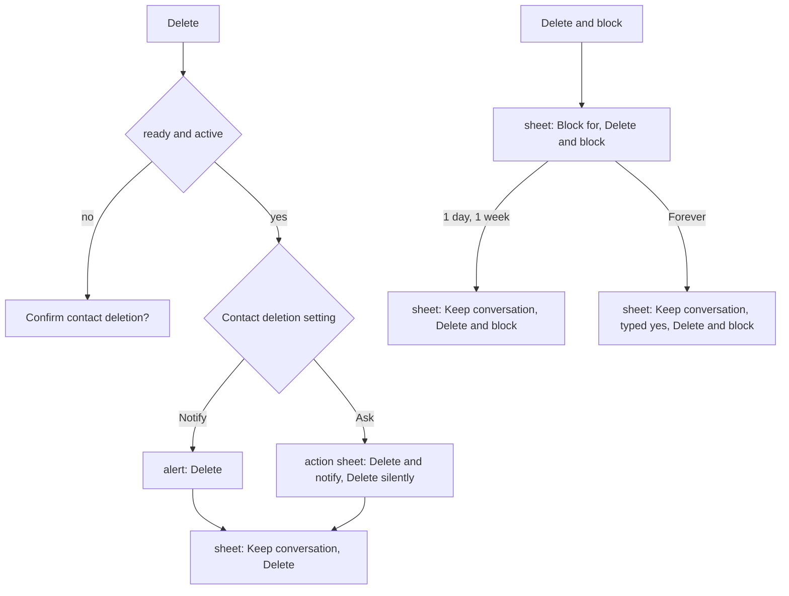

# Connection Flow

> **Related spec:** [spec/api.md](../../spec/api.md) | [spec/architecture.md](../../spec/architecture.md)

## Overview

Establishing contact between two SimpleX Chat users. SimpleX uses no user identifiers; connections are formed through one-time invitation links or permanent SimpleX addresses. Each connection creates unique unidirectional SMP queues, ensuring no server can correlate sender and receiver. Supports incognito mode for per-contact random profile generation.

## Prerequisites

- User profile created and chat engine running
- Network connectivity to SMP relay servers
- For QR code scanning: camera permission granted

## Step-by-Step Processes

### 1. Create Invitation Link

1. User taps "+" button in `ChatListView` -> `NewChatMenuButton` -> "Add contact".
2. `NewChatView` is presented.
3. Calls `apiAddContact(incognito:)`:
   ```swift
   func apiAddContact(incognito: Bool) async
       -> ((CreatedConnLink, PendingContactConnection)?, Alert?)
   ```
4. Internally sends `ChatCommand.apiAddContact(userId:incognito:)` to core.
5. Core creates SMP queues and returns `ChatResponse1.invitation(user, connLinkInv, connection)`.
6. Returns `(CreatedConnLink, PendingContactConnection)`.
7. `CreatedConnLink` contains the invitation URI (both full and short link forms).
8. UI displays:
   - QR code rendered by `QRCode` view (scannable by peer)
   - Share button to send link via system share sheet
   - Copy button for clipboard
9. A `PendingContactConnection` appears in the chat list while awaiting peer.

### 2. Connect via Link

1. User receives a SimpleX link (pasted, scanned, or opened via URL scheme).
2. If opened via deep link: `SimpleXApp.onOpenURL` sets `chatModel.appOpenUrl`.
3. For manual entry: User pastes link in `NewChatView`.
4. First, `apiConnectPlan(connLink:inProgress:)` is called to validate:
   ```swift
   func apiConnectPlan(connLink: String, inProgress: BoxedValue<Bool>) async
       -> ((CreatedConnLink, ConnectionPlan)?, Alert?)
   ```
5. Returns `ConnectionPlan` indicating whether it is an invitation, contact address, or group link, and whether connection is already established.
6. If valid, calls `apiConnect(incognito:connLink:)`:
   ```swift
   func apiConnect(incognito: Bool, connLink: CreatedConnLink) async
       -> (ConnReqType, PendingContactConnection)?
   ```
7. Core creates the connection and returns one of:
   - `ChatResponse1.sentConfirmation(user, connection)` -- for invitation links (type: `.invitation`)
   - `ChatResponse1.sentInvitation(user, connection)` -- for contact address links (type: `.contact`)
   - `ChatResponse1.contactAlreadyExists(user, contact)` -- duplicate
8. `PendingContactConnection` appears in chat list while awaiting peer confirmation.

### 3. Prepared Contact/Group Flow (Short Links)

1. For short links with embedded profile data, the app uses a two-phase flow.
2. `apiPrepareContact(connLink:contactShortLinkData:)` or `apiPrepareGroup(connLink:directLink:groupShortLinkData:)` creates a local prepared chat. `directLink` is `true` for standard group links, `false` for channel relay links.
3. Returns `ChatData` with the prepared contact/group shown in UI before connecting.
4. User can switch profiles or set incognito before committing.
5. `apiConnectPreparedContact(contactId:incognito:msg:)` finalizes the connection.
6. Returns `ChatResponse1.startedConnectionToContact(user, contact)`.

### 4. Accept Contact Request

1. When a peer connects via the user's SimpleX address, core generates a `ChatEvent.receivedContactRequest`.
2. `processReceivedMsg` handles the event, adding a `UserContactRequest` to `ChatModel`.
3. Contact request appears in `ChatListView` as a special `ContactRequestView` row.
4. User taps "Accept":
   ```swift
   func apiAcceptContactRequest(incognito: Bool, contactReqId: Int64) async -> Contact?
   ```
5. Sends `ChatCommand.apiAcceptContact(incognito:contactReqId:)`.
6. Core returns `ChatResponse1.acceptingContactRequest(user, contact)`.
7. Connection handshake proceeds asynchronously.
8. User can also reject: `apiRejectContactRequest(contactReqId:)` -> `ChatResponse1.contactRequestRejected`.

### 5. Connection Established

1. Both sides complete the SMP handshake asynchronously.
2. Core sends `ChatEvent.contactConnected(user, contact, userCustomProfile)`.
3. `processReceivedMsg` updates `ChatModel`:
   - Contact status transitions from pending to active.
   - Chat becomes available for messaging.
4. `NtfManager` may post a notification: "Contact connected".
5. The `PendingContactConnection` in the chat list is replaced by the full contact chat.

### 6. Create SimpleX Address

1. User navigates to Settings or taps "Create SimpleX address" during onboarding.
2. Calls `apiCreateUserAddress()`:
   ```swift
   func apiCreateUserAddress() async throws -> CreatedConnLink?
   ```
3. Core creates a permanent address (unlike one-time invitations).
4. Address is stored in `ChatModel.shared.userAddress`.
5. Can be shared publicly; multiple contacts can connect via the same address.
6. User must accept each incoming contact request individually.
7. To delete: `apiDeleteUserAddress()` removes the address and associated SMP queues.

### 7a. Relay Link Rejection

1. User scans, pastes, or opens a relay address link (URL path `/r` or `SimplexLinkType.relay`).
2. In `ContentView.connectViaUrl_()`: early return with alert "Relay address" / "This is a chat relay address, it cannot be used to connect."
3. In `NewChatView.planAndConnect()`: `.simplexLink(_, .relay, _, _)` pattern triggers the same alert.
4. The link is NOT processed further. No connection is attempted.

### 7a2. Blocked Link (Link Notice)

1. The core stores a notice for the link the user joined or connected through when a group admin removes the user with a block, or a contact or business deletes the user with a block.
2. The plan returns `.contactAddress(.linkNotice(expiresAt, contactSLinkData_))` or `.groupLink(.linkNotice(expiresAt))`; a connect call (`apiConnect`, `apiConnectPreparedContact`, `apiConnectPreparedGroup`, `apiConnectContactViaAddress`) returns `ChatErrorType.linkNotice(expiresAt)`.
3. `showLinkNoticeAlert(_:expiresAt:cleanup:)` in `NewChatView.swift` shows "Not allowed":
   - by target (`LinkNoticeTarget`): group "Blocked by the admins of this group.", channel "Blocked by the owners of this channel.", contact "Blocked by this contact.", business "Blocked by this business."
   - with an end time: "until <time>" before the full stop
   - buttons: OK; How it works opens the user guide section "Blocking members" (`bansGuideLink`)
4. Target: plan `.linkNotice` from the link type, a SimpleX channel name gives channel, and business when the address link data has `business`; `apiConnect` from the link type of the connection link; `apiConnectPreparedGroup` from the group (business chat, channel, group); `apiConnectPreparedContact` and `apiConnectContactViaAddress`: contact.
5. No connection is attempted.

### 7b. Channel Prepared Group Flow

1. When connecting to a channel link (`GroupShortLinkInfo.direct == false`):
2. `apiPrepareGroup(connLink:directLink:groupShortLinkData:)` is called with `directLink: false`, preparing the channel locally.
3. `groupShortLinkInfo.groupRelays` (hostnames) stored in `ChatModel.shared.channelRelayHostnames[groupId]`.
4. Pre-join UI shows channel icon and "Open channel" (not "Open group").
5. `apiConnectPreparedGroup(groupId:incognito:msg:)` returns `(GroupInfo, [RelayConnectionResult])`.
6. `RelayConnectionResult` contains `relayMember: GroupMember` and optional `relayError: ChatError?` per relay.
7. Relay members are upserted to `chatModel.groupMembers`; `channelRelayHostnames` entry is cleared.

### 7. Incognito Connection

1. Before connecting, user toggles "Incognito" in the connection UI.
2. `incognito: true` is passed to `apiAddContact`, `apiConnect`, or `apiAcceptContactRequest`.
3. Core generates a random display name for this connection only.
4. The random profile is stored per-connection; the user's real profile is never shared.
5. Incognito status is shown with a mask icon in the chat.
6. Can also be toggled for pending connections via `apiSetConnectionIncognito(connId:incognito:)`.

### 8. Delete, Archive or Block a Contact

Entry points: "Delete contact" and "Delete and block" in contact info; the chat list swipe "Delete", "Block" and "Archive"; the swipe "Delete" in contact lists and "Block" in Archived contacts. The functions are in `ChatInfoView.swift`.



Delete (`deleteContactDialog`):
1. A contact that is ready and active, archived or not, gets two dialogs.
2. Dialog 1 by the Contact deletion setting (`privacyContactDeletionDefault`): Notify shows "Delete contact?" with Delete; Ask shows "Delete contact?" with "Delete and notify" and "Delete silently". The message: "Contact with **<name>** will be deleted - this cannot be undone!"
3. Dialog 2 (`KeepConversationDialog`): "Keep conversation", Delete, Cancel; the footer "**<name>** will be notified." or "**<name>** won't be notified."; with the user's address: "**<name>** will be notified, and can connect to you again via your address." or "won't be notified, and …".
4. "Keep conversation" off: `apiDeleteChat` with `.full(notify:)`; on: `.entity(notify:)`, and an archived contact stays in Archived contacts.
5. After `.entity`, "Contact deleted!" with "Don't show again" (`showDeleteContactNoticeDefault`): "You can still view conversation with <name> in the list of chats." or, for an archived contact, "You can still view conversation with <name> in Archived contacts."
6. Other contacts: "Confirm contact deletion?" with Confirm, as before.

Archive (`archiveContact`):
1. `apiDeleteChat` with `.archive`: the contact moves to Archived contacts and keeps the conversation.
2. "Contact archived!" with "Don't show again" (`showDeleteConversationNoticeDefault`): "You can send messages to <name> from Archived contacts." or, for a deleted contact, "You can view the conversation with <name> in Archived contacts."

Delete and block (`deleteAndBanContactDialog`), when `Contact.canDeleteAndBan`: the contact is ready and active, connected via the user's address (`Connection.viaUserContactLink`), and supports `LINK_NOTICE_VERSION`:
1. "Delete and block?": "Block for" 1 day (default), 1 week or Forever; "Delete and block"; Cancel; the footer "Contact with **<name>** will be deleted - this cannot be undone!" ("Chat with **<name>** will be deleted for all members - this cannot be undone!" for a business customer).
2. 1 day or 1 week: "Delete and block?" with "Keep conversation"; the footer "**<name>** won't be notified, and can't connect to you for <duration>."
3. Forever: "Delete and block forever?" with "Keep conversation" and a field with the placeholder "Type yes"; "Delete and block" is enabled when the field is "yes"; the footer "**<name>** won't be notified, and can't connect via your address again, except from another app."
4. `apiDeleteChat` with `notify=off` and a `LinkNotice`: the contact is not notified, whatever the setting, and the contact's app does not connect via the user's address for the duration; one-time links are not affected.

## Data Structures

| Type | Location | Description |
|------|----------|-------------|
| `CreatedConnLink` | `SimpleXChat/APITypes.swift` | Contains `connFullLink` (URI) and optional `connShortLink` |
| `PendingContactConnection` | `SimpleXChat/ChatTypes.swift` | Represents an in-progress connection before contact is established |
| `ConnectionPlan` | `Shared/Model/AppAPITypes.swift` | Enum describing what a link will do: connect contact, join group, already connected, etc. |
| `ConnReqType` | `Shared/Views/NewChat/NewChatView.swift` | `.invitation`, `.contact`, or `.groupLink` -- type of connection request |
| `Contact` | `SimpleXChat/ChatTypes.swift` | Full contact model with profile, connection status, preferences |
| `UserContactRequest` | `SimpleXChat/ChatTypes.swift` | Incoming contact request awaiting acceptance |
| `ChatType` | `SimpleXChat/ChatTypes.swift` | `.direct`, `.group`, `.local`, `.contactRequest`, `.contactConnection` |
| `GroupShortLinkInfo` | `Shared/Model/AppAPITypes.swift` | Contains `direct: Bool`, `groupRelays: [String]`, `publicGroupId: String?`; transient data returned by prepare |
| `RelayConnectionResult` | `Shared/Model/AppAPITypes.swift` | Contains `relayMember: GroupMember`, `relayError: ChatError?`; per-relay join outcome |

## Error Cases

| Error | Cause | Handling |
|-------|-------|----------|
| `ChatError.invalidConnReq` | Malformed or expired link | Alert: "Invalid connection link" |
| `ChatError.unsupportedConnReq` | Link requires newer app version | Alert: "Unsupported connection link" |
| `ChatError.errorAgent(.SMP(_, .AUTH))` | Link already used or deleted | Alert: "Connection link removed" |
| `ChatError.errorAgent(.SMP(_, .BLOCKED(info)))` | Server operator blocked connection | Alert: "Connection blocked" with reason |
| `ChatError.errorAgent(.SMP(_, .QUOTA))` | Too many undelivered messages | Alert: "Undelivered messages" |
| `ChatError.errorAgent(.INTERNAL("SEUniqueID"))` | Duplicate connection attempt | Alert: "Already connected?" |
| `ChatError.errorAgent(.CONN(.DUPLICATE, _))` | One-time link already used to connect | Alert: "Already connected?" |
| `ChatError.errorAgent(.BROKER(_, .TIMEOUT))` | Server timeout | Retryable via `chatApiSendCmdWithRetry` |
| `ChatError.errorAgent(.BROKER(_, .NETWORK))` | Network failure | Retryable via `chatApiSendCmdWithRetry` |
| `contactAlreadyExists` | Connecting to existing contact | Alert: "Contact already exists" with contact name |
| `errorAgent(.SMP(_, .AUTH))` on accept | Sender deleted request | Alert: "Sender may have deleted the connection request" |

## Key Files

| File | Purpose |
|------|---------|
| `Shared/Views/NewChat/NewChatView.swift` | Main connection UI: create link, paste link, QR scan |
| `Shared/Views/NewChat/NewChatMenuButton.swift` | "+" button menu in chat list |
| `Shared/Views/NewChat/QRCode.swift` | QR code rendering for invitation links |
| `Shared/Views/NewChat/AddContactLearnMore.swift` | Help text explaining connection process |
| `Shared/Views/ChatList/ContactRequestView.swift` | Incoming contact request display |
| `Shared/Views/ChatList/ContactConnectionView.swift` | Pending connection display |
| `Shared/Views/ChatList/ContactConnectionInfo.swift` | Connection details sheet |
| `Shared/Model/SimpleXAPI.swift` | API functions: `apiAddContact`, `apiConnect`, `apiConnectPlan`, `apiAcceptContactRequest`, `apiCreateUserAddress` |
| `Shared/Model/AppAPITypes.swift` | `ConnectionPlan` enum, `GroupLink` struct |
| `SimpleXChat/APITypes.swift` | `CreatedConnLink`, `ComposedMessage`, command/response types |
| `SimpleXChat/ChatTypes.swift` | `Contact`, `PendingContactConnection`, `UserContactRequest` |

## Related Specifications

- `apps/ios/product/README.md` -- Product overview: Contacts capability map
- `apps/ios/product/flows/messaging.md` -- Messaging after connection is established
