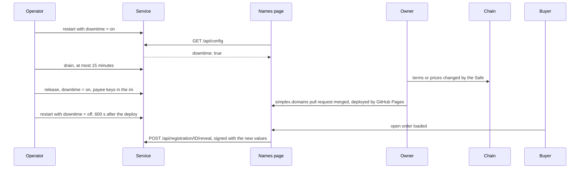

# SimpleX store service

`simplex-store-service` runs the whole store service as one process, two
lanes: a SimpleX chat bot that answers service RPC over a double-ratchet contact
address, and — only when `--service-config` names a `store_service.ini` — the badge-codes
web checkout (BTCPay and Stripe payment, code issuance, the poller). **Without
`--service-config` the web listener does not start at all**; the process still runs the
chat side and nothing else.

The wire protocol for the RPC side is
[`docs/protocol/badges-rpc.md`](../../docs/protocol/badges-rpc.md). The web checkout is
specified in
[`plans/badges-codes/2026-08-27-badge-codes.md`](../../plans/badges-codes/2026-08-27-badge-codes.md),
whose §9 is the `store_service.ini` reference, with the implementation plan in
[`plans/badges-codes/2026-08-31-service-btcpay.md`](../../plans/badges-codes/2026-08-31-service-btcpay.md).
Earlier plans (`2026-07-30-supporter-badges-v3-ux.md`, `2026-07-31-badges-core-implementation.md`,
`2026-08-04-badges-mvp-scope.md`) predate the web checkout and describe the RPC-only
scaffold this service started as.

The names part, its parts and its scenarios are drawn in [`docs/names.md`](docs/names.md).

At this stage the service:

- creates a double-ratchet contact address on first start (service RPC requires DR, see [`docs/protocol/badges-rpc.md`](../../docs/protocol/badges-rpc.md)),
- listens for service requests (`CEvtServiceRequest`) on that address, rejects a request whose `purchaseKey` is not the key the agent verified the signature against, and answers `redeemBadgeCode`,
- issues redemption codes, storing only their `SHA-256` in its code table,
- does not accept contact requests: the address is for RPC only,
- in service mode with `[group]` in the ini, manages one SimpleX group and serves `/issue`, `/bulk`,
  `/revoke`, `/balance`, `/record_refund` and `/close` in it (see [Issuing codes](#issuing-codes)),
- in service mode with `--service-config`, also serves the built web app (`npm run build` in `web/`) on `badges_port` and, with `[names]`, the names site on `names_port` (see [Two sites](#two-sites)), `POST /api/invoice` and `GET /api/invoice/:id`, the BTCPay and Stripe webhook routes, and a payment poller, seeding its price/offer catalog on every start,
- owns the `sx_badge_service_`-prefixed tables and its own migrations table (`sx_badge_service_migrations`).

Every other command answers `unsupported_version`, or `unknown_purchase_key` when the key that
signed it is not one the service has stored — every command but `redeemBadgeCode` needs a
purchase that already exists.

## Build

Build prerequisites and the general contribution flow are in [`docs/CONTRIBUTING.md`](../../docs/CONTRIBUTING.md).

```
cabal build exe:simplex-store-service
```

### Tests on PostgreSQL

The tests are built with `+client_postgres` and run against a PostgreSQL server with
`max_connections=1500`, with `PGHOST` set to its host and `LANG=C.UTF-8`, as CI's job
`test-store-postgres` (`.github/workflows/build.yml`) runs them. They connect as `test_chat_user`
to `test_chat_db`, which they create and drop. With the default 100 connections, examples fail with
"remaining connection slots are reserved"; without a UTF-8 locale, reading the label vectors fails.

```
cabal build --enable-tests --ghc-options -O0 --constraint 'simplexmq +client_postgres' --constraint 'simplex-chat +client_postgres' simplex-chat-test
LANG=C.UTF-8 PGHOST=127.0.0.1 $(cabal list-bin simplex-chat-test --ghc-options -O0 --constraint 'simplexmq +client_postgres' --constraint 'simplex-chat +client_postgres') -m "Supporter badges" -m "SimpleX store service" -m "StoreService names"
```

## Run

```
simplex-store-service --help
```

- default (no `--run-cli`): background service mode, no interactive terminal.
- `--run-cli`: interactive CLI that also processes service requests (mirrors
  `simplex-directory-service --run-cli`). This mode is the chat/RPC side and the `//` commands
  below: it starts no web listener and no poller, and serves no group commands, whatever
  `--service-config` says. It still updates a code's group message when the code is redeemed or
  revoked. `[apple]`, `[google]`, `[dev]` and `[log]` apply to it.
- `--execute COMMAND` (`-e`): `--run-cli` without a terminal, for one command: it runs `COMMAND`,
  such as `//issue name 6`, prints its answer and exits.
- `--no-address`: skip address creation on start-up (for operators who provision the address themselves).
The service cannot sign credentials without an issuer key and refuses to start without one:

- `--issuer-key-idx IDX` — the index the apps find the matching public key under (`badgePublicKeys` in `ChatConfig`).
- `--issuer-secret SECRET` — the issuer secret from `simplex-chat badge keygen`.

The service checks the secret against the configured public key at that index and refuses to start
if they disagree: credentials signed with the wrong key cannot be verified by any client, and the
codes redeemed against them would be spent for nothing.

The key can come from `store_service.ini` instead:

```ini
[issuer]
index = 1
private_key = <secret from `simplex-chat badge keygen`>
```

`index` is the index clients verify against (`badgePublicKeys` in `ChatConfig`), and `private_key`
is the secret that signs. Both are required, and the key is checked at startup like the flags.
Rotating is a change to both and a restart, once clients trust the new index. The service logs the
index it signs with at startup.

The command line wins over the file when both `--issuer-key-idx` and `--issuer-secret` are given.
Note that a secret passed as a flag is visible to every user on the machine through `ps`, where one
in the ini is only as readable as the file: `store_service.ini` is gitignored and already holds the
provider API keys and webhook secrets.

For a local run, where no client key's secret is at hand, `[issuer] dev_keys` lists keys the service
trusts beside the clients' keys, as `<index>:<secret>` entries separated by commas, each secret from
`simplex-chat badge keygen`:

```ini
[issuer]
index = 999
private_key = <secret>
dev_keys = 999:<secret>
```

With `dev_keys`, the service refuses to start:

- unless `[names]` is on and `[chain] chain_id` is 31337, anvil's local chain;
- unless the node at `rpc_url` answers `eth_chainId` with 31337 as the service starts;
- when `[stripe]` holds a live key: `secret_key` must be a test key (`sk_test_` or `rk_test_`), and
  `publishable_key` too (`pk_test_`);
- when `[btcpay]`'s `host` is not on loopback (`127.0.0.1`, `::1` or `localhost`);
- when a dev key has the index of a key clients trust.

So a run with dev keys takes test payments only: Stripe in test mode, and a BTCPay on the same machine,
such as one on regtest. `host` must still be https, so put a TLS proxy in front of a local BTCPay and
have the service trust the proxy's certificate authority with `SYSTEM_CERTIFICATE_PATH`.

It logs a warning naming the dev keys' indexes at every start. Clients never trust a dev key, but the
service's own chat core does, for the badges it receives, so a contact's badge signed by a dev key is
accepted in that run. Leave `dev_keys` out everywhere else.

Other options:

- `--service-config INI_FILE`: path to `store_service.ini`. Omit it to run the chat/RPC side
  only; the process never starts a web listener without it, and never starts one under
  `--run-cli`, which parses and validates the whole file (`[listener]` included) but
  uses only its `[issuer]`, `[apple]`, `[google]`, `[dev]` and `[log]` sections. An issuer key is
  still required either way.
- `--service-name NAME`: the bot's display name, without `*`s or spaces (default `SimpleX Badges`).
- `--client-service`: use the client service certificate.
- also accepts the standard SimpleX Chat core options — database path, SMP/XFTP servers,
  `--socks-proxy`, `--log-level`/`-l`, and the rest — run `simplex-store-service --help`
  for the complete list.

Name links are read for their profiles through an SMP proxy, as the default `--smp-proxy` reads
every link of a server the service does not use, so the service connects to no host a buyer chose.
Onion links, and links whose host name does not resolve on the service's machine, are allowed and
read through the proxy too; an onion link needs Tor on the proxy's relay. A link whose host is or
resolves to a loopback, private or other non-public address is refused before it is read. Leave
`--smp-proxy` and `--smp-proxy-fallback` at their defaults: `--smp-proxy never` or
`--smp-proxy-fallback yes` would connect to a link's host directly.

The service logs to stderr: its routine lines at note level, its warnings and errors at their own.
`[log] level` in `store_service.ini` sets the lowest level printed, one of `trace`, `debug`, `info`,
`note` (the default), `warn` or `error`, in both run modes. The level applies to the whole process,
so below `note` the SMP agent's lines print too. With
`--log-agent` or `-l debug`, the level is set from `-l` instead, `important` counting as `info`.

### Running the web checkout

`store_service.ini` holds the listener bind address, its ports and `badges_static_dir`, an optional
`[btcpay]` section (omitting it disables Bitcoin and Monero), an optional `[stripe]`
section (omitting it disables card payments), an optional `[group]` section (omitting it
turns off the group's commands, though a group created earlier still has its code messages updated),
the poll cadence, optional `[apple]` and `[google]` sections that verify store purchases (see
[Store purchases](#store-purchases-app-store-and-google-play)), and optional `[names]` and `[chain]` sections for the names store (omitting both
turns it off), whose `[chain] service_key` is [the gas key](#the-gas-key). `[chain] rpc_url` must be
https, as it can carry a provider's API key, unless the node is on the same machine (`127.0.0.1`,
`::1` or `localhost`), which `http://` may reach. The service refuses to start when the node there
answers `eth_chainId` with another chain than `[chain] chain_id`, and only warns when it does not
answer, unless `[chain] chain_id` is 31337, whose loopback terms links it takes, or `[issuer] dev_keys`
are set. `[chain] confirmations` (default 3) is how deep a
transaction's receipt must be before the service settles it and reads the chain's state, counting
the receipt's own block, so it must be at least 1. An optional `[community]` section gives what each
community name is for (see [Terms and community names](#terms-and-community-names)). Write every setting as
`key = value`. A line other than a `[section]` header, a setting, a `;` or `#` comment or a blank
line, `key: value` among them, a key written twice in one section, a section header written twice,
or a `[names]` or `[chain]` setting nothing reads, stops the service at startup.
`store_service.ini.example` is the committed template; `store_service.ini` itself is
gitignored, since a real one holds API keys and webhook secrets.

The full walkthrough is in
[`web/README.md`](web/README.md#running-the-real-service-against-this-build). Short version:

```
cd apps/simplex-store-service/web && npm install && npm run build && cd ../../..
cp apps/simplex-store-service/store_service.ini.example apps/simplex-store-service/store_service.ini
cabal run simplex-store-service -- \
  --issuer-key-idx IDX --issuer-secret SECRET \
  --service-config apps/simplex-store-service/store_service.ini
```

`IDX` and `SECRET` must be one of the issuer keys clients already ship, not a fresh
`simplex-chat badge keygen` pair: startup refuses a key no client could verify against.

`trust_forwarded_for` decides what the rate limiter counts. Behind a reverse proxy it must be
`on`, or every request keys on the proxy's address and the whole service shares one bucket of 60
reads and 5 checkouts a minute. Where the listener is reached directly it must be `off`, because
then the header is whatever the caller wrote. The last entry is the one read, which is the one a
proxy appends.
An IPv6 client is counted by its /64, since one host gets a whole /64, and an IPv4-mapped address
by its IPv4 address.
Checkouts that reach the provider (`POST /api/invoice`, each a provider invoice or card
PaymentIntent) are also capped at 5 a minute for
each IPv4 /24 or IPv6 /48, and at 60 card and 30 BTCPay checkouts a minute for all clients together.
A call to BTCPay or Stripe, its body read included, fails as a provider error after 10 seconds, and
after 30 seconds when it creates a checkout's invoice or card payment, which a buyer waits on; the
lookup of the provider's host name is outside that bound. After a timed-out read, cancel or rate
call, the poller asks that provider nothing more in the same pass; a timed-out list stops nothing.
Searches read the chain at most 16 at a time and long polls hold at most 500 at a time, for all clients
together; past that they answer `429 rate_limited` with a short `Retry-After` at once.
Registration views of committed orders read the chain at most 16 at a time as well, each with its
wait for a slot and all its reads within 10 seconds; past that it names its chain fields in `unread`.

The BTCPay API key needs four permissions, each scoped to the one store:
`cancreateinvoice` and `canviewinvoices` for checkout and the poller,
`canviewstoresettings` to log the store's live payment methods at startup and to read the store's
rates for late crypto credits, and
`canmodifyinvoices` so `POST /api/invoice/:id/cancel` can invalidate an invoice at BTCPay
rather than only in this store.

**Keep the right to modify the store's invoices to the store's owners and this API key.** BTCPay
lets whoever has it mark an invoice settled by hand, and the service takes a `Settled` invoice as
paid, so they get the badge code or the name without paying. The service logs `btcpay: invoice <ref>
additionalStatus Marked` at note only when it reads that invoice on its own, not from BTCPay's list.

**Payee keys.** With `[names]`, the service proves each name invoice's Bitcoin or Monero address
from the store's wallet keys, and the names page shows the address only with that proof, checked
against the keys it holds. The keys are set in `[btcpay]`, each pair together or not at all:

- `btc_xpub`: the account extended public key of the store's Bitcoin wallet, as BTCPay shows its
  derivation scheme: a single-signature native SegWit (P2WPKH) wallet, an `xpub` for `bc` or a
  `tpub` for `tb` and `bcrt`, with nothing after it;
- `btc_hrp`: the bech32 prefix of the wallet's network: `bc`, `tb` or `bcrt`;
- `xmr_address`: the primary address of the Monero wallet that BTCPay's view-only wallet watches,
  on mainnet, testnet or stagenet;
- `xmr_view_key`: that wallet's private view key, 64 lowercase hex digits.

A value that does not parse, or one of a pair without the other, stops the service at start,
naming the key. Without a coin's pair, every name invoice in that coin is answered `503
provider_unavailable` before BTCPay is asked, and the start logs `btcpay: [btcpay] sets no btc_xpub
and btc_hrp, so every name invoice in Bitcoin is refused`, or the same for `xmr_address and
xmr_view_key` and Monero. Badge invoices are created and answered as before, with the keys or
without them.

With the keys, the start logs the values the names page holds, at note:
`btcpay: the names page holds: bitcoin receive key <0x and 66 hex digits>; monero primary address
<address>`. The receive key is the public key of the account's receiving branch, `0`. Compare both
with the names page's `MAINNET` before a release (see
[Values the names page holds](#values-the-names-page-holds)).

At a name invoice's creation the service derives its address from BTCPay's `keyPath` (`0/i`) for
Bitcoin, or from its `accountIndex` and `addressIndex` for Monero, and compares it with the address
BTCPay answered. An invoice whose address differs, or whose indices BTCPay does not answer, is
cancelled at BTCPay and answered `503 provider_unavailable`, with the error `POST /api/invoice
(name) failed at the provider: create invoice: <method> on invoice <ref> is not proven from the
payee keys: <reason>; invoice <ref> is cancelled`. The proof is stored with the invoice and
answered in its view as `addressProof`: the Bitcoin key tweak, or the Monero spend tweak and a view
proof (`docs/names.md`, 3.1).

**`speed_policy = HighSpeed` is refused beside `[names]`**: under it BTCPay marks a payment `Settled`
with no confirmation, which a double spend would turn into a free name, and crypto reaching a name
invoice after it closed could never be credited. The service judges each invoice by the policy it was
created with. With `MediumSpeed` (the template's value) or a slower policy, late bitcoin is credited to
the order's balance once confirmed.

A credit is the money's share of the invoice's price: the price times the crypto received, divided by
the crypto the invoice asked, which includes the network fee BTCPay adds (to every Monero invoice, and
to a Bitcoin invoice after a part payment), so the fee is never credited. It is also taken at the
lower of the invoice's rate and the rate when it is credited, rounded down to the cent. So a whole
late payment credits at most the price. A current rate below half the invoice's credits nothing: the
money goes to support for good.

**Overpayment.** Crypto above what an invoice asks is credited to the order's balance in the same
way, once confirmed, also on an invoice paid in time: the extra's share of the price, at the lower
rate. The service logs it at note as `names: invoice <provider reference> was overpaid; credited
<cents> cents of the extra to its order's balance`, and an extra it cannot credit is alerted as late
money is.
An extra still unconfirmed when BTCPay settles the invoice is never credited, as its transaction can
still be replaced: it is alerted, and support refunds it by hand once it confirms.
Crypto sent to a name invoice after the service recorded it paid is not credited either: the poller
logs an error naming the invoice, at most once an hour while it still lists it, and support refunds it
once its transaction is confirmed on chain. The poller lists the invoices created in the last 72
hours and the invoice expiry minutes, and a webhook can name an older one; past that nothing reports
such crypto. Crypto sent to a badge invoice after it was paid is reported by nothing.

BTCPay keeps an invoice it has closed `Expired` (or `Invalid` after a cancel) when money arrives late.
The invoice view reports `paidInFull` on such an invoice only once BTCPay reads it `PaidLate` or
`PaidOver`: BTCPay's paid amount counts unconfirmed payments too, so a due of 0 or less is not
enough. It reports an overpaid invoice's `cryptoAmountDue` as `0`, never below.

**Set the Monero plugin's settled-confirmation threshold (`InvoiceSettledConfirmationThreshold`) to
at least 1.** BTCPay's API does not show how many confirmations a Monero payment has, only that
threshold, so late Monero is credited only on an invoice made while it was 1 or more; it is then
credited as late bitcoin is. Left unset (the plugin's default) or at 0,
every late Monero payment stays pending and goes to support, as under `HighSpeed`. Each invoice
keeps the threshold it was made with, so raising it later credits nothing already paid.

Give the service a BTCPay store of its own, and a Stripe account of its own if card payments are
on. The poller lists every invoice and payment intent of the last three days or so, and one it did
not create and cannot read is reported in a warning once an hour until it falls out of that window.
A BTCPay invoice older than that window, still open here past its expiry, as after an outage of BTCPay
or of the service, is read once more before the service expires it, at most 25 in a pass, and stays
open while that read fails. Those whose read never failed are read first, then the others by their
last failed read, oldest first. A pass reads none of them when its reads of recent invoices all
failed, and no more of them once one fails before any read succeeds, as while BTCPay is down. A
failed read counts only in a pass where other reads succeed, and one that fails so for 24 hours is
expired here, with an error naming it. Without a `[btcpay]` section, such invoices are expired
without a read.

### Card payments (Stripe)

An optional `[stripe]` section enables the card lane; omitting it disables card payments
and `POST /api/invoice` answers `provider_unavailable` for a card order, the same as an
absent `[btcpay]` does for Bitcoin and Monero. Its keys:

- `secret_key` — a **restricted** key (`rk_...`), never a full secret key (`sk_...`). Grant it
  **PaymentIntents: write**, to create and cancel intents, plus **Charges: read** — the poller
  reads an intent with `expand[]=latest_charge`, and Stripe rejects the whole read if the key
  lacks read on an expanded object (settlement then falls back to the slower list pass).
- `publishable_key` (`pk_...`) — the public key the browser mounts the Payment Element with.
- `webhook_secret` (`whsec_...`) — the signing secret of the `/webhooks/stripe` endpoint,
  configured in the Stripe Dashboard alongside it.
- `session_minutes` — how many minutes an unpaid card order stays open (1 to 1440, default 60).
  Ten minutes after that, the service cancels the payment at Stripe, and retries if that fails.
  If the order is over 72 hours old and the cancel has kept failing for an hour, the service marks
  it expired and logs an error. Check such orders in the Stripe Dashboard. After a restart, the
  hour starts again.

The service refuses to start when `secret_key` and `publishable_key` are not both live keys or both
test keys (`sk_test_` or `rk_test_`, and `pk_test_`). With `[names]`, it also refuses test keys
unless `[chain] chain_id` is 31337, anvil's local chain, or 11155111, Sepolia, so no name on another
chain is registered for a test payment. Without `[names]`, test keys are accepted, as a staging
deployment of badges needs.

The service creates each payment intent with `metadata[order]`, the order's reference. A badge
order's is its id, which the page shows the buyer as "Reference" (`invoice_id` in
`sx_badge_service_invoices`); a name order's is `name:0x<order hash>` (`order_hash` in
`sx_badge_service_name_registrations`). Neither is a secret, and support finds an intent's order
from it in the Dashboard.

The create also sends an `Idempotency-Key` of that reference with the amount and currency. The
page sends a name order again as it was, so a resend after the first answer was lost gets the
intent the first create made, not a second one. Stripe keeps a key's first answer for 24 hours and
replays it, an error included. A replayed error, or a replayed intent that has been cancelled since
(the service cancels the intent of an order it could not write), is not passed on: the service
creates the intent again without the key. A badge order's reference is new on every request, so
its key never repeats.

A PaymentIntent waiting for a card is cancelled once its last 3 charges were all declined (the log
line is `stripe: intent <id> is cancelled after 3 declined card payments in a row`), so stolen cards
cannot be tried on it one after another, and the buyer starts a new checkout. Add Radar rules in the
Dashboard too, such as blocking a card fingerprint or IP address that has failed several times.

Both pages read `publishable_key` from `GET /api/config`, which every port answers with
`{"mode": "open" | "codes", "stripePublishableKey": "pk_…" | null}`, so the ini is the only place
the key is set and the built pages are served as they are. With no `[stripe]` section the key is
`null` and the page shows its development stand-in card form. The dev mock
(`web/mock/server.py`) answers the same route from `$STRIPE_PUBLISHABLE_KEY`, since it runs
without an ini.

`POST /webhooks/stripe` verifies `Stripe-Signature` against `webhook_secret` and queues a
read, the same hint-only role as `POST /webhooks/btcpay`: the poller carries authority, so
an unverified or unreadable delivery costs nothing but a log line. A delivery signed more than
15 minutes away from the server's clock is refused with a warning, so keep the clock synced (NTP).
The endpoint's events in the Dashboard are `payment_intent.succeeded`,
`payment_intent.payment_failed` and `payment_intent.canceled`, and with `[names]` also
`charge.dispute.created`, `charge.refunded` and `radar.early_fraud_warning.created`.

A dispute or a refund of a name order's payment is acted on at its delivery, as no read finds it:
- an order paid and live, of which no register transaction of its current name was saved, is
  closed with `closedBy` `reversed`, its name released and nothing credited to its balance, also
  after support refunded part of its balance; a register of a name selected before a reset does not
  keep it;
- an order whose payment is not recorded yet is closed the same way when its payment settles,
  instead of being queued;
- any other order is kept, and the reversed cents are taken back from its balance, as far as the
  balance and the invoice's amount hold them; an order whose refund support recorded is kept as
  it is;
- an order with a recorded dispute or refund is credited nothing more, its price included when
  it is taken or its month ends, and a late credit concurrent with a dispute of its order is
  written after it.

The order's invoice row counts them and keeps the total reversed and the last one's event id and
cents, a refund as the rise of `amount_refunded`; a repeated delivery of the last event
changes nothing. Every dispute, refund and early fraud warning of a name order is logged at
error and posted in the managed group as `names: <event> on payment <pi_...> of order <id>:
<outcome>. Evidence: <payment>; <owner and order hash>; <signed registration>; <commit and register
transactions>`, the evidence for the answer to Stripe. A delivery whose handling fails is answered
500, so Stripe delivers it again; a badge order's dispute or refund changes nothing.

The reverse proxy in front of this service must send a Content-Security-Policy that
allows Stripe.js and its iframes, since Stripe forbids bundling or self-hosting its
script:

```
script-src 'self' https://js.stripe.com https://*.js.stripe.com;
frame-src https://js.stripe.com https://*.js.stripe.com https://hooks.stripe.com
```

The full policies of both sites are in [Caddy](#caddy).

**Stripe Link must be disabled in the Dashboard.** Left on, it needs `link.com` in the
CSP above and reintroduces an email prompt of its own, which this design otherwise avoids.

**Enable card only; do not enable redirect-based methods** (iDEAL, Bancontact, PayPal, and
the rest) in the Dashboard. The embedded checkout sends no `return_url`, which Stripe requires
the moment a redirect-based method is offered, so enabling one makes every checkout fail to
create. The service pins the Stripe API version it was built against, so the account's default
version does not affect the card lane.

### The checkout endpoints

The browser in `web/` is the only client of the `/api` routes; the two webhooks below are the
providers', one each for BTCPay and Stripe.
The invoice id is the only credential for reading or cancelling a badge order (a name order's
requests are signed with its name key, as [Order requests signed with the name key](#order-requests-signed-with-the-name-key) states): it is 16 random bytes,
it travels in the path, and anything that logs request paths logs it. It is also what the buyer
is shown as their reference and asked to quote, so support sees it: losing it lets someone cancel
an invoice, which is why the code, which lets them take the badge, is never printed until the
service says the invoice is paid. The service keeps it out of its own logs: a line about an invoice
names the provider's reference (the BTCPay invoice id or the Stripe PaymentIntent id), which opens
nothing in this service's API. A line about a name order without its invoice, from the worker or
`//record_refund`, names the registration id, which opens nothing in the API without the order's
name key. Keep the logs to the service's operators all the same.

| Route | Answers |
|---|---|
| `POST /api/invoice` | `{invoiceId, badgeType, months, amount, currency, expiresAt}` plus a destination: `clientSecret` for a card, or `address`, `cryptoAmount`, `cryptoCurrency`. Refuses with `code_conflict`, `catalog_changed`, `bad_request`, `provider_unavailable` or `rate_limited`. |
| `GET /api/invoice/:id` | `{status, badgeType, months, amount, currency, expiresAt}` and the same destination — no `invoiceId`, since the caller already has it — plus `amountPaid`, `cryptoAmountPaid`, `cryptoAmountDue`, `paidInFull`, `settledAt` and `requiredConfirmations` once each has a value. Never the code, which this service has never seen. |
| `GET /api/invoice/:id?wait=<status>&seenPaid=<figure>&seenFull=<0\|1>` | The same, held for up to 30 seconds while the invoice's status is still `<status>` **and** its payment is the one the caller says it has rendered. `wait=paid` and any value that is not a status answer at once, since neither can change. A status the caller has not seen, or a payment it has not seen, answers at once — the provider's verdict counts as much as the figure, because Monero reports an invoice as confirming while its figures are still zero. A request that omits `seenPaid` holds on the status alone. |
| `POST /api/invoice/:id/cancel` | Invalidates an open invoice at the provider and expires it here. Refuses a settled or expired one with `not_open`, and one that already holds a payment with `funded`. The provider is told first, and a payment landing in between does not keep the invoice open: nothing can reach that address any more, so the row is expired either way and the poller settles or reports what arrived. |
| `POST /webhooks/btcpay` | Verifies `BTCPay-Sig` over the bytes as received and queues a read. A hint only: the poller is what carries authority, so an unverified or unreadable delivery costs nothing but a log line. |
| `POST /webhooks/stripe` | Verifies `Stripe-Signature` over the bytes as received and queues a read. The card lane's equivalent of the row above, and a hint just the same: the poller carries authority, so an unverified or unreadable delivery costs nothing but a log line. A name order's dispute, refund or early fraud warning is acted on at once (see Stripe above). |

Every refusal is `{"type": "<code>", …}`, with its data beside the code, such as
`{"type": "catalog_changed", "price": 1500}`. Besides the codes above, any of them can answer
`internal`, an unknown id answers `not_found`, and a wrong verb answers `method_not_allowed` —
ten codes in all, which is what the browser's `WIRE_ERROR_CODES` lists. The two webhook routes are
the exception: each answers 200, 400, 413 or, for a name order's dispute or refund not handled, 500 with an empty body, because its provider is the only
caller and nothing it could read would change what the route does. A wrong verb on any route, those
two included, answers `method_not_allowed`.

### Store purchases (App Store and Google Play)

Each store is verified only when its section is present; without one, every receipt from that store
is answered `provider_not_configured` and the app keeps the purchase to present again. A section
missing a key, a root certificate that cannot be read or is not a root, an unreadable service
account key, or either section beside
`[dev] accept_unverified_store_receipts = on`, stops the service at startup.

```ini
[apple]
bundle_id = chat.simplex.app
root_certificates = /etc/simplex-store-service/AppleRootCA-G3.cer
api_key_id = 2X9R4HXF34
api_issuer_id = 57246542-96fe-1a63-e053-0824d011072a
api_private_key_file = /etc/simplex-store-service/AuthKey_2X9R4HXF34.p8

[google]
package_name = chat.simplex.app
service_account_file = /etc/simplex-store-service/play-service-account.json
```

- `[apple]` verifies the signed transaction offline, against the roots `root_certificates` lists,
  comma-separated, each in DER. Today that is Apple Root CA - G3 as Apple publishes it at
  <https://www.apple.com/certificateauthority/AppleRootCA-G3.cer>. Each must be self-signed.
  Verification reads no validity period, so an expired root keeps verifying. A transaction for
  another bundle id, or an intermediate no listed root signed, is answered `internal` and logged as
  an error rather than refused, since `bundle_id` may be wrong or a root missing; check both when those errors appear, unless the purchase was made in Xcode's
  StoreKit testing, which the App Store does not sign, so no root verifies it. When Apple signs
  under a new root, list it beside the old one rather than in its place: a purchase signed under the
  old root still verifies, and one answered `internal` meanwhile is credited when the app presents
  it again.
- With `api_key_id`, `api_issuer_id` and `api_private_key_file`, `[apple]` also verifies
  subscriptions: it asks the App Store Server API for a subscription's status, with a token signed
  by the in-app purchase key App Store Connect issued (the `.p8` file, its key id and the
  account's issuer id), and checks what Apple signed in the answer against the same roots. Without
  them, one-time purchases verify as before and every subscription is answered
  `provider_not_configured`. The three are set together or not at all. `api_host` defaults to the
  production host, `https://api.storekit.itunes.apple.com`, which answers nothing about a Sandbox
  transaction; a test deployment with `[dev] credit_test_purchases = on` (below) sets
  `https://api.storekit-sandbox.itunes.apple.com`. The service refuses to start with any other host,
  or with the Sandbox host while `credit_test_purchases` is off, as the Sandbox never charges anyone;
  the host's case and a trailing slash do not matter. A 401 or 403
  from Apple, the key refused, is answered `internal` and logged. Keep the key file readable by this
  service alone.
- `[google]` asks the Google Play Developer API about each purchase and subscription, and
  acknowledges it before crediting it, as the service account whose JSON key
  `service_account_file` holds. The account needs both Play Console permissions Google's
  [getting started](https://developers.google.com/android-publisher/getting_started) lists for its
  billing APIs: "View financial data, orders, and cancellation survey responses" to read a
  purchase, and "Manage orders and subscriptions" to acknowledge it. Without the second, a Play
  purchase the app has not already acknowledged itself is answered `internal` and logged as an
  error naming the acknowledgement, and the app presents it again once the permission is granted,
  which must be within three days, before Play refunds it. The key signs in
  for an access token, so keep the file readable by this service alone.
  A request that may ask a store waits on a lane of its own: Play purchases, App Store
  subscription purchases and transfers of a subscription (Restore) on one, and issue requests and
  tier raises for a subscription due its hourly store check on another. A slow or unreachable
  store therefore delays only those, not code redemptions, App Store one-time purchases or other
  renewals; and no purchase or transfer, genuine or made up, delays a renewal check. The purchase
  path asks Play about at most 300 subscriptions a minute (a purchase it credits is read once more
  to acknowledge it), so made-up tokens can spend at most a tenth of the quota renewal checks share.

While a subscription's paid coverage runs, as an annual plan's does for a year, the service asks
its store before it issues each new month, at most once an hour. When the store reports the
subscription ended, or the charge the service granted revoked, the months not yet issued are debited
as a refund and the badge ends with the month already issued; a store that fails or does not answer
ends nothing. A Play refund that leaves the subscription active is not seen: the service does not
read Play's voided purchases.

Which answers are terminal for a purchase and which leave it to be presented again is listed per
store in [`docs/protocol/badges-rpc.md`](../../docs/protocol/badges-rpc.md#commands).

The root certificates, the App Store Server API key and the Play service account key are read only
at startup, so rotating any of them takes a restart. Until then the old key keeps being used, and
each request the store refuses it for is answered `internal` and logged as an error.

Do not roll back the `20261012_badge_subscriptions` migration on a database that holds store
subscriptions. Its down migration drops their columns without refusing: every subscription becomes
a prepaid purchase that is never renewed, every Play purchase token is lost, and every ledger with a
charge, transfer or tier-change row can no longer be read, so its purchase answers `internal`.
Upgrading again restores none of it. Take a backup first if a rollback is unavoidable.

#### Store setup

The subscriptions must be sold under the ids the apps buy and the service credits, and set up as
follows:

- [ ] App Store: one subscription group holding all four subscriptions, so a change of tier or plan
  keeps the original transaction id, and with it the purchase.
- [ ] App Store levels: `SUBSCR_BADGE_LEGEND_MONTH_01` and `SUBSCR_BADGE_LEGEND_YEAR_01` at level 1,
  `SUBSCR_BADGE_SUPPORTER_MONTH_01` and `SUBSCR_BADGE_SUPPORTER_YEAR_01` at level 2. Apple charges a
  move to a higher level at once, and the apps send only Supporter to Legend as a raise.
- [ ] App Store: Billing Grace Period off, and Family Sharing off, which cannot be turned off once on:
  a family-shared subscription is refused.
- [ ] Play: the product `subscr_badge_supporter_01` with the base plans
  `subscr-badge-supporter-month-02` and `subscr-badge-supporter-year-01`, and the product
  `subscr_badge_legend_01` with `subscr-badge-legend-month-01` and `subscr-badge-legend-year-01`.
  A charge for any other base plan is not credited, and a charge for one of these under the other
  product is answered `internal`.
- [ ] Play, on each of the four base plans: Resubscribe off, pausing off, the minimum grace period,
  and account hold on.
- [ ] Both: no offers of any kind: no free trial, introductory or promotional price, or offer code.
  The service credits no App Store charge made with an offer and no Play charge in a free trial or
  introductory price.

### Accepting store receipts unverified, for local testing

```ini
[dev]
accept_unverified_store_receipts = on
```

Without a store verifier every store purchase is answered `provider_not_configured`. With this on,
the service accepts any well-formed receipt without asking or verifying anything: an Apple JWS for
the `transactionId` and `productId` its payload names, unsigned or not, and a Play product id and
token as given. It applies to both run modes, since `--run-cli` answers service requests too, and
the service logs a warning at every start while it is on, and refuses to start when the issuer key
is at an index clients trust, as any receipt would then mint badges they accept. Off by default, and only `on`/`off`
parse. The service refuses to start with it on beside an `[apple]` or `[google]` section.

It answers subscriptions too, each as renewing, charged from a minute before the check for the
length of its plan:

- an App Store subscription: the plan its product names;
- a Play subscription: the base plan a test token `test.<basePlanId>.<uuid>` names, when it is a
  plan of the product (the apps' test products sign their tokens so), or else the product's
  monthly base plan, so a licence tester's purchase is credited too;
- an App Store tier raise: a charge for the raised plan, which its renewals then charge;
- a renewal: a new charge for the plan it last charged. It keeps that plan in memory only, so after
  a restart it answers a renewal of a subscription it credited before as ended, and the unissued
  months of a plan still covered are refunded at its next month.

It acknowledges nothing, so Play refunds a licence tester's subscription it credited once Play's
acknowledgement window lapses.

With it on, anyone who can reach the service address can mint badges by sending a made-up receipt.
The service starts only with an issuer key released apps trust, so they accept every badge it
mints this way, and a subscription credited so renews at every check for as long as the process
runs. Never turn it on where anyone but you can reach the service.

```ini
[dev]
accept_unverified_store_receipts = on
check_store_during_coverage = on
```

With `check_store_during_coverage` on as well, the service asks its store, the mock or a real one
with `credit_test_purchases` on (below), at every `issueBadge` for a subscription, rather than at
most once an hour and only when a month is due. A charge it reports during coverage is banked: a
charge row, the plan's months added to what is left and a later paid-through date, and those
months are issued once coverage reaches them; a deployment without the setting only records it.
So a renewal shows at once, though its credential waits for the paid month to end on the service's
clock, and after a restart the mock answers the subscription ended at once, so the months banked
are refunded. The mock charges anew at every
check, so every such request banks the plan's months again; space requests over a minute apart, as
the mock dates a charge a minute back and the app fails a ledger row dated before the one it
follows. The service logs each banked charge as
`store subscription charge banked: <n> months`, which tells a banked month
from a repeated `badge issued`. Off by default, and the service refuses to start with it on unless
`accept_unverified_store_receipts` or `credit_test_purchases` is on: a real store has not started
its next charge while coverage runs, and asking it then would spend the quota every subscriber
shares.

### Crediting test purchases, for testing against a real store

```ini
[dev]
credit_test_purchases = on
```

A purchase the store itself calls a test, an App Store Sandbox purchase (which TestFlight builds
buy in) or a Play licence tester's, is refused `test_purchase` by default, which is terminal, so it
can never be credited. With this on, the service credits it as a real one, one-time purchases and
subscriptions alike. It applies beside a real `[apple]` or `[google]` section, which still verifies
every receipt, and changes nothing beside `accept_unverified_store_receipts`, whose mock reports
no test purchase. The service logs a warning at every start while it is on, and at every test
purchase and test subscription it takes as paid. Off by default, and only `on`/`off` parse.

Beside `[apple]` the service starts with it on only when `[apple]` sets the server API key with
`api_host = https://api.storekit-sandbox.itunes.apple.com`: a Sandbox receipt verifies offline like
any other, so beside the production host, or without the key, Sandbox purchases would be credited as
real ones. Beside `[google]` it is allowed, as Play calls a purchase a test only for the licence
testers the Play Console lists.

```ini
[dev]
credit_test_purchases = on
check_store_during_coverage = on
```

With both on, the real store is asked at every `issueBadge` for a subscription, as above, to watch
its renewals by hand: a Sandbox subscription renews every few minutes.

The service starts only with an issuer key released apps trust, so they accept every badge it
credits this way. Nothing tells a production `[google]` from a test one, so never turn this on
beside the production Play app's `[google]`, or every licence tester the Play Console lists gets a
badge without paying.

## Deployment

`scripts/store-service/` holds the production deployment: the image (`Dockerfile`, built from
the repository root), `compose.yml` and the ini template `store_service.ini.example`; `dev/` holds
the scripts of the dev setup and the webapp's cases. The service
runs with `+client_postgres` and host networking, and serves the API and the webhooks. A second
container, `webapps`, copies both built sites into `scripts/store-service/webapps/`, as `badges/`
and `names/`, at every `docker compose up` and exits; one Caddy serves `badges/` and proxies the
API to the service, while GitHub Pages serves the names page (see [Caddy](#caddy)). The service
writes no file of either site.

`webapps` is built from the same `Dockerfile` (target `webapps`) and runs
`rsync -rlpt --delete-after --delay-updates`: every new file is renamed into place at the end, so
Caddy never serves a shell whose assets are missing, and then what the build no longer has is
deleted. The folder must exist before `docker compose up`, owned by `USER_UID`, which the
container runs as: `install -d webapps`.

`compose.yml` mounts the folder `scripts/store-service/config/` read-only at
`/etc/simplex-store-service`. It holds `store_service.ini`, and the App Store root and the Play
service account key when `[apple]` and `[google]` are configured. The folder must exist before
`docker compose up`: compose refuses to start rather than create it empty.

On PostgreSQL the service holds an advisory lock on its database for as long as it runs, so a second
process on the same database, `--run-cli` included, stops at start with `another store service holds
this database`: two would send with the gas key's nonces and run the chat agent's queues together. Stop
the service before the console. The lock is held by a database connection of its own, and PostgreSQL
releases it when that connection ends, as on a PostgreSQL restart. The service checks the connection
every 30 seconds and exits when it fails, with `Error: the instance lock's database connection
failed: …`. Compose's `restart: unless-stopped` then starts it again, and each start takes the lock
or exits while another process holds it.

### Restoring the database

A database restored from a copy loses every row written after the copy, and the service re-derives
none of them. The service's tables are in the chat's schema, so the chat agent's state goes back to
the copy too, and SimpleX warns that an older copy of a chat database may stop receiving messages
from some contacts. Before the service starts on it:

1. Wait until the gas key has nothing in the node's pool: `cast nonce $REGISTRAR --block latest`
   equals `cast nonce $REGISTRAR --block pending` (see
   [Check the balance and transactions in flight](#check-the-balance-and-transactions-in-flight)). The
   service numbers a new transaction after the key's mined transactions and the ones the copy saved,
   so a transaction in the pool that the copy does not hold can have the same nonce.
2. Record again, with `//record_refund` in `--run-cli` or `/record_refund` in the group, each refund recorded after the copy: the copy holds
   those balances unrefunded, so they could be refunded twice. The service logged each as
   `names: recorded a refund of <cents> cents for order <registration id>`.
3. Revoke with `//revoke` each code spent or revoked after the copy, which the copy holds unspent, and
   issue again each code issued after it, which the copy does not hold, so it answers `code_invalid`.
   The service logs no code: a code issued in the group is in the group's history on the members'
   devices, and one issued with `//issue` only where it was copied when printed.
4. List at BTCPay and in the Stripe Dashboard the invoices and payments created after the copy's
   time. The service holds no row for them, so it records no payment to them: its poller's list
   skips them without a line, and a webhook naming one is logged at note with
   `no invoice holds provider_ref <ref>`. Support settles each paid one by hand.

After the start, a contact or a group member whose messages no longer arrive is resynchronised in
`--run-cli` with `/sync @<contact>` or `/sync #<group> @<member>`. The orders the copy holds resume
from the chain: the worker reads each commitment before it commits, and judges a register that does
not go through with `confirmLanded` (see
[When funds or the allowance run out](#when-funds-or-the-allowance-run-out)).

### Upgrading from the badge service

The rename to StoreService changed what the operator runs:

| Before | After |
|---|---|
| `scripts/badge-service/` | `scripts/store-service/` |
| compose service `badge-service`, image `simplex-badge-service` | compose service `store-service`, image `simplex-store-service` |
| `badge_service.ini` | `store_service.ini` |
| the folder `config`, mounted read-only at `/etc/simplex-badge-service` (before it, `badge_service.ini` alone, mounted at `/etc/simplex-badge-service/badge_service.ini`) | the folder `config`, mounted read-only at `/etc/simplex-store-service` |
| `[apple] root_certificates` and `[google] service_account_file` under `/etc/simplex-badge-service/` | the same files under `/etc/simplex-store-service/` |
| the binary `simplex-badge-service` | `simplex-store-service` |
| `port = 8080` | `badges_port = 8080`, the default, which can be omitted |
| `static_dir = /srv/web` | `badges_static_dir = /srv/badges`, the image's build and the default, which can be omitted in Docker |
| `webapp_export_dir = /srv/webapp`, host folder `web` | removed: the `webapps` container writes host folder `webapps`, with `badges` and `names` in it |
| `names_hosts`, the hosts that got the names site by `Host` | `names_port = 8081`, the default: the names site on its own port (see [Two sites](#two-sites)) |

The service refuses to start with a key from the left column, naming the key that replaced it.
Move `scripts/badge-service/config/` to `scripts/store-service/config/` (a deployment from before
the config folder creates it and moves `badge_service.ini` into it), rename `badge_service.ini` in it
to `store_service.ini`, and change its keys and paths as the table says, the
`/etc/simplex-badge-service/` files under `[apple]` and `[google]` among them. Where Caddy runs on the
same machine, also set `[listener] host = 127.0.0.1`: an ini copied from the earlier template binds
`0.0.0.0` with `trust_forwarded_for = on`, so a caller reaching the port past Caddy picks its own rate
limit bucket. Point Caddy's badges root at
`scripts/store-service/webapps/badges`, which the `webapps` container fills; create
`scripts/store-service/webapps` first, as [Deployment](#deployment) says. Compose names a project after its
folder, so the new `store-service` project does not see the old `badge-service` container, which
would keep running on the same port and database: stop it first, from `scripts/badge-service/` or
anywhere with `-p`. The image builds the names site from the `apps/simplex-domains` submodule, a
badge-only service included, so fetch it before the build:

```
docker compose -p badge-service down
git submodule update --init ../../apps/simplex-domains
docker compose up -d --build
```

from `scripts/store-service/`. The database `badge_service`,
`BADGE_DB_CONN`, the `sx_badge_service_` tables and the chat database prefix
`simplex_badge_service` are unchanged.

A badge-service database upgrades in place: the store's own migrations run after every badge
migration, `20261012_badge_subscriptions` included; `20261013_names` marks each existing
invoice `badge` and copies its provider reference into the invoices table, which holds every
invoice's reference from then on; a badge invoice's stays in its badge row too. A database that ran the names migrations of
an earlier draft (`20261010_names`, or that draft's steps dated after `20261013_names`) does not start, as
the service refuses to roll back migrations it does not list. A database that ran `20261013_names`
before it created `sx_badge_service_name_terms` starts without that table, and every terms read
fails. Recreate such a database.

A database that a build of the `names` branch ran keeps `20261013_names` as that branch wrote it,
in a shape this service does not read. It is upgraded in two steps:

1. From master's `scripts/badge-service/`, run the badge service once without `--yes-migrate`, and
   answer `y` when it asks to roll back `20261013_names`:

   ```
   docker compose run --rm badge-service -d "$BADGE_DB_CONN" --create-schema --service-config /etc/simplex-badge-service/badge_service.ini
   ```

   It runs the down migration that the database stored with `20261013_names`: the names tables
   and the columns that migration added to the payments table are dropped, and the badge tables
   and their rows stay. With `--yes-migrate` it refuses the rollback and exits. Stop it once it
   runs.
2. Deploy this service as [Deployment](#deployment) says. It applies `20261013_names`.

### Two sites

Both images carry the badges build at `/srv/badges` and the names build at `/srv/names`: the
`webapps` image to copy them out for Caddy, and the service's for `serve_webapp = on`, where they
are the defaults of `badges_static_dir` and `names_static_dir`; a run outside the image sets both. The names
site (simplex.domains) comes from the `apps/simplex-domains` submodule, the simplex.domains
repository, and is configured beside the badges site in `[listener]`. Fetch the submodule before
building the image:

```
git submodule update --init apps/simplex-domains
```

A new names site ships by moving the submodule to its commit and committing that here:

```
git -C apps/simplex-domains fetch origin
git -C apps/simplex-domains checkout <commit>
git add apps/simplex-domains
```

`.gitmodules` names `branch = sh/names-webapp`, the branch of simplex.domains#6, which is not merged
yet; it only sets what `git submodule update --remote` fetches, and moves to the main branch once
that pull request merges. The commit committed here is what builds.

The names site is on when, and only when, the ini has `[names]`. Its `[listener]` keys:

- `names_static_dir`: the names build, by default `/srv/names`, the image's;
- `names_port`: the port the names site is served on when `serve_webapp = on`, by default 8081,
  beside `badges_port` (by default 8080), which serves the badges site. The two must differ.

The service refuses to start with any of these keys but no `[names]`, and with `names_port` and
`serve_webapp = off`. It also refuses to start when a build it serves is not a directory, naming
the setting, so a local run that keeps a default path stops there. It never writes to either build:
the badges page reads its Stripe publishable key from `GET /api/config`, and the names page holds
its deployment's values and reads only `names.downtime` there (see
[Values the names page holds](#values-the-names-page-holds)). In production the names page is served
by GitHub Pages, not by this host (see [Caddy](#caddy)).

With `serve_webapp = on` (all in one), the service listens on both ports, and each serves only its
own site: every path outside `/api/` and `/webhooks/` is a file of that site, `/` and `/index.html`
its shell. Both ports answer `/api/` and `/webhooks/`, whatever the `Host`. A reverse proxy sends
each domain to its own port, as the all-in-one example in [Caddy](#caddy) does. With
`serve_webapp = off`, the service listens on `badges_port` alone, for the API and the webhooks. With
`metrics_port`, it also listens on `127.0.0.1` on that port, for `/metrics` alone.

### Development with a local chain

`compose.dev.yml` adds two containers, so a dev deployment needs nothing on the host but Docker:

- `chain`: an anvil chain on `127.0.0.1:8545` (chain id 31337) with the names contracts, deployed
  on its first start. Its state is kept in `./data/chain`, so restarts keep the contracts, balances
  and registered names. Its keys are anvil's public test keys, so never use it beside a real chain.
- `postgres`: PostgreSQL 17 on `127.0.0.1:5433`, user `simplex`, database `store_service`, without a
  password, kept in `./data/postgres`. `BADGE_DB_CONN` in `.env` points the service at it.

From a fresh clone:

```
git clone https://github.com/simplex-chat/simplex-chat && cd simplex-chat
git submodule update --init apps/simplex-domains
cd scripts/store-service
printf '%s\n' COMPOSE_FILE=compose.yml:compose.dev.yml BADGE_DB_CONN=postgresql://simplex@127.0.0.1:5433/store_service > .env
install -d webapps
docker compose up -d --build
```

The names site is then on `http://127.0.0.1:8081` and the badges site on `http://127.0.0.1:8080`,
served by the service itself.

On its first start, the chain writes `config/store_service.ini` for its deployment, unless the file
exists; it never rewrites it, so edits there are kept. The file serves both sites all in one, with
`[names]` on the `.simplex` TLD, `[chain]` at the local chain with 1 confirmation, and `[issuer]`
signing with a public test key at index 999, which no client trusts, through `dev_keys`. That key is
in `dev/chain.sh`, as public as anvil's: never use it elsewhere. The service starts once the chain
and the database are healthy. `USER_UID` and `USER_GID` in `.env` (by default 1000) own the file,
mode 600, and its folder, mode 700.

Names are paid for with prepaid codes, so no payment provider is needed. To issue one, stop the
service and run its console against the dev database:

```
docker compose stop store-service
docker compose run --rm store-service -d postgresql://simplex@127.0.0.1:5433/store_service --run-cli --service-config /etc/simplex-store-service/store_service.ini
```

There, `//issue name 6` prints a code for one name of 6 letters or more (see
[From the command line](#from-the-command-line)). Leave with `/quit`, then
`docker compose start store-service`.

The service key's account starts with 10,000 ETH and a sponsor allowance. To top it up, or set any
account's balance:

```
docker compose exec chain chain.sh topup [address] [eth]
```

Registrations wait 10 seconds after their commit (`MIN_COMMITMENT_AGE` in `compose.dev.yml`).

Card payments in Stripe's test mode: uncomment `[stripe]` in `config/store_service.ini` (as the
`USER_UID` user, or with `sudo`), put in the test keys and the webhook secret, which
`stripe listen --forward-to 127.0.0.1:8080/webhooks/stripe` prints, and run
`docker compose restart store-service`. With `dev_keys`, the service refuses live keys, and a
BTCPay that is not on loopback.

To start over, delete the containers and every dev state together, since orders in the database
point at names on the chain. `./data` belongs to root and to Postgres's user, so:

```
docker compose down
sudo rm -rf data config
```

### Caddy

The Caddyfile is not in this repository. Its two host blocks, with `serve_webapp = off` and the
service at `127.0.0.1:8080`; `/path/to/webapps` stands for the folder the `webapps` container
writes, `scripts/store-service/webapps` of the checkout:

```
badges.simplex.chat {
	encode zstd gzip
	header Content-Security-Policy "default-src 'self'; script-src 'self' https://js.stripe.com https://*.js.stripe.com; frame-src https://js.stripe.com https://*.js.stripe.com https://hooks.stripe.com; connect-src 'self' https://api.stripe.com; img-src 'self' https://*.stripe.com; frame-ancestors 'self' https://simplex.chat https://*.simplex.chat"

	@backend path /api /api/* /webhooks /webhooks/*
	handle @backend {
		reverse_proxy 127.0.0.1:8080
	}

	handle {
		@assets path /assets/*
		header @assets {
			Cache-Control "public, max-age=31536000, immutable"
			match status 2xx
		}
		@rest not path /assets/*
		header @rest Cache-Control "no-cache"

		root * /path/to/webapps/badges
		file_server
	}
}

api.simplex.domains {
	encode zstd gzip
	header {
		Strict-Transport-Security "max-age=63072000"
		X-Content-Type-Options "nosniff"
	}

	@backend path /api /api/*
	handle @backend {
		reverse_proxy 127.0.0.1:8080
	}

	handle {
		respond 404
	}
}
```

- The names page is served by GitHub Pages at simplex.domains, and its card page at
  pay.simplex.domains, each from its repository (simplex.domains README, "Hosting"); this host
  serves the names API alone, at api.simplex.domains. The DNS credentials of simplex.domains are
  kept off this host: Caddy obtains the certificate of api.simplex.domains by an HTTP or TLS-ALPN
  challenge, its default.
- The badges site calls `/api/*` on its own origin. The names page calls api.simplex.domains, on
  another origin: every `/api/` answer carries `Access-Control-Allow-Origin: *` and
  `Access-Control-Expose-Headers: *`, so the page reads `Date` and `Retry-After`, and `OPTIONS` on
  any `/api/` path is answered 200 without a body, before the rate limits, with
  `Access-Control-Allow-Methods: GET, POST, OPTIONS`, `Access-Control-Allow-Headers: *` and
  `Access-Control-Max-Age: 86400`. The webhooks answer without them. An answer Warp writes for a
  handler's exception, a 500, carries none.
- `/webhooks/*` is proxied on badges.simplex.chat only. BTCPay and Stripe send every event there,
  names payments included.
- `/assets/*` file names carry a content hash, so they are kept a year, and only when found: a
  missing asset is a 404 that is not cached. Everything else, the shell and `/sw.js` among them, is
  `no-cache`, since the shell names the build's hashed files and Caddy's `file_server` sends no
  `Cache-Control` of its own.
- There is no `try_files` fallback to `index.html`: the badges page routes not by path but by
  `?order=` and `#…`, and the fallback would answer a missing `/assets/*` file with the shell,
  status 200, kept a year under that asset's URL.
- The badges policy is `web/README.md`'s.

With `serve_webapp = on`, the service serves both sites itself, as in development, so the badges
host block proxies everything to `badges_port`, keeping its policy header:

```
badges.simplex.chat {
	encode zstd gzip
	reverse_proxy 127.0.0.1:8080
	# the Content-Security-Policy header of the badges.simplex.chat block above
}
```

The service then sets each file's type and `Cache-Control` itself: `no-cache`, and a year for
`/assets/*`.

### Metrics

`[listener] metrics_port` turns on the store's Prometheus metrics. It is off when the key is
absent and must differ from `badges_port` and `names_port`. The service answers `GET /metrics` on
`127.0.0.1:<metrics_port>`, whatever `host` is, so only the machine itself reaches it:

```ini
[listener]
metrics_port = 9300
```

Each scrape counts invoices, badges and, with `[names]`, name orders, transactions, balances and
record edits in the database. With `[names]`, the registrar key's ETH balance, its sponsor
allowance, the node's latest block and the terms links are read from the node at start and then
every minute, and a scrape answers the last read, so a slow or failing node never delays a scrape.
A part that fails keeps its last value, sets `simplex_store_names_chain_read_ok` to 0 and logs a
warning. When the metrics port cannot be listened on, the failure is logged as an error and, with
`[group]`, posted in the managed group, and the rest of the service runs on without metrics.

| Metric | Value |
|---|---|
| `simplex_store_invoices_open{provider}` | open invoices of badges and names, by provider: `crypto` (BTCPay) or `stripe`; 0 for a configured provider with none |
| `simplex_store_invoices_overdue{provider}` | those of them past their expiry and its 10-minute grace with no money received; the poller expires each once the provider answers, so a count that stays up means the provider cannot be read or the invoice cancelled there |
| `simplex_store_provider_list_ok_timestamp_seconds{provider}` | when the poller last listed the provider's open invoices successfully, every one or two minutes at the default `idle_seconds`; absent until the first list |
| `simplex_store_provider_webhook_timestamp_seconds{provider}` | when the provider last delivered a webhook that verified; absent until the first one |
| `simplex_store_badges_purchases{status}` | badge purchases by status: `acquiring`, `issued`, `superseded` or `failed`, each 0 when it has none |
| `simplex_store_badges_subscriptions{state}` | App Store and Google Play subscriptions paying for badges, by state: `renewing`, `cancelled`, `billingRetry` or `ended`, each 0 when it has none |
| `simplex_store_badges_codes_open` | badge codes paid or free, not revoked or expired, with redemptions left |
| `simplex_store_names_orders{phase,reason}` | name orders in the phase: `unpaid`, `closed`, `queued`, `committing`, `committed`, `registering`, `registered`, `taken`, `ended` or `failed`; the queue is `queued` to `registering`, while `closed` counts unpaid orders closed with their invoice, kept for 30 days, and `failed` every failed order not tried again, by `reason`: `registry_refused`, `signature_refused`, `month_ended` or `unread`, each 0 when it has none |
| `simplex_store_names_queue_oldest_change_timestamp_seconds` | the last change, in Unix seconds, of the order unchanged longest among those the service moves on: `queued`, `committing`, `registering`, and `committed` with the page's reveal stored; absent when there is none |
| `simplex_store_names_unregistered_oldest_selected_timestamp_seconds` | the oldest selection of a name among the live orders `queued`, `committing`, `committed`, `registering` or `failed`: a payment's settlement, a code order's placement, or a selection after a reset; a month-ended order not counted; absent when there is none |
| `simplex_store_names_transactions_pending` | registrar transactions sent and not settled, one per nonce, so a fee replacement counts once |
| `simplex_store_names_transactions_oldest_pending_timestamp_seconds` | when the oldest of them was first signed; absent when none is pending |
| `simplex_store_names_invoices_open` | open invoices of name orders |
| `simplex_store_names_record_edits_pending` | record edits relayed and not settled |
| `simplex_store_names_record_edits_oldest_pending_timestamp_seconds` | when the oldest of them was made; absent when none is pending |
| `simplex_store_names_registrar_balance_wei` | the registrar key's ETH balance, as last read |
| `simplex_store_names_sponsor_allowance_cents` | its allowance left on the sponsor, in cents, rounded down, as last read |
| `simplex_store_names_chain_head_block` | the node's latest block number, as last read |
| `simplex_store_names_chain_head_timestamp_seconds` | that block's time |
| `simplex_store_names_chain_base_fee_wei` | that block's base fee per gas |
| `simplex_store_names_max_fee_per_gas_wei` | the fee cap, `[chain] max_fee_per_gas` |
| `simplex_store_names_terms_held{kind}` | 1 when the service holds the text of the `general` or `community` terms the name policy links, 0 while it cannot fetch it, so names of that kind cannot be ordered; absent while the policy links none |
| `simplex_store_names_chain_read_timestamp_seconds` | when every part of the read last succeeded |
| `simplex_store_names_chain_read_ok` | 1 when the last read succeeded in every part, 0 when a part failed or none has finished |
| `simplex_store_names_month_pass_timestamp_seconds` | when the last month pass that completed started, every 5 minutes; the service's start until the first one completes |
| `simplex_store_names_credit_pass_timestamp_seconds` | when the last late credit pass that completed started, every `idle_seconds`; the service's start until the first one completes |
| `simplex_store_names_ended_pass_timestamp_seconds` | when the last ended sweep that completed started, every hour, a sweep whose block read failed not completing (see [Dispute days](#dispute-days)); the service's start until the first one completes |

With `[names]`, the service also counts every name on chain, however it was registered, at start and
then every 5 minutes, under the metric names of the former `simplex-names-exporter`. At the latest
block it reads the base registrar's names (`totalSupply`, `tokenByIndex`), keeps those whose
`nameExpires` is after the block's time, takes each label from `labelOf`, then walks the subname
registrar (`subnameHook()`) level by level with `getChildren`, keeping subnames whose `ownerOf` is
not zero. For each name it reads `resolver(node)` on the registry and, on the configured resolver,
its `simplex.contact` and `simplex.channel` texts. The reads run 16 at a time at that one block. A
failed read keeps the last one and is counted.

| Metric | Value |
|---|---|
| `simplex_names{level,records}` | live names at `level` 2 (`alice.simplex`), 3 (`shop.alice.simplex`) and below, by `records`: `none`, `contact`, `channel`, `both`, or `other_resolver` for a name whose resolver is not the configured one, whose records are not read; names in the 90-day grace period are not counted |
| `simplex_name_length` | histogram of label lengths in characters, by `level`, a bucket for each length 1 to 63 |
| `simplex_names_block` | the block the names were read at |
| `simplex_names_refresh_timestamp_seconds` | when the names were last read |
| `simplex_names_refresh_failures_total` | counter of failed reads of the names since the service started |

Every metric is a gauge, but for the names' histogram and counter. A stuck order, an order whose name is not
registered 3 hours after its selection, a registrar key that cannot pay for a register with links, a
base fee above the fee cap, a stuck transaction or record edit, a node that cannot be read or
has stopped following the chain, terms that cannot be shown, a payment provider that cannot be
read, names on chain that cannot be counted, a month pass, late credit pass or ended sweep that stopped
completing and a scrape that fails, such as while the database cannot be read, show as:

```
time() - simplex_store_names_queue_oldest_change_timestamp_seconds > 1200
time() - simplex_store_names_unregistered_oldest_selected_timestamp_seconds > 10800
simplex_store_names_registrar_balance_wei < 10000000000000000
simplex_store_names_chain_base_fee_wei > simplex_store_names_max_fee_per_gas_wei
time() - simplex_store_names_transactions_oldest_pending_timestamp_seconds > 900
time() - simplex_store_names_record_edits_oldest_pending_timestamp_seconds > 900
simplex_store_names_chain_read_ok == 0
time() - simplex_store_names_chain_head_timestamp_seconds > 120
simplex_store_names_terms_held == 0
time() - simplex_store_provider_list_ok_timestamp_seconds > 600
simplex_store_invoices_overdue > 0
increase(simplex_names_refresh_failures_total[20m]) > 2
time() - simplex_store_names_month_pass_timestamp_seconds > 1200
time() - simplex_store_names_credit_pass_timestamp_seconds > 600
time() - simplex_store_names_ended_pass_timestamp_seconds > 7800
up == 0
```

`up` is the scrape's own metric, for the job that scrapes the service. The names are counted every
5 minutes, so more than 2 failures in 20 minutes means most counts failed. Until a month pass, late
credit pass or ended sweep completes, its gauge is the service's start time, so its alert also fires
when every pass fails from the start. The ended sweep runs hourly, so its alert fires after two
passes in a row did not complete.

The overdue count can be above 0 for a few seconds between an invoice's grace ending and the next
poller pass, so its alert waits, as with `for: 10m`. Mainnet makes a block every 12 seconds, so a
head older than 2 minutes means the node has fallen behind.

An order moves on within minutes: its commit and register are each mined and confirmed, and the
register waits about a minute after the commit. An order tried again can wait unchanged up to
`reveal_margin_seconds` (900 by default) for its old commitment to lapse, so the queue alert's
threshold is above it. Every 5 minutes the service also logs an error and, with `[group]`, posts in
the managed group, once for each order whose name was selected 3 hours ago or more, at its payment's
settlement, its code's placement or a selection after a reset, and still `queued`, `committing`,
`committed`, `registering` or `failed`: `names: order <id> had its name selected at <time> and is <phase>, not registered, 3
hours later`. An order whose name is not selected is not alerted, and the 3 hours are counted again from each later selection. When its name is no longer available on chain, the service logs an
error and posts in the group once: `names worker: registration <id> was taken: its name is no longer
available on chain`. An order taken at settlement, as someone has taken its name, is logged
as a note. The alert rule fires for any phase. Below 0.01 ETH the node refuses a register with links (see [Fund the key](#fund-the-key)),
and while the base fee is above the cap no transaction is signed; size a warning on the balance and the
allowance to the orders expected before a top-up, with the figures there.

Caddy proxies it on the monitoring site of the host, beside node_exporter, inside that site's
`handle_path /metrics/*` block:

```
handle_path /store_service* {
	rewrite * /metrics
	reverse_proxy http://127.0.0.1:9300
}
```

Prometheus then scrapes `/metrics/store_service` on that site.

### Terms and community names

The controller's name policy (`SimplexNamePolicy`, read from `namePolicy()` once at startup and
logged, or on first use when that read fails or finds none, or after a register reverts
`TermsNotAccepted`) holds the links of two sets of terms:
`generalTermsLink()`, the general terms, and `communityTermsLink()`, the community terms. It keeps
the list of community names, which the contracts' owner edits on chain and the guardian
can add to. A listed name is sold under the community terms, which include the general terms that
apply to it, and any other name under the general terms. A name is registered only after its owner
accepts the current terms of its kind on chain, once.

**Upgrading:** remove `[names] terms_version` and `terms_url`. Nothing reads them now, and the
service refuses to start with any `[names]` or `[chain]` setting it does not read.

A later `setNamePolicy` takes effect for the service after a restart, so restart it
at once. Until then the service reads the reservations, the list, the terms and the nonces from the
old policy, so an order of a name the new policy reserves ends taken. Each order whose acceptance
went to the old policy fails one register, `TermsNotAccepted`, and its page signs again; the first
such failure makes the service read `namePolicy()` again, so the page signs for the new policy.

A community name is registered for 2 paid years, plus the free days before `[names] term_start`,
whatever years `[names] years` or its prepaid code gives, since the controller registers a community
name for at most 1095 days.

Each link names one file at one commit of simplex-chat/simplex-chat, on git.simplex.chat or GitHub,
optionally with the sha256 of the file's bytes:

```
https://git.simplex.chat/simplex-chat/simplex-chat/raw/commit/<40 lower-case hex>/<path>[#sha256=<64 lower-case hex>]
https://raw.githubusercontent.com/simplex-chat/simplex-chat/<40 lower-case hex>/<path>[#sha256=<64 lower-case hex>]
```

The path is one or more segments of letters, digits, `_`, `-` and `.`, separated by `/`, with no empty,
`.` or `..` segment, and ends in `.md`. Without the fragment, the commit alone pins the file. The terms'
hash, which orders sign and the policy records with each acceptance, is the keccak256 of the link. With
`[chain] chain_id = 31337` and a node of that chain id, the service also takes a link of a file on this
machine, `http://127.0.0.1:<port>/<path>#sha256=<64 lower-case hex>`, always with the sha256, as the dev
scripts set.

The service reads both links at one block for each request that needs them, so a change on chain
applies at once. It fetches each text once, without the link's fragment, following no redirect, within
10 seconds: a `200` answer of at most 256 KB, valid UTF-8, with the link's sha256 when the link has
one. It keeps each text by its hash, in memory and in the table `sx_badge_service_name_terms`, and
fetches one at a time. A stored text is read before any fetch and used only when it is valid UTF-8
with the link's sha256, if any, so a restart while the links' host is down keeps the texts fetched
before it. The table is empty after the upgrade to this version, so its first start needs that host
to fetch them; a stored text that fails the check is logged and fetched again. A text that cannot be stored is logged and kept in memory only. After a failed fetch it fetches no text for 30 seconds, or for longer, up to an
hour, when the answer's `Retry-After` asks, and logs why. `GET /api/terms/<hash>` answers
`{"link", "text"}` for the hash of either current link, `404` for any other hash or a link the service
does not take, and meanwhile `503 terms_unavailable` with `Retry-After` for a text not fetched yet.

The terms of a name's kind are unavailable while their link is not set, is not a link the service
takes, or has a text the service cannot fetch now. An available name's search answer then carries
`"terms": null`, and an order, a code order or a selection of such a name answers
`503 terms_unavailable` before any payment, with `Retry-After` while the fetch waits. The service
logs both links and their hashes at startup, and warns for each that is not set or not a link it
takes. A names lane reads or fetches both texts at the start and then every hour. A search reads the links only for an available name, and
waits for its text within the search's deadline. To change the terms,
the contracts' owner calls `setGeneralTerms(link)` or `setCommunityTerms(link)`; an order signed
under the old terms is asked to agree again before its reveal.

`[community]` gives what each community name is for, one line per name: the label, as it is searched,
then `=` and the text:

```
[community]
bakers = bakers and bakeries in Portugal
```

Search answers carry a listed name's text, and the registration view the text of an order that signed the community terms, which the page shows with the
name as a community name. A name the policy lists without a line here shows as a community name
without a text, and the service warns at startup, when it reads the policy, for each line naming a
name the policy does not list, which is sold as a plain name. Each label must be a valid name in lower case and listed once; each text is
1 to 200 characters with no control, format or line separator characters, and should not end with a
full stop, since the page adds one. The service refuses to start, naming the setting, on any other
entry, on `[community]` without `[names]`, on a key written twice in a section and on a section
header written twice in the file. It logs
how many community names it loaded.

The `[community]` texts are read only at startup, so an edit applies after a restart; the policy's
list and its terms apply as soon as they change on chain. After a restart, search each listed name on
the names site and check that it shows as a community name.

Every order signs the terms the buyer agreed to: the 64 lower-case hex digits of the hash of the
terms of the name's kind, without `0x`, after `community/` for a listed name. The request sends them
as `terms` in its `fields`, `{"communityName": true, "termsHash": "0x…"}`. The service stores them
with the order, so an open order keeps the terms it signed after a change; a selection of a name is
signed with the current terms for that name, which are stored with it. An order or a selection signed with any other
value answers `409 terms_changed` with the current terms of the name's kind, `{"hash", "link"}`, and
the name's community entry, and the page asks again; an order signed with a terms version, as pages
before signed, meets it once. An exact resend is still answered after the terms changed.

**Upgrading:** a page that sends no `terms` gets `bad_request` on every order and selection of a name, so the
page and the service are deployed together.

On chain the order is the same for every name: the service commits, the page signs the reveal, the
service registers. With the reveal the page signs the acceptance of the terms of the name's kind for
the commitment, `AcceptGeneralTerms` or `AcceptCommunityTerms`, at the policy's nonce and the
reveal's deadline, and the service relays it with `commitUnderGeneralTermsWithSig` or
`commitUnderCommunityTermsWithSig` as soon as the reveal is stored, then registers. A relay or a
register refused for the acceptance (new terms, a used nonce), an acceptance of the other kind of
terms, or one signed for the name policy before a `setNamePolicy`, clears the reveal, and the page
signs again. A relay that reverts while the policy holds that acceptance for the commitment, as when
another sent it first, is followed by the register. The page signs the reveal and the acceptance
with a deadline a week ahead, the latest the service accepts, so it keeps them across a lapse while the deadline has not
passed and the sponsor nonce is unchanged: it commits again and registers with no new signature. The
intent does not cover the secret; the service replaces the stored reveal at a selection of a name and clears it at a close.

### Codes-only launch

`[names] codes_only = on` lets only prepaid codes register names, as for the launch to the investors
who hold them before anyone can pay. It is `off` by default. While it is on:

- `GET /api/config` answers `"mode": "codes"` in place of `"open"`, and the names page then offers
  only codes. The badges site ignores the mode;
- `POST /api/invoice` for a name answers
  `403 {"type": "codes_only"}`, before it reads the order,
  so no order takes money for a name;
- search, the signing read, link previews, code checks, code orders (`POST /api/name/register`),
  the registration view, `find`, the reveal, `/retry`, the selection of a name and record edits work as before. Webhooks and the
  poller still settle the invoices already open, and badges sell as before.

The setting is read at startup, so switching it is an edit of the ini and a restart, with the same
build. Codes for investors come from the group (needs `[group]`, see
[From the group](#from-the-group)) or from `//issue name` in `--run-cli` (see
[From the command line](#from-the-command-line)).

### Order requests signed with the name key

A request that names a name order is signed with the order's name key, the key of its owner's name
code. The names page signs each one, polls included.

| Route | Signed |
|---|---|
| `GET /api/registration/:id` | `read` |
| `POST /api/registration/:id/retry` | `retry` |
| `GET /api/invoice/:id`, a name invoice | `read` |
| `POST /api/invoice/:id/cancel`, a name invoice | `cancel` |
| `POST /api/registration/:id/name` | the selection's own signature |
| `POST /api/registration/:id/reveal` | the owner's `RegisterName` |

- The message is `simplex.domains order <id> <action> <timestamp>`, with the route's id and the
  timestamp in seconds, signed as `find` is, with EIP-191 `personal_sign`.
- A `GET` sends `timestamp` and `signature` as query parameters, beside `seenVersion` and the
  invoice's `wait` parameters; a `POST` sends them as fields of its JSON body.
- A timestamp more than 600 seconds from the service's clock is answered `400 bad_request` before
  the id is looked up, as `find` answers it.
- An unsigned request, one signed by another key, or for another id, action or timestamp, and one
  for an unknown id all get the same answer, `404 not_found`, after the same rate limit.
- A selection or a reveal with a malformed body is answered `400 bad_request`, and in a downtime a
  selection `503 downtime`, before its id is looked up; one signed by another key is answered as one
  for an unknown id; its other refusals come after its signer is checked.
- Only a signed read counts as the page's read of an order, which keeps a committed order from
  failing as `unread`.
- A badge invoice is read and cancelled unsigned, as before.

### Values the names page holds

The names page holds every value on which the destination of a buyer's signature or payment
depends, in its code (`webapp/src/config.ts` `MAINNET` in simplex.domains), and reads only
`names.downtime` from `GET /api/config`. Of this service's settings it holds these, so each changes
only with a page release:

- `[names]` `term_start`, `years`, `codes_only` and `tld`;
- `[chain]` `chain_id` and the contract addresses;
- the payee keys of `[btcpay]`: the receive key of `btc_xpub`, `btc_hrp`, and `xmr_address`;
- `[stripe] publishable_key`.

It also holds the chain's terms and prices, the name policy's and the base registrar's addresses,
and the dispute days of each method.

### Changing a value the names page holds

A held value other than a payee key changes in a downtime: the service enters it first, and the
page follows at its next read of `/api/config`.

1. Restart the service with `[names] downtime = on`.
2. Drain: the worker registers the queued orders with their stored reveals, and the providers settle
   the payments in progress. Wait until `simplex_store_names_queue_oldest_change_timestamp_seconds`
   is absent, or for 15 minutes.
3. The Safe's signers execute the chain changes, signed before step 1: terms by `setGeneralTerms` or
   `setCommunityTerms`, prices by the price oracle.
4. Release the service from its prepared, tested pull request, still with `downtime = on`, with new
   payee keys in BTCPay and the ini.
5. The owner merges the simplex.domains pull request with the new values, and its `pages` job deploys
   the page; with a new Stripe key, the card page's repository moves to that merge.
6. Once step 5's `pages` jobs have completed and 600 seconds have passed, the `max-age` GitHub Pages
   serves with, restart the service with `downtime = off`.
7. Buyers' pages sign the open orders again.
8. The owner merges a pull request here that moves `apps/simplex-domains` to step 5's merge.

With `downtime = on`:

- `GET /api/config` answers `names.downtime: true`, and the start line `names: on, …` ends with
  `, downtime: name invoices, code orders and selections are refused`;
- a name invoice (`POST /api/invoice` for a name), a code order (`POST /api/name/register`) and a
  selection of a name (`POST /api/registration/:id/name`) are answered `503 {"type": "downtime"}`
  before their orders are read;
- reveals, `/retry`, reads and cancels are answered as before, and the worker, the poller and the
  webhooks run as before.

Step 7: the worker clears a stored reveal that the current values refuse, and the order waits,
committed, for its page to sign again: after a change of `[chain] chain_id` or `sponsor`, its
`RegisterName`, logged at warning as `names worker: registration <id>: its stored signature is
refused under the service's current configuration, …, so its page signs again`, and after a change
of the terms or the name policy, its acceptance. The buyer's page, loaded after step 5, signs
the order again with the new values; a commitment past its age is committed again through the page's
`/retry`, and an order its page has not read for 3 days fails as `unread` until its buyer's Continue.
A change of `[chain] resolver` or `[names] tld` changes every open order's commitment, so those orders
cannot be signed again: the drain runs without the 15 minutes' cap, and support closes a paid order
still open after it with `//close` once its commitment lapses.



### Rotating a payee key

A payee key changes without a downtime, as the page holds a list of each coin's keys:

1. A page release adds the new Bitcoin receive key or Monero primary address beside the old one.
2. BTCPay and the ini's `[btcpay]` keys switch to the new wallet, and the service restarts; its
   start line names the new values.
3. Once the old wallet's last invoice has expired, a page release removes the old key.

### Price floor

Prices come from the chain, as the controller's `rentPriceUSD` answers them, with one exception:
`[names] min_price_cents_per_year` (default 5000, at least 1, read at startup) is the lowest price, in
cents a year, at which the service sells a name. A chain price under it for the name's paid years
fails the price read, and the service logs a warning with the price:

- a search answers `503 provider_unavailable`;
- an order answers `503 name_check_unavailable` before any payment;
- a selection of a name after a reset, for an order paid by invoice, answers `503 name_check_unavailable`.

A name selected after a reset, for an order paid by invoice, must have the order's price, as an order's name
must have the price its page showed: a dearer or a cheaper one answers `409 catalog_changed` with the
name's price. The price is spent from the order's balance, and a balance that no longer holds it,
refunded or taken back at a dispute, answers `400 bad_request`.

No price is read for a code order or for a name selected for one, so the floor does not apply to them. The default is the
launch price of a name of 8 letters or more, $100 for 2 years. One floor bounds every length, so a
node answering the floor price for a 6- or 7-letter name passes the check even when those names
cost more on chain. To lower prices on chain below the floor, lower the setting and restart first.

### Dispute days

Each name the sponsor registers has a dispute period, within which the guardian or the controller's
owner can end the registration if a payment for it is disputed, reversed or refunded in full. Its
length in days is set when the order is made, by how the order is paid:

| Payment | Days |
|---|---|
| card | 120 |
| BTC, XMR or another BTCPay method | 14 |
| prepaid code | 14 |

A name selected for a taken order keeps the order's payment, and so its days. The order's
`disputeDays` are returned in the registration view, signed by the owner in `RegisterName` with the
reveal of the order or of the selection, and sent by the service in `registerWithCredit`; a reveal
signed over other days is refused `400 bad_request`. Once the name is registered, the view's
`registered` phase has `disputeUntil`: the registrar's `disputeUntil(id)` read at the confirmation
depth, absent for a registration without a dispute period.

The registrar's `disputeUntil(id)` is changed only by `unregister`, which ends a registration within
its dispute period, and by a later registration of the name. Every hour the service reads the block
at the confirmation depth and, at that block, `disputeUntil(id)` of each registered order whose
dispute period has not ended or ended less than 7 days ago, if its registration is older than that
block. When the value differs from the one read at the registration, the order's phase is set to
`ended`, and it stays `ended` when the name is registered again. An order whose read fails is read
again at the next pass, and the other orders are read in the same pass; when the block cannot be
read, the pass is stopped and does not complete (see [Metrics](#metrics)). The first failed read of
each pass is logged once, with its order's registration id, and a failed block read with the pass
stopped. Each order set `ended`, by the pass or by the check below, is logged at note with its
registration id, the `disputeUntil(id)` read and the end it was compared with.

When an order's register is found mined, by the worker or by `//close`, `disputeUntil(id)` at the
confirmed block is compared with the end set by its register, its block's timestamp plus the order's
days; when the two differ, the registration was ended before the confirmed block, possibly followed
by another, and the order is set `ended` at once, with the expiry and the dispute end set by its
register stored: its block's timestamp plus the order's duration, and plus its days. While the
register's block is above the confirmed block, a warning naming both blocks is logged and the order
is left as it is: the worker checks it again 15 seconds later, and `//close` answers `Nothing
recorded: the chain could not be read; run //close again.` The view's phase of an ended order is
`{"type": "ended"}`; its stored times are kept.

This version runs against the contracts with the dispute period (ens-contracts #51): the service
calls the sponsor's `registerWithCredit` with `disputeDays` and the registrar's `disputeUntil`.

### Link edits

Each "Edit links" save is one request, relayed by the service as one transaction whose gas it pays
(see [The gas key](#the-gas-key)): one changed link as `setTextWithSig`,
both links as the resolver's `multicall` of two `setTextWithSig` calls, which lands both or neither.

A request whose earliest signed deadline is within 10 minutes of the latest block's time is refused
(`400 bad_request`) before any row or gas: a closer deadline could pass while the transaction waits
for the sender's fee replacements (36 seconds apart), and the edit would revert after paying gas. The
names page signs a deadline one hour ahead.

`[names] record_edits_per_year` (default 3, from 1 to 100, read at startup) bounds them per name in
any 365 days:

- each accepted request counts once, from when it is stored to be sent, whether it changes one link
  or both;
- links set at registration ride on the register transaction and count nothing;
- an edit that reverts on chain (or expires) counts as well, since its transaction may have paid
  gas, so the limit bounds repeats of failing edits too;
- a request refused before any transaction, a dry run that reverts, and a send the chain fails count
  nothing;
- an exact resend of an accepted request is answered as before and counts nothing more.

When a name has none left, `POST /api/name/records` answers
`409 {"type": "edit_limit", "nextAt": <ISO time>}` before any chain read, and the search answer
for the name has `found.records.edits: {"left": 0, "nextAt": …}`, from which the page shows when the
owner can edit again. Lowering the setting keeps the edits already counted. The hourly cap of 10
relayed requests per name still applies.

### The gas key

`[chain] service_key` is the registrar key: an Ethereum account (EOA) that sends every names
transaction, `commit` to the controller, each name's terms acceptance (`commitUnderGeneralTermsWithSig` or `commitUnderCommunityTermsWithSig`) to the name policy, `registerWithCredit` to the sponsor, and the owners' record
edits (`setTextWithSig`, or a `multicall` of two) to the resolver. It pays
only their gas, in ETH. The names' rent is spent from its allowance on the sponsor, in USD, which the
guardian sets. It holds no names.

The commands run from `scripts/store-service/` on the service host, with Foundry's `cast`
([getfoundry.sh](https://getfoundry.sh), checked with 1.5.1) and `jq`. They read the ini through this
shell function, which takes a `[chain]` key's value without surrounding spaces, tabs or a CR:

```
ini() { sudo sed -n "/^\[chain\]/,/^\[/s/^$1[[:space:]]*=[[:space:]]*\([^[:space:]]*\).*/\1/p" "${2:-config/store_service.ini}"; }
```

Keys and the RPC URL are read through `ini`, so they stay out of the shell history. A key is in
cast's arguments, and the RPC URL in curl's, visible to `ps` while it runs.

The ini is never edited in place. `sudoedit` refuses a file in a directory the invoking user can
write (sudo(8), sudoers(5) `sudoedit_checkdir`), as `scripts/store-service/config/` of the checkout is.
`sudo <editor>` would leave swap or backup files holding the key beside it, which git does not
ignore. So each change is made in a copy in a root-only directory and copied over the ini, which
keeps its owner and mode. `next/store_service.ini` and
the other copies below are ignored by git, as every `store_service.ini` is, and are outside the
image.

#### Create the key

Fill `[names]` and `[chain]` in a copy, with a `service_key = 0x...` line under `[chain]`. Then
generate the key into that line, so it is never printed, and put the copy in place:

```
sudo install -d -m 700 next && sudo cp -p config/store_service.ini next/store_service.ini
sudoedit next/store_service.ini
cast wallet new --json | jq -r '"s/^service_key[[:space:]]*=.*/service_key = " + .[0].private_key + "/"' | sudo sed -i -f - next/store_service.ini
cast wallet address "$(ini service_key next/store_service.ini)"
sudo cp next/store_service.ini config/store_service.ini && sudo rm -r next
```

The address check prints the key's address, as in `0xB2590B3a4fa5bEdda803F5f1F605803438C3F71E`, and
fails when the line was not replaced. The key is `0x` and 64 hex digits in either case.

The ini holds the only copy of the key. It is gitignored, every `*.ini` is kept out of the image,
and compose mounts its folder read-only. Keep it owned by the service user with mode 600. The
service never logs the key; keep it out of logs and tickets too.
If a key was ever shown on a terminal, clear the screen and its scrollback (`clear && printf
'\e[3J'`, and `tmux clear-history` in tmux), and never show one in a recorded session.

#### Set up the shell

```
export ETH_RPC_URL="$(ini rpc_url)"
CONTROLLER=$(ini controller)
SPONSOR=$(ini sponsor)
REGISTRAR=$(cast wallet address "$(ini service_key)")
```

cast reads the node from `ETH_RPC_URL`, so no command below names it. The address check reads the
ini on disk, not the running service, which logs no address. To confirm the service runs with the
key, check that `cast nonce $REGISTRAR --block pending` rises after its next transaction.

#### Grant the allowance

Only the guardian, the controller's beneficiary, can set the allowance:

```
cast call $CONTROLLER 'beneficiary()(address)'
```

The guardian sends this call to `$SPONSOR`, with no value, from whatever wallet holds its key. Its
calldata, here for $1,000:

```
cast calldata 'setRegistrarAllowance(address,uint256)' $REGISTRAR $(cast parse-units 1000)
```

```
0x7f8ac8b8000000000000000000000000b2590b3a4fa5bedda803f5f1f605803438c3f71e00000000000000000000000000000000000000000000003635c9adc5dea00000
```

- From a key, with cast (`--interactive` prompts for the key; `--ledger` signs on a Ledger instead):

  ```
  cast send $SPONSOR 'setRegistrarAllowance(address,uint256)' $REGISTRAR $(cast parse-units 1000) --interactive
  ```

- From a multisig such as Safe: submit that calldata to the sponsor address as a transaction with
  value 0 in the Safe app.

Then anyone can check the result:

```
cast call $SPONSOR 'registrarAllowance(address)(uint256)' $REGISTRAR
```

```
1000000000000000000000 [1e21]
```

- The amount is in attoUSD: dollars × 10^18, or cents × 10^16. `cast parse-units 1000` gives $1,000.
- It replaces the allowance and does not add to it. To top it up, read what is left and send the
  new total.
- Zero is the kill switch: `setRegistrarAllowance($REGISTRAR, 0)` stops every register from that
  key in one transaction. A sender that is not the guardian is refused with `NotBeneficiary`.
- Each register spends the name's list price (`rentPriceUSD`, base plus premium) for its whole
  duration, the free days before `[names] term_start` included. For example, 2 years of a name of 8
  letters or more:

  ```
  cast call $CONTROLLER 'rentPriceUSD(string,uint256)((uint256,uint256))' examplename 63072000
  ```

  ```
  (100000000000000000000 [1e20], 0)
  ```

#### Fund the key

Send ETH on the chain of `[chain] chain_id` from any wallet, and top it up the same way. With cast:

```
cast send $REGISTRAR --value 1ether --interactive
```

The gas below was measured on a local anvil deployment of the contracts (the names webapp's
`dev/deploy.ts`), with a 63-letter label and links of 4096 bytes, before the terms became links
accepted for every name. The service now accepts links of at most 1024 bytes, so the rows with links
are upper bounds: each byte of a link costs about 730 gas. The acceptance's figures are those of the
community names' acceptance then, whose work its two functions repeat; a plain name's register now also
reads, clears and logs its acceptance, as a community name's did:

| Transaction | Gas limit | Gas used | At most: limit × 5 gwei, within 0.01 ETH |
|---|---|---|---|
| `commit` | 58,983 | 53,521 | 0.0003 ETH |
| `commitUnderGeneralTermsWithSig` or `commitUnderCommunityTermsWithSig`, the acceptance | 95,795 | 94,791 | 0.0005 ETH |
| `registerWithCredit`, no links | 568,116 | 504,408 | 0.0028 ETH |
| `registerWithCredit`, one link | 3,673,412 | 3,489,551 | 0.01 ETH |
| `registerWithCredit`, two links | 6,791,417 | 6,467,815 | 0.01 ETH |
| `setTextWithSig`, a new link | 3,026,449 | 3,026,449 | 0.01 ETH |
| `setTextWithSig`, a link replacing one | 462,289 | 462,289 | 0.0023 ETH |
| `setTextWithSig`, a link removed | 698,644 | 558,916 | 0.0035 ETH |
| `multicall`, two new links | 6,054,042 | 6,008,868 | 0.01 ETH |

- The figures predate the dispute period (ens-contracts #51), whose `registerWithCredit` also writes
  the name's `disputeUntil`. That write is estimated, not measured, at about 22,100 gas for a name
  registered for the first time: a storage slot set from zero, 20,000 gas, and its first access in
  the transaction, 2,100 (EIP-2200, EIP-2929). Each register's estimate is then about 22,100 gas
  higher, the two-link register's about 6,813,500, and the gas limit the service sets, a fifth above
  the estimate, about 26,500 higher.
- The service sets each transaction's gas limit a fifth above its estimate, within `gas_limit_cap`,
  and its max fee to at most `max_fee_per_gas` (default 5 gwei) and at most 0.01 ETH divided by its
  gas limit, so no transaction can cost more than 0.01 ETH. The node accepts a transaction only while
  the balance covers its limit × max fee, so each needs held about the last column. What it is
  charged is gas used × the block's base fee plus tip, usually far less: at a base fee of 0.1 gwei, a
  register with two links costs about 0.00065 ETH and its tip. The tip is the median of the last 10
  blocks' median tips (`eth_feeHistory`), at least 0.05 gwei: reth's and geth's
  `eth_maxPriorityFeePerGas` sample each block's cheapest transactions and answer near zero.
- An order is one commit, one acceptance relay and one register: 0.0108 ETH at the cap with two
  links, 0.0036 ETH with none, and with none about 0.00013 ETH more for the dispute period's write,
  its 26,500 more gas limit at 5 gwei. The expected orders × 0.0108 ETH, plus 0.01 ETH per expected
  Save of one or both links, pays for all of them even at the cap. A name's link edits are at most
  `record_edits_per_year` (3) a year, see [Link edits](#link-edits). Below 0.01 ETH the figures scale
  with `max_fee_per_gas`.
- A Save of both links in one `multicall` uses 26,906 gas less than the same two edits sent as two
  transactions with links of 4096 bytes, and 28,082 less with short links.
- `gas_limit_cap` (default 8,000,000) must be at least 6,791,417, about 6,813,500 with the dispute
  period's write: a transaction whose estimate is above it is not sent.
- The 0.01 ETH bound applies above 2,000,000 gas at 5 gwei: registers and edits with long links. It
  also keeps every transaction under reth's and geth's `--rpc.txfeecap`, 1 ETH by default, above which
  the node refuses a transaction and every later one of the key waits behind it. A transaction it
  caps logs `[NOTE …] names sender: nonce <n> at max fee <wei>, capped so that its gas limit <gas>
  costs at most 0.01 ETH`, and a replacement it caps logs `[NOTE …] names sender: replacing nonce
  <n> at max fee <wei>, capped so that …`.
- When the base fee is above the cap, orders wait until it falls. Mainnet's base fee is rarely above
  1 gwei, so 5 gwei waits out only a spike.

#### Check the balance and transactions in flight

```
cast balance $REGISTRAR --ether
cast nonce $REGISTRAR --block latest
cast nonce $REGISTRAR --block pending
```

The balance prints as `1.000000000000000000`. The `latest` nonce counts the key's mined
transactions, and the `pending` one adds those waiting in the node's pool; the difference is what is
in flight. The same reads through JSON-RPC answer in hex wei and hex counts
(`{"jsonrpc":"2.0","id":1,"result":"0xde0b6b3a7640000"}`, which `cast to-unit 0xde0b6b3a7640000 ether`
prints as `1`):

```
curl -s -X POST -H 'content-type: application/json' --data '{"jsonrpc":"2.0","id":1,"method":"eth_getBalance","params":["'"$REGISTRAR"'","latest"]}' "$ETH_RPC_URL"
curl -s -X POST -H 'content-type: application/json' --data '{"jsonrpc":"2.0","id":1,"method":"eth_getTransactionCount","params":["'"$REGISTRAR"'","latest"]}' "$ETH_RPC_URL"
curl -s -X POST -H 'content-type: application/json' --data '{"jsonrpc":"2.0","id":1,"method":"eth_getTransactionCount","params":["'"$REGISTRAR"'","pending"]}' "$ETH_RPC_URL"
```

A transaction the node refused is in neither count. The service's own list is the `pending` rows of
its transactions table, here with compose's default database and schema:

```
psql "postgresql://simplex@127.0.0.1:5432/badge_service" -c "SELECT registrar_nonce, kind, sent_at FROM simplex_v1_chat_schema.sx_badge_service_name_transactions WHERE status = 'pending' ORDER BY registrar_nonce"
```

#### When funds or the allowance run out

With `metrics_port` set, both are exported before they run out (see [Metrics](#metrics)).
`docker compose logs store-service` shows:

- `[ERROR …] names sender: nonce <n>: not sent: …`, with the node's `insufficient funds` message,
  when the key cannot pay. The transaction is saved and sent again every few seconds, so funding the
  key is enough and needs no restart. The line is logged again only when the node's message changes.
- `[ERROR …] names worker: registration <id> waits: the registrar's allowance on the sponsor is
  used up; the guardian raises it with setRegistrarAllowance` when the sponsor refuses a register
  with `InsufficientAllowance`. The order keeps its phase and its register's dry run is tried again
  every 15 seconds, also past its commitment's lapse, so a top-up registers it with no restart, the
  commitment sent again first when it lapsed. The line is logged once per order. An order whose
  signature expires first, a week after the page signed it, has its reveal cleared, and its page
  signs again. This holds when the
  register's dry run is refused. A register that passes its dry run and reverts once mined, as two
  registers sent while the allowance covers one can, is sent again, and its dry run logs the line.
- `[WARN …] names sender: the latest block needs <wei> wei per gas, above the fee cap <cap>;
  the transaction waits` when fees are above the fee cap, `max_fee_per_gas` or 0.01 ETH over the gas
  limit. Nothing is signed until they fall.
- `[WARN …] names sender: nonce <n>: not replaced: a replacement would pay over the fee cap
  <cap>` when a transaction stuck in the pool cannot be bumped within the fee cap. A register waiting
  there shows its name to anyone who reads the pool, who can register the name first with a commitment
  of their own once it is old enough. The order then ends `taken`: a paid order keeps its price as a
  balance, and a code order keeps its code.

The order's row keeps the count of its counted dry-run failures and of its sent failures, and its last
failed attempt of a commit, a terms acceptance or a register: the transaction, the stage (`dry_run`, or
`sent` for a transaction mined with status 0), the decoded reason and the time, for the caps, the logs
and the reports; the order's view does not show it. A failure that is not counted is written only when
its transaction, stage or reason differs from the stored one, so its time is the first in a row.
A dry run that reverts while the name is available is retried every 15 seconds. Its reason decides:
- `InvalidSignature`, `DurationTooLong`, `DurationTooShort`, `ResolverRequiredWhenDataSupplied`,
  `ReverseRecordNotSupported`, `NameTooShort`, `LabelTooLong` and `ReentrantCall` count toward
  `[names] max_dry_run_failures` (default 5) for the order's commitment;
- any other reason, a revert without data and `Error(string)` are retried with no count, logged at
  error at their first time in a row and posted in the managed group after 10 minutes of
  consecutive failures, as
  `names worker: registration <id> waits: the register reverts while the name is available, <reason>, failing for 10 minutes`.

A commit, relay or register mined with status 0 counts toward `[names] max_sent_failures` (default 5) for the
commitment, and a commit's dry run that reverts for one of the reasons above toward
`max_dry_run_failures`. At either cap the order fails with the reason `registryRefused`, logged at error and
posted in the managed group as `names worker: registration <id> failed: its register failed <n> times
at its dry run, last: <reason>`, and support closes it with `//close` (see
[Closing a failed order](#closing-a-failed-order)). Both counts start again at a selection of a name after a reset. Any other
failure after which the order's phase is kept, such as a node that does not answer, funds, the fee
cap, the allowance or an exception in its step, is posted in the group after 10 minutes of
consecutive failures, of any reasons, with the latest reason; an exception is logged at error
at its first time in a row, and its step is run again in 15 seconds.
`CommitmentNotFound` commits the order again, and `CommitmentTooOld` past the commitment's lapse
commits it again, posted in the group as `names worker: registration <id> is committed again: its
commitment lapsed`. An order whose stored signature was cleared, and whose
commitment lapses before its page signed again, waits, and its page asks for a new commitment with
`POST /api/registration/:id/retry`.
An order waiting for its owner
fails with the reason `unread` once its page has not read it for 3 days, logged at error and posted
in the managed group as
`names worker: registration <id> failed: it waited for its owner, and its page has not read it since <time>`;
a read of the order or of its invoice is stored at most once an hour. Its page's reveal, its owner
signing again, queues it to be committed again while it holds its name.

A signature past its deadline is cleared, and the page signs again. A signature within its deadline
that no longer verifies, as after a change of `[chain] chain_id` or `sponsor`, is cleared before its
acceptance relay or its register is sent, and the order waits, committed, for its page to sign again
with the current values; the log line is
`[WARN …] names worker: registration <id>: its stored signature is refused under the service's current configuration, …, so its page signs again`.
A change of `[chain] resolver` or `[names] tld` changes the commitment of every open order, so its
page cannot sign it again: support closes such a paid order with `//close` once its commitment
lapses. The reason
`signatureRefused` remains only on orders failed by earlier releases.

A close of a failed order, and the worker's judgment of a register that did not go
through, first run `confirmLanded`. It marks the order registered when `ownerOf` at the confirmation
depth shows the order's owner holding the name, even if this order's register never landed: an
owner who got the name another way counts as served, and a code order spends its code.

#### Rotate the key

The service resumes its saved transactions at start and gives new ones nonces after theirs. Those
are signed by the key that sent them, so started on another key it would give that key's
transactions nonces it has not reached, and they would never be mined. So the service refuses to start
while a `pending` row is signed by another key than `service_key`, or for another chain than
`chain_id`, and names both:

```
Error: a pending transaction of nonce <n> was signed by <old address>, not by <new address> of chain.service_key; start with the key and chain that signed it until no transaction is pending
```

Rotate only with no `pending` row, at a quiet time: every stop takes the store offline, and each order
sends its register about a minute after its commit.

1. Keep a copy of the old ini, create the new key in another, fund it, and have the guardian grant
   it an allowance, as above for `$NEW`:

   ```
   sudo install -d -m 700 prev next
   sudo cp -p config/store_service.ini prev/store_service.ini && sudo cp -p config/store_service.ini next/store_service.ini
   cast wallet new --json | jq -r '"s/^service_key[[:space:]]*=.*/service_key = " + .[0].private_key + "/"' | sudo sed -i -f - next/store_service.ini
   OLD=$(cast wallet address "$(ini service_key prev/store_service.ini)")
   NEW=$(cast wallet address "$(ini service_key next/store_service.ini)")
   ```

2. Stop the service and count the `pending` rows:

   ```
   docker compose stop store-service
   psql "postgresql://simplex@127.0.0.1:5432/badge_service" -tAc "SELECT count(*) FROM simplex_v1_chat_schema.sx_badge_service_name_transactions WHERE status = 'pending'"
   ```

   On `0`, go to step 3. Otherwise `docker compose start store-service` on the old key, let them
   settle (`confirmations` blocks after they are mined), wait for a pause in the orders, and repeat
   this step. For a drain that new orders cannot hold up, start the old key with
   `max_fee_per_gas = 1` under `[chain]` instead:

   ```
   sudo install -d -m 700 drain && sudo cp -p config/store_service.ini drain/store_service.ini
   sudoedit drain/store_service.ini
   sudo cp drain/store_service.ini config/store_service.ini
   docker compose start store-service
   ```

   With a cap of 1 wei the service signs no new transaction. Each new one waits and logs the fee
   warning, and an owner's link edit is answered as unavailable. The saved transactions are still
   followed and settle. They are not bumped above the cap, so one that stays pending for long needs
   the old ini back (`sudo cp prev/store_service.ini config/store_service.ini` and a restart) to be
   replaced. Step 3 puts the full cap back, since `next/` was copied before.
3. Put the new ini in place, start, and check that the ini on disk now holds the new key:

   ```
   sudo cp next/store_service.ini config/store_service.ini
   docker compose start store-service
   cast wallet address "$(ini service_key)"
   ```

   It prints `$NEW`. After the next order's commit, `cast nonce $NEW --block pending` is above 0,
   and `cast nonce $OLD --block pending` stays where it was. If `docker compose logs store-service`
   shows the error above, a row is still pending and compose keeps restarting the service: stop it
   with `docker compose stop store-service`, put `prev/store_service.ini` back in `config/` and
   repeat step 2.
4. The guardian zeroes the old key's allowance, sending this calldata as in
   [Grant the allowance](#grant-the-allowance), then anyone checks it reads 0:

   ```
   cast calldata 'setRegistrarAllowance(address,uint256)' $OLD 0
   cast call $SPONSOR 'registrarAllowance(address)(uint256)' $OLD
   ```

5. Send the old key's ETH back to a plain account (a transfer to a contract such as a Safe needs
   more than the 21,000 gas used here), then delete the copies. The first send leaves 0.01 ETH for
   the fees. The second sweeps the rest, as a legacy transaction that pays exactly its gas price,
   twice the node's current one, so the balance ends at 0:

   ```
   cast balance $OLD --ether
   cast send <account> --value <balance - 0.01>ether --private-key "$(ini service_key prev/store_service.ini)"
   P=$(( 2 * $(cast gas-price) ))
   cast send <account> --legacy --gas-limit 21000 --gas-price $P --value $(( $(cast balance $OLD) - 21000 * P )) --private-key "$(ini service_key prev/store_service.ini)"
   cast balance $OLD
   sudo rm -rf prev next drain
   ```

   The last balance prints `0`. A negative value, from fees above about 150 gwei, makes cast refuse
   the sweep; run it again when they fall.

The old key's `pending` rows keep every other key from starting until they settle. A key that
starts but cannot pay for them, as its ETH is used up, settles them once funded, as in
[Fund the key](#fund-the-key). When it is not to be funded, or cannot be started at all, as when its
ini is lost, the guardian first zeroes its allowance, as in step 4, and anyone checks it reads 0, so
that a register of the old key reverts wherever it lands. Then stop the service and mark the rows
dropped:

```
docker compose stop store-service
psql "postgresql://simplex@127.0.0.1:5432/badge_service" -c "UPDATE simplex_v1_chat_schema.sx_badge_service_name_transactions SET status = 'dropped' WHERE status = 'pending'"
```

The sender no longer follows them, and at the next start each order is judged from the chain, as
after a nonce taken by another transaction: a commit or terms acceptance not on chain is sent again
from the new key, a register that did not land is sent again as after a reverted register, and a
link edit not applied is sent again before its deadline. The marked
transactions stay signed and valid: while the old address holds enough ETH, its commits, terms
acceptances and link edits can still be mined, and its registers revert.

## Issuing codes

Operators issue codes two ways: from the service's own command line in `--run-cli` mode, and from the
managed group in service mode. Both are commands to a running process, so no second process
touches the service's database.

### From the command line

The command is sent to the running service in `--run-cli` mode, not a way to start it:

```
//issue <badge_type> [months <M>] [paid|unpaid|free]
//issue supporter months 12
//issue name <length> [years <Y>] [paid|free]
//issue name 7 years 5
```

A script passes one command with `--execute`, with the service stopped, and reads the `Code: ...`
line it prints:

```
simplex-store-service -d <database> --service-config store_service.ini --execute "//issue name 7"
```

`months` defaults to 1 and must be between 1 and 12; the status defaults to `free` and records
whether the code was sold (`paid`), is awaiting payment (`unpaid`), or was issued by an operator
(`free`). Redemption refuses an `unpaid` code with `payment_pending`: the web checkout writes the
code row when the invoice is created, and settlement is what marks it paid.

`//issue name` makes a prepaid name code (`SN<length>-…`): it pays for one name of at least
`<length>` letters, 6 to 63, for `years` years, 2 to 10 (default 2), or 2 for a community name. Its status is
`paid` or `free`: nothing marks a name code paid later, so `unpaid` is refused. Without `[names]`,
`//issue name` is answered that names are not enabled, and issues nothing. A name code reserves a
name until 3 calendar months after its issue, and the answer says so: `Code: SN7-…. Valid until
<time> UTC.` An order already holding the code keeps it past that time, also at a take, so a name
selected for the order afterwards is accepted with the code until that time or a calendar month
after the take, whichever is later, then refused `code_expired`, and refused `code_invalid` once
the code is revoked. A code order not registered a calendar month after its name
was selected, at its placement or after a reset, fails with the reason `monthEnded`, its code
released and its name freed.

The console reads the commands by the group's grammar (see [From the group](#from-the-group)), with
a payment status in place of `uses`, a badge's months also without `months` (`//issue supporter 12`),
and without `/bulk`. A malformed command is answered with its
usage, which for `//issue` also lists each kind's bounds and an example of each; an unknown one with
the usage of every command.

The code is printed once and only its `SHA-256` is stored, so a code that is not copied when it is
shown cannot be recovered.

A code that leaked, or that was refunded, is withdrawn the same way, badge and name codes alike:

```
//revoke <code>
```

The answer names the code, as `/revoke`'s does: `<code>: Revoked.`
A revoked code answers redemption with `code_invalid`, as if it had never existed, so its holder
learns nothing from trying. A client that redeemed it before the revoke still gets its own badge
back when it asks again. Revoking it again answers "already revoked" and fixes its group
message if the first revoke didn't. A code with no uses left can't be revoked, because its badges
were already given out, and the command answers with an error. A multi-use code with uses left can
be revoked, which stops the uses that remain.

Core parses `//...` into `CustomChatCommand` and leaves it to the service's `preCmdHook`, which is
why issuing codes lives in the service rather than in core. `//balance`, `//record_refund` and
`//close`, the other commands of this console, are in [Refunding a name balance](#refunding-a-name-balance) and
[Closing a failed order](#closing-a-failed-order).

### From the group

With `[group]` in `store_service.ini`, the service manages one group and serves six commands in
it: `/issue` and `/bulk` for moderators and above, `/revoke <code>` for admins and owners, and
`/balance`, `/record_refund` and `/close` for owners (see [Balances and failed orders in the
group](#balances-and-failed-orders-in-the-group)). Each name code
registers at the sponsor allowance's and the gas key's cost, so the group issues at most
`[group] name_codes_per_day` of them in 24 hours, 10 by default and 0 for none (`//issue name` in
`--run-cli` has no limit, and its codes are not counted). Raise it for a planned batch, restart the
service, and lower it again after; the allowance has to cover the names the codes will register. The code commands take these forms:

```
/issue <kind> [<length>] [years <Y> | months <M>] [uses <N>]
/bulk <kind> [months <M>] count <N>
```

`/issue` makes one code and `/bulk` makes `<N>` single-use badge codes. `<kind>` is `name` with a
length, in `/issue` only, or a badge type: `supporter`, `legend` or `investor`. A name takes a length
of 6 to 63 and `years`, 2 to 10 and 2 by default; a name code issued in the group is single-use and
`free`. A badge takes `months`, 1 to 12 and 1
by default, and in `/issue` also `uses`, 1 to 1000. `count` is 1 to 100. A value outside these
bounds, a length for a badge, `months` or `uses` for a name, or `name` in `/bulk` gets the usage reply, which
lists the form, each kind's bounds and an example of each. The group's command menu shows the kinds
of each command in its hint and fills the hint into the message box. Without `[names]`, `/issue name`
gets a reply that names are not enabled, and issues nothing. `/revoke` takes badge and name codes, so
a name code issued before names were turned off can still be withdrawn. A member's role
is checked as the service last saw it, so a command sent by a moderator just demoted or removed can still run if it
reaches the service first; revoke any code the service posts for them after the change. `uses`
above 1 makes a multi-use code, tracked by a group message showing its remaining uses and the time
of the last one; when every use is redeemed, the same message says so. Every reply carrying a code is read by every member,
since the group has no private lane, so a code issued there is only as private as its least trusted
member.
Those replies are also kept as plain text in the service's chat database, so a copy of the database
holds every code issued in the group. Keep the group's visible history off: with it on, each new
member receives recent messages, and the codes in them, when they join. A multi-use code's message
carries the code, and every redemption edits it or, after a day, posts it again; either way every
current member receives it, so a member who joined after the code was issued gets the code while it
still has uses left. A message replaced by a new post stays in the group with its old count. Keep
disappearing messages off in the group and set no message TTL for the service's chats: a code's
message that expires is treated as deleted and never posted again, so its counter stops.
Every member can see when each use of a multi-use code was redeemed: the message shows the time of
the last one, and its edit times show the rest.
`/revoke <code>` names the code in an ordinary group message, so every member holds it before the
service reads the command, and the code stays redeemable until the service acts on it — for the
whole of any downtime. Revoke a code that is not already public in the group, a refunded one above
all, with `//revoke` in `--run-cli` mode. A `/revoke <code>` with nothing after the code, from a
member below admin, is answered that the code was not revoked and is now visible to the group. A
group command the service received but had not run when it stopped, or received while it ran in
`--run-cli` mode, is dropped with no reply, so resend it, or use `//revoke`.

The first member to join through the link is promoted to owner, so the operator joins before sharing
it. Keep the service an owner too: below owner it cannot update the group's command menu or its member
review setting, though as an admin it still holds joiners for review; below admin it ignores join
requests, and below author it cannot post codes or replies. A failed promotion is logged at
once, and an owner who left is logged at the next start or join. Then make the member you choose
owner with the `/mr` command that the log line names, in `--run-cli` mode; a member pending review
is accepted as owner with the log line's `/accept member #<group> @<member> owner` instead, as `/mr`
refuses a pending member. The service never promotes anyone once the first promotion was attempted.

The join link is never logged, as anyone who has it can join. The service stores it in the
`group_link` column of `sx_badge_service_group`, and the operator reads it there to join, in the chat
schema (`simplex_v1_chat_schema` by default):

```
psql "$BADGE_DB_CONN" -Atc 'SELECT group_link FROM simplex_v1_chat_schema.sx_badge_service_group'
```

The link stays valid, but once the first promotion was attempted the service holds every joiner for
review, a removed member who rejoins included, in `--run-cli` mode too: the joiner waits until a
moderator, admin or owner accepts them, and receives no group messages until then. The service decides
this from its own record when the join request arrives, so a request handled at start, before the group
lane runs, and one that arrives while an owner has turned review off are held too. The first member is
not reviewed, as only the service could accept them. The group's member review setting is turned on
with that promotion, or at the next start for a group promoted before. In service mode it is turned
on again when an owner turns it off, and at every join while the group has an owner; an owner's
change made while the service runs in `--run-cli` mode stays until the next start in service mode. A
database copy holds the link, as it holds the codes.

If an owner deletes the group, or removes the service from it, the service logs an error on start
and stops serving the group. To create a new group, stop the service, delete the row, and start it
again: with SQLite, run `DELETE FROM sx_badge_service_group;` on the `<prefix>_chat.db` file
(`~/.simplex/simplex_badge_service_chat.db` by default), opened with `sqlcipher` and the database key
if one is set; with PostgreSQL, run
`DELETE FROM <schema-prefix>_chat_schema.sx_badge_service_group;` (`simplex_v1_chat_schema` by default).
Multi-use codes issued in the old group stay redeemable, but their messages there are no longer
updated, so revoke with `//revoke` any that should not stay live.

The group is identified by the single `sx_badge_service_group` row. Rolling back past the
`20260918_badge_group_ops` migration drops that table, so a later re-upgrade creates a second group
and orphans the first one with its members and roles; multi-use codes come back single-use with
their claims re-derived, and outstanding trackers come back unanchored. Redeemed credentials are
preserved and no code becomes redeemable again, though while the old version runs, only the holder
whose credential ends last gets it back on a retry, and any other holder of a multi-use code gets
`code_used`; every holder of a revoked code gets `code_invalid`. Rolling back means re-creating and
re-sharing the group; delete the orphaned one with `/d #'<old local name>'` in `--run-cli` mode, as its
join link still works and its messages hold every code posted there.

The configured `display_name` and `description` apply only to the group the service creates. Editing
them later is logged as not applied and changes nothing.

## Refunding a name balance

A paid name order keeps its money as a balance when it is reset to `taken` (another buyer registered the
name first, or support closed the failed order with `//close`, which also records the refund; see
[Closing a failed order](#closing-a-failed-order)), when a payment reaches its invoice
after the invoice closed, and when its invoice was paid more crypto than it asked (the extra). The
balance of an order reset by a take is spent only when a name of the order's price is selected for that order,
at any time, and on no other order. Otherwise the buyer asks for a balance back: the page tells them to
write to chat@simplex.chat with the order's reference, which is its invoice id, or its registration
id for an order without an invoice. Nothing is refunded automatically, and the service never learns
where to send money. A reference is not proof of who paid: a registration id is in the service's
logs, and the API answers a name order's reads only to requests signed with its name key, so ask
the buyer for the order's name address too. Neither provider holds a name order's
reference: its Stripe payment carries `name:0x<order hash>`, and its BTCPay invoice nothing of the
order, while a badge order's Stripe payment carries its invoice id. Only a card refund
is safe on the reference alone, as Stripe returns it to
the card that paid; a crypto refund goes to an address the buyer gives, which nothing here ties to
the order. Support records each refund in `--run-cli` mode with the service stopped, like the other
`//` commands, or in the group while the service runs (see [Balances and failed orders in the
group](#balances-and-failed-orders-in-the-group)):

```
//balance <reference>
//record_refund <reference> <cents>
```

1. Run `//balance <reference>` with the reference the buyer sent. It records nothing and answers the
   balance, what paid for it and the command that records its refund:

   ```
   Order <id>: balance $100.00 (credited $100.00, refunded $0.00). Paid by: order <id> of <owner>: $100.00 by btc on invoice <invoice id> (provider reference <provider reference>). To record its refund: //record_refund <reference> 10000
   ```

   `Paid by` names this order with its owner, the address that signed it, what its invoice paid and
   by which method (`card`, `btc` or `xmr`), and money credited from its invoice later: marked
   `late` when it arrived after the invoice closed, and `overpaid` when it is the extra of an
   invoice that paid the order. The provider
   reference is the BTCPay invoice id or the Stripe PaymentIntent id, which finds the payment in the
   provider's Dashboard.
2. Run the command the answer ends with. The cents must equal the whole balance: a refund zeroes it,
   and part of a balance is never refunded. Other cents record nothing, and the answer gives the
   balance.
3. The answer, `Recorded a refund of $100.00 for order <id>. Refund it now, by: …`, repeats what
   paid. Pay the balance's amount in US dollars back now, by the method it lists. The refund is
   recorded first so that the money is not spent on a selection of a name while it is paid back. The service logs
   each recorded refund at note with the order's registration id and the cents.

The commands also answer when the reference matches no order, when the order has no balance, and
when the cents are not the balance. A refunded balance shows `amount` 0 and its `refunded` total in
Your names; a later late payment credits it again, and a second refund adds to `refunded`.

## Closing a failed order

A failed paid order, after its attempts reached a cap, stays live, holds its name and keeps its money uncredited, so its wallet cannot order the
name again. So does a paid order whose commitment lapsed before its page signed it, until the page
asks for a new commitment. A calendar month after its name was selected, at its payment or after a
reset, clipped to the last day of a shorter
month, an order that is still `queued`, `committed` or `failed` fails with the reason `monthEnded`:
the money paid for an order paid by invoice is added to its balance, a code order's code is
released, its name is released, and the order is final. A pass every 5 minutes does it, logging each order at note; an order sending its commit, or with a
register transaction sent and not settled, is ended at the first pass after that transaction settles. Support closes a failed or lapsed
order before then in `--run-cli` mode with the service stopped, or with `/close` in the group while
it runs; a month-ended order is refused, and its refund is recorded with `//record_refund`:

```
//close <reference>
```

The reference is the order's invoice id, or its registration id. The command reads the chain, so it
needs `[names]` and `[chain]` in `store_service.ini`; without `[names]` it answers that names are not
enabled. It:

1. checks the chain first: when a register of the order mined, or its owner holds
   the name at the confirmation depth, the order is set `registered`, nothing is refunded, and the
   change is logged at note with its registration id;
2. otherwise, in one transaction, sets the order `taken`, clears its stored signatures, credits its
   price to its balance, which may already hold an overpayment or late money, and records all
   of that balance as refunded, as `//record_refund` does.

The answer, `Closed order <id>, failed or lapsed unsigned at <time>, as taken and recorded a refund of $100.00. Check at
the provider that it was not refunded by hand before; if not, refund it now, by: …`, lists what paid
for the order, as the answer of `//record_refund` does. Before this command existed, support refunded failed
orders at the provider by hand, so look for a refund of that payment after the failure time first, and
pay the amount back by those methods only if none is found. The service logs each closed order at
note with its registration id and the cents.

Before the first version with `//close` is deployed, list the failed paid orders, with the committed
ones past their signing deadline, which can be closed too, and find at the provider,
by the provider reference listed, each one already refunded by hand. After the deploy, close
the orders refunded by hand with `//close` and pay nothing, so that their records match the money:

```
psql "$BADGE_DB_CONN" -Atc "SELECT r.registration_id, r.phase, r.failed_at, r.reveal_before, ni.invoice_id, i.provider_ref FROM simplex_v1_chat_schema.sx_badge_service_name_registrations r LEFT JOIN simplex_v1_chat_schema.sx_badge_service_name_invoices ni ON ni.registration_id = r.registration_id LEFT JOIN simplex_v1_chat_schema.sx_badge_service_invoices i ON i.invoice_id = ni.invoice_id WHERE r.name_prepaid_code_id IS NULL AND (r.phase = 'failed' OR (r.phase = 'committed' AND r.label IS NULL AND r.reveal_before < EXTRACT(EPOCH FROM now()))) ORDER BY r.created_at"
```

A closed order reads `taken` in Your names, with its refund. `/retry` answers `400 bad_request`, and so
does a selection of a name, as the balance no longer holds the price; `//balance` finds nothing to refund, and the
wallet can order the name again.

The command records nothing for an order that is neither failed nor lapsed unsigned, or was paid with
a prepaid code, whose code is released when the month from the selection of its name ends; for an order with a
recorded dispute or refund of its payment, as nothing is refunded; for a failed chain read; and for an
order or a balance that changed meanwhile. Run the command again after the last two.

## Balances and failed orders in the group

With `[group]`, the group's owners run the same three commands while the service runs, with one
slash:

```
/balance <reference>
/record_refund <reference> <cents>
/close <reference>
```

The service answers each in the group with the console's answer, which names `/record_refund` and
`/close` in place of `//record_refund` and `//close`. A command takes the same per-name and
per-balance locks as Try again and the selection of a name, and writes a balance only while it still holds the
amount read, so a late credit meanwhile makes it refuse rather than write. The group's commands run one at a time, so a `/close` waiting on a slow
chain node delays the group's other replies by up to its three reads' timeouts. `/close` reads the chain through the client the console uses, made at
start with `[names]`, and without `[names]` answers that names are not enabled.

A member below owner gets no reply and nothing runs; a malformed command from an owner gets the usage
reply. The reference and the answer, with the order and invoice id that paid, are read by every
member and kept in the service's chat database, as codes are, so the group's members must be people
who may see them. A command the service received but had not run when it stopped is dropped with no
reply; run it again.

## Running the webapp's cases against the service

`scripts/store-service/dev/contract-run.sh` runs the names webapp's end-to-end cases in Chromium
against this service, as they run against the webapp's mock, with the fake BTCPay and the fake Stripe
of the service's tests in place of the payment providers. CI runs it in the `names-e2e` scope
(scripts/ci/README.md). It:

1. starts anvil on `RPC_PORT`, mining a block for each transaction and one a second, deploys the
   contracts with the webapp's `dev/deploy.ts` with a commitment age of 5 seconds, which the cases
   that watch the wait need, into the webapp's `dev/local-chain-0.json`, which the cases read, and starts the
   webapp's `dev/serve-terms.ts` on 8098, which serves the texts of the terms' links that the deploy sets;
2. builds the names site with the dev chain's values (`vite build --mode devchain`) into the run's
   folder;
3. writes an ini for that deployment with `[names]`, `[chain]` with 1 confirmation, `[btcpay]` with
   the payee keys of the dev keys, read from `tests/fixtures/store-service/rest-api/vectors-address-proofs.json`,
   and no `[stripe]`, with the one community name `bakers`, which the webapp's community cases search for,
   serving the names site all in one on `SERVICE_PORT` and the badges site, from an empty folder, on
   `BADGES_PORT`, and signing with the test suite's
   public issuer secret (`issuerSecret` in `tests/Bots/StoreService/ConfigTests.hs`), trusted through
   `[issuer] dev_keys`. That secret is public: never use it outside this script;
4. starts the service from the test suite, `simplex-chat-test -m "/Names page against the store service/"`
   (tests/Bots/StoreService/NamesPageService.hs): the service as `Main` runs it from that ini, with the
   fake BTCPay, keeping the ini's payee keys, and the fake Stripe in place of `[btcpay]` and `[stripe]`,
   and an SMP server where nothing
   listens, so the cases' links read as unread and no case reaches a real server; and the controls the
   service's process alone can serve, on `RUNNER_PORT`;
5. starts the mock on 8099, where the webapp's dev server sends `/api` and `/control`;
6. runs the cases against the webapp's dev server on 5173, which Playwright starts, then
   `e2e/offline.spec.ts` and `e2e/track.spec.ts` against the production build the service serves, with
   `BASE_URL` at the names site, as the webapp's own CI runs them against `vite preview`.

The mock passes `/api/` to the service with the case's `X-Forwarded-For`, and `/api/config` without
the Stripe key, so the dev server shows its stand-in card form. Its controls:

| Request | Against the service |
|---|---|
| `/control/code` `{"minLength", "years", "state"}` | the runner issues a code as `//issue name` does, and with `"state": "revoked"` revokes it as `//revoke` does |
| `/control/settle/<invoice>` `{"paid"}` | BTCPay settles the invoice, for the coin given or its amount, or, once it is closed, takes the coin as a confirmed late payment; Stripe's payment intent succeeds |
| `/control/partial/<invoice>` | half the invoice's coin reaches it, unconfirmed |
| `/control/confirming/<invoice>` | BTCPay processes the invoice paid in full; Stripe processes the card payment |
| `/control/expire/<invoice>` | BTCPay expires the invoice; Stripe cancels the payment intent |
| `/control/take` `{"label"}` | the mock's own: the holder registers the name, through a registrar of its own |
| `/control/general-terms` | the mock's own: the contracts' owner sets the terms |
| `/control/search` with the reset that `search.spec.ts` sends after each case | answered as done |

After each change at a provider, the runner sends the service that provider's webhook and answers
once the service has read the change, its late money credited. `/control/refund/<invoice or
registration>` `{"cents"}` runs support's `//record_refund` for those cents or the whole balance, and
`/control/take` holds these controls until the name is the holder's. Any other
`/control/` answers `501`, which fails the case that sends it; `EXCLUDED` in the script names each case
that cannot run against the service, with the reason.

It needs bash 5.1 or later (for `wait -n -p`), `cabal` (for the default `STORE_TEST_BIN`),
Foundry's anvil, Node.js 22.18 or later (which runs the webapp's `dev/deploy.ts` as TypeScript, as its
`dev/start.sh` does), and `curl`; the webapp with its packages and
Playwright's Chromium (`npm install`, `npx playwright install chromium`); and the compiled
`ens-contracts` submodule (simplex-network/ens-contracts#47) of a simplex-namespace-contract checkout
(simplex-chat/simplex-namespace-contract main, since #10), whose `test/fixtures/terms/` the deploy links
as the terms, as the webapp's `dev/start.sh` needs; the webapp's `dev/Dockerfile` builds both at the
versions it pins. `RPC_PORT`, `SERVICE_PORT`, `BADGES_PORT`, `RUNNER_PORT`, 8099, 5173 and 8098 must be
free: the script stops before starting anything when one of them answers, and stops at once when anvil,
the terms server, the service or the mock exits before it answers.

```
cabal build --enable-tests simplex-chat-test
ENS_CONTRACTS_DIR=<ens-contracts> ANVIL=<anvil> scripts/store-service/dev/contract-run.sh
```

- `WEBAPP_DIR`: the names webapp (default: the `apps/simplex-domains` submodule's `webapp/`).
- `STORE_TEST_BIN`: the test suite (default: `cabal list-bin simplex-chat-test`).
- `RPC_PORT`, `SERVICE_PORT`, `BADGES_PORT`, `RUNNER_PORT`: anvil's, the service's names and badges
  ports and the runner's (8545, 8180, 8181 and 8182).
- Arguments, if given, are passed to `playwright test` against the dev server in place of the
  excluded cases' title filter.

The excluded cases send a control only the mock has, read the mock's memory, send more checkouts or
cancels than the service takes from one client in a minute, expect the mock's coin amounts or the
profiles it makes up for its links, or pay late in Monero, which the fake BTCPay's fixture leaves
unconfirmed.

Each case sends its own `X-Forwarded-For`, and the ini sets `trust_forwarded_for = on`, so each case
is its own client for the service's per-client limits, as for the mock's code limit. The script stops
everything it started, deletes its folder when the cases pass, and keeps it with the logs, the ini and
Playwright's results when they fail, printing the last 100 lines of each log.
