# SimpleX names in the store service: architecture and flows

> With the names part of the SimpleX store service, added by [PR 7979](https://github.com/simplex-chat/simplex-chat/pull/7979), SimpleX names are sold on simplex.domains and registered on chain. A name is paid by card (Stripe), by Bitcoin or Monero (BTCPay), or with a prepaid code. Each order is checked against the names contracts; the service then commits the order's commitment, relays the owner's acceptance of the terms and registers the name. Every transaction is signed with the service's registrar key, and the owner signs messages that the service verifies. One process per database runs the web API, the payment poller, the names worker, the transaction sender, the record edits lane and the chat core. The badge sale existed before this PR and is shown only where parts are shared with it.
>
> Related docs: [README](../README.md) | [Names overview](../../../docs/protocol/names-overview.md) | [Deployment](../../../scripts/store-service/README.md)

**Source:** [`Service.hs`](../src/StoreService/Service.hs) | [`Web/Server.hs`](../src/StoreService/Web/Server.hs) | [`Web/Names.hs`](../src/StoreService/Web/Names.hs) | [`Web/Names/`](../src/StoreService/Web/Names) | [`Poller.hs`](../src/StoreService/Poller.hs) | [`Orders.hs`](../src/StoreService/Orders.hs) | [`Names/`](../src/StoreService/Names) | [`Group.hs`](../src/StoreService/Group.hs) | [`Config.hs`](../src/StoreService/Config.hs)

---

## Table of contents

1. [System diagram](#1-system-diagram)
2. [Parts](#2-parts)
3. [Scenarios](#3-scenarios)
   1. [A name ordered and paid by card or crypto](#31-a-name-ordered-and-paid-by-card-or-crypto)
   2. [A paid order registered on chain](#32-a-paid-order-registered-on-chain)
   3. [A prepaid name code issued and spent](#33-a-prepaid-name-code-issued-and-spent)
   4. [A name searched, and a link previewed](#34-a-name-searched-and-a-link-previewed)
   5. [A register transaction that fails](#35-a-register-transaction-that-fails)
   6. [A lapsed order queued again, or an order moved](#36-a-lapsed-order-queued-again-or-an-order-moved)
   7. [An owner's orders found](#37-an-owners-orders-found)
   8. [Late crypto credited](#38-late-crypto-credited)
   9. [A balance refunded by support](#39-a-balance-refunded-by-support)
   10. [A registered name's links edited](#310-a-registered-names-links-edited)
   11. [Service start](#311-service-start)
   12. [A card dispute or a refund](#312-a-card-dispute-or-a-refund)
4. [The life of an order](#4-the-life-of-an-order)

---

## 1. System diagram

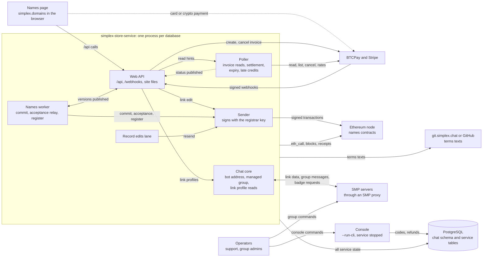

How a request flows:

1. The page calls `/api/*` on its own origin. The API and both webhooks are answered on every listener port. The template sets `serve_webapp = off`, and Caddy serves both sites from `./webapps`; with `serve_webapp = on`, the names site is also served on the names port, as built: the page reads the mode and the Stripe key from `GET /api/config`. Caddy proxies each domain to its port and is configured outside this repository ([`Web/Server.hs:124-151`](../src/StoreService/Web/Server.hs#L124-L151), [`Config.hs:505-514`](../src/StoreService/Config.hs#L505-L514), [`store_service.ini.example:8-11`](../../../scripts/store-service/store_service.ini.example#L8-L11), [`README.md:702-795`](../README.md#L702-L795)).
2. A route is matched, its method checked, one token of its per-client limit taken (webhooks and site files take none), then its handler run ([`Web/Names.hs:46-51`](../src/StoreService/Web/Names.hs#L46-L51), [`Web/Http.hs:209-222`](../src/StoreService/Web/Http.hs#L209-L222)).
3. An order is checked against the contracts with `eth_call`, a provider invoice is created, and the order is written with its invoice in one transaction ([`Web/Names/Orders.hs:86-173`](../src/StoreService/Web/Names/Orders.hs#L86-L173)).
4. On a webhook only a read is queued. The poller reads the provider and settles the invoice in one transaction; a paid order is moved from `unpaid` to `queued` ([`Web/Server.hs:500-554`](../src/StoreService/Web/Server.hs#L500-L554), [`Poller.hs:248-263`](../src/StoreService/Poller.hs#L248-L263), [`Orders.hs:95-213`](../src/StoreService/Orders.hs#L95-L213)).
5. After each commit the new invoice status or registration version is published to in-memory watches, and the held long polls and worker threads waiting on them resume ([`Orders.hs:106-117`](../src/StoreService/Orders.hs#L106-L117), [`Waiters.hs:24-84`](../src/StoreService/Waiters.hs#L24-L84), [`Names/Phases.hs:23-65`](../src/StoreService/Names/Phases.hs#L23-L65)).
6. The names worker scans the database every 5 s and follows each order in `queued`, `committing`, `committed` or `registering` in a thread of its own ([`Names/Worker.hs:82-84`](../src/StoreService/Names/Worker.hs#L82-L84), [`Names/Worker.hs:115-126`](../src/StoreService/Names/Worker.hs#L115-L126)).
7. Every transaction is sent through the sender: dry run, nonce, fees, EIP-1559 signature with the registrar key, a saved row, then broadcast. Receipts are followed every 4 s to the confirmation depth ([`Names/Sender.hs:107-131`](../src/StoreService/Names/Sender.hs#L107-L131), [`Names/Sender.hs:151-226`](../src/StoreService/Names/Sender.hs#L151-L226)).
8. A link edit is submitted to the sender on its request's thread, and pending edits are settled by the record edits lane every 4 s ([`Names/Records.hs:155-266`](../src/StoreService/Names/Records.hs#L155-L266), [`Names/Records.hs:268-320`](../src/StoreService/Names/Records.hs#L268-L320)).
9. Link profiles are read from the link data, through the chat core and SMP servers ([`Names/Profiles.hs:276-282`](../src/StoreService/Names/Profiles.hs#L276-L282), [`Chat/Library/Internal.hs:1724-1727`](../../../src/Simplex/Chat/Library/Internal.hs#L1724-L1727)).
10. Operators issue and revoke codes in the managed group while the service runs. In the console, a separate run of the same binary while the service is stopped, they issue and revoke codes, record refunds and close failed paid orders ([`Group.hs:300-343`](../src/StoreService/Group.hs#L300-L343), [`Main.hs:26-29`](../Main.hs#L26-L29), [`Service.hs:401-419`](../src/StoreService/Service.hs#L401-L419)).
11. One process runs per database: a PostgreSQL advisory lock is held on a connection of its own for the whole run ([`Store/Migrate.hs:46-58`](../src/StoreService/Store/Migrate.hs#L46-L58)).

---

## 2. Parts

| Part | Role | Source |
|---|---|---|
| Startup | `store_service.ini` is parsed, the database lock taken, and the node's chain id and the issuer key checked; then the chat core is started. In its callback the providers, the names environment and the web environment are built, the managed group resolved, and all lanes started together. Without `--service-config` only the chat side and the badge request lanes run. | [`Main.hs:16-29`](../Main.hs#L16-L29), [`Service.hs:259-347`](../src/StoreService/Service.hs#L259-L347) |
| Web API | Warp listeners on `[listener] host`: `badges_port` (8080) always, `names_port` (8081) with `[names]` and `serve_webapp = on`; with `metrics_port`, a listener on `127.0.0.1` for `/metrics` alone. `/api/*` and both webhooks are answered on every port but the metrics one. Per-client limits a minute: read 60, search 30, preview 20, code 10, records 10, create 5, find 5. Checkouts that reach a provider: 5 a minute per IPv4 /24 or IPv6 /48, and 60 card and 30 BTCPay a minute for all clients together. At most 500 long polls are held at once, each up to 30 s. | [`Web/Server.hs:121-151`](../src/StoreService/Web/Server.hs#L121-L151), [`Web/Server.hs:563-586`](../src/StoreService/Web/Server.hs#L563-L586), [`Config.hs:511-520`](../src/StoreService/Config.hs#L511-L520), [`Web/Names.hs:28-51`](../src/StoreService/Web/Names.hs#L28-L51), [`Web/Http.hs:111-161`](../src/StoreService/Web/Http.hs#L111-L161), [`Web/Http.hs:227-230`](../src/StoreService/Web/Http.hs#L227-L230) |
| Order handlers | An order is placed in one of two ways: a paid invoice or a prepaid code. The owner's signature, the timestamp, the duration, the terms and an available name are checked, then the chain price for a paid order, then the owner's signed registration and terms acceptance. The order is written with them in one transaction, in which the same wallet's overdue orders for that name are closed. | [`Web/Names/Orders.hs`](../src/StoreService/Web/Names/Orders.hs) `nameInvoiceHandler`, `codeOrderHandler`, [`Names/Orders.hs`](../src/StoreService/Names/Orders.hs) `placeOrder` |
| Registration and owner handlers | The registration view, held on its version; the reveal; `/retry`; find by the owner's signature; a move to another name. | [`Web/Names/Registration.hs:45-140`](../src/StoreService/Web/Names/Registration.hs#L45-L140), [`Web/Names/Owner.hs:44-152`](../src/StoreService/Web/Names/Owner.hs#L44-L152), [`Names/Reveal.hs:103-145`](../src/StoreService/Names/Reveal.hs#L103-L145), [`Names/View.hs:81-176`](../src/StoreService/Names/View.hs#L81-L176) |
| Search handlers | Name status, price, terms, and records with link profiles; the terms text; the link preview; what an owner signs with an order. These handlers only read, except that a terms text fetched for the first time is stored. | [`Web/Names/Search.hs:53-154`](../src/StoreService/Web/Names/Search.hs#L53-L154), [`Names/Profiles.hs:221-271`](../src/StoreService/Names/Profiles.hs#L221-L271) |
| Poller | One loop. A pass is run every `waiting_seconds` (3) while a page holds an invoice poll, else every `idle_seconds` (60), and webhook read hints are served between passes. Invoices are settled, overdue ones expired 10 minutes past their window, late money credited, and unpaid orders deleted daily, 30 days after their invoice expired. | [`Poller.hs:62-76`](../src/StoreService/Poller.hs#L62-L76), [`Poller.hs:148-168`](../src/StoreService/Poller.hs#L148-L168), [`Poller.hs:559-598`](../src/StoreService/Poller.hs#L559-L598), [`Orders.hs:95-275`](../src/StoreService/Orders.hs#L95-L275), [`Names/LateCredits.hs:50-72`](../src/StoreService/Names/LateCredits.hs#L50-L72) |
| Names worker | A thread is started by a scan every 5 s for each order in `queued`, `committing`, `committed` or `registering`: commit, terms acceptance relay, register with the stored reveal or wait for a new one, and the outcome judged from chain state. A month pass every 5 minutes fails each order unregistered a calendar month after its payment or its code's reservation. | [`Names/Worker.hs:115-401`](../src/StoreService/Names/Worker.hs#L115-L401), [`Names/Worker.hs:503-522`](../src/StoreService/Names/Worker.hs#L503-L522) |
| Sender | Signs with `[chain] service_key`, the only signer of that key. Per transaction: dry run, nonce, a tip of the last 10 blocks' median tip and at least 0.05 gwei, fees within `max_fee_per_gas` and within 0.01 ETH over the gas limit, EIP-1559 signature, a saved row, broadcast. Every 4 s: receipts followed to `confirmations` (default 3), an unknown transaction rebroadcast, and one unmined after 36 s replaced with higher fees when the market's fees have passed its own, within the same caps. | [`Names/Sender.hs:109-332`](../src/StoreService/Names/Sender.hs#L109-L332) |
| Record edits relay and lane | Owner-signed link edits, each relayed as one resolver transaction through the sender, within `record_edits_per_year` and 10 an hour per name. Pending edits are settled by the lane every 4 s. | [`Names/Records.hs:108-375`](../src/StoreService/Names/Records.hs#L108-L375), [`Web/Names/Records.hs:33-86`](../src/StoreService/Web/Names/Records.hs#L33-L86) |
| Contracts reader and chain client | One JSON-RPC client to `[chain] rpc_url`, 10 s per call, redirects refused. Typed `eth_call` reads; the name policy address, the registrar constants and the commitment ages kept once read; terms texts fetched once per hash and stored. | [`Names/Contracts.hs:147-411`](../src/StoreService/Names/Contracts.hs#L147-L411), [`Names/Chain.hs:147-313`](../src/StoreService/Names/Chain.hs#L147-L313) |
| In-memory coordination | Waiters: invoice status and payments. Phases: registration versions. Locks: one writer at a time per label hash, prepaid code and balance. Read hints: up to 256 webhook reads queued for the poller. | [`Waiters.hs:14-91`](../src/StoreService/Waiters.hs#L14-L91), [`Names/Phases.hs:15-65`](../src/StoreService/Names/Phases.hs#L15-L65), [`Names/Turns.hs:3-69`](../src/StoreService/Names/Turns.hs#L3-L69), [`Poller.hs:88-108`](../src/StoreService/Poller.hs#L88-L108) |
| Chat core | The SimpleX chat controller with the bot user: the bot address for badge requests, the managed group's messages, and the link data of link profiles. Every chat event is read from `outputQ` by one reader. | [`Service.hs:293-313`](../src/StoreService/Service.hs#L293-L313), [`Service.hs:636-645`](../src/StoreService/Service.hs#L636-L645), [`Names/Profiles.hs:276-282`](../src/StoreService/Names/Profiles.hs#L276-L282) |
| Badge request lanes | Badge requests on the bot address, present before this PR: three lanes, each answer sent as `APISendServiceResponse`. | [`Service.hs:572-657`](../src/StoreService/Service.hs#L572-L657) |
| Group lane | With `[group]`: one managed group. `/issue`, `/issue name` included, and `/bulk` are taken from moderators, `/revoke` from admins, `/balance`, `/record_refund` and `/close` from owners; `/bulk` issues badge codes only. A name code command is refused once the name codes the group issued in the last 24 hours would pass 10. `/balance`, `/record_refund` and `/close` run the console's handlers in the service's locks, with the console's chain client. Once the first promotion was attempted, every joiner waits for a moderator's review, decided when the join request arrives. | [`Group.hs:91-346`](../src/StoreService/Group.hs#L91-L346), [`Group/Command.hs:65-90`](../src/StoreService/Group/Command.hs#L65-L90), [`Group/Command.hs:275-282`](../src/StoreService/Group/Command.hs#L275-L282), [`Service.hs:414-418`](../src/StoreService/Service.hs#L414-L418) |
| Console | The same binary under `--run-cli`, or `--execute` for one command, while the service is stopped: the terminal chat and the badge request lanes only, with `//issue`, `//issue name`, `//revoke`, `//balance`, `//record_refund` and `//close`. They are read by the group's grammar, with a payment status in place of `uses`, and run by the group's dispatch, without its tracker and its daily cap; `//issue name` and `//close` are refused without `[names]`. `//close` reads the chain through a client of its own, made at start with `[names]`. | [`Main.hs:23-29`](../Main.hs#L23-L29), [`Service.hs:365-418`](../src/StoreService/Service.hs#L365-L418), [`Group/Command.hs:72-118`](../src/StoreService/Group/Command.hs#L72-L118), [`Group.hs:324-346`](../src/StoreService/Group.hs#L324-L346) |
| PostgreSQL | One database (`BADGE_DB_CONN`) with the chat core's schema and the `sx_badge_service_` tables. Names tables: prepaid codes, registrations, balances, name invoices, late credits, record edits and their changes, transactions, terms texts; the one names migration also adds the product and the provider reference to the generic invoices. A registration's primary key is an integer, `name_registration_id`, by which orders of one second are told apart, newest first; its public id `registration_id` is unique, and the other tables reference it. Partial unique indexes admit one active order (`live = 1`) per commitment and per owner and label hash. | [`Store/Postgres/Migrations.hs:276-506`](../src/StoreService/Store/Postgres/Migrations.hs#L276-L506), [`compose.yml:16`](../../../scripts/store-service/compose.yml#L16) |
| Names page | simplex.domains, in the submodule `apps/simplex-domains`, outside this checkout. `/api/*` is called on its own origin, and the owner's EIP-191 and EIP-712 signatures are sent from it. | [`.gitmodules:4-7`](../../../.gitmodules#L4-L7), [`Web/Names.hs:28-44`](../src/StoreService/Web/Names.hs#L28-L44) |
| BTCPay | Bitcoin and Monero invoices through Greenfield: create, read, list, cancel (status `Invalid`), store rates; webhooks signed with `BTCPay-Sig`. Each call, its body read included, fails after 10 s, 30 s when it creates an invoice; the host-name lookup is outside that bound. An invoice whose address cannot be read after it was created is cancelled. | [`Providers/BTCPay.hs:269-371`](../src/StoreService/Providers/BTCPay.hs#L269-L371), [`Providers/BTCPay.hs:529-543`](../src/StoreService/Providers/BTCPay.hs#L529-L543), [`Providers/BTCPay.hs:560-583`](../src/StoreService/Providers/BTCPay.hs#L560-L583), [`Providers/BTCPay.hs:585-623`](../src/StoreService/Providers/BTCPay.hs#L585-L623) |
| Stripe | Card PaymentIntents: create with an `Idempotency-Key`, read, list, cancel, also after 3 declined charges; webhooks signed with `Stripe-Signature`, within 15 minutes. Each call, its body read included, fails after 10 s, 30 s when it creates a payment; the host-name lookup is outside that bound. | [`Providers/Stripe.hs:103-304`](../src/StoreService/Providers/Stripe.hs#L103-L304), [`Providers/Stripe.hs:378-424`](../src/StoreService/Providers/Stripe.hs#L378-L424) |
| Ethereum node and names contracts | `[chain] rpc_url`: https, or http to a node on loopback. Controller, sponsor, base registrar and resolver are set in `[chain]`; the registry is read from `ens()`, the name policy from `namePolicy()`. The registrar key's USD allowance on the sponsor is raised outside the service with `setRegistrarAllowance`; on an `InsufficientAllowance` revert the order waits and an error is logged. | [`Config.hs:186-198`](../src/StoreService/Config.hs#L186-L198), [`Config.hs:698-703`](../src/StoreService/Config.hs#L698-L703), [`Names/Contracts.hs:150-220`](../src/StoreService/Names/Contracts.hs#L150-L220), [`Names/Worker.hs:341`](../src/StoreService/Names/Worker.hs#L341) |
| SMP servers and proxy | Hold the bot address, the group's queues and the data of buyers' short links. Private routing for unknown servers, with a protected fallback, is preset by `terminalChatConfig`. | [`Chat/Terminal.hs:41-63`](../../../src/Simplex/Chat/Terminal.hs#L41-L63), [`Chat/Library/Internal.hs:1723-1726`](../../../src/Simplex/Chat/Library/Internal.hs#L1723-L1726) |
| git.simplex.chat or raw.githubusercontent.com | Hosts the terms files the name policy links to, at a fixed commit, optionally with the sha256 in the link. A loopback link, always with the sha256, is taken only on chain 31337. | [`Names/Contracts.hs:292-324`](../src/StoreService/Names/Contracts.hs#L292-L324) |

Deployment, the gas key and Caddy are described in the [README](../README.md#deployment) and in [`scripts/store-service`](../../../scripts/store-service/README.md).

---

## 3. Scenarios

Participants:

| Letter | Participant |
|---|---|
| P | the names page in the buyer's browser, which sends the owner's signatures |
| W | the Web API: the Warp listeners and their handlers |
| D | PostgreSQL |
| E | the Ethereum node with the names contracts |
| V | the payment provider: BTCPay or Stripe |
| L | the poller |
| K | the names worker |
| S | the sender |
| R | the record edits lane |
| C | the chat core, or the console under `--run-cli` |
| M | SMP servers, reached through an SMP proxy |
| G | git.simplex.chat or GitHub |
| O | an operator: support or a group admin |
| B | the buyer |
| U | the startup code: `Main.hs` and `storeService` |

Terms used in the diagrams:

- A lock is held in the process: one request or lane at a time per name (its label hash), prepaid code or balance ([`Names/Turns.hs:3-69`](../src/StoreService/Names/Turns.hs#L3-L69)).
- A read hint asks the poller to read one invoice at the provider before its next pass ([`Poller.hs:88-108`](../src/StoreService/Poller.hs#L88-L108)).
- A lane is a thread that runs for the whole life of the process ([`Service.hs:301-313`](../src/StoreService/Service.hs#L301-L313), [`Service.hs:366-370`](../src/StoreService/Service.hs#L366-L370)).
- `ID` is a registration or invoice id, `LABELHASH` the keccak256 of the label, `REFERENCE` an invoice id or a registration id. A signed order is `owner`, `fields` (`labelHash`, `length`, `duration`, `commitment`, `sealed` and `terms`, which is `communityName` and `termsHash`), `timestamp` and `signature`. `POST /api/invoice` sends it as `order`, with `kind` `name`, `method` (`card`, `btc` or `xmr`, as the badge page sends it) and `price`; `POST /api/name/register` as `order`, with `code`. A move sends `fields`, `timestamp` and `signature` ([`Names/Orders.hs`](../src/StoreService/Names/Orders.hs) `SignedFields`, [`Web/Names/Orders.hs`](../src/StoreService/Web/Names/Orders.hs) `InvoiceOrder`, `CodeOrder`). All three also send `reveal`: `label`, `secret`, `records` (`contact` and `channel`), the owner's `RegisterName` signature with its `nonce` and `deadline`, and `acceptance` (`termsHash`, `nonce` and `signature`), signed with what `GET /api/name/LABELHASH/sign?owner=OWNER` answers ([`Names/Reveal.hs`](../src/StoreService/Names/Reveal.hs) `orderReveal`, [`Web/Names/Search.hs`](../src/StoreService/Web/Names/Search.hs) `signHandler`).

---

### 3.1 A name ordered and paid by card or crypto

A signed order with its reveal is turned into an open invoice at the provider and a registration in phase `unpaid`, which is moved to `queued` when the payment is settled.

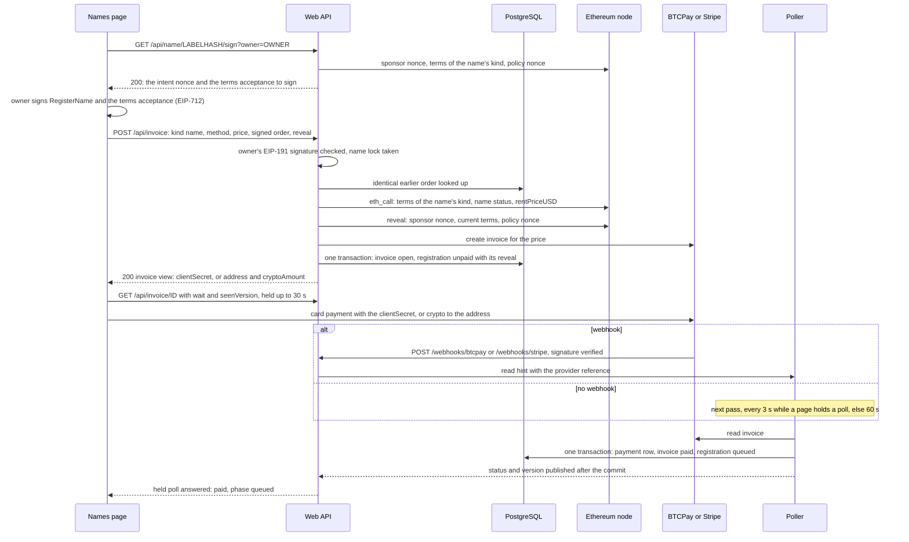

Notes:

- The checks are run in the contract's order: timestamp within 600 s, duration (paid years plus the free days until `term_start`), current terms, a name available on chain and held by no paid order here, then the chain price, at least `min_price_cents_per_year` times the paid years and equal to the order's, then the reveal as 3.2 lists, with its deadline not before the service's clock ([`Web/Names/Orders.hs:104-118`](../src/StoreService/Web/Names/Orders.hs#L104-L118), [`Names/Orders.hs:266-310`](../src/StoreService/Names/Orders.hs#L266-L310), [`Names/Contracts.hs:190-202`](../src/StoreService/Names/Contracts.hs#L190-L202)). Refusals are listed in [`Web/Names/Orders.hs:344-357`](../src/StoreService/Web/Names/Orders.hs#L344-L357).
- A reveal whose link is not a short link of its record's kind is answered `400 {"type": "invalid_link", "kind": "contact" | "channel"}`, naming the first such link, contact before channel, before any invoice or code reservation. A chain read of the reveal's checks that fails is answered `503 name_check_unavailable` (`orderReveal` in [`Names/Reveal.hs`](../src/StoreService/Names/Reveal.hs)).
- The reveal is stored with the order and cleared when the order is closed (`closeOrder` in [`Orders.hs`](../src/StoreService/Orders.hs), `closeOverdue` in [`Names/Store.hs`](../src/StoreService/Names/Store.hs)).
- The terms text is read from the database, or fetched from git.simplex.chat or GitHub on the first use of its hash and stored; either is checked against the sha256 in its link when the link has one. While it cannot be read, the order is answered `503 terms_unavailable` ([`Names/Orders.hs:284-291`](../src/StoreService/Names/Orders.hs#L284-L291), [`Names/Contracts.hs:239-290`](../src/StoreService/Names/Contracts.hs#L239-L290), [`Web/Names/Orders.hs:356`](../src/StoreService/Web/Names/Orders.hs#L356)).
- The name lock is held across the provider call, and the answer is sent after it. Overdue unpaid orders of the same wallet and name are closed in the order's transaction ([`Web/Names/Orders.hs:76-100`](../src/StoreService/Web/Names/Orders.hs#L76-L100), [`Names/Orders.hs:217-256`](../src/StoreService/Names/Orders.hs#L217-L256)).
- When the order is not written, its provider invoice is cancelled. Provider checkouts are capped at 5 a minute for each IPv4 /24 or IPv6 /48, and at 60 card and 30 BTCPay checkouts a minute for all clients together ([`Web/Names/Orders.hs:139-173`](../src/StoreService/Web/Names/Orders.hs#L139-L173), [`Web/Http.hs:153-161`](../src/StoreService/Web/Http.hs#L153-L161), [`Web/Http.hs:227-230`](../src/StoreService/Web/Http.hs#L227-L230)).
- Stripe is sent `metadata[order]` = `name:0x<order hash>` and an `Idempotency-Key`; BTCPay is sent the amount, the currency and the checkout settings ([`Providers/Stripe.hs:240-269`](../src/StoreService/Providers/Stripe.hs#L240-L269), [`Providers/BTCPay.hs:303-339`](../src/StoreService/Providers/BTCPay.hs#L303-L339)).
- On a webhook only a read is queued, and 200 is answered ([`Web/Server.hs:500-554`](../src/StoreService/Web/Server.hs#L500-L554)).
- A paid order holds its name from `queued` to `registering`, and `failed`, until support closes it as `taken`, it moves to another name, or the month from its payment ends; an open invoice holds only its price, and one paid order holds a name at a time ([`Names/Store.hs`](../src/StoreService/Names/Store.hs) `labelHolder` and the index `idx_name_registrations_held_label`). When the payment settles, the poller cancels the name's other open invoices at their providers and closes their orders `cancelled`; a code order and an order paid from a balance do so once placed, and an order moved to another name once moved. A payment that settles while another paid order holds the name ends its order `taken`, the money paid for it added to its balance ([`Orders.hs`](../src/StoreService/Orders.hs) `nameSettled`, `cancelNameInvoices`).
- An open invoice without money can be cancelled with `POST /api/invoice/ID/cancel`: the provider is told first, then the row is expired and the order closed ([`Web/Server.hs:358-381`](../src/StoreService/Web/Server.hs#L358-L381), [`Orders.hs:244-263`](../src/StoreService/Orders.hs#L244-L263)).
- Unpaid: 10 minutes past the expiry the poller's sweep expires the invoice and closes the order, after it cancels a Stripe intent; BTCPay expires its own invoice. The unpaid order is deleted 30 days after the expiry, and a read held on it then answers `not_found` ([`Poller.hs:396-430`](../src/StoreService/Poller.hs#L396-L430), [`Poller.hs:62-76`](../src/StoreService/Poller.hs#L62-L76), [`Poller.hs:295-345`](../src/StoreService/Poller.hs#L295-L345), [`Orders.hs:265-275`](../src/StoreService/Orders.hs#L265-L275), [`Providers.hs:96-100`](../src/StoreService/Providers.hs#L96-L100)).
- Under `codes_only = on` this route is refused with `403 codes_only` ([`Web/Names/Orders.hs:88`](../src/StoreService/Web/Names/Orders.hs#L88)).

---

### 3.2 A paid order registered on chain

The names worker commits the order's commitment, relays the terms acceptance of the reveal stored with the order and registers the name. The page signs again only when the stored reveal was cleared.

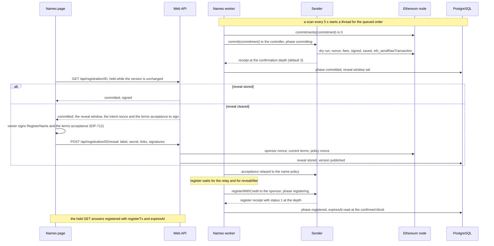

Notes:

- Every transaction here is sent through the sender as the commit is, with value 0 and its gas paid by the registrar key; a failed commit, acceptance or register is stored as an attempt and judged by its reason, as 3.5 says (`submitTransactionIf` in [`Names/Sender.hs`](../src/StoreService/Names/Sender.hs), `failedAttempt` in [`Names/Worker.hs`](../src/StoreService/Names/Worker.hs)). By the code comments and the log line of an `InsufficientAllowance` revert, the rent is spent from the registrar key's allowance on the sponsor ([`Names/Contracts.hs:179-181`](../src/StoreService/Names/Contracts.hs#L179-L181), [`Names/Worker.hs:351`](../src/StoreService/Names/Worker.hs#L351)).
- `RegisterName` is signed in the EIP-712 domain `SimplexSponsor`, the acceptance in `SimplexNamePolicy`, as `AcceptGeneralTerms` or `AcceptCommunityTerms` ([`Names/Registration.hs:80-111`](../src/StoreService/Names/Registration.hs#L80-L111)).
- The reveal, of an order or of `/reveal`, is checked in the contract's order: the label, its hash and length, the commitment rebuilt from the owner, duration and default resolver; the intent's deadline not before the service's clock for an order, or `revealBefore` for `/reveal`, and at most a week and 600 s after the service's clock, its signer and the sponsor nonce; the acceptance against the current terms and policy nonce; the links' kinds last ([`Names/Reveal.hs`](../src/StoreService/Names/Reveal.hs) `checkReveal`).
- The names page signs the intent and the acceptance with a deadline a week after the service's clock, so a signature serves across commitments the service sends again within that week. The intent does not cover the secret, and it stays valid until its deadline or until the owner's sponsor nonce moves; a move stores the move's reveal in place of the old one, and a close clears it ([`Names/Store.hs`](../src/StoreService/Names/Store.hs) `retargetRegistration`, [`Names/Worker.hs`](../src/StoreService/Names/Worker.hs) `sendRegister`).
- A `/reveal` checks no link: the links were checked at the order, and the commitment fixes them, so a reveal of other links is refused as not the order's commitment.
- The acceptance relay is `commitUnderGeneralTermsWithSig` or `commitUnderCommunityTermsWithSig`. It is sent once the order is committed with a reveal stored, without waiting for `revealAfter`, while `revealBefore` has not passed, unless the policy already holds that acceptance. The register is sent after the relay settles and `revealAfter` has passed ([`Names/Worker.hs:254-272`](../src/StoreService/Names/Worker.hs#L254-L272)).
- The links are set by `setText` calls for `simplex.contact` and `simplex.channel` in the register's data ([`Names/Registration.hs:212-235`](../src/StoreService/Names/Registration.hs#L212-L235)).
- The stored reveal is cleared when its deadline passes, on `InvalidNonce`, `TermsNotAccepted` or `TermsMismatch` (3.5), and when its acceptance is refused for another policy or kind of terms. Without a reveal by `revealBefore` the order waits, and its view's signature reads `lapsed`; the page with the code then sends `POST /api/registration/ID/retry`, which queues it to be committed again (3.6) ([`Names/Worker.hs:255-264`](../src/StoreService/Names/Worker.hs#L255-L264), [`Names/View.hs:127-143`](../src/StoreService/Names/View.hs#L127-L143)).
- An order waiting for its owner, committed without a reveal, fails with the reason `unread` once its page has not read it for 3 days. A read is `GET /api/registration/ID` or the order's `GET /api/invoice/ID`, stored in `read_at` at most once an hour; an order starts read at its placement (`noteRead` in [`Names/Orders.hs`](../src/StoreService/Names/Orders.hs), `committed` in [`Names/Worker.hs`](../src/StoreService/Names/Worker.hs)). A reveal of such an order, checked as at an order (3.1), is stored and queues the order to be committed again (`revealHandler` in [`Web/Names/Registration.hs`](../src/StoreService/Web/Names/Registration.hs)).
- The view of a failed order that still holds its name gives `heldUntil` in its phase: a calendar month after its payment, or its code's placement (`phaseView` in [`Names/View.hs`](../src/StoreService/Names/View.hs)).
- The view gives the name of its stored reveal in `label` only once the order is paid (`toRegistrationView` in [`Names/View.hs`](../src/StoreService/Names/View.hs)).
- After a restart every phase is resumed from the stored order and the sender's saved transactions ([`Names/Sender.hs:123-131`](../src/StoreService/Names/Sender.hs#L123-L131), [`Names/Worker.hs:6-8`](../src/StoreService/Names/Worker.hs#L6-L8)).

---

### 3.3 A prepaid name code issued and spent

An operator issues a code good for one name. The buyer's order with it is queued without an invoice. Under `codes_only = on`, a code is the only way to order a name.

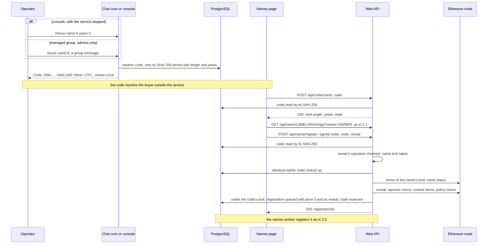

Notes:

- Only the code's SHA-256 is stored, so a code not copied when shown cannot be recovered ([`Names/Codes.hs:147-159`](../src/StoreService/Names/Codes.hs#L147-L159)). `unpaid` name codes are refused in the console, and name codes without `[names]` in the console and the group ([`Group/Command.hs:116-118`](../src/StoreService/Group/Command.hs#L116-L118), [`Group.hs:326-330`](../src/StoreService/Group.hs#L326-L330)).
- In the group, `/issue` is taken from moderators and above, a name code too, for 2 to 10 years. A name code command is refused once the name codes the group issued in the last 24 hours would pass 10; the console has no cap ([`Group/Command.hs:65-118`](../src/StoreService/Group/Command.hs#L65-L118), [`Group.hs:300-322`](../src/StoreService/Group.hs#L300-L322)).
- A code order is checked for the timestamp, the duration, the terms, an available name and its reveal (3.1); its years are the code's, 2 for a community name ([`Web/Names/Orders.hs:216-222`](../src/StoreService/Web/Names/Orders.hs#L216-L222), [`Names/Community.hs:54-59`](../src/StoreService/Names/Community.hs#L54-L59)).
- The code is spent when the name is registered, released when the order is set `taken`, and kept with a failed order for a move, or with a lapsed unsigned one for `/retry` or a move, until a calendar month after its reservation, when the month pass fails the order `monthEnded` and releases the code in the same write (`endOrder` and `endMonths` in [`Names/Worker.hs`](../src/StoreService/Names/Worker.hs)).
- A name code is issued valid for 3 calendar months, and the answer names its expiry: `Code: SN6-…. Valid until <time> UTC.` (`issueNameCode` in [`Names/Codes.hs`](../src/StoreService/Names/Codes.hs)).
- A name code is withdrawn by `//revoke` unless it is spent; a code an order already holds stays usable by that order ([`Names/Codes.hs:162-173`](../src/StoreService/Names/Codes.hs#L162-L173), [`Names/Codes.hs:78-88`](../src/StoreService/Names/Codes.hs#L78-L88)).
- Under `codes_only = on`, `GET /api/config` answers `names.codesOnly` true, which the page reads, and paid orders are answered `403 codes_only` (`siteConfig` in [`Web/Server.hs`](../src/StoreService/Web/Server.hs), `nameInvoiceHandler` in [`Web/Names/Orders.hs`](../src/StoreService/Web/Names/Orders.hs)).

---

### 3.4 A name searched, and a link previewed

A search is answered with the name's state: available with its price and terms, reserved, or registered with its records and their profiles.

```mermaid
sequenceDiagram
  participant P as Names page
  participant W as Web API
  participant D as PostgreSQL
  participant E as Ethereum node
  participant G as git.simplex.chat or GitHub
  participant C as Chat core
  participant M as SMP servers
  P->>W: GET /api/name/LABELHASH?length=N
  W->>D: a paid order holding this label hash?
  W->>E: within 10 s: nameExpires, communityNames, then owner or reservedNames
  alt available
    W->>E: rentPriceUSD, generalTermsLink, communityTermsLink
    W->>D: terms text stored for the hash, sha256 checked when the link has one
    W->>G: terms text when none is stored, once per hash, sha256 checked when the link has one, then stored
    W-->>P: found available: price, years, terms; community
  else registered
    W->>E: records simplex.contact and simplex.channel, resolver nonce
    W->>C: the link data per link, 3 s each, after the chain reads
    C->>M: short link data
    W->>D: record edits of the last 365 days
    W-->>P: found registered: owner, resolver, expiresAt, gracePeriod, entities, records with nonce and edits; community
  end
  P->>W: POST /api/link/preview: link
  W->>C: the same profile read, under the preview limits
  W-->>P: kind, profile: kind of chat, displayName, fullName, image, subscribers, or unread or unavailable
```

Notes:

- Only the label's hash and length are sent ([`Web/Names/Search.hs:53-57`](../src/StoreService/Web/Names/Search.hs#L53-L57)). 30 a minute per client are allowed for searches and terms reads together; chain reads are run for at most 16 searches at once, for all clients together, and a 17th is answered `429` ([`Web/Names.hs:34-36`](../src/StoreService/Web/Names.hs#L34-L36), [`Web/Http.hs:128-149`](../src/StoreService/Web/Http.hs#L128-L149)).
- The owner and resolver are read from the registry for a name registered or in its grace period (`nameExpires` plus `GRACE_PERIOD` not before the latest block's time); for any other name `reservedNames` is read ([`Names/Contracts.hs:149-162`](../src/StoreService/Names/Contracts.hs#L149-L162)).
- An available name's price is `rentPriceUSD` for its paid years; a price under `min_price_cents_per_year` times those years fails the search with `503 provider_unavailable` ([`Names/Contracts.hs:190-202`](../src/StoreService/Names/Contracts.hs#L190-L202)).
- A name shown available on chain while an order here holds it, its register in flight included, is answered `taken`, without a price, owner or records; a reserved name is answered `reserved` ([`Web/Names/Search.hs:66-72`](../src/StoreService/Web/Names/Search.hs#L66-L72), [`Web/Names/Search.hs:97-98`](../src/StoreService/Web/Names/Search.hs#L97-L98)).
- Records, their nonce and the edits left are read only for a name on the default resolver, and at most 5 links of each record ([`Names/Contracts.hs:164-177`](../src/StoreService/Names/Contracts.hs#L164-L177), [`Web/Names/Search.hs:99-130`](../src/StoreService/Web/Names/Search.hs#L99-L130)).
- A link whose host is, or resolves to, a non-public address is refused before it is read, and each DNS lookup is run in a thread of its own. Profiles are kept 600 s; 4 fetch slots are used by searches and 2 by previews ([`Names/Profiles.hs:98-110`](../src/StoreService/Names/Profiles.hs#L98-L110), [`Names/Profiles.hs:287-338`](../src/StoreService/Names/Profiles.hs#L287-L338)).
- Private routing for unknown servers, with a protected fallback, is preset by `terminalChatConfig` ([`Chat/Terminal.hs:59-63`](../../../src/Simplex/Chat/Terminal.hs#L59-L63)); the routing itself is implemented in simplexmq.
- `GET /api/terms/HASH` is answered with the text and link of either current terms link ([`Web/Names/Search.hs:141-154`](../src/StoreService/Web/Names/Search.hs#L141-L154)).

---

### 3.5 A register transaction that fails

After a register or terms acceptance fails, the order is judged from chain state and the revert's reason: its reveal is cleared for the page to sign again, it waits, its transaction is sent again, it is committed again with its reveal, it is set `taken` with its price kept as a balance, or, at an attempt cap, it is set `failed`. A failed commit is stored and counted the same way. The revert's reason is one of the 18 contract errors the worker acts on, another contract error by its name, the message of `Error(string)`, an unknown selector in hex, or none (`RevertName` and `decodeRevert` in [`Names/Chain.hs`](../src/StoreService/Names/Chain.hs)).

```mermaid
sequenceDiagram
  participant K as Names worker
  participant S as Sender
  participant E as Ethereum node
  participant D as PostgreSQL
  opt the commit
    K->>S: commit(commitment) to the controller
    alt dry run reverted
      K->>D: attempt stored, counted for a permanent reason; retried every 15 s; failed at max_dry_run_failures
    else mined with status 0
      K->>D: attempt stored, counted; phase queued, the commit sent again; failed at max_sent_failures
    end
  end
  K->>S: registerWithCredit to the sponsor, or the acceptance relay to the name policy
  S-->>K: dry run reverted, or mined with status 0
  K->>E: registered after all? ownerOf and nameExpires at the confirmed block
  alt InvalidNonce, SignatureExpired, TermsNotAccepted or TermsMismatch from the dry run
    K->>D: reveal cleared, phase stays committed, the page signs again
  else CommitmentTooOld past the lapse, or CommitmentNotFound
    K->>D: phase queued, reveal kept, then committed again and registered with it
  else name taken at the latest block and at the confirmation depth
    K->>D: phase taken, the money paid for the order added to its balance
  else name available, mined with status 0
    K->>D: attempt stored, counted; phase committed with its reveal, sent again; failed at max_sent_failures
  else name available, dry run reverted for a permanent reason
    K->>D: attempt stored, counted; retried every 15 s; failed at max_dry_run_failures
  else name available, dry run reverted for any other reason, InsufficientAllowance included
    K->>D: attempt stored, uncounted; retried every 15 s, logged once, reported after 10 minutes of failures in a row
  end
```

Notes:

- Whether the name was registered after all is checked first: on a register mined with status 1, or with the name held by the owner at the confirmation depth, the order is set `registered` ([`Names/Orders.hs:365-400`](../src/StoreService/Names/Orders.hs#L365-L400), [`Names/Worker.hs:329-336`](../src/StoreService/Names/Worker.hs#L329-L336)).
- An `InsufficientAllowance` revert waits for the registrar key's allowance on the sponsor to be raised outside the service, also past the commitment's lapse, as the sponsor checks the allowance before the commitment. The reveal is cleared once its intent's deadline passes, and the page signs again ([`Names/Worker.hs:359`](../src/StoreService/Names/Worker.hs#L359), [`Names/Worker.hs:307-321`](../src/StoreService/Names/Worker.hs#L307-L321)).
- A stored intent within its deadline that no longer verifies, as after a change of `[chain] chain_id`, `sponsor` or `resolver`, or of `[names] tld`, fails the order with the reason `signatureRefused` before its acceptance relay or its register is sent, logged as an error and reported in the managed group (`intentRefused` in [`Names/Worker.hs`](../src/StoreService/Names/Worker.hs)). Such an order is not moved: `POST /api/registration/ID/name` with other fields answers `400 bad_request`, as for any order that is not movable, and support settles it.
- `CommitmentTooOld` is reverted only after the intent's and the allowance's checks. The order is set `committing` with its reveal kept, or, while `revealBefore` has not passed by the service's clock, the dry run is tried again a second later; the commit is sent again, and the register follows once it has aged, with no new signature while the signature's week lasts (3.2) ([`Names/Worker.hs:356-358`](../src/StoreService/Names/Worker.hs#L356-L358), [`Names/Worker.hs:199-215`](../src/StoreService/Names/Worker.hs#L199-L215)).
- On `CommitmentTooNew` the register is retried 1 s later. While the name is taken only above the confirmation depth, or is reported gone by the dry run while `available(label)` is true, the order is retried every 15 s ([`Names/Worker.hs:340-352`](../src/StoreService/Names/Worker.hs#L340-L352)).
- A code order set `taken` has its code released instead of a balance credited ([`Names/Worker.hs:361-368`](../src/StoreService/Names/Worker.hs#L361-L368)).
- The permanent reasons are `InvalidSignature`, `DurationTooLong`, `DurationTooShort`, `ResolverRequiredWhenDataSupplied`, `ReverseRecordNotSupported`, `NameTooShort`, `LabelTooLong` and `ReentrantCall`. Both caps count per commitment, so a move starts them again; at a cap the order fails with the reason `registryRefused`, logged as an error and reported in the managed group (`revertClass` and `failedAttempt` in [`Names/Worker.hs`](../src/StoreService/Names/Worker.hs)).
- A failure after which the order's phase is kept is logged at the first time of its reason in a row. It is reported once, with the latest reason, after 10 minutes of consecutive temporary failures of any reasons, such as an unanswered node read, funds, the fee cap, the allowance, an unexpected revert or an exception in the step; progress ends the streak, and a permanent failure is never reported this way. A step that throws is run again as after such a failure, in 15 s (`failureNotice` and `follow` in [`Names/Worker.hs`](../src/StoreService/Names/Worker.hs)).
- The order's row keeps the last failed attempt of its commitment, its transaction, stage, reason and time, for the caps, the logs and the reports; the order's view does not show it. A failure that is not counted is written only when its transaction, stage or reason differs from the stored one (`failedAttempt` in [`Names/Worker.hs`](../src/StoreService/Names/Worker.hs), `recordAttempt` in [`Names/Store.hs`](../src/StoreService/Names/Store.hs)).

---

### 3.6 A lapsed order queued again, or an order moved

An order whose commitment lapsed unsigned is queued again by `/retry`; it, and a failed order, can move to another name. A failed order's move first checks whether its name was registered after all.

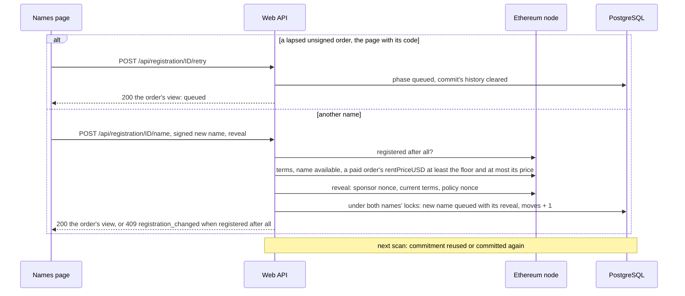

Notes:

- `/retry` is sent with the registration id alone. It is refused with `400 bad_request` for any order but one whose commitment lapsed with no reveal stored. A lapsed order keeps its payment and its code, so `/retry` reads no chain and checks no code ([`Web/Names/Registration.hs:111-132`](../src/StoreService/Web/Names/Registration.hs#L111-L132), [`Names/Worker.hs:434-454`](../src/StoreService/Names/Worker.hs#L434-L454)). At the next scan a new commit is sent, a second past the old commitment's lapse ([`Names/Worker.hs:174-215`](../src/StoreService/Names/Worker.hs#L174-L215)).
- A move is accepted for a failed order but a month-ended or signature-refused one, and for one whose commitment lapsed unsigned, up to `max_order_moves` (default 3). The page offers another name only for an order whose name was taken. For a failed order the service checks first whether its name was registered after all ([`Web/Names/Owner.hs:113-126`](../src/StoreService/Web/Names/Owner.hs#L113-L126), [`Config.hs:655`](../src/StoreService/Config.hs#L655)).
- Both names' locks are taken in hash order, and the first order's hash is kept. A paid order moved to a cheaper name is credited the difference; a code order is moved at price 0, its code reserved again ([`Names/Turns.hs:27-32`](../src/StoreService/Names/Turns.hs#L27-L32), [`Web/Names/Owner.hs:128-135`](../src/StoreService/Web/Names/Owner.hs#L128-L135), [`Names/Orders.hs:340-356`](../src/StoreService/Names/Orders.hs#L340-L356), [`Names/Store.hs:787-813`](../src/StoreService/Names/Store.hs#L787-L813)).
- A paid order's move reads the new name's price as an order does: a price under `min_price_cents_per_year` times the paid years is answered `503 name_check_unavailable`, and nothing is credited ([`Names/Contracts.hs:190-202`](../src/StoreService/Names/Contracts.hs#L190-L202)).
- The move's reveal is checked last, as an order's (3.1), for the order's owner; a repeat of the order's current fields is answered with its view before any check ([`Web/Names/Owner.hs`](../src/StoreService/Web/Names/Owner.hs) `moveChecked`).
- A link equal to the order's stored link of its kind is accepted as stored, without the link check; a stored link is parsed nowhere else ([`Names/Reveal.hs`](../src/StoreService/Names/Reveal.hs) `refusedLink`).

---

### 3.7 An owner's orders found

An owner without an order's link finds their orders by signing with their wallet; the ids found are used for `/retry`, a move or a refund.

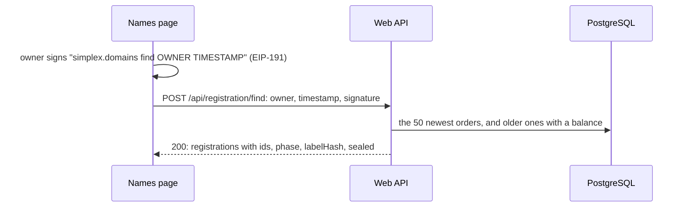

Notes:

- The signature and a timestamp within 600 s are checked; an owner without orders is answered an empty list. 5 finds a minute are allowed per client ([`Web/Names.hs:38`](../src/StoreService/Web/Names.hs#L38), [`Web/Names/Owner.hs:51-99`](../src/StoreService/Web/Names/Owner.hs#L51-L99), [`Names/Registration.hs:386-387`](../src/StoreService/Names/Registration.hs#L386-L387), [`Names/Store.hs:1038-1062`](../src/StoreService/Names/Store.hs#L1038-L1062)).
- Each order's `phase` is its stored phase, `closed` for an unpaid order whose invoice closed.

---

### 3.8 Late crypto credited

Crypto paid to an invoice whose order has closed is credited to that order's balance.

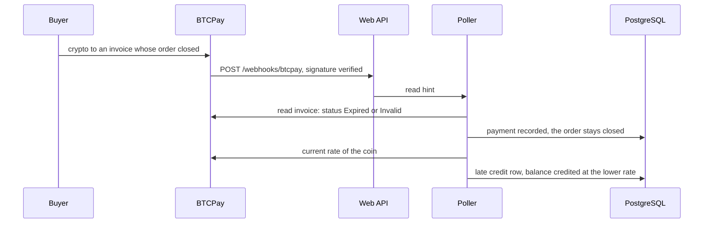

Notes:

- An invoice paid more crypto than it asked is settled as in 3.1, and only its confirmed units above the invoiced units are credited to the order's balance, the same way ([`Providers/BTCPay.hs:448-452`](../src/StoreService/Providers/BTCPay.hs#L448-L452), [`Names/LateCredits.hs:74-104`](../src/StoreService/Names/LateCredits.hs#L74-L104)).
- `InvoiceReceivedPayment` and `InvoicePaymentSettled` are among the BTCPay events acted on. From a BTCPay invoice read `Expired` or `Invalid` a closed signal is made, and at settlement the payment is recorded while the order stays closed ([`Providers/BTCPay.hs:115`](../src/StoreService/Providers/BTCPay.hs#L115), [`Providers/BTCPay.hs:448-454`](../src/StoreService/Providers/BTCPay.hs#L448-L454), [`Orders.hs:55-60`](../src/StoreService/Orders.hs#L55-L60), [`Orders.hs:180-198`](../src/StoreService/Orders.hs#L180-L198)).
- Only confirmed money is credited: crypto as its share of the invoice's amount, at the lower of the invoice's and the current rate, rounded down to the cent. With a current rate below half the invoice's, the money is never credited and is marked for support ([`Names/LateCredits.hs:31-72`](../src/StoreService/Names/LateCredits.hs#L31-L72), [`Names/LateCredits.hs:114-129`](../src/StoreService/Names/LateCredits.hs#L114-L129)).
- Confirmed money not yet credited is credited again by a pass at the idle cadence ([`Poller.hs:393-413`](../src/StoreService/Poller.hs#L393-L413)). With late card money the invoice is set paid and the order kept closed; its cents are credited as they are ([`Orders.hs:184-189`](../src/StoreService/Orders.hs#L184-L189), [`Names/LateCredits.hs:91-95`](../src/StoreService/Names/LateCredits.hs#L91-L95)). Crypto sent to an invoice already recorded paid is left unrecorded, and an error naming the invoice by the provider's reference is logged at most hourly ([`Poller.hs:242-252`](../src/StoreService/Poller.hs#L242-L252)).
- A credit writes the order's next version, which is published with the invoice's payment after the credit commits, so the order's held invoice and registration polls answer at once, and so does a poll sent later with the version before the credit (`creditLate` in [`Poller.hs`](../src/StoreService/Poller.hs)).

---

### 3.9 A balance refunded by support

Support records the refund of a balance in the console and pays it back by hand.

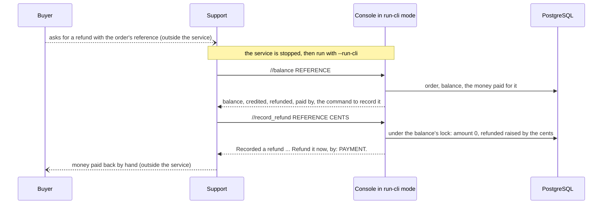

Notes:

- The refund must equal the whole balance ([`Names/Balances.hs`](../src/StoreService/Names/Balances.hs) `recordRefund`, [`Names/Store.hs`](../src/StoreService/Names/Store.hs) `refundBalance`).
- A balance is credited when a paid order is set `taken` or fails at the end of its month (its whole price), when support closes a failed order, and with late or extra money; it is spent by no other order ([`Names/Worker.hs`](../src/StoreService/Names/Worker.hs) `endOrder`, `refundTaken`, [`Names/LateCredits.hs`](../src/StoreService/Names/LateCredits.hs)).
- The provider interface offers create, read, cancel, list, rate and webhook verification, so the money is paid back by hand ([`Providers.hs:120-130`](../src/StoreService/Providers.hs#L120-L130)). The buyer's email to chat@simplex.chat is described in the README; the page code is in the submodule ([`README.md:1371-1411`](../README.md#L1371-L1411)).
- The console starts only while the service is stopped, as the database lock is held by one process ([`Store/Migrate.hs:46-54`](../src/StoreService/Store/Migrate.hs#L46-L54)).
- While the service runs, a group owner sends the same commands with one slash, `/balance`, `/record_refund` and `/close`. The group lane runs the console's handlers in the service's per-name and per-balance locks and answers in the group; the answers name the one-slash commands ([`Service.hs`](../src/StoreService/Service.hs) `runMoneyCmd`, [`Group.hs`](../src/StoreService/Group.hs)).

A failed paid order, and one whose commitment lapsed unsigned, has no balance until it is closed. Support closes it with `//close`, which checks the chain first and records the refund in the same transaction that ends the order.

```mermaid
sequenceDiagram
  participant B as Buyer
  participant O as Support
  participant C as Console in run-cli mode
  participant N as Ethereum node
  participant D as PostgreSQL
  B--)O: asks for a refund of a failed order with its reference (outside the service)
  Note over O,C: the service is stopped, then run with --run-cli
  O->>C: //close REFERENCE
  C->>D: the order, under its name's lock
  C->>N: a mined register of the order, or the owner holding the name at the confirmation depth
  alt the register went through
    C->>D: order set registered
    C-->>O: Nothing refunded: the register of order ID went through
  else not registered
    C->>D: under the balance's lock, one transaction: order set taken, its stored reveal cleared, price credited, the whole balance recorded as refunded
    C-->>O: Closed order ID, failed or lapsed unsigned at TIME ... Check at the provider ...; if not, refund it now, by: PAYMENT.
    O--)B: money paid back by hand, unless refunded before (outside the service)
  end
```

- Only a failed or lapsed unsigned order paid by invoice is closed ([`Names/Worker.hs`](../src/StoreService/Names/Worker.hs) `closeRegistration`, `refundTaken`, [`Names/Orders.hs`](../src/StoreService/Names/Orders.hs) `checkLanded`).
- The answer names the time of the failure or the lapse, as failed orders were refunded at the provider by hand before `//close` existed ([`Service.hs:463-485`](../src/StoreService/Service.hs#L463-L485), [`README.md:1491-1536`](../README.md#L1491-L1536)).

---

### 3.10 A registered name's links edited

The owner's signed link changes are relayed to the resolver as one transaction, its gas paid by the registrar key.

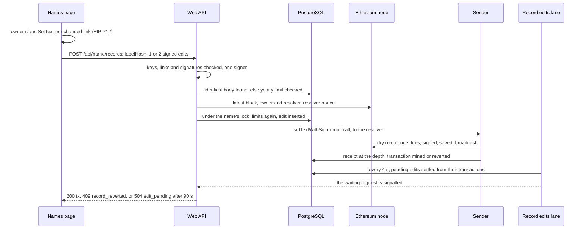

Notes:

- `SetText` is signed in the EIP-712 domain `SimplexResolver`; the signer must be the registry's owner of a name on the default resolver, and the first nonce the owner's current resolver nonce, which the search answers as `found.records.nonce`; another first nonce is answered `409 stale_nonce`, and any other refusal `400 bad_request` ([`Names/Registration.hs:83-84`](../src/StoreService/Names/Registration.hs#L83-L84), [`Names/Records.hs:185-199`](../src/StoreService/Names/Records.hs#L185-L199), [`Web/Names/Search.hs:105`](../src/StoreService/Web/Names/Search.hs#L105)).
- Edits relayed per name are bounded by `record_edits_per_year` (default 3, from 1 to 100) in any 365 days, and every stored edit is counted, a reverted one too; at most 10 are relayed per name an hour, and 10 requests are accepted a minute per client ([`Names/Records.hs:112-151`](../src/StoreService/Names/Records.hs#L112-L151), [`Config.hs:286-289`](../src/StoreService/Config.hs#L286-L289), [`Web/Http.hs:149`](../src/StoreService/Web/Http.hs#L149)).
- The earliest deadline must be more than 600 s past the latest block's time ([`Names/Records.hs:126-129`](../src/StoreService/Names/Records.hs#L126-L129), [`Names/Records.hs:185-199`](../src/StoreService/Names/Records.hs#L185-L199)).
- Two changes are sent in one `multicall`, and both or neither are applied ([`Names/Registration.hs:205-207`](../src/StoreService/Names/Registration.hs#L205-L207), [`Names/Records.hs:399-408`](../src/StoreService/Names/Records.hs#L399-L408)).
- An edit whose transactions were all dropped is judged from receipts, the owner's resolver nonce and the records, then resent before its deadline or settled ([`Names/Records.hs:293-356`](../src/StoreService/Names/Records.hs#L293-L356)). The records are read from the chain at the next search ([`Names/Contracts.hs:165-177`](../src/StoreService/Names/Contracts.hs#L165-L177)).

---

### 3.11 Service start

The production container starts one process, which checks its configuration, the database lock and the node, starts the chat core, then starts all lanes.

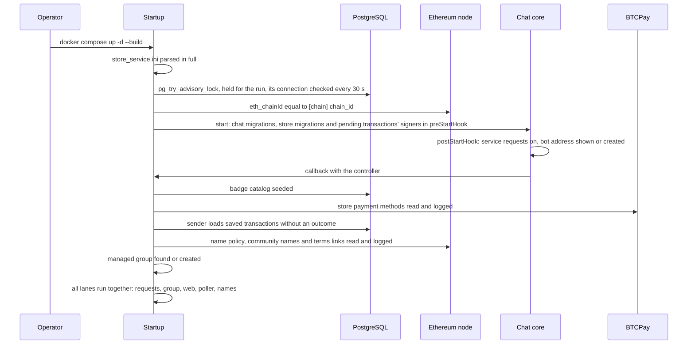

Notes:

- The container runs `simplex-store-service -d BADGE_DB_CONN --create-schema --yes-migrate --service-config /etc/simplex-store-service/store_service.ini` ([`compose.yml:14-20`](../../../scripts/store-service/compose.yml#L14-L20)).
- The process exits on a config error (Stripe keys of two modes, or Stripe test keys with `[names]` off chains 31337 and 11155111, among them), a held lock, a chain id mismatch, an issuer key mismatch, a failed migration, a pending transaction signed by another key or for another chain, or a missing site build; while it runs, it exits when the lock's connection fails. Compose restarts it after every exit until it is stopped ([`Main.hs:23-29`](../Main.hs#L23-L29), [`Config.hs:475-479`](../src/StoreService/Config.hs#L475-L479), [`Service.hs:259-264`](../src/StoreService/Service.hs#L259-L264), [`Service.hs:632-635`](../src/StoreService/Service.hs#L632-L635), [`Store/Migrate.hs:53-64`](../src/StoreService/Store/Migrate.hs#L53-L64), [`compose.yml:10`](../../../scripts/store-service/compose.yml#L10)). A node that does not answer `eth_chainId` is only warned of, unless `dev_keys` are set ([`Service.hs:169-181`](../src/StoreService/Service.hs#L169-L181)).
- The lanes are started in the chat core's callback, after `postStartHook`, so after the bot address exists, unless `--no-address` is passed ([`Chat/Core.hs:97-106`](../../../src/Simplex/Chat/Core.hs#L97-L106), [`Service.hs:301-313`](../src/StoreService/Service.hs#L301-L313), [`Service.hs:636-645`](../src/StoreService/Service.hs#L636-L645)).
- The names lanes are the sender, the record edits lane, the names worker, the check of paid orders not registered 3 hours after their payment, every 5 minutes, which logs an error and reports in the managed group once for each, the month pass, every 5 minutes, which fails each order still `queued`, `committed` or `failed`, with no register transaction pending, a calendar month after its payment or its code's reservation with the reason `monthEnded`, the money paid for it added to its balance or its code released, and its name released, and the terms fetch, which reads or fetches both current terms texts at the start and then hourly; all lanes are started together with `raceAny_` from simplexmq ([`Service.hs:366-371`](../src/StoreService/Service.hs#L366-L371), [`Names/Contracts.hs:247-254`](../src/StoreService/Names/Contracts.hs#L247-L254)).
- Under `--run-cli` the binary runs the terminal chat and the badge request lanes only ([`Service.hs:381-404`](../src/StoreService/Service.hs#L381-L404)).

---

### 3.12 A card dispute or a refund

Stripe reports a dispute, a refund or an early fraud warning on a name order's payment; the order is cancelled while no register transaction of it was sent, and the operators are alerted with its evidence.

```mermaid
sequenceDiagram
  participant V as Stripe
  participant W as Web API
  participant D as PostgreSQL
  participant O as Operators
  V->>W: POST /webhooks/stripe: charge.dispute.created, charge.refunded or radar.early_fraud_warning.created
  W->>D: the invoice of its payment_intent, a name order's
  alt an early fraud warning
    W->>D: nothing written
  else a dispute or a refund, its event recorded before
    W->>D: nothing written
  else a dispute or a refund
    W->>D: under the name's lock, one transaction: the event recorded, the order's row locked
    alt unpaid, its payment not recorded yet
      W->>D: nothing more written; its settlement later closes it as reversed
    else live past unpaid, no register transaction of it saved
      W->>D: order set closed, reversed; its reveal cleared; its own balance taken back
    else support recorded the order's refund
      W->>D: nothing more written
    else otherwise
      W->>D: its own balance taken back
    end
  end
  W->>O: log and managed group: the event, the outcome, the payment, the signed order and its transactions
  W-->>V: 200, or 500 when the handling failed, so Stripe delivers it again
```

Notes:

- The events are read by `stripeEvent` in [`Providers/Stripe.hs`](../src/StoreService/Providers/Stripe.hs): a dispute's `amount`, a refund's `amount_refunded`, and the `payment_intent` of each. A badge invoice's event changes nothing ([`Web/Server.hs`](../src/StoreService/Web/Server.hs) `onNameOrder`).
- Each dispute or refund is counted on the order's invoice row, which keeps the total reversed and the last event's id and cents; a repeated delivery of the last event changes nothing, and a refund counts the rise of `amount_refunded` over the total reversed on the invoice ([`Names/Store.hs`](../src/StoreService/Names/Store.hs) `recordReversal`).
- The cents taken back from the order's own balance are the reversed cents, at most the balance's amount and the invoice's amount less what earlier reversals of it reversed (`takeBackBalance`).
- A support refund of part of a live order's balance does not keep the order from being cancelled; an order not cancelled whose refund support recorded is only alerted (`reversalCase`).
- A late credit writes the order's next version before it credits, which locks the order's row, as the reversal's lock does, so a credit and a concurrent reversal of the same order run one after the other; a reversal that read the order before the credit fails its lock, and the provider delivers it again (`creditLatePayment` in [`Names/Store.hs`](../src/StoreService/Names/Store.hs)).
- A payment that settles after a reversal of it was recorded closes its unpaid order as reversed, logged at error, instead of queuing it (`nameSettled` in [`Orders.hs`](../src/StoreService/Orders.hs)).
- An order with a reversal is credited nothing more: `creditBalance` adds nothing to it, so a taken write, the month's end, a move to a cheaper name and late money credit none of its price. A reversed order is not counted as a closed order's late money (`closedUnpaid`).
- The register's save locks the order's row at the version the worker read, in the transaction that saves the transaction, and the reversal locks the row before it reads the order's transactions, so a register is saved and sent only for an order not cancelled ([`Names/Sender.hs`](../src/StoreService/Names/Sender.hs) `submitTransactionIf`, [`Names/Worker.hs`](../src/StoreService/Names/Worker.hs) `sendRegister`).
- A cancelled order's view reads `{"type": "closed", "closedBy": "reversed"}` ([`Names/Balances.hs`](../src/StoreService/Names/Balances.hs) `reverseOrder`).

---

## 4. The life of an order

Every state of a name order and every transition between them. An order is held from `queued` to `registering`, and while `failed` within its month: no other order through the service can be placed for its name, and a payment for the name is settled as `taken`. The month is one calendar month from `paid_at`, the payment's settlement or the placement of a code order.

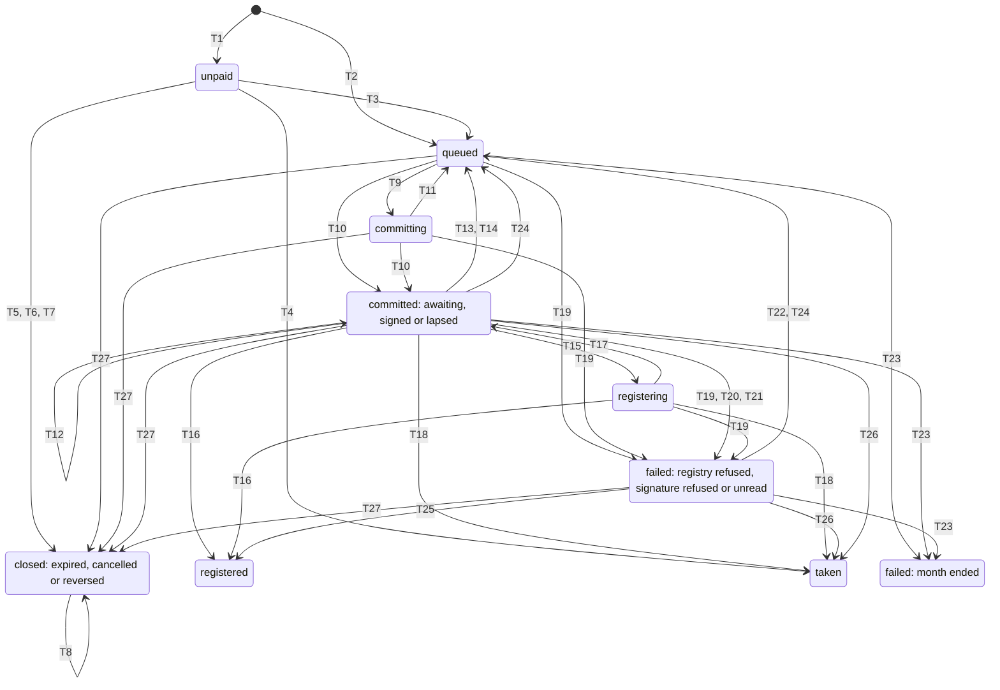

| | From → to | Trigger | Effect |
|---|---|---|---|
| T1 | start → unpaid | An invoice order by card, BTC or XMR. | An invoice is opened at the provider. It holds only its price. A held name is refused `name_taken` (`placeOrder`). |
| T2 | start → queued | A code order. | The name is held and the month starts. The code is reserved. Other buyers' open invoices of the name are cancelled at their providers, then here (`announceHeld`). |
| T3 | unpaid → queued | The invoice is paid in full, and no other order holds the name. | The name is held; `paid_at` is the settlement's time. Other buyers' open invoices of the name are cancelled (`settleOrder`, `cancelNameInvoices`). |
| T4 | unpaid → taken | The invoice is paid in full while another order holds the name. | The order's price is credited to its balance (`takenAtSettlement`). |
| T5 | unpaid → closed, expired | Nothing is paid by the invoice's expiry, or a new order of the same wallet and name is placed after it. | The order is no longer live (`expireOverdue`, `closeOverdue`). |
| T6 | unpaid → closed, cancelled | The buyer cancels the invoice, or another order's payment holds the name. | As T5 (`cancelOpenInvoice`). |
| T7 | unpaid → closed, reversed | The payment is settled after a reversal of it was recorded. | Nothing is credited (`reversedAtSettlement`). |
| T8 | closed → closed | Money is received on the closed invoice. | Once confirmed, it is credited to the order's balance, unless the order has a reversal (`creditLateInvoice`). |
| T9 | queued → committing | The node accepts the commit's dry run. | The commit is sent (`sendCommit`). |
| T10 | queued or committing → committed | The commitment is on chain, with the reveal margin left of its window. | The window's times are stored (`toCommitted`). |
| T11 | committing → queued | The commitment's window is over, or the commit is mined with status 0 below its cap. | A mined failure is stored as an attempt; the commit is sent again (`fromCommitment`, `commit`). |
| T12 | committed → committed | The page stores the owner's signature; or the signature is cleared (`InvalidNonce`, `TermsMismatch`, `TermsNotAccepted`, `SignatureExpired`, its deadline passed, its acceptance refused under another name policy or kind of terms); or no signature is stored by the window's end. | The view's signature reads `signed`, `awaiting` or `lapsed` (`judge`, `relayAcceptance`, `sendRegister`). |
| T13 | committed → queued | The page asks `/retry` for an order past its window unsigned. | The same commitment is committed again (`retryRegistration`). |
| T14 | committed → queued | The node reverts the register's dry run with `CommitmentTooOld` past the window, or with `CommitmentNotFound`. | The commitment is committed again with the stored signature; `CommitmentTooOld` is logged and reported (`judge`). |
| T15 | committed → registering | The signature is stored, the acceptance is held by the name policy or relayed, and the window has opened. | The register is sent (`sendRegister`). |
| T16 | committed or registering → registered | A register is mined with status 1, or the owner holds the name at the confirmation depth. | A code is spent (`confirmLanded`). |
| T17 | registering → committed | Every register transaction is settled, none with status 1, and the name is read as free, below the cap. | The mined failure is stored as an attempt; the register is sent again (`judge`, `failedAttempt`). |
| T18 | committed or registering → taken | The chain reverts a register or relay while the name is not available at the confirmation depth. | A paid order's price is credited to its balance; a code is released (`taken`). |
| T19 | queued, committing, committed or registering → failed, registry refused | Failed attempts are counted to a cap: 5 dry runs reverted for a permanent reason, or 5 transactions mined with status 0, among the commitment's commits, relays and registers. | Logged and reported; the order still holds its name (`failedAttempt`). |
| T20 | committed → failed, signature refused | The service cannot verify the stored signature, within its deadline, under its chain id and sponsor, before the relay or the register. | Logged and reported; nothing is sent (`intentRefused`). |
| T21 | committed → failed, unread | The order is committed without a signature, and its page has not read it for 3 days. | Logged and reported; the order still holds its name (`committed`). |
| T22 | failed, unread → queued | The page sends the owner's signature (Continue). | Queued with the signature (`revealHandler` in [`Web/Names/Registration.hs`](../src/StoreService/Web/Names/Registration.hs)). |
| T23 | queued, committed or failed → failed, month ended | The month is over, and no register transaction of the order is pending. | The order is no longer live; a paid order's price is credited to its balance; a code is released; logged and reported (`endMonths`). |
| T24 | failed (registry refused or unread), or committed past its window → queued | The owner moves the order to another name or other links, at most 3 times. | A new commitment; the month is unchanged; a cheaper name's difference is credited to the balance; other buyers' open invoices of the new name are cancelled (`retargetOrder`). |
| T25 | failed → registered | At a move or support's close, the service finds the order's register mined with status 1, or the owner holding the name. | As T16 (`checkFailedOrder`, `closeRegistration`). |
| T26 | failed, or committed past its window → taken | Support's `//close` of a paid order. | The price is credited to the balance, then recorded as refunded (`closeRegistration`). |
| T27 | queued, committing, committed or failed → closed, reversed | A dispute or refund of the payment while no register transaction of the order was saved. | The hold is released; nothing is credited (`reverseOrder`). |

The functions named are in [`Names/Worker.hs`](../src/StoreService/Names/Worker.hs), [`Names/Orders.hs`](../src/StoreService/Names/Orders.hs), [`Orders.hs`](../src/StoreService/Orders.hs), [`Web/Names/Orders.hs`](../src/StoreService/Web/Names/Orders.hs), [`Names/Store.hs`](../src/StoreService/Names/Store.hs), [`Names/Balances.hs`](../src/StoreService/Names/Balances.hs) and [`Names/LateCredits.hs`](../src/StoreService/Names/LateCredits.hs).

The page offers another name only for an order whose name was taken; the service accepts a move (T24) for every failed order but a month-ended or signature-refused one (`movable` in [`Names/Orders.hs`](../src/StoreService/Names/Orders.hs)). A dispute or refund of an order not cancelled (a register sent, taken, month ended or registered) takes the reversed cents back from its balance, as section 3.12 says. Every paid order not registered 3 hours after `paid_at` is alerted once, failed orders included; only live orders are counted in the gauge `simplex_store_names_unregistered_oldest_paid_timestamp_seconds`.
