# SimpleX names in the store service: architecture and flows

> With the names part of the SimpleX store service, added by [PR 7979](https://github.com/simplex-chat/simplex-chat/pull/7979), SimpleX names are sold on simplex.domains and registered on chain. A name is paid by card (Stripe), by Bitcoin or Monero (BTCPay), with a prepaid code, or from the balance of an earlier order. Each order is checked against the names contracts; the service then commits the order's commitment, relays the owner's acceptance of the terms and registers the name. Every transaction is signed with the service's registrar key, and the owner signs messages that the service verifies. One process per database runs the web API, the payment poller, the names worker, the transaction sender, the record edits lane and the chat core. The badge sale existed before this PR and is shown only where parts are shared with it.
>
> Related docs: [README](../README.md) | [Names overview](../../../docs/protocol/names-overview.md) | [Deployment](../../../scripts/store-service/README.md)

**Source:** [`Service.hs`](../src/StoreService/Service.hs) | [`Web/Server.hs`](../src/StoreService/Web/Server.hs) | [`Web/Names.hs`](../src/StoreService/Web/Names.hs) | [`Web/Names/`](../src/StoreService/Web/Names) | [`Poller.hs`](../src/StoreService/Poller.hs) | [`Orders.hs`](../src/StoreService/Orders.hs) | [`Names/`](../src/StoreService/Names) | [`Group.hs`](../src/StoreService/Group.hs) | [`Config.hs`](../src/StoreService/Config.hs)

---

## Table of contents

1. [System diagram](#1-system-diagram)
2. [Parts](#2-parts)
3. [Scenarios](#3-scenarios)
   1. [A name ordered and paid by card or crypto](#31-a-name-ordered-and-paid-by-card-or-crypto)
   2. [A paid order registered on chain](#32-a-paid-order-registered-on-chain)
   3. [A prepaid name code issued and spent](#33-a-prepaid-name-code-issued-and-spent)
   4. [A name searched, and a link previewed](#34-a-name-searched-and-a-link-previewed)
   5. [A register transaction that fails](#35-a-register-transaction-that-fails)
   6. [A failed order queued again or moved](#36-a-failed-order-queued-again-or-moved)
   7. [An owner's orders found](#37-an-owners-orders-found)
   8. [A balance spent on another name](#38-a-balance-spent-on-another-name)
   9. [Late crypto credited](#39-late-crypto-credited)
   10. [A balance refunded by support](#310-a-balance-refunded-by-support)
   11. [A registered name's links edited](#311-a-registered-names-links-edited)
   12. [Service start](#312-service-start)

---

## 1. System diagram

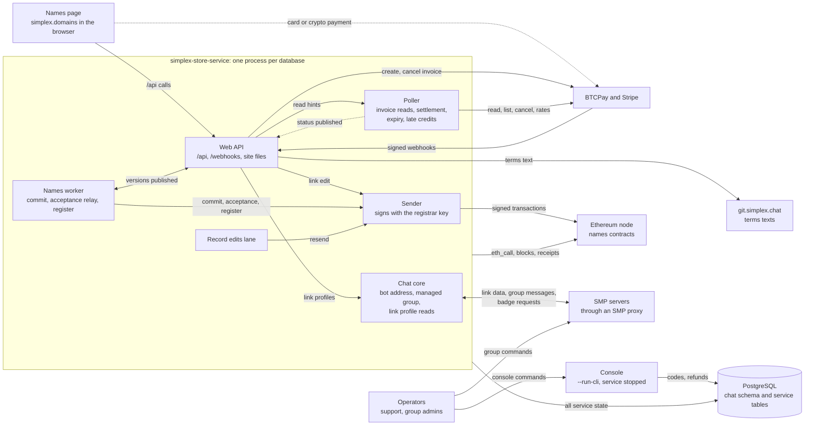

How a request flows:

1. The page calls `/api/*` on its own origin. The API and both webhooks are answered on every listener port. With `serve_webapp = on` the names site is also served on the names port; with it off, as the template sets, Caddy serves the exported sites and proxies `/api/*` to `badges_port`. Caddy is configured outside this repository ([`Web/Server.hs:124-151`](../src/StoreService/Web/Server.hs#L124-L151), [`Config.hs:505-514`](../src/StoreService/Config.hs#L505-L514), [`store_service.ini.example:8-11`](../../../scripts/store-service/store_service.ini.example#L8-L11), [`README.md:702-795`](../README.md#L702-L795)).
2. A route is matched, its method checked, one token of its per-client limit taken (webhooks and site files take none), then its handler run ([`Web/Names.hs:46-51`](../src/StoreService/Web/Names.hs#L46-L51), [`Web/Http.hs:209-222`](../src/StoreService/Web/Http.hs#L209-L222)).
3. An order is checked against the contracts with `eth_call`, a provider invoice is created, and the order is written with its invoice in one transaction ([`Web/Names/Orders.hs:86-173`](../src/StoreService/Web/Names/Orders.hs#L86-L173)).
4. On a webhook only a read is queued. The poller reads the provider and settles the invoice in one transaction; a paid order is moved from `unpaid` to `queued` ([`Web/Server.hs:500-554`](../src/StoreService/Web/Server.hs#L500-L554), [`Poller.hs:248-263`](../src/StoreService/Poller.hs#L248-L263), [`Orders.hs:95-213`](../src/StoreService/Orders.hs#L95-L213)).
5. After each commit the new invoice status or registration version is published to in-memory watches, and the held long polls and worker threads waiting on them resume ([`Orders.hs:106-117`](../src/StoreService/Orders.hs#L106-L117), [`Waiters.hs:24-84`](../src/StoreService/Waiters.hs#L24-L84), [`Names/Phases.hs:23-65`](../src/StoreService/Names/Phases.hs#L23-L65)).
6. The names worker scans the database every 5 s and follows each order in `queued`, `committing`, `committed` or `registering` in a thread of its own ([`Names/Worker.hs:82-84`](../src/StoreService/Names/Worker.hs#L82-L84), [`Names/Worker.hs:115-126`](../src/StoreService/Names/Worker.hs#L115-L126)).
7. Every transaction is sent through the sender: dry run, nonce, fees, EIP-1559 signature with the registrar key, a saved row, then broadcast. Receipts are followed every 4 s to the confirmation depth ([`Names/Sender.hs:107-131`](../src/StoreService/Names/Sender.hs#L107-L131), [`Names/Sender.hs:151-226`](../src/StoreService/Names/Sender.hs#L151-L226)).
8. A link edit is submitted to the sender on its request's thread, and pending edits are settled by the record edits lane every 4 s ([`Names/Records.hs:156-263`](../src/StoreService/Names/Records.hs#L156-L263), [`Names/Records.hs:265-302`](../src/StoreService/Names/Records.hs#L265-L302)).
9. Link profiles are read through the chat core's connect plan, and the link data through SMP servers ([`Names/Profiles.hs:269-274`](../src/StoreService/Names/Profiles.hs#L269-L274), [`Chat/Library/Internal.hs:1723-1726`](../../../src/Simplex/Chat/Library/Internal.hs#L1723-L1726)).
10. Operators issue and revoke codes in the managed group while the service runs. In the console, a separate run of the same binary while the service is stopped, they issue and revoke codes and record refunds ([`Group.hs:263-300`](../src/StoreService/Group.hs#L263-L300), [`Main.hs:25-28`](../Main.hs#L25-L28), [`Service.hs:412-430`](../src/StoreService/Service.hs#L412-L430)).
11. One process runs per database: a PostgreSQL advisory lock is held on a connection of its own for the whole run ([`Store/Migrate.hs:46-58`](../src/StoreService/Store/Migrate.hs#L46-L58)).

---

## 2. Parts

| Part | Role | Source |
|---|---|---|
| Startup | `store_service.ini` is parsed, the database lock taken, and the node's chain id and the issuer key checked; then the chat core is started. In its callback the providers, the names environment and the web environment are built, the sites exported, the managed group resolved, and all lanes started together. Without `--service-config` only the chat side and the badge request lanes run. | [`Main.hs:15-28`](../Main.hs#L15-L28), [`Service.hs:280-370`](../src/StoreService/Service.hs#L280-L370) |
| Web API | Warp listeners on `[listener] host`: `badges_port` (8080) always, `names_port` (8081) with `[names]` and `serve_webapp = on`. `/api/*` and both webhooks are answered on every port. Per-client limits a minute: read 60, search 30, preview 20, code 10, records 10, create 5, find 5. At most 500 long polls are held at once, each up to 30 s. | [`Web/Server.hs:121-151`](../src/StoreService/Web/Server.hs#L121-L151), [`Web/Server.hs:562-585`](../src/StoreService/Web/Server.hs#L562-L585), [`Config.hs:505-514`](../src/StoreService/Config.hs#L505-L514), [`Web/Names.hs:28-51`](../src/StoreService/Web/Names.hs#L28-L51), [`Web/Http.hs:109-154`](../src/StoreService/Web/Http.hs#L109-L154) |
| Order handlers | An order is placed in one of three ways: a paid invoice, a prepaid code, a spend of another order's balance. The owner's signature, the timestamp, the duration, the terms and an available name are checked, then the chain price for a paid or spent order and the balance for a spend. The order is written in one transaction, in which the same wallet's overdue orders for that name are closed. | [`Web/Names/Orders.hs:86-306`](../src/StoreService/Web/Names/Orders.hs#L86-L306), [`Names/Orders.hs:201-310`](../src/StoreService/Names/Orders.hs#L201-L310), [`Names/Balances.hs:79-106`](../src/StoreService/Names/Balances.hs#L79-L106) |
| Registration and owner handlers | The registration view, held on its version; the reveal; Try again; find by the owner's signature; a move to another name. | [`Web/Names/Registration.hs:45-140`](../src/StoreService/Web/Names/Registration.hs#L45-L140), [`Web/Names/Owner.hs:44-152`](../src/StoreService/Web/Names/Owner.hs#L44-L152), [`Names/Reveal.hs:103-145`](../src/StoreService/Names/Reveal.hs#L103-L145), [`Names/View.hs:52-112`](../src/StoreService/Names/View.hs#L52-L112) |
| Search handlers | Name status, price, terms, and records with link profiles; the terms text; the link preview. These handlers only read. | [`Web/Names/Search.hs:53-154`](../src/StoreService/Web/Names/Search.hs#L53-L154), [`Names/Profiles.hs:236-274`](../src/StoreService/Names/Profiles.hs#L236-L274) |
| Poller | One loop. A pass is run every `waiting_seconds` (3) while a page holds an invoice poll, else every `idle_seconds` (60), and webhook read hints are served between passes. Invoices are settled, overdue ones expired 10 minutes past their window, late money credited, and unpaid orders deleted daily, 30 days after their invoice expired. | [`Poller.hs:62-76`](../src/StoreService/Poller.hs#L62-L76), [`Poller.hs:148-168`](../src/StoreService/Poller.hs#L148-L168), [`Poller.hs:559-598`](../src/StoreService/Poller.hs#L559-L598), [`Orders.hs:95-275`](../src/StoreService/Orders.hs#L95-L275), [`Names/LateCredits.hs:50-72`](../src/StoreService/Names/LateCredits.hs#L50-L72) |
| Names worker | A thread is started by a scan every 5 s for each order in `queued`, `committing`, `committed` or `registering`: commit, wait for the reveal, terms acceptance relay, register, and the outcome judged from chain state. A daily sweep releases the codes of code orders failed for 30 days. | [`Names/Worker.hs:115-401`](../src/StoreService/Names/Worker.hs#L115-L401), [`Names/Worker.hs:503-522`](../src/StoreService/Names/Worker.hs#L503-L522) |
| Sender | Signs with `[chain] service_key`, the only signer of that key. Per transaction: dry run, nonce, fees within `max_fee_per_gas` and within 1 ETH over the gas limit, EIP-1559 signature, a saved row, broadcast. Every 4 s: receipts followed to `confirmations` (default 3), an unknown transaction rebroadcast, and one unmined after 36 s replaced with higher fees when the market's fees have passed its own, within the same caps. | [`Names/Sender.hs:109-332`](../src/StoreService/Names/Sender.hs#L109-L332) |
| Record edits relay and lane | Owner-signed link edits, each relayed as one resolver transaction through the sender, within `record_edits_per_year` and 10 an hour per name. Pending edits are settled by the lane every 4 s. | [`Names/Records.hs:112-366`](../src/StoreService/Names/Records.hs#L112-L366), [`Web/Names/Records.hs:34-86`](../src/StoreService/Web/Names/Records.hs#L34-L86) |
| Contracts reader and chain client | One JSON-RPC client to `[chain] rpc_url`, 10 s per call, redirects refused. Typed `eth_call` reads; the name policy address, the registrar constants and the commitment ages kept once read; terms texts fetched once per hash. | [`Names/Contracts.hs:137-379`](../src/StoreService/Names/Contracts.hs#L137-L379), [`Names/Chain.hs:112-305`](../src/StoreService/Names/Chain.hs#L112-L305) |
| In-memory coordination | Waiters: invoice status and payments. Phases: registration versions. Locks: one writer at a time per label hash, prepaid code and balance. Read hints: up to 256 webhook reads queued for the poller. | [`Waiters.hs:14-91`](../src/StoreService/Waiters.hs#L14-L91), [`Names/Phases.hs:15-65`](../src/StoreService/Names/Phases.hs#L15-L65), [`Names/Turns.hs:3-69`](../src/StoreService/Names/Turns.hs#L3-L69), [`Poller.hs:88-108`](../src/StoreService/Poller.hs#L88-L108) |
| Chat core | The SimpleX chat controller with the bot user: the bot address for badge requests, the managed group's messages, and connect plans for link profiles. Every chat event is read from `outputQ` by one reader. | [`Service.hs:293-313`](../src/StoreService/Service.hs#L293-L313), [`Service.hs:636-645`](../src/StoreService/Service.hs#L636-L645), [`Names/Profiles.hs:269-274`](../src/StoreService/Names/Profiles.hs#L269-L274) |
| Badge request lanes | Badge requests on the bot address, present before this PR: three lanes, each answer sent as `APISendServiceResponse`. | [`Service.hs:572-657`](../src/StoreService/Service.hs#L572-L657) |
| Group lane | With `[group]`: one managed group. `/issue` and `/bulk` are taken from moderators, `/revoke` and name codes from admins. A name code command is refused once the name codes created in the last 24 hours, console ones included, would pass 100. | [`Group.hs:87-304`](../src/StoreService/Group.hs#L87-L304), [`Group/Command.hs:59-73`](../src/StoreService/Group/Command.hs#L59-L73), [`Group/Command.hs:216-220`](../src/StoreService/Group/Command.hs#L216-L220) |
| Console | The same binary under `--run-cli`, while the service is stopped: the terminal chat and the badge request lanes only, with `//issue`, `//issue name`, `//revoke` and `//refund`. | [`Main.hs:25-28`](../Main.hs#L25-L28), [`Service.hs:381-506`](../src/StoreService/Service.hs#L381-L506) |
| PostgreSQL | One database (`BADGE_DB_CONN`) with the chat core's schema and the `sx_badge_service_` tables. Names tables: prepaid codes, registrations, balances, name invoices, late credits, record edits and their changes, transactions. Partial unique indexes admit one active order (`live = 1`) per commitment and per owner and label hash. | [`Store/Postgres/Migrations.hs:276-473`](../src/StoreService/Store/Postgres/Migrations.hs#L276-L473), [`compose.yml:16`](../../../scripts/store-service/compose.yml#L16) |
| Names page | simplex.domains, in the submodule `apps/simplex-domains`, outside this checkout. `/api/*` is called on its own origin, and the owner's EIP-191 and EIP-712 signatures are sent from it. | [`.gitmodules:4-7`](../../../.gitmodules#L4-L7), [`Web/Names.hs:28-44`](../src/StoreService/Web/Names.hs#L28-L44) |
| BTCPay | Bitcoin and Monero invoices through Greenfield: create, read, list, cancel (status `Invalid`), store rates; webhooks signed with `BTCPay-Sig`. | [`Providers/BTCPay.hs:267-367`](../src/StoreService/Providers/BTCPay.hs#L267-L367), [`Providers/BTCPay.hs:524-538`](../src/StoreService/Providers/BTCPay.hs#L524-L538), [`Providers/BTCPay.hs:555-578`](../src/StoreService/Providers/BTCPay.hs#L555-L578) |
| Stripe | Card PaymentIntents: create with an `Idempotency-Key`, read, list, cancel, also after 3 declined charges; webhooks signed with `Stripe-Signature`, within 15 minutes. | [`Providers/Stripe.hs:101-302`](../src/StoreService/Providers/Stripe.hs#L101-L302) |
| Ethereum node and names contracts | `[chain] rpc_url`: https, or http to a node on loopback. Controller, sponsor, base registrar and resolver are set in `[chain]`; the registry is read from `ens()`, the name policy from `namePolicy()`. The registrar key's USD allowance on the sponsor is raised outside the service with `setRegistrarAllowance`; on an `InsufficientAllowance` revert the order waits and an error is logged. | [`Config.hs:186-198`](../src/StoreService/Config.hs#L186-L198), [`Config.hs:698-703`](../src/StoreService/Config.hs#L698-L703), [`Names/Contracts.hs:150-220`](../src/StoreService/Names/Contracts.hs#L150-L220), [`Names/Worker.hs:341`](../src/StoreService/Names/Worker.hs#L341) |
| SMP servers and proxy | Hold the bot address, the group's queues and the data of buyers' short links. Private routing for unknown servers, with a protected fallback, is preset by `terminalChatConfig`. | [`Chat/Terminal.hs:41-63`](../../../src/Simplex/Chat/Terminal.hs#L41-L63), [`Chat/Library/Internal.hs:1723-1726`](../../../src/Simplex/Chat/Library/Internal.hs#L1723-L1726) |
| git.simplex.chat | Hosts the terms files the name policy links to, at a fixed commit, with the sha256 in the link. A loopback link is taken only on chain 31337. | [`Names/Contracts.hs:229-290`](../src/StoreService/Names/Contracts.hs#L229-L290) |

Deployment, the gas key and Caddy are described in the [README](../README.md#deployment) and in [`scripts/store-service`](../../../scripts/store-service/README.md).

---

## 3. Scenarios

Participants:

| Letter | Participant |
|---|---|
| P | the names page in the buyer's browser, which sends the owner's signatures |
| W | the Web API: the Warp listeners and their handlers |
| D | PostgreSQL |
| E | the Ethereum node with the names contracts |
| V | the payment provider: BTCPay or Stripe |
| L | the poller |
| K | the names worker |
| S | the sender |
| R | the record edits lane |
| C | the chat core, or the console under `--run-cli` |
| M | SMP servers, reached through an SMP proxy |
| G | git.simplex.chat |
| O | an operator: support or a group admin |
| B | the buyer |
| U | the startup code: `Main.hs` and `storeService` |

Terms used in the diagrams:

- A lock is held in the process: one request or lane at a time per name (its label hash), prepaid code or balance ([`Names/Turns.hs:3-69`](../src/StoreService/Names/Turns.hs#L3-L69)).
- A read hint asks the poller to read one invoice at the provider before its next pass ([`Poller.hs:88-108`](../src/StoreService/Poller.hs#L88-L108)).
- A lane is a thread that runs for the whole life of the process ([`Service.hs:301-313`](../src/StoreService/Service.hs#L301-L313), [`Service.hs:366-370`](../src/StoreService/Service.hs#L366-L370)).
- `ID` is a registration or invoice id, `SOURCE` the registration id of the order whose balance pays, `LABELHASH` the keccak256 of the label, `REFERENCE` an invoice id or a registration id. A signed order is `owner`, `labelHash`, `length`, `duration`, `commitment`, `sealed`, `terms`, `timestamp` and `signature` ([`Names/Orders.hs:150-169`](../src/StoreService/Names/Orders.hs#L150-L169)).

---

### 3.1 A name ordered and paid by card or crypto

A signed order is turned into an open invoice at the provider and a registration in phase `unpaid`, which is moved to `queued` when the payment is settled.

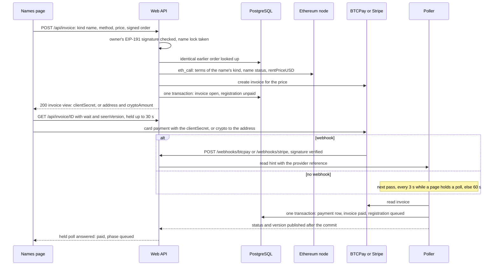

Notes:

- The checks are run in the contract's order: timestamp within 600 s, duration (paid years plus the free days until `term_start`), current terms, a name available on chain and not in `registering` here, then the chain price, at least `min_price_cents_per_year` times the paid years and equal to the order's ([`Web/Names/Orders.hs:104-118`](../src/StoreService/Web/Names/Orders.hs#L104-L118), [`Names/Orders.hs:266-310`](../src/StoreService/Names/Orders.hs#L266-L310), [`Names/Contracts.hs:180-192`](../src/StoreService/Names/Contracts.hs#L180-L192)). Refusals are listed in [`Web/Names/Orders.hs:344-357`](../src/StoreService/Web/Names/Orders.hs#L344-L357).
- The terms text is fetched from git.simplex.chat on the first use of its hash and checked against the sha256 in its link; while it cannot be read, the order is answered `503 terms_unavailable` ([`Names/Orders.hs:284-291`](../src/StoreService/Names/Orders.hs#L284-L291), [`Names/Contracts.hs:229-258`](../src/StoreService/Names/Contracts.hs#L229-L258), [`Web/Names/Orders.hs:356`](../src/StoreService/Web/Names/Orders.hs#L356)).
- The name lock is held across the provider call, and the answer is sent after it. Overdue unpaid orders of the same wallet and name are closed in the order's transaction ([`Web/Names/Orders.hs:76-100`](../src/StoreService/Web/Names/Orders.hs#L76-L100), [`Names/Orders.hs:207-243`](../src/StoreService/Names/Orders.hs#L207-L243)).
- When the order is not written, its provider invoice is cancelled. Provider checkouts are capped at 30 a minute for all clients together ([`Web/Names/Orders.hs:139-173`](../src/StoreService/Web/Names/Orders.hs#L139-L173), [`Web/Http.hs:151-154`](../src/StoreService/Web/Http.hs#L151-L154)).
- Stripe is sent `metadata[order]` = `name:0x<order hash>` and an `Idempotency-Key`; BTCPay is sent the amount, the currency and the checkout settings ([`Providers/Stripe.hs:240-269`](../src/StoreService/Providers/Stripe.hs#L240-L269), [`Providers/BTCPay.hs:303-339`](../src/StoreService/Providers/BTCPay.hs#L303-L339)).
- On a webhook only a read is queued, and 200 is answered ([`Web/Server.hs:500-554`](../src/StoreService/Web/Server.hs#L500-L554)).
- An open invoice without money can be cancelled with `POST /api/invoice/ID/cancel`: the provider is told first, then the row is expired and the order closed ([`Web/Server.hs:358-381`](../src/StoreService/Web/Server.hs#L358-L381), [`Orders.hs:244-263`](../src/StoreService/Orders.hs#L244-L263)).
- Unpaid: 10 minutes past the expiry the poller's sweep expires the invoice and closes the order, after it cancels a Stripe intent; BTCPay expires its own invoice. The unpaid order is deleted 30 days after the expiry ([`Poller.hs:62-76`](../src/StoreService/Poller.hs#L62-L76), [`Poller.hs:295-345`](../src/StoreService/Poller.hs#L295-L345), [`Orders.hs:265-275`](../src/StoreService/Orders.hs#L265-L275), [`Providers.hs:96-100`](../src/StoreService/Providers.hs#L96-L100)).
- Under `codes_only = on` this route is refused with `403 codes_only` ([`Web/Names/Orders.hs:88`](../src/StoreService/Web/Names/Orders.hs#L88)).

---

### 3.2 A paid order registered on chain

The names worker commits the order's commitment, waits for the page's signed reveal, relays the terms acceptance and registers the name.

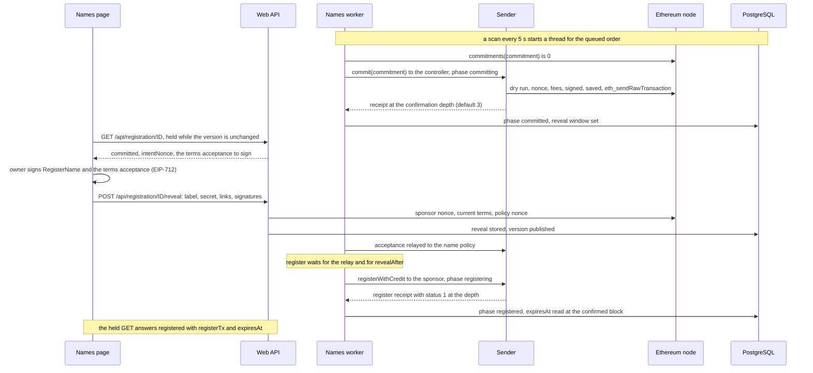

Notes:

- Every transaction here is sent through the sender as the commit is, with value 0 and its gas paid by the registrar key; each kind is sent at most 5 times per order, moves included ([`Names/Chain.hs:199-214`](../src/StoreService/Names/Chain.hs#L199-L214), [`Names/Worker.hs:428-449`](../src/StoreService/Names/Worker.hs#L428-L449)). By the code comments and the log line of an `InsufficientAllowance` revert, the rent is spent from the registrar key's allowance on the sponsor ([`Names/Contracts.hs:179-181`](../src/StoreService/Names/Contracts.hs#L179-L181), [`Names/Worker.hs:341`](../src/StoreService/Names/Worker.hs#L341)).
- `RegisterName` is signed in the EIP-712 domain `SimplexSponsor`, the acceptance in `SimplexNamePolicy`, as `AcceptGeneralTerms` or `AcceptCommunityTerms` ([`Names/Registration.hs:80-111`](../src/StoreService/Names/Registration.hs#L80-L111)).
- The reveal is checked in the contract's order: the label, its hash and length, at most one link per key, the commitment rebuilt from the stored owner, duration and default resolver; the intent's deadline not before `revealBefore`, its signer and the sponsor nonce; the acceptance against the current terms and policy nonce; the links' kinds last ([`Names/Reveal.hs:103-145`](../src/StoreService/Names/Reveal.hs#L103-L145)).
- A reveal whose link is not a short link of its record's kind is answered `400 invalid_link`, and the order is marked `linksRefused`. The links are part of the commitment, so only a move (3.6) continues the order ([`Web/Names/Registration.hs:95-109`](../src/StoreService/Web/Names/Registration.hs#L95-L109), [`Names/Orders.hs:315-320`](../src/StoreService/Names/Orders.hs#L315-L320)).
- The acceptance relay is `commitUnderGeneralTermsWithSig` or `commitUnderCommunityTermsWithSig`. It is sent as soon as the reveal is stored, without waiting for `revealAfter`, while `revealBefore` has not passed, unless the policy already holds that acceptance. The register is sent after the relay settles and `revealAfter` has passed ([`Names/Worker.hs:254-272`](../src/StoreService/Names/Worker.hs#L254-L272)).
- The links are set by `setText` calls for `simplex.contact` and `simplex.channel` in the register's data ([`Names/Registration.hs:212-235`](../src/StoreService/Names/Registration.hs#L212-L235)).
- Without a reveal by `revealBefore` the order is set `failed` with "The name was not signed in time" ([`Names/Worker.hs:251-253`](../src/StoreService/Names/Worker.hs#L251-L253), [`Names/View.hs:145-152`](../src/StoreService/Names/View.hs#L145-L152)).
- After a restart every phase is resumed from the stored order and the sender's saved transactions ([`Names/Sender.hs:123-131`](../src/StoreService/Names/Sender.hs#L123-L131), [`Names/Worker.hs:6-8`](../src/StoreService/Names/Worker.hs#L6-L8)).

---

### 3.3 A prepaid name code issued and spent

An operator issues a code good for one name. The buyer's order with it is queued without an invoice. Under `codes_only = on`, a code is the only way to order a name.

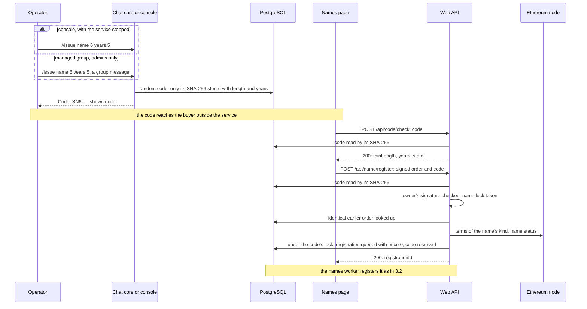

Notes:

- Only the code's SHA-256 is stored, so a code not copied when shown cannot be recovered ([`Names/Codes.hs:147-159`](../src/StoreService/Names/Codes.hs#L147-L159)). `unpaid` name codes are refused in the console ([`Service.hs:535-543`](../src/StoreService/Service.hs#L535-L543)).
- In the group, `/issue` is taken from moderators and above, a name code from admins. A name code command is refused once the name codes created in the last 24 hours, console ones included, would pass 100; the console has no cap ([`Group/Command.hs:59-73`](../src/StoreService/Group/Command.hs#L59-L73), [`Group.hs:289-294`](../src/StoreService/Group.hs#L289-L294), [`Service.hs:421-422`](../src/StoreService/Service.hs#L421-L422)).
- A code order is checked for the timestamp, the duration, the terms and an available name; its years are the code's, 2 for a community name ([`Web/Names/Orders.hs:216-222`](../src/StoreService/Web/Names/Orders.hs#L216-L222), [`Names/Community.hs:54-59`](../src/StoreService/Names/Community.hs#L54-L59)).
- The code is spent when the name is registered, released when the order is set `taken`, and kept for 30 days with a failed order for Try again, then released by the daily sweep ([`Names/Orders.hs:397-400`](../src/StoreService/Names/Orders.hs#L397-L400), [`Names/Worker.hs:361-365`](../src/StoreService/Names/Worker.hs#L361-L365), [`Names/Worker.hs:503-522`](../src/StoreService/Names/Worker.hs#L503-L522)).
- A name code is withdrawn by `//revoke` unless it is spent; a code an order already holds stays usable by that order ([`Names/Codes.hs:162-173`](../src/StoreService/Names/Codes.hs#L162-L173), [`Names/Codes.hs:78-88`](../src/StoreService/Names/Codes.hs#L78-L88)).
- Under `codes_only = on` the names site's `index.html` is served with `content="codes"`, and paid orders and spends are answered `403 codes_only` ([`Web/Server.hs:168-174`](../src/StoreService/Web/Server.hs#L168-L174), [`Web/Names/Orders.hs:88`](../src/StoreService/Web/Names/Orders.hs#L88), [`Web/Names/Orders.hs:240`](../src/StoreService/Web/Names/Orders.hs#L240)).

---

### 3.4 A name searched, and a link previewed

A search is answered with the name's state: available with its price and terms, reserved, or registered with its records and their profiles.

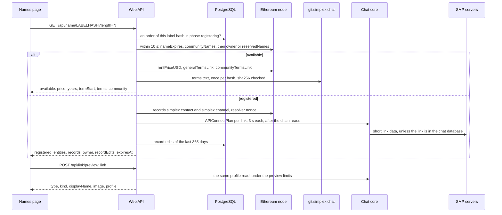

Notes:

- Only the label's hash and length are sent ([`Web/Names/Search.hs:53-57`](../src/StoreService/Web/Names/Search.hs#L53-L57)). 30 a minute per client are allowed for searches and terms reads together; chain reads are run for at most 16 searches at once, for all clients together, and a 17th is answered `429` ([`Web/Names.hs:34-36`](../src/StoreService/Web/Names.hs#L34-L36), [`Web/Http.hs:128-149`](../src/StoreService/Web/Http.hs#L128-L149)).
- The owner and resolver are read from the registry for a name registered or in its grace period (`nameExpires` plus `GRACE_PERIOD` not before the latest block's time); for any other name `reservedNames` is read ([`Names/Contracts.hs:149-162`](../src/StoreService/Names/Contracts.hs#L149-L162)).
- An available name's price is `rentPriceUSD` for its paid years; a price under `min_price_cents_per_year` times those years fails the search with `503 provider_unavailable` ([`Names/Contracts.hs:180-192`](../src/StoreService/Names/Contracts.hs#L180-L192)).
- A name shown available on chain while an order here is in `registering` is answered `registered` with no entities; a reserved name is answered `reserved` ([`Web/Names/Search.hs:66-72`](../src/StoreService/Web/Names/Search.hs#L66-L72), [`Web/Names/Search.hs:97-98`](../src/StoreService/Web/Names/Search.hs#L97-L98)).
- Records, their nonce and the edits left are read only for a name on the default resolver, and at most 5 links of each record ([`Names/Contracts.hs:164-177`](../src/StoreService/Names/Contracts.hs#L164-L177), [`Web/Names/Search.hs:99-130`](../src/StoreService/Web/Names/Search.hs#L99-L130)).
- A link whose host is, or resolves to, a non-public address is refused before it is read, and each DNS lookup is run in a thread of its own. Profiles are kept 600 s; 4 fetch slots are used by searches and 2 by previews ([`Names/Profiles.hs:83-95`](../src/StoreService/Names/Profiles.hs#L83-L95), [`Names/Profiles.hs:326-371`](../src/StoreService/Names/Profiles.hs#L326-L371)).
- Private routing for unknown servers, with a protected fallback, is preset by `terminalChatConfig` ([`Chat/Terminal.hs:59-63`](../../../src/Simplex/Chat/Terminal.hs#L59-L63)); the routing itself is implemented in simplexmq.
- `GET /api/terms/HASH` is answered with the text and link of either current terms link ([`Web/Names/Search.hs:141-154`](../src/StoreService/Web/Names/Search.hs#L141-L154)).

---

### 3.5 A register transaction that fails

After a register transaction reverts, the order is judged from chain state: its reveal is cleared for the page to sign again, it waits, it is set `taken` with its price kept as a balance, or it is set `failed`.

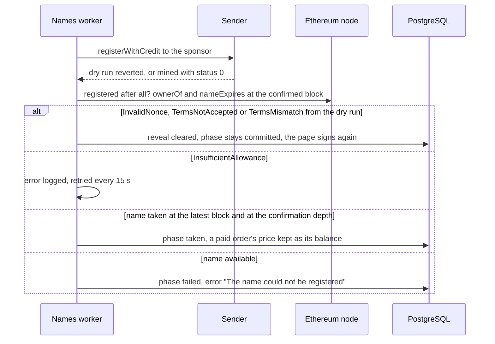

Notes:

- Whether the name was registered after all is checked first: on a register mined with status 1, or with the name held by the owner at the confirmation depth, the order is set `registered` ([`Names/Orders.hs:365-400`](../src/StoreService/Names/Orders.hs#L365-L400), [`Names/Worker.hs:329-336`](../src/StoreService/Names/Worker.hs#L329-L336)).
- An `InsufficientAllowance` revert waits for the registrar key's allowance on the sponsor to be raised outside the service ([`Names/Worker.hs:341`](../src/StoreService/Names/Worker.hs#L341)).
- On `CommitmentTooNew` the register is retried 1 s later. While the name is taken only above the confirmation depth, or is reported gone by the dry run while `available(label)` is true, the order is retried every 15 s ([`Names/Worker.hs:340-352`](../src/StoreService/Names/Worker.hs#L340-L352)).
- A code order set `taken` has its code released instead of a balance credited ([`Names/Worker.hs:361-368`](../src/StoreService/Names/Worker.hs#L361-L368)).

---

### 3.6 A failed order queued again or moved

A failed order is queued again by Try again, or moved to another name; both first check whether its name was registered after all.

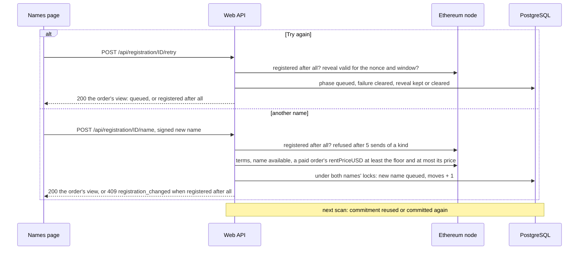

Notes:

- Try again is sent with the registration id alone. It is refused for an order whose links were refused, one with 5 sends of a kind, and a code order whose code no longer pays. The reveal is kept while the sponsor nonce is unchanged and the commitment has `reveal_margin_seconds` (default 900) left within the intent's deadline ([`Web/Names/Registration.hs:116-140`](../src/StoreService/Web/Names/Registration.hs#L116-L140), [`Names/Worker.hs:411-501`](../src/StoreService/Names/Worker.hs#L411-L501), [`Config.hs:654`](../src/StoreService/Config.hs#L654)). At the next scan a commitment with that margin left is reused; otherwise a new commit is sent, a second past the old commitment's lapse when one is on chain ([`Names/Worker.hs:175-206`](../src/StoreService/Names/Worker.hs#L175-L206)).
- A move is accepted for a failed order, or for one whose links were refused, up to `max_order_moves` (default 3). For a failed order the service checks first whether its name was registered after all, then refuses a move after 5 sends of a kind ([`Web/Names/Owner.hs:113-126`](../src/StoreService/Web/Names/Owner.hs#L113-L126), [`Config.hs:655`](../src/StoreService/Config.hs#L655)).
- Both names' locks are taken in hash order, and the first order's hash is kept. A paid order moved to a cheaper name is credited the difference; a code order is moved at price 0, its code reserved again ([`Names/Turns.hs:27-32`](../src/StoreService/Names/Turns.hs#L27-L32), [`Web/Names/Owner.hs:128-135`](../src/StoreService/Web/Names/Owner.hs#L128-L135), [`Names/Orders.hs:340-356`](../src/StoreService/Names/Orders.hs#L340-L356), [`Names/Store.hs:787-813`](../src/StoreService/Names/Store.hs#L787-L813)).
- A paid order's move reads the new name's price as an order does: a price under `min_price_cents_per_year` times the paid years is answered `503 name_check_unavailable`, and nothing is credited ([`Names/Contracts.hs:180-192`](../src/StoreService/Names/Contracts.hs#L180-L192)).

---

### 3.7 An owner's orders found

An owner without an order's link finds their orders by signing with their wallet; the ids found are used for Try again, a move, a spend or a refund.

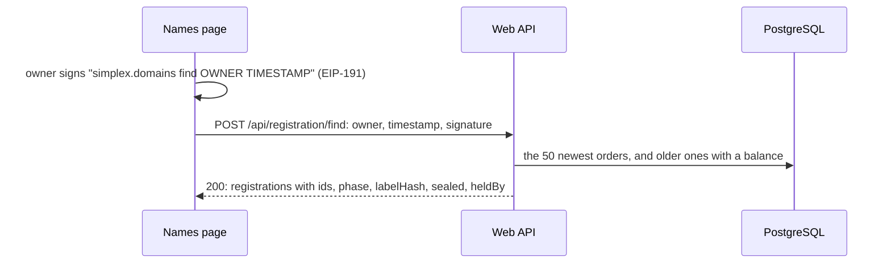

Notes:

- The signature and a timestamp within 600 s are checked; an owner without orders is answered `404`. 5 finds a minute are allowed per client ([`Web/Names.hs:38`](../src/StoreService/Web/Names.hs#L38), [`Web/Names/Owner.hs:44-67`](../src/StoreService/Web/Names/Owner.hs#L44-L67), [`Names/Signatures.hs:98-99`](../src/StoreService/Names/Signatures.hs#L98-L99), [`Names/Store.hs:815-837`](../src/StoreService/Names/Store.hs#L815-L837)).

---

### 3.8 A balance spent on another name

Another name of the same owner is paid from an order's balance, wholly or with an invoice for the difference.

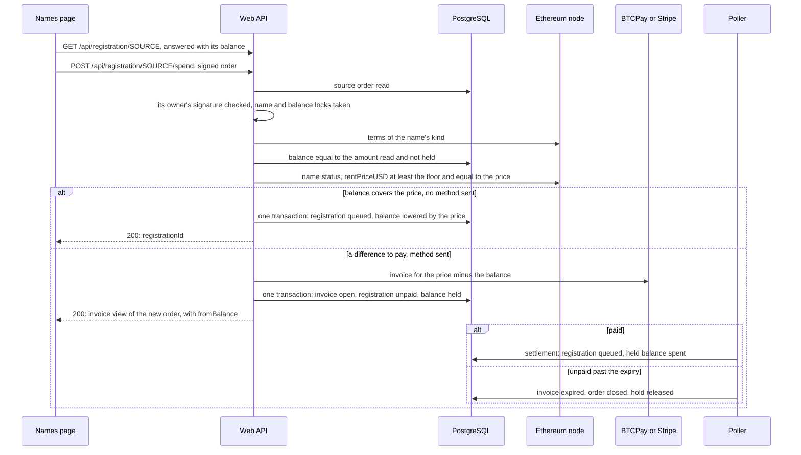

Notes:

- `method` is present exactly when the price is above the balance, and a card difference under 50 cents is refused ([`Web/Names/Orders.hs:280-306`](../src/StoreService/Web/Names/Orders.hs#L280-L306)).
- The chain price is checked as an order's: a price under `min_price_cents_per_year` times the paid years is answered `503 name_check_unavailable` before any payment ([`Names/Contracts.hs:180-192`](../src/StoreService/Names/Contracts.hs#L180-L192)).
- The spend is signed `simplex.domains spend SOURCE ...` by the source order's owner, who owns the new order ([`Web/Names/Orders.hs:249-257`](../src/StoreService/Web/Names/Orders.hs#L249-L257), [`Names/Signatures.hs:104-106`](../src/StoreService/Names/Signatures.hs#L104-L106)).
- A balance amount other than the one read, or a hold, is answered `409 balance_changed`. A hold by an overdue order is treated as none, and that order is closed in the spend's transaction ([`Names/Balances.hs:79-87`](../src/StoreService/Names/Balances.hs#L79-L87), [`Names/Orders.hs:236-243`](../src/StoreService/Names/Orders.hs#L236-L243)).
- The whole balance read is held by the difference order. At settlement the hold is spent; when it cannot be spent, the order is kept `queued` and an error is logged ([`Names/Store.hs:514-532`](../src/StoreService/Names/Store.hs#L514-L532), [`Orders.hs:200-204`](../src/StoreService/Orders.hs#L200-L204), [`Orders.hs:232-236`](../src/StoreService/Orders.hs#L232-L236)).
- Balances are credited when a paid order is set `taken` (its whole price), when a paid order moves to a cheaper name (the difference), and with late or extra money ([`Names/Worker.hs:359-368`](../src/StoreService/Names/Worker.hs#L359-L368), [`Names/Orders.hs:341-349`](../src/StoreService/Names/Orders.hs#L341-L349), [`Names/LateCredits.hs:66-72`](../src/StoreService/Names/LateCredits.hs#L66-L72)).

---

### 3.9 Late crypto credited

Crypto paid to an invoice whose order has closed is credited to that order's balance.

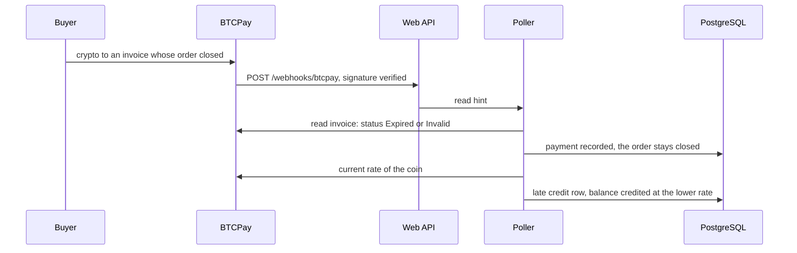

Notes:

- An invoice paid more crypto than it asked is settled as in 3.1, and only its confirmed units above the invoiced units are credited to the order's balance, the same way ([`Providers/BTCPay.hs:448-452`](../src/StoreService/Providers/BTCPay.hs#L448-L452), [`Names/LateCredits.hs:74-104`](../src/StoreService/Names/LateCredits.hs#L74-L104)).
- `InvoiceReceivedPayment` and `InvoicePaymentSettled` are among the BTCPay events acted on. From a BTCPay invoice read `Expired` or `Invalid` a closed signal is made, and at settlement the payment is recorded while the order is kept unpaid ([`Providers/BTCPay.hs:115`](../src/StoreService/Providers/BTCPay.hs#L115), [`Providers/BTCPay.hs:448-454`](../src/StoreService/Providers/BTCPay.hs#L448-L454), [`Orders.hs:55-60`](../src/StoreService/Orders.hs#L55-L60), [`Orders.hs:180-198`](../src/StoreService/Orders.hs#L180-L198)).
- Only confirmed money is credited: crypto as its share of the invoice's amount, at the lower of the invoice's and the current rate, rounded down to the cent. With a current rate below half the invoice's, the money is never credited and is marked for support ([`Names/LateCredits.hs:31-72`](../src/StoreService/Names/LateCredits.hs#L31-L72), [`Names/LateCredits.hs:114-129`](../src/StoreService/Names/LateCredits.hs#L114-L129)).
- Confirmed money not yet credited is credited again by a pass at the idle cadence ([`Poller.hs:347-367`](../src/StoreService/Poller.hs#L347-L367)). With late card money the invoice is set paid and the order kept closed; its cents are credited as they are ([`Orders.hs:184-189`](../src/StoreService/Orders.hs#L184-L189), [`Names/LateCredits.hs:91-95`](../src/StoreService/Names/LateCredits.hs#L91-L95)). Crypto sent to an invoice already recorded paid is left unrecorded, and an error naming it is logged at most hourly ([`Poller.hs:234-244`](../src/StoreService/Poller.hs#L234-L244)).

---

### 3.10 A balance refunded by support

Support records the refund of a balance in the console and pays it back by hand.

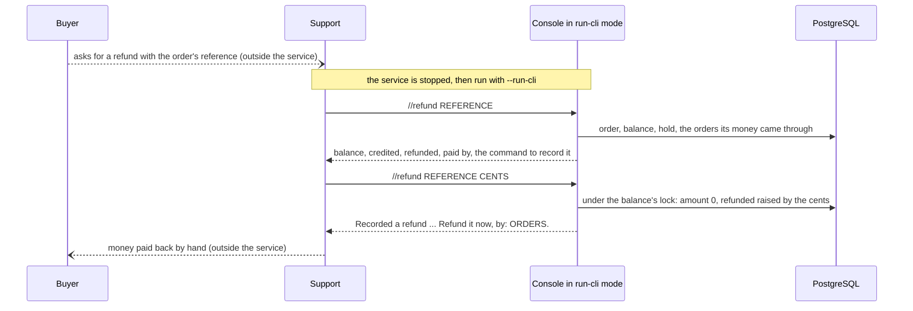

Notes:

- The refund must equal the whole balance, and a held balance is refused, overdue or not. `//refund` closes no holder: its answer asks support to start the service, whose poller closes an overdue holder 10 minutes after its expiry, then to run `//refund` again ([`Names/Balances.hs:40-65`](../src/StoreService/Names/Balances.hs#L40-L65), [`Names/Store.hs:1046-1056`](../src/StoreService/Names/Store.hs#L1046-L1056), [`Service.hs:498-506`](../src/StoreService/Service.hs#L498-L506)).
- The provider interface offers create, read, cancel, list, rate and webhook verification, so the money is paid back by hand ([`Providers.hs:120-130`](../src/StoreService/Providers.hs#L120-L130)). The buyer's email to chat@simplex.chat is described in the README; the page code is in the submodule ([`README.md:1371-1411`](../README.md#L1371-L1411)).
- The console starts only while the service is stopped, as the database lock is held by one process ([`Store/Migrate.hs:46-54`](../src/StoreService/Store/Migrate.hs#L46-L54)).

---

### 3.11 A registered name's links edited

The owner's signed link changes are relayed to the resolver as one transaction, its gas paid by the registrar key.

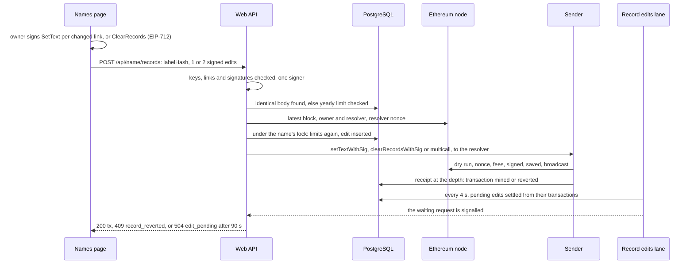

Notes:

- `SetText` and `ClearRecords` are signed in the EIP-712 domain `SimplexResolver`; the signer must be the registry's owner of a name on the default resolver, and the first nonce the owner's current resolver nonce, which the search answers as `recordsNonce` ([`Names/Registration.hs:83-84`](../src/StoreService/Names/Registration.hs#L83-L84), [`Names/Records.hs:185-195`](../src/StoreService/Names/Records.hs#L185-L195), [`Web/Names/Search.hs:105`](../src/StoreService/Web/Names/Search.hs#L105)).
- Edits relayed per name are bounded by `record_edits_per_year` (default 3, from 1 to 100) in any 365 days, and every stored edit is counted, a reverted one too; at most 10 are relayed per name an hour, and 10 requests are accepted a minute per client ([`Names/Records.hs:116-152`](../src/StoreService/Names/Records.hs#L116-L152), [`Config.hs:286-289`](../src/StoreService/Config.hs#L286-L289), [`Web/Http.hs:149`](../src/StoreService/Web/Http.hs#L149)).
- The earliest deadline must be more than 600 s past the latest block's time ([`Names/Records.hs:130-133`](../src/StoreService/Names/Records.hs#L130-L133), [`Names/Records.hs:185-195`](../src/StoreService/Names/Records.hs#L185-L195)).
- Two changes are sent in one `multicall`, and both or neither are applied ([`Names/Registration.hs:205-207`](../src/StoreService/Names/Registration.hs#L205-L207), [`Names/Records.hs:388-397`](../src/StoreService/Names/Records.hs#L388-L397)).
- An edit whose transactions were all dropped is judged from receipts, the owner's resolver nonce and the records, then resent before its deadline or settled ([`Names/Records.hs:288-347`](../src/StoreService/Names/Records.hs#L288-L347)). The records are read from the chain at the next search ([`Names/Contracts.hs:165-177`](../src/StoreService/Names/Contracts.hs#L165-L177)).

---

### 3.12 Service start

The production container starts one process, which checks its configuration, the database lock and the node, starts the chat core, then starts all lanes.

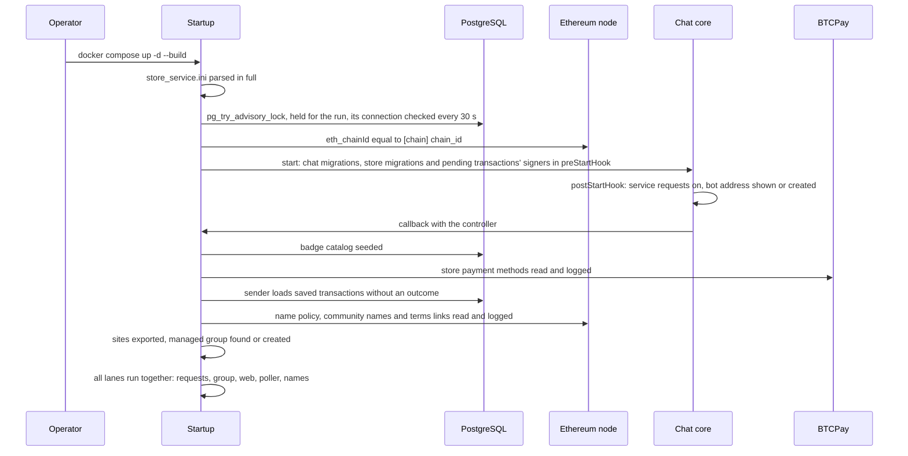

Notes:

- The container runs `simplex-store-service -d BADGE_DB_CONN --create-schema --yes-migrate --service-config /etc/simplex-store-service/store_service.ini` ([`compose.yml:14-20`](../../../scripts/store-service/compose.yml#L14-L20)).
- The process exits on a config error (Stripe keys of two modes, or Stripe test keys with `[names]` off chains 31337 and 11155111, among them), a held lock, a chain id mismatch, an issuer key mismatch, a failed migration, a pending transaction signed by another key or for another chain, or a missing site build; while it runs, it exits when the lock's connection fails. Compose restarts it after every exit until it is stopped ([`Main.hs:22-28`](../Main.hs#L22-L28), [`Config.hs:475-479`](../src/StoreService/Config.hs#L475-L479), [`Service.hs:280-285`](../src/StoreService/Service.hs#L280-L285), [`Service.hs:632-635`](../src/StoreService/Service.hs#L632-L635), [`Store/Migrate.hs:53-64`](../src/StoreService/Store/Migrate.hs#L53-L64), [`compose.yml:10`](../../../scripts/store-service/compose.yml#L10)). A node that does not answer `eth_chainId` is only warned of, unless `dev_keys` are set ([`Service.hs:169-181`](../src/StoreService/Service.hs#L169-L181)).
- The lanes are started in the chat core's callback, after `postStartHook`, so after the bot address exists, unless `--no-address` is passed ([`Chat/Core.hs:97-106`](../../../src/Simplex/Chat/Core.hs#L97-L106), [`Service.hs:301-313`](../src/StoreService/Service.hs#L301-L313), [`Service.hs:636-645`](../src/StoreService/Service.hs#L636-L645)).
- The names lanes are the sender, the record edits lane, the names worker and the code sweep; all lanes are started together with `raceAny_` from simplexmq ([`Service.hs:366-370`](../src/StoreService/Service.hs#L366-L370)).
- Under `--run-cli` the binary runs the terminal chat and the badge request lanes only ([`Service.hs:381-404`](../src/StoreService/Service.hs#L381-L404)).
