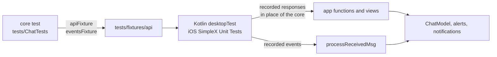

# Testing

The testing approaches of this repository: what is checked, how a test is written and run, and where CI runs it. The CI scopes, the reduced build and the `ci-tests` block of a pull request: [CI on GitHub's runners](../../scripts/ci/README.md).

## Tests for a change

| Change | Tests |
|---|---|
| Behaviour of the chat core: messages, groups, files, profiles, connections | [chat scenario test](#chat-scenario-tests) |
| Encoding of a protocol message or a JSON type, markdown, a pure function of the core | [unit test](#unit-tests) |
| Command, response, event or type of the core API | [Bot API docs](#checks-against-committed-files), regenerated<br>[app fixture](#app-fixtures), when an app processes it |
| Database migration | [schema dumps](#checks-against-committed-files) of SQLite and PostgreSQL<br>query plans |
| Directory service, badge service, remote sessions | the [suite](#suites) of the area |
| App processing of a core response or event | [app fixture](#app-fixtures), replayed in Kotlin and iOS tests |
| App screen | a preview, rendered by the [desktop](#desktop-snapshots) and [iOS](#simplex-snapshots) snapshot tests |
| Flow across app screens | a case of an [app workflow](#app-workflows) |
| Kotlin or Swift code without views | [desktopTest or commonTest](#kotlin-apps)<br>[SimpleX Unit Tests](#simplex-unit-tests) |
| Package, bot, website or CI script | the tests of its [scope](#packages-and-other-scopes) |
| Scope lacking CI tests | its CI coverage, in the same pull request ([Adding CI coverage](../../scripts/ci/README.md#adding-ci-coverage)) |

## Core

The hspec suite `simplex-chat-test` of simplex-chat.cabal, with the entry point [tests/Test.hs](../../tests/Test.hs). Building it, running it and selecting tests by hspec match patterns: [CI guide, core](../../scripts/ci/README.md#core). A pattern is a path of `describe` and `it` names, for example `/SimpleX chat client/direct tests/`.

- A new test module is added to `other-modules` of the test suite in simplex-chat.cabal, and its spec to `main` of Test.hs.
- `tests/tmp` contains a directory per test (`tmpBracket` in Test.hs) and is emptied at the start and the end of a run (`withTmpFiles` in ChatClient.hs).
- With `CI=true`, set on GitHub's runners, the tests marked `xdescribe''` and `xit''` are skipped, and on macOS those marked `xitMacCI` ([ChatTests/Utils.hs](../../tests/ChatTests/Utils.hs)); the tests marked `xit'` are skipped on Linux.
- [tests/fixtures](../../tests/fixtures): images and files sent in the tests, TLS credentials of the test servers, and the [app fixtures](#app-fixtures) in `api`.
- In the full matrix of build.yml, the whole suite runs on Linux x86_64, with GHC 9.6.3 and 8.10.7, and on macOS aarch64; on a draft pull request, the tests matched by its `ci-tests` block run.
- Coverage: `-fhpc` added to `ghc-options` of the test suite in simplex-chat.cabal.

### Suites

| Pattern | Module | Checked |
|---|---|---|
| `/SimpleX chat client/` | [ChatTests.hs](../../tests/ChatTests.hs) | [chat scenarios](#chat-scenario-tests): direct, forward, group, chat relay, local, file, profile and chat list tests |
| `/names tests/` | ChatTests/Names.hs | SimpleX names, resolved by a local resolver ([NameResolver.hs](../../tests/NameResolver.hs)); SQLite only |
| `/SimpleX chat protocol/` | ProtocolTests.hs | chat protocol messages, short link data, batch limits, preferences JSON |
| `/JSON Tests/` | JSONTests.hs, JSONFixtures.hs | conversion of the Swift JSON form to the tagged form, with QuickCheck; JSON of markdown |
| `/SimpleX chat markdown/` | MarkdownTests.hs | the markdown parser |
| `/SimpleX chat view/` | ViewTests.hs | functions of the CLI view |
| `/Mobile API Tests/` | MobileTests.hs | the API of the core library (src/Simplex/Chat/Mobile.hs) and its C functions; SQLite only |
| `/Message batching/` | MessageBatching.hs | batches of messages and of relay deliveries |
| `/Valid names/` | ValidNames.hs | display names made valid |
| `/Random servers/` | RandomServers.hs | the random choice of preset servers |
| `/Operators/` | OperatorTests.hs | server operators, usage conditions, validation of user servers |
| `/Member relations/` | MemberRelationsTests.hs | member relation vectors |
| `/Image resize/` | ImageTests.hs | image resizing |
| `/Supporter badges/` | BadgeTests.hs | badge credentials and proofs |
| `/WebRTC encryption/` | WebRTCTests.hs | encryption of call media frames; SQLite only |
| `/Remote session/` | RemoteTests.hs | a desktop controlling a mobile: handshake, messages, files |
| `/SimpleX Directory service bot/`<br>`/SimpleX Directory names/` | Bots/DirectoryTests.hs | the directory service with chat clients (`withDirectoryService`); names: SQLite only |
| `/SimpleX Broadcast bot/` | Bots/BroadcastTests.hs | the broadcast bot; skipped when `CI=true` |
| `/SimpleX badge service/` | Bots/BadgeService/*Tests.hs | configuration, web server and schema, catalog, groups, invoice waiters, payment providers, store receipts; the providers are local fakes (`Fake*.hs`) |
| `/SimpleX badge service e2e/` | Bots/BadgeService/BotTests.hs, GroupIntegrationTests.hs | the badge service bot with chat clients |
| `/Schema dump/`<br>`/Postgres schema dump/`<br>`/Bot API docs/`<br>`/Save query plans/` | SchemaDump.hs, PostgresSchemaDump.hs, APIDocs.hs | [committed files](#checks-against-committed-files) |

### Chat scenario tests

- Checked: chat cores of several clients connected through a test SMP server, by the terminal output of each client, and by queries of a client's database for a state absent from the output.
- Pattern, registered with `it "<name>" testDirectMessage` in the spec of its module:

  ```haskell
  testDirectMessage :: HasCallStack => TestParams -> IO ()
  testDirectMessage =
    testChat2 aliceProfile bobProfile $ \alice bob -> do
      connectUsers alice bob
      alice #> "@bob hello"
      bob <# "alice> hello"
  ```

- Helpers of [ChatClient.hs](../../tests/ChatClient.hs) and [ChatTests/Utils.hs](../../tests/ChatTests/Utils.hs):

  | Helper | Use |
  |---|---|
  | `testChat2` … `testChat5`, `testChatCfgOpts2` | clients with new databases |
  | `withNewTestChat`, `withTestChat` | one client with a new database; a restart with its database |
  | `withNewTestChatCfgOpts` | a client with a `ChatConfig` and `ChatOpts`, such as `chatHooks` or `markRead = False` |
  | `connectUsers`, `createGroup2`, `createGroup3` | a contact; a group of 2 or 3 members |
  | `##>`, `#>`, `send` | a command and its echo; a message and its sent item, time removed; a command alone |
  | `<##`, `<#`, `<##.`, `.<##` | the next line; the next line, time removed; its prefix; its suffix |
  | `<###`, `concurrentlyN_` | lines in any order; lines of several clients at once |
  | `#$>` | a command and a function of its output line, as in `("/_get chat @2 count=100", chat, [...])` |
  | `withCCTransaction`, `shouldEventuallyReturn` | a query of the client's database; a value polled for 20 s |
  | `withXFTPServer`, `withSmpServer'`, `withSmpServerAndNames` | an XFTP server; another SMP server; an SMP server with a names resolver |
  | `versionTestMatrix2`, `testCfgVPrev`, `testCfgV1` | clients of the previous and of the first supported versions |
  | `withTestOutput` | the terminal output of the clients printed |

- Run: `/SimpleX chat client/<area> tests/`, for example `/SimpleX chat client/group tests/`.
- CI: build-linux, step "Run tests".
- Pitfalls:
  - The output of every client is read to its end: a test fails when a client prints a line within 0.1 s after the test (`<//` in `testChatN` and the `with…TestChat…` brackets).
  - The lines of one client are read in order; the lines of several clients are awaited with `concurrently_` or `concurrentlyN_`.
  - A test fails when a line is awaited for 20 s (`getTermLine'`) and when it runs longer than 180 s (`it` of ChatTests/Utils.hs, imported in place of hspec's).
  - Each test has its own ports (`withPortBase`): the ports 7001–7003 of server addresses in `ChatOpts` are mapped to them (`testPortsCfg`), and `smpServerStr`, `smpServer2Str` and `xftpServerStr` return the addresses for commands and expected lines.
  - One SMP server is started per test by `testBracket` of Test.hs; XFTP and other servers are started by the test.

### Unit tests

- Checked: functions and encodings of the core, in the [suites](#suites) without clients.
- Pattern: a `Spec` of `describe` and `it` with hspec expectations, as in [ViewTests.hs](../../tests/ViewTests.hs) and [ProtocolTests.hs](../../tests/ProtocolTests.hs).
- Pitfall: in MobileTests, the expected JSON is the Swift form on macOS with the `swift` flag and the tagged form otherwise; both forms are in JSONFixtures.hs.

### Checks against committed files

Each of these tests writes its file, then compares the new text with the previous one: the first run after a change of the text fails, and the next passes. The rewritten file is reviewed and committed with the change.

| Pattern | Written | Source |
|---|---|---|
| `/Bot API docs/` | bots/api/COMMANDS.md, EVENTS.md, TYPES.md<br>packages/simplex-chat-client/types/typescript/src/*.ts<br>packages/simplex-chat-python/src/simplex_chat/types/_*.py | the API docs in bots/src/API/Docs (`testGenerate` in [APIDocs.hs](../../tests/APIDocs.hs)) |
| `/Schema dump/` | src/Simplex/Chat/Store/SQLite/Migrations/chat_schema.sql | SQLite migrations, dumped with `sqlite3` |
| `/Postgres schema dump/` | src/Simplex/Chat/Store/Postgres/Migrations/chat_schema.sql | PostgreSQL migrations, dumped with `pg_dump` |
| `/Save query plans/` | chat_query_plans.txt and agent_query_plans.txt in src/Simplex/Chat/Store/SQLite/Migrations | the queries recorded in the run (`chatQueryStats`, `agentQueryStats`) |
| recording tests | tests/fixtures/api | [app fixtures](#app-fixtures) |

- Bot API docs also fail on a command, response or event of the API that is neither documented in bots/src/API/Docs nor listed in `cliCommands`, `undocumentedCommands`, `undocumentedResponses` or `undocumentedEvents`, on a type of a documented one missing from Docs/Types.hs, and on a documented command without responses. They run with GHC 9.6 and later (`MIN_VERSION_base(4,18,0)`), in SQLite builds.
- Schema dump also checks down migrations (exceptions in `skipComparisonForDownMigrations`), STRICT tables, and the output of `.lint fkey-indexes` against chat_lint.sql, an empty file, so that the test fails for a foreign key without an index.
- Save query plans is skipped when `CI=true`. The plans are of the queries of that run only, so the files are committed from a local run of the whole suite.

### PostgreSQL

- Run:

  ```sh
  cabal test simplex-chat-test --constraint 'simplexmq +client_postgres' --constraint 'simplex-chat +client_postgres' --ghc-options=-O0 --test-option=-m --test-option='/SimpleX chat client/'
  ```

  The flags `client_postgres` of simplexmq and simplex-chat, as in scripts/desktop/build-lib-linux.sh; `dbPostgres` is defined for the tests.
- Needed: a PostgreSQL server that accepts the role `postgres` without a password, and `pg_dump`. The role `test_chat_user` and the database `test_chat_db` are created at the start of a run and dropped at its end (`withTestDB` in Test.hs); each client has its own schema, dropped after each test (`dropTestSchemas` in ChatClient.hs).
- Left out of PostgreSQL builds: Schema dump, Bot API docs, WebRTC encryption, Mobile API Tests, both names suites, Save query plans.
- CI: local runs only; build.yml builds the PostgreSQL library for releases (build-linux-postgres).
- Pitfall: the Postgres schema dump calls `sed -i ''` (BSD sed) unless `CI=true`.

## App fixtures

The core's responses and events are recorded by core tests in [tests/fixtures/api](../../tests/fixtures/api) and replayed by Kotlin and iOS tests in place of the core library, so that app code is tested on the output of the current core.



### Recording

Helpers of [ChatTests/Utils.hs](../../tests/ChatTests/Utils.hs), called in a chat scenario test:

| Helper | Written to `tests/fixtures/api/<fixture>.json` |
|---|---|
| `apiFixture fixture cc placeholders FixtureRequests {frCommands, frMarkdown, frUris}` | an object with `commands`, `markdown` and `uris`, keyed by the request: the response to each command, encoded by `chatSendCmd` of the core library's API; `chatParseMarkdown` of each text; `chatParseUri` of each link |
| `nameFixture fixture cc name` | `apiFixture` of `/_connect plan 1 <name>` and of the markdown of the name, in `names/` |
| `eventsFixture fixture events steps` | an array of the events appended by `recordItemEvent events`, in `eventHook` of `chatHooks`, during `steps`: `newChatItems` and `chatItemUpdated`, encoded as `chatRecvMsg` encodes them |
| `nameMovedFixture` | a `nameMoved` event, built from the IDs of the named contacts and groups |

Examples: `testPlanKnownNameAvailable` in ChatTests/Names.hs, `testDirectMessageUpdatePrevItem` and `testMissedCall` in ChatTests/Direct.hs.

Stable recordings:

- Values of each run are replaced by `stableJSON`:

  | Fields | Replaced by |
  |---|---|
  | `createdAt`<br>`updatedAt`<br>`chatTs`<br>`userMemberProfileSentAt`<br>`itemTs` | `1970-01-01T00:00:00Z` |
  | `agentConnId`<br>`xContactId`<br>`connFullLink`<br>`connShortLink`<br>`contactLink`<br>`groupLink`<br>`viaGroupLinkUri`<br>`simplexUri`<br>`memberId`<br>`memberPubKey`<br>`publicGroupId`<br>`businessId`<br>`customerId`<br>`itemSharedMsgId` | the field name |
  | `groupRelays` | `"groupRelay"` per element |

  A field with a new value in each run is added to this list.
- Strings of the test, such as links, are replaced by the `placeholders` of `apiFixture`, in keys and values: `[(cLink, "CONTACT_LINK")]` in `testPlanAddressContactViaAddress`, so that the app test connects to `CONTACT_LINK`.
- The recorded state is awaited first: the response to an update is recorded after the item status in the database is `snd_rcvd ok complete` (`shouldEventuallyReturn` in `testDirectMessageUpdatePrevItem`), and the steps of `eventsFixture` end after the expected number of events (`testMissedCall`).
- The client whose events are recorded has `markRead = False`: the CLI marks received items read when it prints them (`runTerminalOutput` in src/Simplex/Chat/Terminal/Output.hs), while the apps receive unread items.
- Recordings are in the tagged JSON form of builds without the `swift` flag.

### Replay

| | Kotlin, common/src/commonMain | iOS |
|---|---|---|
| Commands | `chatSendCmdRetry`, platform/Core.kt | `sendSimpleXCmdStr`, SimpleXChat/API.swift |
| Markdown | `chatParseMarkdown`, platform/Core.kt | `parseSimpleXMarkdownText`, SimpleXChat/API.swift |
| Links | `chatParseUri`, platform/Core.kt | `parseSanitizeUri`, SimpleXChat/API.swift |
| Events | `ChatController.processReceivedMsg`, model/SimpleXAPI.kt | `processReceivedMsg`, Shared/Model/SimpleXAPI.swift |
| Notifications | `ntfManager`, platform/NtfManager.kt | `NtfManager.shared`, Shared/Model/NtfManager.swift |
| Recording read by | `fixtureText` | `fixtureJSON`, then `singleFieldJSON` to the Swift JSON form |
| Tests | [NameAlertsTest.kt](../../apps/multiplatform/common/src/desktopTest/kotlin/chat/simplex/app/NameAlertsTest.kt), [ChatItemUpdateTest.kt](../../apps/multiplatform/common/src/desktopTest/kotlin/chat/simplex/app/ChatItemUpdateTest.kt) | [NameAlertsTests.swift](../../apps/ios/SimpleX%20Unit%20Tests/NameAlertsTests.swift), [ChatItemUpdateTests.swift](../../apps/ios/SimpleX%20Unit%20Tests/ChatItemUpdateTests.swift) |

- Pattern: `recorded(fixture)` in the NameAlerts tests sets the first three seams to lookups in the recording; the test fails at tear-down on a request without a recorded response, unless the request is checked with `assertRequested`. The ChatItemUpdate tests decode the recorded events, pass each to `processReceivedMsg` and compare `ChatModel`. Tear-down restores the seams and clears the model.
- Run and CI: [Kotlin apps](#kotlin-apps), [SimpleX Unit Tests](#simplex-unit-tests). CI runs the kotlin and ios scopes for a change in tests/fixtures/api (`BUILD_CHANGES` in scripts/ci/packages_release.py). The recording tests are core tests, selected in the `ci-tests` block by the patterns of the [CI guide, core](../../scripts/ci/README.md#core).
- Pitfalls:
  - `singleFieldJSON` converts each object with a `type` field, except `MsgContent`, recognized by its tags. The core encodes other types with `type` in both JSON forms: the types of `taggedObjectJSON` in src, such as `MsgChatLink`, `LinkContent`, `MsgScope` and `ChatBotCommand`, and `MsgReaction`, by its own instance. A recording with them requires another conversion rule.
  - The tests use the app's singletons, such as `ChatModel` and `AlertManager`: each test restores what it changes.
  - The core is reached only through the replaced seams: the Kotlin test JVM does not load the core library, and the iOS app host in CI is linked with stub libraries.

## Kotlin apps

In apps/multiplatform:

| Source set | Gradle task | Contents |
|---|---|---|
| common/src/commonTest | `:common:desktopTest` | tests of common code (kotlin.test) |
| common/src/desktopTest | `:common:desktopTest` | JVM tests: Compose views with `runComposeUiTest`, layout positions with `renderScene` and `Modifier.record` ([LayoutRecorder.kt](../../apps/multiplatform/common/src/desktopTest/kotlin/chat/simplex/app/LayoutRecorder.kt)), files with `withTempDir`, [app fixtures](#app-fixtures), [snapshots](#desktop-snapshots) |
| android/src/test | `:android:testFossDebugUnitTest` | a template test, `ExampleUnitTest` |
| android/src/androidTest | `connectedFossDebugAndroidTest`, with a device or an emulator | a template test, `ExampleInstrumentedTest` |

- Run: `./gradlew :common:desktopTest`; one class: `./gradlew :common:desktopTest --tests chat.simplex.app.ChatItemUpdateTest`. The CI command: [CI guide, kotlin](../../scripts/ci/README.md#kotlin).
- CI: build.yml, step "Build and test Kotlin apps" (kotlin scope); desktop-linux, app job.
- Pitfalls:
  - The working directory is apps/multiplatform/common: recordings are read from `../../../tests/fixtures/api`, sources from `src/`.
  - The tests use the app's singletons, such as `ChatModel`, `appPrefs` and `simplexWindowState`: they are restored in `@AfterTest`.
  - The test JVM does not load the core library: code that calls it is tested with the replaced seams of [app fixtures](#replay).

### Desktop snapshots

- Checked: each `@Preview` of commonMain and desktopMain, rendered in the light and dark themes by `SnapshotTest` ([SnapshotTest.kt](../../apps/multiplatform/common/src/desktopTest/kotlin/chat/simplex/app/SnapshotTest.kt)), equals its reference in [common/src/desktopTest/snapshots](../../apps/multiplatform/common/src/desktopTest/snapshots), within 8 of 255 per colour channel ([snapshots-compare.py](../../scripts/ci/snapshots-compare.py)).
- Write: a new `@Preview` is added to `previewScenes`, with `chatItemFontScales` for a chat item, or to `previewsCallingCore` when its layout calls the core library; `everyPreviewIsRendered` fails otherwise. A preview uses `previewDate` in place of the current time.
- Record and check: with `scripts/ci/snapshots-remote.py desktop record`, desktop-linux renders the previews of the pushed branch, and the renders replace the references, for review and commit; with `check`, the renders that differ are listed.
- Run, from apps/multiplatform, then from the repository root:

  ```sh
  SNAPSHOT_DIR=<absolute dir> ./gradlew -Psimplex.assets.dir=../../assets :common:desktopTest --tests chat.simplex.app.SnapshotTest
  python3 scripts/ci/snapshots-compare.py apps/multiplatform/common/src/desktopTest/snapshots <absolute dir> <diff dir>
  ```

- CI: desktop-linux, step "Compare snapshots"; in build.yml, the previews are rendered without a comparison.
- Details: [desktop-linux README](../../scripts/ci/desktop-linux/README.md), "Snapshots".

## iOS app

In apps/ios, SimpleX.xcodeproj:

| Target | Kind | Scheme | CI |
|---|---|---|---|
| SimpleX Unit Tests | unit tests hosted by the app | SimpleX Unit Tests | build.yml, build-ios, step "Run iOS unit tests" (ios scope) |
| SimpleX Snapshots | unit tests hosted by the app: preview renders and tests of a running chat | SimpleX (iOS) | ios-sim, after the smoke test |
| Tests iOS | UI tests of Xcode's template | SimpleX (iOS) | local runs only |

A new test file is added to its target in project.pbxproj: a PBXBuildFile, a PBXFileReference, the target's group and its Sources phase.

### SimpleX Unit Tests

- Checked: app code on [app fixtures](#app-fixtures) and other logic of the app.
- Write: an `XCTestCase` in [apps/ios/SimpleX Unit Tests](../../apps/ios/SimpleX%20Unit%20Tests); `fixtureJSON`, `singleFieldJSON` and `waitFor` are at file scope of NameAlertsTests.swift.
- Run, on macOS: `scripts/ci/ios-stub-libs.sh`, then the `xcodebuild test` command of the step "Run iOS unit tests" of build-ios in build.yml; or Product > Test with the scheme SimpleX Unit Tests.
- Pitfalls:
  - The stubs replace the libraries in apps/ios/Libraries/sim, where scripts/ios/prepare.sh puts the core built for the simulator.
  - With the stubs, the app opens its database error screen and calls the core no more.
  - The tests run with `-testLanguage en -testRegion US`; a test of dates sets `NSTimeZone.default` to UTC.

### SimpleX Snapshots

- Checked: each `PreviewProvider` of apps/ios, rendered in the light and dark themes, equals its reference in [References](../../apps/ios/SimpleX%20Snapshots/References), within 8 of 255 per colour channel; previews marked `allSizes` are rendered at three content sizes. [SnapshotTests.swift](../../apps/ios/SimpleX%20Snapshots/SnapshotTests.swift) also contains assertion tests of layout functions, calls and VoIP pushes; the VoIP push tests require a running chat (`waitUntilChatActive`).
- Write: a new `PreviewProvider` is added to `previewScenes()`, or to `EXCLUDED` of [check-previews.py](../../apps/ios/SimpleX%20Snapshots/check-previews.py) when its renders differ between runs; check-previews.py fails on a `#Preview`. A preview uses `previewDate` in place of the current time.
- Record and check: `scripts/ci/snapshots-remote.py ios record|check`, as for [desktop](#desktop-snapshots).
- Run, from the repository root, with the core in apps/ios/Libraries/sim and a simulator where the app has a running chat: `SIM_UDID=<udid> scripts/ci/ios-sim/snapshots.sh <derived data> <out dir>` ([snapshots.sh](../../scripts/ci/ios-sim/snapshots.sh)).
- CI: build-ios runs check-previews.py; ios-sim renders and compares at the end of the smoke test, whose step fails on a difference.
- Details: [ios-sim README](../../scripts/ci/ios-sim/README.md), "Snapshots".

### Tests iOS

Xcode's UI test template: `testExample` launches the app, `testLaunchPerformance` measures its launch, `testLaunch` attaches a screenshot of the launch screen. It is in the test action of the scheme SimpleX (iOS), with SimpleX Snapshots: `xcodebuild test -scheme "SimpleX (iOS)"` of [apps/ios/README.md](../../apps/ios/README.md) runs both.

## App workflows

The app built from a branch, its core included, driven on a device by scripts and, on request, by Claude following a test plan, with an optional test backend (relay, directory, names server, peers).

| Workflow | App | Smoke test | Claude plan | README |
|---|---|---|---|---|
| `ios-sim` | iOS app in an iPhone simulator | onboarding<br>images sent in a group<br>snapshots | device-test-plan.md, cases per layout in claude-scope | [ios-sim](../../scripts/ci/ios-sim/README.md) |
| `desktop-linux` | desktop app on a virtual display, Ubuntu | desktopTest with snapshots<br>onboarding<br>a local group<br>both layouts<br>images sent | claude-test.md, claude-scope | [desktop-linux](../../scripts/ci/desktop-linux/README.md) |
| `android-emu` | debug APK in an Android emulator | onboarding<br>a local group<br>both layouts<br>images sent | claude-test.md, claude-scope | [android](../../scripts/ci/android/README.md) |

- Write: a scripted case in the workflow's `smoke-test.sh`, with its `ui` driver; a Claude plan in the files of the table, with `backend: yes` in claude-scope when the cases use the test backend.
- Run: by hand only, on any branch: [CI guide, Starting a run](../../scripts/ci/README.md#starting-a-run). Each run uploads the app for manual tests.
- Pitfalls:
  - A run with `claude` and `backend: yes` in claude-scope also requires the input `backend`, or its plan job fails.
  - A Claude run requires the branch rule of the GitHub environment `app-sim-claude` to include the branch.
  - The Android app runs under ARM translation: with the input `release`, the released app runs in the same emulator, to tell an app failure from the emulator's.

## Packages and other scopes

| Scope | Tests | Run |
|---|---|---|
| packages: Node.js library | [packages/simplex-chat-nodejs/tests](../../packages/simplex-chat-nodejs/tests), jest:<br>unit tests `*.unit.test.ts`, with `core` functions mocked<br>tests of the add-on and of library downloads<br>live tests with a local smp-server (`describeIfSmpServerAvailable`: `SMP_SERVER`, or a download on Linux) | `scripts/ci/package-tests.sh build linux-x86_64`<br>`scripts/ci/package-tests.sh test` |
| packages: Python library | [packages/simplex-chat-python/tests](../../packages/simplex-chat-python/tests), pytest, with a fake libsimplex (`FakeLib`) | as above |
| packages: TypeScript types | generated by [Bot API docs](#checks-against-committed-files), compiled by package-tests.sh | as above |
| mcp | [packages/simplex-chat-mcp/test](../../packages/simplex-chat-mcp/test), jest:<br>`test/unit`<br>`test/e2e`, with a local smp-server and xftp-server<br>manual checks: [TESTING.md](../../packages/simplex-chat-mcp/TESTING.md) | `scripts/ci/scope-tests.sh mcp` |
| support-bot | [apps/simplex-support-bot/bot.test.ts](../../apps/simplex-support-bot/bot.test.ts), vitest, with `simplex-chat` and `@simplex-chat/types` replaced by test/__mocks__ | `scripts/ci/scope-tests.sh support-bot` |
| support-bot-light | [apps/simplex-support-bot-light/tests](../../apps/simplex-support-bot-light/tests), pytest, with `FakeChatApi` of conftest.py; ruff, pyright | `scripts/ci/scope-tests.sh support-bot-light` |
| website | [website/test](../../website/test), `node --test` of src/js/simplex-lib.jsc | `npm test` in website |
| badge-web | [apps/simplex-badge-service/web/test](../../apps/simplex-badge-service/web/test), `node --test` of the compiled tests, in UTC | `npm ci`, `npm test` in apps/simplex-badge-service/web |
| ci-scripts | [scripts/ci/test_packages_release.py](../../scripts/ci/test_packages_release.py), unittest of packages_release.py | `python3 scripts/ci/test_packages_release.py` |

CI of each scope: [CI guide, Scopes](../../scripts/ci/README.md#scopes). Scopes lacking CI tests, with tests run locally:

| Scope | Run | Notes |
|---|---|---|
| ts-client | `npm test` in packages/simplex-chat-client/typescript | prettier, eslint and jest; client.test.ts is skipped |
| webrtc | `npm test` in packages/simplex-chat-webrtc | fullstack.test.js requires `SIMPLEX_CHAT` and `SMP_SERVER`, the paths of the chat CLI and of smp-server |
| calculator-bot | `npm test` in apps/simplex-calculator-bot | calculatorBot.test.ts: smp-server from `SMP_SERVER` or a download on Linux, and tests/fixtures/tls |
