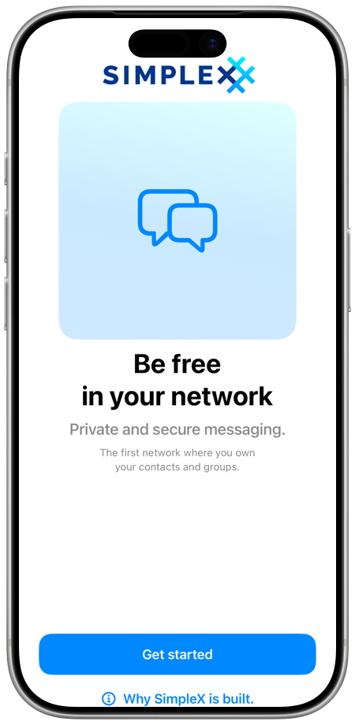

# SimpleX Chat User Guide

Unlike other messaging platforms, SimpleX Chat assigns no identifiers to its users: no phone numbers, usernames, public keys or random IDs. To use it, you create a profile on your device; the app asks only for a name.

This guide describes the apps for iOS, Android and desktop (Windows, macOS and Linux). Where the apps differ, the differences are noted.

## Contents

- [Quick start](#quick-start) and [Your chats](#your-chats), on this page
- [Messages and media](./send-messages.md)
- [Groups](./secret-groups.md)
- [Channels](./channels.md)
- [Channel webpage](./channel-webpage.md)
- [Chat profiles](./chat-profiles.md)
- [Registering a SimpleX name](./register-simplex-name.md)
- [Managing data](./managing-data.md)
- [Linked devices](./linked-devices.md)
- [Audio & video calls](./audio-video-calls.md)
- [Notifications](./notifications.md)
- [Privacy & security](./privacy-security.md)
- [App settings](./app-settings.md)
- [Supporter badges](./supporter-badges.md)
- [Making connections](./making-connections.md)

## Quick start

### Install the app

Download the app from [simplex.chat/downloads](https://simplex.chat/downloads/): iOS (App Store or TestFlight), Android (Google Play, F-Droid or an APK file) and desktop (Windows, macOS and Linux).

### Create your first chat profile

On iOS and Android:

1. Open the app and tap **Get started**.
2. Enter your name in **Enter profile name...** (iOS) or **Enter profile name…** (Android).
3. Tap **Create profile**.

On desktop, the start screen has two buttons:

- **Create your profile**: enter your name in **Enter profile name…** and click **Create profile**.
- **Link a mobile**: use the chat profiles of your phone from this computer. On the phone, open **Use from desktop** and scan the QR code shown on the computer. See [Linked devices](./linked-devices.md).

If the app cannot use the name as you typed it, a red icon appears next to the name: tap it, and the app offers a corrected name when it can. You can add a profile image and a bio later, see [Edit your profile](./chat-profiles.md#edit-your-profile).

Your profile is stored on your device, and the app sends it to your contacts and to the members of the groups you join. When you connect incognito, a random profile is sent instead, see [Incognito mode](./chat-profiles.md#incognito-mode).

On desktop, the app also shows **Setup database passphrase**: after **Create profile**, or before the **Link a mobile** screen. Enter a passphrase in **New passphrase…** and **Confirm new passphrase…**, then click **Set database passphrase**; the app explains that you will have to enter it every time the app starts, and that a lost passphrase cannot be recovered. Or click **Use random passphrase**; the app then says that the random passphrase is stored in the settings as plaintext and that you can change it later. See [Database passphrase](./managing-data.md#database-passphrase).

To move your profiles and chats from another device instead of creating a new profile, tap **Migrate** (iOS, Android) or click **Migrate from another device** (desktop) at the top of the profile screen. See [Migrate to another device](./managing-data.md#migrate-to-another-device).

### Your network

After you create the profile, the app shows **Your network**:

- Tap **Setup routers** to open **Server operators**. The app has two preset operators, SimpleX Chat and Flux, and both are selected. Tap an operator to select or deselect it; at least one must stay selected. Tap **How it helps privacy** to read that the app uses different operators in each conversation. Tap **OK** to return.
- Tap **Setup notifications** (iOS and Android) to choose a notification mode. See [Notifications](./notifications.md).

Then tap **Continue**.

On the last screen, **Network commitments**, the app lists what operators commit to (be independent, minimize metadata usage, run verified open-source code) and what you commit to (only legal content in public groups, respect other users, no spam). Tap **Privacy policy and conditions of use.** to read the full text. Tap **Accept** to start using the app.

You can change operators and servers later, see [Network & servers](./app-settings.md#network-and-servers).

### Connect to friends

Until you have a contact or a group, the app shows **Talk to someone** in place of the chat list (on desktop, in the main part of the window):

- Tap **Let someone connect to you** to see **Create your link**, with **Invite someone privately** (a link for one person to connect) and **Create your public address** (an address for anyone to reach you).
- Tap **Connect via link or QR code** to paste a link you received, or to scan a QR code on iOS and Android.

To invite a friend at any time:

1. Ask your friend to install SimpleX Chat.
2. Tap the pencil button, then **Create 1-time link**.
3. Send the link to your friend via any messenger, or show the QR code. A 1-time link connects one person.
4. Your friend pastes the link into **Search or paste SimpleX link** in the chat list, or taps the pencil button, then **Scan / Paste link** (iOS), **Paste link / Scan** (Android) or **Paste link** (desktop). On iOS and Android, your friend can scan the QR code instead.

If your friend opens the link in a web browser, the web page has the steps to install the app and a button to open the link in the app.

Until your friend connects, the link is shown in your chat list as a pending connection. To know who connected, give it a name: swipe it left and tap **Name** (iOS), or long press it (Android) or right-click it (desktop) and choose **Set contact name**. See [Pending connections](./making-connections.md#pending-connections).

For other ways to connect, including your SimpleX address and SimpleX names, see [Making connections](./making-connections.md).

After your first conversation, a card with **New 1-time link** and **Paste link / Scan** (iOS, Android) or **Paste link** (desktop) is shown at the end of the chat list until you close it.

### Ask SimpleX Team

Each new chat profile has the contact card **Ask SimpleX Team**, for questions and suggestions about the app. To connect, tap the pencil button, tap **Ask SimpleX Team** in the list of contacts, then choose **Use current profile** or **Use new incognito profile**. The app sends a connection request.

You can also connect later from **Settings** > **Help & support** > **Send questions and ideas**.

### Find groups and channels

[SimpleX Directory](https://simplex.chat/directory/) lists groups and channels registered by their owners. The directory is also available as a [SimpleX chat bot](https://smp4.simplex.im/a#lXUjJW5vHYQzoLYgmi8GbxkGP41_kjefFvBrdwg-0Ok): connect to it and send a word to search. See [SimpleX Directory](../DIRECTORY.md).

To join a group or a channel, tap its link in a chat, or paste the link into **Search or paste SimpleX link**. You can also type a channel's SimpleX name there. See [Join a group](./secret-groups.md#join-a-group) and [Subscribe to a channel](./channels.md#subscribe-to-a-channel).

The groups for questions about SimpleX Chat are listed in [Join user groups](../../README.md#join-user-groups).

## Your chats

Your contacts, groups, channels, business chats, **Private notes**, contact requests and pending connections are shown in the chat list. When the last message in a chat is an image, a video, a voice message or a file, it is shown in the chat list, and voice messages can be played there. This needs **Show last messages**, which is on by default, in **Settings** > **Your privacy** > **More privacy**.

One banner at a time can be shown between the search field and your chats: about supporter badges (see [Supporter badges](./supporter-badges.md)) or, where it is offered, about crowdfunding (see [App settings](./app-settings.md)).

### Chat list toolbar

The chat list toolbar has:

- your profile image, on the left: tap it to open the [profile menu](#profile-menu). A dot on the image means that another of your profiles has unread messages.
- **Chats** with the connection indicator, in the middle: tap the indicator to open **Servers info**, see [Server status](#server-status).
- the pencil button, on the right: tap it to open **New chat**.

By default, the toolbar is at the bottom. To move it to the top, turn off **Reachable chat toolbar** (iOS) or **Reachable app toolbars** (Android, desktop) in **Settings** > **Appearance**. A card with **Bottom bar** and **Top bar** can also be shown in the chat list to choose from. With the toolbar at the top, the pencil button is at the top right on iOS, and floats at the bottom right on Android and desktop.

**New chat** has **Create 1-time link**, **Scan / Paste link** (iOS), **Paste link / Scan** (Android) or **Paste link** (desktop), **Create group**, **Create public channel**, **Archived contacts** when you have archived contacts, and the list of your contacts. See [Making connections](./making-connections.md), [Create a group](./secret-groups.md#create-a-group) and [Create a channel](./channels.md#create-a-channel).

When the chat is stopped, a red icon is shown in place of the pencil button: tap it to see how to start the chat.

### Profile menu

Tap your profile image to open the profile menu:

- Your current profile: tap it to edit your name, image and bio in **Your current profile**. Your other profiles are shown next to it (iOS, Android) or below **Chat preferences** (desktop): tap one to switch to it. See [Switching between profiles](./chat-profiles.md#switching-between-profiles).
- **Create SimpleX address** or **Your SimpleX address**: see [Your SimpleX contact address](./app-settings.md#your-simplex-contact-address).
- **Chat preferences**: disappearing messages, message deletion, reactions, voice messages and calls in chats with the contacts of the current profile. See [Chat preferences](./app-settings.md#chat-preferences).
- **Your chat profiles**: see [Chat profiles](./chat-profiles.md).
- **Use from desktop** (iOS, Android) or **Link a mobile** (desktop; **Linked mobiles** once a mobile is linked): see [Linked devices](./linked-devices.md).
- **Settings**: see [App settings](./app-settings.md). Tap the sun or moon icon in this row to switch between the light and the dark theme; long press it (or right-click it on desktop) to follow the system theme.

On desktop with linked mobiles, **This device** and each connected mobile are shown at the top of the menu: click one to switch to it.

### Search

Use the field **Search or paste SimpleX link** in the chat list:

- type a name to find a chat;
- paste a SimpleX link to connect, or to find the chat you already have with this link;
- type a SimpleX name, then tap the **Connect to …** row that appears.

See [Connect via a link or a name](./making-connections.md#connect-via-a-link-or-a-name).

### Filters and lists

Filter buttons are shown with the search field when at least two of the filters below have chats (on Android and desktop, two filters other than **Reports**). Tap a filter to show only these chats; tap it again to show all chats.

| Filter | Chats |
|---|---|
| **Favorites** | chats you marked as favorite |
| **Contacts** | contacts, contact requests, pending connections, and chats with your customers when you use a business address |
| **Groups** | groups, except business chats |
| **Channels** | channels |
| **Businesses** | chats with businesses you contacted, see [Business chats](./secret-groups.md#business-chats) |
| **Notes** | **Private notes** |
| **Reports** | groups with member reports that you received and did not archive, see [Member reports](./secret-groups.md#member-reports) |

When there are more than three filters and lists in total, the filters other than **Reports** are grouped in a menu. When a filter is on, the menu also has **All** to show all chats.

Tap the button next to the search field to show only unread chats: chats with unread messages and chats you marked as unread. Muted chats are included when you marked them as unread; a group muted with **Mute** is also included when it has unread mentions of you. Tap the button again to show all chats.

Lists are filters you create:

- To create a list, tap **Add list** (or **+** when you have lists), enter a name in **List name...** and, if you want, choose an emoji, then tap **Save list**. Names and emoji must be different for each list.
- To add a chat to a list, swipe the chat left and tap **List** (iOS), or choose **Add to list** in the chat menu (Android, desktop). A chat can be in one list; choose its list again to remove it.
- A dot after a list name means it has unread chats.
- To edit, delete or reorder lists, long press a list (iOS, Android) or right-click it (desktop). When you delete a list, the chats are removed from it and kept in the chat list.

### Chat actions

On iOS, swipe a chat right or left to see its actions. On Android, long press a chat; on desktop, right-click it.

| Action | iOS | Android, desktop |
|---|---|---|
| Mark as read or unread | swipe right: **Read** or **Unread** | **Mark read** or **Mark unread** |
| Favorite | swipe right: **Favorite** or **Unfav.** | **Favorite** or **Unfavorite** |
| Mute | swipe right: **Mute**, **Mute all** or **Unmute** | **Mute**, **Mute all** or **Unmute** |
| Add to a list | swipe left: **List** | **Add to list** or **Change list** |
| Delete all messages on your device | swipe left: **Clear** | **Clear** |
| Leave a group | swipe left: **Leave** | **Leave** |
| Delete | swipe left: **Delete** | **Delete** |

On iOS, when a group has more than three actions on the left swipe, some of them are under **More**. For muting, see [Mute chats and profiles](./notifications.md#mute-chats-and-profiles). For deleting a contact, see [Contact info](./making-connections.md#contact-info); for leaving and deleting a group, see [Leave or delete a group](./secret-groups.md#leave-or-delete-a-group).

Messages have their own menu: long press a message (iOS, Android) or right-click it (desktop). See [Messages and media](./send-messages.md).

### Archived contacts

When you delete a contact with **Only delete conversation**, the conversation is removed from the chat list and the contact is kept in **Archived contacts**. To open it, tap the pencil button, then **Archived contacts**. You can send messages to an archived contact from there. See [Contact info](./making-connections.md#contact-info).

### Private notes

**Private notes** is a chat with yourself. Messages and files you add there are kept only on your device. Each chat profile has its own notes.

### Server status

The share of your connections that are active for receiving messages is shown by the connection indicator next to **Chats**. The indicator is grey when the device is offline, and indigo when the app connects via a SOCKS proxy (on iOS, also when it uses .onion hosts).

Tap the indicator to open **Servers info**. The servers for **Messages** and for **Files** are listed there, with connection statistics; the statistics are kept on your device. With more than one profile, choose **All profiles** or **Current profile**. Tap **Reconnect all servers** to reconnect to the servers and force message delivery; the app warns that this uses additional traffic. Tap **Reset all statistics** to reset the statistics.

On iOS, you can also pull the chat list past the search field to reconnect all servers: the app asks **Reconnect servers?** first.

### New versions

After an app update, the app shows the new features of the version once. Use the arrows at the bottom to see earlier versions. To open this screen again, go to **Settings** > **Help & support** > **What's new**.
