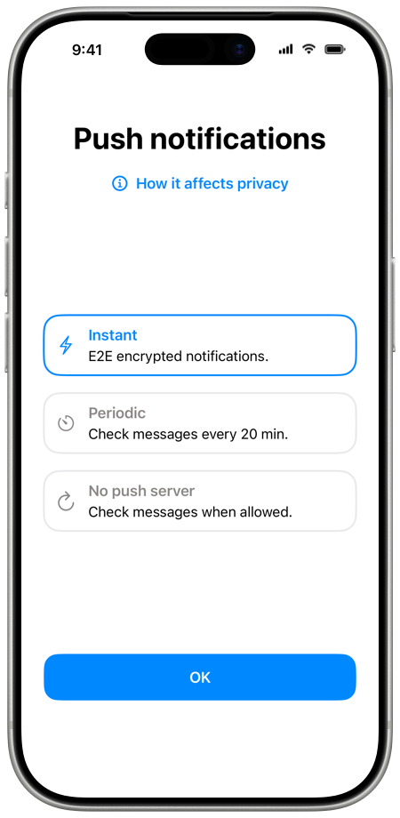

# SimpleX Chat User Guide

The first messaging network that has no user identifiers of any kind.

## Contents

- [Quick start](#quick-start) - scroll down this page
- [Making connections](./making-connections.md)
- [Sending messages](./send-messages.md)
- [Groups](./secret-groups.md)
- [Channels](./channels.md)
- [Channel webpage](./channel-webpage.md)
- [Chat profiles](./chat-profiles.md)
- [Registering a SimpleX name](./register-simplex-name.md)
- [Managing data](./managing-data.md)
- [Linked devices](./linked-devices.md)
- [Audio & video calls](./audio-video-calls.md)
- [Notifications](./notifications.md)
- [Privacy & security](./privacy-security.md)
- [App settings](./app-settings.md)
- [Supporter badges](./supporter-badges.md)

## Quick start

### Create your first chat profile

After downloading SimpleX Chat via the links at https://simplex.chat:

- Open the app and tap "Get started". On desktop, click "Create your profile".
- Create a new profile by inputting your profile name.
- Tap on "Create profile".

This profile is stored on your device and shared only with your contacts.
SimpleX servers cannot see it.

On desktop, the app then asks you to set a database passphrase or to use a
random one, see [Database passphrase](./managing-data.md#database-passphrase).
You can also click "Link a mobile" instead of "Create your profile" to use the
chat profiles of your phone from the computer, see [Linked
devices](./linked-devices.md).

### Choose notifications mode

After you have created the chat profile, the app shows "Your network". On iOS
and Android, tap "Setup notifications" there to choose notifications mode.

Please read their description, as on iOS it is trade-off between convenience and privacy, with instant notifications sharing more meta-data with the servers, and on Android it is a trade-off between notification delays and battery life.

You can read more about [the differences between notifications work on Android and iOS](../../blog/20220404-simplex-chat-instant-notifications.md).

You can also tap "Setup routers" to choose server operators. Then tap
"Continue", and "Accept" on the "Network commitments" screen to start using the
app.

To change notifications mode later, see [Notifications](./notifications.md).

### Connect to developers

When you just start using the app, you can connect to "Ask SimpleX Team" to ask
any questions or just to test the app - feel free to send any test messages.

Each new chat profile has this contact. To connect, tap the pencil button, tap
"Ask SimpleX Team" in the list of your contacts and choose "Use current profile"
or "Use new incognito profile". You can also connect to the developers via the
app settings:

- [Open the app settings](./app-settings.md#opening-the-app-settings).
- Tap on "Help & support", then "Send questions and ideas".

### Join some user groups

There are links to join several [user groups](../../README.md#join-user-groups) on our GitHub page - join them to ask any questions and discuss ideas.

You can also find groups and channels in [SimpleX
Directory](https://simplex.chat/directory/), and some other user-managed groups
via online search.

To join a group via a link:

- Get a link to a SimpleX user group, which you can get from your existing SimpleX conversations or by finding it online.
- Tap on a button in the lower right-hand of the screen.
- Tap on "Scan / Paste link" (iOS), "Paste link / Scan" (Android) or "Paste
  link" (desktop), and paste the link, or scan its QR code on iOS and Android.
- Tap on "Open group", then "Join group".

### Connect to friends

- Tell your friends to download SimpleX Chat app via one of the links here: https://simplex.chat
- Create a one-time link for each of your friends by tapping the pencil button
  (in the bottom right corner, or in the top right corner on iOS when the
  toolbar is at the top).
- Tap "Create 1-time link".
- Share each link with a different friend, or alternatively let them scan a QR code.
- You can optionally set a different contact name for each link, to know when
  they connect who is who, if they use incognito mode, for example: swipe the
  pending connection in the chat list and tap "Name" (iOS), or long-press it
  (Android) or right-click it (desktop) and choose "Set contact name".
- To use your link or QR code, tell your friends to tap the pencil button and
  then tap on "Scan / Paste link" (iOS), "Paste link / Scan" (Android) or "Paste
  link" (desktop).
- They can either scan QR code (iOS and Android) or paste the link, then tap
  "Open new chat" and "Connect", see [Connect via a link or a
  name](./making-connections.md#connect-via-a-link-or-a-name). If they opened
  the link in the browser, they need to tap "Open SimpleX app" button on the
  page.

Watch the [video](https://youtu.be/2iIibhaoMhI) that shows how it works.

You can also create a [long-term contact address](./app-settings.md#your-simplex-contact-address).

### Explore the app

Tap your profile image in the chat list toolbar to open the menu with your chat
profiles, your SimpleX address, chat preferences and the app settings.

Most app settings are shared for all profiles, but some settings are specific to chat profile.

Read more in [App settings](./app-settings.md) page.

Many conversation actions are available via long-press or swipe (right-click on
desktop) – try them!
