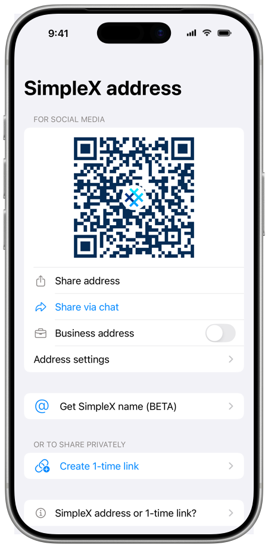
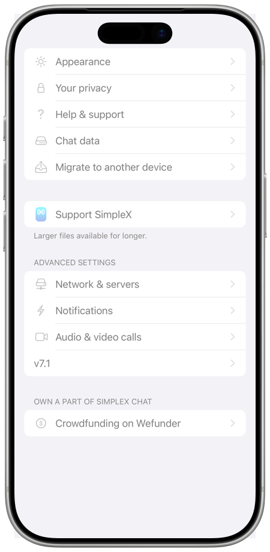
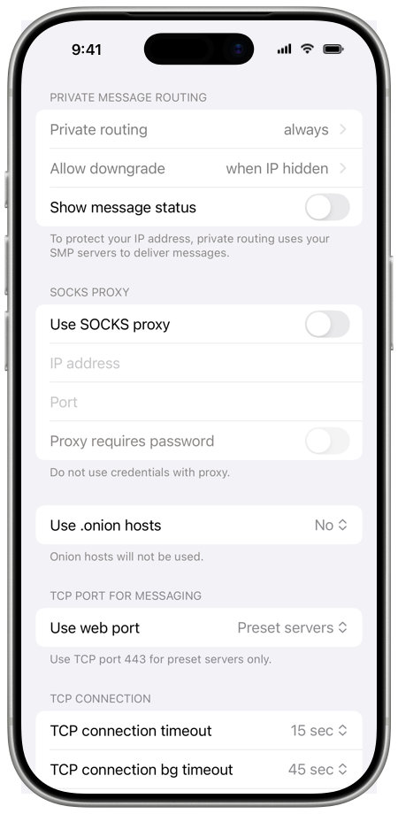

# App settings

## Opening the app settings

To open app settings:

- Open the app.
- Tap on your user profile image in the lower left-hand of the screen (in the
  upper left-hand, if the reachable toolbar is off in [Appearance](#appearance)).
- Tap **Settings**.

## Your profile settings

These settings are in the menu that opens when you tap your user profile image.
The menu also has **Use from desktop** (iOS and Android) or **Link a mobile**
(desktop), see [Linked devices](./linked-devices.md).

### Your active profile

Tap on your avatar/name to update your current profile names and avatar.

Display name can have spaces, but it is recommended to use latin characters and
numbers to make it easier to type these names to the users who use [SimpleX Chat
for the terminal](../CLI.md) (CLI).

**Please note**: When you save your profile, the update will be sent to all your contacts (excluding the contacts with whom your incognito profiles were shared). If you have a large number of contacts it can take several seconds.

### Your chat profiles

This page allows adding and configuring your chat profiles. Please see [Your chat profiles](./chat-profiles.md) for more details.

### Incognito

This feature is unique to SimpleX Chat – it is independent from chat profiles.

When you choose "Incognito" for a new connection, your current profile name and
image are not shared with this contact or group. It allows connections with
other people without any shared data – when you make new connections or join
groups via a link a new random profile name will be generated for each contact
or group.

Please read more in [Incognito mode](./chat-profiles.md#incognito-mode).

### Your SimpleX contact address

This page allows you to create a long term address that can be used by other people to connect with you. Unlike 1-time invitation links, these addresses can be used many times, that makes them good to share online, e.g. on other social media platforms.

When people connect to you via this address, you will receive a connection request that you can accept or reject. You can configure an automatic acceptance of connection request and an automatic welcome message that will be sent to the new contacts.

If you start receiving too many requests via this address it is always safe to remove it – all the connections you created via this address will remain active, as this address is not used to deliver the messages.

See the comparison with [1-time invitation links](./making-connections.md#comparison-of-1-time-invitation-links-and-simplex-contact-addresses).

### Chat preferences

This page allows to configure the chat preferences that would apply to all contacts - they can be changed separately for each contact:

- _disappearing messages_ - to allow disappearing messages in the conversations with you, only if your contacts allow them.
- _delete for everyone_ - to allow irreversible message deletion (by default messages are marked as deleted, not fully deleted). "Yes" setting would allow it only if they allow it for you, and "Always" - even if they don't allow.
- _voice messages_ - to allow sending voice messages.
- _message reactions_ - to allow message reactions.
- _audio/video calls_ - to allow calls.

To set chat preferences in each contact, tap contact name in the chat toolbar
and then choose "Contact preferences".

Group owners can set similar preferences for their groups, when the group is
created or later: tap group name in the chat toolbar and then choose "Group
preferences".

## Your app settings

Tap **Settings** in the menu to open these settings, see [Opening the app
settings](#opening-the-app-settings).

**Migrate to another device** is described in [Managing
data](./managing-data.md#migrate-to-another-device), and **Audio & video calls**
in [Audio & video calls](./audio-video-calls.md).

### Notifications

This page (iOS and Android) allows to configure the notifications mode: instant,
periodic or only when the app is running. On iOS, the third mode is **No push
server**: the app checks messages in the background when iOS allows it. There
are some differences in how these options work on iOS and Android, see
[Notifications](./notifications.md). Please read more in [this
post](../../blog/20220404-simplex-chat-instant-notifications.md) about how
notifications work.

You can also configure whether the message preview is shown when the message
arrives. To do it, tap **Your privacy**, then **More privacy** and **Show
preview**.

**Please note**: For instant and periodic notifications to work on Android, you need to disable power optimization when prompted by the app, or later via the settings. Also, some variants of Android system require additional settings, for example MIU system on Xiaomi phones requires to enable "Autostart" for the app for the notification service to work. Please read [Don't kill my app](https://dontkillmyapp.com/) guide for any settings that may be required on your device.

Also, on Android instant notifications have the highest battery consumption.

### Network & servers

This page allows to configure server operators and your own servers, and to
change other network settings.

#### SMP servers

By default, the app uses the servers of two preset operators, SimpleX Chat and
Flux. You can disable them and add your own servers in **Your servers**. When
more than one operator is enabled, the app uses different operators in each
conversation to protect your privacy.

This page also allows testing the connection with the servers.

Read how to host your own servers in [this guide](../SERVER.md).

#### Use SOCKS proxy

This option makes the app connect via a SOCKS proxy that should be provided by some other app running on your device.

The most typical use for this is to run Orbot app that provides a SOCKS proxy to connect via Tor network, but it can be some other app and it can proxy connections via some other overlay network.

The option is available on all platforms. On Android and desktop, it is in
**Network & servers**, and the default port is 9050. On iOS, it is in **Advanced
network settings**, where you enter the IP address and the port of the proxy.

#### Use .onion hosts

##### Android

On Android and desktop, **Use .onion hosts** option is in **SOCKS proxy
settings**, and it is only available when **Use SOCKS proxy** is enabled. You
can choose:

- _no_: never use .onion hosts. Choose this option if your SOCKS proxy does not connect via Tor network.
- _when available_ (default): when SOCKS proxy is enabled the app assumes that it provides connections via Tor network and use .onion host addresses when SMP relays include them in their configuration.
- _required_: always use .onion hosts. Choose this option if your SOCKS proxy connects via Tor network and you want to avoid connections without Tor. In this case, if the SMP relay address does not include .onion host, the connection will fail.

##### iOS

On iOS, this option is in **Advanced network settings**. You can install Orbot
app that works as VPN provider. You can choose:

- _no_ (default): do not use .onion hosts. Choose this option if you do not use Orbot or if you use VPN that proxies connections via some other overlay network.
- _when available_: use .onion host addresses when SMP relays include them in their configuration. Orbot VPN must be enabled for this option to work.
- _required_: always use .onion hosts. Choose this option if you use Orbot VPN and you want to avoid connections without Tor. In this case, if the SMP relay address does not include .onion host, the connection will fail. If you use this option, you can enable "Disable Orbot for non-onion traffic" option in Orbot settings making the rest of your device traffic to not use Tor.

**Please note** VPN on iOS can send some traffic to the usual network, if, for
example, VPN app crashes. You can enable always-on VPN mode on managed iOS
devices, but this is not applicable to most individual devices.

#### Transport isolation (BETA)

This option sets how the app isolates your traffic. With **Chat profile**, **App
session** (default) and **Server**, the app uses a separate TCP connection for
each chat profile. On Android and desktop, **App session** also uses new SOCKS
credentials every time you start the app, and **Server** uses them for each
server. With **Connection**, the app uses a separate TCP connection for each
contact and group member.

The option is in **Advanced network settings**. On iOS, it is available after
you enable [developer options](#show-developer-options). On Android and desktop,
the **Connection** mode is available with developer options.

#### Advanced network settings

If your network is slow, and connections to the servers keep failing (the server
status icon in the chat list toolbar shows it), please increase TCP and protocol
timeouts in this page.

This page also has the settings of private message routing: "To protect your IP
address, private routing uses your SMP servers to deliver messages." By default,
**Private routing** is set to always.

### Privacy and security

This page is labelled **Your privacy** in the app settings.

#### SimpleX Lock

SimpleX Lock when enabled requires to pass the device authentication or to enter
the app passcode when you open the app or use some security- or
privacy-sensitive features. You choose it in **Lock mode** (iOS and Android);
the desktop app uses the app passcode.

You will be offered to enable it once, when you have more than 2 chats (iOS) or
more than 3 chats (Android and desktop).

To enable it later:

- [Open the app settings](#opening-the-app-settings).
- Tap on "Your privacy".
- Tap on "SimpleX Lock" and toggle on "Enable lock".
- Confirm your phone credentials, or set the app passcode.

Done! Now you will be required to authenticate when you start or resume the app
after 30 seconds in background. You can change this time in **Lock after**.

#### Protect app screen

This option hides the app screen in recent apps on iOS and Android - it is
enabled by default on Android. On Android it also prevents screenshots.

#### Auto Accept Images

With this option, the app receives images, small videos and voice messages
without asking – it is enabled by default.

- [Open the app settings](#opening-the-app-settings).
- Tap on "Your privacy".
- Toggle "Auto-accept images".

#### Send Link Previews

Enabling sending link previews may reduce privacy – your app will be loading
link preview from the website. The first time you type a link, the app asks
**Enable link previews?**

- [Open the app settings](#opening-the-app-settings).
- Tap on "Your privacy".
- Toggle on "Send link previews".

#### Contact deletion

This option chooses whether the contact is notified when you delete it:

- _Notify_ (default for new users): the contact is notified.
- _Ask_ (default when you update the app): the app asks each time, with "Delete and notify" and "Delete silently".

See [Deleting and archiving contacts](./making-connections.md#deleting-and-archiving-contacts).

#### SimpleX Links

This option is in [Developer tools](#developer-tools), in the section
**Deprecated options**.

This option affects how the links to connect to other SimpleX users or to join groups are shown in the conversations. You can choose between:

- _description_ (default): only the link description and server host name are shown. The link won't be opened in the browser.
- _full link_: the full link is shown. The link will still not be opened in the browser.

### Appearance

This page allows configuring:

- interface language
- app icon (iOS and Android)
- accent color
- light or dark mode, dark mode colors, wallpaper and other theme colors
- reachable toolbars at the bottom of the screen
- chat layout, message shape and profile image shape
- font size (Android and desktop) and zoom (desktop)
- **Close to tray** (desktop): the app keeps running in the system tray to
  receive messages after you close its window.

### Database passphrase & export

This page is labelled **Chat data** in the app settings. It allows to change the
database passphrase, export and import the database and configure the message
retention period.

Read more in [Managing data](./managing-data.md) page.

## Help & feedback

In the app settings, it is labelled **Help & support**.

This section has information on how to use the app and the links to connect to the team. Please use [Send questions and ideas](https://simplex.chat/contact#/?v=1&smp=smp%3A%2F%2FPQUV2eL0t7OStZOoAsPEV2QYWt4-xilbakvGUGOItUo%3D%40smp6.simplex.im%2FK1rslx-m5bpXVIdMZg9NLUZ_8JBm8xTt%23%2F%3Fv%3D1%26dh%3DMCowBQYDK2VuAyEALDeVe-sG8mRY22LsXlPgiwTNs9dbiLrNuA7f3ZMAJ2w%253D%26srv%3Dbylepyau3ty4czmn77q4fglvperknl4bi2eb2fdy2bh4jxtf32kf73yd.onion) to connect to us via the chat to ask any questions, make any suggestions and report any issues.

## Support SimpleX Chat

Tap **Support SimpleX** in the app settings to get a supporter badge, see
[Supporter badges](./supporter-badges.md).

These links are in **Help & support**, in the section **Support the project**:

- contribute - the link to the information about how to contribute and to donate to the project.
- rate the app - rate and review it on the App Store or Play Store - your feedback helps a lot.
- star on GitHub - that also helps us grow very much.

The app settings also have **Crowdfunding on Wefunder**, in the section **Own a
part of SimpleX Chat**: it opens **Invest in SimpleX Chat**, with a link to the
SimpleX Chat crowdfunding on Wefunder. It is shown in the iOS app and in the
Android app from Google Play when the store country is the United States or is
not known, and in the desktop app and other Android builds in every country.

Thank you for your support!

## Developer tools

This page has options that normally are only needed for app developers and can be used to debug the app in case something is not working.

To open it, tap the app version at the end of **Advanced settings** in the app
settings, then **Developer** (iOS) or **Developer tools** (Android and desktop).

### Chat console

Here you can see and use console command with the chat core. None of this information is sent over the network, this is an internal communication between different parts of the app.

Please be careful - some of the commands can disrupt app functioning, only use them if you know what you are doing or were instructed by the team.

**Please note**: the log in console can contain what looks like errors. Unless you experience any issues in the app UI, these errors should not be considered as the app malfunction - they are likely to be normal and expected behavior.

### Confirm database upgrades

This option is shown when [Show developer options](#show-developer-options) is
enabled.

This option is off by default - the app database is migrated to the new version without any confirmations. Starting from v4.6.2 these migrations are reversible - you can rollback to the previous version(s) of the app (not earlier than v4.6.1). If you want to be asked a confirmation every time database is upgraded you may enable this option - this is not recommended, as it happens almost on every app update, and should not cause any concerns.

### Show developer options

This option currently enables [Transport isolation
mode](#transport-isolation-beta) option (on Android and desktop, its
**Connection** mode) and also enables showing database IDs in contacts, groups
and group members to simplify debugging via console commands. It also shows the
section **Developer options**, with [Confirm database
upgrades](#confirm-database-upgrades) and other options.
