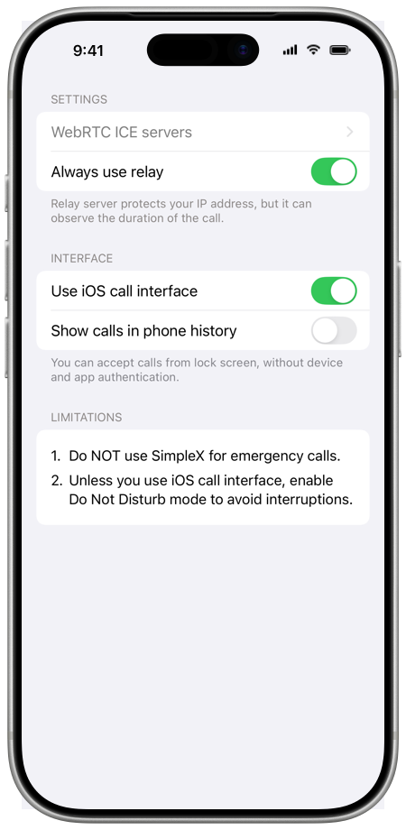

# Audio and video calls

You can make audio and video calls with your contacts in direct chats. The app
uses WebRTC for calls. Calls are end-to-end encrypted when both devices support
it, and the call screen shows whether the call is encrypted. On desktop, calls
open in your web browser.

## Make a call

1. Open the chat with the contact.
2. Tap the phone icon in the chat toolbar. The chat toolbar is at the top on
   iOS, and at the bottom on Android and desktop by default.
3. Choose **Audio call** or **Video call**.

You can also tap the contact's name in the chat toolbar to open contact info,
and tap **call** or **video**.

The phone icon is shown when calls are allowed with this contact, the contact is
connected and you are not in another call. If **call** or **video** in contact
info cannot start a call, the app explains why: **Can't call contact** (for
example, **Connecting to contact, please wait or check later!**), **Allow
calls?** (tap **Allow** to allow your contact to call you) or **Calls
prohibited!**.

Calls are allowed by default. To change this for all contacts or for one
contact, use the **Audio/video calls** preference, see [Contact
preferences](./send-messages.md#contact-preferences).

During a call, the chat toolbar of this contact shows a red button that ends the
call. On desktop, it also shows the call duration.

## Answer a call

On iOS, incoming calls are shown in the iOS call interface by default, see
[Calls on the lock screen](#calls-on-the-lock-screen). On Android and desktop,
and on iOS with the iOS call interface off, the app shows the contact and the
type of the call, with three buttons:

- **Accept** answers the call. If you are in another call, that call ends first.
- **Reject** declines the call on your device only, without a message to the
  caller.
- **Ignore** hides the incoming call. While the caller is still waiting, you can
  answer it with **Answer call** in the chat. If the call has ended, the app
  shows **Call already ended!**.

The app shows an incoming call only for a call invitation that is up to 3
minutes old. For an older invitation, Android and desktop show a notification
instead, and iOS shows one when the iOS call interface is off.

When the app is in the background, an incoming call is also shown as a
notification with **Accept** and **Reject**: on iOS when the iOS call interface
is off, on Android when the device is unlocked, and on desktop when the app
window is not focused. How calls appear on a locked device is described in
[Calls on the lock screen](#calls-on-the-lock-screen).

Calls to a muted chat profile are shown only while this profile is active, see
[Mute chats and profiles](./notifications.md#mute-chats-and-profiles).

If you start a call and your contact accepts it without end-to-end encryption,
the app shows **Call is not encrypted**. Tap **End call** or **Continue**.

## During a call

The call screen shows the contact's name, the state of the call, the encryption
status, for example **e2e encrypted** or **contact has no e2e encryption**, and,
when the call is connected, how it is connected, for example **peer-to-peer** or
**via relay**.

On iOS and Android, the buttons at the bottom turn the microphone on and off,
switch between the speaker and the earpiece (or choose an audio device, when
another one is connected), end the call, flip the camera and turn the camera on
and off. You can turn the camera on during an audio call.

On iOS and Android, to use the app during a call, tap the back button on the
call screen. A green bar with the contact's name and the call duration is shown
at the top of the app: tap it to return to the call. During a video call, the
video continues in a picture-in-picture window where the device allows it.

On Android, when the system restricts the app in the background, the call screen
shows **No background calls**. Tap it: the app explains that it may be closed
after 1 minute in the background, and **Open app settings** opens the system
settings of the app, where you choose **App battery usage** / **Unrestricted**.

On desktop, the call opens in a tab of your default web browser. If the browser
does not allow the app to use the microphone, the page shows "To make calls,
allow to use your microphone. End the call and try to call again." The page has
buttons to share your screen, turn the microphone on and off, end the call, turn
the sound on and off, and turn the camera on and off. Closing the tab ends the
call. While the call is active, the chat list shows the contact's picture with a
call icon: click it to open the chat, or right-click it and choose **Hang up**.

## Calls on the lock screen

| | iOS | Android |
|---|---|---|
| Setting | **Use iOS call interface**, on by default | **Calls on lock screen:**, **Show** by default |
| Incoming call on a locked device | With the iOS call interface on, the app notes: "You can accept calls from lock screen, without device and app authentication." With the interface off, the call is shown as a notification, and the app notes: "Authentication is required before the call is connected, but you may miss calls." | **Accept**: the lock screen shows **Reject**, **Ignore** and **Accept**. **Show**: the lock screen shows **Open SimpleX Chat to accept call** and **Open**. **Disable**: the call is shown as a notification with **Accept** and **Reject**. |

To change the setting, open **Settings** (see [Opening the app
settings](./app-settings.md#opening-the-app-settings)), tap **Audio & video
calls**, then:

- iOS: toggle **Use iOS call interface**. With the interface on, you can also
  turn on **Show calls in phone history**. When the App Store country is China,
  the app uses its own call screen and hides these two settings.
- Android: choose an option in **Calls on lock screen:**.

The iOS settings also list **Limitations**: "Do NOT use SimpleX for emergency
calls." and "Unless you use iOS call interface, enable Do Not Disturb mode to
avoid interruptions."

## Call settings



To open the call settings, open **Settings**, then tap **Audio & video calls**.
The screen is titled **Your calls**.

The call settings, including the ICE servers, are saved with the other app
settings in the exported database, and are restored when you import the database
or migrate to another device, see [Managing data](./managing-data.md).

### WebRTC ICE servers

By default, calls use the STUN and TURN servers of SimpleX Chat, and **WebRTC
ICE servers** shows "Using SimpleX Chat servers." To use your own servers:

1. Tap **WebRTC ICE servers**. On Android and desktop, this item is also in
   **Network & servers**, in the **Calls** section.
2. Turn on **Configure ICE servers**.
3. Enter the server addresses in **ICE servers (one per line)**.
4. Tap **Save**.

Each address has the form `stun:host:port` or `turn:username:password@host:port`
(also `stuns:` and `turns:`). If an address cannot be used, the app shows
**Error saving ICE servers**. To go back to the SimpleX Chat servers, turn
**Configure ICE servers** off and confirm **Use SimpleX Chat servers?**. **How
to** opens the guide [Using custom WebRTC ICE servers](../WEBRTC.md).

### Always use relay

**Always use relay** is on by default: calls are connected through a relay
(TURN) server. The app explains: "Relay server protects your IP address, but it
can observe the duration of the call."

When you turn it off, the app connects calls peer-to-peer when your networks
allow it: "Relay server is only used if necessary. Another party can observe
your IP address."

To prohibit relays, turn **Always use relay** off and configure only STUN
servers in **WebRTC ICE servers**, for example:

```
stuns:stun.simplex.im:443
```

Calls connect directly, also when the app connects to the servers through a
SOCKS proxy. On Android and desktop, **Network & servers** notes this when **Use
SOCKS proxy** is on.
