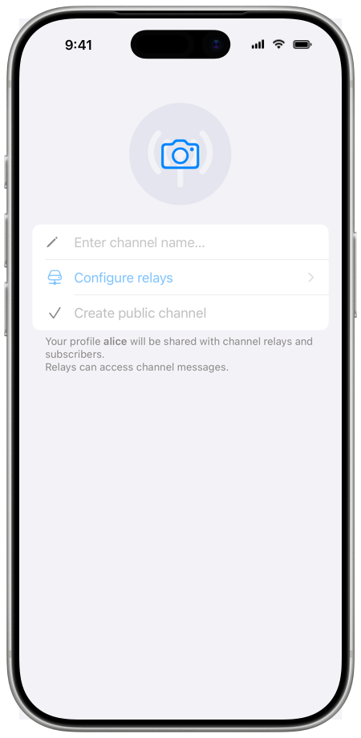

# Channels

With a channel, you publish messages to many subscribers. The owner posts as the
channel, and subscribers read the posts. Anyone with the channel link can
subscribe.

Most channel settings are in the channel's chat info: tap the channel name in
the chat toolbar. The chat toolbar is at the top on iOS and at the bottom by
default on Android and desktop.

## How channels work

Chat relays deliver the messages of a channel. Each message is sent to the
channel's chat relays, and the relays forward it to the subscribers through
messaging servers. Subscribers do not connect directly to the chat relays, to
the owner or to each other, so the relays and the owner do not see their IP
addresses.

A channel can have several chat relays, and its messages are delivered while at
least one of them is active. See [Chat relays](#chat-relays).

Because anyone with the link can join a channel, channel messages are not
end-to-end encrypted, and chat relays can see them. The app shows a notice about
this at the start of each channel. Group messages are end-to-end encrypted, so
use a [group](./secret-groups.md) for private conversations.

The channel profile is stored on subscribers' devices and on the chat relays.
The owner's chat profile is shared with the relays and the subscribers.

The owner holds the channel's keys. Changes to the channel's profile,
preferences, relays and roles, and removals of members, are signed with the
owner's key, and subscribers' apps reject such changes without a valid
signature. Messages can also be signed, see [Message signing](#message-signing).

## Create a channel

1. Tap the pencil button in the chat list, then tap **Create public channel**.
2. Tap the picture to add a channel image, and enter the channel name.
3. Tap **Create public channel**.

**Configure relays** opens **Network & servers**, where you choose the chat
relays that the app can use. If no chat relay is enabled, **Configure relays**
is shown in orange, and the app asks you to enable at least one chat relay.

The channel is created with your current chat profile, which is shared with the
chat relays and subscribers. The app picks up to 3 of your enabled chat relays
at random, preferring one of your own relays and relays of different server
operators.

On the **Creating channel** screen, the app shows how many relays are active,
for example "2/3 relays active", and moves on when all of them are active. To
move on earlier, tap **Continue** when at least one relay is active. To delete
the new channel, tap **Cancel and delete channel**.

Then the app shows the channel link and its QR code on the **Channel link**
screen. Share the link now or later, and tap **Continue** to open the channel.
On desktop, the app opens the channel and shows the channel link next to it.

New channels have **Visible history** on and **Chat with admins** off. See
[Channel preferences](#channel-preferences).

## Subscribe to a channel

1. Open the channel link: tap it in a chat, paste it into the search field of
   the chat list, or scan its QR code. To use the channel's SimpleX name, type
   it into the search field and tap **Connect to …**. See [Connect via a link or
   a name](./making-connections.md#connect-via-a-link-or-a-name).
2. The app shows the channel's name, image and number of subscribers. Tap **Open
   channel**.
3. The app opens the channel with its welcome message, if it has one. To join
   with another chat profile or incognito, choose it in **Your profile** above
   the button. See [Incognito mode](./chat-profiles.md#incognito-mode).
4. Tap **Join channel**.

The app connects to each of the channel's relays through messaging servers, and
you are subscribed when at least one relay connects. Until all relays connect,
the app shows the progress in a bar above the message field, for example "1/2
relays connected".

A channel card shared by the owner is marked "Channel link (from owner)". When
you open such a card, the app shows "Link signature verified." in the channel
preview.

When a channel has no active relays, the app shows "Channel has no active
relays. Please try to join later."

As a subscriber, you read the channel, and "you are subscriber" is shown in the
message field. You can react to messages when **Message reactions** is on, and
use **Chat with admins** when the owner turns it on.

## Post in a channel

As the owner, you post as the channel, and **Broadcast** is shown in the empty
message field. Subscribers see your posts with the channel's name and image,
marked "channel".

Contributors and moderators post with their own chat profiles, and subscribers
see their names.

Writing and sending messages is described in [Sending
messages](./send-messages.md#sending-messages).

The owner and moderators have **Delete from history** (iOS) or **From history**
(Android and desktop) in place of **Delete for me**. It deletes the message on
your device. For a message that you posted, the chat relays also delete it from
the channel history that they keep: new subscribers do not receive it, and the
channel webpage does not show it. Subscribers who received the message earlier
keep it.

## Channel link and name

Anyone with the channel link can join the channel.

- As the owner, tap **Channel link** in the chat info. The app shows the QR
  code, **Share link** and **Share via chat**. Everyone who joins by the link
  becomes a subscriber, and the link cannot be deleted.
- Other members see the QR code, **Share link** and **Share via chat** in the
  chat info.

With **Share via chat**, you choose a chat, and the app adds a channel card to
your message there. Recipients tap the card to open the channel.

To let people find the channel by a name, the owner taps **Get SimpleX name
(BETA)** in the chat info, below the channel link. See [Registering a SimpleX
name](./register-simplex-name.md).

To show a preview of the channel on a website, see [Channel
webpage](./channel-webpage.md).

## Chat relays

Chat relays forward channel messages to subscribers. The SimpleX Chat server
operator provides preset relays, and you can add your own.

Tap **Chat relays** in the channel's chat info to see the relays and their
status. The owner sees each relay's state in the channel, for example
**active**. Other members see their connection to each relay, for example
**connected** or **connecting**.

The owner can change the relays:

- To add relays, tap **Add relay**, select relays, and tap **Add** (iOS) or
  **Add relays** (Android and desktop). You can select from your enabled chat
  relays that are not in the channel yet.
- To remove a relay, swipe it left (iOS), long-press it (Android) or right-click
  it (desktop), and tap **Remove relay**. **Remove relay** is also in the
  relay's info. For the last active relay, the app warns: "This is the last
  active relay. Removing it will prevent message delivery to subscribers."

When some relays are not active, the app shows their number in a bar above the
message field, for example "2/3 relays active, 1 failed" to the owner or "1/2
relays connected" to subscribers. Tap the bar to see each relay. When no relay
works, the app shows "Add relays to restore message delivery." to the owner and
"Waiting for channel owner to add relays." to other members in the opened bar,
and "can't broadcast" in the message field of members who can post.

The relays that the app can use are in **Network & servers**: in the **Chat
relays** section of a server operator, and in **Your servers**. To add your own
relay, open **Your servers**, tap **Add server**, then **Chat relay**, paste the
relay address, tap **Test relay**, and save with **Save servers**. A relay is
turned on or off with **Use for new channels**. See [Network &
servers](./app-settings.md#smp-servers).

## Subscribers and roles

| Role | What the member can do |
|---|---|
| Subscriber | Reads posts. Reacts when **Message reactions** is on. Uses **Chat with admins** when it is on. |
| Contributor | Also posts messages with their own name. |
| Moderator | Also deletes messages of contributors, blocks subscribers and contributors for all, and answers subscribers in **Chats with members**. |
| Owner | Posts as the channel. Edits the channel profile, welcome message and preferences. Manages relays and roles. Removes subscribers. Deletes the channel. |

The owner and moderators see the members in **Subscribers** in the chat info.
Other members see **Owners & contributors**.

The owner can change a member's role to subscriber, contributor or moderator:

1. In the chat info, tap **Subscribers**, then tap the member.
2. Choose the new role in **Change role**.
3. Tap **Change** to confirm. All subscribers are notified.

A channel has one owner, the member who created it. The owner role cannot be
given to other members. A channel can have up to 256 contributors and
moderators.

In the member's info, moderators and the owner can **Block for all**, and the
owner can **Remove subscriber**.

## Message signing

When the owner turns on **Sign messages** in [Channel
preferences](#channel-preferences), the apps of all members who post sign every
message, and subscribers' apps verify the signatures. New subscribers see
earlier messages as unsigned.

A seal icon is shown next to the time of a signed and verified message. Its
**Info** has the line "Signed & verified", or "Signed" for your own messages.

While signing is on, a red seal icon is shown on a message without a signature.
Such a message was sent before the channel started signing, or it may be fake.

A message with an invalid signature, or an unsigned edit or deletion of a signed
message, is rejected, and "message rejected: bad signature" is shown in the
chat.

## Channel preferences

The owner changes channel preferences. Tap **Channel preferences** in the
chat info, change them, and tap **Save and notify subscribers** (iOS) or **Save
and notify channel subscribers** (Android and desktop). Other members see the
preferences without the switches.

| Preference | When it is on | New channels |
|---|---|---|
| **Sign messages** | Messages are signed: see [Message signing](#message-signing). | off |
| **Disappearing messages** | New messages are deleted after the time set in **Delete after**. | off |
| **Delete for everyone** | Messages deleted by their senders are deleted for all subscribers. | off |
| **Message reactions** | All members, including subscribers, can react to messages. | on |
| **Visible history** | Up to 100 last messages are sent to new subscribers. | on |
| **Chat with admins** | Subscribers and contributors can chat with the owner and moderators. | off |

Chats with admins in channels are not end-to-end encrypted, so turn them on only
with chat relays you trust.

The owner also edits the channel's name, image and short description with
**Edit channel profile**, and the message for new subscribers with **Add welcome
message** (**Welcome message** once it is added). Profile changes are sent to
subscribers.

## Leave or delete a channel

- As a subscriber, contributor or moderator, tap **Leave channel** in the chat
  info to leave. You stop receiving messages from the channel, and the chat
  history stays on your device. After that, tap **Delete channel** to delete it
  for you.
- The owner can delete the channel for all subscribers with **Delete channel**.
  This cannot be undone.

See also [Leaving a group](./secret-groups.md#leaving-a-group).
