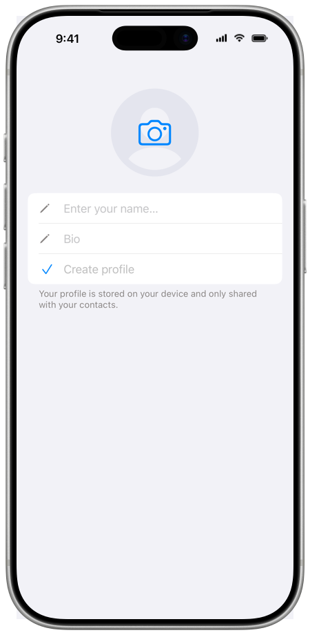
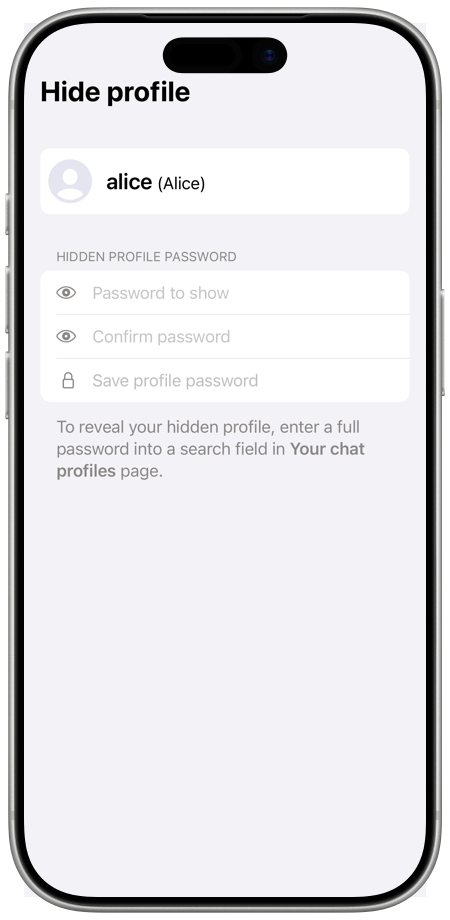

# Your chat profiles

A chat profile is the name, image, bio and description that your contacts see. You can have any number of chat profiles in the app and switch between them. Each profile has its own contacts, groups, channels and chats. All profiles are stored on your device.

Each profile also has its own:

- [SimpleX address](./making-connections.md#your-simplex-contact-address).
- [Chat preferences](./send-messages.md#contact-preferences).
- Servers for new connections and files, in [Network & servers](./app-settings.md#network-and-servers).
- Period of [automatic message deletion](./managing-data.md#automatic-message-deletion).
- Theme, when you choose the profile in **Apply to** in [Appearance](./app-settings.md#appearance).

Other settings apply to all profiles.

You manage profiles from the profile menu: tap your profile image in the chat list toolbar (see [Your chats](./README.md#your-chats)).

## Creating additional chat profiles

1. Open the profile menu and tap **Your chat profiles**.
2. Tap **Add profile**.
3. Enter the profile name: **Enter your name…** on iOS, **Enter your name:** on Android and desktop.
4. Optionally, add a bio (**Bio** on iOS, **Your bio:** on Android and desktop) and an image (tap the camera button).
5. Tap **Create profile**.

The new profile becomes the active profile. The app gives it the servers of the profile that was active when you created it.

Each profile needs a different name. When the name contains characters that cannot be used, the app marks the field; tap the mark to see the corrected name (**Correct name to …?**).

When [SimpleX Lock](./app-settings.md#simplex-lock) is on, the app asks you to authenticate before you add, hide, unhide, mute or delete a profile.

## Hiding and muting chat profiles

You can hide a profile behind a password, and you can mute a profile. To see these actions, open **Your chat profiles** and:

- iOS: swipe the profile to the right.
- Android: tap and hold the profile.
- Desktop: right-click the profile.

The actions are:

- **Hide**: enter a password in **Password to show** and **Confirm password**, then tap **Save profile password**. The profile is then shown in the profile menu and in **Your chat profiles** only while it is the active profile. **Hide** is offered when you have at least two visible profiles. A hidden profile is always muted.
- **Mute** and **Unmute**: what muting does is described in [Notifications](./notifications.md#mute-chats-and-profiles).
- **Unhide**: the app makes a hidden profile visible again, removes its password and unmutes it.

To use a hidden profile, open **Your chat profiles** and type its full password in the search field. The app shows the profile in the list: tap it to make it active, or use **Unhide**. After you switch to another profile, it is hidden again.

## Switching between profiles

- Open the profile menu and tap another profile. On iOS and Android your profiles are shown in a row at the top of the menu; on desktop they are listed below **Chat preferences**.
- Or open **Your chat profiles** and tap a profile.

To switch to a hidden profile, use its password in **Your chat profiles**, as described in [Hiding and muting chat profiles](#hiding-and-muting-chat-profiles).

## Incognito mode

Incognito mode is unique to SimpleX Chat. In incognito mode, the app uses a random profile instead of your chat profile for one contact or one group. The random profile has a name made of two random words, joined together, and no image. The app makes a new random profile each time you choose incognito mode. Incognito connections belong to your current chat profile.

You choose incognito mode for each connection, in these places:

- **When you create a 1-time link**: under **Share profile**, tap your profile and choose **Incognito** in **Select chat profile**. The app then shows "A new random profile will be shared." See [1-time links](./making-connections.md#1-time-links).
- **When you open a link or a SimpleX name that shows a preview**: in the opened chat, tap your profile under **Your profile**, above the message field, and choose **Incognito**. Then tap **Connect**, **Join group** or **Join channel**, or send your request. After the connection attempt, the app keeps this choice for the chat (**Can't change profile**). See [Connect via a link or a name](./making-connections.md#connect-via-a-link-or-a-name).
- **When you open a full link that someone sent you, or a contact card such as Ask SimpleX Team**: the app asks you to choose **Use current profile** or **Use new incognito profile**.
- **When you create a group**: turn on **Incognito**. After the group is created, the app shows the screen of its group link. See [Create a group](./secret-groups.md#create-a-group).
- **When a contact with whom you use a random profile invites you to a group**: the app uses the same random profile in the group and offers **Join incognito**.

The app keeps your last choice: after you choose **Incognito**, it is selected again the next time you create a 1-time link, open a link with a preview or create a group.

The app shows the random profile in contact info and in channel info, under **Incognito**, as **Your random profile**. In a group, it shows the random profile in your row of the member list.

With a random profile:

- A contact receives the default chat preferences in place of the ones you set in [Chat preferences](./send-messages.md#contact-preferences).
- In a group, the app shows **Can't invite contacts!** when you tap **Invite members**; people join the group by its group link.
- Your supporter badge is sent only with your chat profile (see [Supporter badges](./supporter-badges.md)).

## Edit your profile

1. Open the profile menu and tap your current profile, the first profile at the top of the menu. The app opens **Your current profile**.
2. Change the image (camera button), the name, the bio or the description (**Add description** or **Edit description**). The full name field is shown only when your profile already has a full name that differs from the name.
3. Tap **Save (and notify contacts)** on iOS, or **Save and notify contacts** on Android and desktop.

When you leave the screen with unsaved changes, the app asks whether to save them: **Save your profile?** on iOS, **Save preferences?** on Android and desktop.

The updated profile is sent to your contacts when you save it, and to the members of each group with your next message in that group. Contacts and groups where you use a random profile keep seeing the random profile. If your SimpleX address has a short link, the profile that people see when they open the link is updated too.

## Delete a profile

1. Open **Your chat profiles**.
2. iOS: swipe the profile to the left and tap **Delete**. Android: tap and hold the profile, then tap **Delete**. Desktop: right-click the profile, then click **Delete**.
3. Choose what to delete:
   - **Profile and server connections**: the profile is deleted from this device, and its connections are deleted on the servers too.
   - **Local profile data only**: the profile is deleted from this device only.
4. On iOS, confirm with **Delete**.

All chats, messages and files of the profile are deleted, and this cannot be undone. To delete a hidden profile while it is active, the app can ask for its password (**Profile password**, then **Delete chat profile**).

## Move your chat profiles to another device

All chat profiles are stored in one database, and the app moves them to another device together. There are two ways:

- [Migrate to another device](./managing-data.md#migrate-to-another-device): the app uploads an encrypted archive of the database, and the new device downloads it after you scan a QR code or paste a link.
- [Export the database](./managing-data.md#export-database) to a file, copy the file to the new device and [import it](./managing-data.md#import-database). On a new device, you can import the file before you create a profile, from the migration screen of the first start (see [Migrate to another device](./managing-data.md#migrate-to-another-device)). Or [create your first chat profile](./README.md#create-your-first-chat-profile) and import the file in **Chat data**: the app replaces this profile with the imported data.

Use the database on one device only. The app warns that using the same database on two devices breaks the decryption of messages from your connections.
