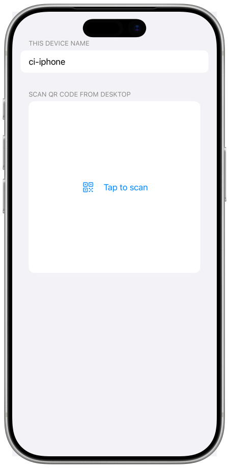

# Linked devices

You can use the chat profiles of the SimpleX app on your mobile (iOS or Android) from the desktop app. The mobile app keeps your profiles, contacts and messages; the desktop app shows them, and the mobile app performs the actions that you take on the desktop. The desktop connects to the mobile over the local network.

To link the devices:

- The mobile and the desktop must be connected to the same local network, and the desktop firewall must allow the connection.
- Both apps must have compatible versions. Otherwise the mobile shows **Not compatible!** or **Incompatible version**.

The desktop keeps its own chat profiles, if you created any, and you can switch between them and the profiles of the mobile.

## Link a mobile

On the desktop:

1. Open the profile menu and click **Link a mobile** (**Linked mobiles** after the first link).
2. Optionally, change **This device name**: "The device name will be shared with the connected mobile client."
3. Click **Link a mobile** under **Devices**. The desktop shows a QR code and asks: "Open Use from desktop in mobile app and scan QR code."

On a new desktop, the first screen also offers **Link a mobile**, next to **Create your profile**, so you can link a mobile without creating a profile on the desktop. The desktop can first offer to set a [database passphrase](./managing-data.md#database-passphrase), and then it shows the QR code.

On the mobile:

4. Open the profile menu and tap **Use from desktop**. The app opens **Connect to desktop**.
5. Optionally, change **This device name**.
6. Scan the QR code from the desktop, under **Scan QR code from desktop**.
7. Compare the session codes: the mobile shows its code under **Verify code with desktop**, and the desktop under **Verify code on mobile**. If the codes are the same, tap **Confirm** on the mobile.

The desktop then shows the chats of the mobile.

The desktop waits 60 seconds for the mobile to connect, then closes the QR code. To get a new QR code, click **Link a mobile** again.

## Session code verification

Each connection between the mobile and the desktop has a session code, and both devices show it. When the codes are the same, the mobile and the desktop are in the same session.

- When you connect to a new desktop, the mobile always asks you to confirm the code.
- When you connect to a desktop that you linked before, the mobile confirms the code without asking. To be asked each time, turn on **Verify connections**: it is off by default.

While the devices are connected, the mobile shows the code under **Session code**. The desktop shows it under **Verify code on mobile** when you click the mobile in **Linked mobiles**.

## Connect again

After the first link, the mobile and the desktop remember each other.

1. On the desktop, open **Linked mobiles** and click the mobile. The desktop shows a QR code (**Scan from mobile**).
2. On the mobile, open **Use from desktop**:
   - If **Discover via local network** is on, the mobile looks for linked desktops on the local network ("Waiting for desktop…"). When it finds the desktop, it connects, or it shows **Connect** if **Connect automatically** is off. To scan the QR code instead, tap **Scan QR code**.
   - Otherwise, scan the QR code.

## Local network discovery

When the desktop shows the QR code for a linked mobile and **Discoverable via local network** is on, the desktop also announces itself on the local network. The announcement is encrypted for that mobile. A mobile with **Discover via local network** on receives it and connects without scanning.

| Setting | Device | Default | What it does |
|---|---|---|---|
| **Discoverable via local network** | Desktop | On | The desktop announces itself to linked mobiles |
| **Discover via local network** | Mobile | On (iOS), off (Android) | The mobile looks for linked desktops when you open **Use from desktop** |
| **Connect automatically** | Mobile | On | The mobile connects to a found desktop without asking |
| **Verify connections** | Mobile | Off | The mobile asks you to confirm the session code each time |

On the desktop, **Discoverable via local network** is on the screen **Link a mobile** (**Linked mobiles**). On the mobile, the other settings are in **Use from desktop** > **Linked desktops** > **Linked desktop options**; **Linked desktops** is shown after you link a desktop, and **Connect automatically** is shown while **Discover via local network** is on.

## Desktop address and port

Below the QR code, the desktop shows its network address and the port that it uses for the connection.

- If the computer has several network interfaces, choose the address from the list.
- The port is random by default (**Random**). To use a fixed port, enter a number above 1023. If a firewall runs on the desktop, open this port in it: "To allow a mobile app to connect to the desktop, open this port in your firewall, if you have it enabled".

After you change the address or the port, click **Refresh** to show a new QR code. The address and the port that you choose are saved for that mobile.

## While the devices are connected

On the desktop:

- The profile menu shows the name of the mobile and **This device**. Click **This device** to use the profiles of the desktop, and the name of the mobile to return to the profiles of the mobile.
- Files that you send are copied to the mobile, which sends them. Files in the chats of the mobile are loaded from the mobile when you open them.
- To disconnect, click the Wi-Fi icon next to the name of the mobile in the profile menu, or click the mobile in **Linked mobiles** and click **Disconnect**.

On the mobile:

- The screen **Connected to desktop** shows the name and version of the desktop, the session code and **Disconnect**.
- On iOS, the session ends when the app goes to the background: "Keep the app open to use it from desktop". The screen of the iPhone stays on while the session is active.
- On Android, closing the screen asks **Disconnect desktop?**: "Only one device can work at the same time".

The database of the mobile, its passphrase and its network settings are managed on the mobile.

## Remove a linked device

- On the desktop, open **Linked mobiles** and right-click the mobile, then click **Delete**. The files of that mobile that the desktop loaded are deleted too.
- On the mobile, open **Use from desktop** > **Linked desktops**. On iOS, swipe the desktop to the left and confirm **Unlink**. On Android, tap and hold the desktop, then tap **Delete**.

With developer tools on, the desktop also offers **Share link** below the QR code, and the mobile offers **Paste desktop address** and **Connect to desktop**, to connect by the link instead of the QR code.
