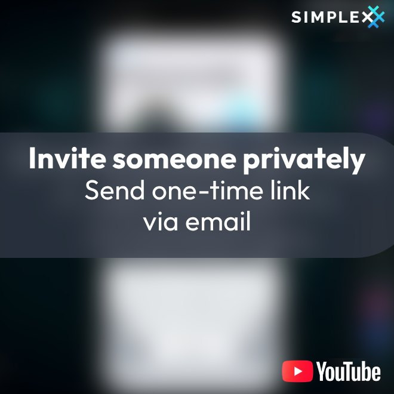
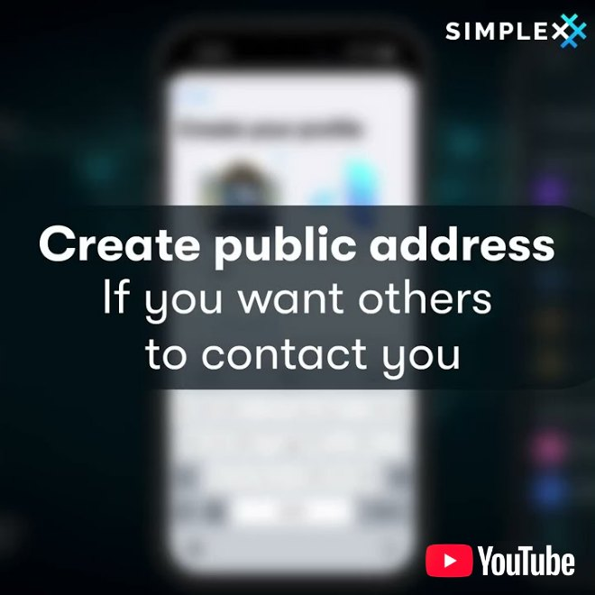
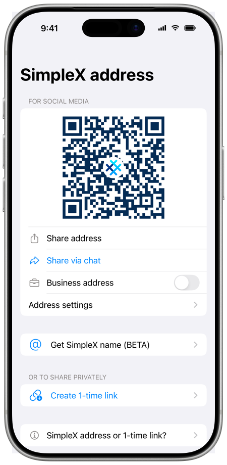
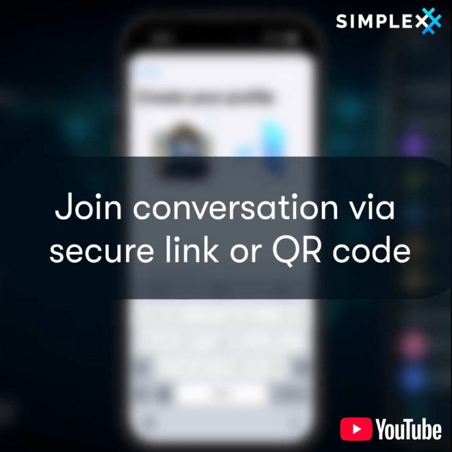
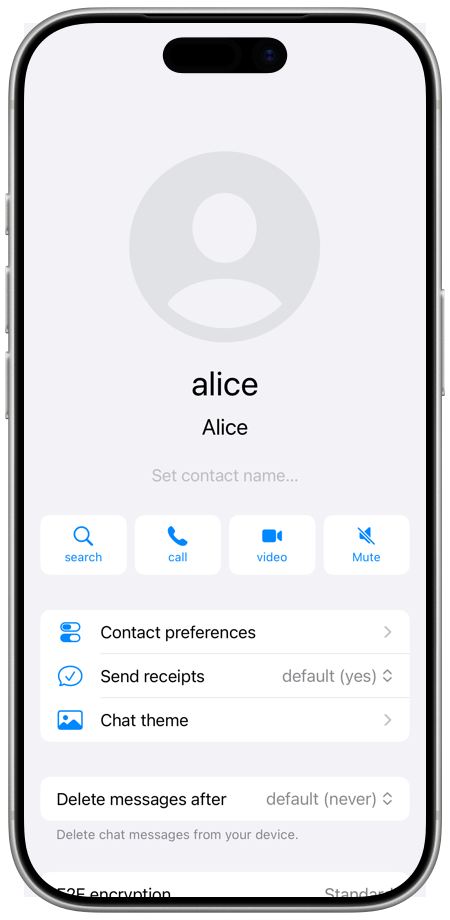

# Making connections

SimpleX Chat has no user identifiers: messages are delivered via separate
addresses for each contact, instead of a phone number or a username. To connect
with you directly, people need a link or a name that you share: a 1-time link,
your SimpleX address, or a SimpleX name, if you registered one for your address.
You can delete your address at any time, and the contacts made via it remain
connected.

Members of your groups can also send you a contact request when direct messages
are allowed in the group ([Groups](./secret-groups.md)).

You join a group via its group link or an invitation from a contact ([Join a
group](./secret-groups.md#join-a-group)), and a channel via its link or its
SimpleX name ([Subscribe to a channel](./channels.md#subscribe-to-a-channel)).

## 1-time links

Watch how to create a 1-time link and send it by email. Only one person can
connect via the link: after your friend connects, nobody else can use it. If
someone intercepts the email and connects first, your friend cannot connect, so
confirm with your friend that the connection worked, or compare security codes
(see [Security code verification](./privacy-security.md#security-code-verification)).

You use a 1-time link to connect with one person. Share it with somebody you
know, or let them scan its QR code in person or during a video call.

To create a 1-time link:

1. Tap the pencil button in the chat list toolbar, then **Create 1-time link**.
2. Under **Share profile**, the profile to share is shown: your current profile
   or **Incognito**. Tap it to choose another chat profile or **Incognito**
   ([Incognito mode](./chat-profiles.md#incognito-mode)).
3. Under **Share this 1-time invite link**, tap the share button to send the
   link via another app, or let the other person scan the QR code under **Or
   show this code**. On Android and desktop, you can also copy the link; on
   desktop, the link is copied when you share it.

The profile you share is included in the link, so the person who opens it sees
your name and image before connecting. With **Incognito**, a new random profile
is shared. If you choose another chat profile, the app creates a new link and
switches to that profile.

If you leave the screen without sharing or copying the link, the app asks **Keep
unused invitation?**: with **Keep**, the link is kept as a [pending
connection](#pending-connections); with **Delete**, it is deleted.

After the other person uses the link, you are connected when their device is
online. The link can be used only once.

## Your SimpleX contact address

Watch how to create your SimpleX address and share it as a link or a QR code.
People who use the address send you a contact request, and you accept or reject
it, unless you turn on **Auto-accept** (see [Contact requests](#contact-requests)).
The address is used only for new requests, not to deliver messages: you can
delete it and create a new one, and the contacts made via it stay connected. If
you registered a SimpleX name, add the new address to the name and claim it
again (see [Registering a SimpleX name](./register-simplex-name.md)).

Your SimpleX address is a long-term link that many people can use to connect
with you. You can share it online, for example in social media profiles, on a
website or in an email signature.

To create your address, open the [profile menu](./README.md#profile-menu), tap
**Create SimpleX address**, then tap **Create SimpleX address** on the screen
that opens. Once the address exists, the menu item is named **Your SimpleX
address**.

If you have contacts in this chat profile that you connected to without
incognito, the app asks **Share address with SimpleX contacts?**. Otherwise, the
address is added to your profile (see **Share with SimpleX contacts** in
[Address settings](#address-settings)).

On the address screen:

- The QR code of the address, under **For social media**.
- **Share address**: send the address via another app. On desktop, it is copied.
- **Share via chat**: choose a chat, and the address is added to your message as
  a card. People who tap the card see that it was shared by the owner of the
  address ([Connect via a link or a name](#connect-via-a-link-or-a-name)).
- **Business address**: each person who connects via the address gets a separate
  business chat, where you can add your team members ([Business
  chats](./secret-groups.md#business-chats)). Requests to a business address are
  accepted automatically.
- **Address settings**: see [Address settings](#address-settings).
- **Get SimpleX name (BETA)**: let people connect to you by a name ([Registering
  a SimpleX name](./register-simplex-name.md)).
- **Create 1-time link**, under **Or to share privately**.
- **SimpleX address or 1-time link?**: a short explanation of the difference,
  with a link to the
  [comparison](#comparison-of-1-time-invitation-links-and-simplex-contact-addresses)
  below.
- **Delete address**: the address is deleted after you confirm.

When people connect via your address, you receive a contact request that you can
accept or reject ([Contact requests](#contact-requests)).

If you start receiving too many requests via this address, you can delete it:
all the contacts made via this address remain connected, as the address is not
used to deliver messages.

Your profile is included in the address, so people see it before they connect.

### Address settings

Tap **Address settings** on the address screen:

- **Share with SimpleX contacts**: when on, the address is added to your
  profile. Your contacts see it in your contact info and can pass it on. Group
  members see it in your member info, with **Connect**, when direct messages and
  SimpleX links are allowed in the group. When you turn it on or off, the app
  sends a profile update to your contacts.
- **Auto-accept**: contact requests are accepted without your action. With
  **Business address** on, **Auto-accept** is always on.
- **Welcome message**: a message for people who connect via your address. People
  who open your address see it in the new chat before they connect, and the
  message is sent to each new contact when the connection is established.

Changes to the welcome message are saved with **Save**.

### Comparison of 1-time invitation links and SimpleX Contact addresses

<table>
  <tr>
    <th></th>
    <th>1-time invitation link</th>
    <th>SimpleX contact address</th>
  </tr>
  <tr>
    <td>Can be used many times?</td>
    <td>No</td>
    <td>Yes</td>
  </tr>
  <tr>
    <td>Can be included in user profile?</td>
    <td>No, as it can only be used once.</td>
    <td>Yes, to allow group members to connect directly, and your contacts to pass it on to their contacts.</td>
  </tr>
  <tr>
    <td>When to use it?</td>
    <td>With somebody you know, via another communication channel or QR code (in person or during a video call)</td>
    <td>Where many people can see and connect via it, e.g. in email signature, website, social media or group chat.</td>
  </tr>
  <tr>
    <td>Security</td>
    <td>More secure, as can only be used once, and the initial connection request (including profile) is encrypted with double ratchet.</td>
    <td>Initial connection request is also e2e encrypted, but without double ratchet (it is initialized when request is accepted).</td>
  </tr>
  <tr>
    <td>Identification</td>
    <td>Both sides know who they connect to, as they know with whom and by who the link was shared. You can set a contact name for this connection as soon as you share or use the link, to identify the other person when connection is established.</td>
    <td>Only the person using the address knows who they connect to, via the channel where they found the address (email, social media, etc.). The address owner can only see the user profile of the request, and has no proof of identity from the person sending the request.</td>
  </tr>
  <tr>
    <td>Advantages over other platforms</td>
    <td>There is no direct analogy, other platforms don’t offer one-time invitations without any fixed part identifying the user.</td>
    <td>Unlike addresses in other platforms, SimpleX addresses are not used to deliver the messages &mdash; only the initial connection requests. It means that removing this address will not break the contacts made via it (like changing an email address would), it would only prevent new connections, so you can delete the address to stop spam requests.</td>
  </tr>
  <tr>
    <td>Vulnerability to attacks</td>
    <td>Until the connection is established, anybody who intercepts this link can connect to it, so it has to be verified with the original contact that the connection succeeded.</td>
    <td>These addresses are vulnerable to connection request spam. Unlike other platforms, you can delete or change the address, without losing any contacts (see above).</td>
  </tr>
  <tr>
    <td>Passive attacks on connection links</td>
    <td colspan="2">Both types of links are not vulnerable if simply observed &mdash; they only contain public keys. So they can be safely shared via insecure or public channels, as long as you can confirm that you connected to the intended person.</td>
  </tr>
  <tr>
    <td>Active attacks on connection links</td>
    <td colspan="2">If the link is substituted via the attack on the channel used to share it, the connection security can be compromised, and the original messages monitored (man-in-the-middle attack). If it is a real risk then security code should be verified to mitigate it - doing so proves* that the link and keys were not substituted, and that the end-to-end encryption is secure.</td>
  </tr>
</table>

* Connection security code is the cryptographic hash (SHA256) of
combined public keys of both sides &mdash; there are 2256 possible
security codes (1 with 77 zeros – about [1000 times
smaller](https://www.wolframalpha.com/input?i=2%5E256) than the estimated number
of atoms in the visible universe). See [Security code
verification](./privacy-security.md#security-code-verification).

## Connect via a link or a name

Watch how to connect by scanning a QR code. Before you connect, the app shows the
profile included in a short link, and you choose which of your profiles, or a
new random profile, to connect with (see [Incognito mode](./chat-profiles.md#incognito-mode)).
A QR code that you scan in person cannot be replaced on the way to you.

To connect via a 1-time link or a SimpleX address that you received:

1. Open the link in the app in one of these ways:
   - Tap the pencil button, then **Scan / Paste link** (iOS), **Paste link /
     Scan** (Android) or **Paste link** (desktop). Tap **Tap to paste link**,
     or, on iOS and Android, scan the QR code under **Or scan QR code**.
   - Paste the link into the search field (**Search or paste SimpleX link**) of
     the chat list or of the new chat sheet.
   - Tap the link, or a link card, in a message.
2. The app loads the link and shows the profile included in it. Tap **Open new
   chat**.
3. The app opens a new chat with the profile of the contact. The welcome message
   of the address, if set, is shown in the chat.
4. At the bottom, under **Your profile**, the profile you will share is shown.
   Tap it to choose another chat profile or **Incognito** ([Incognito
   mode](./chat-profiles.md#incognito-mode)). If you choose another chat
   profile, the app moves the new chat to that profile and switches to it.
5. For a 1-time link, tap **Connect**. For an address, you can type a message in
   **Add message**, then tap **Connect** or send the message, and confirm with
   **Send request** or **Send request without message**. You can send more
   messages only after your request is accepted. For a bot, tap **Connect**.

Until the connection is established, **connecting…** (1-time link) or **contact
should accept…** (address) is shown in the chat. After you tap **Connect**, the
profile cannot be changed: to use another profile, delete the chat and use the
link again.

Your SimpleX address and [channel](./channels.md) links can be sent as link
cards with **Share via chat**. On a link card in a message, the name and image
of the profile and **Tap to open** are shown. A card signed by the owner of the
link is marked **(from owner)**; when you open it, the app checks the signature
and shows **Link signature verified.**, or a warning when the check fails.

When you open a link received without a profile, such as a full link (the long
form of a SimpleX link), the app offers **Use current profile**, **Use new
incognito profile** and **Cancel**, and the connection is shown as a [pending
connection](#pending-connections) until it is established.

You open group and channel links in the same way: see [Join a
group](./secret-groups.md#join-a-group) and [Subscribe to a
channel](./channels.md#subscribe-to-a-channel).

### Connect by SimpleX name

Type or paste a SimpleX name, such as `@name.testing` for a contact or
`#name.testing` for a channel, into the search field of the chat list or of the
new chat sheet. A name without a dot, 5 or more characters long, is completed
with `.testing`. Tap the **Connect to …** row that appears: the app finds the
address or channel registered for the name and continues as for a link. You can
also tap a SimpleX name in a message.

To let people connect to you by name, see [Registering a SimpleX
name](./register-simplex-name.md).

### Messages when connecting

| Link | The app shows |
|---|---|
| Your own 1-time link or address | **Connect to yourself?**, with **Use current profile**, **Use new incognito profile** and **Cancel** |
| A link of a contact you are connected or connecting to | the contact's profile with **Open chat** |
| A link of a new chat you opened earlier, before tapping **Connect** | the profile with **Open new chat** |
| A 1-time link you are already connecting via | **Already connecting!** |
| A chat relay address | **Relay address**: it cannot be used to connect |
| Text that is not a SimpleX link | **Invalid link** (iOS) or **Invalid link!** (Android, desktop) |
| A QR code that is not a SimpleX link | **Invalid QR code** |

## Contact requests

When somebody sends a request via your address, a new chat with their profile is
added to the chat list. With **Auto-accept** on, requests are accepted without
your action ([Address settings](#address-settings)).

To answer a request:

1. Open the chat. The profile of the sender and the message they added are shown
   in it.
2. Tap **Accept** or **Reject** at the bottom.

When you tap **Reject**, the app asks you to confirm; the sender is not
notified.

You can also answer from the chat list: swipe left on iOS, long press on
Android, or right-click on desktop, then choose **Accept** or **Reject**.

Requests sent to a [business address](#your-simplex-contact-address) are
accepted automatically. For contact requests from group members, **Accept** and
**Reject** are shown in the same way.

## Pending connections

A 1-time link that you created is shown in the chat list as a pending
connection, with **invited to connect** and **you shared one-time link**, until
the other person connects.

Tap a pending connection to open its details:

- **Set contact name…**: a name that only you see, to recognize the person when
  they connect. This name is kept for the contact after the connection is
  established.
- For your 1-time link: its QR code, **Share 1-time link** and **Learn more**.
- The profile that is shared, or **Incognito**.
- **Delete connection** (iOS) or **Delete** (Android, desktop).

From the chat list, swipe left on iOS to see **Name** and **Delete**; on Android
and desktop, long press or right-click to see **Set contact name** and
**Delete**.

Before deleting, the app asks **Delete pending connection?**. After you delete
your 1-time link, the person you shared it with cannot connect.

## Contact info

To open contact info, open the chat with a contact and tap the contact's name in
the chat toolbar: at the top on iOS, and at the bottom by default on Android and
desktop.

In contact info, the contact's profile is shown with these items:

- **Set contact name…**: a name for the contact that only you see.
- Buttons to search the conversation, start an [audio or video
  call](./audio-video-calls.md), and
  [mute](./notifications.md#mute-chats-and-profiles) the chat.
- **Your random profile**, under **Incognito**, when you connected incognito.
- **Verify security code**, or **View security code** after verification
  ([Security code
  verification](./privacy-security.md#security-code-verification)).
- **Contact preferences**: the features allowed in this chat ([Contact
  preferences](./send-messages.md#contact-preferences)).
- **Send receipts**: **yes**, **no**, or the default from **Send delivery
  receipts to** in [Your privacy](./app-settings.md#your-privacy).
- **Fix connection**: shown when the encryption of the connection needs to be
  renegotiated; tap it to renegotiate.
- **Chat theme**: colors and wallpaper of this chat
  ([Appearance](./app-settings.md#appearance)).
- **Delete messages after**: message retention for this chat ([Automatic message
  deletion](./managing-data.md#automatic-message-deletion)).
- **E2E encryption**: **Quantum resistant** when quantum resistant encryption is
  used in both directions, otherwise **Standard**.
- **Address**: the contact's SimpleX address with its QR code and **Share
  address**, when the contact shares it in their profile.
- **Servers**: **Network status**, whether the app is connected to the server
  used to receive messages from this contact; tap it for details. The servers
  are shown in **Receiving via** and **Sending via**; tap them to copy.
- **Change receiving address**: messages from this contact are then received via
  a different server; the change is completed when the contact comes online.
  While the change is in progress, **Abort changing address** is shown.
- **Clear conversation** (iOS) or **Clear chat** (Android, desktop): all
  messages in this chat are deleted, only for you.
- **Delete contact**: see below.

A shield mark is shown before the name when you verified the security code.

### SimpleX name of a contact

When a contact has a SimpleX name, it is shown under their name. Tap **Verify
name** to check that the name is registered for the contact's address and that
the claim was signed by the owner of the address; a verified name is shown with
a check mark. With **Verify SimpleX names** on in [Your
privacy](./app-settings.md#your-privacy), names are checked when you open
contact info. See [Registering a SimpleX name](./register-simplex-name.md).

### Delete a contact

Tap **Delete contact** in contact info, or **Delete** in the chat list actions.
For a connected contact, the app offers:

- **Only delete conversation**: all messages are deleted, and the contact stays
  connected. The contact is listed in **Archived contacts** in the new chat
  sheet, where you can open the chat and send messages again.
- **Delete contact**: the contact is deleted, and this cannot be undone. Choose
  **Delete without notification** or **Delete and notify contact**; with **Keep
  conversation** on, the conversation is kept in the chat list. A notified
  contact sees **deleted contact** in their chat with you.
