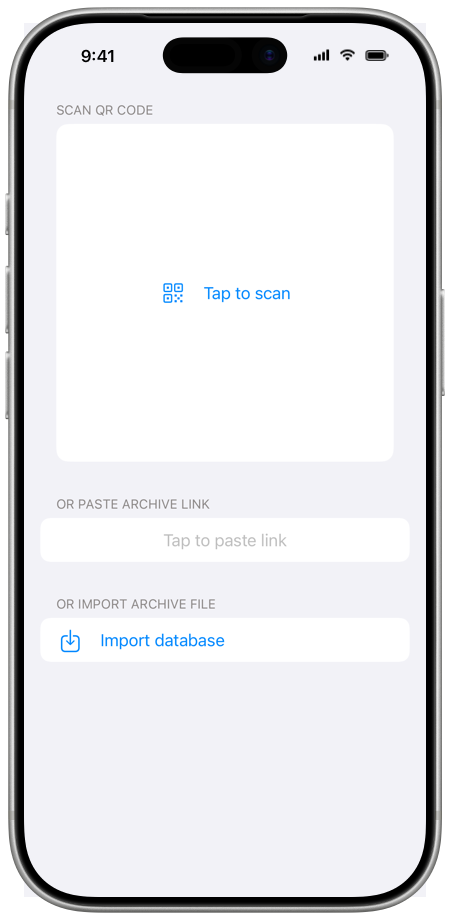

# Managing Your Data

The app stores your chat profiles, contacts, messages and files on your device, in a database protected by a [passphrase](#database-passphrase). To manage this data, open **Settings** (see [App settings](./app-settings.md#opening-the-app-settings)) and tap **Chat data**.

The **Chat data** screen has three parts:

- **Messages**: **Delete messages after**, see [Automatic message deletion](#automatic-message-deletion).
- **Database passphrase & export**, see [Chat database](#chat-database).
- **Files & media**, see [Delete files and media](#delete-files-and-media).

## Automatic message deletion

The app can delete old messages from your device. Messages are deleted only on your device; your contacts keep their copies.

1. Open **Chat data**.
2. Tap **Delete messages after** and choose **never**, **1 year**, **1 month**, **1 week** or **1 day**. The default is **never**.
3. When you choose a shorter period, confirm **Delete messages** in the alert **Enable automatic message deletion?**.

Messages older than the chosen period are deleted with their files. This can take several minutes.

The setting applies to the current chat profile, and each profile has its own period.

To set a different period for one chat, open the chat info and choose **Delete messages after** there. With **default (…)**, the app applies the period of the profile.

## Chat Database

To open the database settings, open **Chat data** and tap **Database passphrase & export**. The screen has:

- **Database passphrase**.
- **Open database folder**, on desktop: the app opens the folder with the database files.
- **Export database**, **Import database** and **Delete database**.
- **Run chat**: the toggle **Chat is running** or **Chat is stopped**.

To export, import or delete the database, the app stops the chat. The app explains: "You will not be able to receive and send messages while the chat is stopped." While the chat is stopped, the app shows a red mark next to **Chat data** in Settings. When [SimpleX Lock](./app-settings.md#simplex-lock) is on, the app asks you to authenticate before it stops the chat.

The app warns: "You must use the most recent version of your chat database on one device ONLY, otherwise you may stop receiving the messages from some contacts." On Android and desktop this warning is shown while the chat is stopped.

### Database passphrase

 &nbsp;&nbsp; 

When the app starts for the first time, it encrypts the database with a random passphrase and saves this passphrase on the device:

| | iOS | Android | Desktop |
|---|---|---|---|
| Where the passphrase is saved | iOS Keychain | Android Keystore | App settings, as plaintext |
| Toggle | **Save passphrase in Keychain** | **Save passphrase in Keystore** | **Save passphrase in settings** |

On Android, the screen shows where Keystore keeps its key: **Secure element**, **TEE** or **Software**.

On desktop, the first start offers to set your own passphrase (**Setup database passphrase**): enter it twice, click **Set database passphrase** and confirm, or click **Use random passphrase**. You then enter a passphrase set there each time the app starts.

To set or change the passphrase:

1. Open **Chat data** > **Database passphrase & export** > **Database passphrase**.
2. If you set your own passphrase before, enter it in **Current passphrase…**.
3. Enter the new passphrase in **New passphrase…** and **Confirm new passphrase…**. It can contain Latin letters, digits and symbols, without spaces. The app colours the icon next to the field by the strength of the passphrase.
4. Tap **Update database passphrase** and confirm.

The app restarts the chat with the new passphrase.

To enter the passphrase each time the app starts, turn off the toggle (**Save passphrase in Keychain**, **Save passphrase in Keystore** or **Save passphrase in settings**) and confirm **Remove**. The toggle can be turned off after you set your own passphrase. At each start, the app then shows **Encrypted database**: enter the passphrase and tap **Open chat**.

On iOS, the app warns: "Instant push notifications require passphrase saved in Keychain." On Android, when you remove the passphrase from Keystore, the app warns: "Notifications will be delivered only until the app stops!" See [Notifications](./notifications.md).

The app warns: "you will NOT be able to recover or change passphrase if you lose it." Store the passphrase securely.

### Backups

On iOS, the app excludes its data from device backups. On Android, system backup is turned off for the app. To keep a copy of your data, [export the database](#export-database).

### Export database

The app exports the database to a .zip archive, with the files and the chat wallpapers. The archive also contains the app settings: network, privacy, notifications, calls (including ICE servers), linked desktop options, developer tools and appearance. The settings are applied when the archive is imported.

1. Open **Chat data** > **Database passphrase & export**.
2. Tap **Export database**. When the database still uses the random passphrase, the app shows **Set passphrase to export** and opens **Database passphrase**: set your own passphrase first.
3. The app stops the chat and creates the archive.
4. Save the archive: iOS opens the share sheet, Android and desktop ask where to save the file.

After the export, the app keeps the chat stopped. To start it, turn on the toggle under **Run chat**.

You need the database passphrase to open the archive on another device.

### Import database

The app deletes your current chat profiles, contacts, messages and files, and imports the data from the archive. This cannot be undone.

1. Open **Chat data** > **Database passphrase & export**.
2. Tap **Import database** and choose the .zip archive.
3. Tap **Import** in the alert **Import chat database?**.
4. The app shows **Chat database imported**.
5. When the chat starts again, the app asks for the passphrase of the imported database (**Encrypted database**). Enter it and tap **Save passphrase and open chat**, or **Open chat** if you enter the passphrase at each start.

On a new device, you can also import the archive before you create a profile: see [Migrate to another device](#migrate-to-another-device).

### Delete database

With **Delete database**, the app deletes all chat profiles, contacts, messages and files from this device, and this cannot be undone. The app asks **Delete chat profile?**; after you confirm, it shows **Chat database deleted** and "Restart the app to create a new chat profile".

## Delete files and media

In **Chat data**, under **Files & media**, tap **Delete all files**. When you have more than one chat profile, the button is **Delete files for all chat profiles**. Below the button, the app shows the number and the total size of the files.

The app asks **Delete files and media?** and explains: "This action cannot be undone - all received and sent files and media will be deleted. Low resolution pictures will remain." The messages stay in the chats.

With **Encrypt local files** on, in [Your privacy](./app-settings.md#your-privacy), the app encrypts the files that it saves.

To see how much space each app folder uses, turn on **Show developer options** and open **Storage** (see [Developer tools](./app-settings.md#developer-tools)).

## Migrate to another device

The app can move all your chat profiles, contacts, messages and files to another device, also to a device with another operating system. The old device uploads an archive of the database, and the new device downloads it. The app explains: "All your contacts, conversations and files will be securely encrypted and uploaded in chunks to configured XFTP relays."

On the old device:

1. Open **Settings** and tap **Migrate to another device**. When SimpleX Lock is on, authenticate.
2. The app stops the chat. If the database uses the random passphrase, set your own passphrase and tap **Set passphrase**. Otherwise, enter your passphrase and tap **Verify passphrase**. You need this passphrase on the new device.
3. Tap **Archive and upload**. The app archives the database and uploads it.
4. When the upload completes, the app shows a QR code (**Show QR code**) and a link (**Or securely share this file link**).

On the new device:

5. Install the app and open it. Tap **Get started** (iOS and Android) or **Create your profile** (desktop), then tap **Migrate** (iOS and Android) or **Migrate from another device** (desktop) at the top of the screen. The app opens **Migrate here**.
6. Scan the QR code (iOS and Android), or copy the link and tap **Tap to paste link**.
7. The app downloads and imports the archive. Enter the passphrase and tap **Open chat**. With the toggle above the field, you choose whether the app saves the passphrase on this device.
8. The app shows **Chat migrated!** and "Finalize migration on another device."

When the old device used a SOCKS proxy or .onion hosts, the new device asks you to check the network settings (**Confirm network settings**), then tap **Apply**.

On the old device:

9. Tap **Finalize migration**, then **Continue** in the alert **Remove archive?**. The uploaded archive is removed from the servers.
10. Under **Migration complete**, tap **Delete database from this device**, or tap **Start chat** to continue using the database on the old device. The app warns: "Warning: starting chat on multiple devices is not supported and will cause message delivery failures".

To stop the migration before you finalize it, tap **Cancel migration** on the old device: the uploaded archive is removed, and the app starts the chat again on the old device.

The app transfers the app settings with the archive. When the new device has a different app version, it can ask to upgrade or downgrade the database (**Upgrade and open chat** or **Downgrade and open chat**).

On the screen **Migrate here**, you can also import an archive file that you exported before: tap **Import database** under **Or import archive file**.
