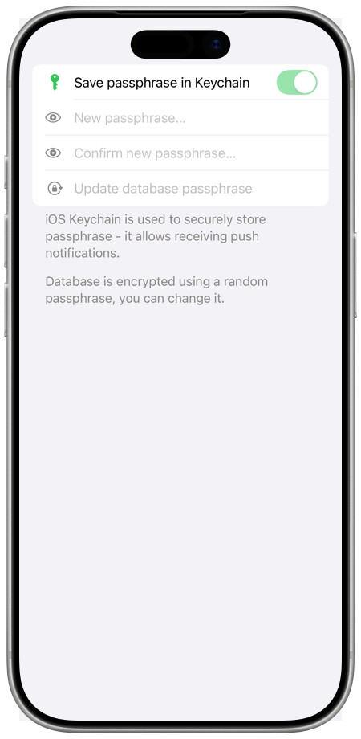
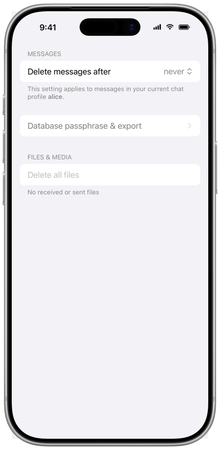

# Managing data

## Automatic message deletion

To delete messages from your local chat database after a set period of time,
open [the app settings](./app-settings.md#opening-the-app-settings), tap **Chat
data** and choose the period in **Delete messages after**.

**Please note**: This option does not delete messages for other users, only for you. This option is set independently for each chat profile.

To set a different period for one chat, choose it in **Delete messages after**
in the chat info.

## Chat database

To open your chat database settings:

- [Open the app settings](./app-settings.md#opening-the-app-settings).
- Tap **Chat data**, then **Database passphrase & export**.

### Database passphrase

By default, database passphrase is random, you have to set it manually to be able to export it.

To set your own passphrase, tap **Database passphrase**, enter it in **New
passphrase…** and **Confirm new passphrase…**, and tap **Update database
passphrase**. To change a passphrase that you set before, also enter it in
**Current passphrase…**.

The app saves the passphrase on the device, in iOS Keychain, in Android Keystore,
or in the app settings as plaintext on desktop. After you set your own
passphrase, you can turn off **Save passphrase in Keychain** (iOS), **Save
passphrase in Keystore** (Android) or **Save passphrase in settings** (desktop).
On desktop, a passphrase that you set at the first start is not saved. The app
then asks for the passphrase each time it starts, and notifications on iOS and
Android are limited (see
[Notifications](./notifications.md#notifications-and-the-database-passphrase)).
A lost passphrase cannot be recovered.

### App data backup

The app data is not saved in iOS backups, and Android backup is turned off for
the app. To keep a copy of your data, [export the database](#export-database).

### Export database

Here you can export the chat database to a file. The file also contains your
files and the app settings. The app stops the chat to export the database, and
the chat stays stopped after the export. To start it again, turn on the toggle
under **Run chat**.

### Import database

Here you can import the chat database from a file. Your current chat database is
deleted and replaced with the imported one. When the chat starts again, the app
asks for the passphrase of the imported database.

### Delete database

Here you can delete your chat database. WARNING: Results in a loss of all your SimpleX Chat data! Unless you have just exported the chat database.

## Delete files and media

You can delete all sent and received files and media stored in the app with
**Delete all files** in **Chat data**, without deleting the messages. When you
have several chat profiles, the button is **Delete files for all chat
profiles**.

## Migrate to another device

You can move all your chat profiles, contacts, messages and files to a new
device. The app encrypts them and uploads them in chunks to your XFTP file
servers.

1. On the old device, open [the app
   settings](./app-settings.md#opening-the-app-settings) and tap **Migrate to
   another device**. The app stops the chat. Set a database passphrase, or
   confirm the one you set before, and tap **Archive and upload**. When the
   upload completes, the app shows a QR code and a link.
2. On the new device, install the app and tap **Get started** (iOS and Android)
   or **Create your profile** (desktop). Tap **Migrate** (**Migrate from another
   device** on desktop) at the top of the screen. Scan the QR code (iOS and
   Android) or paste the link, then enter the database passphrase and tap **Open
   chat**.
3. When the new device shows **Chat migrated!**, tap **Finalize migration** on
   the old device, then **Delete database from this device**.

Do not use the same database on two devices. It breaks the decryption of
messages from your connections.
