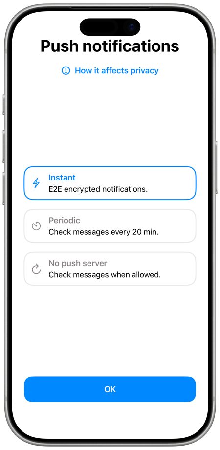
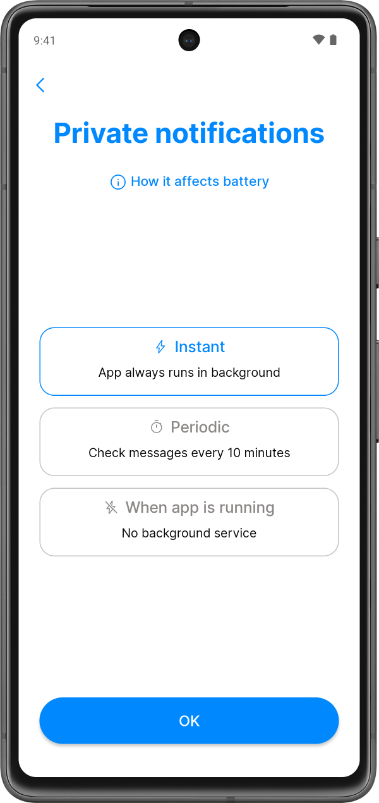

# Notifications

The app shows notifications for new messages, contact requests, new contacts and
calls. How it receives messages in the background depends on the platform. The
iOS app can use a push server, the Android app runs a notification service on
your device, and the desktop app receives messages while it runs.

When you create your first profile on iOS or Android, you can choose the
notification mode with **Setup notifications** on the **Your network** screen,
see [Choose notifications mode](./README.md#choose-notifications-mode). The
default mode is **Instant**. You can change it later in the settings.

## Notifications on iOS

There are three modes:

- **Instant**. The device token and end-to-end encrypted notifications are sent
  to the push server. The push server does not see the message content, its
  size or who sent it.
- **Periodic**. The app checks for new messages every 20 minutes. Only the
  device token is shared with the push server, and the server does not see how
  many contacts you have or any message metadata.
- **No push server**. The push server is not used. The app checks for messages
  in the background when iOS allows it, which depends on how often you use the
  app.

The app marks **Instant** as recommended, **Periodic** as more private and **No
push server** as the most private.

To change the mode:

1. Open **Settings** (see [Opening the app
   settings](./app-settings.md#opening-the-app-settings)) and tap
   **Notifications**.
2. Tap **Send notifications** and choose a mode.
3. Tap **Enable**, or **Turn off** for **No push server**.

When a push server is used, the **Notifications** screen shows it in **Push
server**. **Test notifications** checks the connection to the push server and
the notification token of your device. If there is a problem, the app shows
**Notifications error** with **Register**, which registers the token again.

If notifications for SimpleX Chat are turned off in the iOS settings, the app
shows **Notifications are disabled!** with **Open Settings**.

## Notifications on Android

The Android app receives messages itself, with a background service or with
periodic checks. The modes have different names at the first start and in the
settings:

| At the first start | In **Notification service** | What it does |
|---|---|---|
| **Instant** (default) | **Always on** | A background service is always running, and notifications are shown as soon as messages arrive. It uses more battery. |
| **Periodic** | **Starts periodically** | The app checks for new messages every 10 minutes, for up to 1 minute. It uses less battery, and you may miss calls or urgent messages. |
| **When app is running** | **Runs when app is open** | The app receives messages while it is open. It uses the least battery. |

To change the mode, open **Settings**, tap **Notifications**, then
**Notification service**, and choose a mode.

While the service runs, Android shows the notification **SimpleX Chat service**
with **Receiving messages…**. Its **Hide** button opens the system settings of
this notification.

**Starts periodically**, and **Always on** on Android 12 and later, need the app
to run without battery optimization. If this is not allowed, the app shows an
alert. **Allow** opens the system dialog to allow it, and **Disable
notifications** switches to **Runs when app is open**. If Android restricts the
app in the background, the app asks you to set **App battery usage** to
**Unrestricted** in the app settings, and **Open app settings** opens them.

On Xiaomi, Redmi and POCO devices, the app asks you to enable **Autostart** in
the system settings.

On Android 13 and later, the app asks for permission to show notifications when
the chat list opens. The notification service starts after notifications are
allowed.

## Notifications on desktop

The desktop app shows system notifications while it runs. The **Notifications**
row in the settings is on iOS and Android only. When the app window is focused,
message notifications are shown for chats other than the open one, and incoming
calls are shown in the app window.

To keep receiving messages after you close the window, turn on **Close to tray**
in [Appearance](./app-settings.md#appearance), and the app keeps running in the
system tray. The first time you close the window, the app asks **Minimize to
tray?** with **Close the app** and **Minimize to tray**. Messages are not
received after the app is closed. The tray icon shows a dot when there are
unread messages, and its tooltip shows how many. Its menu has **Show SimpleX**
and **Quit SimpleX**. **Close to tray** is available when the system has a tray.

## Notifications and the database passphrase

If you remove the database passphrase from the device, the iOS app warns that
instant push notifications will be hidden, and the Android app warns that
notifications will be delivered only until the app stops. See [Database
passphrase](./managing-data.md#database-passphrase).

## Notification previews

By default, notifications show the name of the contact or group and the message
text. To change this:

1. Open **Settings** and tap **Your privacy**, then **More privacy**.
2. In the **Notifications** section, tap **Show preview**.
3. Choose an option:
   - **Message text**: the name and the message. Text formatted as secret is
     replaced with "...".
   - **Contact name**: the name and "new message".
   - **Hidden**: "Contact hidden:" and "new message". On iOS, group messages
     show "Group message:". Contact pictures are not shown.

The option also applies to notifications of calls and contact requests. On iOS,
you can set the lock screen preview in the system settings, and **Open
Settings** opens them.

## Mute chats and profiles

When you mute a chat, its notifications are turned off. In groups and channels,
you can keep notifications for mentions. Muted chats have a muted icon in the
chat list.

In a direct chat, **Mute** turns notifications off and **Unmute** turns them on.
In groups and channels, the same menu item switches between three states:

- **Mute**: notifications only for messages that mention you or reply to your
  messages.
- **Mute all**: no notifications.
- **Unmute**: notifications for all messages.

| | iOS | Android | Desktop |
|---|---|---|---|
| Chat list | Swipe the chat right | Long press the chat | Right-click the chat |
| Open chat | The "…" menu in the chat toolbar | The "⋮" menu in the chat toolbar | The "⋮" menu in the chat toolbar |
| Chat info | The mute button under the name | The mute button under the name | The mute button under the name |

A muted chat profile shows no notifications while it is not your active profile.
When it is the active profile, you receive its calls and notifications. Hidden
profiles are always muted. To mute or unmute a profile, see [Hiding and muting
chat profiles](./chat-profiles.md#hiding-and-muting-chat-profiles).

The design of notifications on iOS and Android is explained in [this
post](../../blog/20220404-simplex-chat-instant-notifications.md).
