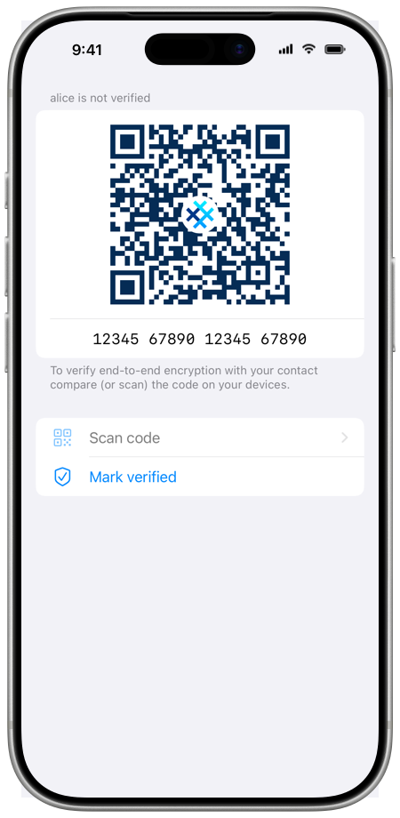

# Privacy and security

Unlike other messaging platforms, SimpleX Chat assigns no identifier to its users: no phone number, username, account or random number identifies you. Messages are delivered through separate message queues for each of your contacts, and, as the app puts it, "Network routers cannot know who talks to whom".

The default settings of SimpleX Chat balance privacy, security and convenience. This page gives an overview of how the app protects your conversations and your data, and links to the settings that change it.

## Encryption

When a conversation starts, the chat shows how it is encrypted. In direct chats and groups, for example: "Messages, files and calls are protected by **end-to-end encryption** with perfect forward secrecy, repudiation and break-in recovery." When a direct chat uses quantum resistant encryption, the text says **quantum resistant e2e encryption**. Contact info shows **E2E encryption**: **Quantum resistant** or **Standard**, see [Contact info](./making-connections.md#contact-info).

Channel messages are not end-to-end encrypted, and chat relays can see them, see [How channels work](./channels.md#how-channels-work).

The call screen shows whether a call is end-to-end encrypted, see [During a call](./audio-video-calls.md#during-a-call).

On your device, the chat database is encrypted (see [Database passphrase](#database-passphrase) below), and with **Encrypt local files**, on by default, the app stores files encrypted too.

## Privacy settings

The settings that affect privacy are in **Settings** > **Your privacy**, and are described in [Your privacy](./app-settings.md#your-privacy):

- **SimpleX Lock** asks you to authenticate when you open the app. With a passcode, you can also set a **Self-destruct passcode**: entering it deletes all app data. See [SimpleX Lock](./app-settings.md#simplex-lock).
- **Protect app screen** (iOS, Android) hides the app screen in the recent apps.
- **Send link previews**: the app loads the preview of a link you send from its website. **Remove link tracking**: the app removes tracking parameters from the links you type.
- **Auto-accept images**, **Blur media**, and auto-accepting **Contact requests in groups** and **Group invitations** set what the app receives and shows without your tap.
- **More privacy** has **Show last messages**, **Message draft**, **Verify SimpleX names**, **Encrypt local files**, **Protect IP address**, **Show encryption**, the notification preview (see [Notification previews](./notifications.md#notification-previews)) and the delivery receipts (see [Delivery receipts](./send-messages.md#delivery-receipts)).

On iOS, the notification mode sets what the push server receives, see [Notifications on iOS](./notifications.md#notifications-on-ios).

## Security code verification

You connect with someone through a link or a QR code that you pass to them outside of SimpleX. Unlike messengers whose servers distribute the keys, SimpleX Chat requires this, so that the messaging servers cannot replace the keys of the connection. If an attacker replaces the link on the way, they can intercept the connection (a man-in-the-middle attack). The security code is computed from the encryption keys of your connection: when you and your contact see the same code, the keys were not replaced.

To verify a contact:

1. Open the chat with the contact and tap the contact's name in the chat toolbar to open contact info.
2. Tap **Verify security code**.
3. Ask your contact to do the same on their device.
4. Compare the codes:
   - **Scan code** (iOS, Android): scan the QR code on your contact's screen. When the codes match, the contact is marked as verified on your device. When they do not match, the app shows **Incorrect security code!**.
   - **Mark verified**: when you compared the codes yourself, for example in person or by reading them aloud during a call.

Your contact verifies you on their device in the same way. The share button of the screen shares the code as text.

A verified contact has a shield mark next to their name in the chat list, in the chat toolbar and in contact info. In contact info, **View security code** opens the code again, and **Clear verification** there removes the mark. If the security code of the connection changes, the app removes the verification.

To verify a group member, open the member's info, for example by tapping the member in the member list of the group, and tap **Verify security code**. In channels, the same steps verify the keys of a subscriber: "To verify keys with this subscriber, compare (or scan) the code on your devices."

Why to verify the code is explained in [this post](../../blog/20230103-simplex-chat-v4.4-disappearing-messages.md#connection-security-verification).

The SimpleX name of a contact or a channel is checked separately, with **Verify name**: see [SimpleX name of a contact](./making-connections.md#simplex-name-of-a-contact) and [Registering a SimpleX name](./register-simplex-name.md).

## Database passphrase

The app creates the chat database encrypted with a random passphrase, and stores the passphrase on the device: in the iOS Keychain, in the Android Keystore, or, on desktop, in the settings as plaintext. You can set your own passphrase and remove it from the device; then you enter it each time the app starts, and notifications are limited (see [Notifications and the database passphrase](./notifications.md#notifications-and-the-database-passphrase)). See [Database passphrase](./managing-data.md#database-passphrase).

## Incognito mode

Incognito mode uses a new random profile instead of your chat profile for one contact or group. You choose it for each connection. See [Incognito mode](./chat-profiles.md#incognito-mode).

## Hidden profiles

You can hide a chat profile behind a password. A hidden profile is shown only while it is the active profile, and it is always muted. See [Hiding and muting chat profiles](./chat-profiles.md#hiding-and-muting-chat-profiles).

## Network settings

These settings are in **Settings** > **Network & servers**, and are described in [Network & servers](./app-settings.md#network-and-servers):

- **Server operators**: "The app protects your privacy by using different operators in each conversation." See [Server operators](./app-settings.md#server-operators).
- **Private message routing**: "To protect your IP address, private routing uses your SMP servers to deliver messages." See [Private message routing](./app-settings.md#private-message-routing).
- **Transport isolation**: by default, the app uses a separate TCP connection for each chat profile. See [Transport isolation](./app-settings.md#transport-isolation).

**Protect IP address**, in **Your privacy** > **More privacy**, makes the app ask you before it downloads a file from an unknown file server, see [More privacy](./app-settings.md#more-privacy). For calls, **Always use relay** hides your IP address from your contacts, see [Always use relay](./audio-video-calls.md#always-use-relay).

## Using Tor

To connect to the servers through the Tor network, use a SOCKS proxy to Tor, for example the Orbot app, and turn on the SOCKS proxy in the app, see [SOCKS proxy](./app-settings.md#socks-proxy). **Use .onion hosts** sets whether the app connects to the .onion addresses of servers, see [Use .onion hosts](./app-settings.md#use-onion-hosts). On iOS, the app notes that the **When available** and **Required** options of **Use .onion hosts** require a compatible VPN.

Calls connect directly, also when the app uses a SOCKS proxy.
