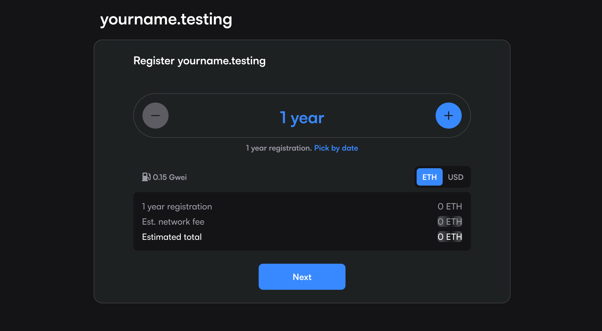
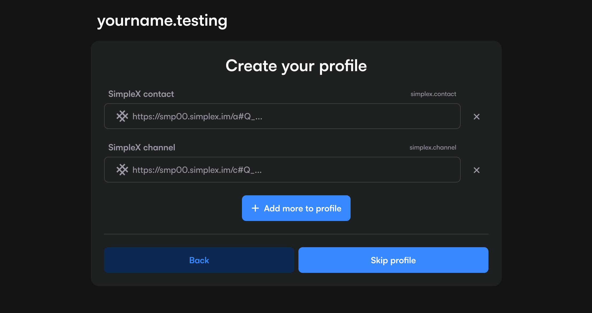
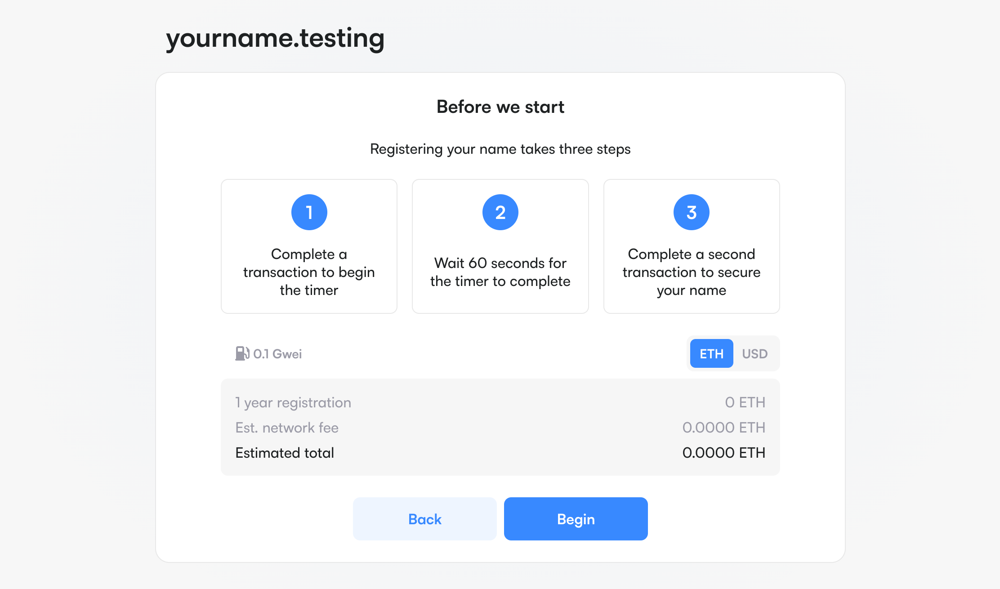

# Registering a SimpleX name

A SimpleX name lets people reach you by typing a short `@name` instead of pasting
a long link. You register the name on a website and add your SimpleX link to it,
then claim the name in the app, to connect it with your SimpleX address or
channel.

> Names currently run on a testing network. The registration page is
> [testing-names.simplex.chat](https://testing-names.simplex.chat) and names end
> in `.testing`. The steps stay the same when the main names launch.
>
> In the app, **How to register a test name** on the SimpleX name screen of [Step
> 4](#step-4-claim-the-name-in-the-app) opens
> [simplex.domains/#testing](https://simplex.domains/#testing). Test names stop
> working in the app when the SimpleX name sale starts, on 12 December 2026 at
> 18:00 UTC. The app counts down to it under **SimpleX name sale starts in**.

## What you need

- A crypto wallet such as MetaMask.
- The SimpleX app.
- A link for the name to open: your **contact address** (for one-to-one chats),
  your **channel link** (to join a channel), or both.

## How it works

Setting up a name takes two parts. On the website you register the name and add
your link, so people can find your link by name. In the app you set the same name
on your profile - to prevent any other names from opening your profile or channel.

## Step 1. Create a wallet

Install MetaMask (browser extension or mobile app) and create a wallet. Write
down your recovery phrase somewhere safe and offline, as anyone with that phrase
controls your names.

On the testing network you need a small amount of test ETH to pay network fees.

## Step 2. Register the name and add your link

Open the registration page and tap **Connect** to link your wallet. Type the
name you want in **Search for a name** and open it. Choose how many years to
register for, then tap **Next**. Names are currently 6 characters or more, and
some names are reserved.

On **Create your profile**, paste your SimpleX link into the matching field:

- **SimpleX contact** for one-to-one chats. Copy your address from the app
  (**Create SimpleX address**) and paste it here. People reach it with `@name`.
- **SimpleX channel** for a channel. Copy your **Channel link** and paste it here.
  People join it with `#name`.
- **Advanced usage:** fill both to use one name for your chat (`@name`) and your
  channel (`#name`).

Then tap **Next**.

Finally, tap **Begin** and complete the three steps the site shows:

> Before we start. Registering your name takes three steps:
> 1. Complete a transaction to begin the timer.
> 2. Wait 60 seconds for the timer to complete.
> 3. Complete a second transaction to secure your name.

These two transactions protect the name you are registering. The first records
only a secret code for the name, not the name itself, so nobody watching the
blockchain can see which name you want. The wait lets that first transaction
settle, and the second transaction then reveals and claims the name. Without this
two-step process, someone could see your registration in progress and grab the
name before you.

## Step 3. Check what the app sees

Copy your `#name.testing` (or `@name.testing`). Paste the name into the search
field, or simply type it, and tap **Connect to …**.

The app reports that the name is registered but not yet added to your profile:

> Unconfirmed name. The SimpleX name is registered, but not added to profile.
> Please add it to your address or channel profile, if you are the owner.

This is expected, and confirms the name points at your link. The next step
finishes the setup.

## Step 4. Claim the name in the app

Set the name on the same profile the record points at.

- For your **contact address**, open your SimpleX address, tap **Get SimpleX
  name (BETA)**, enter the full name, for example `@name.testing`, and save.
- For your **channel**, open the channel information, tap **Get SimpleX name
  (BETA)** (under **Channel link**), enter the full name, for example
  `#name.testing`, and save.

A name entered without a dot is saved with `.simplex`, so enter it with
`.testing`.

This proves to people who connect to you that `#name.testing` (or `@name.testing`) is your name.

## Step 5. Connect by name

On another device, copy `#name.testing` (or `@name.testing`). Paste the name
into the search field, or simply type it, and tap **Connect to …**. This time
the app connects, and the name shows a check mark next to it.

You can paste the name in your own device too - the app will warn you that it is your own name.

Anyone can now reach you by name, and their app confirms it is really you.

When a contact or a channel has a SimpleX name, its chat info shows the name. A
check mark next to the name means that the app verified it, and a red cross
means that the verification failed. To verify a name, tap **Verify name** next
to it. To verify names automatically when you open the chat info, turn on
**Verify SimpleX names** in **Your privacy** > **More privacy**; it is off by
default.

## If something doesn't work

| Message | Meaning | Fix |
|---|---|---|
| Unconfirmed name | The name points at a link, but the link's profile does not claim the name yet. | Do step 4: set the name on the profile it points at. |
| Name not found | No name is registered. | Check the spelling, or register it (step 2). |
| No valid link | The name has no contact or channel link. | Add a link to the name on the website, on its **Records** tab. |
| Error saving name | You tried to claim a name that has no matching link on the website. | Add your contact address or channel link to the name, then set the name again. |
| None of your servers are set to resolve SimpleX names | No server in the app is set to resolve names. | In **Network & servers**, open a server operator and turn on **To resolve names**. |

## See also

- [Making connections](./making-connections.md)
- [Chat profiles](./chat-profiles.md)
- [Channel webpage](./channel-webpage.md)
