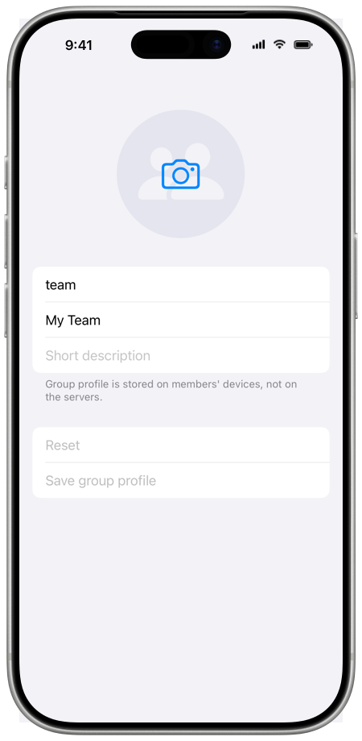
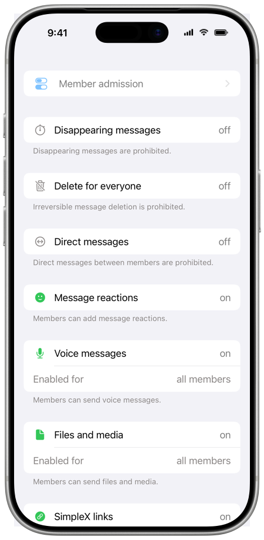
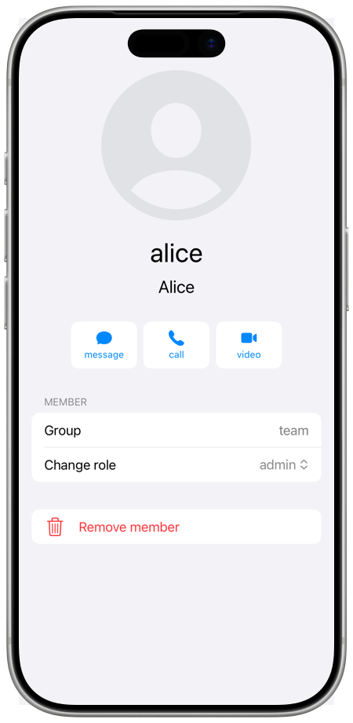

# Groups

In a group, your app sends each message to every connected member separately, and each file is uploaded once to file servers, with a separate download description sent to every connected member. In a [channel](./channels.md#how-channels-work), messages are sent to chat relays, which deliver them to subscribers.

SimpleX is the first network where you own your contacts and groups: a group, its member list and its messages are stored on the devices of its members.

## Create a group

1. Tap the pencil button in the [chat list toolbar](./README.md#your-chats) to open **New chat**.
2. Tap **Create group**.
3. Enter the group name. To add a group picture, tap the camera button.
4. To join the group with a random profile instead of your own, turn on **Incognito** (see [Incognito mode](./chat-profiles.md#incognito-mode)).
5. Tap **Create group**.

On Android and desktop, this screen is titled **Create secret group**.

The app then shows your contacts, so you can [invite members](#invite-members). When you have contacts to invite, you can also tap **Set member admission** and **Set group preferences** on this screen. You can skip this step and invite people later.

If you created the group with an incognito profile, the app shows the [group link](#group-link) instead of your contacts.

## Invite members

Admins and owners can invite their contacts.

1. Open the group and tap its name in the chat toolbar to open chat info. On Android and desktop, the chat toolbar is at the bottom of the screen by default.
2. Tap **Invite members**.
3. Select the contacts.
4. Choose the **New member role**. You can choose roles up to your own.
5. Tap **Invite to group**.

You can also start from the menu of the chat toolbar: **Invite member** in the "…" menu on iOS, **Invite members** in the "⋮" menu on Android and desktop.

Each contact receives the invitation in your direct chat with them.

You can invite only contacts that you are connected to with your main profile, and only while you use your main profile in the group. If you use an incognito profile in the group, the app shows "Can't invite contacts!" when you tap **Invite members**, and offers **Group link** in the menu instead.

## Join a group

### From an invitation

The app shows the invitation in your direct chat with the contact who invited you: "You are invited to group". Tap it to join.

The app also lists the group in your chat list. When you tap it, iOS offers **Join group** and **Delete invitation**; Android and desktop show **Join group?** with **Join** and **Delete**. **Join** and **Delete** are also in the chat list item actions: swipe on iOS, long press on Android, right-click on desktop.

If you are connected to the inviting contact with an incognito profile, the button is labelled **Join incognito**, and you join with that profile.

After you join, the app connects you to the member who invited you, and then to the other members. Until the connection is complete, the app shows "Joining group" when you tap the group.

### With a group link

Open the group link or scan its QR code, as described in [Connect via a link or a name](./making-connections.md#connect-via-a-link-or-a-name). The app shows the group; tap **Join group**.

If the owners of the group turned on review of new members, the app opens **Chat with admins**, where you wait for admission (see [Member admission](#member-admission)).

## Group link

Admins and owners can create a link that anyone can use to join the group.

1. Open chat info and tap **Create group link**. The app creates the link and shows it with a QR code.
2. Choose the **Initial role** of people who join by the link: **member** or **observer**.
3. Tap **Share link**, or show the QR code.

After that, chat info shows **Group link** in place of **Create group link**.

People who join by your link connect to the group through your app, as long as you are an admin or owner. Each admin and owner can create their own link. When you leave the group, your link is deleted.

To stop people joining by your link, tap **Delete link**. "All group members will remain connected."

## Chat info

Tap the group name in the chat toolbar to open chat info. It contains:

- buttons to search the group, to invite members (admins and owners) and to mute the group (see [Mute chats and profiles](./notifications.md#mute-chats-and-profiles));
- **Set chat name…**, a name for the group that only you see;
- **Create group link** or **Group link**, **Chats with members** and **Member reports**, depending on your role, or **Chat with admins** for members and observers;
- **Edit group profile** and **Add welcome message** for owners, and **Welcome message** when the group has one;
- **Group preferences**;
- **Send receipts**, **Chat theme** and **Delete messages after** (see [Automatic message deletion](./managing-data.md#automatic-message-deletion));
- the member list, with **Invite members** for admins and owners;
- **Clear conversation** (iOS) or **Clear chat** (Android and desktop), **Delete group** and **Leave group** (see [Leave or delete a group](#leave-or-delete-a-group)).

### Edit the group profile

Owners can change the group picture, name and short description: tap **Edit group profile**, make the changes and tap **Save group profile**. The updated profile is sent to group members.

## Member roles

Each member has one role. The table lists the roles from the lowest to the highest. A member with a higher role can do what the lower roles allow, except reporting messages and writing in **Chat with admins**: moderators, admins and owners receive reports and these chats instead.

| Role | What the role allows |
|---|---|
| observer | Reading the group and writing in **Chat with admins**. The app shows "you are observer" in place of the message field. |
| member | Sending messages, files and voice messages, as the [group preferences](#group-preferences) allow, and [reporting messages](#member-reports) to moderators. |
| moderator | [Moderating](#moderation) messages of members with the same or a lower role, blocking members and observers for all, receiving member reports, chatting with members in **Chats with members**, and accepting new members who wait for [review](#member-admission). |
| admin | Inviting contacts, creating a [group link](#group-link), removing members and changing their roles, for members with the same or a lower role. |
| owner | Editing the group profile and welcome message, changing group preferences and member admission, and deleting the group for all members. |

To change a member's role, admins and owners open [member info](#member-info-and-direct-messages), choose the new role in **Change role** and tap **Change**. You can choose roles up to your own. All group members are notified. A member who has not joined yet receives a new invitation.

On Android and desktop, you can act on several members and observers at once: long press or right-click a member, tap **Select**, select the members, then use the buttons at the bottom of the screen to remove them, block them for all, or switch their role between member and observer. You can use each action only with the role shown in the table.

Channels have different roles; see [Channels](./channels.md).

## Group preferences

Owners set group preferences for all members. Open chat info, tap **Group preferences**, change the settings and tap **Save and notify group members**. Other members see the current values without switches.

Disappearing messages, Delete for everyone, Message reactions and Voice messages are described in [Contact preferences](./send-messages.md#contact-preferences). In a group, the owners' choice is applied to all members.

| Preference | Default | Enabled for | In a group |
|---|---|---|---|
| **Member admission** | **Review members**: off | | See [Member admission](#member-admission). |
| **Disappearing messages** | off | | When on, messages are deleted after the **Delete after** time, 1 day by default. A sender can choose another time for one message (see [Disappearing messages](./send-messages.md#disappearing-messages)). |
| **Delete for everyone** | off | | When on, messages that members delete for everyone and messages that moderators moderate are deleted for all members. When off, they are marked as deleted. |
| **Direct messages** | off | yes | When on, members can start a direct chat from [member info](#member-info-and-direct-messages). |
| **Message reactions** | on | | |
| **Voice messages** | on | yes | |
| **Files and media** | on | yes | |
| **SimpleX links** | on | yes | |
| **Member reports** | on | | Always on in groups; see [Member reports](#member-reports). |
| **Visible history** | on | | "Up to 100 last messages are sent to new members." On in groups created in the app. |
| **Chat with admins** | on | | Always on in groups; see [Chat with admins](#chat-with-admins). |

With **Enabled for**, owners limit a preference to members with the chosen role or a higher one. The choices are **all members**, **admins** and **owners** on iOS, and **all members**, **moderators**, **admins** and **owners** on Android and desktop.

## Member admission

Owners can have new members reviewed before they join: "Review members before admitting ("knocking")."

1. Open chat info and tap **Group preferences**, then **Member admission**. When you create a group, you can also tap **Set member admission**.
2. Set **Review members** to **all**.
3. Tap **Save and notify group members**.

With **all**, people who join by a group link wait for review. Contacts invited by admins and owners join without review.

While a new member waits, the app opens **Chat with admins** for them, and shows "reviewed by admins" in place of the message field of the group. They can write to the group's moderators, admins and owners.

Moderators, admins and owners find waiting members at the top of **Chats with members**, marked with a flag. To review a member:

1. Open the chat with the member.
2. Tap **Accept**, then **Accept as member** or **Accept as observer**. **Accept** is also in the member's actions in **Chats with members**: swipe on iOS, long press on Android, right-click on desktop.
3. To refuse, tap **Reject** and confirm. Only admins and owners can reject.

After acceptance, the new member joins the group. With **Visible history** on, they receive recent messages.

## Welcome message

Owners can set a message that new members see when they join.

1. Open chat info and tap **Add welcome message**.
2. Type the message. Tap **Preview** to see the formatting (see [Formatting](./send-messages.md#formatting)).
3. Tap **Save and update group profile**.

The app shows "Message too large" when the message is over the size limit.

Other members open the message from chat info with **Welcome message**, and can **Copy** it.

## Moderation

### Moderate messages

Moderators, admins and owners can delete messages of members with the same or a lower role, at any time after they were sent.

1. Open the message menu: long press on iOS and Android, right-click on desktop.
2. Tap **Moderate**.
3. In "Delete member message?", tap **Delete**.

When **Delete for everyone** is on in the group, "The message will be deleted for all members." When it is off, "The message will be marked as moderated for all members." In both cases, members see "moderated by" and the moderator's name in place of the message. The reports about a moderated message are archived.

To moderate several messages, select them (**Select** in the message menu) and tap the flag button.

### Block members

You can hide new messages from a member only for yourself: open [member info](#member-info-and-direct-messages) and tap **Block member**, then **Block**. Their new messages are shown as "blocked". With **Unblock member**, their new messages are shown again. Moderators, admins and owners use **Block for all** instead.

Moderators, admins and owners can block a member or an observer for all members: open member info and tap **Block for all**, then confirm. New messages from the member are shown as "blocked by admin" to everyone in the group. With **Unblock for all**, their new messages are shown again.

Both actions are also in the member list of chat info: swipe a member on iOS, long press on Android, right-click on desktop.

### Remove members

Admins and owners can remove members with the same or a lower role.

1. Open member info and tap **Remove member**, or use the member's actions in the member list.
2. Tap **Remove**, or **Remove and delete messages** to also delete the member's messages for all members. When **Delete for everyone** is off, the messages are marked as deleted.

"Member will be removed from group - this cannot be undone!" For a member who has left the group, member info has **Delete member messages**.

## Member reports

Members with the member role can report a message to the group's moderators, admins and owners.

1. Open the message menu and tap **Report**.
2. Choose the reason: **Spam**, **Inappropriate content**, **Community guidelines violation**, **Inappropriate profile** or **Another reason**.
3. Add a comment if you want. For **Another reason**, a comment is required.
4. Send the report.

Above the message field, the app shows the reason, for example "Report spam: only group moderators will see it." After sending, the app shows "Report sent to moderators": "You can view your reports in Chat with admins."

Moderators, admins and owners see the reports in chat info, under **Member reports**, with the number of active reports. On iOS, the app shows a red flag on the group picture in the chat toolbar. Android and desktop show a bar with the number of reports at the top of the chat; tap it to open the reports. The app also lists groups with active reports under the **Reports** filter of the [chat list](./README.md#your-chats).

To act on a report:

- Tap the quoted message in the report to open it in the group, then [moderate](#moderate-messages) it.
- To archive a report, open its menu, tap **Archive report**, then **For me** or **For all moderators**.
- To archive all reports of a group for yourself, use **Archive reports** in the chat list item actions.

Member reports are always on in groups.

## Chat with admins

Members and observers can write privately to the group's moderators, admins and owners: open chat info and tap **Chat with admins**. Only you and the group's moderators, admins and owners see this chat. Your reports are also shown there.

Moderators, admins and owners see these chats in chat info, under **Chats with members**. To start a chat with a member, open their [member info](#member-info-and-direct-messages) and tap **Chat with member**. To delete a chat with a member, use its actions in **Chats with members**: swipe on iOS and tap **Delete**; long press on Android or right-click on desktop and tap **Delete chat**.

New members who wait for [review](#member-admission) use this chat before they join.

Chat with admins is always on in groups.

## Member info and direct messages

To open member info, tap a member in the member list of chat info, or tap the member's picture next to their message.

Member info includes the member's profile and role, and:

- **message**, **call** and **video** buttons (**Message**, **Call** and **Video** on Android and desktop);
- **Chat with member**, for moderators, admins and owners;
- **Verify security code** (see [Security code verification](./privacy-security.md#security-code-verification));
- the member's SimpleX address with a QR code, when they include one in their profile;
- **Change role** for admins and owners;
- the servers of the connection and **Change receiving address** (see [Contact info](./making-connections.md#contact-info));
- the block and remove actions described in [Moderation](#moderation).

When the group allows direct messages for your role, **message** opens a direct chat with the member. The first message you send is a contact request. The member taps **Accept** to connect, or **Reject**: "The sender will NOT be notified." If you tap **call** or **video** before you have a direct chat with the member, the app shows "Send message to enable calls."

When direct messages are off and you have no direct chat with the member, the app shows that direct messages between members are prohibited when you tap **message**, **call** or **video**. If the member includes a SimpleX address in their profile, you can connect to it: tap **Connect** under **Address**.

## Mentions

To mention a member, type **@** at the start of a message or after a space, then tap the member in the list. You can mention up to 3 members in one message.

In the chat list, a group with unread mentions of you is marked with **@** at its unread count.

In a group muted with **Mute**, the app still notifies you when you are mentioned or when someone replies to your message. With **Mute all**, these notifications are off too. See [Mute chats and profiles](./notifications.md#mute-chats-and-profiles).

## Delivery receipts in groups

In groups with up to 20 members, the app sends delivery receipts, so senders see that you received their messages (see [Message status and errors](./send-messages.md#message-status-and-errors)).

The default is set in **Your privacy**, under **Send delivery receipts to**: **Small groups (max 20)**, on for new profiles (see [Your privacy](./app-settings.md#your-privacy)). To change it for one group, open chat info and set **Send receipts** to **yes**, **no** or **default**.

In groups with more than 20 members, chat info shows **disabled** next to **Send receipts**: "This group has over 20 members, delivery receipts are not sent."

## Leave or delete a group

To leave a group:

1. Open chat info and tap **Leave group**. You can also use **Leave** in the chat list item actions: swipe on iOS, long press on Android, right-click on desktop.
2. Tap **Leave**. "You will stop receiving messages from this group. Chat history will be preserved."

After you leave, or after you are removed, the group is kept in your chat list. To delete it from your device, tap **Delete group** in chat info, or **Delete** in the chat list item actions: "Group will be deleted for you - this cannot be undone!"

Owners can delete the group for all members: tap **Delete group**, then **Delete**. "Group will be deleted for all members - this cannot be undone!" Members see that the group was deleted, and can then delete it from their devices.

To delete all messages of the group only on your device, tap **Clear conversation** (iOS) or **Clear chat** (Android and desktop) in chat info.

## Business chats

When you turn on **Business address** for your [SimpleX address](./making-connections.md#your-simplex-contact-address), each person who connects to it gets a separate business chat. A business chat is a group: you are its owner, and the customer is a member.

- On your side, the app shows the chat with the customer's name and picture, and lists it under the **Contacts** filter of the chat list.
- On the customer's side, the app shows the chat with your name and picture, and lists it under the **Businesses** filter.

To add your team members to a chat with a customer, open chat info, tap **Add team members**, select contacts, choose the **New member role** and tap **Invite to chat**. Members with the admin or owner role on the customer's side see **Add friends** instead.

In business chats, the app uses the labels **Chat preferences**, **Leave chat** and **Delete chat**. "Only chat owners can change preferences."
