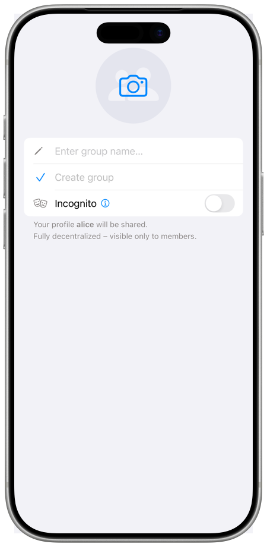
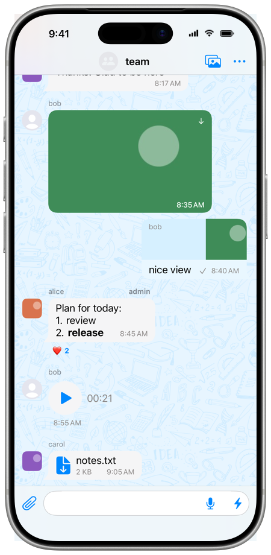
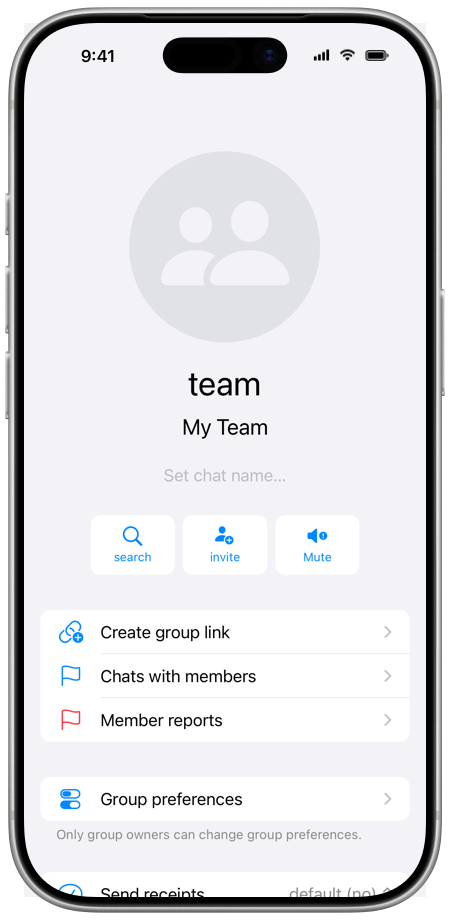

# Groups

Groups are decentralized: the group profile and the member list are stored on
members' devices, and servers have no information about the group. Every
message gets sent separately to every member in the group, which suits smaller
groups. Files are uploaded to file servers once, and each member can download
them from there. For large audiences, use [channels](./channels.md).

## Creating a group

 

- Tap on the pencil button in the lower right-hand of the chat list.
- Tap on "Create group".
- Enter group display name.
- Tap on "Create group".

Unless Incognito is on, the app then shows your contacts. Select the ones to
invite and tap "Invite to group", or skip this step and [add
members](#adding-members) later.

## Group preferences

On the group page, in "Group preferences", group owners can choose whether to
allow disappearing messages, direct messages, deleting for everyone, message
reactions, voice messages, files and media, SimpleX links, and visible history
for new members.

## Adding members

- Open a group.
- Tap group name, then tap "Invite members".
- Select contacts you wish to invite.
- Tap on "Invite to group".

## Joining a group

When you receive the invitation to join the group you can accept it both from the conversation with your contact and from the list of conversations.

To join a group via its link, open the link in the app, tap "Open group", then
"Join group" (see [Join some user groups](./README.md#join-some-user-groups)).

## Leaving a group

Tap and hold (Android), swipe (iOS) or right-click (desktop) the group in the
list of the conversations to leave the group.

You can also leave the group from the group page:

- Open a group conversation.
- Tap group name.
- Scroll to the bottom and tap "Leave group".

After you leave, the group stays in the list of the conversations. To delete it
from your device, tap "Delete group" on the group page. Owners can tap "Delete
group" without leaving, to delete the group for all members.

## Member permissions

Open a group and tap on group's name to view members list, there you can tap on a member and change their role.

- Observer: can only read messages, add reactions and use "Chat with admins"
  (and delete or mark deleted the messages they sent before their role was
  changed).
- Member: can send messages and delete own messages.
- Moderator: Same as member, but can delete the messages of others and block
  members for all.
- Admin: Same as moderator, but can also invite members, create a group link,
  remove members from the group and change their roles.
- Owner: Same as admin, but can also edit the group profile and the welcome
  message, change group preferences and delete the group for all members.

Moderators, admins and owners can act only on members with the same or a lower
role.

## Link to join group

If you are a group owner or admin, you can create a link that can be used by anyone to join the group, making a group more public.

- Open a group conversation.
- Tap group name.
- Tap on "Create group link".

Once the link is created, you can also change the role assigned to members when they join.

## Welcome message

If you are a group owner you can create a welcome message that will be shown to all new members joining group.

To create it, tap "Add welcome message" on the group page.
