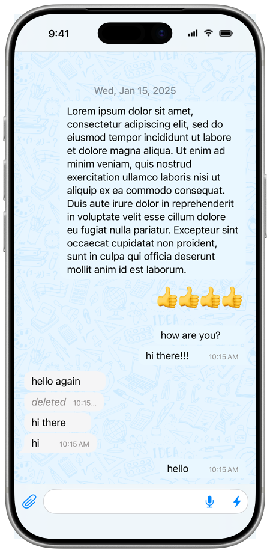
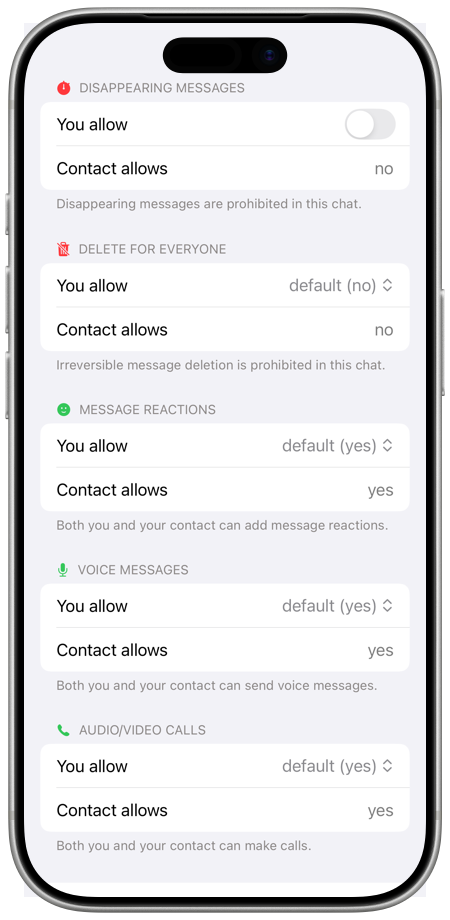

# Sending, editing and deleting messages

Sending text messages on SimpleX Chat is pretty straightforward, tap on your contact and then tap on text area, type in your message and tap on "Send" button.

You need to open a conversation to send messages.

## Sending messages

### Sending text messages

You can send, edit and reply to messages in a conversation.

To send, simply type in the message in the entry box and tap "Send".

On desktop, press Enter to send the message, and Shift+Enter to start a new
line.

To reply to a message, edit it, add a reaction or forward it, tap and hold the
message (right-click on desktop) and choose the action. On iOS and Android, you
can also swipe a message to the left to reply to it. You can edit a message for
24 hours after you send it.

To save a message for yourself, forward it to "Private notes".

In a group, type @ and choose a member to mention them.

You can format messages with markdown. The formats are listed in the [app
settings](./app-settings.md#opening-the-app-settings), in "Help & support" >
"How to use it".

### Sending images and files

- Tap 📎 (paperclip) button on the left of the message entry box.
- Choose between "Take picture", "Choose from library" and "Choose file" on
  iOS, "Camera", "Image", "Video" and "File" on Android, or "Image", "Video" and
  "File" on desktop.
- Once you have chosen what you wish to send, tap on "Send" button.

On iOS you can also paste images from the clipboard.

On iOS and Android, you can also share images, videos and files to a chat from
other apps, with their share button.

On desktop, you can also paste images and files, or drag them into the chat.

Files can be up to 1 GB, or larger with a [supporter
badge](./supporter-badges.md).

### Sending voice messages

- Tap 🎤 (microphone) button on the right of the message entry box.
- Allow SimpleX Chat to record the voice if prompted. On Android, you will have
  to tap on the microphone button once again if this happens.
- Speak, once you've finished the recording, tap on the square stop icon on the right.
- You may listen to the recording before sending it, and re-record if necessary.
- Tap on "Send" button to send the recorded voice message.

You can also tap and hold the microphone button to record a voice message. In this case the recording will stop once you release the button. You still need to tap "Send" to send the message.

A voice message can be up to 5 minutes long.

**Please note**: if the microphone button is gray, that means voice messages are
disabled in this conversation. Tap it to see why. Ask your contact or group
owner to enable them (they are enabled by default).

### How to use disappearing messages

- Tap on name of the conversation.
- Tap "Contact preferences".
- Under "Disappearing messages", make sure that the "You allow" slider is on (it
  is on by default).
- Choose how long until messages are deleted in "Delete after". On your device,
  the time counts from when the message is sent, and on your contact's device,
  from when it is read.
- Tap "Save and notify contact".

**Please note**: Your contact must also allow disappearing messages (they are
allowed by default). In a group, only group owner can enable disappearing
messages.

To send one disappearing message, type it, then tap and hold the "Send" button
(right-click on desktop), choose "Disappearing message" and the time.

### Sending "live" messages

You can use "live" messages for your recipients to see the messages as you type them, without having to tap "Send" button until it's completed. It can be useful in these scenarios:

1. Real-time conversation, like talking in person or in a discussion club. You can retract what you wrote, but your recipients would see it. Also people don’t need to guess what you’re typing. This allows to avoid interrupting the flow of conversation and still send longer messages.
2. An activist doing live reporting when there is a risk to lose the phone or connection at any moment. This feature allows to send as much as possible, up to the last word, without having to send only very short messages.

To send a "live" message:

- Tap ⚡️ (lightning) button on the right of the message entry box.
- When you do it first time, you would see an alert explaining the feature. Tap
  "Send".
- Now you can start typing the messages, the app will be periodically sending the updates to your recipients, as you type (every few seconds, and only complete words).
- Tap ✓ (check mark) on the right of the message entry box to finish the
  message.

### Sending stickers and animated messages

While there are no stickers and GIFs in the app itself, you can send them using third-party (such as [GIPHY](https://apps.apple.com/us/app/giphy-the-gif-search-engine/id974748812) on iOS) or native (Android 13+) keyboards.

### Message drafts

Messages are kept in the chat until they are sent, even if you leave the chat.

For privacy and simplicity, we decided to allow only one message draft and keep it only until the app is stopped.

## Deleting messages

To delete a message, tap and hold the message (right-click on desktop) and
choose "Delete".

If you sent this message yourself within the last 24 hours, you will be offered two options:

- `delete for everyone` - this will either mark the message as deleted for you
  and the recipient(s) (this is the default) or fully delete the message on your
  and recipients' devices (if "Delete for everyone" is enabled in the
  conversation preferences)
- `delete for me` - this will delete the message only locally.

Please read about [reasons for not allowing full deletion by default](../../blog/20221206-simplex-chat-v4.3-voice-messages.md#irreversible-message-deletion). TL;DR: data sovereignty.

## Moderating messages in the groups

Group moderators, admins and owners can delete member messages that are
inappropriate for the groups, when the member's role is the same as theirs or
lower.

To remove a message of another member, tap and hold the message (right-click on
desktop) and choose "Moderate".

Members can report a message to the group moderators. To report it, tap and hold
the message (right-click on desktop) and choose "Report". Moderators see the reports on the
group page, in "Member reports".
