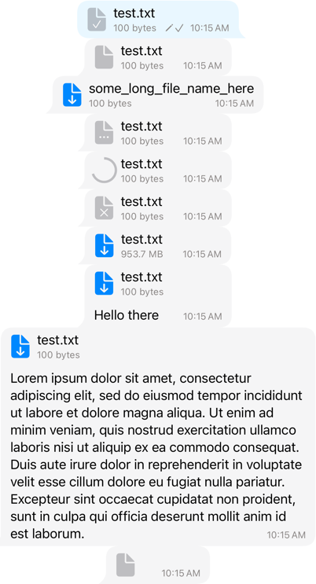
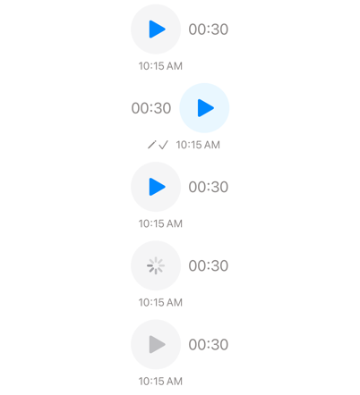
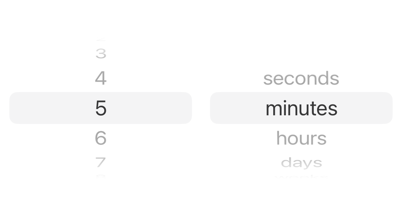
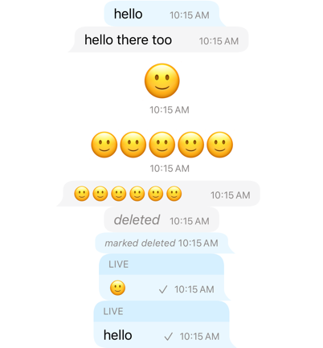
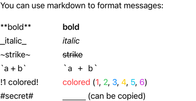

# Messages and media

This page describes messages in chats with contacts, in groups and channels, and in Private notes: writing and sending them, the actions on a message, attachments, voice, disappearing and live messages, formatting, and the preferences that you set with each contact. Mentions, moderation and member reports, which exist only in groups, are described in [Groups](./secret-groups.md).

## Send a message

1. Open a chat from the chat list.
2. Type the message in the message field at the bottom of the chat.
3. Tap the send button at the right end of the field.


The buttons of the message field:

- The paperclip, on the left: attach images, videos and files (see [Images, videos and files](#images-videos-and-files)).
- The microphone, at the right end of the empty field: record a voice message (see [Voice messages](#voice-messages)).
- The lightning button, next to the microphone: start a live message (see [Live messages](#live-messages)).
- The send button, which the app shows in their place when you type. Tap and hold it (right-click on desktop) to send a live message or a disappearing message.

Stickers and GIFs that your keyboard inserts are sent as images (iOS and Android).

In a group, type `@` to mention a member: see [Groups](./secret-groups.md).

On desktop:

- Press **Enter** to send the message, and **Shift+Enter** to start a new line.
- Press **Up arrow** in the empty field to change your last message that is still editable.
- Click the emoji button, next to the paperclip, to open a panel with emoji categories and a search field. Click an emoji to insert it; press **Esc** to close the panel.

## Message actions

Open the menu of a message:

| iOS | Android | Desktop |
|---|---|---|
| Tap and hold the message | Tap and hold the message | Right-click the message |

The app shows in the menu the actions that apply to the message. The main ones:

| Action | Use |
|---|---|
| Emoji at the top | Add a reaction: see [Reactions](#reactions). |
| **Reply** | Quote the message in your reply. |
| **Share** | Share the message with another app. |
| **Copy** | Copy the message to the clipboard. |
| **Save** | Save the image, video, voice message or file to your device. |
| **Download** | Download a file that you have not received yet. |
| **Edit** | Change a message that you sent. |
| **Forward** | Send the message to another chat, or save it to Private notes. |
| **Info** | See the details of the message. |
| **Reveal** or **Hide** | Show or hide the content of a message marked deleted. |
| **Stop file** or **Revoke file** | Stop sending or receiving a file, or delete a file that you sent from the servers. |
| **Delete** | Delete the message: see [Delete messages](#delete-messages). |
| **Moderate** or **Report** | In groups: see [Moderation and reports in groups](#moderation-and-reports-in-groups). |
| **Select** | Select several messages. |

### Reply

Choose **Reply**. The app shows the message above the message field: type your reply and send it. To cancel, tap × next to the quoted message. On iOS and Android, you can also swipe a message to the left to reply to it. Tap the quoted message in a reply to scroll to the original.

### Edit

Choose **Edit** on a message that you sent. The app puts the text in the message field: change it and tap ✓. The change is sent to the recipients. You can edit a message for 24 hours after sending it, except voice messages and forwarded messages; in Private notes, at any time. The app marks edited messages with a pencil icon, and **Info** lists the earlier versions under **History**.

### Reactions

Tap an emoji at the top of the message menu: 👍 👎 😀 😂 😢 ❤ 🚀 ✅. On iOS, some of them are under the ellipsis button; on iOS versions before 16.4, choose **React…**. You can add up to 3 reactions to one message. The app shows reactions under the message: tap a reaction to add the same one, or to remove yours; tap and hold it (right-click on desktop) to see who reacted. Reactions can be used when they are allowed in the chat: see [Contact preferences](#contact-preferences) and the group preferences in [Groups](./secret-groups.md#group-preferences).

### Forward and save

Choose **Forward**, then choose a chat. The app shows the message above the message field: add text if you want, and send it. Text that you add is sent as a reply to the forwarded message. To save a message for yourself, choose **Private notes** at the top of the list (see [Your chats](./README.md#your-chats)). Forwarded messages are marked **forwarded**, and saved messages **saved**. A message with a file can be forwarded after the file is downloaded. Chats where the message is not allowed by the chat preferences are greyed out.

### Select messages

Choose **Select**, then tap the messages to select. With the bar at the bottom, you can delete up to 200 messages and forward up to 20; group moderators can also moderate the selected messages. To finish, tap **Cancel** (iOS) or × (Android and desktop).

### Message info

Choose **Info** to see when the message was sent and received, when it was deleted or when it disappears, and until when its file is available. In tabs, the app shows the earlier versions of an edited message (**History**), the quoted message (**In reply to**), where it was forwarded from (**Forwarded**, or **Saved** in Private notes) and, for your messages in groups, the delivery status for each member (**Delivery**).

## Images, videos and files

1. Tap the paperclip on the left of the message field.
2. Choose the source:

| iOS | Android | Desktop |
|---|---|---|
| **Take picture**, **Choose from library**, **Paste image** (when you copied an image), **Choose file** | **Camera**, **Image**, **Video**, **File** | **Image**, **Video**, **File** |

3. Add a message if you want, and send it.

On iOS and Android, you can choose up to 10 images or videos at once; on desktop, several. You can attach one file at a time. Images, except animated ones, are resized before sending: to send the original image, choose it as a file. Files can be up to 1 GB; with a supporter badge, the limit is higher (see [Supporter badges](./supporter-badges.md)).

On iOS, you can also paste an image into the message field. On desktop, press **Ctrl+V** (**Cmd+V** on macOS) to paste an image or files from the clipboard, or drag files and images into the chat window.

When files are not allowed in a group, the app shows **Files and media prohibited!** when you tap the paperclip.



### Receive files

Small images, videos and voice messages are downloaded automatically when **Auto-accept images** is on in **Your privacy** (on by default): images and voice messages up to 510 KB, videos up to 1023 KB. To download any other file, tap it, or choose **Download** in its menu.

When **Protect IP address** is on in **Your privacy** → **More privacy** (on by default), the app asks before it downloads a file from servers that are not among your servers: it lists them in the alert **Unknown servers!**, and you continue with **Download**. The app does not ask when your IP address is protected from those servers by your network settings (see [Network and servers](./app-settings.md#network-and-servers)). These privacy settings are described in [App settings](./app-settings.md#your-privacy).

Tap a received image or video to see it full screen. Tap a downloaded file to save it. The app opens Markdown files (.md and .markdown, up to 1 MB) as formatted documents.

## Voice messages

1. Tap the microphone at the right end of the empty message field. On Android, the app asks for access to the microphone on the first tap; then tap the microphone again.
2. Speak, then tap the stop button.
3. Listen to the recording if you want. To discard it, tap ×.
4. Tap the send button.

You can also hold the microphone while you speak: when you hold it for more than a second, the app stops recording when you release it. A voice message can be up to 5 minutes long; the app stops recording at 5 minutes.



When the microphone is grey, voice messages are not allowed in this chat: tap it to see why. When you do not allow voice messages to a contact who allows them, the app offers to allow them (**Allow voice messages?**).

## Disappearing messages

Disappearing messages are deleted from your device and from the recipient's device after the time you choose. On your device, the time is counted from when the message is sent; on the recipient's device, from when it is read. The app shows a timer icon on these messages, and **Disappears at** in **Info**.

### With a contact

Disappearing messages can be sent in a chat when both you and your contact allow them; they are allowed by default (see [Contact preferences](#contact-preferences)). To make all messages that you send in the chat disappear:

1. Open the chat and tap the contact's name in the chat toolbar to open chat info.
2. Tap **Contact preferences**.
3. Under **Disappearing messages**, turn on **You allow** and choose the time in **Delete after**: from 10 minutes to 3 months, **off**, or **custom**.
4. Tap **Save and notify contact**.

The time is applied to messages sent after the change. When your contact changes the time, the app sets the same time for you. With **off**, the messages that you send are deleted only when you send them as disappearing messages.

### One message

1. Type the message.
2. Tap and hold the send button (right-click on desktop) and choose **Disappearing message**.
3. Choose **30 seconds**, **1 minute**, **5 minutes** or **Custom time**.

This option is available in chats where disappearing messages are allowed.



### Default for new contacts

In the profile menu, in **Chat preferences**, you set whether you allow disappearing messages and, in **Delete after**, a time for new contacts: **1 week**, **1 month**, **3 months** or **off**. As the app notes, this time is set only for new contacts.

### In groups

In groups, disappearing messages are off by default. Group owners turn them on and set the time in the group preferences: see [Groups](./secret-groups.md#group-preferences).

## Live messages

The app updates a live message for the recipients as you type it.

1. In the empty message field, tap the lightning button. If you already typed text, tap and hold the send button (right-click on desktop) and choose **Send live message**.
2. The first time, the app explains the feature (**Live message!**): tap **Send**.
3. Type the message. While you type, the app sends the complete words every 3 seconds.
4. Tap ✓ to finish the message.

The app marks live messages **LIVE** until you finish them. If you leave the chat, the message is sent as it is. Live messages are not available in Private notes.



## Message drafts

When you leave a chat with an unfinished message, the app keeps it as a draft, with its attachment or voice recording, and shows it in the chat list. The app keeps one draft: when you leave another chat with an unfinished message, the app replaces the draft. Drafts are not saved to the database, so a draft is lost when the app stops. To turn drafts off, use **Message draft** in **Your privacy** → **More privacy**.

## Delete messages

1. Open the message menu and choose **Delete**.
2. Choose how to delete the message:

| Deletion | iOS | Android and desktop |
|---|---|---|
| Only on your device | **Delete for me** | **Delete for me** |
| For everyone, when full deletion is allowed in the chat | **Delete for everyone** | **For everyone** |
| For everyone, when it is not | **Mark deleted for everyone** | **For everyone** |

Deletion for everyone is offered for messages that you sent in the last 24 hours. Messages that you received are deleted only on your device.

With full deletion, the message is deleted from all devices. Full deletion is used when it is allowed by the **Delete for everyone** preference of the chat: see [Contact preferences](#contact-preferences), where it is off by default, and the group preferences in [Groups](./secret-groups.md#group-preferences). Otherwise the message is marked deleted: the app shows **marked deleted** in its place, and its content can be seen with **Reveal**. The reasons for marking messages deleted by default are explained in [this post](../../blog/20221206-simplex-chat-v4.3-voice-messages.md#irreversible-message-deletion).

To delete several messages, use **Select**: up to 200 messages at a time.

In channels, owners and moderators have **Delete from history** (iOS) or **From history** (Android and desktop) in place of **Delete for me**: see [Channels](./channels.md).

## Moderation and reports in groups

In groups, moderators, admins and owners can delete messages of other members with **Moderate**, and members can report messages to moderators with **Report**. See [Moderation](./secret-groups.md#moderation) and [Member reports](./secret-groups.md#member-reports).

## Search and content filter

The app searches the messages of the open chat on your device.

- iOS: in the chat toolbar, tap … → **Search**, or open chat info and tap **search**.
- Android and desktop: in the chat toolbar, tap ⋮ → **Search**, or open chat info and tap **search**.
- Private notes: tap the magnifier in the chat toolbar.

Type the text to find. Tap the magnifier next to a found message to open it in the conversation.

To show only one type of content, use the media button in the chat toolbar. In a chat with a contact where you can make calls, the filter is in the … menu on iOS and the ⋮ menu on Android; on desktop, the media button is always shown. The app lists **Images** and **Links**, and **Videos**, **Voice messages** and **Files** when such messages are in the chat. You can search within the filtered messages. Choose **All messages** to show all messages again.

## Formatting

You can format messages with markdown:

| You type | You get |
|---|---|
| `**bold**` | **bold** |
| `_italic_` | *italic* |
| `~strike~` | ~~strike~~ |
| `` `a + b` `` | `a + b` in monospace |
| `#secret#` | text hidden until it is tapped |
| `!1 colored!` | colored text: 1 red, 2 green, 3 blue, 4 yellow, 5 cyan, 6 magenta |
| `!- small!` | smaller grey text |
| `[text](https://example.com)` | a link shown as text |

You can also use blocks: headings (`#` to `######` and a space at the start of a line), quotes (`>`), lists (`-`, `*`, `+`, or a number with `.` or `)`), code blocks (between lines of ```` ``` ````), tables (lines with `|` and a delimiter row such as `|---|---|`) and horizontal rules (`---`).



The main formats are shown in the app's help: **Settings** → **Help & support** → **How to use it**.

## Links and link previews

The app opens web links in messages after a confirmation: **Open link?** on iOS, **Open web link?** on Android and desktop. When there are tracking parameters in a link, choose **Open clean link** to open it without them, or **Open full link**. The app opens SimpleX links and SimpleX names itself: see [Making connections](./making-connections.md#connect-via-a-link-or-a-name).

When you type a web link, the app can load a preview of the page and send it with the message. When the app loads a preview, your IP address may be revealed to the website; the first time, the app asks **Enable link previews?**. To remove a preview before sending, tap × next to it. With **Send link previews** in **Your privacy**, you turn previews on or off; with **Remove link tracking** (off by default), the app removes tracking parameters from the links that you type.

## Bot commands

In chats with bots, and in groups with commands, the app shows the `//` button on the left of the empty message field. Tap it to see the commands; for some items, a submenu is opened. Tap a command to send it; a command that needs parameters is placed in the message field for you to complete. When you type `/`, the app also shows the commands that match. Commands in messages are shown as links: tap one to send it.

## Share from other apps

You can share text, links, images, videos and files from other apps into a SimpleX chat.

**iOS:**

1. In another app, tap the share button and choose SimpleX.
2. Choose a chat of your active profile; you can search the list.
3. Add a **Comment** if you want, and tap the send button.

You can share one item at a time: text, a link, an image, a video or a file. When SimpleX Lock is on, you can share only after you turn on **Allow sharing** in the SimpleX Lock settings; otherwise the app shows **App is locked!**.

**Android:**

1. In another app, tap **Share** and choose SimpleX.
2. Choose a chat. When you have several profiles, tap your profile image to choose another profile.
3. The app puts the content in the message field: send it.

You can share text, a file, or one or more images.

**Desktop:** drag files into a chat, or paste them: see [Images, videos and files](#images-videos-and-files).

## Message status and errors

The app shows the status of the messages that you send next to the time:

| Mark | Meaning |
|---|---|
| One check mark | Sent. |
| Two check marks | Delivered: the recipient's app sent a delivery receipt. |
| Pale check marks | In groups: sent to, or delivered to, some of the members. |
| Red × | Not delivered: tap the message to see the reason. |
| Orange triangle | Delivery warning: tap the message to see the reason. |
| → | Sent via private routing, shown when **Show message status** is on (see [Private message routing](./app-settings.md#private-message-routing)). |

The app marks a received message that you have not read yet with a filled circle.


### Delivery receipts

The app shows two check marks when the recipient's app sends a delivery receipt. For a new profile, the app sends receipts to contacts and to groups with up to 20 members. To change this for all chats of the profile, use **Send delivery receipts to**: **Contacts** and **Small groups (max 20)** in **Your privacy** → **More privacy**. To change it for one contact, open chat info and choose **Send receipts**: **yes**, **no** or **default (…)**. Receipts in groups are described in [Groups](./secret-groups.md).

### Delivery errors

- The app shows a red **decryption error** notice when messages from a contact or member could not be decrypted. When the connection can be fixed, the app adds **Fix connection** to the notice: tap it and confirm with **Fix** to renegotiate the encryption.
- When the app removes a message after several attempts to receive it, it shows a notice in the chat; tap the notice to see **Message error** and the number of attempts.
- With developer tools on, the app also shows notices of skipped messages, a bad message hash, a bad message ID or a duplicate message. Tap a notice to see its possible causes.

## Contact preferences

In a chat with a contact, the app enables five features according to the preferences of both of you. Each of you sets what you allow.

| Preference | Default |
|---|---|
| **Disappearing messages** | allowed, with **Delete after** set to **off** |
| **Delete for everyone** | **no** |
| **Message reactions** | **yes** |
| **Voice messages** | **yes** |
| **Audio/video calls** | **yes** |

For each feature except disappearing messages, you choose:

- **always**: your contact can use the feature, whatever your contact allows you.
- **yes**: your contact can use the feature if your contact also allows it to you (**yes** or **always**).
- **no**: your contact cannot use the feature.

The same rules apply to your use of the feature, with your contact's setting. Disappearing messages are allowed or not; they can be used only when both of you allow them. Under each feature, the app shows who can use it in this chat.

To set your default preferences for the contacts of a profile, open the profile menu and tap **Chat preferences**, then tap **Save (and notify contacts)** on iOS or **Save and notify contacts** on Android and desktop. To set them for one contact:

1. Open the chat and tap the contact's name in the chat toolbar to open chat info.
2. Tap **Contact preferences**.
3. For each feature, choose **You allow**; with **default (…)**, your chat preferences are used. Your contact's setting is shown in **Contact allows**.
4. Tap **Save and notify contact**.

When your contact offers a feature that you do not allow, the app shows the offer in the chat with **Accept** (or **Set 1 day** for disappearing messages without a time): tap it to allow the feature. In chats where you are incognito, the defaults in the table are used in place of your chat preferences.


Groups have their own preferences, set by the group owners: see [Groups](./secret-groups.md#group-preferences).
