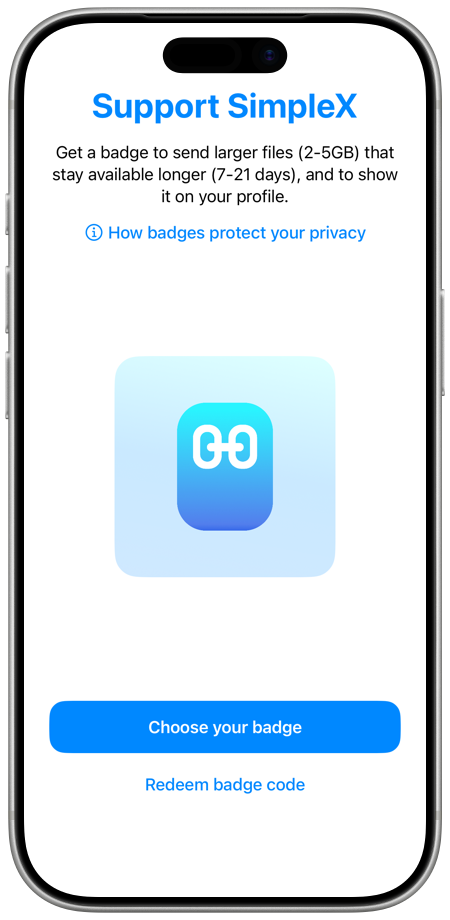
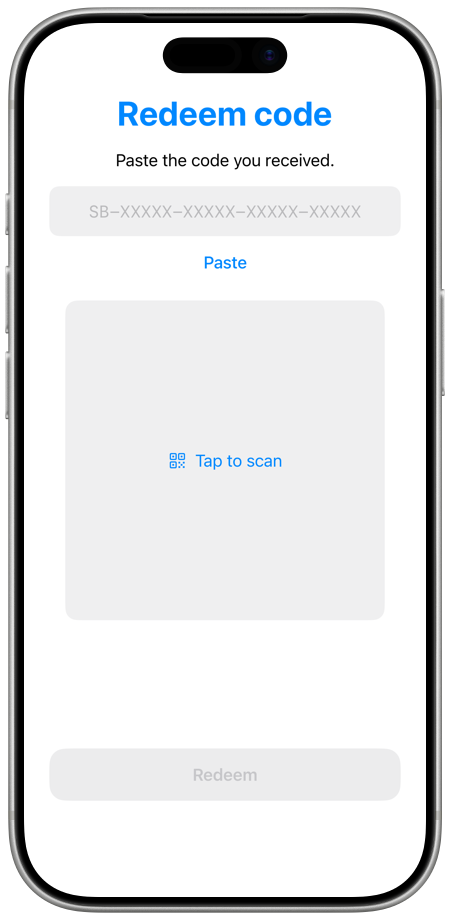

# Supporter badges

A supporter badge is shown next to your name on your chat profile, and with it you can send larger files that are stored longer. The app explains: "Get a badge to send larger files (2-5GB) that stay available longer (7-21 days), and to show it on your profile."

A badge is added to one chat profile. It is shown to your contacts, and to the members of groups and channels where you use this profile. It is never shown with an incognito profile.

 &nbsp;&nbsp; 

## Badge types

| Badge | Benefits shown in the app |
|---|---|
| **Supporter** | Files up to 2 GB, stored for 7 days. |
| **Legend** | Files up to 5 GB, stored for 21 days. |
| **Investor** | The app shows the benefits of **Supporter**, and files up to 2 GB are accepted. When other people tap the badge, the app shows that you invested in SimpleX Chat crowdfunding. |

Without a badge, you can send files up to 1 GB. The app of the person who receives your file checks your badge before it accepts a larger file. The storage time is set by the file servers: a file server keeps the files of badge holders longer when its operator configures it.

In incognito chats, you can send files up to 1 GB.

## Where the app offers a badge

- **Settings**, then **Support SimpleX**. With a badge, this row is **Your badge** or **Your legend badge**.
- The **Support SimpleX** banner in the chat list, "Get badge + better files", shown when you have more than 3 chats and no badge. After you tap it once, you can dismiss it: "You can support SimpleX later in Settings."
- The **Large file!** alert, when you have no badge and choose a file larger than 1 GB and up to 5 GB, outside incognito chats. It has the button **Support SimpleX**.
- The alert that opens when you tap another person's supporter or legend badge, when you have no badge yourself.

On the **Support SimpleX** screen are **How badges protect your privacy** and the ways to get a badge on your platform.

## Get a badge

| iOS | Android from Google Play | Android from F-Droid or GitHub, and desktop |
|---|---|---|
| **Choose your badge**: the badge page in your browser. **Redeem badge code**: a badge from a code. | **Choose your badge**: a purchase in the app with Google Play. **Restore purchases**: "Moves a paid badge to this profile." **Redeem badge code**: a badge from a code. In the United States, **Buy in browser** is offered as well, and **Redeem badge code** is on the **Choose your badge** screen. | **Buy in browser**: the badge page in your browser. **Redeem badge code**: a badge from a code. |

### Buy on the badge page

Tap **Choose your badge** (iOS) or **Buy in browser** to open the badge page, badges.simplex.chat. On the page, choose a **Supporter** or **Legend** badge and the number of months, and pay by card, Bitcoin or Monero.

- When the app is registered to open links from the page, the page shows **Return to SimpleX** after the payment. Tap it to open the app, which asks **Add badge to your profile?** and names the profile. Tap **Add badge**. Tap **Show code** on the page to see the badge code.
- Otherwise, the page shows the badge code, **Copy code**, and a QR code to scan with your phone. The code is saved only in that browser. Redeem it as described below.

The iOS and Android apps are registered to open these links. When the desktop app is not registered to open them, it opens **Redeem code** next to the browser.

If the profile already has a badge, the app shows **Profile already has a badge**: "A badge can be added to another profile, or here once this badge ends."

A badge bought on the badge page is not renewed: "No renewal: the badge ends when the prepaid months run out."

### Buy in the app with Google Play

In the Android app from Google Play:

1. Open **Settings**, then **Support SimpleX**, and tap **Choose your badge**.
2. Choose **Supporter** or **Legend**, and tap **Continue**.
3. Choose **1 month**, **Monthly** or **Annual**, and tap **Continue**. **Monthly** and **Annual** are subscriptions: "Renews on [date]. Cancel anytime."
4. Check your order and tap **Pay**. Complete the payment in Google Play.

While the badge is added, the app shows **Issuing your badge**: "Your payment is complete. The badge will be added to this profile." When the payment needs approval, the app shows **Waiting for approval**: "Nothing has been charged."

### Redeem a badge code

1. Open **Settings**, then **Support SimpleX**, and tap **Redeem badge code**.
2. Tap **Paste**, type the code, or scan its QR code. Badge codes look like SB-XXXXX-XXXXX-XXXXX-XXXXX. Scanning is available on iOS and Android.
3. Tap **Redeem**.

The badge is added to your current profile.

| Message | Meaning |
|---|---|
| This profile already has a badge. | A profile holds one badge at a time. Use the code with another profile, or after this badge ends. |
| This code was not recognized. | Check the code. |
| This code has already been used. | The code was redeemed before. |
| This code has expired. | The code can no longer be redeemed. |
| The code was accepted, but the badge it grants has already ended. | The paid period of the code is over. |
| Too many attempts. Please try again later. | Wait before you try again. |

## Your badge

With a badge, open **Settings**, then **Your badge** (or **Your legend badge**). On the **Your badge** screen are:

- The badge, its type, and "shown on your profile".
- **Benefits**: the file size and storage time.
- **Ends** with the date, for a badge without renewal, or **Subscription** with its state.
- **How badges protect your privacy**.
- **Error**, when the badge could not be renewed, with **Contact SimpleX team**.

| Subscription state | What the app shows |
|---|---|
| Renewing | **Renews** with the date, and the price when known: "Renews automatically until you cancel it". |
| Cancelled | **Ends** with the date: "Your subscription is cancelled. The badge stays until [date]." |
| Payment failed | **Payment problem**: "Payment failed. Update your payment method". |
| Ended | **Ended**: "Subscription ended. The badge will be removed." |

Tap **Manage subscription** to open the subscriptions of your store account: on iOS in the App Store, in the Android app from Google Play in Google Play.

The app renews the badge every month while paid months remain, with no action from you.

## Badge alerts

The chat list shows a banner about your badge in these cases. Tap the banner to open your badge.

| Banner | When |
|---|---|
| **Your badge expired** | A badge without renewal has ended. |
| **Your subscription ended** | The subscription has ended. |
| **Badge payment problem** | "The store could not charge your payment method." |
| **Badge renewal failed** | The badge could not be renewed. |
| **Subscription cancelled** | "Your badge stays until [date]." |
| **Your badge renews soon** | 3 days before an annual subscription is renewed. |

To close a banner, tap its close button and choose **Remind me later**, to see it again after one day, or **Dismiss**.

## How badges protect your privacy

The app explains:

> A badge is an anonymous credential stored in your profile on your device. This credential is never sent to anyone.
>
> To prove to a contact or a server that you have a badge, the app generates a new proof that reveals only the badge type and the expiry date, rounded to a week.
>
> Nobody can link two different proofs to each other or to the purchase.

SimpleX Chat has no user accounts, so a badge is not attached to an account: the app keeps the credential in your profile on your device.

The app sends a new proof with your profile each time it sends the profile: to a new contact, in your SimpleX address and 1-time links, to the groups and channels you join, to your contacts when a badge is added, and with your profile updates. A file larger than 1 GB is sent with a proof as well.

The expiry date is the same for all badges whose paid month ends in the same week: the end of the following Monday. The apps of other people accept a badge for 7 days after this date. After that, the badge is shown dimmed, and one month later it is no longer shown.

The design is described in the [supporter badges whitepaper](../protocol/badges-overview.md).

## Badges of other people

A badge is shown after the person's name. Tap it in the contact info, in the member info, or in the profile shown at the start of the chat to see what it means:

- "[name] supports SimpleX Chat." for a supporter or legend badge;
- "[name] supported SimpleX Chat. The badge expired on [date]." for a recently expired badge;
- "[name] invested in SimpleX Chat crowdfunding." for an investor badge.

When the app could not verify a badge, a warning sign is shown instead of it. Tap it to see **Unverified badge** ("This badge could not be verified and may not be genuine.") or **Badge cannot be verified**, when the badge is signed with a key that this version of the app does not recognize.
