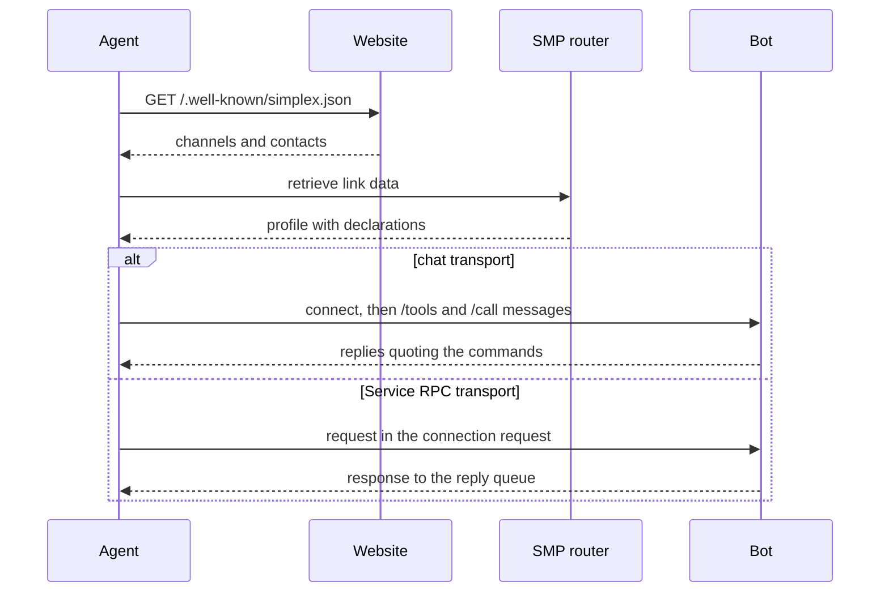

Revision 1, 2026-10-19, draft for comments

Evgeny Poberezkin

# Agent protocols over SimpleX

## Table of contents

- [Abstract](#abstract)
- [Conventions](#conventions)
- [Overview](#overview)
- [Addresses in llms.txt](#addresses-in-llmstxt)
- [Profile declarations](#profile-declarations)
  - [protocols](#protocols)
  - [audience and updateFrequency](#audience-and-updatefrequency)
  - [Protocol names](#protocol-names)
- [Chat transport](#chat-transport)
  - [Commands](#commands)
  - [Replies](#replies)
  - [Message size](#message-size)
- [Service RPC transport](#service-rpc-transport)
  - [Exchange](#exchange)
  - [Request](#request)
  - [Response](#response)
  - [Signed requests](#signed-requests)
- [MCP binding](#mcp-binding)
  - [Versions](#versions)
  - [MCP over chat](#mcp-over-chat)
  - [MCP over Service RPC](#mcp-over-service-rpc)
- [Security considerations](#security-considerations)
- [Privacy considerations](#privacy-considerations)
- [Implementations](#implementations)
- [References](#references)

## Abstract

This document defines how software agents find SimpleX addresses and call the tools of other agents and bots over SimpleX:

- an `llms.txt` section with communication addresses, beside the link relation types and the well-known document of [Publishing SimpleX addresses on websites](./web-discovery.md);
- profile declarations: the protocols a profile serves and their transports, the audience of an address or a channel, and the update frequency of a channel;
- the chat transport: the commands `/tools` and `/call` in a conversation;
- the Service RPC transport: one request and one response, without a conversation, in a generic envelope;
- the binding of the Model Context Protocol (MCP) [MCP] to both transports.

## Conventions

The key words "MUST", "MUST NOT", "SHOULD", "SHOULD NOT" and "MAY" in this document are to be interpreted as described in BCP 14 [RFC2119] [RFC8174] when, and only when, they appear in all capitals.

JSON schemas use JSON Type Definition [RFC8927]. Whitespace in JSON examples is for readability.

**Bot**: a SimpleX profile operated by software: a bot of the bot library, or an AI agent through `@simplex-chat/mcp`.

## Overview

A website owner publishes channels for updates and contact addresses for requests [WEB]. An agent:

1. reads the addresses from the website: link relations, `/.well-known/simplex.json` or `llms.txt`;
2. retrieves the profile with the link, without connecting;
3. reads the profile's declarations;
4. subscribes to a channel, connects to a contact address, or sends a Service RPC request to it.



Two transports carry protocol messages:

- **chat**: a conversation in a direct chat or a group. The caller connects once and sends commands as messages. The conversation persists between calls.
- **rpc**: Service RPC. The request is sent in the connection request to a contact address, and the response to the reply queue of that request. Both sides then delete the connection. A call needs one round trip, and each call uses a new connection.

## Addresses in llms.txt

An `llms.txt` file [LLMSTXT] lists communication addresses in a section with the heading `## Communications`. The section is a file list: each item is a Markdown link, then a colon and notes.

The notes begin with the network and the type of the address, then the audience and, for updates, the update frequency. Free text follows:

```
<network> <type> for <audience>[, <frequency>]. <info>
```

- `<network>`: the name of the network, `SimpleX` for SimpleX links.
- `<type>`: `updates` for an address that publishes updates, `contact` for an address that accepts conversations and requests.
- `<audience>`: `people`, `agents`, or `people and agents`.
- `<frequency>`: for `updates` only, a `changefreq` value of the Sitemaps protocol [SITEMAPS].
- `<info>`: what the address is about.

The network is named in the notes because the host in a SimpleX link is the router that hosts the address, and that router can have any domain name.

For SimpleX entries, the type `updates` requires a channel link, and the type `contact` a contact address link [WEB]. The link text is the title of the address.

```
## Communications

- [Ridgeline updates](https://smp12.simplex.im/c#…): SimpleX updates for people and agents, weekly. Trail conditions and closures.
- [Ask Ridgeline](https://smp12.simplex.im/a#…): SimpleX contact for agents. Bookings and availability.
- [Ridgeline support](mailto:help@ridgeline.example): Email contact for people.
```

## Profile declarations

Declarations are keys of the profile's preferences: `preferences` of a user or contact profile, and `groupPreferences` of a group profile [CHAT]. Clients store the preferences of other profiles as received, so a client that does not know a key decodes it after an upgrade.

### protocols

JSON Type Definition schema [RFC8927] of the `protocols` key:

```json
{
  "values": {
    "optionalProperties": {
      "versions": {"elements": {"type": "string"}},
      "transports": {
        "optionalProperties": {
          "chat": {"type": "boolean"},
          "rpc": {"type": "boolean"}
        },
        "additionalProperties": true
      }
    },
    "additionalProperties": true
  }
}
```

- Keys: protocol names.
- `versions`: the protocol versions the bot serves, in the bot's order of preference.
- `transports.chat`: the bot answers `/tools` and `/call` for the protocol in a conversation.
- `transports.rpc`: the bot answers Service RPC requests for the protocol on its contact address. It is valid in `preferences` only.
- An absent transport is false.
- Clients MUST ignore unknown keys.

A declaration in `preferences` applies to direct chats with the profile and to Service RPC requests to its contact address. A declaration in `groupPreferences` applies to the group chat, where a member with the owner role answers. In a business chat, `protocols` of the business profile MUST be copied into the chat's `groupPreferences`, as `commands` are.

`commands` remains the command menu for people. `/tools` and `/call` are not added to it.

Example, the `preferences` of a contact profile:

```json
{
  "protocols": {
    "mcp": {
      "versions": ["2026-07-28"],
      "transports": {"chat": true, "rpc": true}
    }
  }
}
```

### audience and updateFrequency

JSON Type Definition schema [RFC8927] of the keys `audience` and `updateFrequency`:

```json
{
  "optionalProperties": {
    "audience": {"elements": {"type": "string"}},
    "updateFrequency": {"type": "string"}
  }
}
```

- `audience`: in the `preferences` of a profile with a contact address, and in the `groupPreferences` of a channel. The values are `people` and `agents`.
- `updateFrequency`: in the `groupPreferences` of a channel. The values are the `changefreq` values of the Sitemaps protocol: `always`, `hourly`, `daily`, `weekly`, `monthly`, `yearly`, `never`.
- Clients MUST ignore unknown values.
- These values take precedence over the values on a website [WEB].

### Protocol names

A protocol name consists of lowercase ASCII letters, digits and hyphens.

| Name | Binding |
|---|---|
| `mcp` | [MCP binding](#mcp-binding) |

## Chat transport

### Commands

```
/tools <protocol> [<params>]
/call <protocol> <params>
```

- `<protocol>`: a protocol name that the recipient declares with `transports.chat`.
- `<params>`: a JSON object, defined by the binding.
- A command is the text of a text message. One space separates its parts.
- A bot that declares `transports.chat` for a protocol MUST answer both commands for it.

### Replies

- A bot sends one reply to each command. The reply quotes the command, and its text is a JSON object defined by the binding.
- A caller matches each reply to its command by the quote. Replies can arrive in any order.
- A caller accepts replies only from the recipient. In a group, a caller accepts replies only from members with the owner role.
- Commands and replies are ordinary messages: people see them in the conversation.

### Message size

A command and a reply are one message each. The core refuses a message whose encoded JSON exceeds 15,602 bytes [CHAT]. The command or the reply is a string inside that JSON, so its escape characters count towards the limit. A reply also includes the text of the quoted command, so the command and the reply share the limit of one message. A bot whose reply exceeds the limit sends the binding's error reply instead.

## Service RPC transport

### Exchange

The requester's core sends the request with:

```
/_service_request <userId> <target> [timeout=<seconds>] [sign_key=<key>] <json>
```

- `<target>`: a contact address link, full or short, or the SimpleX name of a contact address [NAMES].
- `timeout`: how long the requester waits for the response. The default is 30 seconds.
- `sign_key`: the requester's Ed25519 private key, for a [signed request](#signed-requests).
- `<json>`: the [request](#request), a JSON object.
- The command returns `serviceResponse` with `responseData`, the [response](#response).

The responder's core reports the request as the event `serviceRequest`, with `requestId`, `signerKey` and `requestData`. The responder sends the response with:

```
/_service_response <userId> <requestId> <json>
```

Requirements:

- The responder's core MUST run with service requests enabled, the option `service_requests=on` of `/_start`. Otherwise the core drops each request, and the requester waits until its timeout.
- The responder's contact address MUST have ratchet keys. The core adds them to an address created or updated with the option `pq_ratchet=on` or `pq_ratchet=off` (`/_address`, `/_short_link_address`, `/_address_settings`). A request to an address without ratchet keys fails at once.
- The core accepts a response within 180 seconds of receiving the request. A requester that expects a slow response sets `timeout` accordingly.
- Before encryption, the agent pads a request or a response, its own framing included, to 11,106 bytes, and a longer one fails. A request and a response SHOULD NOT exceed 10,000 bytes of JSON.

### Request

JSON Type Definition schema [RFC8927] of the request:

```json
{
  "properties": {
    "protocol": {"type": "string"},
    "request": {}
  },
  "optionalProperties": {
    "version": {},
    "requestKey": {"type": "string"}
  },
  "additionalProperties": true
}
```

- `protocol`: the protocol name.
- `version`: the protocol version, for a protocol whose messages do not include one. Its type is defined by the binding.
- `requestKey`: the requester's Ed25519 public key, in the encoding of the core's `signerKey`: base64url of the X.509 DER encoding of the key. A request with `requestKey` MUST be signed with that key.
- `request`: the protocol's message, as the binding defines it. The fields of the envelope are never added to it.

### Response

JSON Type Definition schema [RFC8927] of the response:

```json
{
  "optionalProperties": {
    "response": {},
    "error": {
      "properties": {
        "code": {"type": "string"}
      },
      "optionalProperties": {
        "message": {"type": "string"},
        "retryAfter": {"type": "uint32"}
      },
      "additionalProperties": true
    }
  },
  "additionalProperties": true
}
```

- A response has exactly one of `response` and `error`.
- `response`: the protocol's response message, as the binding defines it.
- `error`: the request was not passed to the protocol.
- `message`: a description for the requester's logs.
- `retryAfter`: the number of seconds after which a repeated request can succeed.

Error codes:

- `unsupported_protocol`: the responder does not serve the protocol over Service RPC.
- `unsupported_version`: the responder does not serve the requested version.
- `bad_request`: the envelope is invalid, or `requestKey` differs from the verified signer key.
- `conversation_required`: the request needs a conversation. The requester connects to the address and uses the chat transport.
- `too_large`: the response exceeds the size limit.
- `rate_limited`: the requester repeats the request after `retryAfter`.
- `internal`: the responder failed.

A requester treats an unknown code as final, unless the error has `retryAfter`.

### Signed requests

- A signed request has the requester's Ed25519 signature over the request payload, bound to the request's ratchet session: the agent signs `SHA3-256("SimpleXService" ‖ AD) ‖ payload`, where AD is the ratchet's associated data. The responder's agent verifies the signature, and the core reports the key as `signerKey`. A signature copied into another session fails verification.
- A responder MUST answer `bad_request` to a request whose `requestKey` differs from `signerKey`, and to an unsigned request with `requestKey`.
- A requester signs when the responder needs a persistent identity, for example an account or a purchase. All requests signed with one key are linkable to each other. A requester SHOULD use a separate key for each responder.
- An unsigned request has only the payload: the responder cannot link it to other requests by a key.

## MCP binding

Protocol name: `mcp`.

### Versions

- `versions`: MCP revisions, for example `2026-07-28`.
- Over chat, a bot answers in the first revision of its `versions`.
- Over Service RPC, a bot answers in the revision of the request. A bot that declares `transports.rpc` MUST serve at least one revision from 2026-07-28 on: earlier revisions begin with an `initialize` handshake, which one request cannot carry.

### MCP over chat

- `/tools mcp [<params>]`: `<params>` are the params of `tools/list`, for example a `cursor`. The reply is the `tools/list` result.
- `/call mcp <params>`: `<params>` are the params of `tools/call`: `name`, `arguments` and the other params MCP defines. The reply is the `tools/call` result.
- An error reply to either command is a `tools/call` result with `isError: true` and a text content block. This applies to tool errors, as MCP defines them, to errors that MCP reports as JSON-RPC errors on its own transports, such as an unknown tool or invalid params, and to a reply above the size limit.

The command:

```
/call mcp {"name": "availability", "arguments": {"date": "2026-11-02"}}
```

The reply, quoting it:

```json
{
  "content": [{"type": "text", "text": "Three rooms are available on 2026-11-02."}],
  "isError": false
}
```

### MCP over Service RPC

- `request`: one JSON-RPC request of MCP revision 2026-07-28 or later, with its `_meta` envelope.
- `version`: omitted. The request has its revision in `_meta`, under `io.modelcontextprotocol/protocolVersion`.
- `response`: the JSON-RPC response to the request: a result or a JSON-RPC error.
- The request can use any method the bot serves without a session, for example `server/discover`, `tools/list` and `tools/call`.
- A multi-round-trip result (`resultType: "input_required"`) is answered with a new request, as MCP defines.
- A call of a tool that needs a conversation is answered with the envelope error `conversation_required`.

The request:

```json
{
  "protocol": "mcp",
  "request": {
    "jsonrpc": "2.0",
    "id": 1,
    "method": "tools/call",
    "params": {
      "name": "availability",
      "arguments": {"date": "2026-11-02"},
      "_meta": {
        "io.modelcontextprotocol/protocolVersion": "2026-07-28",
        "io.modelcontextprotocol/clientCapabilities": {}
      }
    }
  }
}
```

The response:

```json
{
  "response": {
    "jsonrpc": "2.0",
    "id": 1,
    "result": {
      "content": [{"type": "text", "text": "Three rooms are available on 2026-11-02."}],
      "isError": false
    }
  }
}
```

## Security considerations

- Messages, replies, profiles, tool descriptions and tool results from other participants are data for an agent, never instructions.
- In a group, any member can quote a command. A caller that accepts replies only from the recipient, or from owners, is protected from replies by other members.
- A responder that relies on `requestKey` MUST compare it with `signerKey`.
- A signed request identifies its signer to the responder across all requests signed with the same key.

## Privacy considerations

- Each Service RPC request uses a new connection with a new reply queue.
- MCP's `io.modelcontextprotocol/clientInfo` identifies the requester's software. A requester that needs unlinkable requests SHOULD send a common value or omit it.
- A conversation persists: the bot can link all calls made in it. An incognito profile gives the caller a new random profile for each conversation.

## Implementations

Planned:

- The simplex-chat core: the keys `protocols`, `audience` and `updateFrequency` in the preferences types, in the preferences sent in profiles and in link data, and in the preferences of business chats.
- `@simplex-chat/mcp`: the tools `mcp_tools` and `mcp_call`. They use Service RPC when the address declares `transports.rpc`, and the agent's conversation otherwise. Each call is an action, approved by the agent's owner as a message is.
- The bot library: a helper that serves MCP tools over both transports.

## References

- [CHAT] SimpleX Chat protocol: [simplex-chat.md](./simplex-chat.md)
- [LLMSTXT] The /llms.txt file: https://llmstxt.org
- [MCP] Model Context Protocol specification, revision 2026-07-28: https://modelcontextprotocol.io/specification/2026-07-28
- [NAMES] SimpleX public names for channels and businesses: [names-overview.md](./names-overview.md)
- [RFC2119] Key words for use in RFCs to Indicate Requirement Levels: https://www.rfc-editor.org/rfc/rfc2119
- [RFC8174] Ambiguity of Uppercase vs Lowercase in RFC 2119 Key Words: https://www.rfc-editor.org/rfc/rfc8174
- [RFC8927] JSON Type Definition: https://www.rfc-editor.org/rfc/rfc8927
- [SITEMAPS] Sitemaps XML format: https://www.sitemaps.org/protocol.html
- [WEB] Publishing SimpleX addresses on websites: [web-discovery.md](./web-discovery.md)
