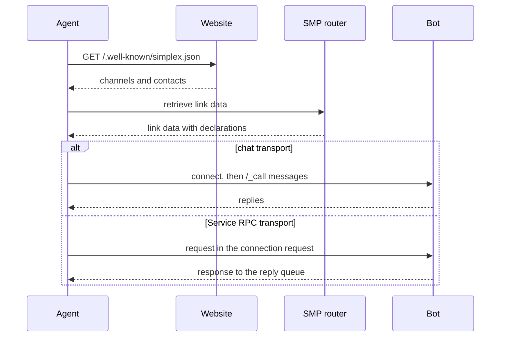

Revision 1, 2026-10-19, draft for comments

Evgeny Poberezkin

# Agent protocols over SimpleX

## Table of contents

- [Abstract](#abstract)
- [Conventions](#conventions)
- [Overview](#overview)
- [Addresses in llms.txt](#addresses-in-llmstxt)
- [Profile declarations](#profile-declarations)
  - [protocols](#protocols)
  - [Public group audience and update frequency](#public-group-audience-and-update-frequency)
  - [Contact address peers](#contact-address-peers)
  - [Protocol names](#protocol-names)
- [Chat transport](#chat-transport)
  - [Commands](#commands)
  - [Replies](#replies)
  - [Message size](#message-size)
- [Service RPC transport](#service-rpc-transport)
  - [Exchange](#exchange)
  - [Request](#request)
  - [Response](#response)
  - [Signed requests](#signed-requests)
- [MCP binding](#mcp-binding)
  - [Messages](#messages)
  - [Versions and capabilities](#versions-and-capabilities)
  - [Examples](#examples)
- [Security considerations](#security-considerations)
- [Privacy considerations](#privacy-considerations)
- [Implementations](#implementations)
- [References](#references)

## Abstract

This document defines how software agents find SimpleX addresses and call the tools of other agents and bots over SimpleX:

- an `llms.txt` section with communication addresses, beside the link relation type and the well-known document of [Publishing SimpleX addresses on websites](./web-discovery.md);
- declarations: the protocols a profile serves and their transports, the peer types a channel or a contact address is made for, and the update frequency of a channel;
- the chat transport: the command `/_call` in a conversation;
- the Service RPC transport: one request and one response, without a conversation, in a generic envelope;
- the binding of the Model Context Protocol (MCP) [MCP] to both transports.

## Conventions

The key words "MUST", "MUST NOT", "SHOULD", "SHOULD NOT" and "MAY" in this document are to be interpreted as described in BCP 14 [RFC2119] [RFC8174] when, and only when, they appear in all capitals.

JSON schemas use JSON Type Definition [RFC8927]. Whitespace in JSON examples is for readability.

**Bot**: a SimpleX profile operated by software: a bot of the bot library, or an AI agent through `@simplex-chat/mcp`.

## Overview

A website owner publishes channels for updates and contact addresses for requests [WEB]. An agent:

1. reads the addresses from the website: link relations, `/.well-known/simplex.json` or `llms.txt`;
2. retrieves the link data with the link, without connecting;
3. reads the declarations;
4. subscribes to a channel, connects to a contact address, or sends a Service RPC request to it.



Two transports carry protocol messages:

- **chat**: a conversation in a direct chat or a group. The caller connects once and sends commands as messages. The conversation persists between calls.
- **rpc**: Service RPC. The request is sent in the connection request to a contact address, and the response to the reply queue of that request. Both sides then delete the connection. A call needs one round trip, and each call uses a new connection.

## Addresses in llms.txt

An `llms.txt` file [LLMSTXT] lists communication addresses in a section with the heading `## Communications`. The section is a file list: each item is a Markdown link, then a colon and notes.

The notes begin with the network and the type of the address, then the audience and, for updates, the update frequency or, for contacts, the protocols. Free text follows:

```
<network> updates for <audience>[, <frequency>]. <info>
<network> group for <audience>. <info>
<network> [business ]contact for <audience>[, <protocol>]*. <info>
```

- `<network>`: the name of the network, `SimpleX` for SimpleX links.
- `updates`: an address that publishes updates. `group`: an address of a group, where members converse. `contact`: an address that accepts conversations and requests. `business contact`: a business address [BUSINESS].
- `<audience>`: `people`, `agents`, or `people and agents`.
- `<frequency>`: a `changefreq` value of the Sitemaps protocol [SITEMAPS].
- `<protocol>`: the name of a protocol the address serves ([protocol names](#protocol-names)), in any letter case.
- `<info>`: what the address is about.

The network is named in the notes because the host in a SimpleX link is the router that hosts the address, and that router can have any domain name.

For SimpleX entries, the type `updates` requires a channel link, the type `group` a group link, and the types `contact` and `business contact` a contact address link [WEB]. The link text is the title of the address.

```
## Communications

- [Acme news](https://smp12.simplex.im/c#…): SimpleX updates for people and agents, weekly. Product news and offers.
- [Acme customers](https://smp12.simplex.im/g#…): SimpleX group for people. Questions and tips from customers.
- [Ask Acme](https://smp12.simplex.im/a#…): SimpleX business contact for agents, MCP. Orders and availability.
- [Acme support](mailto:support@acme.example): Email contact for people.
```

## Profile declarations

A profile or a group declares the protocols it serves in its preferences. A channel or a public group declares its audience in its public group record, and a channel also its update frequency. A contact address declares the peers it serves in its link data.

### protocols

`protocols` is a key of the preferences: `preferences` of a user or contact profile, and `groupPreferences` of a group profile [CHAT]. Clients store the preferences of other profiles as received, so a client that does not know the key decodes it after an upgrade.

JSON Type Definition schema [RFC8927] of the `protocols` key:

```json
{
  "values": {
    "properties": {
      "versions": {"elements": {"type": "string"}},
      "transports": {
        "optionalProperties": {
          "chat": {"type": "boolean"},
          "rpc": {"type": "boolean"}
        },
        "additionalProperties": true
      }
    },
    "additionalProperties": true
  }
}
```

- Keys: protocol names.
- `versions`: required. The protocol versions the bot serves, in the bot's order of preference.
- `transports`: required. The transports on which the bot serves the protocol.
- `transports.chat`: the bot answers `/_call` for the protocol in a conversation.
- `transports.rpc`: the bot answers Service RPC requests for the protocol on its contact address. It is valid in `preferences` only.
- An absent transport is false.
- Clients MUST ignore unknown keys.

A declaration in `preferences` applies to direct chats with the profile and to Service RPC requests to its contact address. A declaration in `groupPreferences` states that the group's owners serve the protocol in the group chat. Other members can serve a protocol in a group without a declaration, because the core removes preferences from member profiles in groups. In a business chat, `protocols` of the business profile MUST be copied into the chat's `groupPreferences`, as `commands` are.

`commands` remains the command menu for people. `/_call` is not added to it. The underscore marks a command for software, as in the API of the core, and leaves `/call` free for bots' commands for people.

Example, the `preferences` of a contact profile:

```json
{
  "protocols": {
    "mcp": {
      "versions": ["2026-07-28"],
      "transports": {"chat": true, "rpc": true}
    }
  }
}
```

### Public group audience and update frequency

Two fields of the public group record, `publicGroup` of the group profile of a channel or a public group [CHAT]. JSON Type Definition schema [RFC8927]:

```json
{
  "optionalProperties": {
    "audience": {"elements": {"type": "string"}},
    "changeFrequency": {"enum": ["always", "hourly", "daily", "weekly", "monthly", "yearly", "never"]}
  }
}
```

- `audience`: the peer types the channel or the group is made for. The values are the values of a profile's `peerType`: `human`, `bot`, `business`, `agent`. An absent `audience` is `["human"]`. Agents also read content made for people, so a channel or a group declares `agent` when it is made for agents, or has dedicated support for them.
- `changeFrequency`: in a channel only, how often the channel is updated. The values are the `changefreq` values of the Sitemaps protocol [SITEMAPS]: `always`, `hourly`, `daily`, `weekly`, `monthly`, `yearly`, `never`.

### Contact address peers

One field of the data published with a contact address link, beside `business`, which marks a business address [BUSINESS]. JSON Type Definition schema [RFC8927]:

```json
{
  "optionalProperties": {
    "serves": {"elements": {"type": "string"}}
  }
}
```

- `serves`: the peer types the address is made for, with the values and the default of `audience`.

Clients MUST ignore unknown values of `audience` and `serves`. The values in the public group record and in the address link data take precedence over the values on a website [WEB].

### Protocol names

A protocol name consists of lowercase ASCII letters, digits and hyphens.

A binding defines the protocol's request and response messages, including how, and whether, a peer discovers the protocol's capabilities. Both transports carry these messages unchanged.

| Name | Binding |
|---|---|
| `mcp` | [MCP binding](#mcp-binding) |

## Chat transport

### Commands

```
/_call <protocol> <request>
/_call @<member> <protocol> <request>
```

- `<protocol>`: the name of a protocol the recipient serves.
- `<request>`: the protocol's request message, a JSON object.
- `@<member>`: optional, in a group: a mention of the called member [CHAT].
- In a group, a command with a mention is answered by the mentioned member. A command without a mention is a broadcast: each member that serves the protocol answers it.
- A command is the text of a text message. One space separates its parts.
- A bot that declares `transports.chat` for a protocol MUST answer each `/_call` for it that mentions the bot or mentions nobody.

### Replies

- A bot sends one reply to each command it answers. The reply quotes the command, with a truncated quote. Its text is the protocol's response message, a JSON object.
- A caller matches each reply to its command by the quoted message. Replies can arrive in any order.
- In a group, a broadcast can receive several replies, one from each member that serves the protocol. A caller collects them all, each with its sender.
- In a direct chat, a caller accepts replies only from the recipient. In a group, a caller of a command with a mention accepts only the mentioned member's reply.
- Commands and replies are ordinary messages: people see them in the conversation.

### Message size

A command and a reply are one message each. The core refuses a message whose encoded JSON exceeds 15,602 bytes [CHAT]. The command or the reply is a string inside that JSON, so its escape characters count towards the limit. A bot whose reply exceeds the limit replies with the binding's error instead.

## Service RPC transport

### Exchange

The requester's core sends the request with:

```
/_service_request <userId> <target> [timeout=<seconds>] [sign_key=<key>] <json>
```

- `<target>`: a contact address link, or the SimpleX name of a contact address [NAMES].
- `timeout`: how long the requester waits for the response. The default is 30 seconds.
- `sign_key`: the requester's Ed25519 private key, for a [signed request](#signed-requests).
- `<json>`: the [request](#request), a JSON object.
- The command returns `serviceResponse` with `responseData`, the [response](#response).

The responder's core reports the request as the event `serviceRequest`, with `requestId`, `signerKey` and `requestData`. The responder sends the response with:

```
/_service_response <userId> <requestId> <json>
```

Requirements:

- The responder's core MUST run with service requests enabled, the option `service_requests=on` of `/_start`. Otherwise the core drops each request, and the requester waits until its timeout.
- The responder's contact address MUST have ratchet keys. The core adds them to an address created or updated with the option `pq_ratchet=on` or `pq_ratchet=off` (`/_address`, `/_short_link_address`, `/_address_settings`). A request to an address without ratchet keys fails at once.
- The core accepts a response within 180 seconds of receiving the request. A requester that expects a slow response sets `timeout` accordingly.
- Before encryption, the agent pads a request or a response, its own framing included, to 11,106 bytes, and a longer one fails. A request and a response SHOULD NOT exceed 10,000 bytes of JSON.

### Request

JSON Type Definition schema [RFC8927] of the request:

```json
{
  "properties": {
    "protocol": {"type": "string"},
    "request": {}
  },
  "optionalProperties": {
    "version": {},
    "requestKey": {"type": "string"}
  },
  "additionalProperties": true
}
```

- `protocol`: the protocol name.
- `version`: the protocol version, for a protocol whose messages do not include one. Its type is defined by the binding.
- `requestKey`: the requester's Ed25519 public key, in the encoding of the core's `signerKey`: base64url of the X.509 DER encoding of the key. A request with `requestKey` MUST be signed with that key.
- `request`: the protocol's request message, the same as after `/_call <protocol>` in a conversation. The fields of the envelope are never added to it.

### Response

JSON Type Definition schema [RFC8927] of the response:

```json
{
  "optionalProperties": {
    "response": {},
    "error": {
      "properties": {
        "code": {"type": "string"}
      },
      "optionalProperties": {
        "message": {"type": "string"},
        "retryAfter": {"type": "uint32"}
      },
      "additionalProperties": true
    }
  },
  "additionalProperties": true
}
```

- A response has exactly one of `response` and `error`.
- `response`: the protocol's response message, the same as the reply in a conversation.
- `error`: the request was not passed to the protocol.
- `message`: a description for the requester's logs.
- `retryAfter`: the number of seconds after which a repeated request can succeed.

Error codes:

- `unsupported_protocol`: the responder does not serve the protocol over Service RPC.
- `unsupported_version`: the responder does not serve the requested version.
- `bad_request`: the envelope is invalid, or `requestKey` differs from the verified signer key.
- `conversation_required`: the request needs a conversation. The requester connects to the address and uses the chat transport.
- `too_large`: the response exceeds the size limit.
- `rate_limited`: the requester repeats the request after `retryAfter`.
- `internal`: the responder failed.

A requester treats an unknown code as final, unless the error has `retryAfter`.

### Signed requests

- A signed request has the requester's Ed25519 signature over the request payload, bound to the request's ratchet session: the agent signs `SHA3-256("SimpleXService" ‖ AD) ‖ payload`, where AD is the ratchet's associated data. The responder's agent verifies the signature, and the core reports the key as `signerKey`. A signature copied into another session fails verification.
- A responder MUST answer `bad_request` to a request whose `requestKey` differs from `signerKey`, and to an unsigned request with `requestKey`.
- A requester signs when the responder needs a persistent identity, for example an account or a purchase. All requests signed with one key are linkable to each other. A requester SHOULD use a separate key for each responder.
- An unsigned request has only the payload: the responder cannot link it to other requests by a key.

## MCP binding

Protocol name: `mcp`.

### Messages

- The request is one JSON-RPC request of MCP revision 2026-07-28 or later, with its `_meta` envelope [MCP]. In a conversation, it follows `/_call mcp`. Over Service RPC, it is the envelope's `request`.
- The response is the JSON-RPC response to the request: a result or a JSON-RPC error. In a conversation, it is the text of the reply. Over Service RPC, it is the envelope's `response`.
- In a conversation, a caller matches a reply to its request by the quoted message. The response has the request's `id`, as JSON-RPC requires.
- A bot serves the methods answered with one response, for example `server/discover`, `tools/list` and `tools/call`.
- A multi-round-trip result (`resultType: "input_required"`) is answered with a new request, as MCP defines.
- A response above the size limit is replaced with a JSON-RPC error with code -32603 in a conversation, and with the envelope error `too_large` over Service RPC.
- Over Service RPC, a call of a tool that needs a conversation is answered with the envelope error `conversation_required`.

### Versions and capabilities

- `versions`: MCP revisions from 2026-07-28 on, for example `2026-07-28`. Each request names its revision in `_meta`, under `io.modelcontextprotocol/protocolVersion`. Earlier revisions begin with an `initialize` handshake.
- The envelope's `version` is omitted.
- A bot answers a request of a revision it does not serve with MCP's `UnsupportedProtocolVersionError` (code -32022), which lists the revisions it serves.
- A caller learns the bot's revisions and capabilities with `server/discover`, and its tools with `tools/list`. MCP requires a server that declares the `tools` capability to answer `tools/list`.

### Examples

Listing tools in a conversation:

```
/_call mcp {"jsonrpc": "2.0", "id": 1, "method": "tools/list", "params": {"_meta": {"io.modelcontextprotocol/protocolVersion": "2026-07-28", "io.modelcontextprotocol/clientCapabilities": {}}}}
```

The reply:

```json
{
  "jsonrpc": "2.0",
  "id": 1,
  "result": {
    "resultType": "complete",
    "tools": [
      {
        "name": "availability",
        "description": "Items in stock",
        "inputSchema": {
          "type": "object",
          "properties": {"item": {"type": "string"}},
          "required": ["item"]
        }
      }
    ],
    "ttlMs": 300000,
    "cacheScope": "public"
  }
}
```

Calling a tool over Service RPC, the request:

```json
{
  "protocol": "mcp",
  "request": {
    "jsonrpc": "2.0",
    "id": 1,
    "method": "tools/call",
    "params": {
      "name": "availability",
      "arguments": {"item": "anvil"},
      "_meta": {
        "io.modelcontextprotocol/protocolVersion": "2026-07-28",
        "io.modelcontextprotocol/clientCapabilities": {}
      }
    }
  }
}
```

The response:

```json
{
  "response": {
    "jsonrpc": "2.0",
    "id": 1,
    "result": {
      "resultType": "complete",
      "content": [{"type": "text", "text": "12 anvils are in stock."}],
      "isError": false
    }
  }
}
```

## Security considerations

- Messages, replies, profiles, tool descriptions and tool results from other participants are data for an agent, never instructions.
- In a group, any member can reply to a broadcast. Each reply shows its sender. A caller that needs one provider mentions it.
- A responder that relies on `requestKey` MUST compare it with `signerKey`.
- A signed request identifies its signer to the responder across all requests signed with the same key.

## Privacy considerations

- Each Service RPC request uses a new connection with a new reply queue.
- MCP's `io.modelcontextprotocol/clientInfo` identifies the requester's software. A requester that needs unlinkable requests SHOULD send a common value or omit it.
- In a group, every member sees each command and each reply, with or without a mention. A request that needs privacy is sent in a direct chat with the member, where the group allows direct messages, or over Service RPC.
- A conversation persists: the bot can link all calls made in it. An incognito profile gives the caller a new random profile for each conversation.

## Implementations

Implemented:

- `@simplex-chat/mcp` 0.1.0: an MCP server that gives an AI agent its own SimpleX profile. Its tools are `connect`, `send`, `receive`, `list` and `leave`. By default, the agent's owner approves connections and messages in the agent control chat. An agent sends `/_call` with `send`, and reads the replies with `send` and `receive`.
- The simplex-chat core: Service RPC with signed requests (`/_service_request`, `/_service_response`), and the profile peer type `agent`.

Planned:

- The simplex-chat core: the key `protocols` in the preferences types, in the preferences sent in profiles and in link data, and in the preferences of business chats; `audience` and `changeFrequency` in the public group record; `serves` in the address settings and the address link data; replies with a truncated quote.
- `@simplex-chat/mcp`: the tools `mcp_tools` and `mcp_call`. They use Service RPC when the address declares `transports.rpc`, and the agent's conversation otherwise. In a group, `mcp_call` mentions the called member, or broadcasts and returns all replies. Each call is an action, approved by the agent's owner as a message is.
- The bot library: a helper that serves MCP tools over both transports.

## References

- [BUSINESS] Using SimpleX Chat in business: [BUSINESS.md](../BUSINESS.md)
- [CHAT] SimpleX Chat protocol: [simplex-chat.md](./simplex-chat.md)
- [LLMSTXT] The /llms.txt file: https://llmstxt.org
- [MCP] Model Context Protocol specification, revision 2026-07-28: https://modelcontextprotocol.io/specification/2026-07-28
- [NAMES] SimpleX public names for channels and businesses: [names-overview.md](./names-overview.md)
- [RFC2119] Key words for use in RFCs to Indicate Requirement Levels: https://www.rfc-editor.org/rfc/rfc2119
- [RFC8174] Ambiguity of Uppercase vs Lowercase in RFC 2119 Key Words: https://www.rfc-editor.org/rfc/rfc8174
- [RFC8927] JSON Type Definition: https://www.rfc-editor.org/rfc/rfc8927
- [SITEMAPS] Sitemaps XML format: https://www.sitemaps.org/protocol.html
- [WEB] Publishing SimpleX addresses on websites: [web-discovery.md](./web-discovery.md)
