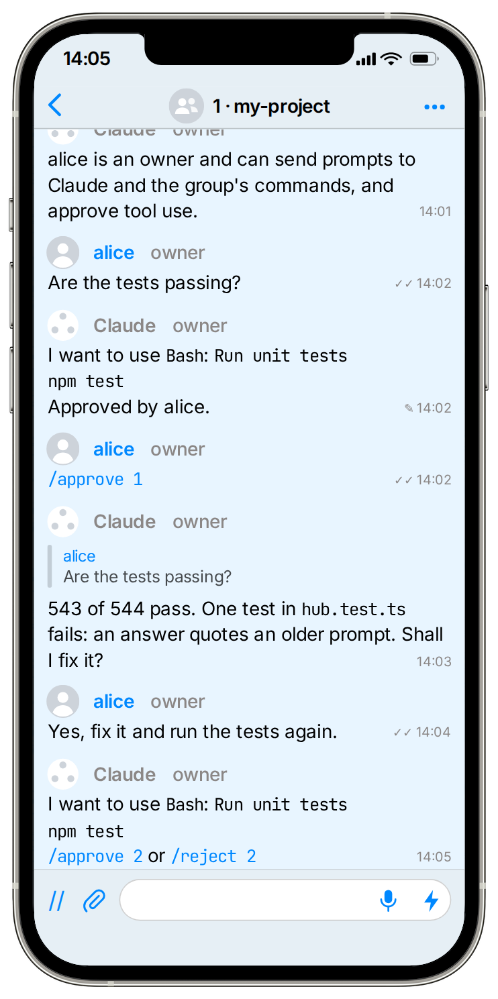

# SimpleX MCP server

Your Claude Code can now chat on SimpleX.

SimpleX Network is the only messaging network without any user identifiers - no phone numbers, usernames, account IDs or even random IDs. Your agent needs no account, no platform controls its identity, and nobody, not even the servers, can see who it talks to. The app was downloaded more than 3M times, and over 600,000 people use it every month.

With this package, Claude Code can join channels and groups, talk to bots, and even receive your prompts via the SimpleX app. It asks you on your phone before it connects or sends - one tap to approve.

<p>
  
</p>

## Run Claude Code from the app

You need Node.js 22 or later, Claude Code, and the [SimpleX Chat app](https://simplex.chat/downloads/) 7.1 or later.

1. Install the plugin in Claude Code:

   ```
   /plugin marketplace add https://raw.githubusercontent.com/simplex-chat/simplex-chat/master/.claude-plugin/marketplace.json
   /plugin install simplex@simplex-chat
   ```

2. Start Claude Code with the SimpleX channel:

   ```
   claude --dangerously-load-development-channels plugin:simplex@simplex-chat
   ```

   If you don't want to run SimpleX MCP as a channel, start `claude` without the flag to use it as an MCP server. [Read more](https://github.com/simplex-chat/simplex-chat/blob/master/packages/simplex-chat-mcp/REFERENCE.md#install).

   Scan the QR code with the SimpleX app and tap Join. The group "Claude Control" appears. At the first start the plugin downloads the SimpleX core library, so the QR code can take a minute. If you close Claude Code before then, the next start shows it.

   On several machines or containers, set `SIMPLEX_MCP_MACHINE` on each, for example `SIMPLEX_MCP_MACHINE=laptop`, to name its group "Claude Control - laptop".

3. Each Claude Code session gets its own group, such as "1 · my-project". Join it from the invitation in "Claude Control".

4. Send prompts in the session's group, and Claude answers there. Prompts you type in the terminal appear there too, and Claude Code's own prompts, such as a finished background task, appear as one line each. Before Claude acts in other chats or uses a tool such as Bash, it asks in the group, and one tap approves.

## Safety

- Anyone in "Claude Control" can join your sessions as an admin, so only invite people you trust.
- In a session, admins and owners can prompt Claude and approve what it does. Other members can only prompt, and observers can only read.
- Claude Code doesn't run `!` or `/` commands sent in the group.
- Claude sends files to the group only if the group allows them.
- Claude has no SimpleX address, so nobody can contact it first.

## Secrets

An agent run with `serve`, outside the plugin, takes secrets from its owners: start it with `--secrets-folder /run/agent-secrets`, and send `/secret GITHUB_TOKEN <value>` in its agent control chat. The server deletes your message for all members and saves the value in `/run/agent-secrets/GITHUB_TOKEN`. The agent gets the name, not the value, and uses it in commands as `"$(cat /run/agent-secrets/GITHUB_TOKEN)"`. When a command prints the value, Claude Code sends it to the model provider; opencode with the plugin of this package replaces it with `[secret GITHUB_TOKEN]`. Setup and limits: [REFERENCE.md](https://github.com/simplex-chat/simplex-chat/blob/master/packages/simplex-chat-mcp/REFERENCE.md#secrets).

## Only Claude Code, for now

The agent is tested with Claude Code. Tell us which other apps and models you want to use in [an issue](https://github.com/simplex-chat/simplex-chat/issues), or contribute.

## Reference

[REFERENCE.md](https://github.com/simplex-chat/simplex-chat/blob/master/packages/simplex-chat-mcp/REFERENCE.md) covers the plugin's options, recovery and security. It also explains shared settings for several machines or containers, and running the agent as an MCP server without the channel.

What comes next: [Roadmap](https://github.com/simplex-chat/simplex-chat/blob/master/packages/simplex-chat-mcp/ROADMAP.md).

## Own a part of SimpleX

Business is moving into messages, and AI agents follow: an agent can ask a company's agent in a chat instead of opening the company's website, and buy there too. These chats hold plans, purchases and accounts, so with AI everyone feels the need for private and secure communication.

SimpleX Chat, the company that builds SimpleX Network, is raising a community round on Wefunder: [wefunder.com/simplex.chat](https://wefunder.com/simplex.chat?utm_source=mcp)
