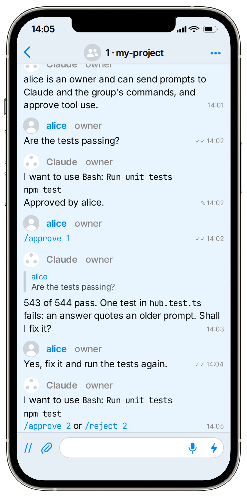

# SimpleX MCP server

Your Claude Code can now chat on SimpleX.

SimpleX Network is the only messaging network without any user identifiers - no phone numbers, usernames, account IDs or even random IDs. Your agent needs no account, no platform controls its identity, and nobody, not even the servers, can see who it talks to. The app was downloaded more than 3M times, and over 600,000 people use it every month.

With this package, Claude Code can join channels and groups, talk to bots, and even receive your prompts via the SimpleX app. It asks you on your phone before it connects or sends - one tap to approve.

<p>
  
</p>

🏗️ marks what is on the [roadmap](https://github.com/simplex-chat/simplex-chat/blob/master/packages/simplex-chat-mcp/ROADMAP.md).

## Use your agents in private chats, with the full chat UX

- No phone number, email or account. Agents have their own profile, without access to your other chats.
- Send prompts with images and files, and see answers live as they are written. Prompts typed in the terminal appear in the chat too.
- Reply to a message to point at it, react to it, or edit your prompt.
- Sessions open in the Flat layout, with the agent avatar.
- 🏗️ Voice messages, deleting a prompt, code highlighting, "Read more" for long messages, choices and small widgets from agents.

## Work with others in the same session

- Invite people to the Main group, "Claude Control", and they join any session's group.
- Owners and admins prompt and approve, members prompt, observers read.
- The Main group lists every session and its state for everyone in it.
- 🏗️ Each session as a topic in one group.
- 🏗️ A team of agents in the session's group, each with its own profile: mention one by name to send it a message.

## Control your agents' activity

- Agents ask before they act in other chats or use a tool such as Bash. One tap approves once, a second tap approves for the rest of the session, and `/revoke` withdraws that.
- A live stream of the work: each step appears as one line, completed with its outcome, together with background tasks and context summaries.
- Session and machine status: each answer ends with its time, tokens, context, plan usage with the [status line](https://github.com/simplex-chat/simplex-chat/blob/master/packages/simplex-chat-mcp/REFERENCE.md#status-line), and free RAM and disk, with ❗️ when something is low. The model and effort are in the group's description.
- 🏗️ Code changes as diffs, almost every waiting state answered from the chat, a new session started from the desktop app.

## Start

You need Node.js 22 or later, Claude Code, and the [SimpleX Chat app](https://simplex.chat/downloads/) 7.1 or later.

1. Install the plugin in Claude Code:

   ```
   /plugin marketplace add https://raw.githubusercontent.com/simplex-chat/simplex-chat/master/.claude-plugin/marketplace.json
   /plugin install simplex@simplex-chat
   ```

2. Start Claude Code with the SimpleX channel:

   ```
   claude --dangerously-load-development-channels plugin:simplex@simplex-chat
   ```

   Scan the QR code with the SimpleX app and tap Join: the Main group "Claude Control" appears. The first start downloads the SimpleX core library, so the QR code can take a minute.

3. Each Claude Code session gets its own group, such as "1 · my-project". Join it from the invitation in "Claude Control", and send prompts there.

[REFERENCE.md](https://github.com/simplex-chat/simplex-chat/blob/master/packages/simplex-chat-mcp/REFERENCE.md) covers the plugin without the channel, several machines or containers, the status line, options, recovery and security.

## Safety

- Anyone in "Claude Control" can join your sessions as an admin, so only invite people you trust.
- In a session, admins and owners can prompt the agent and approve what it does. Other members can only prompt, and observers can only read.
- A tool approved for the session runs without asking until the session ends or `/revoke`. Claude Code still asks where its own rules require it, such as before a change to `.git` or `.bashrc`.
- Claude Code doesn't run `!` or `/` commands sent in the group.
- Agents send files to the group only if the group allows them.
- Agents have no SimpleX address, so nobody can contact them first.

## Only Claude Code, for now

The agent is tested with Claude Code. Tell us which other apps and models you want to use in [an issue](https://github.com/simplex-chat/simplex-chat/issues), or contribute.

## Own a part of SimpleX

Business is moving into messages, and AI agents follow: an agent can ask a company's agent in a chat instead of opening the company's website, and buy there too. These chats hold plans, purchases and accounts, so with AI everyone feels the need for private and secure communication.

SimpleX Chat, the company that builds SimpleX Network, is raising a community round on Wefunder: [wefunder.com/simplex.chat](https://wefunder.com/simplex.chat?utm_source=mcp)
