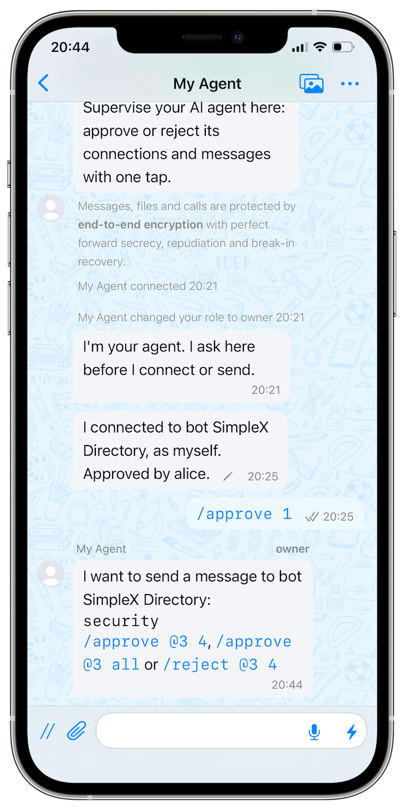
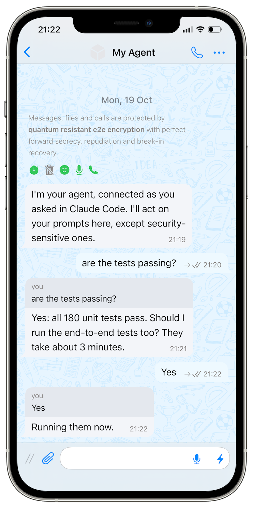

# SimpleX MCP server: reference

[README](README.md) explains how to install and use the plugin.

`@simplex-chat/mcp` is a local server that gives an AI agent its own presence on the SimpleX network. The agent connects to people, bots, groups, channels and directories, as itself or incognito, sends messages and files, and receives all the responses, with the files people send it. Bots tell it which commands they understand, so every bot on the network becomes a service the agent can use. You supervise the agent from its control chat in SimpleX: it asks there before it connects, sends, downloads a file or leaves, and you approve or reject from your phone with one tap, or approve all its messages to a chat you trust, or all files from it. Six tools cover it: `connect`, `send`, `receive`, `download`, `list`, `leave`. Setup is one command to start the agent, a scan to join its control chat, and one command to add it to Claude Code.

The package is also a Claude Code plugin, which gives each Claude Code session its own SimpleX group. There you prompt the session, approve its actions and tool use, and read its answers, see [Claude Code plugin](#claude-code-plugin).

What it isn't:
- **Not a directory or a search service.** The agent reaches chats through links, SimpleX names and the directories it connects to.
- **Not a push channel into an agent of `serve`.** An MCP server can't start a turn of the agent, so news reaches it only as results of calls it makes: waits inside `send` and `receive`, or polling. The plugin's channel passes your prompts to a running Claude Code session.
- **Not an always-on service.** The agent acts while its session runs; services that must always be up should be bots.
- **Not hosted.** It runs on your machine, one process per agent.
- **Not in v0.3:**
  - an address for the agent: nobody can contact it first;
  - your approval of incoming messages;
  - registration in other hosts.

Status: v0.3. [`TESTING.md`](TESTING.md) describes a local build and test. The design, the tools and the scenarios of `serve` are in [`PLAN.md`](PLAN.md).

- [Requirements](#requirements)
- [Quick start](#quick-start)
- [Owner approval](#owner-approval)
- [Add the agent to Claude Code](#add-the-agent-to-claude-code)
- [Approval modes](#approval-modes)
- [Expiry](#expiry)
- [What the owner sees](#what-the-owner-sees)
- [What the agent sees](#what-the-agent-sees)
- [Waiting for approval in Claude Code](#waiting-for-approval-in-claude-code)
- [Prompt the agent from the app](#prompt-the-agent-from-the-app)
- [Several agents](#several-agents)
- [Other MCP hosts](#other-mcp-hosts)
- [Recovery](#recovery)
- [Command reference](#command-reference)
- [Data folder](#data-folder)
- [Security](#security)
- [Claude Code plugin](#claude-code-plugin)

## Requirements

- Node.js 22.
- One of the platforms of the `simplex-chat` package: Linux x86-64 or arm64, macOS x86-64 or arm64, Windows x86-64.
- On Linux x86-64: glibc 2.34 or later, and the system libraries `libcrypto.so.3`, `libgmp.so.10` and `libz.so.1`.
- The SimpleX Chat app on a phone or computer, for the owner.
- Claude Code; other MCP hosts with Streamable HTTP and custom headers can be configured by hand.

At its first start the server downloads the SimpleX core library, 29 to 50 MB depending on the platform, into `~/.cache/simplex-chat` (macOS: `~/Library/Caches/simplex-chat`, Windows: `%LOCALAPPDATA%\simplex-chat`). Unpacked on Linux, it takes about 240 MB.

## Quick start

1. Start the agent's server in a terminal and keep it running. NAME, here `my-agent`, names the agent's data folder and its entry in Claude Code; `--display-name` is the name people see in SimpleX, NAME by default:

   ```
   npx -y @simplex-chat/mcp serve my-agent --display-name "My Agent"
   ```

   The first start prints, after two lines about downloading the SimpleX core library and the Node.js add-on:

   ```
   SimpleX MCP server 0.3.0, agent "my-agent"
   Data folder: /home/alice/.simplex-mcp/my-agent
   Approval mode: requests
   Agent control chat "My Agent" created.
   Join the agent control chat in the SimpleX app. The link works once:
   <QR code>
   https://smp4.simplex.im/g#...
   If the QR code does not scan, restart with --qr-code large, or paste the link into the app.
   Whoever joins by this link becomes an owner of "My Agent" and approves its actions. To approve owners yourself, start with --owners.
   Listening on http://127.0.0.1:5226/mcp
   ```

   `-y` answers npm's prompt to install the package. The server asks no questions: every choice is an option. The QR code of such a link is 37 columns wide and 19 lines high; `--qr-code large` draws it twice as wide and twice as high. Ctrl-C stops the server, see [Expiry](#expiry).

2. In the SimpleX app, scan the QR code or open the link, and tap Join. The chat "My Agent" appears in the chat list, and the agent writes: `I'm your agent. I ask here before I connect, send, download a file or leave a chat.` The terminal prints:

   ```
   Alice joined (member 3) and is now an owner. The link is deleted.
   Add the agent to Claude Code:
     npx -y @simplex-chat/mcp register my-agent
   ```

3. In another terminal, add the agent to Claude Code:

   ```
   $ npx -y @simplex-chat/mcp register my-agent
   Added to Claude Code: scope user, server simplex-my-agent.
   ```

4. Add `"mcp__simplex-my-agent"` to `permissions.allow` in `~/.claude/settings.json`, so Claude Code does not prompt for each call; approval happens in the SimpleX app.

5. Start Claude Code and ask it, for example: `Connect to the SimpleX Directory at https://smp4.simplex.im/a#lXUjJW5vHYQzoLYgmi8GbxkGP41_kjefFvBrdwg-0Ok and search it for trail running shoes.` In the chat "My Agent", the agent writes:

   ```
   I want to connect to bot SimpleX Directory, as myself.
   `Find groups, channels, businesses and bots.`
   /approve 1 or /reject 1
   ```

   Tap `/approve 1`. The agent then asks to send its search, and you approve that too, or tap the card's `all` command to approve all its messages to the directory. Once the name `@directory.simplex` is registered, it works as the target too, and the card shows `(@directory.simplex)`.

Without `--owners`:

- whoever joins by the link becomes an owner of the agent control chat;
- every owner approves actions, including owners added later in the app;
- the link is deleted when the first person joins.

## Owner approval

With `--owners`, only the owners listed in it approve actions. An owner added later in the app approves actions only after the server is restarted with that owner in the list.

1. Start the server with `--owners` and no list:

   ```
   npx -y @simplex-chat/mcp serve my-agent --owners
   ```

   The output is the same as in the quick start, with the line `The link adds an observer. Its ID and name are printed when it joins.` in place of `Whoever joins by this link ...`.

2. Join the agent control chat in the SimpleX app with the link. The link is deleted. The terminal prints, and the agent posts in the chat:

   ```
   Alice joined (member 3). Restart the server with --owners 3:Alice
   ```

   Until the restart, the agent's `connect`, `send`, `download` and `leave` fail.

3. Stop the server with Ctrl-C and start it with the list:

   ```
   $ npx -y @simplex-chat/mcp serve my-agent --owners 3:Alice
   Owners: 3:Alice.
   Add the agent to Claude Code:
     npx -y @simplex-chat/mcp register my-agent
   ```

4. To add an owner, add the person to the agent control chat in the app and make them an owner there. The terminal prints, and the agent posts in the chat:

   ```
   Bob (member 7) is now an owner and can't approve actions yet. Restart the server with --owners 3:Alice,7:Bob
   ```

   When an owner leaves or is removed, the agent lists the human owners who remain:

   ```
   Alice (member 3) is no longer an owner. Restart the server with --owners 7:Bob
   ```

   When none remains: `No owners remain: restart the server with --reset-owners --owners`.

In the chat, the `--owners ...` part of these lines is shown as code, so a member's name in it cannot form a tappable command.

At every start with a list, the server removes the connected members of the agent control chat other than the listed owners.

## Add the agent to Claude Code

```
npx -y @simplex-chat/mcp register my-agent                  # all Claude Code projects
npx -y @simplex-chat/mcp register my-agent --scope local    # the current project only
```

`register NAME` reads the agent's port from its data folder, runs `claude mcp remove --scope SCOPE simplex-NAME` (SCOPE: `user`, or the `--scope` value), ignoring a missing entry, and then, for `register my-agent`:

```
claude mcp add-json --scope user simplex-my-agent '{"type":"http","url":"http://127.0.0.1:5226/mcp","headersHelper":"cat /home/alice/.simplex-mcp/my-agent/headers.json","timeout":169800000}'
```

- NAME: 1 to 32 lowercase letters, digits and single hyphens, starting with a letter or digit.
- The entry has no token. At every connection Claude Code runs the `headersHelper` command and sends the header it prints from `headers.json` in the data folder; on Windows the command is `type "<folder>\headers.json"`. With `--scope local`, Claude Code runs it only in a folder whose trust dialog was accepted.
- The agent's tools in Claude Code are `mcp__simplex-my-agent__connect` and the rest.
- `timeout` is the expiry plus 24 hours and 10 minutes, in milliseconds: the longest wait for a decision plus the longest wait for responses. After a change of `--expire` or `--port`, register the agent again; an agent on another port needs the same `--port` at every start.
- The server must be running when Claude Code starts a session. If a session started before the server, run `/mcp reconnect all` in it (Claude Code 2.1.284 or later; earlier, reconnect `simplex-my-agent` in `/mcp`).

Errors:

```
situation                  message
never started              Agent "my-agent" was never started. Start it with: npx -y @simplex-chat/mcp serve my-agent
claude not on PATH         Add this entry under "mcpServers" in ~/.claude.json: {"simplex-my-agent": {...}}
                           (--scope local: under "projects" > "<project folder>" > "mcpServers")
```

The token is created at the agent's first start and saved in its data folder; every start writes it to `headers.json`. `serve my-agent --new-token` replaces it, and Claude Code sends the new token from its next connection, without a new `register`.

## Approval modes

`--approve MODE` sets what the owner approves. It is set only by this option.

| Mode | The agent's actions: connect, send, download, leave | Messages to the agent |
|---|---|---|
| `requests` (default) | Performed after `/approve N`, or `/receive N` for a download; a send to a chat approved for all messages at once, with a copy posted in the agent control chat; a download from a chat approved for all files at once, with no post, when the file is on the agent's XFTP servers. | Passed to the agent. |
| `host` | Performed at once; a copy is posted in the agent control chat, except for downloads. A download of a file on other servers fails. | Passed to the agent. |

Claude Code's own permission check applies to every tool call too. In mode `requests`, add the agent's server, for example `"mcp__simplex-my-agent"`, to `permissions.allow` in `~/.claude/settings.json`; otherwise Claude Code prompts for each call, or in auto mode its classifier decides it.

In `host` mode, approval is left to the MCP host. The server marks `connect`, `send`, `download` and `leave` with `_meta["anthropic/requiresUserInteraction"]: true`, so Claude Code shows its permission prompt on every call, in `acceptEdits`, `auto` and `bypassPermissions` modes as well, and allow rules do not skip it. In `dontAsk` mode and in `claude -p` runs Claude Code denies these calls.

## Expiry

A pending action expires after `--expire HOURS`, 23 by default and at most: SimpleX allows edits of a message for 24 hours, and the outcome of a pending action is an edit of its card. Cards don't show the time; `/pending` does. The last line of its card is edited to `Expired.`, and the agent's call returns `{"action": N, "status": "expired"}`. For the same reason, a `connect` waits for the other side at most until 23 hours 50 minutes after the action was created.

A result that no call has returned is dropped after the action's expiry time; a repeated call after that creates a new action. At most 20 actions are pending at once; a further `connect`, `send`, `download` or `leave` fails until the owner decides.

Actions last only while the server runs. When the server stops, the last line of each pending card is edited to `Cancelled: the server stopped.`, and the server waits up to 10 seconds, `--stop-wait`, for these edits to be sent: it prints `Stopping: sending 2 cancelled cards, up to 10 s. Ctrl-C to stop now.`, and a second Ctrl-C ends the wait. After a restart, `/approve` of an earlier number replies `Action N is not pending.`, and the agent's repeated call posts a new card. Action numbers continue across restarts.

## What the owner sees



All of it is in the agent control chat, posted by the agent's profile. The chat has the agent's display name; to see it under another name in your chat list, set an alias for the chat in the app. Names that are valid display names are shown plain. All other text written by the agent or by peers, other names included, is shown as code, line by line; names and errors take one line. Commands and SimpleX links inside it cannot be tapped: a valid display name cannot contain `/`, and the app parses each line of a message separately.

```
My Agent: I want to connect to bot SimpleX Directory (@directory.simplex), as myself.
          `Find groups, channels, businesses and bots.`
          /approve 1 or /reject 1

My Agent: I want to send a message to business Ridgeline, where I am incognito:
          `Is the Talus Trail waterproof?`
          /approve #9 4, /approve #9 all or /reject #9 4

My Agent: I want to leave business Ridgeline (#9).
          /approve #9 12 or /reject #9 12

My Agent: I want to download a file from Alice in group Builders (#3):
          `report.pdf`, 2.4 MB
          Servers: `xftp.example.com`, unknown: downloading shows it this computer's IP address.
          /receive #3 7, /forward #3 7 or /reject #3 7
```

The download card of an image or a video shows the sender's preview. Its servers line says `Servers: known.` when the file is on the agent's XFTP servers; otherwise it names the other servers, which see this computer's IP address during the download, and the card leaves out `/receive #3 7 all`. The agent waits until the sender finishes the upload before it asks, because the file's servers are known only then. A file without a file description is not downloaded: no card appears, and the agent's call ends with an error. A send with a file names the file's type, full path and size after the text, and shows an image's or video's preview:

```
My Agent: I want to send a message to group Builders:
          `The trail map.`
          attaching image `/home/alice/trail.jpg`, 3.1 MB
          /approve #3 8, /approve #3 all or /reject #3 8
```

When the agent asks to send a private key or a file of the server's data folder, the server refuses it and posts ``Refused to send `/home/alice/.ssh/id_ed25519` to group Builders (#3): private keys and the server's own files are not sent.`` When the upload of a sent file fails, the agent posts, for example, ``The file `trail.jpg` was not sent to group Builders (#3): `File server error: Server address is incompatible with network settings.`.``; both lines are logged too.

After the decision the card is edited, and its commands removed:

```
My Agent: I sent a message to business Ridgeline, where I am incognito:
          `Is the Talus Trail waterproof?`
          Approved by Alice.
```

Commands:

| Command | Effect |
|---|---|
| `/approve N`, `/approve #9 N` | Performs a connect, send or leave action N; the cards of sends and leaves name the chat. |
| `/reject N`, `/reject #9 N` | Rejects action N. |
| `/approve #9 all` | Approves all the agent's messages to chat #9: the pending ones and later ones. |
| `/revoke #9` | Ends that approval: each message to #9 needs approval again. |
| `/receive #3 7` | The agent receives the file of download 7: the server downloads it, and the agent's call returns its path. |
| `/receive #3 7 all` | The same, and the agent receives its later downloads from chat #3 of files on its XFTP servers without asking. Other pending downloads of #3 stay pending. |
| `/receive #3 off` | Ends that: each download from #3 needs approval again. |
| `/forward #3 7` | Downloads the file of action 7 and sends it to you in the agent control chat, as a reply to the card when the file's preview and the card fit in one message. The card stays pending, and the agent gets nothing: its messages show the file as offered, without a path. The server keeps the file outside the chat's folder until `/receive #3 7`, which then uses it. |
| `/leave #9`, `/leave @4` | Makes the agent leave group #9, or delete contact @4, at once, in both approval modes, and rejects the agent's pending actions for that chat. The reply, for example `Left business Ridgeline (#9), requested by Alice.`, is logged too. |
| `/delete #9 files` | Cancels the running downloads from chat #9, which then fail, also those the core continues after a restart, and deletes the chat's files in the data folder, forwarded ones included, for a current or a left chat: `Deleted 3 files from #9, 2.1 MB.` or `No files from #9.` |
| `/pending` | Lists pending actions. |
| `/list` | Lists the agent's 100 most recent chats, one line each, and which of them are approved for all messages or all files: `, approved for this chat by NAME` and `, files approved by NAME`; a last line counts the older chats. |

After `/leave #9`, or after the agent's `leave` of #9 is performed in either mode, when the chat's folder has files, the agent posts ``Files from business Ridgeline (#9) are kept in `/home/alice/.simplex-mcp/my-agent/files/group-9`: 3 files, 2.1 MB. /delete #9 files``. The files forwarded from #9 are deleted when the agent leaves it.

`/pending`, `/list` and `/leave` are in the chat's command menu, and the cards carry the others. Tapping `/leave` in the menu puts `/leave <chat ID>` into the entry field: replace `<chat ID>` with the chat's ID from `/list`, such as `#9`, and send it. Each command includes its number, because the app sends a tapped command as a new message, without a quote. Every card form and reply is listed in [`PLAN.md`](PLAN.md), section "What the owner sees: the agent control chat".

### Approval of all messages to a chat

After `/approve #9 all`, the agent's messages to #9 are sent at once, and each one is posted in the agent control chat after it is sent:

```
My Agent: I sent a message to business Ridgeline, where I am incognito:
          `Thanks, I'll order.`
          Approved for this chat by Alice. /revoke #9
```

- It covers messages only: connecting and leaving are approved one by one.
- It lasts until `/revoke`, until the chat is deleted, or until the approving owner is no longer an approver. It survives restarts: it is kept in the agent's database, as custom data of that chat.
- With it, the agent can send anything it can read, without asking, to everyone in that chat.
- It applies in mode `requests` only: in mode `host`, `list` and `/list` show no approvals.

### Receiving all files from a chat

After `/receive #3 7 all`, the agent's later downloads from #3 are performed at once, and nothing is posted in the agent control chat.

- It covers files on the agent's XFTP servers. A download of a file on other servers gets a card, as without it.
- Cards already pending in #3, other than card 7, stay pending. A file you rejected, or whose card expired, gets a card again.
- It covers downloads only, and the approval of messages covers no downloads: each is given and ended by its own command.
- It lasts as the approval of messages does, until `/receive #3 off`, and is kept next to it in the chat's custom data.
- `/list` shows it as `, files approved by Alice`.

## What the agent sees

Six tools:

| Tool | What it does |
|---|---|
| `connect` | Joins a contact, bot, business, group or channel by a link or a SimpleX name, as the agent's profile or incognito. Returns the chat, its profile, welcome message, the commands a bot advertises, and the messages so far. |
| `send` | Sends a message, with a file of this computer when asked, and returns every message received in that chat after it, until none arrives for `idle` seconds (30 by default). A directory bot's search results arrive this way. |
| `receive` | Returns the chat's unread messages and those that arrive while it waits, waiting for one when asked. |
| `download` | Downloads the file of a received message to the data folder and returns its full path. |
| `list` | Lists the agent's chats with unread counts and `approved: true` for chats approved for all messages, and its actions without a result. |
| `leave` | Deletes a contact, or leaves a group, business chat or channel, and deletes the chat; the contact or the members are notified. |

A `send` to a chat that `list` shows with `connected: false` is refused before any card. A `send` is refused with `text: too long for its approval card; shorten it.` when its card, in its longest outcome form, would exceed 15000 bytes in the SimpleX message, which holds at most 15602; a text of many lines or multi-byte characters reaches it below 12000 characters.

A received message with a file has a `file` field: its name, size, type (image, video, voice or file) and status. Status `offered` means `download` can fetch it; `received` comes with the path of the file that `download` downloaded; a file `/forward` sent to you stays `offered`; `rejected` means you rejected its download, or it expired; `failed` comes with the error, also for a file above the size its sender may send, and for a received file that is not in the chat's folder, for example after `/delete #3 files`. A downloaded file is named by its file ID and the extension of its name, when the extension has only letters and digits: the name the sender gave stays in the `name` field. `download` first waits, up to `wait` seconds, for the sender to finish the upload; when it has not finished by then, the call returns an error that asks to call again later. A `download` that runs past its `wait` after the approval returns status `performing`, and the same call again picks it up. A download fails when the sender cancels the file, when the message or its chat is deleted, or when no part of the file arrives for 30 minutes; the server then cancels it.

A short voice message can arrive with its file already received. The server moves such a file into the chat's folder under the same naming when it is received in full, and its message shows it as `offered`; `download` returns its path there after the approval. A partial file of a download, or of a short voice message that arrives while the server runs, is deleted when its transfer fails or is cancelled.

`send` with `file`, an absolute path, sends that file with `text` as its caption:
- `.jpg`, `.jpeg` and `.png` as an image, resized by the SimpleX core to the size the apps send, with a preview the core makes;
- `.gif` and `.webp` as an image, unchanged, with a gray preview;
- `.mp4` and `.mov` as a video, unchanged, with the first frame as its preview and its duration when `ffmpeg` and `ffprobe` are installed, otherwise a gray preview;
- other files as a file, unchanged; `as: "file"` sends an image or video this way too.

An empty file is refused, and so is `as` without `file`. A message holds at most 15602 bytes with its text, the file's name and preview, the message `reply_to` quotes and the mentioned names. The quote is the quoted text when the message is an image or video; otherwise it is the quoted content, an image's preview included. A `send` over it is refused with `text: too long for a message with this image; shorten it.`, or without a file `text: too long for the message with its quote; shorten it.` An image's preview takes up to 14000 bytes, so its text has about 1 KB.

The server checks the file by its real path, after symbolic links, and refuses files under `~/.ssh` and `~/.gnupg`, files named `id_*`, `*.pem`, `*.key`, `*.p12` and `*.pfx`, and the files under its data folder and under `~/.simplex-mcp`, except those under `files/` of its own data folder; each folder is taken by its real path too. The card shows the real path. A file whose real path, size, inode or change time differs at the send from the request is not sent: the action fails.

Incognito: the core creates a random profile for that one chat, so peers of different chats can't link them. The tools' inputs, results and errors are in [`PLAN.md`](PLAN.md), section "What the agent sees: tools", and the call sequences of the scenarios in section "Sequence diagrams".

## Waiting for approval in Claude Code

An MCP server cannot start a turn of the agent: what the agent reads from the server are the results of its own tool calls. A call that waits for the owner, or for responses, stays open, and Claude Code turns it into a background task:

- A tool call in the main conversation that runs past two minutes moves to a background task. Claude continues working, and the result arrives as a task notification. When it arrives while the session is idle, Claude responds to it without a prompt (checked with Claude Code 2.1.300).
- To move calls to the background sooner, set `CLAUDE_CODE_MCP_AUTO_BACKGROUND_MS`, for example to `10000`, in the `env` block of `~/.claude/settings.json`. This applies to every MCP server.
- Calls from subagents, and calls in `claude -p` runs unless `CLAUDE_AUTO_BACKGROUND_TASKS=1`, stay in the foreground: the subagent or the run waits.
- A background task ends with the session. The action stays in the server while it runs; `list` shows it, and the same call again picks it up.

## Prompt the agent from the app



Give Claude Code your SimpleX address:

```
Connect to me as yourself at <your SimpleX address>, with the message:
"I'm your agent, connected as you asked in Claude Code. I'll act on your prompts here, except security-sensitive ones."
Then take my prompts from that chat and answer there: wait for my messages with receive (wait 3600),
answer each one in that chat, and call receive again after every answer, until I say stop.
```

Approve the connection in "My Agent", and accept the request in the app if it asks. On the card of the agent's first answer, tap `all`: its later answers to you need no approval.

## Several agents

Each agent is its own process, with its own data folder, port, agent control chat and Claude Code server:

```
npx -y @simplex-chat/mcp serve my-agent-2 --port 5227
npx -y @simplex-chat/mcp register my-agent-2
```

## Other MCP hosts

Add an entry with the URL `http://127.0.0.1:5226/mcp` and the header `Authorization: Bearer <token>`, as in `headers.json` of the data folder; after `--new-token`, update the entry. A host that ends a tool call early returns a timeout to the agent; the agent repeats the call with the same arguments, which picks up the same action. Hosts with a fixed tool-call limit, between 60 and 300 seconds in several hosts, need `wait` below it.

## Recovery

| Situation | What to do |
|---|---|
| The server was not running when Claude Code started | Start the server, then run `/mcp reconnect all` in Claude Code (2.1.284 or later). |
| The server restarted while Claude Code was running | Claude Code reconnects up to five times within about 30 seconds. After that, in an interactive session, run `/mcp reconnect all`; `claude -p` runs and Agent SDK sessions keep retrying for about half an hour. Open calls fail, and pending actions are cancelled; the agent's repeated call creates a new request. |
| A second server was started on the same data folder | It exits with `Another server uses <folder> (PID N). If no server runs, remove <folder>/lock.` |
| Every owner left the agent control chat or was removed | `connect`, `send`, `download` and `leave` fail. Without `--owners`, the server logs `No owners in the agent control chat.` and prints a new link; join with it. With an `--owners` list, the agent posts and the server logs `No owners remain: restart the server with --reset-owners --owners`. |
| The agent was removed from the agent control chat, the chat was deleted, or the agent lost its owner role | `connect`, `send`, `download` and `leave` fail, and the server logs `The agent lost its control chat. Restart the server with --reset-owners.` |
| The QR code does not scan | Start with `--qr-code large`, or paste the link into the app. |
| The wrong person joined by the link | Start with `--reset-owners`. |
| The token leaked | Start with `--new-token`; Claude Code reads the new token at its next connection. |

`--reset-owners` deletes the agent control chat for all its members, creates a new one and prints a new link. Member IDs change in the new chat, so `--reset-owners` takes `--owners` without a list.

## Command reference

`npx -y @simplex-chat/mcp --help` prints:

```
Usage:
  simplex-mcp serve NAME [options]     run agent NAME
  simplex-mcp register NAME [options]  add agent NAME to Claude Code
  simplex-mcp session                  MCP server of one Claude Code session (run by the plugin)
  simplex-mcp service                  the shared SimpleX service of the plugin (started on demand)
  simplex-mcp hook session-start       Claude Code SessionStart hook (run by the plugin)
  simplex-mcp hook turn                Claude Code hooks of prompts, answers and model changes (run by the plugin)
  simplex-mcp link                     show the Main group link, or its owners
  simplex-mcp reset-owners             replace the Main group and its owners

Claude Code plugin:
  /plugin marketplace add https://raw.githubusercontent.com/simplex-chat/simplex-chat/master/.claude-plugin/marketplace.json
  /plugin install simplex@simplex-chat
  SIMPLEX_MCP_HOME       the plugin's data folder (default: ~/.simplex-mcp)

serve options:
  --data DIR             data folder (default: ~/.simplex-mcp/NAME)
  --display-name TEXT    the agent's name in SimpleX (default at the first start: NAME)
  --approve MODE         what the owner approves in the agent control chat:
                           requests  the agent's connections, messages, downloads
                                     and leaving chats (default)
                           host      nothing; the MCP host asks
  --owners [ID:NAME,...] only these owners approve; without a list, the link
                         adds an observer and its ID is printed at the join.
                         Without --owners, whoever joins becomes an owner and
                         every owner approves.
  --expire HOURS         pending actions expire after HOURS, 1 to 23 (default: 23)
  --stop-wait SECONDS    at stop, wait SECONDS for cancelled cards to be sent,
                         0 to 60 (default: 10)
  --reset-owners         replace the owners: a new agent control chat and link
  --new-token            replace the access token
  --port N               HTTP port on 127.0.0.1 (default: 5226)
  --qr-code SIZE         QR code of the link: small (default) or large

register options:
  --scope SCOPE          user (default) or local
  --data DIR             data folder (default: ~/.simplex-mcp/NAME)

--reset-owners takes --owners without a list.
```

## Data folder

```
~/.simplex-mcp/my-agent/
  simplex_chat.db    SimpleX chat database: the agent's profile and chats
  simplex_agent.db   SimpleX agent database: connections and keys
  token              access token, readable only by the user
  headers.json       the token as the Authorization header for Claude Code, readable only by the user
  server.json        name, port and expiry of the server, read by register
  lock               PID of the running server
  tmp/               the SimpleX core's work folder for files in transfer
  files/group-3/     files downloaded from chat #3, and files received there without a download, each named by its file ID
                     and the extension of its name, such as 12.pdf; files/contact-4/ for contact @4
  files/sent/        resized copies of the images the agent sends, and copies of the files /forward sends you under their names;
                     each is deleted when its upload completes or fails, and all at start
  forwarded/group-3/ files /forward downloaded from chat #3, until /receive moves them into files/group-3/; deleted when the agent
                     leaves the chat, and by /delete #3 files
```

The folder is readable only by the user: every start sets its mode to 0700, except on Windows.

The server keeps its action counter in the chat database, as custom data of the agent control chat, the approvals of all messages to a chat and of all files from it as custom data of that chat, and its actions in memory.

The server keeps no log file: it writes its log to the terminal where `serve` runs, events to stdout and errors to stderr.

One server runs per data folder: a second one exits, because two processes on one database break each other's connections (a SimpleX server delivers a queue's messages only to the last process that subscribed to it).

## Security

- In mode `requests`, the agent asks in the agent control chat before it connects, sends a message or a file, downloads a file or leaves, and the owner approves or rejects. On a download card, `/receive` gives the agent the file, and `/forward` sends it to the agent control chat, not to the agent.
- Messages in your prompt chat can become prompts for your Claude Code session: use a chat where only you write, see [Prompt the agent from the app](#prompt-the-agent-from-the-app).
- The server listens only on 127.0.0.1. Every request needs the token. Requests from web pages on other hosts, and requests with another `Host`, are refused (the SDK's localhost Origin and Host checks).
- Any process with the token can act as the agent. The token is stored only in the data folder, in `token` and `headers.json`; Claude Code's config and the `claude mcp add-json` command line contain the command that prints `headers.json`, not the token.
- Names written by peers are folded to one line, with control and format characters replaced by spaces, in the terminal and in the agent control chat; there, a name that is not a valid display name is shown as code.
- Without `--owners`, whoever opens the link first becomes an owner. The link works once.
- With `--owners`, only the listed owners approve.
- After `/approve #N all`, the agent sends to that chat without asking, files included; `/revoke #N` ends it.
- The server refuses to send private keys, its own files and the files under `~/.simplex-mcp`, where agents keep their data, except the files under `files/` of its own data folder; other files the agent can read are sent after approval.
- After `/receive #N 7 all`, the agent's later downloads from that chat, of files on its XFTP servers, run without asking; `/receive #N off` ends it. A file on other servers is downloaded only by `/receive` or `/forward` of the card that names them; any other download of it fails, unless the IP address is protected.
- Peers of a chat connected as the agent see its profile; peers of an incognito chat see a random profile made for that chat only.
- The agent has no address, so nobody can contact it first.
- The agent uses private message routing: the SMP server that holds a contact's queue does not see the agent's IP address.

## Claude Code plugin

The plugin gives every Claude Code session its own SimpleX group. In that group you send the session prompts, approve its actions and tool use, and read its answers. One service runs all sessions that share a data folder. Peers see one SimpleX profile, `Claude`. Sessions have the tools of `serve` (`connect`, `send`, `receive`, `download`, `list` and `leave`), and `reply`, which sends files to the session's group.

### Install

The plugin needs Claude Code 2.1.214 or later and Node.js 22 or later. In Claude Code:

```
/plugin marketplace add https://raw.githubusercontent.com/simplex-chat/simplex-chat/master/.claude-plugin/marketplace.json
/plugin install simplex@simplex-chat
```

Prompts from SimpleX and approvals of tool use in the group need the plugin's channel. Start Claude Code with it:

| When | Command |
|---|---|
| Until Anthropic lists the channel | `claude --dangerously-load-development-channels plugin:simplex@simplex-chat` |
| After the listing | `claude --channels plugin:simplex@simplex-chat` |
| Team and Enterprise plans | An admin adds `simplex@simplex-chat` to `allowedChannelPlugins`. |

The development flag works only in interactive sessions. Without a channel, the plugin still works, but prompts from SimpleX and approvals of tool use in the group don't. Channels need Anthropic authentication through claude.ai or a Console API key.

The plugin adds:

| Part | What it does |
|---|---|
| MCP server `simplex` | Runs `simplex-mcp session` for each session. It provides the tools, such as `mcp__plugin_simplex_simplex__connect`, and the channel. |
| SessionStart hook | Checks the Node.js version and starts the service. It opens the session and its group, and shows the Main group link while the Main group has no owner. |
| PreToolUse hook | Lets the plugin's tools run without a Claude Code prompt, because you approve them in the SimpleX app. |
| UserPromptSubmit, Stop and PostModelSwitch hooks | Post your terminal prompts and Claude's answers in the session's group, and keep the model and effort in its description. They run in the background. |

The server and hooks run `node ${CLAUDE_PLUGIN_ROOT}/dist/cli.js`. The PreToolUse hook runs `node ${CLAUDE_PLUGIN_ROOT}/plugin/allow.js` instead. The package, a 4 MB download, bundles its dependencies and has no lockfile, so Claude Code installs nothing after unpacking it. Node.js loads the modules from the plugin's folder, so a project's `node_modules` can't replace them. The first session start downloads the SimpleX core library. Claude Code waits up to 600 seconds for the SessionStart hook.

### Shared settings

Settings shared by several machines or containers can load the plugin from a folder, without `/plugin` commands. This setup was checked with Claude Code 2.1.322.

1. On each machine or container, unpack the package into `plugin/` of a folder at the same path, here `/opt/simplex-plugins`. VERSION is the plugin's version, such as 0.3.0:

   ```
   mkdir -p /opt/simplex-plugins/.claude-plugin /opt/simplex-plugins/plugin
   npm pack @simplex-chat/mcp@VERSION
   tar -xzf simplex-chat-mcp-VERSION.tgz -C /opt/simplex-plugins/plugin --strip-components 1
   ```

   The dependencies are bundled, so nothing needs installing.

2. Write `/opt/simplex-plugins/.claude-plugin/marketplace.json`:

   ```json
   {
     "name": "simplex-local",
     "owner": {"name": "Alice"},
     "plugins": [{"name": "simplex", "source": "./plugin"}]
   }
   ```

3. Add to the shared settings:

   ```json
   {
     "extraKnownMarketplaces": {
       "simplex-local": {"source": {"source": "directory", "path": "/opt/simplex-plugins"}}
     },
     "enabledPlugins": {"simplex@simplex-local": true}
   }
   ```

   `path` is the folder's absolute path. Claude Code reads `extraKnownMarketplaces` from user settings (`~/.claude/settings.json`), from a file passed with `--settings`, and from managed settings. It loads the plugin when it starts.

4. Start Claude Code with the channel each time:

   ```
   claude --dangerously-load-development-channels plugin:simplex@simplex-local
   ```

   Settings can't replace this flag. An organization's managed settings, `channelsEnabled` and `allowedChannelPlugins`, only allow the channels that a session names with `--channels`. `--channels plugin:simplex@simplex-local` works only when `simplex@simplex-local` is in `allowedChannelPlugins`.

Each machine and each container needs its own data folder, on storage that no other one uses. Use `~/.simplex-mcp` in its own home folder, or set `SIMPLEX_MCP_HOME` in its own environment, not in the `env` of the shared settings. The service matches sessions and checks its lock by process IDs, and process IDs are only meaningful within one machine or container. Each data folder has its own Main group, whose link shows at the first session start there.

### The Main group

At the first session start, Claude Code shows:

```
SimpleX MCP: scan this QR code with the SimpleX app and tap Join to supervise your agents in "SimpleX MCP":
<QR code>
https://smp4.simplex.im/g#...
```

Only you see this link: it never enters Claude's context or tool results. Scan the QR code, or paste the link into the SimpleX app, 7.1.0 or later, and tap Join. The group "SimpleX MCP" appears, and Claude writes: `I'm Claude. Each Claude Code session has its own group, and you get its invitation here. /sessions lists the sessions; /join N joins the group of session N.`

- The first person who joins by the link becomes an owner, and the link is deleted. Until someone joins, the link stays the same across service restarts.
- Everyone in the Main group is trusted with all sessions, whatever their role there. They can join any session's group with `/join N`, without approval, as admins. There they can prompt the session and approve its actions.
- The group's welcome message says so: `Everyone in this group can join the groups of your Claude Code sessions, prompt Claude and approve what it does. Invite only people you trust with that.` When someone joins, Claude posts `NAME joined. They can join the group of any Claude Code session here, prompt Claude and approve its actions.`
- Claude sets the short description and the welcome message when it creates the group. Later it changes only the group's name and commands, so the texts and preferences that owners set stay.
- Owners can add people with a group link of their own or by inviting their contacts.
- Observers can't send messages in the Main group, so they can't use `/join N`.
- Owners of the Main group are invited to every session's group as owners. They get each invitation in the Main group.
- `/sessions` lists the sessions and marks the closed ones with `, closed`. `/join N` sends you an invitation to the group of session N, as an admin, or as an owner if you own the Main group.
- Leaving the Main group, being removed from it, or getting another role there changes nothing in the session groups.
- When no owner remains, the service creates a new link. In a terminal, `npx -y @simplex-chat/mcp@VERSION link` prints it with a QR code. While the group has owners, the command names them instead.

To replace the owners, run `npx -y @simplex-chat/mcp@VERSION reset-owners` in a terminal. It replaces the Main group at once, without the owners' approval:

- The old Main group is deleted for all its members, and a new one is created. The session groups don't change: members who joined them from the old Main group keep their roles.
- In a terminal, the command prints the new link with a QR code. Run without a terminal, for example by Claude's tools, it shows no link and asks you to run `link` in a terminal.

VERSION is the plugin's version, as in `npx -y @simplex-chat/mcp@0.3.0 link`. The plugin's messages print these commands with the right version. The same command with a newer version would replace the plugin's service.

### Sessions and their groups

- Each session has a number, starting at 1, which is kept across service restarts. Its group is named `N · NAME`. NAME is the session's name from `claude -n NAME` or `/rename`, otherwise the project folder's name, otherwise `Claude Code`. A new name shows from the next session start.
- The group is created at the session start, and the Main group's owners are invited to it as owners. An owner who joins the Main group later is invited to the groups of the open sessions.
- The group's members are Claude, the Main group's owners, members who joined with `/join`, people whom members added directly, and `User`. People added directly get the role that the adding member set. `User` is a second profile of the service that posts your terminal prompts.
- Rights follow the member's role in the group, however they joined:

  | Role | Rights |
  |---|---|
  | owner, admin | prompts, the group's `/` commands, approvals of actions and tool use |
  | moderator, member, author | prompts; each of their `/` commands gets `Only admins and owners of this group can send / commands.` |
  | observer | none: the app can't send their messages |

  `User`'s messages are never prompts, commands or approvals.
- When someone joins or their role changes, Claude posts their rights. For an admin the post is `Bob is an admin and can send prompts to Claude and the group's commands, and approve tool use. You can change role to observer to stop it: /'observer #G ID'`, with the group's and the member's IDs. For a moderator, member or author it is `NAME is a ROLE and can send prompts to Claude; the group's commands and approvals need the role admin or owner.`, followed by the same command. The posts for an owner and for an observer have no command: `NAME is an owner and can send prompts to Claude and the group's commands, and approve tool use.` and `NAME is an observer and can't send messages.` Claude posts nothing for `User`.
- `/observer #G ID` makes that member an observer, and Claude replies `NAME is an observer and can't send messages.` Admins and owners can use it on a member whose role isn't above their own. Standing approvals that the observer gave, of all messages to a chat or all files from it, stop counting while they aren't an admin or owner, and count again if they become one. For a member who was invited and hasn't joined yet, Claude replies `No member ID in this group.` That member joins with the role of the invitation, which can be changed after the join.
- The group's description is `The Claude Code session N. Members send it prompts; admins and owners also send the group's commands and approve tool use.`, set when the group is created. Its short description shows the model and effort, see [Model and effort](#model-and-effort).
- The group has the commands of the agent control chat of `serve` (see [What the owner sees](#what-the-owner-sees)), without a session prefix, such as `/approve 7`, `/receive @3 9` and `/leave #2`. It also has `/give CHAT N` and `/observer #G ID`.
- A chat belongs to the session that connected it, even when the other side accepts after `connect` returned. The tools of other sessions don't show it. Their `connect` to its address returns `The chat of LINK belongs to another session; an admin or owner of that session's group can give it to this session with /give.` For example, `/give @3 2` in the group of the session that owns chat @3 gives it to session 2.
- `/list` and `/revoke` also work in the group of a closed session. A `/revoke` sent while the service is stopped applies when the service starts again.
- `claude --resume` and `claude --continue` reopen a session with its group and chats. `/clear` keeps the session's group, because the service links the new session IDs of a Claude Code process to that process's session. A fork made with `claude --resume ID --fork-session` continues in the group of the resumed session. After `/resume` of another session inside a running one, prompts and answers go to the running session's group. A later `claude --resume` of that other session reopens its own group and chats.
- A session closes 10 minutes after its Claude Code session ends, once the expiry times of its actions have passed. The service stops 10 minutes after the last session closes. The next session start or tool call starts it again.
- A non-interactive run, `claude -p` or the Agent SDK, gets no session and no group. Its hooks post nothing, and its SimpleX tools return `This Claude Code run is not interactive, so it has no SimpleX group; the SimpleX tools work in interactive sessions.`
  - The plugin recognizes such a run by `CLAUDE_CODE_ENTRYPOINT`. Claude Code sets it to `sdk-cli` for `claude -p` and to `sdk-ts` or `sdk-py` for the Agent SDK. It also uses `CLAUDE_CODE_SESSION_ATTENDED`, which Claude Code sets to `0` for the hooks of a run nobody attends.
  - A `claude -p` run started from a session of the VS Code extension or the desktop app keeps that session's entrypoint, and its MCP server gets that session's attended value. For such a run, the SessionStart hook marks its Claude Code process, and the service refuses that process's session server when it registers within 10 seconds. Its tools then return the same text.

### Prompts and answers

With the channel, a message from a member of a session's group, other than `User`, is a prompt to the running session, like one typed in the terminal.

- A file attached to the message is saved without approval to `_sessions/<session ID>/files/group/` in the data folder, and Claude gets its path. When the file fails or doesn't arrive within 10 minutes, Claude replies `The file of this message was not received: ERROR`, and the session gets the text.
- Prompts reach the session in the order they were sent. A later prompt waits for the file of an earlier one.
- Every message from a member who can send is a prompt, including one that starts with `!`. Only one-line messages that start with `/` are not prompts, see below. Claude Code runs no command from a prompt. Claude gets the text, and runs shell commands only as tool use, such as Bash, under Claude Code's permissions, see [Tool use](#tool-use).
- A one-line message that starts with `/` is a command of the group, such as `/approve 5` or `/list`. From an admin or owner, an unknown command gets `Unknown command.` From a moderator, member or author, any such message gets `Only admins and owners of this group can send / commands.`, and it reaches neither the commands nor Claude.
- While the service runs and the session's Claude Code doesn't, Claude replies `Session N is not running.` It also replies so when Claude Code ends while a prompt's file arrives. For 30 seconds after the service starts, a prompt waits for its session to attach again, so a prompt sent while the service was stopped still arrives.
- Claude posts its final answer of each turn in the group. When the turn's prompt came from the group, the answer replies to it, even when the next prompt arrives while Claude answers.
- Claude's replies to a prompt, its answer included, are posted without the quote when the prompt was deleted or the quote makes the message too large. An answer is also posted without the quote when the quote leaves no room for its first character.
- `User` posts the prompts typed in the terminal. It skips commands such as `/compact`, empty prompts such as one with images only, and prompts made only of the plugin's `<channel source="plugin:simplex:simplex" ...>` tags. `User`'s posts are never commands of the group, even a part that starts with `/`.
- A text too long for one message is posted as several messages, each as long as a message can be, measured as for `send`. The first part of an answer carries the quote. A part without a quote holds up to 14,962 Latin, 7,481 Cyrillic or 4,987 CJK characters. A prompt or an answer over 250,000 characters is cut there and ends with `…`.
- The `reply` tool sends a file to the group at once, without approval, with its text as the caption, under the file rules of `send`. It returns the file's message as `item`. A caption too long for a message with the file's preview is refused with `text: too long for a message with this TYPE; shorten it.`

### Group preferences

Owners set the group's preferences in the app, and SimpleX enforces them. Claude never overwrites them: it changes only the group's name, short description and commands, starting from the profile in the chat database.

- While "Files and media" is off, `reply` returns `Files and media are off in the group of this session; its owners can turn them on in the group's preferences.` The cards of sends and downloads of images and videos are posted as text, without the preview, and the sends and downloads still work. `/forward` gets `Action N: Files and media are off in the group of this session; its owners can turn them on in the group's preferences.`
- When another preference refuses one of Claude's posts, Claude posts a text that names it instead:
  - For an answer with a SimpleX link: `Claude's answer was not posted: SimpleX links are off in the group of this session; its owners can turn them on in the group's preferences.`
  - For a terminal prompt: `User's prompt was not posted: SimpleX links are not allowed for User in the group of this session; its owners can allow them in the group's preferences.` This also happens while the preference allows SimpleX links only for roles above `User`'s role, which is member unless the owners change it.
  - For a card that waits for approval, or for `/forward` of a voice message: `Action N: ...`. The action then fails.
  - `reply` returns the same text without the prefix `Claude's answer was not posted: `.
- After an action is decided, the text names the outcome and the card, and the action stays as it was:
  - The card of an action performed in mode `host` or under a standing approval is posted after the action. When that post is refused, Claude posts `Action N was performed; its card was not posted: ...` or `Action N failed; its card was not posted: ...`.
  - When the edit of a card with its outcome is refused, Claude posts `Action N was performed; its card was not updated: ...`, with `failed`, `was rejected`, `expired` or `ended` in place of `was performed`.
  - A card posted or edited when the service stops gets `Action N: ...`.

### Tool use

With the channel, Claude Code's permission prompts, such as the one before a Bash command, are also posted in the session's group:

```
Claude: I want to use `Bash`: `List files`
        `ls -la`
        /approve 5 or /reject 5
```

`/approve 5` allows the tool use, and `/reject 5` denies it. The dialog in the terminal stays open, and the first answer, in the terminal or in the group, applies. A card that is still pending when its turn ends, when the next prompt arrives or when the session ends gets `Ended.` The preview of the tool's input is shortened to fit the card.

### Model and effort

The short description of a session's group shows `MODEL · effort LEVEL`. The model is updated at the session start when Claude Code passes it, at each model change, and at the end of each turn from the model of the answer in the session's transcript. So the model shows from the first answer, also in a resumed session. The effort level is updated at the end of each turn. Changes made in the terminal, or from the Claude app by Remote Control, show the same way.

### Options

Set in `/plugin` > Installed > simplex > Configure options:

| Option | Default | Values | Effect |
|---|---|---|---|
| `main_group` | `SimpleX MCP` | a valid SimpleX display name | The name of the Main group. |
| `approve` | `requests` | `requests`, `host` | The approval mode of the sessions. |
| `expire_hours` | `23` | 1 to 23 | How long an action waits for a decision, see [Expiry](#expiry). |

A changed option applies from the next session start. An invalid value is shown at the session start, and every tool call of that session returns the same text, for example `Plugin option expire_hours: hours from 1 to 23 expected, got 48. Change it in /plugin > Installed > simplex > Configure options.` A value of `approve` other than `requests` and `host` can come only from a hand edit of the settings. It is shown only at the session start, and the session's tools run in mode `requests`.

In mode `host`, a session asks in its group to run in that mode: `I want to run in mode host: Claude Code asks you before each of my actions, and they are performed without approval here.`, with `/approve N or /reject N`. It asks at its start, or when the group gets its first admin or owner other than Claude, by a join or a role change. The session runs in mode `host` after an admin or owner approves, and keeps the mode across restarts, in the custom data of its group in the chat database. After a rejection, it asks again only after a session start with `requests`. A change back to `requests` applies at the next session start without a card, and a pending card then gets `Ended.`

### Plugin data folder

`~/.simplex-mcp`, or the folder in `SIMPLEX_MCP_HOME`:

| Path | Content |
|---|---|
| `service.token` | The access token of the service's socket, readable only by the user. |
| `service.lock` | The PID of the running service. |
| `service.sock` | The service's Unix socket. On Windows it is the named pipe `\\.\pipe\simplex-mcp-<hash>`. For a path over 103 bytes, it is `simplex-mcp-<hash>.sock` in the system temporary folder. |
| `service.log` | The service's log, emptied when it is over 10 MB, at a service start and every hour. |
| `titles.json` | The titles of new sessions whose session server had not registered when the service stopped. The next start reads and removes it. |
| `_hub/` | The databases of the profile `Claude`: the Main group, the session groups and the chats with peers. |
| `_user/` | The databases of the profile `User`. |
| `_sessions/<session ID>/` | `session.json` with the session's number, name, project folder, group, a rejected mode `host`, model, effort level and other session IDs. `files/` holds the files of its chats and of its group. |

The folders, and the files the service writes, are readable only by the user, except on Windows. One service runs per data folder. These names contain a dot or start with `_`, which agent names of `serve` can't, so the folders of agents in `~/.simplex-mcp` never collide with them.

### Plugin recovery

| Situation | What happens, what to do |
|---|---|
| The session start shows an error | The error follows `SimpleX MCP:`, with details in `service.log`. The session starts without the service, and the next tool call tries again. |
| Node.js is older than 22 | The session start shows `SimpleX MCP needs Node.js 22 or later; found <version>.` |
| The service stopped during a call | The call returns `The SimpleX service stopped; repeat the call.`, and the next call starts the service again. The actions of the stopped service are lost, and a repeated call creates a new action. |
| The service stopped between calls, or its start failed | The session starts it again and attaches after 1 second. While that fails, it retries at intervals that double up to 30 seconds. |
| A session starts while the service stops | The new service waits up to 15 seconds for the stopping one to release its lock, and then starts. |
| `service.lock` names a running process that is not the service | After 15 seconds, the session start shows `SimpleX MCP: Another service uses FOLDER (PID N). If no service runs, remove FOLDER/service.lock.` |
| A newer plugin version starts | It stops the older service and starts its own. When the two versions can't talk to each other, tool calls return `Restart Claude Code to update the SimpleX plugin.` |
| A session's group has no admin or owner but Claude | Its actions are refused with `The group of this session has no admin or owner to approve actions. Members of the Main group join it by /join N there; without members, run npx -y @simplex-chat/mcp@VERSION link in a terminal.` |
| A session's group was deleted, or Claude lost its owner role there | The session's actions fail with `The group of this session is lost. Start a new Claude Code session.` |
| The Main group was deleted, or Claude lost its owner role there | The service logs `The Main group is lost. Run npx -y @simplex-chat/mcp@VERSION reset-owners in a terminal.` |
| The wrong person joined by the link | Run `npx -y @simplex-chat/mcp@VERSION reset-owners` in a terminal. |
| The QR code does not scan | Run `npx -y @simplex-chat/mcp@VERSION link` in a terminal, or paste the link into the app. |

### Plugin security

- The service listens only on its local socket, in a folder only the user can read, and every request needs the token. On Windows the named pipe has no folder permissions, so the token is the only check.
- The service gets only the environment variables it uses: the paths of the home, temporary and cache folders, the locale, the proxy and certificate settings, `NODE_OPTIONS`, the `SIMPLEX_` variables and the plugin options.
- Everyone in the Main group is trusted with all sessions. In a session's group, rights follow the member's role, see [Sessions and their groups](#sessions-and-their-groups).
- Claude Code runs no command from a message of a session's group, even one that starts with `!`. Claude gets the text, and its tool use follows Claude Code's permissions.
- Only you get the Main group link. The session start shows it, and `link` prints it in a terminal.
- A session runs in mode `host` only after an admin or owner approves it in the session's group.
- Claude's files reach the group only while its preference "Files and media" allows them. Owners set it, and SimpleX enforces it. A post that a preference refuses is replaced by Claude's text that names the preference.
- Any program running as you on this computer can replace the Main group and its owners at once, without their approval, with `reset-owners` or a request to the service.
- The plugin refuses to send private keys and the files of its data folder, except the files under `files/` of the session's own folder.
- Peers of a chat see the profile `Claude`, or a random profile in a chat connected incognito.
- These protections hold against Claude's tools, but not against a shell running as the same user. Such a shell can read the data folder, with the token and the chat databases, and send requests to the service.
