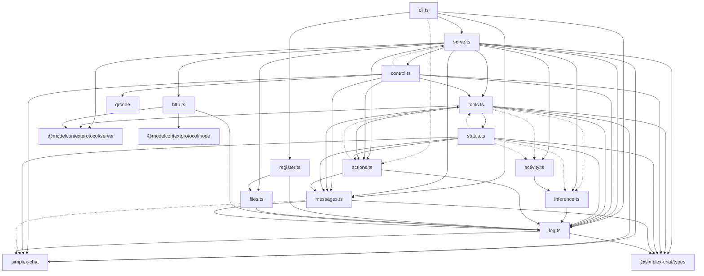

# SimpleX MCP server: specification

> Technical specification of `@simplex-chat/mcp` 0.3.0 in `packages/simplex-chat-mcp`. Statements are checked against the source of version 0.3.0, and each section links to the code.
>
> Related: [README](../README.md) (user manual) | [PLAN](../PLAN.md) (design record) | [TESTING](../TESTING.md) (local build and test)

## Table of contents

1. [Executive summary](#executive-summary)
2. [Dependency graph](#dependency-graph)
3. [Specification documents](#specification-documents)
4. [Source entry points](#source-entry-points)

---

## Executive summary

`@simplex-chat/mcp` is a local server that gives an MCP host one SimpleX profile per process. The host reaches it with Streamable HTTP on `127.0.0.1` and a bearer token. The server exposes six tools: `connect`, `send`, `receive`, `download`, `list` and `leave`.

The SimpleX core (libsimplex, release `core-7.1.0.20`) runs inside the same Node.js process, loaded by the `simplex-chat` library 7.1.0-beta.10.2. The core keeps the profile, chats and connections in two SQLite databases of the data folder, and sends and receives files through XFTP servers. The MCP protocol is served by the MCP TypeScript SDK (`@modelcontextprotocol/server` 2.3.1 and `@modelcontextprotocol/node` 2.1.1).

`connect`, `send`, `download` and `leave` are actions. In mode `requests` the server posts each action as a card in the agent control chat, a SimpleX group created and owned by the agent's profile. An owner approves or rejects the card with a command in that chat, and the server performs the action after the approval. An owner can also approve all messages to one chat, or all downloads of files on known servers from one chat, in advance. On a download card, the owner lets the agent receive the file, or has it forwarded only to the owner. In mode `host` the server performs actions at once and marks the four tools for the host's own confirmation.

A tool call is held open by the server until the owner decides and, for `connect` and `send`, until the replies arrive, and for `download`, until the file is received or `wait` passes. A repeated call with the same arguments is attached to the same action, so a call that the host ends early is resumed.

With `typing: true` on `receive`, the server starts a status message in the chat when the call returns messages: one live message, edited while the agent works and deleted after the agent's next message there is sent. Status messages are shown in chats with people, groups and business chats that have a standing approval of messages, in mode `requests`. With `live: true` on `send`, the text is shown at once under the status line, and the result is status `live`, without an action; each such note is printed in the terminal. With `--inference URL`, the server polls llama-swap or llama-server at URL, and the model loading, the prompt tokens read and the tokens per second are shown in the status line.

`register` also adds status hooks to the Claude Code settings file of its scope. Claude Code then runs curl at each hook event, and curl posts the event to `/hook` of the server with the token. For the sessions that called a tool of this server, the Claude Code tool, permission prompt, subagent or compaction in progress is shown in the status line.

The server keeps actions and downloads in memory, and they are lost when the process exits. The action counter and the standing approvals are stored as custom data in the chat database. The token, the headers files for the host and its hooks, the server record and the lock are files in the data folder; downloaded files are in its `files` folder, one folder per chat.

---

## Dependency graph

Solid edges are runtime imports. Dotted edges are type-only imports, removed by the compiler.

| Module | Role |
|---|---|
| [`cli.ts`](../src/cli.ts) | `simplex-mcp` entry point: commands, options, exit codes |
| [`serve.ts`](../src/serve.ts) | start sequence, event dispatch, stop sequence |
| [`http.ts`](../src/http.ts) | HTTP listener, token check, `/mcp` route, SDK handler, `/hook` route |
| [`tools.ts`](../src/tools.ts) | tool schemas, descriptions, handlers, connect plans, perform steps, downloads, files to send, status message refusals |
| [`status.ts`](../src/status.ts) | status messages: start, ticks, labels, notes, deletion, leftovers, running calls |
| [`inference.ts`](../src/inference.ts) | inference endpoint poller: model states, prompt tokens, tokens per second |
| [`activity.ts`](../src/activity.ts) | Claude Code activity from hook events: agent sessions, running tools, subagents, permission prompts, compaction |
| [`actions.ts`](../src/actions.ts) | action records, state machine, expiry, stop |
| [`control.ts`](../src/control.ts) | agent control chat: link, owners, owner commands, cards, counter |
| [`messages.ts`](../src/messages.ts) | message items and their files, item watch, waits, unread paging, display names |
| [`files.ts`](../src/files.ts) | data folder, lock, token, `headers.json`, `hook-headers`, `server.json` |
| [`register.ts`](../src/register.ts) | `register` command: Claude Code entry, status hooks |
| [`log.ts`](../src/log.ts) | terminal lines, error texts, shell quoting |

---

## Specification documents

| Document | Contents |
|---|---|
| [Architecture](architecture.md) | system diagram, modules and types, state, process lifecycle, approval model, security boundaries, limits |
| [Flows](flows.md) | sequence diagrams of the main flows with source locations |
| [API](api.md) | the six tools, the status message, the control chat commands, replies and cards, the CLI, the hook endpoint |

---

## Source entry points

| Component | File | Key symbol | Line |
|---|---|---|---|
| Binary `simplex-mcp` | [`src/cli.ts`](../src/cli.ts#L214) | `main` | [214](../src/cli.ts#L214) |
| Argument parser | [`src/cli.ts`](../src/cli.ts#L49) | `parseCommand` | [49](../src/cli.ts#L49) |
| Server start | [`src/serve.ts`](../src/serve.ts#L68) | `startServer` | [68](../src/serve.ts#L68) |
| Agent wiring and event dispatch | [`src/serve.ts`](../src/serve.ts#L93) | `startAgent` | [93](../src/serve.ts#L93) |
| HTTP listener | [`src/http.ts`](../src/http.ts#L18) | `startHttp` | [18](../src/http.ts#L18) |
| Hook endpoint | [`src/http.ts`](../src/http.ts#L63) | `receiveHook` | [63](../src/http.ts#L63) |
| Tool registration | [`src/tools.ts`](../src/tools.ts#L504) | `AgentTools.register` | [504](../src/tools.ts#L504) |
| Downloads | [`src/tools.ts`](../src/tools.ts#L541) | `AgentTools.downloadFile` | [541](../src/tools.ts#L541) |
| Status messages | [`src/status.ts`](../src/status.ts#L31) | `Statuses` | [31](../src/status.ts#L31) |
| Inference endpoint | [`src/inference.ts`](../src/inference.ts#L31) | `inferencePoller` | [31](../src/inference.ts#L31) |
| Claude Code activity | [`src/activity.ts`](../src/activity.ts#L24) | `Activity` | [24](../src/activity.ts#L24) |
| Action store | [`src/actions.ts`](../src/actions.ts#L124) | `Actions` | [124](../src/actions.ts#L124) |
| Agent control chat | [`src/control.ts`](../src/control.ts#L81) | `Control` | [81](../src/control.ts#L81) |
| Card text | [`src/control.ts`](../src/control.ts#L552) | `cardText` | [552](../src/control.ts#L552) |
| Item watch | [`src/messages.ts`](../src/messages.ts#L86) | `ChatItemsWatch` | [86](../src/messages.ts#L86) |
| Claude Code entry | [`src/register.ts`](../src/register.ts#L35) | `register` | [35](../src/register.ts#L35) |
| Status hooks | [`src/register.ts`](../src/register.ts#L63) | `statusHooks` | [63](../src/register.ts#L63) |
| Data folder files | [`src/files.ts`](../src/files.ts#L12) | `createDataFolder`, `acquireLock` | [12](../src/files.ts#L12) |
| Package manifest | [`package.json`](../package.json) | `bin.simplex-mcp` | [6](../package.json#L6) |
