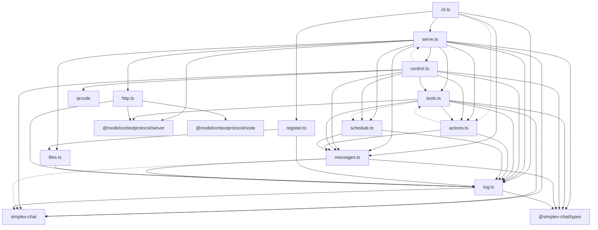

# SimpleX MCP server: specification

> Technical specification of `@simplex-chat/mcp` 0.2.0 in `packages/simplex-chat-mcp`. Statements are checked against the source, and each section links to the code.
>
> Related: [README](../README.md) (user manual) | [PLAN](../PLAN.md) (design record) | [TESTING](../TESTING.md) (local build and test)

## Table of contents

1. [Executive summary](#executive-summary)
2. [Dependency graph](#dependency-graph)
3. [Specification documents](#specification-documents)
4. [Source entry points](#source-entry-points)

---

## Executive summary

`@simplex-chat/mcp` is a local server that gives an MCP host one SimpleX profile per process. The host reaches it with Streamable HTTP on `127.0.0.1` and a bearer token. The server exposes six tools: `connect`, `send`, `receive`, `download`, `list` and `leave`.

The SimpleX core (libsimplex, release `core-7.1.0.20`) runs inside the same Node.js process, loaded by the `simplex-chat` library 7.1.0-beta.10.2. The core keeps the profile, chats and connections in two SQLite databases of the data folder, and sends and receives files through XFTP servers. The MCP protocol is served by the MCP TypeScript SDK (`@modelcontextprotocol/server` 2.3.1 and `@modelcontextprotocol/node` 2.1.1).

`connect`, `send`, `download` and `leave` are actions. In mode `requests` the server posts each action as a card in the agent control chat, a SimpleX group created and owned by the agent's profile. An owner approves or rejects the card with a command in that chat, and the server performs the action after the approval. An owner can also approve all messages to one chat, or all downloads of files on known servers from one chat, in advance. On a download card, the owner lets the agent receive the file, or has it forwarded only to the owner. In mode `host` the server performs actions at once and marks the four tools for the host's own confirmation.

A tool call is held open by the server until the owner decides and, for `connect` and `send`, until the replies arrive, and for `download`, until the file is received or `wait` passes. A repeated call with the same arguments is attached to the same action, so a call that the host ends early is resumed.

An owner can also schedule prompts for a chat with `/schedule CHAT CRON PROMPT` in the agent control chat. At each minute that the cron expression matches in the server's local time, the prompt becomes due; it is returned by the next `receive` of that chat in the field `scheduled`, and a waiting `receive` of that chat ends at once. A schedule applies only while its author is an approver.

The server keeps actions, downloads and due scheduled prompts in memory, and they are lost when the process exits. The action counter, the standing approvals and the schedules are stored as custom data in the chat database. The token, the headers file for the host, the server record and the lock are files in the data folder; downloaded files are in its `files` folder, one folder per chat.

---

## Dependency graph

Solid edges are runtime imports. Dotted edges are type-only imports, removed by the compiler.

| Module | Role |
|---|---|
| [`cli.ts`](../src/cli.ts) | `simplex-mcp` entry point: commands, options, exit codes |
| [`serve.ts`](../src/serve.ts) | start sequence, event dispatch, stop sequence |
| [`http.ts`](../src/http.ts) | HTTP listener, token check, `/mcp` route, SDK handler |
| [`tools.ts`](../src/tools.ts) | tool schemas, descriptions, handlers, connect plans, perform steps, downloads, files to send |
| [`actions.ts`](../src/actions.ts) | action records, state machine, expiry, stop |
| [`control.ts`](../src/control.ts) | agent control chat: link, owners, owner commands, cards, counter, schedule storage |
| [`schedule.ts`](../src/schedule.ts) | scheduled prompts: cron check and matching, minute timer, due prompts per chat |
| [`messages.ts`](../src/messages.ts) | message items and their files, item watch, waits, unread paging, display names |
| [`files.ts`](../src/files.ts) | data folder, lock, token, `headers.json`, `server.json` |
| [`register.ts`](../src/register.ts) | `register` command: Claude Code entry |
| [`log.ts`](../src/log.ts) | terminal lines, error texts, shell quoting |

---

## Specification documents

| Document | Contents |
|---|---|
| [Architecture](architecture.md) | system diagram, modules and types, state, process lifecycle, approval model, security boundaries, limits |
| [Flows](flows.md) | sequence diagrams of the main flows with source locations |
| [API](api.md) | the six tools, the control chat commands, replies and cards, the CLI |

---

## Source entry points

| Component | File | Key symbol | Line |
|---|---|---|---|
| Binary `simplex-mcp` | [`src/cli.ts`](../src/cli.ts#L198) | `main` | [198](../src/cli.ts#L198) |
| Argument parser | [`src/cli.ts`](../src/cli.ts#L45) | `parseCommand` | [45](../src/cli.ts#L45) |
| Server start | [`src/serve.ts`](../src/serve.ts#L66) | `startServer` | [66](../src/serve.ts#L66) |
| Agent wiring and event dispatch | [`src/serve.ts`](../src/serve.ts#L89) | `startAgent` | [89](../src/serve.ts#L89) |
| HTTP listener | [`src/http.ts`](../src/http.ts#L14) | `startHttp` | [14](../src/http.ts#L14) |
| Tool registration | [`src/tools.ts`](../src/tools.ts#L496) | `AgentTools.register` | [496](../src/tools.ts#L496) |
| Downloads | [`src/tools.ts`](../src/tools.ts#L530) | `AgentTools.downloadFile` | [530](../src/tools.ts#L530) |
| Action store | [`src/actions.ts`](../src/actions.ts#L124) | `Actions` | [124](../src/actions.ts#L124) |
| Agent control chat | [`src/control.ts`](../src/control.ts#L153) | `Control` | [153](../src/control.ts#L153) |
| Card text | [`src/control.ts`](../src/control.ts#L672) | `cardText` | [672](../src/control.ts#L672) |
| Scheduled prompts | [`src/schedule.ts`](../src/schedule.ts#L12) | `Schedules` | [12](../src/schedule.ts#L12) |
| Item watch | [`src/messages.ts`](../src/messages.ts#L86) | `ChatItemsWatch` | [86](../src/messages.ts#L86) |
| Claude Code entry | [`src/register.ts`](../src/register.ts#L33) | `register` | [33](../src/register.ts#L33) |
| Data folder files | [`src/files.ts`](../src/files.ts#L12) | `createDataFolder`, `acquireLock` | [12](../src/files.ts#L12) |
| Package manifest | [`package.json`](../package.json) | `bin.simplex-mcp` | [6](../package.json#L6) |
