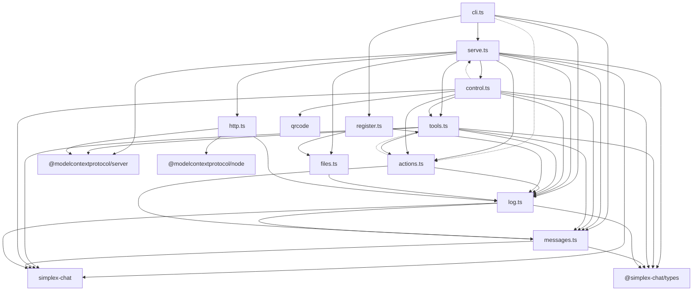

# SimpleX MCP server: specification

> Technical specification of `@simplex-chat/mcp` 0.1.0 in `packages/simplex-chat-mcp`. Statements are checked against the source at commit `a83005bc4` with the uncommitted source changes of 2026-10-18 20:05 UTC (app error texts in `log.ts`, `fullDomainName` in `messages.ts`), and each section links to the code.
>
> Related: [README](../README.md) (user manual) | [PLAN](../PLAN.md) (design record) | [TESTING](../TESTING.md) (local build and test)

## Table of contents

1. [Executive summary](#executive-summary)
2. [Dependency graph](#dependency-graph)
3. [Specification documents](#specification-documents)
4. [Source entry points](#source-entry-points)

---

## Executive summary

`@simplex-chat/mcp` is a local server that gives an MCP host one SimpleX profile per process. The host reaches it with Streamable HTTP on `127.0.0.1` and a bearer token. The server exposes five tools: `connect`, `send`, `receive`, `list` and `leave`.

The SimpleX core (libsimplex, release `core-7.1.0.12`) runs inside the same Node.js process, loaded by the `simplex-chat` library. The core keeps the profile, chats and connections in two SQLite databases of the data folder. The MCP protocol is served by the MCP TypeScript SDK (`@modelcontextprotocol/server` 2.3.1 and `@modelcontextprotocol/node` 2.1.1).

`connect`, `send` and `leave` are actions. In mode `requests` the server posts each action as a card in the agent control chat, a SimpleX group created and owned by the agent's profile. An owner approves or rejects the card with a command in that chat, and the server performs the action after the approval. An owner can also approve all messages to one chat in advance. In mode `host` the server performs actions at once and marks the three tools for the host's own confirmation.

A tool call is held open by the server until the owner decides and, for `connect` and `send`, until the replies arrive. A repeated call with the same arguments is attached to the same action, so a call that the host ends early is resumed.

The server keeps actions in memory, and they are lost when the process exits. The action counter and the standing approvals are stored as custom data in the chat database. The token, the headers file for the host, the server record and the lock are files in the data folder.

---

## Dependency graph

Solid edges are runtime imports. Dotted edges are type-only imports, removed by the compiler.

| Module | Role |
|---|---|
| [`cli.ts`](../src/cli.ts) | `simplex-mcp` entry point: commands, options, exit codes |
| [`serve.ts`](../src/serve.ts) | start sequence, event dispatch, stop sequence |
| [`http.ts`](../src/http.ts) | HTTP listener, token check, `/mcp` route, SDK handler |
| [`tools.ts`](../src/tools.ts) | tool schemas, descriptions, handlers, connect plans, perform steps |
| [`actions.ts`](../src/actions.ts) | action records, state machine, expiry, stop |
| [`control.ts`](../src/control.ts) | agent control chat: link, owners, owner commands, cards, counter |
| [`messages.ts`](../src/messages.ts) | message items, item watch, waits, unread paging, display names |
| [`files.ts`](../src/files.ts) | data folder, lock, token, `headers.json`, `server.json` |
| [`register.ts`](../src/register.ts) | `register` command: Claude Code entry |
| [`log.ts`](../src/log.ts) | terminal lines, error texts, shell quoting |

---

## Specification documents

| Document | Contents |
|---|---|
| [Architecture](architecture.md) | system diagram, modules and types, state, process lifecycle, approval model, security boundaries, limits |
| [Flows](flows.md) | sequence diagrams of the main flows with source locations |
| [API](api.md) | the five tools, the control chat commands, replies and cards, the CLI |

---

## Source entry points

| Component | File | Key symbol | Line |
|---|---|---|---|
| Binary `simplex-mcp` | [`src/cli.ts`](../src/cli.ts#L191) | `main` | [191](../src/cli.ts#L191) |
| Argument parser | [`src/cli.ts`](../src/cli.ts#L42) | `parseCommand` | [42](../src/cli.ts#L42) |
| Server start | [`src/serve.ts`](../src/serve.ts#L64) | `startServer` | [64](../src/serve.ts#L64) |
| Agent wiring and event dispatch | [`src/serve.ts`](../src/serve.ts#L87) | `startAgent` | [87](../src/serve.ts#L87) |
| HTTP listener | [`src/http.ts`](../src/http.ts#L13) | `startHttp` | [13](../src/http.ts#L13) |
| Tool registration | [`src/tools.ts`](../src/tools.ts#L355) | `AgentTools.register` | [355](../src/tools.ts#L355) |
| Action store | [`src/actions.ts`](../src/actions.ts#L93) | `Actions` | [93](../src/actions.ts#L93) |
| Agent control chat | [`src/control.ts`](../src/control.ts#L67) | `Control` | [67](../src/control.ts#L67) |
| Card text | [`src/control.ts`](../src/control.ts#L417) | `cardText` | [417](../src/control.ts#L417) |
| Item watch | [`src/messages.ts`](../src/messages.ts#L58) | `ChatItemsWatch` | [58](../src/messages.ts#L58) |
| Claude Code entry | [`src/register.ts`](../src/register.ts#L30) | `register` | [30](../src/register.ts#L30) |
| Data folder files | [`src/files.ts`](../src/files.ts#L12) | `createDataFolder`, `acquireLock` | [12](../src/files.ts#L12) |
| Package manifest | [`package.json`](../package.json) | `bin.simplex-mcp` | [6](../package.json#L6) |
