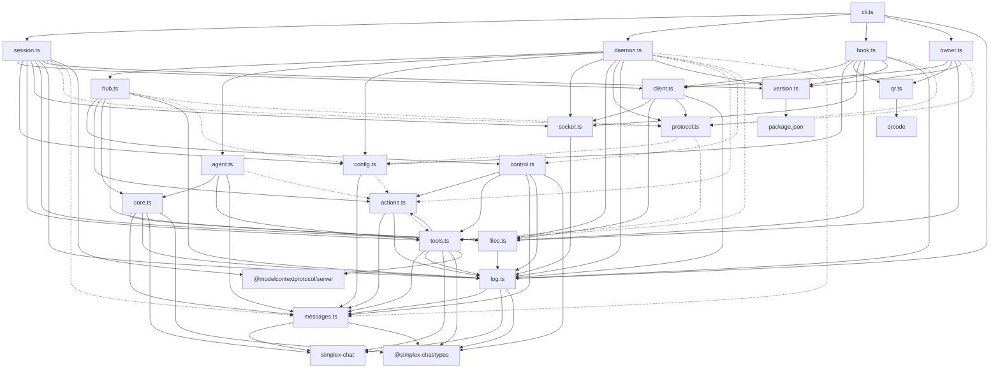

# SimpleX MCP server: specification

> Technical specification of `@simplex-chat/mcp` 0.2.0 in `packages/simplex-chat-mcp`. Statements are checked against the source at commit `334676ebf`, and each section links to the code.
>
> Related: [README](../README.md) (user manual) | [REFERENCE](../REFERENCE.md) (options, owner commands, files, recovery) | [PLAN](../PLAN.md) (design record) | [TESTING](../TESTING.md) (local build and test)

## Table of contents

1. [Executive summary](#executive-summary)
2. [Dependency graph](#dependency-graph)
3. [Specification documents](#specification-documents)
4. [Source entry points](#source-entry-points)

---

## Executive summary

`@simplex-chat/mcp` is a Claude Code plugin. Each Claude Code session runs `simplex-mcp session`, a stdio MCP server, which forwards tool calls over a local socket to one daemon, `simplex-mcp daemon`. The daemon gives every Claude Code session ID its own SimpleX profile and serves five tools to it: `connect`, `send`, `receive`, `list` and `leave`.

The daemon runs one SimpleX core (libsimplex, loaded by the `simplex-chat` library) per profile in one Node.js process: the hub core, whose profile owns the Main group, and one session core per session, each with its own two SQLite databases in its own folder. The socket carries HTTP/1.1 with a bearer token. The MCP protocol is served by the MCP TypeScript SDK (`@modelcontextprotocol/server` 2.3.1, stdio transport) in the session process.

`connect`, `send` and `leave` are actions. In mode `requests` the daemon posts each action as a card in the Main group, a SimpleX group created and owned by the hub profile; each card names its session. An owner approves or rejects the card with a command in that group, and the daemon performs the action in the session's core after the approval. An owner can also approve all messages of one session to one chat in advance. In mode `host` the daemon performs actions at once, and the session server marks the three tools for Claude Code's own confirmation.

A tool call is held open until the owner decides and, for `connect` and `send`, until the replies arrive. A repeated call with the same arguments is attached to the same action, so a call that the host ends early is resumed.

The daemon keeps actions in memory, and they are lost when it exits. The action counter is stored as custom data of the Main group, and the standing approvals as custom data of the approved chats. The token, the lock, the log and each session's number and name are files in the data folder. Options come from the plugin's `userConfig` through environment variables; the SessionStart hook starts the daemon, records the session title and shows the Main group link, and the session process creates the session's profile.

---

## Dependency graph

Solid edges are runtime imports. Dotted edges are type-only imports, removed by the compiler. Node.js built-in modules and type-only imports of packages are left out.

| Module | Role |
|---|---|
| [`cli.ts`](../src/cli.ts) | `simplex-mcp` entry point: commands, exit codes |
| [`session.ts`](../src/session.ts) | `session`: stdio MCP server of one Claude Code session; forwards tool calls to the daemon |
| [`client.ts`](../src/client.ts) | daemon client: status, version check, spawn, requests and streams |
| [`socket.ts`](../src/socket.ts) | HTTP over the local socket: listener with token check, JSON and NDJSON client |
| [`protocol.ts`](../src/protocol.ts) | request and reply types of the socket routes, protocol version |
| [`daemon.ts`](../src/daemon.ts) | `daemon`: routes, session registry, attach, idle close and stop, ready line |
| [`hub.ts`](../src/hub.ts) | hub profile: its core, the Main group, `Control` and `Actions`, live options |
| [`agent.ts`](../src/agent.ts) | session profile: its core, `AgentTools`, event dispatch, profile name |
| [`core.ts`](../src/core.ts) | one SimpleX core: init, user, network config, event buffer, profile update, delivery wait |
| [`tools.ts`](../src/tools.ts) | tool schemas, descriptions, registration, handlers, connect plans, perform steps |
| [`actions.ts`](../src/actions.ts) | action records, state machine, per-session limits, expiry, stop |
| [`control.ts`](../src/control.ts) | Main group: link, owners, owner commands with session references, cards, counter |
| [`messages.ts`](../src/messages.ts) | message items, item watch, waits, unread paging, display names |
| [`hook.ts`](../src/hook.ts) | `hook session-start`: Node.js check, daemon start, session title, link output |
| [`owner.ts`](../src/owner.ts) | `link` and `reset-owners` |
| [`config.ts`](../src/config.ts) | plugin option variables to `Config`, validation |
| [`files.ts`](../src/files.ts) | data root layout, lock, token, session folders and `session.json`, socket path, log file |
| [`qr.ts`](../src/qr.ts) | QR code text: `ansi` for terminals, `plain` for the hook message |
| [`log.ts`](../src/log.ts) | log lines, error texts, `ExitError` |
| [`version.ts`](../src/version.ts) | package version from `package.json` |

Plugin files, run by Claude Code without `node_modules`:

| File | Role |
|---|---|
| [`.claude-plugin/plugin.json`](../.claude-plugin/plugin.json) | plugin `simplex`, version, `userConfig` |
| [`.mcp.json`](../.mcp.json) | MCP server `simplex`: `node plugin/launch.js session`, tool call timeout, options as environment variables |
| [`hooks/hooks.json`](../hooks/hooks.json) | SessionStart: `launch.js hook session-start`; PreToolUse: `allow.js` |
| [`plugin/launch.js`](../plugin/launch.js) | `npx -y @simplex-chat/mcp@<version> ARGS`, signals forwarded, exit code passed on |
| [`plugin/allow.js`](../plugin/allow.js) | PreToolUse allow decision |
| [`skills/link/SKILL.md`](../skills/link/SKILL.md), [`skills/reset-owners/SKILL.md`](../skills/reset-owners/SKILL.md) | `/simplex:link`, `/simplex:reset-owners` |
| [`/.claude-plugin/marketplace.json`](../../../.claude-plugin/marketplace.json) | marketplace `simplex-chat`, plugin source npm `@simplex-chat/mcp` |

---

## Specification documents

| Document | Contents |
|---|---|
| [Architecture](architecture.md) | system diagram, modules and types, state, process lifecycle, approval model, security boundaries, limits |
| [Flows](flows.md) | sequence diagrams of the main flows with source locations |
| [API](api.md) | the five tools, the Main group commands, replies and cards, the socket protocol, the CLI and the plugin |

---

## Source entry points

| Component | File | Key symbol | Line |
|---|---|---|---|
| Binary `simplex-mcp` | [`src/cli.ts`](../src/cli.ts#L40) | `main` | [40](../src/cli.ts#L40) |
| Command parser | [`src/cli.ts`](../src/cli.ts#L34) | `parseCommand` | [34](../src/cli.ts#L34) |
| Session server | [`src/session.ts`](../src/session.ts#L34) | `startSession` | [34](../src/session.ts#L34) |
| Session to daemon link | [`src/session.ts`](../src/session.ts#L55) | `DaemonLink` | [55](../src/session.ts#L55) |
| Daemon start by a client | [`src/client.ts`](../src/client.ts#L32) | `DaemonClient.ensureDaemon` | [32](../src/client.ts#L32) |
| Daemon spawn | [`src/client.ts`](../src/client.ts#L68) | `spawnDaemon` | [68](../src/client.ts#L68) |
| Socket listener | [`src/socket.ts`](../src/socket.ts#L18) | `listen` | [18](../src/socket.ts#L18) |
| Daemon process | [`src/daemon.ts`](../src/daemon.ts#L341) | `runDaemon` | [341](../src/daemon.ts#L341) |
| Daemon routes | [`src/daemon.ts`](../src/daemon.ts#L103) | `Daemon.routes` | [103](../src/daemon.ts#L103) |
| Hub and Main group | [`src/hub.ts`](../src/hub.ts#L26) | `Hub.open` | [26](../src/hub.ts#L26) |
| Session profile | [`src/agent.ts`](../src/agent.ts#L39) | `openSessionAgent` | [39](../src/agent.ts#L39) |
| SimpleX core | [`src/core.ts`](../src/core.ts#L21) | `openCore` | [21](../src/core.ts#L21) |
| SessionStart hook | [`src/hook.ts`](../src/hook.ts#L28) | `sessionStart` | [28](../src/hook.ts#L28) |
| `link`, `reset-owners` | [`src/owner.ts`](../src/owner.ts#L17) | `showLink`, `resetOwners` | [17](../src/owner.ts#L17), [21](../src/owner.ts#L21) |
| Options | [`src/config.ts`](../src/config.ts#L25) | `readConfig` | [25](../src/config.ts#L25) |
| Tool registration | [`src/tools.ts`](../src/tools.ts#L354) | `registerTools` | [354](../src/tools.ts#L354) |
| Tool handlers | [`src/tools.ts`](../src/tools.ts#L366) | `AgentTools` | [366](../src/tools.ts#L366) |
| Action store | [`src/actions.ts`](../src/actions.ts#L95) | `Actions` | [95](../src/actions.ts#L95) |
| Main group | [`src/control.ts`](../src/control.ts#L65) | `Control` | [65](../src/control.ts#L65) |
| Card text | [`src/control.ts`](../src/control.ts#L381) | `cardText` | [381](../src/control.ts#L381) |
| Item watch | [`src/messages.ts`](../src/messages.ts#L58) | `ChatItemsWatch` | [58](../src/messages.ts#L58) |
| Data folder | [`src/files.ts`](../src/files.ts#L21) | `dataRoot`, `socketPath` | [21](../src/files.ts#L21), [57](../src/files.ts#L57) |
| Package manifest | [`package.json`](../package.json#L6) | `bin.simplex-mcp` | [6](../package.json#L6) |
