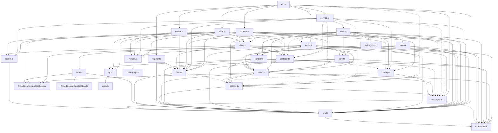

# SimpleX MCP server: specification

> Technical specification of `@simplex-chat/mcp` 0.3.0 in `packages/simplex-chat-mcp`: `simplex-mcp serve` and the Claude Code plugin. Statements are checked against the source of the same commit, and each section links to the code.
>
> Related: [README](../README.md) (the plugin's installation and use) | [REFERENCE](../REFERENCE.md) (`serve` and `register`, shared settings, options, commands, files, recovery) | [PLAN](../PLAN.md) (design record of `serve`) | [TESTING](../TESTING.md) (local build and test)

## Table of contents

1. [Executive summary](#executive-summary)
2. [Dependency graph](#dependency-graph)
3. [Specification documents](#specification-documents)
4. [Source entry points](#source-entry-points)

---

## Executive summary

`@simplex-chat/mcp` is a local server that gives an MCP host one SimpleX profile per process. The host reaches it with Streamable HTTP on `127.0.0.1` and a bearer token. The server exposes six tools: `connect`, `send`, `receive`, `download`, `list` and `leave`.

The SimpleX core (libsimplex, release `core-7.1.0.20`) runs inside the same Node.js process, loaded by the `simplex-chat` library 7.1.0-beta.10.2. The core keeps the profile, chats and connections in two SQLite databases of the data folder, and sends and receives files through XFTP servers. The MCP protocol is served by the MCP TypeScript SDK (`@modelcontextprotocol/server` 2.3.1 and `@modelcontextprotocol/node` 2.1.1).

`connect`, `send`, `download` and `leave` are actions. In mode `requests` the server posts each action as a card in the agent control chat, a SimpleX group created and owned by the agent's profile. An owner approves or rejects the card with a command in that chat, and the server performs the action after the approval. An owner can also approve all messages to one chat, or all downloads of files on known servers from one chat, in advance. On a download card, the owner lets the agent receive the file, or has it forwarded only to the owner. In mode `host` the server performs actions at once and marks the four tools for the host's own confirmation.

A tool call is held open by the server until the owner decides and, for `connect` and `send`, until the replies arrive, and for `download`, until the file is received or `wait` passes. A repeated call with the same arguments is attached to the same action, so a call that the host ends early is resumed.

The server keeps actions and downloads in memory, and they are lost when the process exits. The action counter and the standing approvals are stored as custom data in the chat database. The token, the headers file for the host, the server record and the lock are files in the data folder; downloaded files are in its `files` folder, one folder per chat.

The package is also a Claude Code plugin. Each Claude Code session runs `simplex-mcp session`, a stdio MCP server, which forwards tool calls over a local socket to one service per data root, `simplex-mcp service`. The socket carries HTTP/1.1 with a bearer token. The service runs two cores: `Claude`, the profile peers see, which holds the Main group, one group per session and the chats with peers; and `User`, a member of every session group, which posts the prompts typed in the terminal.

Each session has the six tools and `reply`, its own `Actions` and `Control` in its group, and its own chats: a chat belongs to the session that connected it, and owners move it with `/give`. Every member of the Main group is trusted with all sessions: owners are invited to each session group through the Main group as owners, and every member joins one through it by `/join N` as an admin. Rights in a session group follow the member's role there, whatever way they joined: admins and owners prompt, approve and send the group's `/` commands; moderators, members and authors prompt, and each of their `/` commands gets one refusal; Claude posts the member's rights at each join and role change, and members with the role admin or owner make others observers by `/observer #G ID`. Claude's files of `reply` reach a session group at once, under the group's preference for files and media, which the core enforces. The session server is also a Claude Code channel: a message of a member other than `User` in the session group, except a one-line `/` text, reaches the running session as a prompt, from which Claude Code runs no command, and Claude Code's permission prompts are posted there as cards. The plugin's hooks post the terminal prompts and the final answer of each turn in the group, and keep the model and effort level in its short description.

---

## Dependency graph

Solid edges are runtime imports. Dotted edges are type-only imports, removed by the compiler. Node.js built-in modules are left out.

| Module | Role |
|---|---|
| [`cli.ts`](../src/cli.ts) | `simplex-mcp` entry point: commands, options, exit codes |
| [`serve.ts`](../src/serve.ts) | `serve`: start sequence, event dispatch, stop sequence |
| [`http.ts`](../src/http.ts) | `serve`: HTTP listener, token check, `/mcp` route, SDK handler |
| [`register.ts`](../src/register.ts) | `register` command: Claude Code entry of a `serve` agent |
| [`tools.ts`](../src/tools.ts) | tool schemas, descriptions, handlers, connect plans, perform steps, downloads, files to send, chat owners |
| [`actions.ts`](../src/actions.ts) | action records, state machine, expiry timers, per-session limits, stop |
| [`control.ts`](../src/control.ts) | agent control chat and session groups: link, owners, owner commands, cards, counter |
| [`messages.ts`](../src/messages.ts) | message items and their files, item watch, waits, unread paging, display names |
| [`core.ts`](../src/core.ts) | one SimpleX core: init, user, network config, temp folder, event buffer, profile update |
| [`files.ts`](../src/files.ts) | data folders, lock, token, `headers.json`, `server.json`, session folders, socket path, service log |
| [`log.ts`](../src/log.ts) | log lines, error texts, shell quoting |
| [`qr.ts`](../src/qr.ts) | QR code text: `small` and `large` for terminals, `plain` for the hook message |
| [`version.ts`](../src/version.ts) | package version from `package.json` |
| [`session.ts`](../src/session.ts) | plugin: stdio MCP server of one Claude Code session, its channel, the forward of calls to the service |
| [`client.ts`](../src/client.ts) | plugin: service client, version check, spawn |
| [`socket.ts`](../src/socket.ts) | plugin: HTTP over the local socket, token check, JSON and NDJSON |
| [`protocol.ts`](../src/protocol.ts) | plugin: request and reply types of the socket routes, protocol version |
| [`service.ts`](../src/service.ts) | plugin: routes, session registry, session IDs of one Claude Code process, attachments, idle close and stop, ready line |
| [`hub.ts`](../src/hub.ts) | plugin: the profile `Claude`, the sessions, their groups, prompts, answers and tool-use cards |
| [`main-group.ts`](../src/main-group.ts) | plugin: the Main group, its owners, `/sessions`, `/join`, owner reset |
| [`user.ts`](../src/user.ts) | plugin: the profile `User` |
| [`hook.ts`](../src/hook.ts) | plugin: `hook session-start` and `hook turn` |
| [`owner.ts`](../src/owner.ts) | plugin: `link` and `reset-owners` |
| [`config.ts`](../src/config.ts) | plugin: option variables to `Config`, validation |

Plugin files, run by Claude Code: [`.claude-plugin/plugin.json`](../.claude-plugin/plugin.json), [`.mcp.json`](../.mcp.json), [`hooks/hooks.json`](../hooks/hooks.json), [`plugin/allow.js`](../plugin/allow.js), the production packages bundled in the package's `node_modules` ([`package.json`](../package.json#L35)), and the marketplace [`/.claude-plugin/marketplace.json`](../../../.claude-plugin/marketplace.json); see [API 4.8](api.md#48-plugin-options-files-and-hook-output).

---

## Specification documents

| Document | Contents |
|---|---|
| [Architecture](architecture.md) | system diagram, modules and types, state, process lifecycle, approval model, security boundaries, limits; the plugin in section 8 |
| [Flows](flows.md) | sequence diagrams of the main flows with source locations; the plugin in flows 17-30 |
| [API](api.md) | the six tools, the control chat commands, replies and cards, the CLI; the plugin's tools, groups, channel, socket protocol, commands and files in section 4 |

---

## Source entry points

| Component | File | Key symbol | Line |
|---|---|---|---|
| Binary `simplex-mcp` | [`src/cli.ts`](../src/cli.ts#L218) | `main` | [218](../src/cli.ts#L218) |
| Argument parser | [`src/cli.ts`](../src/cli.ts#L63) | `parseCommand` | [63](../src/cli.ts#L63) |
| Server start | [`src/serve.ts`](../src/serve.ts#L64) | `startServer` | [64](../src/serve.ts#L64) |
| Agent wiring and event dispatch | [`src/serve.ts`](../src/serve.ts#L87) | `startAgent` | [87](../src/serve.ts#L87) |
| HTTP listener | [`src/http.ts`](../src/http.ts#L14) | `startHttp` | [14](../src/http.ts#L14) |
| Tool registration | [`src/tools.ts`](../src/tools.ts#L498) | `registerTools` | [498](../src/tools.ts#L498) |
| Downloads | [`src/tools.ts`](../src/tools.ts#L587) | `AgentTools.downloadFile` | [587](../src/tools.ts#L587) |
| Action store | [`src/actions.ts`](../src/actions.ts#L147) | `Actions` | [147](../src/actions.ts#L147) |
| Agent control chat and session groups | [`src/control.ts`](../src/control.ts#L93) | `Control` | [93](../src/control.ts#L93) |
| Card text | [`src/control.ts`](../src/control.ts#L679) | `cardText` | [679](../src/control.ts#L679) |
| Item watch | [`src/messages.ts`](../src/messages.ts#L86) | `ChatItemsWatch` | [86](../src/messages.ts#L86) |
| Claude Code entry of `serve` | [`src/register.ts`](../src/register.ts#L33) | `register` | [33](../src/register.ts#L33) |
| Data folder files | [`src/files.ts`](../src/files.ts#L103) | `createDataFolder`, `acquireLock` | [103](../src/files.ts#L103), [108](../src/files.ts#L108) |
| Session server | [`src/session.ts`](../src/session.ts#L40) | `startSession` | [40](../src/session.ts#L40) |
| Session to service link | [`src/session.ts`](../src/session.ts#L69) | `ServiceLink` | [69](../src/session.ts#L69) |
| Service start by a client | [`src/client.ts`](../src/client.ts#L35) | `ServiceClient.ensureService` | [35](../src/client.ts#L35) |
| Service process | [`src/service.ts`](../src/service.ts#L430) | `runService` | [430](../src/service.ts#L430) |
| Service routes | [`src/service.ts`](../src/service.ts#L137) | `Service.routes` | [137](../src/service.ts#L137) |
| Hub | [`src/hub.ts`](../src/hub.ts#L358) | `Hub.open` | [358](../src/hub.ts#L358) |
| Session and its group | [`src/hub.ts`](../src/hub.ts#L43) | `Session` | [43](../src/hub.ts#L43) |
| Main group | [`src/main-group.ts`](../src/main-group.ts#L26) | `MainGroup` | [26](../src/main-group.ts#L26) |
| Profile `User` | [`src/user.ts`](../src/user.ts#L13) | `User` | [13](../src/user.ts#L13) |
| Hooks | [`src/hook.ts`](../src/hook.ts#L41) | `sessionStart`, `turn` | [41](../src/hook.ts#L41), [74](../src/hook.ts#L74) |
| `link`, `reset-owners` | [`src/owner.ts`](../src/owner.ts#L22) | `showLink`, `resetOwners` | [22](../src/owner.ts#L22), [28](../src/owner.ts#L28) |
| SimpleX core | [`src/core.ts`](../src/core.ts#L19) | `openCore` | [19](../src/core.ts#L19) |
| Package manifest | [`package.json`](../package.json) | `bin.simplex-mcp` | [6](../package.json#L6) |
