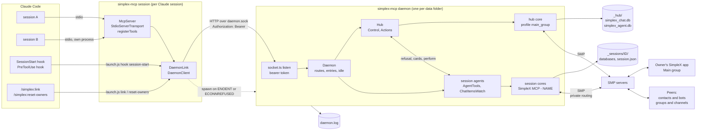

# SimpleX MCP server: architecture

> System structure, modules, state, process lifecycle, approval model and security boundaries of `@simplex-chat/mcp` 0.2.0.
>
> Related specs: [README](README.md) | [Flows](flows.md) | [API](api.md)
> Related docs: [README](../README.md) | [Reference](../REFERENCE.md) | [PLAN](../PLAN.md)

**Source:** [`cli.ts`](../src/cli.ts) | [`session.ts`](../src/session.ts) | [`client.ts`](../src/client.ts) | [`socket.ts`](../src/socket.ts) | [`protocol.ts`](../src/protocol.ts) | [`daemon.ts`](../src/daemon.ts) | [`hub.ts`](../src/hub.ts) | [`agent.ts`](../src/agent.ts) | [`core.ts`](../src/core.ts) | [`tools.ts`](../src/tools.ts) | [`actions.ts`](../src/actions.ts) | [`control.ts`](../src/control.ts) | [`messages.ts`](../src/messages.ts) | [`hook.ts`](../src/hook.ts) | [`owner.ts`](../src/owner.ts) | [`config.ts`](../src/config.ts) | [`files.ts`](../src/files.ts) | [`qr.ts`](../src/qr.ts) | [`log.ts`](../src/log.ts)

---

## Table of contents

1. [System diagram](#1-system-diagram)
2. [Modules](#2-modules)
3. [State](#3-state)
4. [Process lifecycle](#4-process-lifecycle)
5. [Approval model](#5-approval-model)
6. [Security boundaries](#6-security-boundaries)
7. [Limits](#7-limits)

---

## 1. System diagram



Data flow of a tool call:

1. Claude Code calls a tool of the MCP server `simplex` of the session; the SDK validates the arguments against the input schema ([`tools.ts:354-364`](../src/tools.ts#L354-L364), [`mcp-BumlNux0.cjs:1812-1817`](../node_modules/@modelcontextprotocol/server/dist/mcp-BumlNux0.cjs#L1812-L1817)).
2. The session process connects to the daemon when it has no connection: status and version check, spawn when not running, `POST /session`, then `POST /attach` held open ([`session.ts:123-140`](../src/session.ts#L123-L140), [`client.ts:32-44`](../src/client.ts#L32-L44)).
3. The session process sends `POST /call` with the session ID, the tool name and the input, relays each `{progress}` line as an MCP progress notification, and returns the `{result}` line ([`session.ts:94-113`](../src/session.ts#L94-L113)).
4. The daemon checks the token, finds or opens the session's agent, and runs `AgentTools.call` with an abort signal tied to the request ([`socket.ts:18-48`](../src/socket.ts#L18-L48), [`daemon.ts:223-240`](../src/daemon.ts#L223-L240)).
5. `AgentTools` sends chat commands to the session core; actions are created in the hub's `Actions` and shown to the owner by `Control` in the Main group ([`tools.ts:414-427`](../src/tools.ts#L414-L427), [`actions.ts:124-157`](../src/actions.ts#L124-L157)).
6. After an approval, `Actions` calls the daemon's `perform`, which runs the perform step in the action's session ([`daemon.ts:156-160`](../src/daemon.ts#L156-L160), [`tools.ts:378-387`](../src/tools.ts#L378-L387)).
7. Each core emits its events: the hub core to `Control`, a session core to its item watch and connect actions ([`hub.ts:92-104`](../src/hub.ts#L92-L104), [`agent.ts:44-57`](../src/agent.ts#L44-L57)).

---

## 2. Modules

### [2.1 `cli.ts`](../src/cli.ts)

| Symbol | Line | Contents |
|---|---|---|
| `helpText` | [8](../src/cli.ts#L8) | `--help` output |
| `Command`, `commands` | [23-32](../src/cli.ts#L23-L32) | `session`, `daemon`, `hook session-start`, `link`, `reset-owners`, `--help` |
| `parseCommand` | [34](../src/cli.ts#L34) | the joined arguments must equal one command; otherwise `ExitError` code 2 |
| `main` | [40](../src/cli.ts#L40) | dispatch; the hook reads stdin and prints its JSON output; `link` and `reset-owners` print their text |
| top-level catch | [67-76](../src/cli.ts#L67-L76) | `ExitError`: message on stderr, its code; other errors: `logError`, code 1 |

### [2.2 `session.ts`](../src/session.ts)

| Symbol | Line | Contents |
|---|---|---|
| `startSession` | [34](../src/session.ts#L34) | session ID check, options, `McpServer` with instructions, tools, stdio transport, background connect |
| `DaemonLink.connect`, `start` | [62-74](../src/session.ts#L62-L74) | one shared connect promise; `start` logs a failure on stderr |
| `DaemonLink.call` | [81](../src/session.ts#L81) | forward; one retry on status 409; failures to tool errors |
| `DaemonLink.forward` | [94](../src/session.ts#L94) | `/call` stream: progress lines, result line; a broken stream drops the connection |
| `DaemonLink.disconnect` | [116](../src/session.ts#L116) | drops the connection only when it is the current one |
| `DaemonLink.open` | [123](../src/session.ts#L123) | `ensureDaemon`, `/session`, `/attach` until its first line |
| `failureText` | [143](../src/session.ts#L143) | not running or status 503: `The SimpleX daemon stopped; repeat the call.` |

### [2.3 `client.ts`](../src/client.ts)

| Symbol | Line | Contents |
|---|---|---|
| `DaemonClient.forRoot` | [19](../src/client.ts#L19) | data folder, token, socket path |
| `DaemonClient.ensureDaemon` | [32](../src/client.ts#L32) | status; a lower daemon version is stopped; spawn when none runs; protocol check |
| `spawnDaemon` | [68](../src/client.ts#L68) | detached child with stdout and stderr to `daemon.log` and a ready pipe on fd 3 |
| `firstLine` | [91](../src/client.ts#L91) | first line of the ready pipe, spawn error, or the 5-minute timeout |
| `compareVersions` | [117](../src/client.ts#L117) | numeric comparison of the first three version parts |

### [2.4 `socket.ts`](../src/socket.ts)

| Symbol | Line | Contents |
|---|---|---|
| `SocketError` | [12](../src/socket.ts#L12) | message and HTTP status |
| `listen` | [18](../src/socket.ts#L18) | `http.Server` on the socket path: token check, route table, body read, error replies, timeouts |
| `sendJson`, `startLines` | [56-66](../src/socket.ts#L56-L66) | JSON reply; NDJSON stream |
| `isNotRunning` | [68](../src/socket.ts#L68) | `ENOENT` or `ECONNREFUSED` |
| `requestJson`, `streamLines` | [73-92](../src/socket.ts#L73-L92) | client request with a JSON reply; client request with NDJSON lines; status other than 200 to `SocketError` |
| `send` | [94](../src/socket.ts#L94) | `http.request` on the socket path, no connection pool, bearer header |

### [2.5 `protocol.ts`](../src/protocol.ts)

| Symbol | Line | Contents |
|---|---|---|
| `protocolVersion` | [5](../src/protocol.ts#L5) | `1` |
| `SessionRequest`, `TitleRequest`, `TitleReply`, `SessionReply` | [17-35](../src/protocol.ts#L17-L35) | `/session`, `/title` |
| `AttachRequest`, `CallRequest`, `CallLine` | [37-47](../src/protocol.ts#L37-L47) | `/attach`, `/call` |
| `StatusReply`, `ResetReply` | [49-57](../src/protocol.ts#L49-L57) | `/status`, `/reset-owners` |

### [2.6 `daemon.ts`](../src/daemon.ts)

| Symbol | Line | Contents |
|---|---|---|
| `HubLike`, `AgentLike`, `DaemonDeps` | [23-54](../src/daemon.ts#L23-L54) | interfaces the daemon uses; tests replace the cores |
| `Entry` | [56](../src/daemon.ts#L56) | opening promise, agent, open attaches, running calls, idle timer |
| `Daemon.start` | [79](../src/daemon.ts#L79) | lock, session numbers, hub, listener, stop timer |
| `Daemon.routes` | [103](../src/daemon.ts#L103) | the seven routes |
| `Daemon.shutdown` | [118](../src/daemon.ts#L118) | stop sequence |
| `Daemon.perform` | [156](../src/daemon.ts#L156) | perform step in the action's session |
| `onSession`, `onTitle`, `onAttach`, `onCall` | [162-240](../src/daemon.ts#L162-L240) | route handlers |
| `applyTitle`, `rename`, `rememberTitle`, `takeTitle` | [181-208](../src/daemon.ts#L181-L208) | title of an open, a stored or an unknown session; remembered titles, at most 100 |
| `Daemon.entry`, `refuseWhenStopping`, `folder`, `openAgent` | [253-298](../src/daemon.ts#L253-L298) | session registry; status 503 while stopping, 400 for an ID that is not a session ID; new session number and name |
| `scheduleIdle`, `closeAgent`, `scheduleStop` | [300-326](../src/daemon.ts#L300-L326) | idle close of a session, idle stop of the daemon |
| `runDaemon` | [334](../src/daemon.ts#L334) | process entry: data folder, start, ready line, signal handlers |
| `productionDeps` | [358](../src/daemon.ts#L358) | token, `Hub.open`, `openSessionAgent` |
| `readyChannel` | [375](../src/daemon.ts#L375) | ready line to fd `SIMPLEX_MCP_READY_FD`, or stdout |

### [2.7 `hub.ts`](../src/hub.ts)

| Symbol | Line | Contents |
|---|---|---|
| `Hub.open` | [26](../src/hub.ts#L26) | hub core, Main group found or created, `Actions`, `Control`, owner setup, events |
| `Hub.mainGroup`, `owner` | [50-57](../src/hub.ts#L50-L57) | hub profile name; owners and link |
| `Hub.configure` | [63](../src/hub.ts#L63) | live mode and expiry; rename of the Main group and the hub profile |
| `Hub.resetOwners` | [73](../src/hub.ts#L73) | `Control.reset`, serialized with Main group events |
| `Hub.stop` | [77](../src/hub.ts#L77) | actions stop, queued events, Main group deliveries, core close |
| `Hub.onEvent` | [92](../src/hub.ts#L92) | Main group messages and membership events |

`Actions` hooks are bound in [`hub.ts:31-37`](../src/hub.ts#L31-L37): `refusal`, `saveCounter`, `postCard` and `outcome` to `Control`; `perform` to the daemon.

### [2.8 `agent.ts`](../src/agent.ts)

| Symbol | Line | Contents |
|---|---|---|
| `sessionName` | [29](../src/agent.ts#L29) | session title, else the project folder name, else `Claude Code` |
| `profileName` | [35](../src/agent.ts#L35) | `validName("SimpleX MCP - " + name)` |
| `openSessionAgent` | [39](../src/agent.ts#L39) | session core, item watch, `AgentTools`, event dispatch, rename, close |

### [2.9 `core.ts`](../src/core.ts)

| Symbol | Line | Contents |
|---|---|---|
| `networkCommand` | [11](../src/core.ts#L11) | `/network socks=off smp-proxy=always smp-proxy-fallback=protected` |
| `openCore` | [21](../src/core.ts#L21) | `ChatApi.init` with prefix `FOLDER/simplex`, active user or a new one, network config, event buffer, `startChat`, profile update |
| `updatedUser` | [37](../src/core.ts#L37) | display name and peer type `agent` applied with one `apiUpdateProfile` when they differ |
| `deliveries` | [44](../src/core.ts#L44) | wait for pending deliveries to the members of one group |
| `bufferEvents` | [64](../src/core.ts#L64) | events received before the handler is installed are queued and replayed in order |

### [2.10 `tools.ts`](../src/tools.ts)

| Symbol | Line | Contents |
|---|---|---|
| `ConnectInput`, `SendInput`, `ReceiveInput`, `LeaveInput` | [31-57](../src/tools.ts#L31-L57) | tool inputs |
| `PlanSummary` | [63](../src/tools.ts#L63) | card kind, chat type, name, SimpleX name, peer type, description, welcome, commands, `takesMessage` |
| `ChatFields` | [75](../src/tools.ts#L75) | chat fields of `connect` and `list` results |
| `Agent` | [89](../src/tools.ts#L89) | session number, `ChatApi`, user, `Actions`, `ChatItemsWatch`, standing approver lookup |
| schemas | [119-299](../src/tools.ts#L119-L299) | input and output JSON schemas |
| descriptions, `instructions` | [301-332](../src/tools.ts#L301-L332) | tool descriptions and server instructions |
| `definitions` | [342](../src/tools.ts#L342) | name, description, schemas and action flag of the five tools |
| `registerTools` | [354](../src/tools.ts#L354) | `registerTool` for each definition on the session's `McpServer`; `_meta` in mode `host` |
| `AgentTools.call` | [369](../src/tools.ts#L369) | handler result to `CallToolResult`; errors to `isError` |
| `AgentTools.perform` | [378](../src/tools.ts#L378) | perform step of an approved action |
| `onContactConnected`, `onUserJoinedGroup` | [389-397](../src/tools.ts#L389-L397) | completion of connect actions by events |
| `actionResult` | [433](../src/tools.ts#L433) | wait for the decision, result fields, removal |
| `agentChats`, `knownChat` | [701-714](../src/tools.ts#L701-L714) | the session's chats; a checked chat reference |
| `classifyPlan` | [810](../src/tools.ts#L810) | `connectionPlan` response to a join plan or a known chat |
| `chatSubject`, `isConnected`, `isActive`, `memberCurrent` | [910-963](../src/tools.ts#L910-L963) | chat and member predicates shared with `control.ts` |
| `actionKey` | [987](../src/tools.ts#L987) | JSON of session number, tool and action fields |
| `toolCall` | [995](../src/tools.ts#L995) | `ServerContext` to `ToolCall`: abort signal and progress notifications |

### [2.11 `actions.ts`](../src/actions.ts)

| Symbol | Line | Contents |
|---|---|---|
| `Mode`, `State` | [5-6](../src/actions.ts#L5-L6) | `requests`, `host`; `pending`, `performing`, `done`, `failed`, `rejected`, `expired` |
| `lostMessage`, `stoppingMessage` | [13-14](../src/actions.ts#L13-L14) | refusal texts |
| `ToolError` | [18](../src/actions.ts#L18) | errors the model can correct; text returned as is |
| `ActionRecord` | [33](../src/actions.ts#L33) | number, session, key, times, change signal, standing flag, state, card, decider, open calls, interrupted flag, error |
| `ConnectAction`, `SendAction`, `LeaveAction` | [50-83](../src/actions.ts#L50-L83) | per-tool fields |
| `ActionHooks` | [89](../src/actions.ts#L89) | `refusal`, `saveCounter`, `postCard`, `perform`, `outcome` |
| `Actions` | [97](../src/actions.ts#L97) | mode, expiry hours and counter, all public and live; action map, expiry timer, posting and outcome promises |
| `create` | [124](../src/actions.ts#L124) | refusal checks, number, log line, counter write, card |
| `ofSession` | [159](../src/actions.ts#L159) | the actions of one session |
| `decided` | [185](../src/actions.ts#L185) | wait with progress until a decided state or the abort signal |
| `stop` | [219](../src/actions.ts#L219) | cancellation of pending and performing actions |
| `summary`, `performedText`, `progressText` | [290-326](../src/actions.ts#L290-L326) | log and progress texts |

### [2.12 `control.ts`](../src/control.ts)

| Symbol | Line | Contents |
|---|---|---|
| `ControlData` | [23](../src/control.ts#L23) | `{control: true, nextAction}` |
| `SessionView`, `Sessions` | [28-38](../src/control.ts#L28-L38) | open sessions as `Control` sees them: number, display name, `ChatApi`, chat lookups |
| `ChatApproval`, `ChatTarget`, `OwnerRequest` | [49-63](../src/control.ts#L49-L63) | standing approval; `S:@N`; parsed owner command |
| `Control.owners`, `link` | [84-90](../src/control.ts#L84-L90) | owner names; current one-time link |
| `Control.load` | [92](../src/control.ts#L92) | lost check, group name and menu, member list |
| `Control.start` | [101](../src/control.ts#L101) | owner setup: a link when no owner exists |
| `Control.refusal` | [107](../src/control.ts#L107) | bytes left for the link texts of a connect card, card size, owner presence |
| `Control.standingApprover` | [117](../src/control.ts#L117) | approver name of a chat's standing approval |
| `Control.saveCounter` | [122](../src/control.ts#L122) | queued counter writes |
| `Control.postCard`, `outcome` | [128-136](../src/control.ts#L128-L136) | card post and card edit |
| `Control.onMessage` | [138](../src/control.ts#L138) | owner commands, queued one at a time |
| `Control.onEvent` | [150](../src/control.ts#L150) | membership changes and loss of the Main group |
| `Control.ownerCommand` | [168](../src/control.ts#L168) | command dispatch and replies |
| `Control.rename`, `reset` | [200-212](../src/control.ts#L200-L212) | new group name; new group and link |
| `Control.header` | [218](../src/control.ts#L218) | `Session S · NAME`, or `Session S` when the session is not open |
| `approveChat`, `revoke`, `chatsText` | [223-265](../src/control.ts#L223-L265) | standing approvals; `/list` grouped by session |
| `ownerJoined`, `lose`, `openLink` | [267-285](../src/control.ts#L267-L285) | first owner; lost group; one-time link |
| `findControlGroup`, `createControlChat`, `resetControlChat` | [328-356](../src/control.ts#L328-L356) | Main group lookup by marker, creation, reset |
| `isControlEvent` | [358](../src/control.ts#L358) | membership events of the Main group |
| `parseCommand` | [374](../src/control.ts#L374) | one-line `/keyword params` |
| `cardText`, `requestLines`, `commandsLine`, `pendingLine` | [381-439](../src/control.ts#L381-L439) | card text per state and mode |
| `largestCard`, `encodedLength` | [441-449](../src/control.ts#L441-L449) | card size check |
| `codeSpan`, `safeName`, `mentionText` | [487-499](../src/control.ts#L487-L499) | quoting of peer text |
| `chatTarget`, `ownerRequest` | [527-550](../src/control.ts#L527-L550) | `S:@N` and command words to an `OwnerRequest` |
| `losesControl`, `isLost` | [552-567](../src/control.ts#L552-L567) | loss of the Main group |

### [2.13 `messages.ts`](../src/messages.ts)

| Symbol | Line | Contents |
|---|---|---|
| `Message` | [11](../src/messages.ts#L11) | message item of tool results |
| `ToolCall` | [29](../src/messages.ts#L29) | abort signal and progress callback of one call |
| `Collected` | [34](../src/messages.ts#L34) | collected items, change signal, IDs of the items over the first 100, time of the last change |
| `Changes` | [41](../src/messages.ts#L41) | set of wake callbacks |
| `ChatItemsWatch` | [58](../src/messages.ts#L58) | listeners per chat reference; received message items gathered by `collect` |
| `chatRef`, `isChatRef` | [107-120](../src/messages.ts#L107-L120) | `@N` and `#N` references |
| `toMessage` | [138](../src/messages.ts#L138) | chat item to `Message` |
| `chatCommand`, `getChat`, `markRead` | [172-184](../src/messages.ts#L172-L184) | raw chat commands with response type checks |
| `unreadItems` | [186](../src/messages.ts#L186) | unread items of a chat after its `initial=1` read, paged |
| `reportProgress`, `nextChange`, `awaitResponses` | [202-232](../src/messages.ts#L202-L232) | waits |
| `validName`, `viewName` | [238-264](../src/messages.ts#L238-L264) | display name rules and `@name` form |
| `fullDomainName` | [266](../src/messages.ts#L266) | `SimplexDomain` to `name.simplex` or `name.testing` |

### [2.14 `hook.ts`](../src/hook.ts), [`owner.ts`](../src/owner.ts), [`qr.ts`](../src/qr.ts)

| Symbol | Line | Contents |
|---|---|---|
| `sessionStart` | [hook.ts:29](../src/hook.ts#L29) | Node.js check, options, `ensureDaemon`, `/title`, link output; every failure as `systemMessage` |
| `linkText`, `resetOwnersText` | [owner.ts:7-15](../src/owner.ts#L7-L15) | owners, or the link with a QR code on a terminal |
| `showLink`, `resetOwners` | [owner.ts:17-26](../src/owner.ts#L17-L26) | `ensureDaemon`, then `/status` data or `/reset-owners` |
| `qrCodeText` | [qr.ts:12](../src/qr.ts#L12) | error correction level L, margin 2, two modules per text line; `ansi` colors or `plain` block characters |

### [2.15 `config.ts`](../src/config.ts), [`files.ts`](../src/files.ts), [`log.ts`](../src/log.ts)

| Symbol | Line | Contents |
|---|---|---|
| `defaultConfig`, `configVariables` | [config.ts:12-18](../src/config.ts#L12-L18) | defaults; `CLAUDE_PLUGIN_OPTION_*` names |
| `readConfig` | [config.ts:25](../src/config.ts#L25) | blank values take the default; invalid ones throw `ConfigError` |
| `dataRoot`, `hubFolder`, `sessionFolder` | [files.ts:21-37](../src/files.ts#L21-L37) | `SIMPLEX_MCP_HOME` or `~/.simplex-mcp`; `_hub`; `_sessions/<lowercase ID>` after the UUID check |
| `readSessionFile`, `writeSessionFile`, `sessionNumbers` | [files.ts:39-55](../src/files.ts#L39-L55) | `session.json` |
| `socketPath` | [files.ts:57](../src/files.ts#L57) | Unix socket or Windows pipe |
| `openLog` | [files.ts:68](../src/files.ts#L68) | `daemon.log`, truncated when over 10 MB, mode 0600 |
| `createDataFolder` | [files.ts:76](../src/files.ts#L76) | `mkdir -p` mode 0700; `chmod 0700` except on Windows |
| `acquireLock`, `releaseLock` | [files.ts:81-96](../src/files.ts#L81-L96) | `lock` with the PID |
| `serverToken` | [files.ts:98](../src/files.ts#L98) | `token`: created exclusively through a hard link of a temporary file, or read |
| `ExitError`, `oneLine`, `log`, `logError` | [log.ts:12-28](../src/log.ts#L12-L28) | exit code error; one-line folding; stdout and stderr lines |
| `errorText`, `chatErrorText` | [log.ts:30-38](../src/log.ts#L30-L38) | error text, folded to one line: the apps' wording for known error shapes, otherwise the type chain |

---

## 3. State

### 3.1 Memory of the daemon

| Item | Holder | Written by | Read by |
|---|---|---|---|
| Open sessions | `Daemon.entries` by session ID ([daemon.ts:65](../src/daemon.ts#L65)) | `entry`, idle close | routes, `perform`, `Sessions` of `Control` |
| Remembered titles | `Daemon.titles` by lowercased session ID, at most 100 ([daemon.ts:68](../src/daemon.ts#L68)) | `/title` for an ID without `session.json` | `openAgent` of a new session, which removes the entry |
| Next session number | `Daemon.nextNumber` ([daemon.ts:76](../src/daemon.ts#L76)) | constructor: largest number in `_sessions` plus 1; `openAgent` | `openAgent` |
| Actions of all sessions | `Actions.actions` map ([actions.ts:101](../src/actions.ts#L101)) | `create`, `remove`, `expireDue` | tools, `Control`, idle check |
| Mode and expiry hours | `Actions.mode`, `Actions.expireHours` ([actions.ts:106](../src/actions.ts#L106)) | `Hub.open`, `Hub.configure` at each `/session` and `/title` | `create`, cards, `standingApprover` |
| Open calls of an action | `ActionRecord.open` ([actions.ts:44](../src/actions.ts#L44)) | `actionResult` ([tools.ts:434](../src/tools.ts#L434), [:442](../src/tools.ts#L442)) | `list`, `expireDue` |
| Collected replies | `ConnectAction.messages`, `SendAction.responses` ([actions.ts:55](../src/actions.ts#L55), [:73](../src/actions.ts#L73)) | `ChatItemsWatch.collect` | `connect`, `send` results |
| Item listeners | one `ChatItemsWatch` per session ([agent.ts:42](../src/agent.ts#L42)) | `collect` | the session's event dispatch |
| Main group members | `Control.members` ([control.ts:66](../src/control.ts#L66)) | `refreshMembers` ([:302](../src/control.ts#L302)) | owner checks |
| One-time link | `Control.linkText` ([control.ts:70](../src/control.ts#L70)) | `openLink`, `deleteLink` | `/session`, `/title`, `/status`, refusals |

The session process keeps only its connection state: the connect promise and the `/attach` request ([session.ts:55-60](../src/session.ts#L55-L60)).

### 3.2 Chat database custom data

| Item | Database | Entity | Value | Written by | Read by |
|---|---|---|---|---|---|
| Main group marker and counter | hub | Main group | `{simplexMcp: {control: true, nextAction: N}}` | [`createControlChat`](../src/control.ts#L338-L349), [`saveCounter`](../src/control.ts#L122) | [`findControlGroup`](../src/control.ts#L328), [`controlDataOf`](../src/control.ts#L333) |
| Standing approval | session | contact or group of the session | `{...other keys, simplexMcp: {approvedBy, approvedById, approvedAt}}`, `approvedById` a Main group member ID | [`approveChat`](../src/control.ts#L223), [`revoke`](../src/control.ts#L238) | [`standingApprover`](../src/control.ts#L117) |

Each core stores its profile, chats, items and members in `FOLDER/simplex_chat.db`, and connections and queues in `FOLDER/simplex_agent.db` (file prefix `FOLDER/simplex`, [core.ts:23](../src/core.ts#L23)).

### 3.3 Files

ROOT is `SIMPLEX_MCP_HOME`, resolved to an absolute path, or `~/.simplex-mcp` ([files.ts:21-24](../src/files.ts#L21-L24)).

| Path | Contents | Mode | Written | Read |
|---|---|---|---|---|
| `ROOT/` | data root | 0700, set at every `createDataFolder` except on Windows | every client and daemon start ([files.ts:76](../src/files.ts#L76)) | |
| `ROOT/token` | base64url of 32 random bytes | 0600 | first client or daemon ([files.ts:98-113](../src/files.ts#L98-L113)) | every client and daemon |
| `ROOT/lock` | PID and a newline | 0600 | daemon start ([files.ts:128-136](../src/files.ts#L128-L136)) | next daemon start |
| `ROOT/daemon.sock` | Unix socket | | `listen` ([socket.ts:40-47](../src/socket.ts#L40-L47)) | clients |
| `ROOT/daemon.log` | stdout and stderr of the daemon | 0600 | spawner, truncated when over 10 MB ([files.ts:68-74](../src/files.ts#L68-L74)) | people |
| `ROOT/_hub/` | hub databases | 0700 | `openCore` ([core.ts:22](../src/core.ts#L22)) | hub core |
| `ROOT/_sessions/ID/` | session databases | 0700 | `openAgent`, `openCore` | session core |
| `ROOT/_sessions/ID/session.json` | `{number, name, project, created}` | 0600 | new session, rename, title of a stored session ([daemon.ts:186-194](../src/daemon.ts#L186-L194), [:293-295](../src/daemon.ts#L293-L295)) | `openAgent`, `sessionNumbers` |

The socket path is `ROOT/daemon.sock` when it fits in 103 bytes, else `TMP/simplex-mcp-H.sock`; on Windows it is `\\.\pipe\simplex-mcp-H`. H is the first 16 hex digits of the SHA-256 of ROOT ([files.ts:57-62](../src/files.ts#L57-L62)).

The core library is downloaded once into `CACHE/core-<release>/sqlite`, and the Node.js add-on into `CACHE/<add-on release>/`, each with a `Downloading ...` line on stderr, which goes to `daemon.log`. CACHE is `$XDG_CACHE_HOME/simplex-chat` or `~/.cache/simplex-chat`; on macOS `~/Library/Caches/simplex-chat`; on Windows `%LOCALAPPDATA%\simplex-chat` ([libs.ts:41](../../simplex-chat-nodejs/src/libs.ts#L41), [:116](../../simplex-chat-nodejs/src/libs.ts#L116), [:129](../../simplex-chat-nodejs/src/libs.ts#L129)).

---

## 4. Process lifecycle

### 4.1 SessionStart hook

`node plugin/launch.js hook session-start` runs `npx -y @simplex-chat/mcp@VERSION hook session-start`; `sessionStart` reads the hook input from stdin ([cli.ts:49-51](../src/cli.ts#L49-L51), [hook.ts:29-47](../src/hook.ts#L29-L47)):

1. Node.js major version below 22: `systemMessage` `SimpleX MCP needs Node.js 22 or later; found V.`
2. Parse `{session_id, session_title, cwd}`, read the options; a `ConfigError` becomes the `systemMessage`.
3. `ensureDaemon` ([4.3](#43-daemon-spawn-and-version-check)).
4. `POST /title` with `{id: session_id, name: session_title, project: CLAUDE_PROJECT_DIR or cwd, config}`. The hook records the title and opens no profile; the session process creates the profile ([4.5](#45-session-profiles)).
5. Owners present, or no link: empty output. Otherwise a `systemMessage` with the link of the reply's Main group and a `plain` QR code, and `additionalContext` with the link.
6. Any error: `systemMessage` `SimpleX MCP: TEXT`; a not-running error reads `The SimpleX daemon stopped; it starts again with the next tool call.` The exit code is 0.

### 4.2 Session process

`startSession` ([session.ts:34-53](../src/session.ts#L34-L53)):

1. `CLAUDE_CODE_SESSION_ID` missing: exit 2 `simplex-mcp session runs from the Claude Code plugin.`; not a UUID: exit 2 `Not a Claude Code session ID: ID`.
2. The options are read; a `ConfigError` is kept, and every tool call returns its text as a tool error without contacting the daemon.
3. `McpServer` `simplex-mcp` with the package version and the instructions, which name no profile; the five tools are registered with the mode of this session's options.
4. The stdio transport connects; when it closes, the `/attach` request is aborted.
5. Without a config error, the connection to the daemon opens in the background, so the MCP startup is not delayed.

Connection ([session.ts:123-140](../src/session.ts#L123-L140)): `ensureDaemon`, `POST /session` without a name, then `POST /attach` until its first line. The attach stream ending or failing drops the connection; the next call opens a new one.

Call ([session.ts:81-113](../src/session.ts#L81-L113)):

| Outcome | Result |
|---|---|
| result line | the `CallToolResult`, or the cancelled result when it is `null` |
| stream ends without a result line | connection dropped; `The SimpleX daemon stopped; repeat the call.` |
| connection error | connection dropped; the same text |
| status 409 (unknown session, before the call runs) | one retry after a new connection |
| status 503 (daemon stopping) | `The SimpleX daemon stopped; repeat the call.` |
| other `SocketError` | its message |
| the MCP request aborted | no result |

### 4.3 Daemon spawn and version check

`ensureDaemon(version)` ([client.ts:32-44](../src/client.ts#L32-L44)):

1. `GET /status`; not running (`ENOENT`, `ECONNREFUSED`) counts as no daemon.
2. A daemon with a lower version is sent `POST /stop` and counts as no daemon. A higher version is used.
3. No daemon: `spawnDaemon`, then `GET /status`.
4. A protocol other than `1`: `ExitError` `Restart Claude Code to update the SimpleX plugin.`

`spawnDaemon` ([client.ts:68-89](../src/client.ts#L68-L89)): `daemon.log` opened for append (truncated first when over 10 MB); `process.execPath dist/cli.js daemon`, detached, `windowsHide`, stdin ignored, stdout and stderr to the log, fd 3 a pipe; environment with `SIMPLEX_MCP_HOME` and `SIMPLEX_MCP_READY_FD=3`. The first line on fd 3 decides: `ready` or `running` succeed; `error: TEXT` fails with TEXT; any other end fails with `The SimpleX daemon exited; see ROOT/daemon.log`; a spawn error fails with its message; after 5 minutes it fails with `The SimpleX daemon did not start in 5 minutes.` The pipe is then destroyed and the child unreferenced.

The daemon inherits the spawner's environment, so its options are those of the session or hook that started it.

### 4.4 Daemon start

`runDaemon` ([daemon.ts:334-356](../src/daemon.ts#L334-L356)), `Daemon.start` ([:79-96](../src/daemon.ts#L79-L96)):

1. `createDataFolder(ROOT)`; the token is read or created.
2. The lock is taken; when another daemon holds it, the ready line is `running` and the process ends.
3. The next session number is computed from `_sessions/*/session.json`.
4. `Hub.open` with the options read from the environment ([hub.ts:26-48](../src/hub.ts#L26-L48)):
   1. `openCore(ROOT/_hub, main_group)`: active user, or a new one with that display name, empty full name and peer type `agent`; the network config; events buffered; `startChat`; a different display name or peer type is applied ([core.ts:21-35](../src/core.ts#L21-L35)).
   2. The Main group is found by its marker (the latest one when several exist), or created with counter 1 ([control.ts:328-349](../src/control.ts#L328-L349)).
   3. `Actions` with mode, expiry and the counter from the marker; `Control` with the group name.
   4. `Control.load`: a lost group sets `Actions.lost`; otherwise the group name and command menu are updated when they differ, and members are read ([control.ts:92-99](../src/control.ts#L92-L99)).
   5. `Control.start`: without owners, `No owners in the Main group.` when other members exist, then a new one-time link with role `member` ([control.ts:101-105](../src/control.ts#L101-L105), [:280-285](../src/control.ts#L280-L285)).
   6. Buffered events are replayed, then live events are dispatched.
5. The socket listener starts; after a listener error the hub is stopped.
6. The idle stop timer starts.
7. `SimpleX MCP daemon VERSION, data folder ROOT` is logged and the ready line `ready` is written; SIGINT and SIGTERM run the stop.

An error after the lock releases it; the ready line is `error: TEXT` and the exit code 1.

### 4.5 Session profiles

`Daemon.entry` and `openAgent` ([daemon.ts:253-298](../src/daemon.ts#L253-L298)):

- The first `/session`, `/attach` or `/call` for an ID creates its entry; a close of the same ID still in progress is awaited first.
- An ID that is not a session ID: status 400 `Not a Claude Code session ID: ID`, and no entry.
- A folder without `session.json`: with a `/session` request, the folder is created and `{number, name, project, created}` written, with the next number and `sessionName(name, project)`, where the name is the request's, else the title remembered for the ID, which is then forgotten; without it, status 409 `Unknown session; restart the Claude Code session.`
- `openSessionAgent` opens the core with `profileName(name)` and dispatches its events ([agent.ts:39-72](../src/agent.ts#L39-L72)).
- A failed open removes the entry.
- `/session` with a name other than the stored one renames the profile and updates `session.json` ([daemon.ts:167-168](../src/daemon.ts#L167-L168), [:189-194](../src/daemon.ts#L189-L194)); every `/session` applies its options to the hub ([:166](../src/daemon.ts#L166)).
- `/title` applies its options to the hub, and with a non-blank name: an open or opening profile is renamed as by `/session`; a stored session gets the name in `session.json`, and its profile takes it at the next open; for an ID without `session.json` the name is remembered in memory, at most 100 IDs, the oldest dropped. `/title` creates no entry, folder or number, opens no profile, and leaves the idle timers alone ([daemon.ts:172-208](../src/daemon.ts#L172-L208)).
- After `/clear`, and after `--continue` or `--resume` without an ID, Claude Code gives the hook a new session ID while the session process keeps its own, so the title of the new ID stays remembered until it is dropped.

### 4.6 Event dispatch

Each `onAny` receiver is awaited by the library before the next event is read ([api.ts:242](../../simplex-chat-nodejs/src/api.ts#L242)).

Hub core ([hub.ts:92-104](../src/hub.ts#L92-L104)):

| Event | Condition | Handler |
|---|---|---|
| `newChatItems` | item of the Main group, main scope | [`Control.onMessage`](../src/control.ts#L138) |
| `joinedGroupMember`<br>`joinedGroupMemberConnecting`<br>`connectedToGroupMember`<br>`memberRole`<br>`leftMember`<br>`deletedMember`<br>`deletedMemberUser`<br>`groupDeleted` | event of the Main group | [`Control.onEvent`](../src/control.ts#L150), queued one at a time with renames and resets |
| any event | after `Hub.stop` started | ignored |

Session core ([agent.ts:44-57](../src/agent.ts#L44-L57)):

| Event | Handler |
|---|---|
| `newChatItems` | [`ChatItemsWatch.deliver`](../src/messages.ts#L88) |
| `chatItemUpdated` | [`ChatItemsWatch.update`](../src/messages.ts#L92) |
| `chatItemsDeleted` | [`ChatItemsWatch.remove`](../src/messages.ts#L96) of each `deletedChatItem` |
| `contactConnected` | [`AgentTools.onContactConnected`](../src/tools.ts#L389) |
| `userJoinedGroup` | [`AgentTools.onUserJoinedGroup`](../src/tools.ts#L394) |

Owner commands are queued in a chain of their own, independent of the membership chain ([control.ts:144-147](../src/control.ts#L144-L147)).

### 4.7 Attach, idle close and idle stop

| Timer | Start | Fires | Code |
|---|---|---|---|
| session idle, 10 min | entry created; last `/attach` closed; last call ended with no attach; `/session` with no attach | closes the profile when it has no running call and no action; otherwise starts again | [daemon.ts:300-310](../src/daemon.ts#L300-L310) |
| daemon idle, 10 min | daemon start; last entry removed | stops the daemon | [daemon.ts:320-326](../src/daemon.ts#L320-L326) |

An open `/attach` clears the session's timer ([daemon.ts:215](../src/daemon.ts#L215)); a new entry clears the daemon's ([:258](../src/daemon.ts#L258)).

### 4.8 Stop

`POST /stop`, SIGINT, SIGTERM or the idle timer run one shared stop ([daemon.ts:98-101](../src/daemon.ts#L98-L101), [:118-142](../src/daemon.ts#L118-L142)):

1. Timers are cleared; new entries are refused with status 503 `The SimpleX daemon is stopping.`
2. The listener is closed; open `/attach` and `/call` streams are destroyed, which drops the session processes' connections.
3. `Hub.stop` ([hub.ts:77-84](../src/hub.ts#L77-L84)): events are ignored; `Actions.stop` refuses new actions with `The SimpleX daemon is stopping.`, awaits cards being posted, marks pending and performing actions interrupted, aborts the perform signal and edits their cards ([actions.ts:219-229](../src/actions.ts#L219-L229)); queued Main group events are awaited; pending deliveries to Main group members are polled every 100 ms for at most 10 s ([core.ts:44-52](../src/core.ts#L44-L52)); the hub core is closed.
4. `Cancelled K action(s).` when K > 0.
5. The session cores are closed, and closes in progress awaited.
6. The lock is removed and `Stopped.` is logged.
7. After the `/stop` reply is sent, or at once for a signal or the timer, all connections are closed and the process exits with code 0.

### 4.9 The lock

```
acquireLock(ROOT):                                   files.ts:81
  create ROOT/lock exclusively (flag wx), PID       :128-136
  exists:
    PID = number in the file
    PID valid, other than ours, running:            :85, :143-150
      LockedError "Another daemon uses ROOT (PID N). If none runs, remove ROOT/lock."
    remove the file; create it exclusively again    :86-87
      exists again: the same error
releaseLock(ROOT): remove ROOT/lock, ENOENT ignored  :90-96
```

`runDaemon` turns `LockedError` into the ready line `running` ([daemon.ts:342](../src/daemon.ts#L342)).

---

## 5. Approval model

### 5.1 Modes

| Mode | State of a new action | Card | `_meta` of `connect`, `send`, `leave` |
|---|---|---|---|
| `requests` | `pending`<br>`performing` for a send under a standing approval | card with commands<br>outcome card after a standing send | none |
| `host` | `performing` | outcome card after the perform | `{"anthropic/requiresUserInteraction": true}` |

The daemon takes the mode and the expiry of the latest `/session` or `/title` for all sessions ([hub.ts:63-66](../src/hub.ts#L63-L66)); each session process sets `_meta` from its own options at its start ([session.ts:48](../src/session.ts#L48), [tools.ts:360](../src/tools.ts#L360)). Sources: [actions.ts:136](../src/actions.ts#L136). In both modes a new action is refused unless the Main group has an owner ([control.ts:113-114](../src/control.ts#L113-L114)).

### 5.2 Owners

| Term | Rule | Code |
|---|---|---|
| human | Main group member other than the hub profile's membership, status `connected` or `complete` | [control.ts:319-321](../src/control.ts#L319-L321), [tools.ts:948-950](../src/tools.ts#L948-L950) |
| owner, approver | human with role `owner` | [control.ts:310-312](../src/control.ts#L310-L312), [:323-325](../src/control.ts#L323-L325) |

Session profiles are not members of the Main group. The command sender's member record from the chat item is checked ([control.ts:143](../src/control.ts#L143), [:172](../src/control.ts#L172)). The owner count for refusals and standing approvals is taken from `Control.members`, refreshed at load and at each membership event.

| Change | Daemon reaction | Code |
|---|---|---|
| a human joins while no owner exists | link deleted, role `owner`, greeting posted, `NAME joined (member ID) and is now an owner. The link is deleted.` logged | [control.ts:161](../src/control.ts#L161), [:267-273](../src/control.ts#L267-L273) |
| owners drop to zero | `No owners in the Main group.`, new link with role `member` | [control.ts:162-165](../src/control.ts#L162-L165) |
| `deletedMemberUser`, `groupDeleted`, or the hub profile's role below `owner` | `Actions.loseControl`: pending actions set to `failed`; later cards left unedited; `The agent lost its Main group. Run /simplex:reset-owners in Claude Code.` logged | [control.ts:158](../src/control.ts#L158), [:275-278](../src/control.ts#L275-L278), [actions.ts:211-217](../src/actions.ts#L211-L217) |
| `POST /reset-owners` | the group deleted for all members (left first when current and not owner), a new one with the same counter, control regained, new link | [hub.ts:73-75](../src/hub.ts#L73-L75), [control.ts:205-212](../src/control.ts#L205-L212), [:351-356](../src/control.ts#L351-L356) |
| option `main_group` changed | group profile and hub profile renamed | [hub.ts:67-70](../src/hub.ts#L67-L70), [control.ts:200-203](../src/control.ts#L200-L203) |

### 5.3 Action state machine

Transitions, one per row:

| Event | From | To | Code |
|---|---|---|---|
| call creates the action, mode `requests` | | `pending` | [actions.ts:136](../src/actions.ts#L136) |
| call creates the action, mode `host` | | `performing` | [actions.ts:136](../src/actions.ts#L136) |
| `send` call creates the action under a standing approval | | `performing` | [actions.ts:136](../src/actions.ts#L136) |
| counter write or card post fails | `pending`<br>`performing` | `failed` | [actions.ts:231-242](../src/actions.ts#L231-L242) |
| stop arrives while the counter of a `performing` action is written | `performing` | `pending`, interrupted | [actions.ts:247](../src/actions.ts#L247) |
| Main group lost | `pending` | `failed` | [actions.ts:211-217](../src/actions.ts#L211-L217) |
| `/reject` | `pending` | `rejected` | [actions.ts:204-209](../src/actions.ts#L204-L209) |
| expiry time passes | `pending` | `expired` | [actions.ts:175-178](../src/actions.ts#L175-L178) |
| `/approve N`, `/approve S:CHAT N`, `/approve S:CHAT all` | `pending` | `performing` | [actions.ts:198-202](../src/actions.ts#L198-L202) |
| perform throws | `performing` | `failed` | [actions.ts:255-257](../src/actions.ts#L255-L257) |
| perform ends | `performing` | `done` | [actions.ts:253-254](../src/actions.ts#L253-L254) |

`create` ([actions.ts:124-157](../src/actions.ts#L124-L157)):

```
create(session, key, fields, standingApprover?):
  state = mode host or standing ? performing : pending
  expires = now + expireHours
  refusal, first match:
    stopping                                  "The SimpleX daemon is stopping."
    Main group lost                           lostMessage
    20 actions of this session pending        pendingMessage
    20 actions of this session performing     performingMessage
    connect: link texts cut to the bytes its largest card leaves
    send or connect card over 15000 bytes     cardTooLong
    no owner                                  no-owner message with the link
  refusal: throw ToolError                    counter unchanged
  N = next; next += 1; store; log "Action N of session S: ..."
  post:
    saveCounter(next)
    state pending: card = postCard()
    either fails: state failed; log "Action N: failed: ERROR."
  after post:
    posted and performing:
      stopping: state = pending
      otherwise: perform in session S
```

An action is removed from memory when its result is returned to a call ([tools.ts:439](../src/tools.ts#L439)), or at an expiry tick when it is decided, its open call count is 0 and its expiry time has passed ([actions.ts:179-181](../src/actions.ts#L179-L181)). The action key includes the session number, so equal calls of two sessions are two actions ([tools.ts:987-989](../src/tools.ts#L987-L989)).

### 5.4 Cards

The daemon posts a card when a `pending` action is created, and edits it with `apiUpdateChatItem` at the outcome ([control.ts:128-136](../src/control.ts#L128-L136)). For an action without a card (mode `host`, standing sends) the outcome is posted as a new message. Each card starts with `Session S · PROFILE NAME`, or `Session S` when the session is not open ([control.ts:214-221](../src/control.ts#L214-L221)); the text per state is built by [`cardText`](../src/control.ts#L381-L400); forms are listed in [API: cards](api.md#22-cards).

Outcomes are posted after `done` and `failed` ([actions.ts:260-261](../src/actions.ts#L260-L261)), after `rejected` and `expired` ([:208](../src/actions.ts#L208), [:178](../src/actions.ts#L178)), and at stop ([:226](../src/actions.ts#L226)). They are skipped after the Main group is lost ([:226](../src/actions.ts#L226), [:261](../src/actions.ts#L261), [:270](../src/actions.ts#L270)).

### 5.5 Standing approvals

| Aspect | Rule | Code |
|---|---|---|
| grant | `/approve S:CHAT all` from an owner in mode `requests` (mode `host` stores nothing and replies `Approvals apply in mode requests; the SimpleX daemon runs in mode host.`), session S open: custom data of CHAT in session S's database gets `simplexMcp: {approvedBy, approvedById, approvedAt}`, other keys kept; pending sends of session S to CHAT with a card are approved | [control.ts:181-182](../src/control.ts#L181-L182), [:223-236](../src/control.ts#L223-L236) |
| removal | `/revoke S:CHAT`, session S open: the `simplexMcp` key is removed, other keys kept | [control.ts:238-246](../src/control.ts#L238-L246) |
| use | mode `requests`, and `approvedById` equal to the `groupMemberId` of a current owner of the Main group | [control.ts:117-120](../src/control.ts#L117-L120) |
| scope | `send` only | [tools.ts:588](../src/tools.ts#L588) |
| decider shown | `safeName(approvedBy)` | [control.ts:119](../src/control.ts#L119) |
| storage | session database; removed with the chat by `leave` | [tools.ts:648-653](../src/tools.ts#L648-L653) |

### 5.6 Expiry

| Rule | Code |
|---|---|
| `expires = created + expireHours × 3600000`, with the expiry hours at creation; option 1 to 23, default 23 | [actions.ts:133](../src/actions.ts#L133), [config.ts:46-51](../src/config.ts#L46-L51) |
| check every 60 s on an unreferenced timer, and before each owner command | [actions.ts:102](../src/actions.ts#L102), [control.ts:169](../src/control.ts#L169) |
| pending and due: `expired`, log `Action N expired.`, card edited to `Expired.` | [actions.ts:175-178](../src/actions.ts#L175-L178) |
| decided, no open call, due: removed from memory | [actions.ts:179-181](../src/actions.ts#L179-L181) |
| connect wait for the other side: at most until `created + 24 h - 10 min` | [tools.ts:112](../src/tools.ts#L112), [:485](../src/tools.ts#L485) |

`Date.now()` is compared with `expires`, so due actions are expired at the first tick after a sleep of the computer.

### 5.7 Action counter

| Rule | Code |
|---|---|
| initial value: `nextAction` of the Main group marker, or 1 | [hub.ts:31](../src/hub.ts#L31) |
| one counter for all sessions; a new action takes `next`, then `next` grows by 1 | [actions.ts:125](../src/actions.ts#L125), [:149](../src/actions.ts#L149) |
| the new `next` is written before the card is posted | [actions.ts:233-234](../src/actions.ts#L233-L234) |
| one write at a time, also after a failed write | [control.ts:122-126](../src/control.ts#L122-L126) |
| `/reset-owners` copies the value into the new Main group | [control.ts:207](../src/control.ts#L207) |
| a refused call leaves the counter unchanged | [actions.ts:148](../src/actions.ts#L148) |

---

## 6. Security boundaries

### 6.1 Socket

Checks in order of the request listener ([socket.ts:24-36](../src/socket.ts#L24-L36)):

| Check | Rule | Failure | Code |
|---|---|---|---|
| reach | Unix socket in ROOT, mode 0700 (or under the system temporary folder for a long path); Windows named pipe | | [files.ts:57-62](../src/files.ts#L57-L62) |
| token | `Authorization` equal to `Bearer <token>`, same length, `timingSafeEqual` | 401 `{"error":"Unauthorized"}` | [socket.ts:19-25](../src/socket.ts#L19-L25) |
| route | `METHOD PATH` in the route table | 404 `{"error":"Not found"}` | [socket.ts:26-27](../src/socket.ts#L26-L27) |
| body size | 1 MiB | 413 `Body too large` | [socket.ts:103-112](../src/socket.ts#L103-L112) |
| body | empty, or JSON | 400 `Invalid JSON` | [socket.ts:113-118](../src/socket.ts#L113-L118) |
| session ID | UUID format, before it becomes a path | 500 `Not a Claude Code session ID: ID` | [files.ts:34-37](../src/files.ts#L34-L37) |
| handler error | `SocketError` status, else 500 and a log line; after headers were sent, the connection is destroyed | | [socket.ts:30-35](../src/socket.ts#L30-L35) |

Node limits: `requestTimeout` 0, `headersTimeout` 60 s, `keepAliveTimeout` 5 s ([socket.ts:37-39](../src/socket.ts#L37-L39)). A stale socket file is removed before listening, except on Windows ([:40](../src/socket.ts#L40)). Clients use no connection pool ([socket.ts:96-97](../src/socket.ts#L96-L97)). When the client closes a `/call` stream before its end, the call's signal is aborted ([daemon.ts:228-230](../src/daemon.ts#L228-L230)); the session process closes it when the MCP request is aborted ([session.ts:99-103](../src/session.ts#L99-L103)).

### 6.2 Token

- The token is created once, exclusively, by the first client or daemon, and kept in `ROOT/token` with mode 0600 ([files.ts:98-113](../src/files.ts#L98-L113)).
- Any process that reads the token can act as any session; the token is the only check on Windows, where the named pipe has no folder permissions.
- A client reads the token once when it is created ([client.ts:19-22](../src/client.ts#L19-L22)).

### 6.3 Plugin

- The PreToolUse hook allows the tools matching `mcp__plugin_simplex_simplex__.*` ([hooks/hooks.json](../hooks/hooks.json), [plugin/allow.js](../plugin/allow.js)).
- `/simplex:link` and `/simplex:reset-owners` have `disable-model-invocation: true` ([skills/link/SKILL.md](../skills/link/SKILL.md), [skills/reset-owners/SKILL.md](../skills/reset-owners/SKILL.md)); no tool changes the options or the owners.
- `launch.js` runs `npx` with the version from the plugin's `package.json`; on Windows through the shell, because `npx.cmd` needs one ([plugin/launch.js](../plugin/launch.js)).

### 6.4 Peer-written text

| Destination | Rule | Code |
|---|---|---|
| card and reply names | folded to one line; a valid display name is plain, others a code span | [`safeName`](../src/control.ts#L491-L494) |
| card text lines | one code span per line; backticks become `'`; a leading or trailing space becomes U+00A0; blank lines empty | [`codeLines`, `codeSpan`](../src/control.ts#L483-L489) |
| reply quote on a send card | whitespace runs to one space, first 100 characters (code points), one code span | [control.ts:414](../src/control.ts#L414) |
| link texts on a connect card | code span lines in the bytes that the largest card form leaves; the line that does not fit is cut and ends in `…` inside its code span; later lines left out | [control.ts:463-477](../src/control.ts#L463-L477) |
| mention names | valid name: `@name` or `@'name'`; others a code span | [`mentionText`](../src/control.ts#L496-L499) |
| errors on cards | folded to one line, one code span | [control.ts:394](../src/control.ts#L394) |
| log names and errors of actions | folded to one line | [actions.ts:151-152](../src/actions.ts#L151-L152), [:306-313](../src/actions.ts#L306-L313), [control.ts:272](../src/control.ts#L272) |
| tool results | returned as data; schema descriptions and instructions mark `text`, `from`, `name`, `description`, `welcome` and `commands` with their labels and params as data, not instructions; the instructions take a chat's messages as prompts only when the user said so in the session, and limit what the agent shares about its user | [tools.ts:125-129](../src/tools.ts#L125-L129), [:146-147](../src/tools.ts#L146-L147), [:157-161](../src/tools.ts#L157-L161), [:330](../src/tools.ts#L330) |

The daemon writes the tappable form `/'...'` only in the card's command line, `/'approve ...'` and `/'reject ...'` ([control.ts:425-435](../src/control.ts#L425-L435)), and in `/'revoke S:CHAT'` of standing cards and replies ([:392](../src/control.ts#L392), [:235](../src/control.ts#L235)).

### 6.5 Chat references

| Rule | Code |
|---|---|
| `^[@#][1-9]\d{0,14}$`: 1 to 15 digits; the core reads `#(2^64 + N)` as `#N` | [messages.ts:118-120](../src/messages.ts#L118-L120) |
| owner commands: `S:CHAT` with S a positive number and CHAT a chat reference | [control.ts:527-530](../src/control.ts#L527-L530) |
| a store error of the chat read is reported as `No chat CHAT.` | [tools.ts:661-663](../src/tools.ts#L661-L663), [:707-714](../src/tools.ts#L707-L714) |
| the agent's own links are refused by `connect` (`ownLink` plans) | [tools.ts:829](../src/tools.ts#L829), [:847](../src/tools.ts#L847), [:869](../src/tools.ts#L869) |
| a session reaches only its own core: its chats, its actions in `list`, its key space | [daemon.ts:223-234](../src/daemon.ts#L223-L234), [tools.ts:697](../src/tools.ts#L697) |

The Main group belongs to the hub core, so no session's tools can reach it.

### 6.6 Owner commands

| Rule | Code |
|---|---|
| source: `groupRcv` text items in the main scope of the Main group | [hub.ts:95-99](../src/hub.ts#L95-L99), [control.ts:140](../src/control.ts#L140) |
| form: one line `/keyword params`, leading spaces allowed | [control.ts:374-379](../src/control.ts#L374-L379) |
| the help reply is sent to any sender; other commands are accepted from owners only | [control.ts:171-172](../src/control.ts#L171-L172) |
| commands run one at a time in arrival order | [control.ts:144-147](../src/control.ts#L144-L147) |
| `/approve` and `/reject` need a pending action with a card, and the action's session and chat when `S:CHAT` is given | [control.ts:187-191](../src/control.ts#L187-L191) |

### 6.7 Link and network

- The join link is a group link of the Main group with role `member`; it is logged to `daemon.log`, returned by `/session`, `/title` and `/status`, and deleted at the first join of a human while no owner exists ([control.ts:280-295](../src/control.ts#L280-L295), [:267-273](../src/control.ts#L267-L273)).
- Every core sets private message routing: `smp-proxy=always`, `smp-proxy-fallback=protected`, `socks=off` ([core.ts:11](../src/core.ts#L11), [:26](../src/core.ts#L26)).
- With `incognito: true` the daemon sends `incognito=on` with the connect command ([tools.ts:517](../src/tools.ts#L517)); the core then uses a random profile for that chat.

---

## 7. Limits

| Limit | Value | Code |
|---|---|---|
| pending actions | 20 per session | [actions.ts:10](../src/actions.ts#L10) |
| actions being performed | 20 per session | [actions.ts:11](../src/actions.ts#L11) |
| expiry | 1 to 23 h, default 23 | [config.ts:46-51](../src/config.ts#L46-L51) |
| connect wait for the other side | `created + 23 h 50 min` | [tools.ts:112](../src/tools.ts#L112) |
| send and connect card | 15000 bytes JSON-escaped, in its largest form with the session line | [control.ts:15](../src/control.ts#L15), [:441-449](../src/control.ts#L441-L449) |
| error assumed in the largest card | 600 × `€` | [control.ts:19](../src/control.ts#L19) |
| `/list` | 100 chats per session, lines of at most 100 bytes | [control.ts:16-17](../src/control.ts#L16-L17) |
| `send.text` | 1 to 12000 characters | [tools.ts:184](../src/tools.ts#L184) |
| `connect.message` | 1 to 2000 characters | [tools.ts:172](../src/tools.ts#L172) |
| `send.mention` | 1 to 3 unique member IDs | [tools.ts:186](../src/tools.ts#L186) |
| `wait` | 0 to 86400 s | [tools.ts:173](../src/tools.ts#L173), [:187](../src/tools.ts#L187), [:199](../src/tools.ts#L199) |
| `idle` | 1 to 300 s, default 30 | [tools.ts:174](../src/tools.ts#L174), [:188](../src/tools.ts#L188), [:115](../src/tools.ts#L115) |
| `limit` | 1 to 100, default 50 | [tools.ts:189](../src/tools.ts#L189), [:200](../src/tools.ts#L200), [:116](../src/tools.ts#L116) |
| `connect` snapshot | last 50 items | [tools.ts:117](../src/tools.ts#L117) |
| collected items per action or call | 100, then their IDs kept as overflow until deleted | [messages.ts:7](../src/messages.ts#L7), [:81-82](../src/messages.ts#L81-L82) |
| unread page | 100 items | [messages.ts:6](../src/messages.ts#L6) |
| chat list read | one command, `count=1000000` | [tools.ts:111](../src/tools.ts#L111) |
| error details | 500 characters | [log.ts:5](../src/log.ts#L5) |
| progress interval | 60 s | [messages.ts:4](../src/messages.ts#L4) |
| expiry tick | 60 s | [actions.ts:9](../src/actions.ts#L9) |
| delivery wait at stop | 10 s, polled every 100 ms | [core.ts:8-9](../src/core.ts#L8-L9) |
| display name | 50 characters, `mkValidName` rules | [messages.ts:8-9](../src/messages.ts#L8-L9), [:238-260](../src/messages.ts#L238-L260) |
| session idle close | 10 min | [daemon.ts:18](../src/daemon.ts#L18) |
| daemon idle stop | 10 min | [daemon.ts:19](../src/daemon.ts#L19) |
| daemon start wait | 5 min | [client.ts:10](../src/client.ts#L10) |
| socket request body | 1 MiB | [socket.ts:6](../src/socket.ts#L6) |
| socket path | 103 bytes | [files.ts:9](../src/files.ts#L9) |
| `daemon.log` | truncated at spawn when over 10 MB | [files.ts:10](../src/files.ts#L10) |
