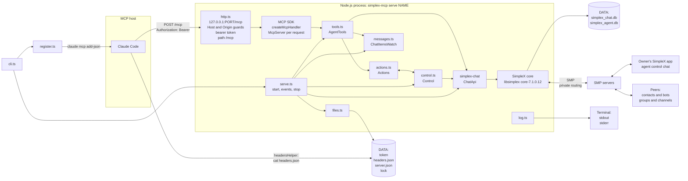

# SimpleX MCP server: architecture

> System structure, modules, state, process lifecycle, approval model and security boundaries of `@simplex-chat/mcp` 0.1.0.
>
> Related specs: [README](README.md) | [Flows](flows.md) | [API](api.md)
> Related docs: [README](../README.md) | [Reference](../REFERENCE.md) | [PLAN](../PLAN.md)

**Source:** [`cli.ts`](../src/cli.ts) | [`serve.ts`](../src/serve.ts) | [`http.ts`](../src/http.ts) | [`tools.ts`](../src/tools.ts) | [`actions.ts`](../src/actions.ts) | [`control.ts`](../src/control.ts) | [`messages.ts`](../src/messages.ts) | [`files.ts`](../src/files.ts) | [`register.ts`](../src/register.ts) | [`log.ts`](../src/log.ts)

---

## Table of contents

1. [System diagram](#1-system-diagram)
2. [Modules](#2-modules)
3. [State](#3-state)
4. [Process lifecycle](#4-process-lifecycle)
5. [Approval model](#5-approval-model)
6. [Security boundaries](#6-security-boundaries)
7. [Limits](#7-limits)

---

## 1. System diagram



Data flow of a tool call:

1. Claude Code runs the `headersHelper` command of its entry ([`register.ts:47`](../src/register.ts#L47)) and sends the `Authorization` header it prints ([Reference](../REFERENCE.md#add-the-agent-to-claude-code)).
2. The server checks Host, Origin, token and path, then passes the request to the SDK handler ([`http.ts:18-26`](../src/http.ts#L18-L26)).
3. An `McpServer` is built from the factory for each request, and the arguments are validated against the input schema by the SDK ([`serve.ts:108-112`](../src/serve.ts#L108-L112), [`mcp-BumlNux0.cjs:1777-1791`](../node_modules/@modelcontextprotocol/server/dist/mcp-BumlNux0.cjs#L1777-L1791)).
4. The handler result is returned by `AgentTools.call` as `structuredContent` and as JSON text ([`tools.ts:367-374`](../src/tools.ts#L367-L374)).
5. The server sends chat commands through `ChatApi` to the core ([`messages.ts:169-173`](../src/messages.ts#L169-L173)); actions are created in `Actions` and shown to the owner by `Control` ([`actions.ts:119-146`](../src/actions.ts#L119-L146)).
6. The core emits events; the server dispatches them in one handler of `serve.ts` to the item watch, the connect actions and the agent control chat ([`serve.ts:123-144`](../src/serve.ts#L123-L144)).

---

## 2. Modules

### [2.1 `cli.ts`](../src/cli.ts)

Entry point of the `simplex-mcp` binary.

| Symbol | Line | Contents |
|---|---|---|
| `helpText` | [10](../src/cli.ts#L10) | `--help` output |
| `Command` | [37](../src/cli.ts#L37) | `help`, `serve` with `ServeOptions`, `register` with `RegisterOptions` |
| `parseCommand` | [42](../src/cli.ts#L42) | command, NAME and options to a `Command` |
| `serveOptions` | [51](../src/cli.ts#L51) | defaults and option switch of `serve` |
| `registerOptions` | [103](../src/cli.ts#L103) | defaults and option switch of `register` |
| `OptionReader` | [120](../src/cli.ts#L120) | `value`: the next argument, required<br>`optionalValue`: the next argument, absent when missing or starting with `--` |
| `validAgentName` | [142](../src/cli.ts#L142) | `^[a-z0-9](-?[a-z0-9])*-?$`, at most 32 characters |
| `usageError` | [187](../src/cli.ts#L187) | `ExitError` with code 2 |
| `main` | [191](../src/cli.ts#L191) | `help` to stdout, `serve`, `register` |
| top-level catch | [204-213](../src/cli.ts#L204-L213) | `ExitError`: message on stderr, its code; other errors: `logError`, code 1 |

### [2.2 `serve.ts`](../src/serve.ts)

Start sequence, event dispatch and stop sequence of one agent.

| Symbol | Line | Contents |
|---|---|---|
| `ServeOptions` | [26](../src/serve.ts#L26) | name, data folder and its `dataGiven` flag, display name, mode, owners, expiry, reset and token flags, port, QR code size |
| `OwnerEntry` | [21](../src/serve.ts#L21) | `{memberId, name}` of `--owners` |
| `RunningServer` | [40](../src/serve.ts#L40) | token, `ChatApi`, user, `Actions`, `stop` |
| `serve` | [48](../src/serve.ts#L48) | `startServer`, then SIGINT and SIGTERM handlers with one shared stop promise |
| `startServer` | [64](../src/serve.ts#L64) | data folder, lock, token, headers file, `ChatApi.init`, `startAgent`; cleanup on error |
| `startAgent` | [87](../src/serve.ts#L87) | user, network config, control group, wiring of `Actions`, `AgentTools`, `Control`, HTTP, event handler, `stop` |
| `registerHint` | [164](../src/serve.ts#L164) | the `register` command line printed after the owner setup |
| `deliveries` | [168](../src/serve.ts#L168) | wait for pending deliveries of the control chat at stop |
| `controlGroup` | [194](../src/serve.ts#L194) | found, created or reset agent control chat |
| `listen` | [201](../src/serve.ts#L201) | `startHttp`; `EADDRINUSE` to `ExitError` code 1 |
| `bufferEvents` | [210](../src/serve.ts#L210) | events received before the handler is installed are queued and replayed in order |

### [2.3 `http.ts`](../src/http.ts)

| Symbol | Line | Contents |
|---|---|---|
| `HttpOptions` | [7](../src/http.ts#L7) | port, token, `McpServerFactory` |
| `startHttp` | [13](../src/http.ts#L13) | `http.Server` on `127.0.0.1:port`: guards, SDK handler, timeouts |
| `authorized` | [32](../src/http.ts#L32) | length check and `timingSafeEqual` against `Bearer <token>` |
| `stopHttp` | [46](../src/http.ts#L46) | `server.close` and `closeAllConnections` |

### [2.4 `tools.ts`](../src/tools.ts)

Tool definitions, call handlers, connect plans and perform steps.

| Symbol | Line | Contents |
|---|---|---|
| `ConnectInput`, `SendInput`, `ReceiveInput`, `LeaveInput` | [31-57](../src/tools.ts#L31-L57) | tool inputs |
| `PlanSummary` | [63](../src/tools.ts#L63) | card kind, chat type, name, SimpleX name, peer type, description, welcome, commands, `takesMessage` |
| `ChatFields` | [75](../src/tools.ts#L75) | chat fields of `connect` and `list` results |
| `Agent` | [89](../src/tools.ts#L89) | `ChatApi`, user, `Actions`, `ChatItemsWatch`, control chat reference, standing approver lookup |
| `JoinMethod` | [98](../src/tools.ts#L98) | `prepared`, `prepareChannel`, `viaAddress`, `prepareContact`, `connect` |
| schemas | [119-299](../src/tools.ts#L119-L299) | input and output JSON schemas |
| descriptions, `instructions` | [301-332](../src/tools.ts#L301-L332) | tool descriptions and server instructions |
| `definitions` | [342](../src/tools.ts#L342) | name, description, schemas and action flag of the five tools |
| `AgentTools.register` | [355](../src/tools.ts#L355) | `registerTool` for each definition; `_meta` in mode `host` |
| `AgentTools.call` | [367](../src/tools.ts#L367) | handler result to `CallToolResult`; errors to `isError` |
| `AgentTools.perform` | [376](../src/tools.ts#L376) | perform step of an approved action |
| `onContactConnected`, `onUserJoinedGroup` | [387-395](../src/tools.ts#L387-L395) | completion of connect actions by events |
| `actionResult` | [431](../src/tools.ts#L431) | wait for the decision, result fields, removal |
| `agentChats`, `knownChat` | [698-721](../src/tools.ts#L698-L721) | the agent's chats; a checked chat reference |
| `classifyPlan` | [811](../src/tools.ts#L811) | `connectionPlan` response to a join plan or a known chat |
| `chatSubject`, `isConnected`, `isActive`, `memberCurrent` | [911-964](../src/tools.ts#L911-L964) | chat and member predicates shared with `control.ts` |
| `toolCall` | [1011](../src/tools.ts#L1011) | `ServerContext` to `ToolCall`: abort signal and progress notifications |

### [2.5 `actions.ts`](../src/actions.ts)

| Symbol | Line | Contents |
|---|---|---|
| `Mode` | [5](../src/actions.ts#L5) | `requests`, `host` |
| `State` | [6](../src/actions.ts#L6) | `pending`, `performing`, `done`, `failed`, `rejected`, `expired` |
| `ToolError` | [16](../src/actions.ts#L16) | errors the model can correct; text returned as is |
| `Subject` | [18](../src/actions.ts#L18) | kind, name, SimpleX name, incognito flag of a card |
| `ConnRef` | [25](../src/actions.ts#L25) | pending connection, contact or group of a connect action |
| `ActionRecord` | [31](../src/actions.ts#L31) | number, key, times, change signal, standing flag, state, card, decider, open calls, interrupted flag, error |
| `ConnectAction`, `SendAction`, `LeaveAction` | [47-79](../src/actions.ts#L47-L79) | per-tool fields |
| `ActionHooks` | [85](../src/actions.ts#L85) | `refusal`, `saveCounter`, `postCard`, `perform`, `outcome` |
| `Actions` | [93](../src/actions.ts#L93) | action map, expiry timer, posting and outcome promises |
| `create` | [119](../src/actions.ts#L119) | refusal checks, number, log line, counter write, card |
| `decided` | [166](../src/actions.ts#L166) | wait with progress until a decided state or the abort signal |
| `stop` | [200](../src/actions.ts#L200) | cancellation of pending and performing actions |
| `summary`, `performedText`, `progressText` | [268-304](../src/actions.ts#L268-L304) | log and progress texts |

Hooks are bound in [`serve.ts:97-103`](../src/serve.ts#L97-L103): `refusal`, `saveCounter`, `postCard` and `outcome` to `Control`; `perform` to `AgentTools`.

### [2.6 `control.ts`](../src/control.ts)

| Symbol | Line | Contents |
|---|---|---|
| `ControlData` | [31](../src/control.ts#L31) | `{control: true, nextAction}` |
| `ChatApproval` | [48](../src/control.ts#L48) | `{approvedBy, approvedById, approvedAt}` |
| `OwnerRequest` | [54](../src/control.ts#L54) | parsed owner command |
| `Control.load` | [88](../src/control.ts#L88) | lost check, group profile and menu, member list |
| `Control.start` | [97](../src/control.ts#L97) | owner setup per `--owners` |
| `Control.refusal` | [105](../src/control.ts#L105) | bytes left for the link texts of a connect card, card size of a send or connect, approver presence |
| `Control.standingApprover` | [113](../src/control.ts#L113) | approver name of a chat's standing approval |
| `Control.saveCounter` | [118](../src/control.ts#L118) | queued counter writes |
| `Control.postCard`, `Control.outcome` | [124-132](../src/control.ts#L124-L132) | card post and card edit |
| `Control.onMessage` | [134](../src/control.ts#L134) | owner commands, queued one at a time |
| `Control.onEvent` | [146](../src/control.ts#L146) | membership changes and loss of the control chat |
| `Control.ownerCommand` | [163](../src/control.ts#L163) | command dispatch and replies |
| `findControlGroup`, `createControlChat`, `resetControlChat` | [364-392](../src/control.ts#L364-L392) | control group lookup, creation, reset |
| `isControlEvent` | [394](../src/control.ts#L394) | membership events of the control group |
| `parseCommand` | [410](../src/control.ts#L410) | one-line `/keyword params` |
| `cardText` | [417](../src/control.ts#L417) | card text per state and mode |
| `largestCard`, `encodedLength` | [476-484](../src/control.ts#L476-L484) | card size check |
| `codeSpan`, `safeName`, `mentionText` | [494-506](../src/control.ts#L494-L506) | quoting of peer text |
| `ownerRequest` | [521](../src/control.ts#L521) | command words to an `OwnerRequest` |
| `qrCodeText` | [532](../src/control.ts#L532) | terminal QR code |
| `losesControl`, `isLost` | [548-563](../src/control.ts#L548-L563) | loss of the control chat |
| `entryText`, `restartText` | [581-591](../src/control.ts#L581-L591) | `--owners` entries in restart lines |

### [2.7 `messages.ts`](../src/messages.ts)

| Symbol | Line | Contents |
|---|---|---|
| `Message` | [11](../src/messages.ts#L11) | message item of tool results |
| `ToolCall` | [29](../src/messages.ts#L29) | abort signal and progress callback of one call |
| `Collected` | [34](../src/messages.ts#L34) | collected items, change signal, IDs of the items over the first 100, time of the last change |
| `Changes` | [41](../src/messages.ts#L41) | set of wake callbacks |
| `ChatItemsWatch` | [58](../src/messages.ts#L58) | listeners per chat reference; received message items gathered by `collect` |
| `chatRef`, `isChatRef` | [104-117](../src/messages.ts#L104-L117) | `@N` and `#N` references |
| `toMessage` | [135](../src/messages.ts#L135) | chat item to `Message` |
| `chatCommand`, `getChat`, `markRead` | [169-181](../src/messages.ts#L169-L181) | raw chat commands with response type checks |
| `unreadItems` | [183](../src/messages.ts#L183) | unread items of a chat after its `initial=1` read, paged |
| `reportProgress`, `nextChange`, `awaitResponses` | [200-230](../src/messages.ts#L200-L230) | waits |
| `validName`, `viewName` | [236-262](../src/messages.ts#L236-L262) | display name rules and `@name` form |
| `fullDomainName` | [264-267](../src/messages.ts#L264-L267) | `SimplexDomain` to `name.simplex` or `name.testing` |

### [2.8 `files.ts`](../src/files.ts)

| Symbol | Line | Contents |
|---|---|---|
| `createDataFolder` | [12](../src/files.ts#L12) | `mkdir -p` mode 0700; `chmod 0700` except on Windows |
| `acquireLock`, `releaseLock` | [17-28](../src/files.ts#L17-L28) | `DATA/lock` with the PID |
| `serverToken` | [30](../src/files.ts#L30) | `DATA/token`: read, or 32 random bytes in base64url |
| `writeHeadersFile` | [42](../src/files.ts#L42) | `DATA/headers.json` |
| `writeServerFile`, `readServerFile` | [46-53](../src/files.ts#L46-L53) | `DATA/server.json` |

### [2.9 `register.ts`](../src/register.ts)

| Symbol | Line | Contents |
|---|---|---|
| `register` | [30](../src/register.ts#L30) | `claude mcp remove`, then `claude mcp add-json` |
| `registryEntry` | [43](../src/register.ts#L43) | `{type, url, headersHelper, timeout}` |
| `manualEntryText` | [52](../src/register.ts#L52) | entry text when `claude` is missing |
| `projectRoot` | [57](../src/register.ts#L57) | project key of `--scope local` |
| `runCommand` | [83](../src/register.ts#L83) | `spawnSync` with ENOENT detection; on Windows after ENOENT, once more through `cmd.exe` with `cmdArgument` quoting, and exit status 9009 as missing |

### [2.10 `log.ts`](../src/log.ts)

| Symbol | Line | Contents |
|---|---|---|
| `ExitError` | [12](../src/log.ts#L12) | message and exit code |
| `shellWord`, `shellPath` | [18-25](../src/log.ts#L18-L25) | POSIX single quotes or Windows double quotes |
| `oneLine` | [27](../src/log.ts#L27) | runs of `\p{Cc}`, `\p{Cf}`, `\p{Zl}`, `\p{Zp}` to one space |
| `log`, `logError` | [31-37](../src/log.ts#L31-L37) | stdout lines; stderr lines |
| `errorText`, `chatErrorText` | [39-47](../src/log.ts#L39-L47) | error text, folded to one line: the apps' wording for known error shapes, otherwise the type chain |
| `appErrorText` | [49-58](../src/log.ts#L49-L58) | wording of the apps' alerts for chat, agent and store errors |
| `chainText`, `errorChain` | [193-205](../src/log.ts#L193-L205) | `SimpleX error: <type chain>: <scalar fields>`, details at most 500 characters |

---

## 3. State

### 3.1 Memory

| Item | Holder | Written by | Read by |
|---|---|---|---|
| Actions | `Actions.actions` map ([actions.ts:96](../src/actions.ts#L96)) | `create`, `remove`, `expireDue` | tools, `Control` |
| Open calls of an action | `ActionRecord.open` ([:41](../src/actions.ts#L41)) | `actionResult` ([tools.ts:432](../src/tools.ts#L432), [:440](../src/tools.ts#L440)) | `list`, `expireDue` |
| Collected replies | `ConnectAction.messages`, `SendAction.responses` ([:52](../src/actions.ts#L52), [:69](../src/actions.ts#L69)) | `ChatItemsWatch.collect` | `connect`, `send` results |
| Item listeners | `ChatItemsWatch.listeners` ([messages.ts:59](../src/messages.ts#L59)) | `collect` | event dispatch |
| Members of the control chat | `Control.members` ([control.ts:68](../src/control.ts#L68)) | `refreshMembers` ([:332](../src/control.ts#L332)) | approver checks |
| Mode, expiry, owners list | `ServeOptions` of the run | CLI | all modules |

### 3.2 Chat database custom data

| Item | Entity | Value | Written by | Read by |
|---|---|---|---|---|
| Control marker and counter | agent control chat | `{simplexMcp: {control: true, nextAction: N}}` | [`createControlChat`](../src/control.ts#L374-L385), [`saveCounter`](../src/control.ts#L118) | [`findControlGroup`](../src/control.ts#L364), [`controlDataOf`](../src/control.ts#L369) |
| Standing approval | contact or group of the agent | `{...other keys, simplexMcp: {approvedBy, approvedById, approvedAt}}` | [`approveChat`](../src/control.ts#L192), [`revoke`](../src/control.ts#L205) | [`standingApprover`](../src/control.ts#L113) |

The profile, chats, items and members are stored by the core in `DATA/simplex_chat.db`; connections and queues in `DATA/simplex_agent.db` (file prefix `DATA/simplex`, [serve.ts:71](../src/serve.ts#L71)).

### 3.3 Files

| Path | Contents | Mode | Written | Read |
|---|---|---|---|---|
| `DATA/` | data folder | 0700, set at every start except on Windows | [files.ts:12](../src/files.ts#L12) | |
| `DATA/token` | base64url of 32 random bytes | 0600, set again at every write except on Windows | first start, `--new-token` ([:30](../src/files.ts#L30)) | every start |
| `DATA/headers.json` | `{"Authorization":"Bearer <token>"}` | 0600, set again at every write except on Windows | every start ([:42](../src/files.ts#L42)) | Claude Code `headersHelper` |
| `DATA/server.json` | `{name, port, expireHours}` | 0600, set again at every write except on Windows | every start, after the HTTP listener is bound ([serve.ts:114](../src/serve.ts#L114)) | `register` |
| `DATA/lock` | PID and a newline | 0600 | start ([files.ts:57](../src/files.ts#L57)) | next start |

The core library is downloaded once into `CACHE/core-7.1.0.12/sqlite`, and the Node.js add-on into `CACHE/<add-on release>/`, each with a `Downloading ...` line on stderr. CACHE is `$XDG_CACHE_HOME/simplex-chat` or `~/.cache/simplex-chat`; on macOS `~/Library/Caches/simplex-chat`; on Windows `%LOCALAPPDATA%\simplex-chat` ([libs.ts:39-46](../../simplex-chat-nodejs/src/libs.ts#L39-L46), [:87](../../simplex-chat-nodejs/src/libs.ts#L87), [:107](../../simplex-chat-nodejs/src/libs.ts#L107), [:114](../../simplex-chat-nodejs/src/libs.ts#L114), [:127](../../simplex-chat-nodejs/src/libs.ts#L127)).

---

## 4. Process lifecycle

### 4.1 Start

1. Data folder, lock, token and headers file are prepared ([serve.ts:66-70](../src/serve.ts#L66-L70)).
2. libsimplex for SQLite is loaded by `ChatApi.init`, and the databases are migrated with confirmation `yesUp` ([serve.ts:71](../src/serve.ts#L71), [api.ts:114-123](../../simplex-chat-nodejs/src/api.ts#L114-L123)).
3. Three log lines: version and NAME, data folder, mode ([serve.ts:72-74](../src/serve.ts#L72-L74)).
4. The active user is read, or created with display name `--display-name` or NAME, empty full name and peer type `agent` ([serve.ts:89](../src/serve.ts#L89)).
5. The network config is set: `/network socks=off smp-proxy=always smp-proxy-fallback=protected` ([:91](../src/serve.ts#L91)).
6. Events are buffered, and the chat is started ([:92-93](../src/serve.ts#L92-L93)).
7. A `--display-name` different from the profile, or a peer type other than `agent`, is applied with one `apiUpdateProfile` ([:94](../src/serve.ts#L94), [:187-192](../src/serve.ts#L187-L192)).
8. The agent control chat is found by its marker, created with counter 1, or reset with `--reset-owners` ([:96](../src/serve.ts#L96), [:194-199](../src/serve.ts#L194-L199)).
9. `Actions`, `ChatItemsWatch`, `AgentTools` and `Control` are created; the counter is taken from the marker ([:97-106](../src/serve.ts#L97-L106)).
10. `Control.load`: for a lost control chat, `Actions.lost` is set; otherwise the group name and command menu are updated when they differ, and members are read ([control.ts:88-95](../src/control.ts#L88-L95)).
11. The HTTP server listens; with the port in use, the process exits with code 1 ([serve.ts:113](../src/serve.ts#L113), [:201-208](../src/serve.ts#L201-L208)). Until step 13 ends, requests to `/mcp` that pass the token check get 503 with `Retry-After: 1` ([http.ts:23](../src/http.ts#L23), [serve.ts:112](../src/serve.ts#L112), [:121](../src/serve.ts#L121)).
12. `server.json` is written ([serve.ts:114](../src/serve.ts#L114)).
13. The server runs the owner setup, `Control.start`; after an error, HTTP is closed and the error is rethrown ([serve.ts:114-119](../src/serve.ts#L114-L119)).
14. `Listening on http://127.0.0.1:PORT/mcp` ([:120](../src/serve.ts#L120)).
15. Buffered events are replayed, then live events are dispatched ([:123](../src/serve.ts#L123), [:210-224](../src/serve.ts#L210-L224)).

After an error inside `startAgent` (steps 4-15) the chat is closed; after any error once the lock is taken, the lock is released ([serve.ts:68-84](../src/serve.ts#L68-L84)).

### 4.2 Event dispatch

Each `onAny` receiver is awaited by the library before the next event is read ([api.ts:192-198](../../simplex-chat-nodejs/src/api.ts#L192-L198)). The dispatcher in [`serve.ts:123-144`](../src/serve.ts#L123-L144):

| Event | Condition | Handler |
|---|---|---|
| `newChatItems` | item of the control group, main scope | [`Control.onMessage`](../src/control.ts#L134) |
| `newChatItems` | every item | [`ChatItemsWatch.deliver`](../src/messages.ts#L85) |
| `chatItemUpdated` | | [`ChatItemsWatch.update`](../src/messages.ts#L89) |
| `chatItemsDeleted` | | [`ChatItemsWatch.remove`](../src/messages.ts#L93) of each `deletedChatItem` |
| `contactConnected` | | [`AgentTools.onContactConnected`](../src/tools.ts#L387) |
| `userJoinedGroup` | | [`AgentTools.onUserJoinedGroup`](../src/tools.ts#L392) |
| `joinedGroupMember`<br>`joinedGroupMemberConnecting`<br>`connectedToGroupMember`<br>`memberRole`<br>`leftMember`<br>`deletedMember`<br>`deletedMemberUser`<br>`groupDeleted` | event of the control group | [`Control.onEvent`](../src/control.ts#L146), queued one at a time |
| any event | after `stop()` started | ignored |

Owner commands are queued in a second chain, independent of the membership chain ([control.ts:140-143](../src/control.ts#L140-L143)).

### 4.3 Stop

On `SIGINT` or `SIGTERM` the server runs one stop, shared by all later signals ([serve.ts:50-61](../src/serve.ts#L50-L61)). `RunningServer.stop` ([serve.ts:150-160](../src/serve.ts#L150-L160)):

1. Events are ignored from now on.
2. `Actions.stop` starts: new actions are refused with `The server is stopping.`; the expiry timer is cleared; cards being posted are awaited; pending and performing actions are marked interrupted; the stop signal of the performs is aborted, which ends the wait of a `connect` for its connection; their cards are edited, or posted when they have no card; outcome edits already in progress are awaited ([actions.ts:200-209](../src/actions.ts#L200-L209)).
3. In parallel with step 2, the HTTP server is closed with all connections, and open calls are aborted ([http.ts:46-50](../src/http.ts#L46-L50)).
4. `Cancelled K action(s).` when K > 0 ([serve.ts:155](../src/serve.ts#L155)).
5. Pending deliveries of the control chat's member connections are polled with `/sql chat` and `/sql agent` every 100 ms, for at most 10 s; an error of either query is logged as `delivery wait: ERROR` and ends the wait ([serve.ts:168-176](../src/serve.ts#L168-L176)).
6. `chat.close()`: `/_stop`, then the store is closed ([api.ts:162-167](../../simplex-chat-nodejs/src/api.ts#L162-L167)).
7. The lock is removed, `Stopped.` is logged, and the process exits with code 0, or 1 after an error ([serve.ts:158-159](../src/serve.ts#L158-L159), [:52-58](../src/serve.ts#L52-L58)).

Performs in progress are not awaited; when one ends, its card stays as edited at the stop and no line is logged, because the action is interrupted ([actions.ts:252](../src/actions.ts#L252)).

### 4.4 The lock

```
acquireLock(DATA):                                   files.ts:17
  create DATA/lock exclusively (flag wx), PID       :57
  exists:
    PID = number in the file
    PID valid, other than ours, running:            :21, :70-77
      exit 1 "Another server uses DATA (PID N). If no server runs, remove DATA/lock."
    remove the file; create it exclusively again    :22-23
      exists again: exit 1 with the same message
releaseLock(DATA): remove DATA/lock                  :26
```

`isRunning`: `true` when `kill(pid, 0)` succeeds or fails with `EPERM` ([files.ts:70-77](../src/files.ts#L70-L77)).

---

## 5. Approval model

### 5.1 Modes

The mode is set by `--approve` for one run ([cli.ts:72-74](../src/cli.ts#L72-L74)).

| Mode | State of a new action | Card | `_meta` of `connect`, `send`, `leave` |
|---|---|---|---|
| `requests` | `pending`<br>`performing` for a send under a standing approval | card with commands<br>outcome card after a standing send | none |
| `host` | `performing` | outcome card after the perform | `{"anthropic/requiresUserInteraction": true}` |

Sources: [actions.ts:130](../src/actions.ts#L130), [tools.ts:361](../src/tools.ts#L361). In both modes a new action is refused unless the control chat has an approver ([control.ts:107-110](../src/control.ts#L107-L110)).

### 5.2 Owners and approvers

| Term | Rule | Code |
|---|---|---|
| human | member other than the agent's membership, status `connected` or `complete` | [control.ts:353-355](../src/control.ts#L353-L355), [tools.ts:949-951](../src/tools.ts#L949-L951) |
| human owner | human with role `owner` | [control.ts:340-342](../src/control.ts#L340-L342) |
| approver, `--owners` absent | member with role `owner` | [control.ts:357-361](../src/control.ts#L357-L361) |
| approver, `--owners` without a list | none | [control.ts:360](../src/control.ts#L360) |
| approver, `--owners ID:NAME,...` | member with role `owner` whose `groupMemberId` and `displayName`, folded to one line by `oneLine`, match an entry | [control.ts:360](../src/control.ts#L360), [:565-567](../src/control.ts#L565-L567) |

The command sender's member record from the chat item is checked ([control.ts:139](../src/control.ts#L139), [:167](../src/control.ts#L167)). The approver count for refusals and standing approvals is taken from `Control.members`, refreshed at load and at each membership event ([control.ts:344-346](../src/control.ts#L344-L346)).

Owner setup at start ([control.ts:97-103](../src/control.ts#L97-L103)):

| `--owners` | Start | First join by the link |
|---|---|---|
| absent | a human owner exists: register hint<br>otherwise: `No owners in the agent control chat.` when humans exist, then a link with role `member` | link deleted, role `owner`, greeting, log line, register hint |
| without a list | no humans: link with role `observer`<br>humans exist: their IDs and the restart command, in the log and the chat | link deleted, the joined member and the restart command announced |
| `ID:NAME,...` | each entry matched to a human, or exit 2<br>role `owner` set where missing<br>other humans removed<br>link deleted<br>`Owners: ...` and register hint | |

Sources: [`startOwners`](../src/control.ts#L236), [`startObserver`](../src/control.ts#L242), [`startListed`](../src/control.ts#L247), [`ownerJoined`](../src/control.ts#L266), [`observerJoined`](../src/control.ts#L275).

Membership changes at run time ([control.ts:146-161](../src/control.ts#L146-L161)):

| Change | `--owners` | Server reaction |
|---|---|---|
| `deletedMemberUser`, `groupDeleted`, or the agent's role below `owner` | any | `Actions.loseControl`: pending actions set to `failed`; later cards left unedited; log line |
| approvers drop to zero after a human owner existed | absent | `No owners in the agent control chat.`, new link with role `member` |
| a human becomes owner outside the list | list | `<name> (member N) is now an owner and can't approve actions yet. Restart the server with --owners ...` |
| a listed owner stops being a human owner | list | `<name> (member N) is no longer an owner.` with the restart command, or `No owners remain: ...` |

### 5.3 Action state machine

Transitions, one per row:

| Event | From | To | Code |
|---|---|---|---|
| call creates the action, mode `requests` | | `pending` | [actions.ts:130](../src/actions.ts#L130) |
| call creates the action, mode `host` | | `performing` | [actions.ts:130](../src/actions.ts#L130) |
| `send` call creates the action under a standing approval | | `performing` | [actions.ts:130](../src/actions.ts#L130) |
| counter write or card post fails | `pending`<br>`performing` | `failed` | [actions.ts:211-221](../src/actions.ts#L211-L221) |
| stop arrives while the counter of a `performing` action is written | `performing` | `pending`, interrupted | [actions.ts:226](../src/actions.ts#L226) |
| control chat lost | `pending` | `failed` | [actions.ts:192-198](../src/actions.ts#L192-L198) |
| `/reject` | `pending` | `rejected` | [actions.ts:185-190](../src/actions.ts#L185-L190) |
| expiry time passes | `pending` | `expired` | [actions.ts:156-159](../src/actions.ts#L156-L159) |
| `/approve N`, `/approve CHAT N`, `/approve CHAT all` | `pending` | `performing` | [actions.ts:179-183](../src/actions.ts#L179-L183) |
| perform throws | `performing` | `failed` | [actions.ts:234-237](../src/actions.ts#L234-L237) |
| perform ends | `performing` | `done` | [actions.ts:232-233](../src/actions.ts#L232-L233) |

`create` ([actions.ts:119-146](../src/actions.ts#L119-L146)):

```
create(key, fields, standingApprover?):
  state = mode host or standing ? performing : pending
  refusal, first match:
    stopping                      "The server is stopping."
    control chat lost             lostMessage
    20 actions pending            pendingMessage
    20 actions performing         performingMessage
    connect: link texts cut to the bytes its largest card leaves
    send or connect card over 15000 bytes    cardTooLong
    no approver                   no-owner message
  refusal: throw ToolError        counter unchanged
  N = next; next += 1; store; log "Action N: ..."
  post:
    saveCounter(next)
    state pending: card = postCard()
    either fails: state failed; log "Action N: failed: ERROR."
  after post:
    posted and performing:
      stopping: state = pending
      otherwise: perform
```

An action is removed from memory when its result is returned to a call ([tools.ts:437](../src/tools.ts#L437)), or at an expiry tick when it is decided, its open call count is 0 and its expiry time has passed ([actions.ts:160-161](../src/actions.ts#L160-L161)).

### 5.4 Cards

The server posts a card when a `pending` action is created, and edits it with `/_update item` at the outcome ([control.ts:124-132](../src/control.ts#L124-L132)). For an action without a card (mode `host`, standing sends) the server posts the outcome as a new message. The text per state is built by [`cardText`](../src/control.ts#L417-L436); forms are listed in [API: cards](api.md#22-cards).

Outcomes are posted after `done` and `failed` ([actions.ts:239](../src/actions.ts#L239)), after `rejected` and `expired` ([:189](../src/actions.ts#L189), [:159](../src/actions.ts#L159)), and at stop ([:206](../src/actions.ts#L206)). They are skipped after the control chat is lost ([:206](../src/actions.ts#L206), [:239](../src/actions.ts#L239), [:248](../src/actions.ts#L248)).

### 5.5 Standing approvals

| Aspect | Rule | Code |
|---|---|---|
| grant | `/approve CHAT all` from an approver in mode `requests` (mode `host` stores nothing and replies `Approvals apply in mode requests; this server runs in mode host.`): custom data of CHAT gets `simplexMcp: {approvedBy, approvedById, approvedAt}`, other keys kept; pending sends of CHAT with a card are approved | [control.ts:192-203](../src/control.ts#L192-L203) |
| removal | `/revoke CHAT`: the `simplexMcp` key is removed, other keys kept | [control.ts:205-211](../src/control.ts#L205-L211) |
| use | mode `requests`, and `approvedById` equal to the `groupMemberId` of a current approver | [control.ts:113-116](../src/control.ts#L113-L116) |
| scope | `send` only | [tools.ts:586](../src/tools.ts#L586) |
| decider shown | `safeName(approvedBy)` | [control.ts:115](../src/control.ts#L115) |
| storage | chat database; removed with the chat by `leave` | [tools.ts:646-651](../src/tools.ts#L646-L651) |

### 5.6 Expiry

| Rule | Code |
|---|---|
| `expires = created + expireHours × 3600000`, `expireHours` 1 to 23, default 23 | [actions.ts:127](../src/actions.ts#L127), [cli.ts:79](../src/cli.ts#L79) |
| check every 60 s on an unreferenced timer, and before each owner command | [actions.ts:97](../src/actions.ts#L97), [control.ts:164](../src/control.ts#L164) |
| pending and due: `expired`, log `Action N expired.`, card edited to `Expired.` | [actions.ts:156-159](../src/actions.ts#L156-L159) |
| decided, no open call, due: removed from memory | [actions.ts:160-161](../src/actions.ts#L160-L161) |
| connect wait for the other side: at most until `created + 24 h - 10 min` | [tools.ts:112](../src/tools.ts#L112), [:483](../src/tools.ts#L483) |

`Date.now()` is compared with `expires`, so due actions are expired at the first tick after a sleep of the computer.

### 5.7 Action counter

| Rule | Code |
|---|---|
| initial value: `nextAction` of the control marker, or 1 | [serve.ts:97](../src/serve.ts#L97) |
| a new action takes `next`, then `next` grows by 1 | [actions.ts:120](../src/actions.ts#L120), [:138](../src/actions.ts#L138) |
| the new `next` is written before the card is posted | [actions.ts:213-214](../src/actions.ts#L213-L214) |
| one write at a time, also after a failed write | [control.ts:118-122](../src/control.ts#L118-L122) |
| `--reset-owners` copies the value into the new control chat | [serve.ts:197-198](../src/serve.ts#L197-L198), [control.ts:387-392](../src/control.ts#L387-L392) |
| a refused call leaves the counter unchanged | [actions.ts:137](../src/actions.ts#L137) |

---

## 6. Security boundaries

### 6.1 HTTP

Checks in order of the request listener ([http.ts:18-26](../src/http.ts#L18-L26)):

| Check | Rule | Failure | Code |
|---|---|---|---|
| bind address | `127.0.0.1` only | | [http.ts:39](../src/http.ts#L39) |
| Host | hostname `localhost`, `127.0.0.1` or `[::1]`, any port | 403, JSON-RPC error | [node index.cjs:26-48](../node_modules/@modelcontextprotocol/node/dist/index.cjs#L26-L48), [server index.cjs:1520-1558](../node_modules/@modelcontextprotocol/server/dist/index.cjs#L1520-L1558) |
| Origin | absent or empty passes; otherwise the same hostnames, any port | 403, JSON-RPC error | [node index.cjs:74-96](../node_modules/@modelcontextprotocol/node/dist/index.cjs#L74-L96), [server index.cjs:1599-1644](../node_modules/@modelcontextprotocol/server/dist/index.cjs#L1599-L1644) |
| token | `Authorization` equal to `Bearer <token>`, same length, `timingSafeEqual` | 401, empty body | [http.ts:32-35](../src/http.ts#L32-L35) |
| path | pathname `/mcp` | 404, empty body | [http.ts:21](../src/http.ts#L21) |
| start | the owner setup at start has ended | 503, `Retry-After: 1`, empty body | [http.ts:23](../src/http.ts#L23) |
| body size | 4 MiB | 413 | [node index.cjs:395-401](../node_modules/@modelcontextprotocol/node/dist/index.cjs#L395-L401) |
| content type of POST | `application/json` | 415 | [server index.cjs:1464-1467](../node_modules/@modelcontextprotocol/server/dist/index.cjs#L1464-L1467) |
| tool arguments | input schema, Ajv | `isError: true` result | [mcp-BumlNux0.cjs:1812-1817](../node_modules/@modelcontextprotocol/server/dist/mcp-BumlNux0.cjs#L1812-L1817) |
| tool results | output schema, Ajv | `isError: true` result | [mcp-BumlNux0.cjs:1822-1829](../node_modules/@modelcontextprotocol/server/dist/mcp-BumlNux0.cjs#L1822-L1829) |

Node limits: `requestTimeout` 0, `timeout` 0, `headersTimeout` 60 s, `keepAliveTimeout` 5 s ([http.ts:27-30](../src/http.ts#L27-L30)). When the client closes the response stream, the call is aborted: the request signal is aborted in `toNodeHandler` on `close`, the per-request transport is closed, and `ctx.mcpReq.signal` is aborted by the protocol layer ([node index.cjs:299-303](../node_modules/@modelcontextprotocol/node/dist/index.cjs#L299-L303), [server index.cjs:86-90](../node_modules/@modelcontextprotocol/server/dist/index.cjs#L86-L90), [src-BhnGYybN.cjs:6410-6427](../node_modules/@modelcontextprotocol/server/dist/src-BhnGYybN.cjs#L6410-L6427)). A result produced after the abort is discarded ([src-BhnGYybN.cjs:6536](../node_modules/@modelcontextprotocol/server/dist/src-BhnGYybN.cjs#L6536)).

### 6.2 Token and `headersHelper`

- The token is created once and kept in `DATA/token`; `--new-token` replaces it ([files.ts:30-36](../src/files.ts#L30-L36)).
- `DATA/headers.json` is rewritten at every start ([files.ts:42-44](../src/files.ts#L42-L44)).
- The Claude Code entry gets the command `cat <DATA>/headers.json`, or `type "<DATA>\headers.json"` on Windows, with the path quoted for the shell ([register.ts:47](../src/register.ts#L47), [log.ts:18-25](../src/log.ts#L18-L25)). Only this command is written to the entry and to the `claude mcp add-json` arguments ([register.test.ts:56](../test/unit/register.test.ts#L56)).
- `token`, `headers.json` and `server.json` are set to mode 0600 at every write, and the data folder to 0700 at every start, except on Windows ([files.ts:12-15](../src/files.ts#L12-L15), [:55-58](../src/files.ts#L55-L58)).

### 6.3 Peer-written text

| Destination | Rule | Code |
|---|---|---|
| card and reply names | folded to one line; a valid display name is plain, others a code span | [`safeName`](../src/control.ts#L498-L501) |
| card text lines | one code span per line; backticks become `'`; a leading or trailing space becomes U+00A0; blank lines empty | [`codeLines`, `codeSpan`](../src/control.ts#L490-L496) |
| reply quote on a send card | whitespace runs to one space, first 100 characters (code points), one code span | [control.ts:450](../src/control.ts#L450) |
| link texts on a connect card | code span lines in the bytes that the largest card form leaves; the line that does not fit is cut and ends in `…` inside its code span; later lines left out | [control.ts:508-522](../src/control.ts#L508-L522) |
| mention names | valid name: `@name` or `@'name'`; others a code span | [`mentionText`](../src/control.ts#L503-L506) |
| errors on cards | folded to one line, one code span | [control.ts:430](../src/control.ts#L430) |
| `--owners` part of restart lines in the chat | one code span | [control.ts:65](../src/control.ts#L65), [:589-591](../src/control.ts#L589-L591) |
| terminal names and errors of actions | folded to one line | [actions.ts:141](../src/actions.ts#L141), [:285-287](../src/actions.ts#L285-L287), [control.ts:64](../src/control.ts#L64) |
| tool results | returned as data; schema descriptions and instructions mark `text`, `from`, `name`, `description`, `welcome` and `commands` with their labels and params as data, not instructions; the instructions take a chat's messages as prompts only when the user said so in the session, and limit what the agent shares about its user | [tools.ts:125-129](../src/tools.ts#L125-L129), [:146-147](../src/tools.ts#L146-L147), [:157-161](../src/tools.ts#L157-L161), [:330](../src/tools.ts#L330) |

The server writes the tappable form `/'...'` only in the card's command line, `/'approve ...'` and `/'reject ...'` ([control.ts:461-470](../src/control.ts#L461-L470)), and in `/'revoke CHAT'` of standing cards and replies ([:428](../src/control.ts#L428), [:202](../src/control.ts#L202)).

### 6.4 Chat references

| Rule | Code |
|---|---|
| `^[@#][1-9]\d{0,14}$`: 1 to 15 digits; the core reads `#(2^64 + N)` as `#N` | [messages.ts:115-117](../src/messages.ts#L115-L117), [scenarios.test.ts:320-332](../test/e2e/scenarios.test.ts#L320-L332) |
| the control chat is refused by `send`, `receive`, `leave` and `/approve CHAT all`, and left out of `list` and `/list` | [tools.ts:655](../src/tools.ts#L655), [:708-711](../src/tools.ts#L708-L711), [:715](../src/tools.ts#L715), [control.ts:223-230](../src/control.ts#L223-L230) |
| a store error of the chat read is reported as `No chat CHAT.` | [tools.ts:660](../src/tools.ts#L660), [:719](../src/tools.ts#L719) |
| the agent's own links are refused by `connect` (`ownLink` plans) | [tools.ts:830](../src/tools.ts#L830), [:848](../src/tools.ts#L848), [:870](../src/tools.ts#L870) |

### 6.5 Owner commands

| Rule | Code |
|---|---|
| source: `groupRcv` text items in the main scope of the control group | [serve.ts:128](../src/serve.ts#L128), [control.ts:136](../src/control.ts#L136) |
| form: one line `/keyword params`, leading spaces allowed | [control.ts:410-415](../src/control.ts#L410-L415) |
| the help reply is sent to any sender; other commands are accepted from approvers only | [control.ts:165-167](../src/control.ts#L165-L167) |
| commands run one at a time in arrival order | [control.ts:140-143](../src/control.ts#L140-L143) |
| `/approve` and `/reject` need a pending action with a card, and the action's chat when CHAT is given | [control.ts:181-183](../src/control.ts#L181-L183) |

### 6.6 Link and network

- The join link is a group link of the control chat with role `member`, or `observer` with `--owners`; it is printed with a QR code on stdout and deleted at the first join event ([control.ts:301-311](../src/control.ts#L301-L311), [:267](../src/control.ts#L267), [:276](../src/control.ts#L276)).
- At every start the server sets private message routing: `smp-proxy=always`, `smp-proxy-fallback=protected`, `socks=off` ([serve.ts:91](../src/serve.ts#L91)).
- With `incognito: true` the server sends `incognito=on` with the connect command ([tools.ts:516](../src/tools.ts#L516)); the core then uses a random profile for that chat ([PLAN, Participants](../PLAN.md#participants)).

---

## 7. Limits

| Limit | Value | Code |
|---|---|---|
| pending actions | 20 | [actions.ts:10](../src/actions.ts#L10) |
| actions being performed | 20 | [actions.ts:11](../src/actions.ts#L11) |
| expiry | 1 to 23 h, default 23 | [cli.ts:79](../src/cli.ts#L79) |
| connect wait for the other side | `created + 23 h 50 min` | [tools.ts:112](../src/tools.ts#L112) |
| send and connect card | 15000 bytes JSON-escaped, in its largest form | [control.ts:17](../src/control.ts#L17), [:476-484](../src/control.ts#L476-L484) |
| error assumed in the largest card | 600 × `€` | [control.ts:18](../src/control.ts#L18) |
| `send.text` | 1 to 12000 characters | [tools.ts:184](../src/tools.ts#L184) |
| `connect.message` | 1 to 2000 characters | [tools.ts:172](../src/tools.ts#L172) |
| `send.mention` | 1 to 3 unique member IDs | [tools.ts:186](../src/tools.ts#L186) |
| `wait` | 0 to 86400 s | [tools.ts:173](../src/tools.ts#L173), [:187](../src/tools.ts#L187), [:199](../src/tools.ts#L199) |
| `idle` | 1 to 300 s, default 30 | [tools.ts:174](../src/tools.ts#L174), [:188](../src/tools.ts#L188), [:115](../src/tools.ts#L115) |
| `limit` | 1 to 100, default 50 | [tools.ts:189](../src/tools.ts#L189), [:200](../src/tools.ts#L200), [:116](../src/tools.ts#L116) |
| `connect` snapshot | last 50 items | [tools.ts:117](../src/tools.ts#L117) |
| collected items per action or call | 100, then their IDs kept as overflow until deleted | [messages.ts:7](../src/messages.ts#L7), [:78-79](../src/messages.ts#L78-L79) |
| unread page | 100 items | [messages.ts:6](../src/messages.ts#L6) |
| chat list read | one command, `count=1000000` | [tools.ts:111](../src/tools.ts#L111) |
| error details | 500 characters | [log.ts:5](../src/log.ts#L5) |
| progress interval | 60 s | [messages.ts:4](../src/messages.ts#L4) |
| expiry tick | 60 s | [actions.ts:9](../src/actions.ts#L9) |
| delivery wait at stop | 10 s, polled every 100 ms | [serve.ts:16-17](../src/serve.ts#L16-L17) |
| HTTP body | 4 MiB | [server index.cjs:254](../node_modules/@modelcontextprotocol/server/dist/index.cjs#L254) |
| SSE keep-alive | 15 s | [mcp-BumlNux0.cjs:64](../node_modules/@modelcontextprotocol/server/dist/mcp-BumlNux0.cjs#L64) |
| agent NAME | 1 to 32 characters | [cli.ts:143](../src/cli.ts#L143) |
| display name | 50 characters, `mkValidName` rules | [messages.ts:8-9](../src/messages.ts#L8-L9), [:236-258](../src/messages.ts#L236-L258) |
| port | 1 to 65535, default 5226 | [cli.ts:88](../src/cli.ts#L88), [:59](../src/cli.ts#L59) |
