# SimpleX MCP server: flows

> Sequence diagrams of the main flows, each with notes and source locations.
>
> Related specs: [README](README.md) | [Architecture](architecture.md) | [API](api.md)

Participants:

| Letter | Participant |
|---|---|
| P | the person at the terminal |
| A | the agent in Claude Code |
| H | the HTTP listener with the MCP SDK |
| T | `AgentTools` |
| X | `Actions` |
| K | `Control` |
| C | the SimpleX core behind `ChatApi` |
| O | the owner in the SimpleX app |
| D | a peer |

`#G` is the agent control chat, `USER` the agent's user ID, `LINK` the link as `connFullLink [connShortLink]`. Chat commands are shown as the server sends them. Card and progress texts with a semicolon are shown with a comma in the diagrams; the exact texts are in the notes.

---

## Table of contents

1. [First start and the owner joins](#1-first-start-and-the-owner-joins)
2. [`register`](#2-register)
3. [`connect` with approval](#3-connect-with-approval)
4. [`send` with responses](#4-send-with-responses)
5. [`receive` with `wait`](#5-receive-with-wait)
6. [`send` under a standing approval, and `/revoke`](#6-send-under-a-standing-approval-and-revoke)
7. [`leave`](#7-leave)
8. [Mode `host`](#8-mode-host)
9. [Expiry](#9-expiry)
10. [A lost call and its re-attachment](#10-a-lost-call-and-its-re-attachment)
11. [Shutdown with pending actions](#11-shutdown-with-pending-actions)
12. [`--owners` setup](#12---owners-setup)

---

## 1. First start and the owner joins

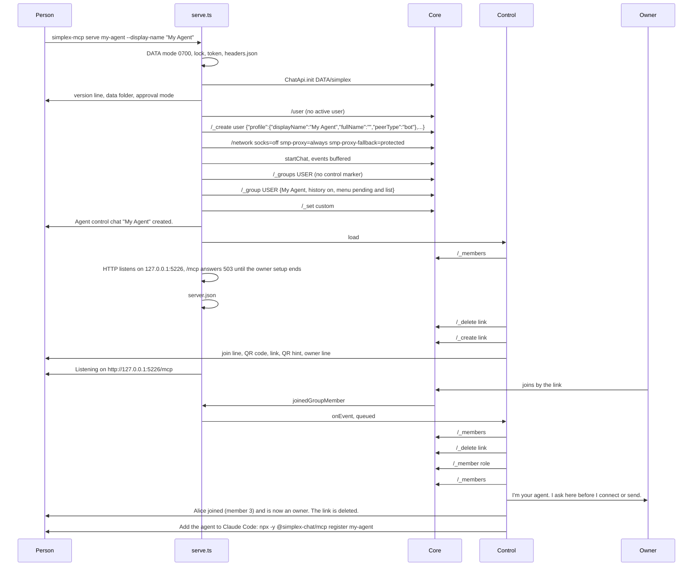

Notes:

- At first use, libsimplex and the Node.js add-on are downloaded, with one `Downloading ...` line each on stderr ([libs.ts:112-133](../../simplex-chat-nodejs/src/libs.ts#L112-L133)).
- With `--data`, `--data <folder>` is appended to the register hint, shell-quoted ([serve.ts:164-166](../src/serve.ts#L164-L166)).
- With `--qr-code small`, the line `If the QR code does not scan, ...` is printed after the link ([control.ts:307](../src/control.ts#L307)).
- The server runs `ownerJoined` for every `joinedGroupMember` event of a human, and the link is deleted in that handler ([control.ts:152-153](../src/control.ts#L152-L153), [:266-273](../src/control.ts#L266-L273)).

Source: [cli.ts:191-200](../src/cli.ts#L191-L200), [serve.ts:64-123](../src/serve.ts#L64-L123), [files.ts:12-44](../src/files.ts#L12-L44), [control.ts:374-385](../src/control.ts#L374-L385), [:88-103](../src/control.ts#L88-L103), [:236-240](../src/control.ts#L236-L240), [:301-311](../src/control.ts#L301-L311), [:146-155](../src/control.ts#L146-L155).

---

## 2. `register`

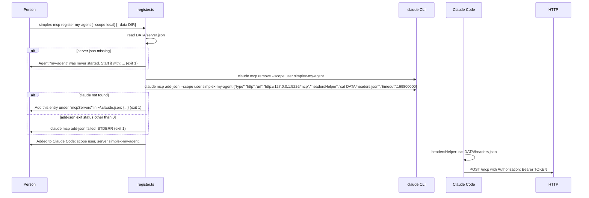

Notes:

- `simplex-mcp` ignores the exit status of `claude mcp remove` and stops at that step only when the `claude` binary is missing ([register.ts:35-36](../src/register.ts#L35-L36)).
- `timeout` is `(expireHours + 24) × 3600000 + 600000` ms from `server.json` ([register.ts:48](../src/register.ts#L48)).
- With `--scope local`, the project folder in the manual entry is the git repository root, the main repository of a worktree, or the current folder outside a repository ([register.ts:53](../src/register.ts#L53), [:57-81](../src/register.ts#L57-L81)).

Source: [cli.ts:103-118](../src/cli.ts#L103-L118), [:200](../src/cli.ts#L200), [register.ts:30-87](../src/register.ts#L30-L87), [files.ts:50-53](../src/files.ts#L50-L53).

---

## 3. `connect` with approval

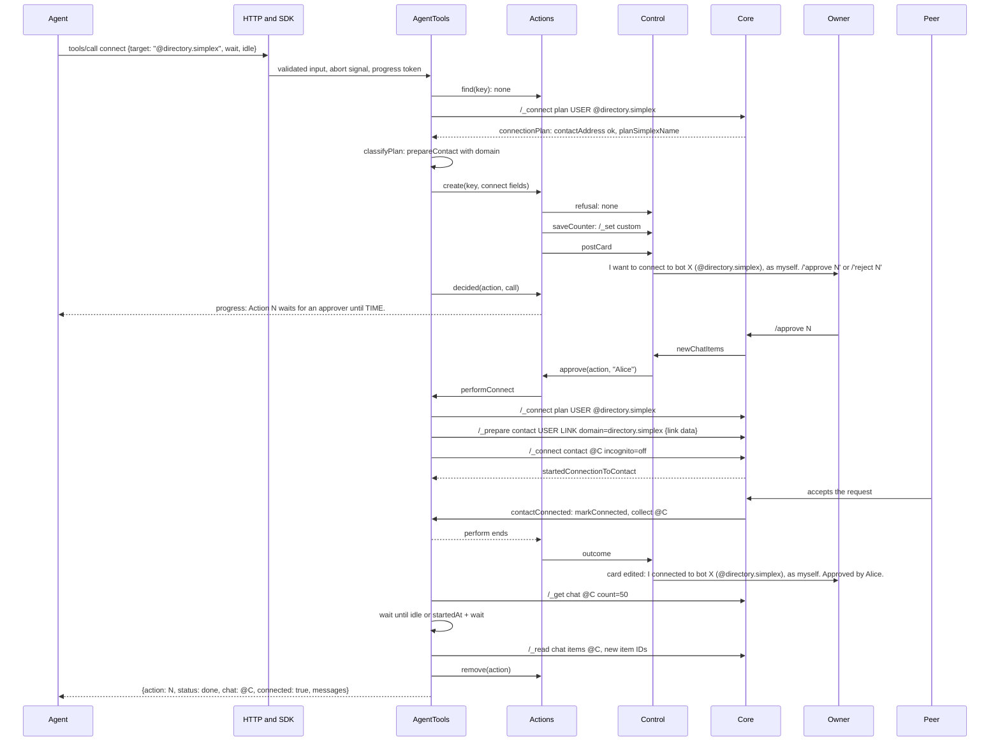

Notes:

- The plan is read again in the perform step ([tools.ts:484](../src/tools.ts#L484)).
- Join commands per plan ([tools.ts:514-542](../src/tools.ts#L514-L542)):

| Plan | Commands |
|---|---|
| known prepared contact or group | `/_connect contact @C incognito=X [json M]` `/_connect group #G incognito=X [json M]` |
| channel link (`direct` false, with link data) | `/_prepare group USER LINK direct=off [domain=D] JSON` `/_connect group #G incognito=X` |
| contact address with link data, and a SimpleX name or a message | `/_prepare contact USER LINK [domain=D] JSON` `/_connect contact @C incognito=X [json M]`, or `/_connect group #G ...` for a business |
| `contactViaAddress` | `/_connect contact USER incognito=X CONTACT_ID` |
| other links | `/_connect USER incognito=X LINK` |

- After a failed prepared connect, the server deletes the prepared chat with `notify=off` ([tools.ts:544-551](../src/tools.ts#L544-L551)).
- The connection is matched by `contactConnected` or `userJoinedGroup`: by contact or group ID, or by the pending connection ID ([tools.ts:387-395](../src/tools.ts#L387-L395), [:557-562](../src/tools.ts#L557-L562)).
- In the perform step the server waits for the other side until `startedAt + wait`, at most until `created + 23 h 50 min`, and then reports `connected: false` ([tools.ts:483](../src/tools.ts#L483), [:507-511](../src/tools.ts#L507-L511)).
- Without `message`, the idle time is counted from the connection; with `message`, from the first reply ([tools.ts:568](../src/tools.ts#L568), [messages.ts:225](../src/messages.ts#L225)).
- For a target the agent is connected to, the result is `status: known` with its chat fields, and no action is created ([tools.ts:417](../src/tools.ts#L417)).
- Exact progress texts: `Action N waits for an approver until TIME.`, then `Action N waits for the connection until TIME.`, then `K messages in CHAT; waiting until TIME.` ([actions.ts:296-299](../src/actions.ts#L296-L299), [tools.ts:452](../src/tools.ts#L452)).

Source: [tools.ts:412-464](../src/tools.ts#L412-L464), [:466-571](../src/tools.ts#L466-L571), [:811-874](../src/tools.ts#L811-L874), [actions.ts:119-183](../src/actions.ts#L119-L183), [control.ts:134-190](../src/control.ts#L134-L190).

---

## 4. `send` with responses

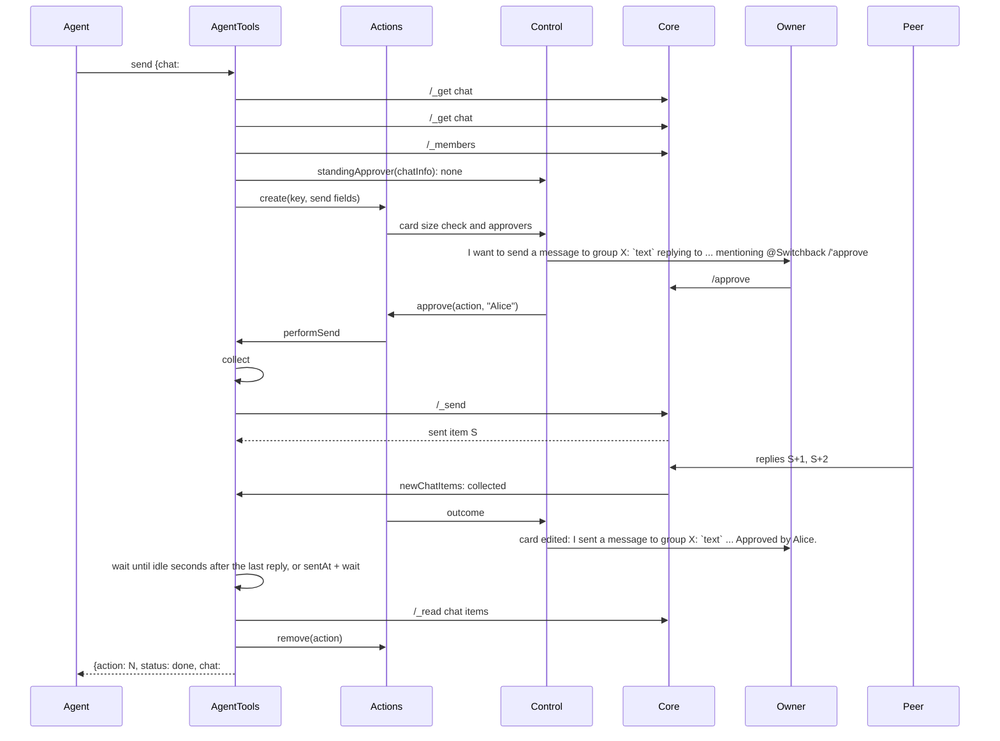

Notes:

- Checks before the action: chat reference, role `observer` or `relay` refused, `reply_to` item present, mentioned members present and the chat a group ([tools.ts:573-581](../src/tools.ts#L573-L581)).
- The server starts collecting before the send and, after it, drops items with IDs up to the sent item ([tools.ts:612](../src/tools.ts#L612), [:622-624](../src/tools.ts#L622-L624)).
- Mentioned names missing from the text are prefixed as `@name` ([tools.ts:614-615](../src/tools.ts#L614-L615)).
- While a collected message is live, the server waits for its final update; live items are left out of `responses` and counted in `more` ([messages.ts:224-225](../src/messages.ts#L224-L225), [tools.ts:599](../src/tools.ts#L599), [:605](../src/tools.ts#L605)).
- At most 100 replies are kept per action; later ones are counted as overflow ([messages.ts:78-79](../src/messages.ts#L78-L79)).

Source: [tools.ts:573-629](../src/tools.ts#L573-L629), [messages.ts:71-83](../src/messages.ts#L71-L83), [:222-230](../src/messages.ts#L222-L230), [control.ts:448-453](../src/control.ts#L448-L453).

---

## 5. `receive` with `wait`

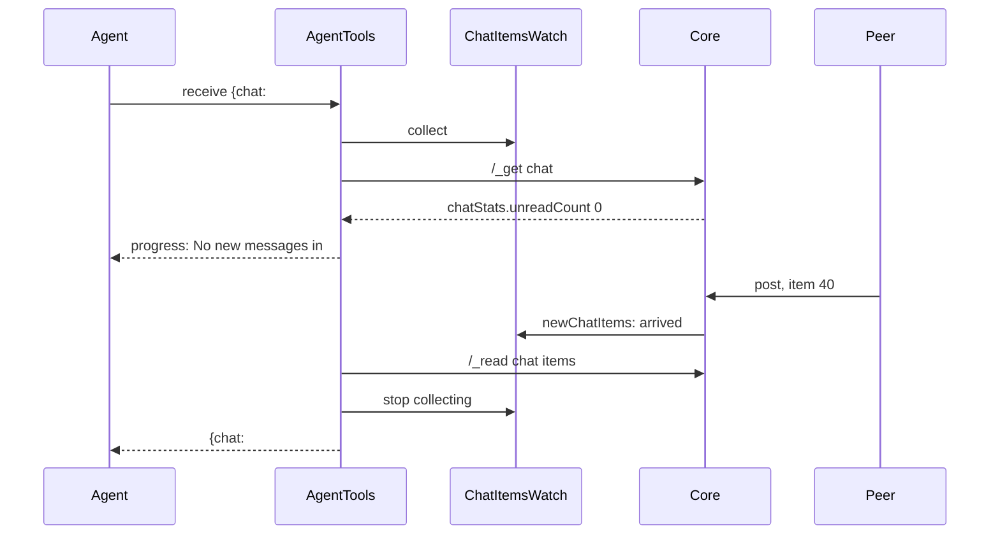

Notes:

- With unread items the server reads `around=<minUnreadItemId> count=0`, then pages of `after=<last> count=100` until it holds `limit + 1` unread, non-live messages or a page is short ([messages.ts:183-194](../src/messages.ts#L183-L194)).
- Unread items other than messages in the read pages are marked read with the returned messages ([tools.ts:663](../src/tools.ts#L663), [:680](../src/tools.ts#L680)).
- `more`: the arrived messages not returned, the overflow and the unread items not read ([tools.ts:682](../src/tools.ts#L682)).
- Items received while the pages are read are returned once ([tools.ts:662-665](../src/tools.ts#L662-L665)).
- Exact progress text: `No new messages in CHAT; waiting until TIME.` ([tools.ts:669](../src/tools.ts#L669)).

Source: [tools.ts:653-686](../src/tools.ts#L653-L686), [messages.ts:183-220](../src/messages.ts#L183-L220).

---

## 6. `send` under a standing approval, and `/revoke`

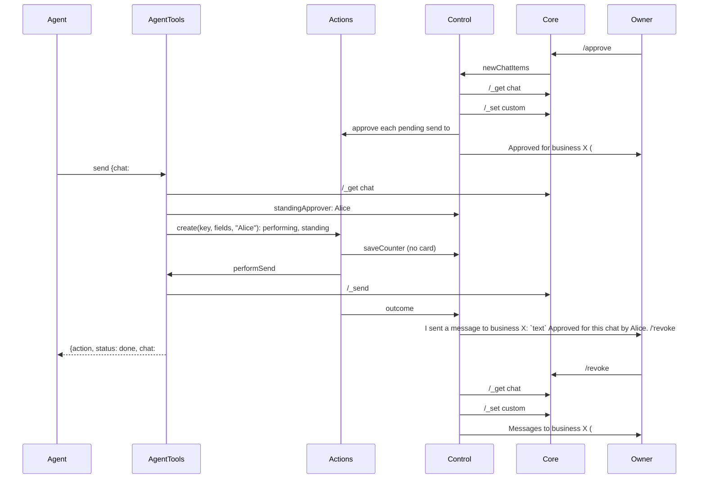

Notes:

- The approval is used in mode `requests` while member `approvedById` is an approver ([control.ts:113-116](../src/control.ts#L113-L116)).
- For sends that were pending at `/approve CHAT all`, the card ends with the plain `Approved by Alice.` ([control.ts:199-201](../src/control.ts#L199-L201), [:419](../src/control.ts#L419)).
- `connect` and `leave` actions are created without the standing approver, so they stay pending ([tools.ts:423](../src/tools.ts#L423), [:638](../src/tools.ts#L638), [commands.test.ts:360-369](../test/unit/commands.test.ts#L360-L369)).

Source: [control.ts:192-211](../src/control.ts#L192-L211), [tools.ts:586](../src/tools.ts#L586), [actions.ts:119-146](../src/actions.ts#L119-L146), [:223-240](../src/actions.ts#L223-L240).

---

## 7. `leave`

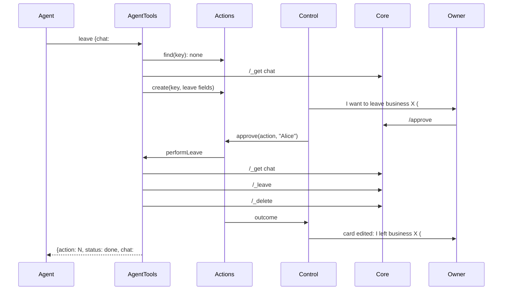

Notes:

- For a contact, the card text is `I want to delete KIND NAME (@N).`, and the perform step sends `/_delete @N full` ([actions.ts:280-282](../src/actions.ts#L280-L282), [tools.ts:647](../src/tools.ts#L647)).
- The delete mode is `full` without `notify=off`, so the core notifies the contact or the members ([types.js:76-81](../node_modules/@simplex-chat/types/dist/types.js#L76-L81)).
- The server looks for an attached action before it reads the chat, so a repeated call after the deletion is attached to the done action ([tools.ts:633-636](../src/tools.ts#L633-L636), [messages.test.ts:745-759](../test/unit/messages.test.ts#L745-L759)).

Source: [tools.ts:631-651](../src/tools.ts#L631-L651), [control.ts:454-457](../src/control.ts#L454-L457).

---

## 8. Mode `host`

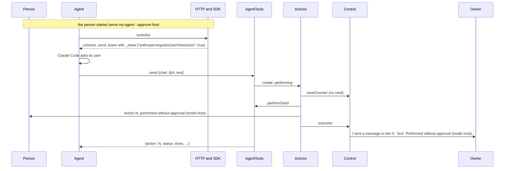

Notes:

- New actions are still refused unless the control chat has an approver ([control.ts:107-110](../src/control.ts#L107-L110)).
- In mode `host`, `undefined` is returned by `standingApprover`, so standing approvals are ignored by `send`, `list` and `/list` ([control.ts:115](../src/control.ts#L115)).
- `_meta` is set on `connect`, `send` and `leave` only ([tools.ts:361](../src/tools.ts#L361)).

Source: [tools.ts:355-365](../src/tools.ts#L355-L365), [actions.ts:130](../src/actions.ts#L130), [:238](../src/actions.ts#L238), [control.ts:419](../src/control.ts#L419).

---

## 9. Expiry

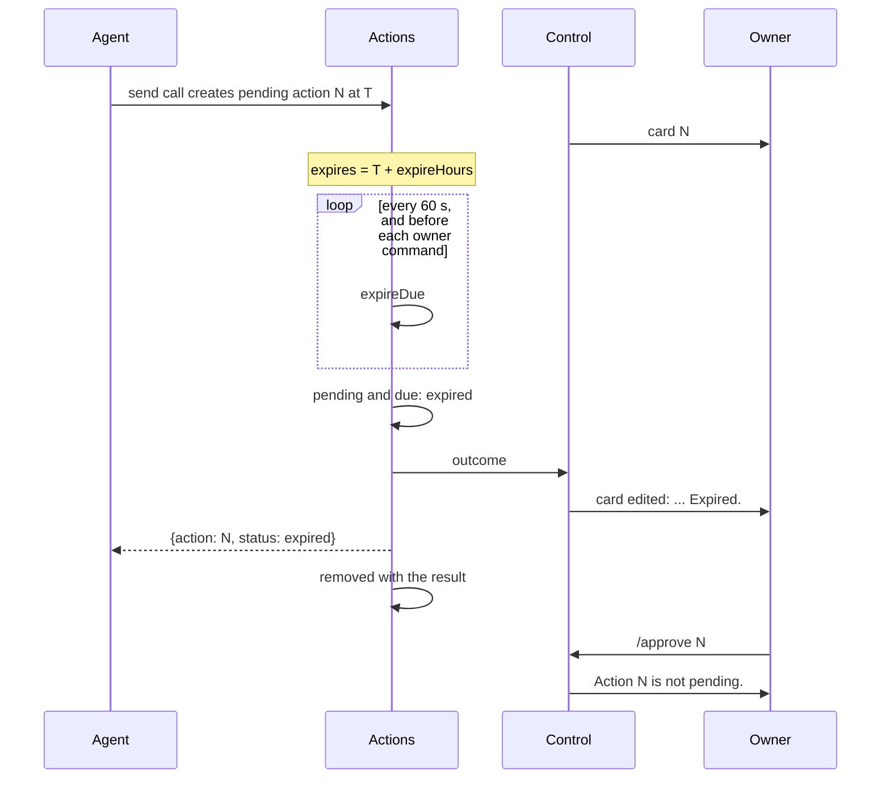

Notes:

- A decided action with an open count of 0 is removed at the first tick after its expiry time ([actions.ts:160-161](../src/actions.ts#L160-L161)).
- Expiry times are listed in the `/pending` reply ([control.ts:472-474](../src/control.ts#L472-L474)).
- The server ends the connect wait at `created + 23 h 50 min`, within the 24 hours in which a message can be edited ([tools.ts:112](../src/tools.ts#L112), [:483](../src/tools.ts#L483)).

Source: [actions.ts:97](../src/actions.ts#L97), [:153-164](../src/actions.ts#L153-L164), [control.ts:164](../src/control.ts#L164), [:433-434](../src/control.ts#L433-L434).

---

## 10. A lost call and its re-attachment

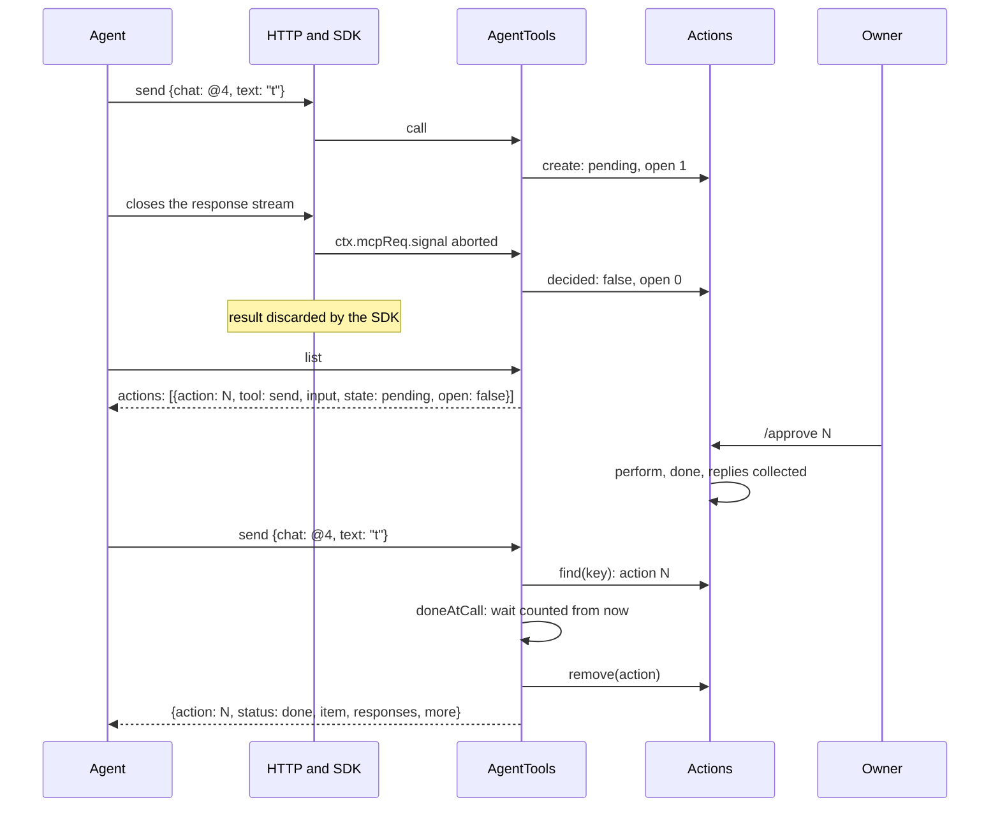

Notes:

- The key is the tool name with the action fields: `target`, `incognito`, `message` for `connect`; `chat`, `text`, `reply_to`, `mention` for `send`; `chat` for `leave` ([tools.ts:413](../src/tools.ts#L413), [:582](../src/tools.ts#L582), [:633](../src/tools.ts#L633), [:1003-1005](../src/tools.ts#L1003-L1005)).
- The `wait`, `idle` and `limit` of the attaching call are used ([tools.ts:593](../src/tools.ts#L593)).
- For a call aborted before `create`, the server returns before it creates an action ([tools.ts:422](../src/tools.ts#L422), [:585](../src/tools.ts#L585), [:637](../src/tools.ts#L637)).
- Abort path in the SDK: on `res` close the web request is aborted ([node index.cjs:299-303](../node_modules/@modelcontextprotocol/node/dist/index.cjs#L299-L303)); the per-request transport is closed ([server index.cjs:86-90](../node_modules/@modelcontextprotocol/server/dist/index.cjs#L86-L90)); the handler signal is aborted ([src-BhnGYybN.cjs:6425](../node_modules/@modelcontextprotocol/server/dist/src-BhnGYybN.cjs#L6425)).

Source: [tools.ts:431-442](../src/tools.ts#L431-L442), [:590-608](../src/tools.ts#L590-L608), [:694](../src/tools.ts#L694), [actions.ts:166-177](../src/actions.ts#L166-L177), [messages.ts:206-220](../src/messages.ts#L206-L220).

---

## 11. Shutdown with pending actions

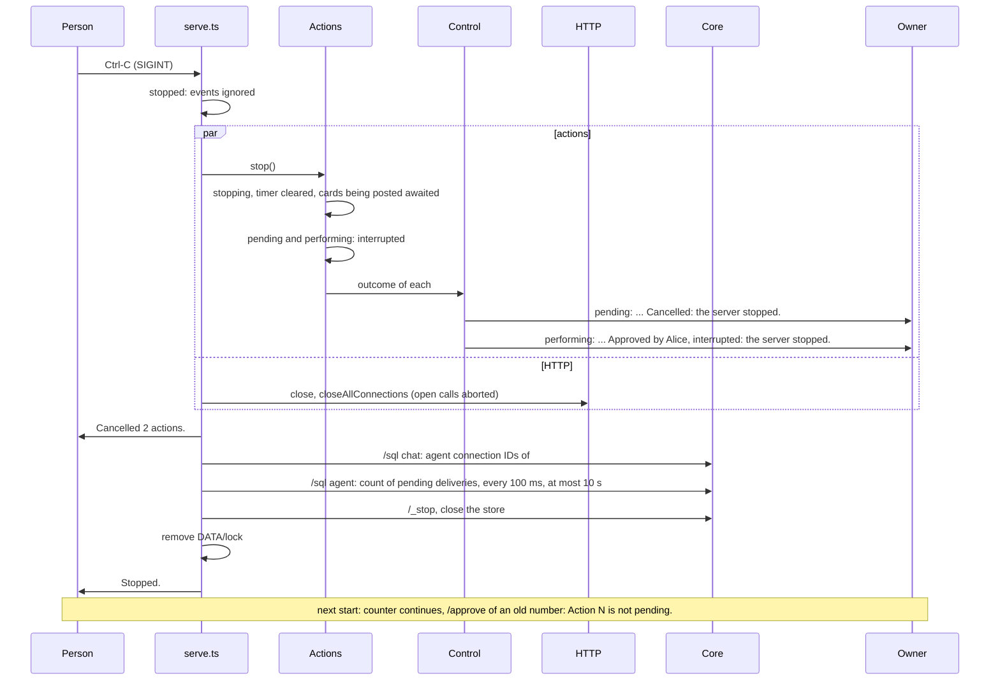

Notes:

- The interrupted card line is `DECIDER; interrupted: the server stopped.` ([control.ts:426](../src/control.ts#L426)).
- A host-mode action whose counter is being written at the stop is set to `pending` and cancelled without a perform ([actions.ts:226](../src/actions.ts#L226), [actions.test.ts:380-391](../test/unit/actions.test.ts#L380-L391)).
- After a crash, the cards of that run are left with their commands; `/approve` of their numbers gets the reply `Action N is not pending.` ([control.ts:182](../src/control.ts#L182)).
- The stop signal of the performs is aborted after the actions are marked interrupted: a `connect` waiting for its connection ends, and an interrupted perform logs no line ([actions.ts:218](../src/actions.ts#L218), [:252](../src/actions.ts#L252), [tools.ts:507-509](../src/tools.ts#L507-L509)).
- An error of a `/sql` query of the delivery wait is logged as `delivery wait: ERROR` on stderr and ends the wait ([serve.ts:185](../src/serve.ts#L185)).

Source: [serve.ts:48-62](../src/serve.ts#L48-L62), [:150-176](../src/serve.ts#L150-L176), [actions.ts:200-209](../src/actions.ts#L200-L209), [http.ts:46-50](../src/http.ts#L46-L50), [control.ts:421-426](../src/control.ts#L421-L426).

---

## 12. `--owners` setup

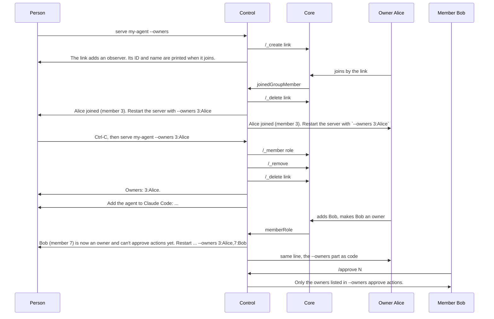

Notes:

- Until the restart with a list, new actions are refused: `The agent has no approving owner. ...` ([control.ts:108-110](../src/control.ts#L108-L110)).
- An entry must match a human by member ID and display name, folded to one line as the restart line prints it, or the server exits with code 2 ([control.ts:249-253](../src/control.ts#L249-L253)).
- With `--reset-owners`, the server deletes the control chat for all members and creates a new one with the same counter; the CLI refuses the option with an `--owners` list ([control.ts:387-392](../src/control.ts#L387-L392), [cli.ts:97-99](../src/cli.ts#L97-L99)).
- When a listed owner leaves and none remains: `... is no longer an owner. No owners remain: restart the server with --reset-owners --owners` ([control.ts:288-293](../src/control.ts#L288-L293)).

Source: [control.ts:242-264](../src/control.ts#L242-L264), [:275-294](../src/control.ts#L275-L294), [:357-361](../src/control.ts#L357-L361), [:565-591](../src/control.ts#L565-L591).
