# SimpleX MCP server: flows

> Sequence diagrams of the main flows of `@simplex-chat/mcp` 0.3.0, each with notes and source locations: `serve` in flows 1-16, the Claude Code plugin in flows 17-30.
>
> Related specs: [README](README.md) | [Architecture](architecture.md) | [API](api.md)

Participants:

| Letter | Participant |
|---|---|
| P | the person at the terminal |
| A | the agent in Claude Code |
| H | the HTTP listener with the MCP SDK |
| T | `AgentTools` |
| X | `Actions` |
| K | `Control` |
| C | the SimpleX core behind `ChatApi` |
| O | the owner in the SimpleX app |
| D | a peer |

In flows 1-16, `#G` is the agent control chat, `USER` the agent's user ID, `DATA` the data folder. Calls to the core are shown as the `ChatApi` methods the server calls, with their arguments in short. Card and progress texts with a semicolon are shown with a comma in the diagrams; the exact texts are in [API](api.md).

---

## Table of contents

1. [First start and the owner joins](#1-first-start-and-the-owner-joins)
2. [`register`](#2-register)
3. [`connect` with approval](#3-connect-with-approval)
4. [`send` with responses](#4-send-with-responses)
5. [`receive` with `wait`](#5-receive-with-wait)
6. [`send` under a standing approval, and `/revoke`](#6-send-under-a-standing-approval-and-revoke)
7. [`leave`](#7-leave)
8. [Mode `host`](#8-mode-host)
9. [Expiry](#9-expiry)
10. [A lost call and its re-attachment](#10-a-lost-call-and-its-re-attachment)
11. [Shutdown with pending actions](#11-shutdown-with-pending-actions)
12. [`--owners` setup](#12---owners-setup)
13. [`download` with approval](#13-download-with-approval)
14. [`/forward`](#14-forward)
15. [`send` with a file](#15-send-with-a-file)
16. [`/leave` and `/delete CHAT files`](#16-leave-and-delete-chat-files)

Claude Code plugin ([participants](#claude-code-plugin-flows)):

17. [First session start and the owner joins](#17-first-session-start-and-the-owner-joins)
18. [Session process start and attach](#18-session-process-start-and-attach)
19. [A tool call with approval in the session group](#19-a-tool-call-with-approval-in-the-session-group)
20. [A prompt from the session group](#20-a-prompt-from-the-session-group)
21. [A terminal prompt and the answer](#21-a-terminal-prompt-and-the-answer)
22. [A tool use approved in the session group](#22-a-tool-use-approved-in-the-session-group)
23. [Mode `host` for a session](#23-mode-host-for-a-session)
24. [`/give`](#24-give)
25. [`reset-owners`](#25-reset-owners)
26. [Idle close, idle stop and a newer version](#26-idle-close-idle-stop-and-a-newer-version)
27. [`/clear`, `--continue` and `/resume` in one session](#27-clear---continue-and-resume-in-one-session)
28. [A member joins the Main group and a session's group, and a person is added to it](#28-a-member-joins-the-main-group-and-a-sessions-group-and-a-person-is-added-to-it)
29. [`reply`](#29-reply)
30. [A run that is not interactive](#30-a-run-that-is-not-interactive)

---

## 1. First start and the owner joins

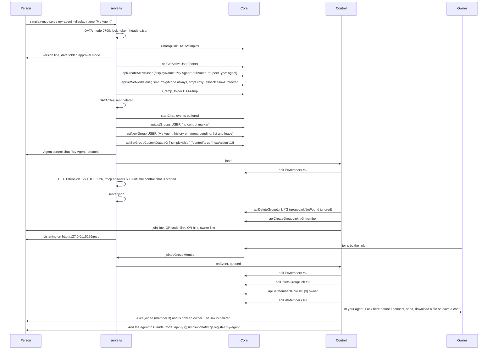

Notes:

- At first use, libsimplex and the Node.js add-on are downloaded, with one `Downloading ...` line each on stderr ([libs.ts:114-135](../../simplex-chat-nodejs/src/libs.ts#L114-L135)).
- With `--data`, `--data <folder>` is appended to the register hint, shell-quoted ([serve.ts:157-159](../src/serve.ts#L157-L159)).
- With `--qr-code small`, the line `If the QR code does not scan, ...` is printed after the link ([control.ts:487](../src/control.ts#L487)).
- Events that arrive before the HTTP listener starts are buffered and handled in order ([core.ts:61-75](../src/core.ts#L61-L75)).
- The server runs `ownerJoined` for every `joinedGroupMember` event of a human without `--owners`, and the link is deleted in that handler ([control.ts:232-233](../src/control.ts#L232-L233), [:446-453](../src/control.ts#L446-L453)).

Source: [cli.ts:218-251](../src/cli.ts#L218-L251), [serve.ts:64-122](../src/serve.ts#L64-L122), [core.ts:37-81](../src/core.ts#L37-L81), [files.ts:97-140](../src/files.ts#L97-L140), [http.ts:14-46](../src/http.ts#L14-L46), [control.ts:112-145](../src/control.ts#L112-L145), [:416-420](../src/control.ts#L416-L420), [:481-500](../src/control.ts#L481-L500), [:585-610](../src/control.ts#L585-L610).

---

## 2. `register`

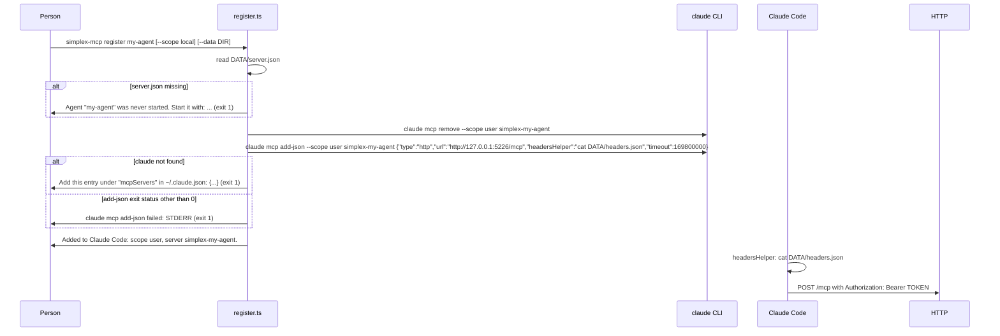

Notes:

- `simplex-mcp` ignores the exit status of `claude mcp remove` and stops at that step only when the `claude` binary is missing ([register.ts:38-39](../src/register.ts#L38-L39)).
- On Windows, a missing `claude` is run again through `cmd.exe`, with each argument quoted for it ([register.ts:86-101](../src/register.ts#L86-L101)).
- `timeout` is `(expireHours + 24) × 3600000 + 600000` ms from `server.json` ([register.ts:51](../src/register.ts#L51)).
- With `--scope local`, the project folder in the manual entry is the git repository root, the main repository of a worktree, or the current folder outside a repository ([register.ts:56](../src/register.ts#L56), [:60-84](../src/register.ts#L60-L84)).

Source: [cli.ts:130-145](../src/cli.ts#L130-L145), [:227](../src/cli.ts#L227), [register.ts:33-58](../src/register.ts#L33-L58), [files.ts:142-145](../src/files.ts#L142-L145).

---

## 3. `connect` with approval

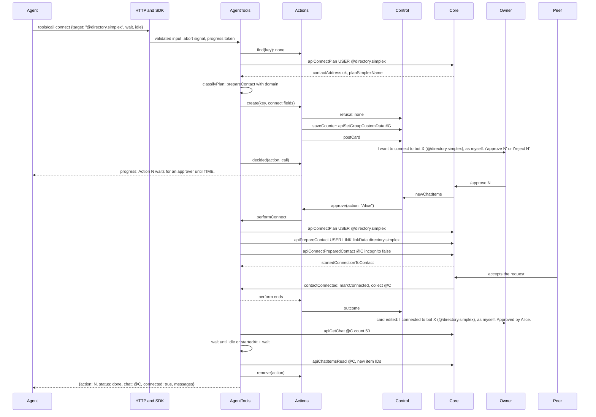

Notes:

- The plan is read again in the perform step ([tools.ts:815](../src/tools.ts#L815)).
- Join methods per plan ([tools.ts:846-874](../src/tools.ts#L846-L874), [:1386-1449](../src/tools.ts#L1386-L1449)):

| Plan | Methods |
|---|---|
| known prepared contact or group | `apiConnectPreparedContact(C, incognito, message)`<br>`apiConnectPreparedGroup(G, incognito, message)` |
| channel link (`direct` false, with link data) | `apiPrepareGroup(USER, LINK, false, linkData, domain)`<br>`apiConnectPreparedGroup(G, incognito)` |
| contact address with link data, and a SimpleX name or a message | `apiPrepareContact(USER, LINK, linkData, domain)`<br>`apiConnectPreparedContact(C, incognito, message)`, or `apiConnectPreparedGroup` for a business |
| `contactViaAddress` | `apiConnectContactViaAddress(USER, incognito, CONTACT_ID)` |
| other links | `apiConnectPreparedLink(USER, incognito, LINK)` |

- After a failed prepared connect, the server deletes the prepared chat without notifying ([tools.ts:876-883](../src/tools.ts#L876-L883)).
- The connection is matched by `contactConnected` or `userJoinedGroup`: by contact or group ID, or by the pending connection ID ([tools.ts:656-664](../src/tools.ts#L656-L664), [:885-890](../src/tools.ts#L885-L890)). In the plugin, a pending connection is also recorded in the session group's data, and its chat becomes the session's when it connects after the call returned, within a day of the record ([tools.ts:826](../src/tools.ts#L826), [hub.ts:162-167](../src/hub.ts#L162-L167), [:496-497](../src/hub.ts#L496-L497)).
- In the perform step the server waits for the other side until `startedAt + wait`, at most until `created + 23 h 50 min`, and then reports `connected: false` ([tools.ts:153](../src/tools.ts#L153), [:814](../src/tools.ts#L814), [:840-843](../src/tools.ts#L840-L843)).
- Without `message`, the idle time is counted from the connection; with `message`, from the first reply ([tools.ts:897](../src/tools.ts#L897), [messages.ts:327-335](../src/messages.ts#L327-L335)).
- For a target the agent is connected to, the result is `status: known` with its chat fields, and no action is created; in the plugin, the chat becomes the session's when it has no owner ([tools.ts:737](../src/tools.ts#L737), [:750-755](../src/tools.ts#L750-L755)).
- Exact progress texts: `Action N waits for an approver until TIME.`, then `Action N waits for the connection until TIME.`, then `K messages in CHAT; waiting until TIME.` ([actions.ts:412-423](../src/actions.ts#L412-L423), [tools.ts:783](../src/tools.ts#L783)).

Source: [tools.ts:732-797](../src/tools.ts#L732-L797), [:811-900](../src/tools.ts#L811-L900), [actions.ts:180-215](../src/actions.ts#L180-L215), [:249-267](../src/actions.ts#L249-L267), [control.ts:183-194](../src/control.ts#L183-L194).

---

## 4. `send` with responses

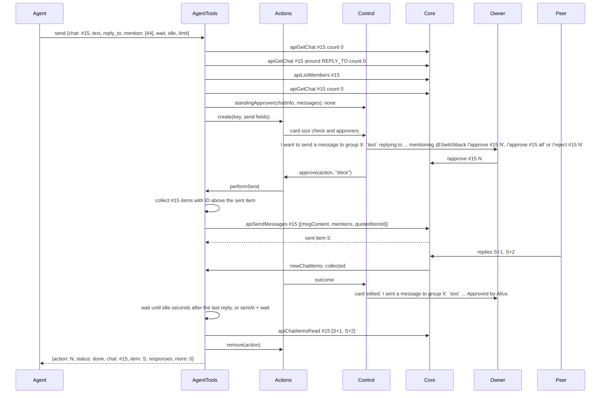

Notes:

- Checks before the action: `text` or `file`, the chat connected, role `observer` or `relay` refused, `reply_to` item a message, mentioned members present and the chat a group, and the message length with its quote ([tools.ts:907-918](../src/tools.ts#L907-L918)).
- The server starts collecting before the send and, after it, drops items with IDs up to the sent item ([tools.ts:950](../src/tools.ts#L950), [:963-965](../src/tools.ts#L963-L965)).
- Mentioned names missing from the text are prefixed as `@name` ([tools.ts:1562-1565](../src/tools.ts#L1562-L1565)).
- While a collected message is live, the server waits for its final update; live items are left out of `responses` and counted in `more` ([messages.ts:327-335](../src/messages.ts#L327-L335), [tools.ts:936](../src/tools.ts#L936), [:942](../src/tools.ts#L942)).
- At most 100 replies are kept per action; later ones are counted as overflow ([messages.ts:10](../src/messages.ts#L10), [:109-110](../src/messages.ts#L109-L110)).

Source: [tools.ts:902-971](../src/tools.ts#L902-L971), [messages.ts:99-114](../src/messages.ts#L99-L114), [:327-335](../src/messages.ts#L327-L335), [control.ts:692-698](../src/control.ts#L692-L698).

---

## 5. `receive` with `wait`

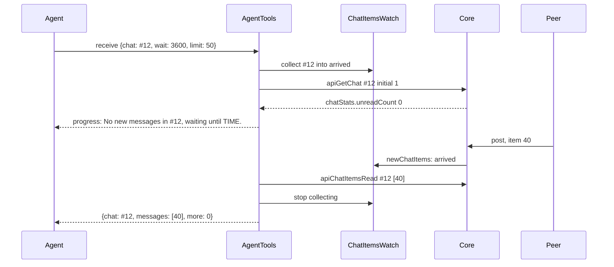

Notes:

- With unread items the server reads `around` the first unread item, `count` 0, then pages of `after` the last item, `count` 100, until it holds `limit + 1` unread, non-live messages or a page is short ([messages.ts:289-303](../src/messages.ts#L289-L303)).
- Unread items other than messages in the read pages are marked read with the returned messages ([tools.ts:1249](../src/tools.ts#L1249), [:1266](../src/tools.ts#L1266)).
- `more`: the arrived messages not returned, the overflow and the unread items not read ([tools.ts:1268](../src/tools.ts#L1268)).
- Items received while the pages are read are returned once ([tools.ts:1248-1251](../src/tools.ts#L1248-L1251)).
- Exact progress text: `No new messages in CHAT; waiting until TIME.` ([tools.ts:1255](../src/tools.ts#L1255)).

Source: [tools.ts:1237-1272](../src/tools.ts#L1237-L1272), [messages.ts:289-335](../src/messages.ts#L289-L335).

---

## 6. `send` under a standing approval, and `/revoke`

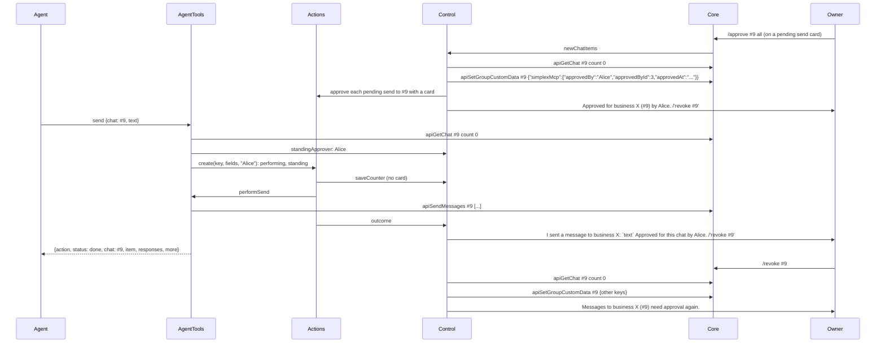

Notes:

- The approval is used in mode `requests` while member `approvedById` is an approver ([control.ts:164-167](../src/control.ts#L164-L167)).
- For sends that were pending at `/approve CHAT all`, the card ends with the plain `Approved by Alice.` ([control.ts:658](../src/control.ts#L658), [:667](../src/control.ts#L667)).
- `connect` and `leave` actions are created without the standing approver, so they stay pending ([tools.ts:743](../src/tools.ts#L743), [:1067](../src/tools.ts#L1067)).
- `/receive CHAT N all` and `/receive CHAT off` work the same way for downloads, with the key `simplexMcpFiles`, except that download N alone is performed, and the other pending downloads of the chat stay pending ([control.ts:24-27](../src/control.ts#L24-L27), [:298-300](../src/control.ts#L298-L300), [tools.ts:1099](../src/tools.ts#L1099)).

Source: [control.ts:290-310](../src/control.ts#L290-L310), [:412-414](../src/control.ts#L412-L414), [tools.ts:922-924](../src/tools.ts#L922-L924), [actions.ts:180-215](../src/actions.ts#L180-L215), [:329-347](../src/actions.ts#L329-L347).

---

## 7. `leave`

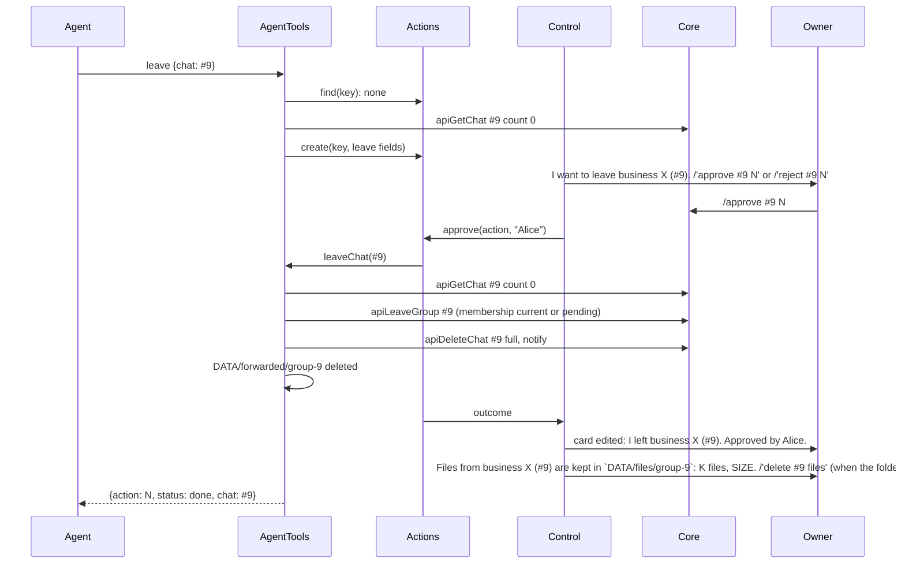

Notes:

- For a contact, the card text is `I want to delete KIND NAME (@N).`, and the perform step calls `apiDeleteChat` for the contact, full, with notify ([control.ts:699-702](../src/control.ts#L699-L702), [tools.ts:1075](../src/tools.ts#L1075)).
- The delete notifies, so the core notifies the contact or the members ([tools.ts:1075](../src/tools.ts#L1075), [:1078](../src/tools.ts#L1078)).
- The server looks for an attached action before it reads the chat, so a repeated call after the deletion is attached to the done action ([tools.ts:1062-1064](../src/tools.ts#L1062-L1064)).

Source: [tools.ts:1060-1082](../src/tools.ts#L1060-L1082), [control.ts:187-194](../src/control.ts#L187-L194), [:346-349](../src/control.ts#L346-L349).

---

## 8. Mode `host`

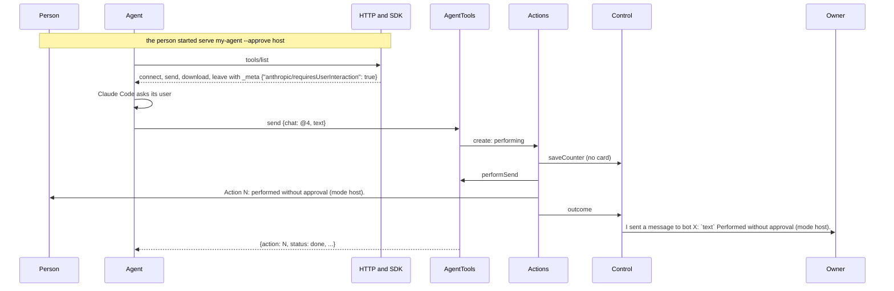

Notes:

- New actions are still refused unless the control chat has an approver ([control.ts:153-157](../src/control.ts#L153-L157)).
- In mode `host`, `standingApprover` returns `undefined`, so standing approvals are ignored by `send`, `download`, `list` and `/list`, and `/approve CHAT all` stores nothing; downloads get no card, so `/receive CHAT N all` has no card to act on ([control.ts:166](../src/control.ts#L166), [:256](../src/control.ts#L256)).
- A download in mode `host` is received without the approval of unknown servers, and it gets no card and no outcome post ([tools.ts:611](../src/tools.ts#L611), [:1153](../src/tools.ts#L1153), [control.ts:581-583](../src/control.ts#L581-L583)).
- The kept-files message also follows a done `leave` in mode `host` ([control.ts:192-193](../src/control.ts#L192-L193)).

Source: [tools.ts:541-543](../src/tools.ts#L541-L543), [actions.ts:193](../src/actions.ts#L193), [:345](../src/actions.ts#L345), [control.ts:187-194](../src/control.ts#L187-L194), [:658](../src/control.ts#L658).

---

## 9. Expiry

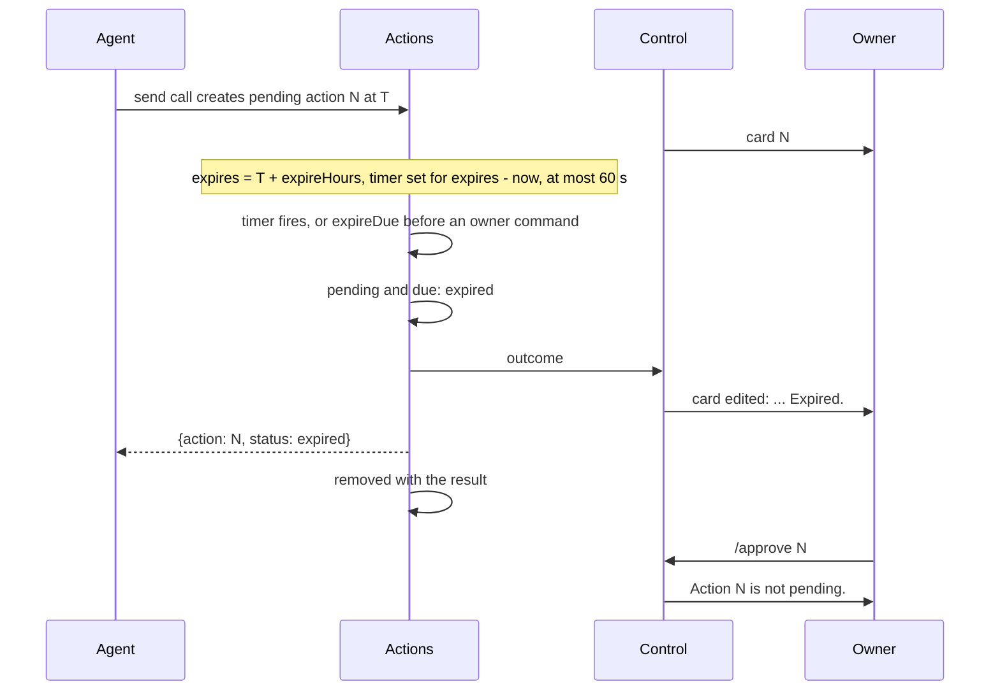

Notes:

- A decided action with an open count of 0 is removed once its expiry time has passed: at its timer, at a later decision or at the close of its last call ([actions.ts:312-314](../src/actions.ts#L312-L314)).
- A timer waits at most 60 s and, when it fires before the expiry time, on the monotonic clock, is set again, so an action whose expiry time passes while the computer sleeps expires within 60 s after it wakes ([actions.ts:11](../src/actions.ts#L11), [:305](../src/actions.ts#L305)).
- Expiry times are listed in the `/pending` reply ([control.ts:729-731](../src/control.ts#L729-L731)).
- The server ends the connect wait at `created + 23 h 50 min`, within the 24 hours in which a message can be edited ([tools.ts:153](../src/tools.ts#L153), [:814](../src/tools.ts#L814)).

Source: [actions.ts:190](../src/actions.ts#L190), [:243-247](../src/actions.ts#L243-L247), [:297-314](../src/actions.ts#L297-L314), [control.ts:244](../src/control.ts#L244), [:274](../src/control.ts#L274).

---

## 10. A lost call and its re-attachment

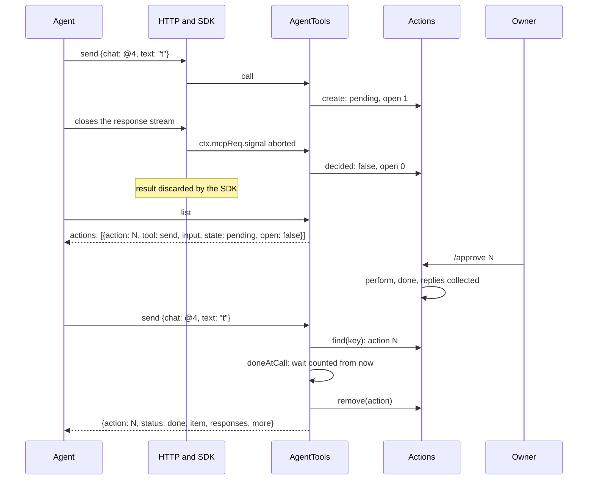

Notes:

- The key is the session number, `undefined` for `serve`, the tool name and the action fields: `target`, `incognito`, `message` for `connect`; `chat`, `text`, `file`, `as`, `reply_to`, `mention` for `send`; `chat`, `item` for `download`; `chat` for `leave` ([tools.ts:733](../src/tools.ts#L733), [:904](../src/tools.ts#L904), [:1062](../src/tools.ts#L1062), [:1086](../src/tools.ts#L1086), [:1701-1703](../src/tools.ts#L1701-L1703)).
- The `wait`, `idle` and `limit` of the attaching call are used ([tools.ts:930](../src/tools.ts#L930)).
- For a call aborted before `create`, the server returns before it creates an action ([tools.ts:742](../src/tools.ts#L742), [:923](../src/tools.ts#L923), [:1066](../src/tools.ts#L1066), [:1100](../src/tools.ts#L1100)).
- Abort path in the SDK: on `res` close the web request is aborted ([node index.cjs:299-303](../node_modules/@modelcontextprotocol/node/dist/index.cjs#L299-L303)); the per-request transport is closed ([server index.cjs:86-90](../node_modules/@modelcontextprotocol/server/dist/index.cjs#L86-L90)); the handler signal is aborted ([src-BhnGYybN.cjs:6425](../node_modules/@modelcontextprotocol/server/dist/src-BhnGYybN.cjs#L6425)).

Source: [tools.ts:761-773](../src/tools.ts#L761-L773), [:927-945](../src/tools.ts#L927-L945), [:1280](../src/tools.ts#L1280), [actions.ts:249-261](../src/actions.ts#L249-L261), [messages.ts:311-325](../src/messages.ts#L311-L325).

---

## 11. Shutdown with pending actions

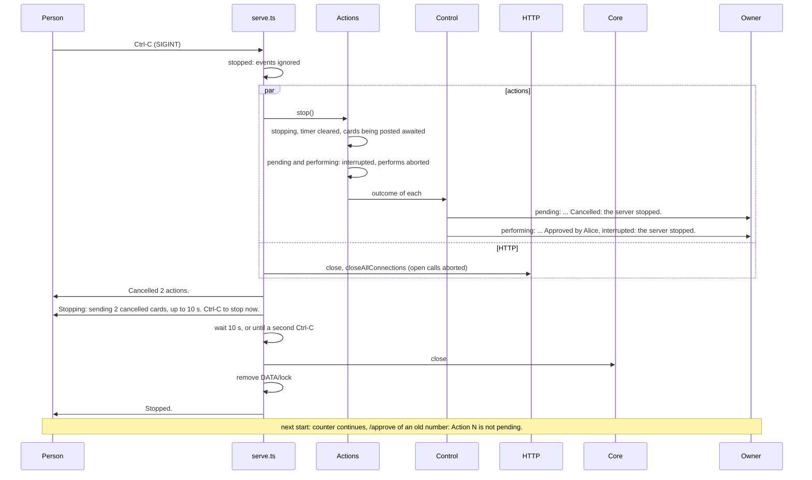

Notes:

- The interrupted card line is `DECIDER; interrupted: the server stopped.` ([control.ts:665](../src/control.ts#L665)).
- An action of mode `host` or of a standing approval whose counter is being written at the stop is set to `pending` and cancelled without a perform ([actions.ts:329-334](../src/actions.ts#L329-L334)).
- After a crash, the cards of that run are left with their commands; `/approve` of their numbers gets the reply `Action N is not pending.` ([control.ts:274](../src/control.ts#L274)).
- The stop signal of the performs is aborted after the actions are marked interrupted: a `connect` waiting for its connection ends, and an interrupted perform logs no line ([actions.ts:290-291](../src/actions.ts#L290-L291), [:344](../src/actions.ts#L344), [tools.ts:840-841](../src/tools.ts#L840-L841)).
- The wait applies only when cards were edited or posted at the stop, a `download` without a card excluded, and `--stop-wait` is above 0 ([serve.ts:149](../src/serve.ts#L149), [:161-175](../src/serve.ts#L161-L175)).

Source: [serve.ts:46-62](../src/serve.ts#L46-L62), [:143-153](../src/serve.ts#L143-L153), [:161-175](../src/serve.ts#L161-L175), [actions.ts:284-314](../src/actions.ts#L284-L314), [http.ts:48-52](../src/http.ts#L48-L52), [control.ts:656-675](../src/control.ts#L656-L675).

---

## 12. `--owners` setup

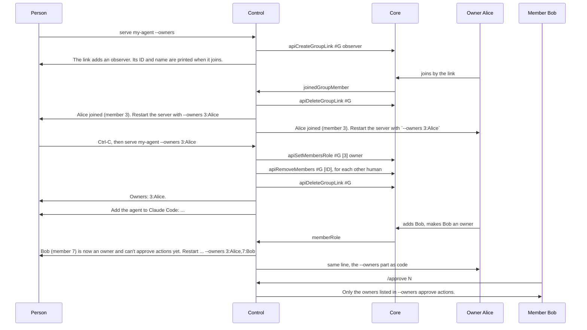

Notes:

- Until the restart with a list, new actions are refused: `The agent has no approving owner. ...` ([control.ts:155-157](../src/control.ts#L155-L157)).
- An entry must match a human by member ID and display name, folded to one line as the restart line prints it, or the server exits with code 2 ([control.ts:429-433](../src/control.ts#L429-L433), [:864-866](../src/control.ts#L864-L866)).
- With `--reset-owners`, the server deletes the control chat for all members and creates a new one with the same counter; the CLI refuses the option with an `--owners` list ([control.ts:619-631](../src/control.ts#L619-L631), [serve.ts:181](../src/serve.ts#L181), [cli.ts:124-126](../src/cli.ts#L124-L126)).
- When a listed owner leaves and none remains: `... is no longer an owner. No owners remain: restart the server with --reset-owners --owners` ([control.ts:468-473](../src/control.ts#L468-L473)).

Source: [control.ts:422-444](../src/control.ts#L422-L444), [:455-474](../src/control.ts#L455-L474), [:481-491](../src/control.ts#L481-L491), [:864-890](../src/control.ts#L864-L890).

---

## 13. `download` with approval

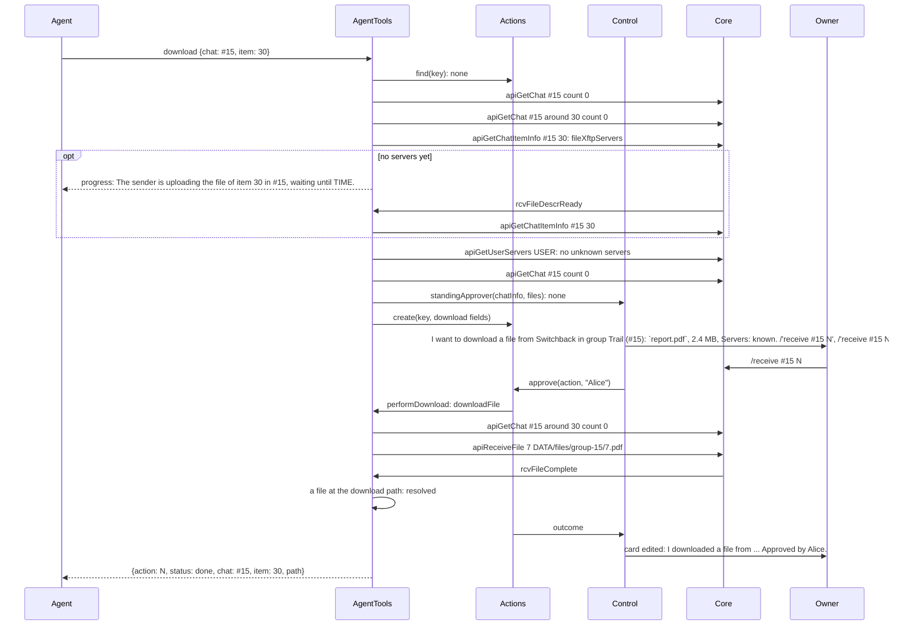

Notes:

- A check every 60 s reads the item: a deleted message or chat fails the download; 30 minutes without a rise of `rcvProgress` fail and cancel it ([tools.ts:1158-1185](../src/tools.ts#L1158-L1185)).
- A download still running `wait` seconds after the perform starts returns `status: performing`; the same call again attaches to the action ([tools.ts:1131-1134](../src/tools.ts#L1131-L1134)).
- `/approve #15 N` on a download card gets the reply `Action N is a download: ...` with the card's command line ([control.ts:281](../src/control.ts#L281)).
- A file on unknown servers gets a card that names their hosts and leaves out `/'receive CHAT N all'` ([control.ts:703-708](../src/control.ts#L703-L708), [:722-725](../src/control.ts#L722-L725), [:775-779](../src/control.ts#L775-L779)). Only such a card approves the relays; the core checks the complete description of every other download, which fails at the acceptance, or at the next check when the description completes later ([tools.ts:611](../src/tools.ts#L611), [:1166](../src/tools.ts#L1166)).
- The card of an image or video shows the sender's preview ([control.ts:526-546](../src/control.ts#L526-L546)); in a plugin session group whose preference does not allow files and media, the core refuses it, and the card is posted as text and edited as text ([:516-524](../src/control.ts#L516-L524)).
- A file the core receives without a request, a short voice message, also in a member chat of a group, is moved into the chat's folder at `rcvFileComplete`; one whose transfer started before a restart, only when it has its full size. Its message then shows it as `offered`, and `download` returns its path after the approval ([tools.ts:617-637](../src/tools.ts#L617-L637), [:1205-1214](../src/tools.ts#L1205-L1214), [messages.ts:194-208](../src/messages.ts#L194-L208)).

Source: [tools.ts:1084-1226](../src/tools.ts#L1084-L1226), [control.ts:677-727](../src/control.ts#L677-L727), [tools.ts:666-693](../src/tools.ts#L666-L693).

---

## 14. `/forward`

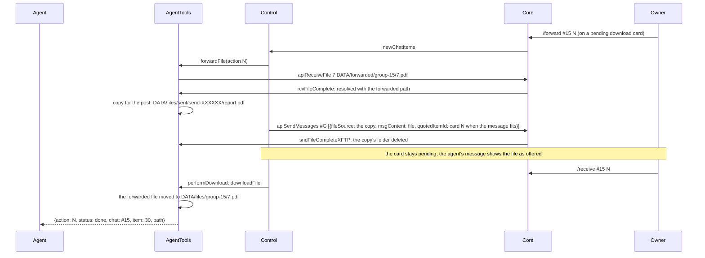

Notes:

- `/forward` gets no reply; a download or post that fails is posted as ``Action N: the file was not received: `ERROR`.``, and a failed post deletes the copy ([control.ts:312-328](../src/control.ts#L312-L328)). In a plugin session group, a post that the core refuses with `feature not allowed Files and media` is answered with `Action N: Files and media are off in the group of this session; its owners can turn them on in the group's preferences.`
- The copy is named by the name the sender gave ([tools.ts:1023-1027](../src/tools.ts#L1023-L1027)).
- The post keeps the sender's preview of an image or video; it replies to the card when the message, with the card as its quote, is within 15602 bytes by the length rule of `send` ([control.ts:312-328](../src/control.ts#L312-L328), [tools.ts:1575-1591](../src/tools.ts#L1575-L1591)).
- The download is shared with the agent's: one download per file ID; the move to the download path waits for the copy of the post ([tools.ts:588-615](../src/tools.ts#L588-L615)).
- The forwarded path is outside `DATA/files/`, so `send` refuses the file there; it is deleted when the agent leaves the chat, and by `/delete CHAT files` ([tools.ts:996-1001](../src/tools.ts#L996-L1001), [:1034-1052](../src/tools.ts#L1034-L1052), [:1074-1082](../src/tools.ts#L1074-L1082)).

Source: [control.ts:268-286](../src/control.ts#L268-L286), [:312-328](../src/control.ts#L312-L328), [tools.ts:588-605](../src/tools.ts#L588-L605), [:973-983](../src/tools.ts#L973-L983), [:1023-1027](../src/tools.ts#L1023-L1027).

---

## 15. `send` with a file

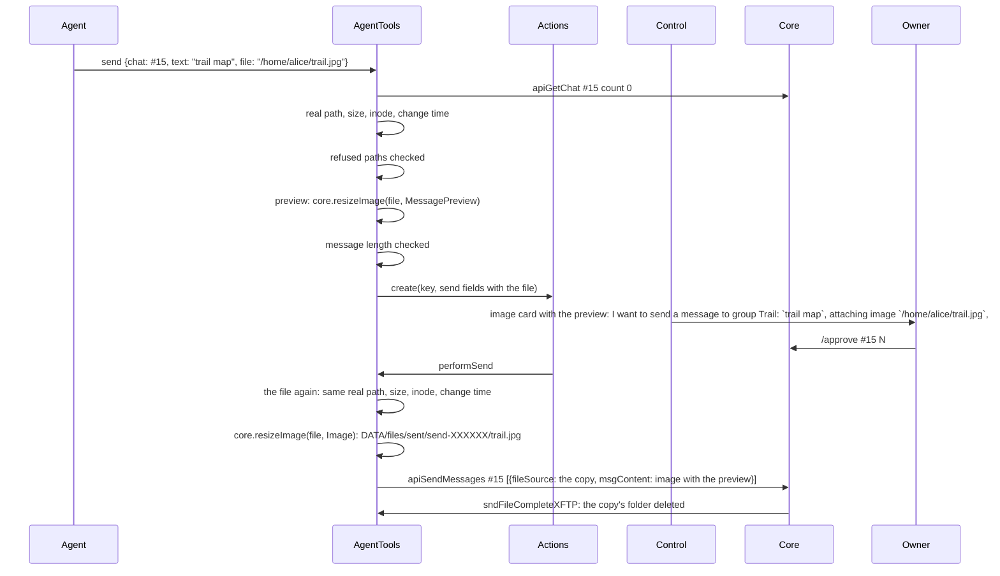

Notes:

- A refused file ends the call with an error, and the refusal is posted to the control chat and logged ([tools.ts:987-990](../src/tools.ts#L987-L990), [control.ts:196-200](../src/control.ts#L196-L200)).
- A video's preview is the first frame from `ffmpeg` and its duration comes from `ffprobe`; a GIF or WebP gets the fixed preview ([tools.ts:1659-1693](../src/tools.ts#L1659-L1693)).
- A changed file fails the perform: ``file: PATH changed after the request.`` ([tools.ts:1003-1008](../src/tools.ts#L1003-L1008)).
- `sndFileError` deletes the copy too, and the failure is posted to the control chat and logged ([tools.ts:689-691](../src/tools.ts#L689-L691), [serve.ts:133](../src/serve.ts#L133), [control.ts:202-211](../src/control.ts#L202-L211)).

Source: [tools.ts:902-925](../src/tools.ts#L902-L925), [:947-1021](../src/tools.ts#L947-L1021), [control.ts:526-546](../src/control.ts#L526-L546), [:692-698](../src/control.ts#L692-L698).

---

## 16. `/leave` and `/delete CHAT files`

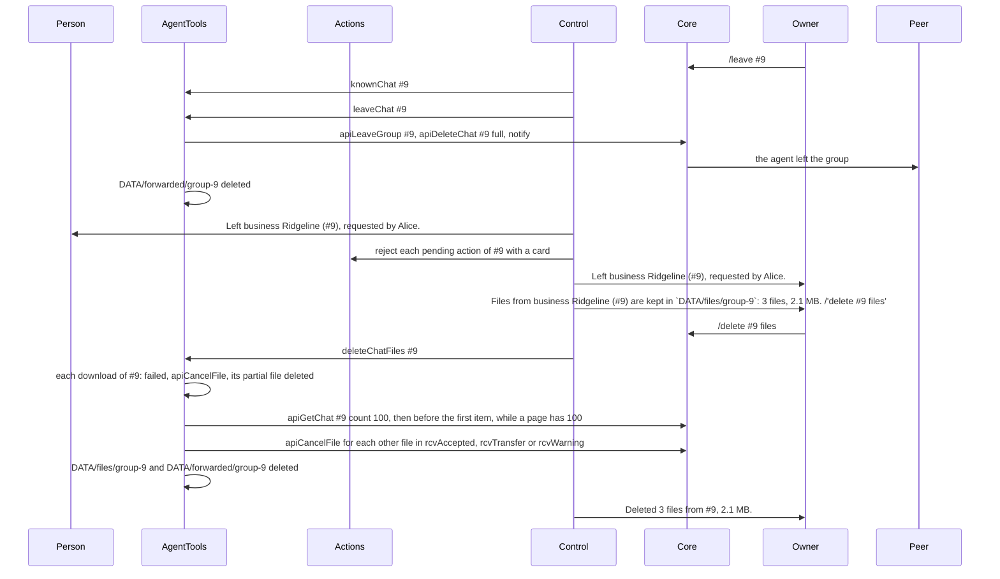

Notes:

- `/leave` acts at once in both modes, and works for a contact as `Deleted bot X (@4), requested by Alice.` ([control.ts:330-344](../src/control.ts#L330-L344)).
- The line `Left ...` goes to the log and to the owners; the members of #9 see only that the agent left.
- The files message is posted after the reply, and only when the folder has files ([control.ts:341-342](../src/control.ts#L341-L342), [:384-386](../src/control.ts#L384-L386)).
- `/delete CHAT files` works for a current or a left chat; the failed downloads return `Your owner deleted the files of this chat.`, and the reply counts the forwarded files too ([tools.ts:1034-1052](../src/tools.ts#L1034-L1052)).
- The paged reads find the downloads the core continues after a restart, which have no download in memory; for a left chat they find none ([messages.ts:275-283](../src/messages.ts#L275-L283), [tools.ts:1041-1047](../src/tools.ts#L1041-L1047)).

Source: [control.ts:330-354](../src/control.ts#L330-L354), [tools.ts:1029-1052](../src/tools.ts#L1029-L1052), [:1074-1082](../src/tools.ts#L1074-L1082).

---

## Claude Code plugin flows

Participants of the plugin flows:

| Letter | Participant |
|---|---|
| CC | Claude Code |
| HK | a hook, `node dist/cli.js hook ...` in the plugin's folder |
| S | the session process, `simplex-mcp session` |
| D | the daemon: socket routes and entries |
| M | `MainGroup` |
| N | the `Session` of session N, with its `Control` and `Actions` |
| T | the session's `AgentTools` |
| C | the core `_hub`, profile `Claude` |
| U | `User` with the core `_user` |
| O | an owner in the SimpleX app |

`#M` is the Main group, `#G` the group of session N, ROOT the data root.

---

## 17. First session start and the owner joins

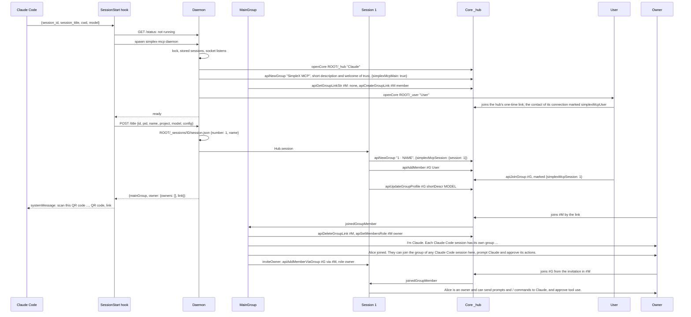

Notes:

- The link reaches the person only: the hook's `systemMessage` carries it, and no hook context or tool result does ([hook.ts:54-56](../src/hook.ts#L54-L56)).
- The core deletes the preset contact of a new profile, both in `_hub` and in `_user` ([core.ts:28](../src/core.ts#L28), [:44-52](../src/core.ts#L44-L52)).
- `User` connects at the first start only: later starts find the hub's contact marked `simplexMcpUser`. The contact is the one whose connection is that of the invitation the hub created; when `User` does not connect in 60 s, the daemon runs without it, and terminal prompts are not posted ([user.ts:21](../src/user.ts#L21), [:38-48](../src/user.ts#L38-L48), [:60-62](../src/user.ts#L60-L62), [hub.ts:365](../src/hub.ts#L365)).
- A later daemon start without owners keeps the Main group's link ([main-group.ts:74-82](../src/main-group.ts#L74-L82)).
- Owners are invited to the groups of open sessions when they join; the groups of closed sessions are joined by `/join N` ([hub.ts:440-444](../src/hub.ts#L440-L444), [:427-438](../src/hub.ts#L427-L438)).
- The Main group states its trust in its short description and welcome message, set when the group is created, and in a post at each human's `joinedGroupMember` or `connectedToGroupMember`, the second with the member's status before the connection, so the joiner is looked up among the refreshed members ([main-group.ts:17-19](../src/main-group.ts#L17-L19), [:222-232](../src/main-group.ts#L222-L232), [:153-154](../src/main-group.ts#L153-L154)). Each profile update, of the name and the menu, starts from the group's current profile, so the short description, the welcome message and the preferences owners set stay ([main-group.ts:63-72](../src/main-group.ts#L63-L72), [control.ts:612-617](../src/control.ts#L612-L617)).
- A session group states at each join other than `User`'s the rights of the joiner's role, with the command that makes them an observer for a role that sends ([hub.ts:218-225](../src/hub.ts#L218-L225), [:510](../src/hub.ts#L510)).
- The daemon reads the hub's contact of `User` after `User` opens, so that the sessions tell `User`'s messages ([hub.ts:366](../src/hub.ts#L366)).

Source: [hook.ts:41-60](../src/hook.ts#L41-L60), [client.ts:35-92](../src/client.ts#L35-L92), [daemon.ts:93-119](../src/daemon.ts#L93-L119), [:218-262](../src/daemon.ts#L218-L262), [hub.ts:357-375](../src/hub.ts#L357-L375), [:398-416](../src/hub.ts#L398-L416), [:469-481](../src/hub.ts#L469-L481), [main-group.ts:143-166](../src/main-group.ts#L143-L166), [user.ts:16-57](../src/user.ts#L16-L57).

---

## 18. Session process start and attach

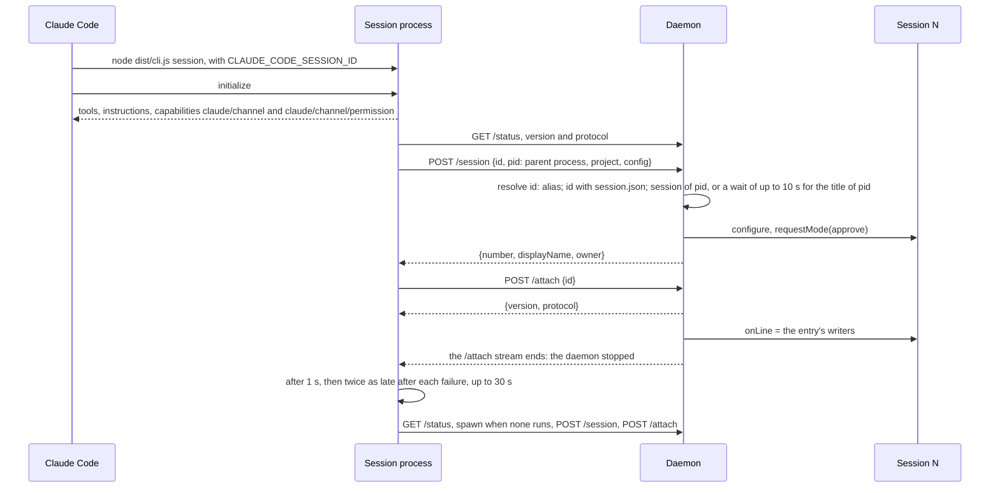

Notes:

- An invalid option, or before it the text of a run that is not interactive, is kept as the result of every call, and the session process does not connect, also at a permission request of Claude Code ([session.ts:44-51](../src/session.ts#L44-L51), [:57](../src/session.ts#L57), [:59](../src/session.ts#L59), [:66](../src/session.ts#L66)); see [flow 30](#30-a-run-that-is-not-interactive).
- `/session` for a session without a folder creates it; `/attach`, `/call`, `/permission` and `/turn` answer 409 for it, and `call` registers again once ([daemon.ts:392-402](../src/daemon.ts#L392-L402), [session.ts:120-130](../src/session.ts#L120-L130)).
- The end of the `/attach` stream, or a failed connection, also a failed spawn, drops the connection and connects again, so the channel works again without a call; one timer serves each attempt, so the delay doubles once per failed attempt; another protocol version, the `ProtocolError`, or a 403 of `/session` ends the retries ([session.ts:88-112](../src/session.ts#L88-L112), [:177-183](../src/session.ts#L177-L183), [client.ts:45](../src/client.ts#L45)).

Source: [session.ts:40-67](../src/session.ts#L40-L67), [:160-185](../src/session.ts#L160-L185), [daemon.ts:201-324](../src/daemon.ts#L201-L324).

---

## 19. A tool call with approval in the session group


Notes:

- The approver check of the session group counts the active members other than Claude and `User` with the role `admin` or `owner` there, whatever way they joined ([hub.ts:301-307](../src/hub.ts#L301-L307), [control.ts:560-562](../src/control.ts#L560-L562)).
- Without an approver in `#G`, the action is refused with the text of [API 4.4](api.md#44-tool-results-in-the-plugin).
- The connected chat gets the session's ID as its owner ([tools.ts:582-586](../src/tools.ts#L582-L586), [:835](../src/tools.ts#L835)).

Source: [daemon.ts:326-345](../src/daemon.ts#L326-L345), [hub.ts:69-103](../src/hub.ts#L69-L103), [tools.ts:732-755](../src/tools.ts#L732-L755).

---

## 20. A prompt from the session group

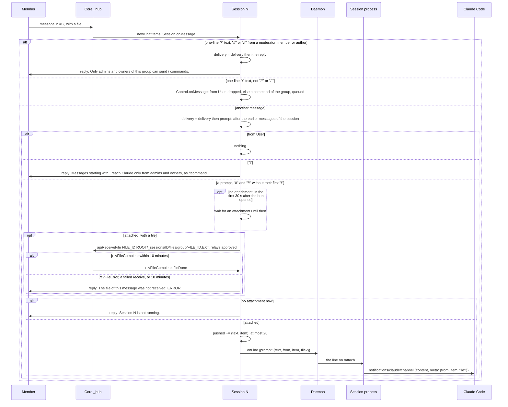

Notes:

- Messages of every member but `User` are prompts, whatever way the member joined, except one-line `/` texts and texts that start with `//`, `/!` or `!`. From a moderator, member or author, a one-line `/` text, a `//` text and a `/!` text each get `Only admins and owners of this group can send / commands.` From an admin or owner, one-line `/` texts that do not start with `//` or `/!` are commands of the group, and one outside its requests gets `Unknown command. To send a command to Claude, start it with //.`; `//model sonnet` reaches Claude as `/model sonnet` and `/!TEXT` as `!TEXT` ([hub.ts:153-160](../src/hub.ts#L153-L160), [:227-234](../src/hub.ts#L227-L234), [:297-303](../src/hub.ts#L297-L303), [control.ts:246](../src/control.ts#L246), [:649-654](../src/control.ts#L649-L654)).
- Messages reach the session in arrival order: a prompt waits for the file of an earlier prompt, and a reply to `!`, `/`, `//` or `/!` waits for the earlier prompts ([hub.ts:157](../src/hub.ts#L157), [:159](../src/hub.ts#L159), [:293-295](../src/hub.ts#L293-L295)).
- After a daemon start, a prompt that arrives before its session attaches again waits up to 30 s from the hub's open, so a prompt sent while the daemon was stopped reaches the session ([hub.ts:236-238](../src/hub.ts#L236-L238), [:368](../src/hub.ts#L368)).
- A session started without the channel flag gets the notification and drops it.

Source: [hub.ts:153-160](../src/hub.ts#L153-L160), [:227-260](../src/hub.ts#L227-L260), [daemon.ts:314](../src/daemon.ts#L314), [session.ts:53-56](../src/session.ts#L53-L56), [:197-201](../src/session.ts#L197-L201).

---

## 21. A terminal prompt and the answer

```mermaid
sequenceDiagram
  participant P as Person
  participant CC as Claude Code
  participant HK as Turn hook
  participant D as Daemon
  participant N as Session N
  participant U as User
  participant C as Core _hub
  participant O as Owner
  P->>CC: prompt typed in the terminal
  CC->>HK: UserPromptSubmit {session_id, prompt}, in the background
  HK->>D: ensureDaemon, POST /turn {id, pid, at, prompt}
  D->>N: turn
  N->>N: end pending permissions created before at
  N->>N: no pushed prompt matched: turns += (at, null)
  N->>U: post(N, parts), unless a "/" command
  U->>O: the prompt in #35;G, from User
  CC->>CC: turn ends
  CC->>HK: Stop {session_id, last_assistant_message, effort}
  HK->>D: ensureDaemon, POST /turn {id, pid, at, answer, effort}
  D->>N: turn
  N->>N: end pending permissions created before at
  N->>N: quote = the newest turn record before at#59; it and the older ones leave turns
  N->>N: a changed effort: description, session.json
  N->>C: apiSendMessages #35;G parts, the first quoting the quote when it came from the group and fits with the first character
  opt the core refuses the quote
    N->>C: apiSendMessages #35;G parts without the quote
  end
  C->>O: the answer, from Claude
  N->>C: apiUpdateGroupProfile #35;G shortDescr MODEL · effort LEVEL, when it changed
```

Notes:

- `at` is `performance.timeOrigin` of the hook process. An answer quotes the newest prompt record whose hook started before its own, also when the request of the next prompt arrives first, or while the answer's request waits for the short description ([hook.ts:74](../src/hook.ts#L74), [hub.ts:180-186](../src/hub.ts#L180-L186), [:262-271](../src/hub.ts#L262-L271)).
- A prompt from the group is not posted again: the pushed prompts in `<channel source="plugin:simplex:simplex" ... item="I" ...>` tags of the prompt with their item, or equal to the raw prompt and pushed in the last 60 s, leave the pushed prompts, and the oldest of them is the item of the turn record. Without a turn record before the answer, the answer quotes the oldest pushed prompt not quoted yet and marks it; it stays pushed, so that a prompt request handled after the Stop request still matches it and `User` does not post it ([hub.ts:23-27](../src/hub.ts#L23-L27), [:184-186](../src/hub.ts#L184-L186), [:264-268](../src/hub.ts#L264-L268), [:287-291](../src/hub.ts#L287-L291)).
- An empty answer takes its turn record too, without a post ([hub.ts:182](../src/hub.ts#L182), [:194](../src/hub.ts#L194)).
- A prompt request whose hook started before an answer already handled records no turn, so that a later answer does not quote its prompt ([hub.ts:183](../src/hub.ts#L183), [:185](../src/hub.ts#L185)).
- A blank prompt, as Claude Code sends for a prompt with images only, a prompt made only of this plugin's channel tags, as after a daemon restart lost the pushed prompts, and a prompt that is a one-line `/` command, such as `/simplex:link`, are not posted ([hub.ts:193](../src/hub.ts#L193)).
- An answer and a terminal prompt are posted in parts: the longest runs of whole characters that each fit one message as `send` measures it, the first part of an answer with its quote; each part is searched among the next 15602 characters. A part that `User` posts and that starts with `/` gets no command reply ([hub.ts:193](../src/hub.ts#L193), [:273-277](../src/hub.ts#L273-L277), [:519-536](../src/hub.ts#L519-L536), [tools.ts:1575-1578](../src/tools.ts#L1575-L1578), [control.ts:220](../src/control.ts#L220)).
- An answer whose quote the core refuses with `invalidQuote` or `chatItemNotFound`, as for a deleted prompt, or which the core refuses with the quote as too large, `largeMsg`, is posted without the quote; so are the replies `Session N is not running.`, `The file of this message was not received: ERROR` and those to `!` and `/!` ([hub.ts:279-285](../src/hub.ts#L279-L285), [:538-541](../src/hub.ts#L538-L541)).
- The hook cuts a prompt or an answer over 250,000 characters there, ending with `…`, so that the request fits the socket's 1 MiB ([hook.ts:15](../src/hook.ts#L15), [:95-97](../src/hook.ts#L95-L97)).
- A card of a tool use that started after the hook is kept: the hook's start time `at` is earlier than its creation ([hook.ts:74](../src/hook.ts#L74), [hub.ts:201-205](../src/hub.ts#L201-L205)).
- PostModelSwitch sends `{id, model}`; only the short description changes ([hook.ts:78](../src/hook.ts#L78), [hub.ts:187-198](../src/hub.ts#L187-L198)).
- A Stop request with a changed effort posts the answer before it updates the short description, so that a prompt request handled meanwhile posts after the answer; the description is updated also when a post fails ([hub.ts:192-198](../src/hub.ts#L192-L198)).
- A turn hook starts the daemon when none runs, repeats a turn refused with 409 up to 15 times 1 s apart, past the 10 s a held title waits, prints `{}`, and logs errors on its stderr ([hook.ts:74-93](../src/hook.ts#L74-L93)).

Source: [hooks.json:5-7](../hooks/hooks.json#L5-L7), [hub.ts:180-199](../src/hub.ts#L180-L199), [:262-285](../src/hub.ts#L262-L285), [:519-536](../src/hub.ts#L519-L536), [user.ts:29-32](../src/user.ts#L29-L32).

---

## 22. A tool use approved in the session group

```mermaid
sequenceDiagram
  participant CC as Claude Code
  participant S as Session process
  participant D as Daemon
  participant N as Session N
  participant O as Owner
  CC->>S: notifications/claude/channel/permission_request {request_id, tool_name, description, input_preview}
  CC->>CC: the terminal dialog stays open
  S->>D: POST /permission {id, requestId, toolName, description, inputPreview}
  D->>N: permission
  N->>O: card in #35;G: I want to use `Bash`: `DESCRIPTION`, preview, /'approve N' or /'reject N'
  O->>N: /approve N
  N->>N: performing
  N->>D: onLine {permission: {requestId, behavior: allow}}
  D->>S: the line on /attach
  S->>CC: notifications/claude/channel/permission {request_id, behavior: allow}
  N->>N: done, removed
  N->>O: card edited: ... Approved by Alice.
```

Notes:

- `/reject N` pushes `deny`; the card ends with `Rejected by NAME.` ([hub.ts:172-173](../src/hub.ts#L172-L173)).
- The first answer applies, in the terminal or in the group. A card still pending at a prompt or an answer whose hook started after the card, or when the last attachment ends, ends with `Ended.` ([hub.ts:181](../src/hub.ts#L181), [:201-205](../src/hub.ts#L201-L205), [daemon.ts:321](../src/daemon.ts#L321), [control.ts:672-673](../src/control.ts#L672-L673)).
- The input preview is cut to fit the card ([control.ts:151](../src/control.ts#L151), [:755-769](../src/control.ts#L755-L769)).
- The card is posted in mode `requests` also for a session in mode `host` ([hub.ts:170](../src/hub.ts#L170)).

Source: [session.ts:58-62](../src/session.ts#L58-L62), [:114-118](../src/session.ts#L114-L118), [daemon.ts:143-147](../src/daemon.ts#L143-L147), [hub.ts:169-177](../src/hub.ts#L169-L177), [control.ts:680-683](../src/control.ts#L680-L683).

---

## 23. Mode `host` for a session

```mermaid
sequenceDiagram
  participant S as Session process
  participant D as Daemon
  participant N as Session N
  participant O as Owner
  S->>D: POST /session {config: {approve: host}}
  D->>N: requestMode(host): requested = host
  alt the group has no approver
    O->>N: joins #35;G as an admin or owner, or gets one of these roles: membership event, Control.onEvent, announceRights, askMode
  end
  N->>O: card in #35;G: I want to run in mode host ... /'approve N' or /'reject N'
  O->>N: /approve N
  N->>N: perform: setMode(host), mode host in the custom data of #35;G
  N->>O: card edited: I run in mode host ... Approved by Alice.
  S->>D: POST /session {config: {approve: requests}}
  D->>N: requestMode(requests): a pending mode card ends with Ended.#59; at once, mode requests in the custom data of #35;G
```

Notes:

- One `mode` card is pending at a time; a rejected or expired card forgets the request until the next `/session` ([hub.ts:140-151](../src/hub.ts#L140-L151)).
- A rejected card sets `hostDeclined` in `session.json`: later `/session` requests of `host` post no card, also after a daemon restart, until a `/session` with `requests` clears it ([hub.ts:70-74](../src/hub.ts#L70-L74), [:136](../src/hub.ts#L136), [:141](../src/hub.ts#L141), [:145](../src/hub.ts#L145), [:314-317](../src/hub.ts#L314-L317)).
- The approved mode is read from the custom data of `#G` when the session opens, `requests` without one; `session.json` holds no mode ([hub.ts:75](../src/hub.ts#L75), [:309-312](../src/hub.ts#L309-L312)).
- A pending `mode` card does not keep the session open ([hub.ts:119-121](../src/hub.ts#L119-L121)).
- The session process marks the action tools for Claude Code's confirmation from the option at its own start, before the owner decides ([session.ts:57](../src/session.ts#L57)).

Source: [hub.ts:132-151](../src/hub.ts#L132-L151), [:309-323](../src/hub.ts#L309-L323), [:510](../src/hub.ts#L510), [tools.ts:564-565](../src/tools.ts#L564-L565).

---

## 24. `/give`

```mermaid
sequenceDiagram
  participant O as Owner
  participant K as Control of session 1
  participant T as AgentTools of session 1
  participant C as Core _hub
  O->>K: /give @4 2 in the group of session 1
  K->>T: agentChat @4: a chat of session 1
  K->>K: session 2 has an ID
  K->>T: giveChat @4 ID2
  T->>C: apiSetContactCustomData @4 {simplexMcpOwner: {session: ID2}}
  K->>K: pending actions of @4 with a card rejected by Alice
  K->>O: Gave bot X (@4) to session 2.
```

Source: [control.ts:356-368](../src/control.ts#L356-L368), [tools.ts:569-572](../src/tools.ts#L569-L572), [hub.ts:418-420](../src/hub.ts#L418-L420).

---

## 25. `reset-owners`

```mermaid
sequenceDiagram
  participant P as Person
  participant CC as Claude Code
  participant D as Daemon
  participant M as MainGroup
  participant N as Sessions
  participant O as Owner
  P->>CC: /simplex:reset-owners
  CC->>D: node dist/cli.js reset-owners: POST /reset-owners
  alt owners exist
    D->>M: askReset
    M->>O: A terminal asks to replace the owners ... /'approve reset' or /'reject reset'
    D-->>CC: An owner approves the reset in "SimpleX MCP". Then run npx -y @simplex-chat/mcp@VERSION link ...
    O->>M: /approve reset
    M->>O: card edited: ... Approved by Alice.
    M->>M: the group deleted for all members, a new Main group with a link
    Note over M,N: the session groups and the roles of their members stay as they are
    P->>D: npx -y @simplex-chat/mcp@VERSION link in a terminal
    D-->>P: Join "SimpleX MCP" in the SimpleX app. The link works once:, QR code, link
  else no owners, from Claude Code
    CC-->>P: Run npx -y @simplex-chat/mcp@VERSION reset-owners in a terminal.
  end
```

Notes:

- VERSION is the plugin's version, so that the command runs the daemon's version ([owner.ts:7-8](../src/owner.ts#L7-L8)).

- Without owners, `reset-owners` in a terminal replaces the group at once and prints the new link with a QR code ([owner.ts:28-35](../src/owner.ts#L28-L35), [hub.ts:392-396](../src/hub.ts#L392-L396)).
- One reset card is pending at a time; `/reject reset` leaves the group ([main-group.ts:105-109](../src/main-group.ts#L105-L109), [:131-141](../src/main-group.ts#L131-L141)).
- The members who joined the session groups from the old Main group stay there with their roles and the rights of those roles ([hub.ts:301-303](../src/hub.ts#L301-L303)).

Source: [main-group.ts:111-122](../src/main-group.ts#L111-L122).

---

## 26. Idle close, idle stop and a newer version

```mermaid
sequenceDiagram
  participant S as Session process
  participant D as Daemon
  participant N as Session N
  participant S2 as Session process of a newer plugin
  S->>D: the /attach stream ends with Claude Code
  D->>N: onLine = undefined, endPermissions
  D->>D: idle timer, 10 min
  D->>N: no call, no action in memory: entry closed, open false
  D->>D: no entry: stop timer, 10 min
  D->>D: stop: actions cancelled, cards edited, cores closed, lock released
  S2->>D: GET /status: version lower than its own
  S2->>D: POST /stop
  S2->>D: spawn a daemon of its version
```

Notes:

- A call or an attachment cancels the stop timer by creating an entry ([daemon.ts:357-367](../src/daemon.ts#L357-L367)).
- A daemon of a higher version is kept; another protocol version makes clients fail with `Restart Claude Code to update the SimpleX plugin.` ([client.ts:35-47](../src/client.ts#L35-L47)).

Source: [daemon.ts:177-199](../src/daemon.ts#L177-L199), [:315-323](../src/daemon.ts#L315-L323), [:404-422](../src/daemon.ts#L404-L422), [hub.ts:450-460](../src/hub.ts#L450-L460).

---

## 27. `/clear`, `--continue` and `/resume` in one session

Claude Code keeps the session server's `CLAUDE_CODE_SESSION_ID` from its spawn, gives the hooks a new `session_id` after `/clear` and `/resume`, and with `--continue` may spawn the server with a startup ID other than the resumed one. The hooks send `CLAUDE_PID`, and the session server its parent process, the same Claude Code process.

```mermaid
sequenceDiagram
  participant CC as Claude Code, process P
  participant S as Session process
  participant HK as Hooks
  participant D as Daemon
  participant N as Session of A
  Note over CC,N: /clear in session A, the server attached as A
  CC->>HK: SessionStart {session_id: B, source: clear}, CLAUDE_PID P
  HK->>D: POST /title {id: B, pid: P}
  D->>D: B unknown#59; entry A has pid P and is attached: alias B to A, in A's session.json
  D->>N: rename, model
  HK->>D: POST /turn {id: B, pid: P, answer}
  D->>N: turn, posted in A's group
  Note over CC,N: claude --continue: the server spawned with startup ID X, the resumed session R
  CC->>S: CLAUDE_CODE_SESSION_ID X
  S->>D: POST /session {id: X, pid: P}
  D->>D: X unknown, no folder: wait up to 10 s for a /title of P
  CC->>HK: SessionStart {session_id: R, source: resume}, CLAUDE_PID P
  HK->>D: POST /title {id: R, pid: P}
  D->>D: the session of R opened, the title of P recorded
  D->>D: the wait of X ends: alias X to R
  D-->>S: {number of R}
  S->>D: POST /attach {id: X}: the entry of R
  Note over CC,N: /resume R2 in session A, R2 with its own session.json
  CC->>HK: SessionStart {session_id: R2, source: resume}, CLAUDE_PID P
  HK->>D: POST /title {id: R2, pid: P}
  D->>D: R2 has session.json#59; entry A has pid P and is attached: A, without an alias
  HK->>D: POST /turn {id: R2, pid: P, answer}
  D->>N: turn, posted in A's group
  Note over CC,N: later, claude --resume R2 in process Q
  S->>D: POST /session {id: R2, pid: Q}
  D-->>S: {number of R2}: its own group and chats
  Note over CC,N: the title of a new ID F before the server of P registers, as with --fork-session or /clear during a re-attach
  HK->>D: POST /title {id: F, pid: P}
  D->>D: F unknown, no session of P: title of P = F#59; the title is held
  D-->>HK: the reply
  S->>D: POST /session {id: A, pid: P}
  D->>D: A has session.json: A#59; the held title resumes: entry A has pid P: alias F to A
  D->>N: rename, model
```

Notes:

- A session server's process is followed while it is attached and for 10 s after it detached, and a title's process for 10 s; a new Claude Code process with a reused PID later starts its own session ([daemon.ts:283-288](../src/daemon.ts#L283-L288)).
- Only an ID without `session.json` gets an alias. A hook of an ID with `session.json` goes to the session attached from its process, in memory, else to its own session; a session server with such an ID registers it ([daemon.ts:268-277](../src/daemon.ts#L268-L277)).
- A title of a new ID from a process without a known session is answered at once and applied after the session server of that process registers, or after 10 s without one; then it opens a session of its own. So `/clear` during the re-attach of a session server after a daemon start, and `--fork-session` in either order, join the new ID to the session the server registers ([daemon.ts:201-262](../src/daemon.ts#L201-L262), [:466-476](../src/daemon.ts#L466-L476)).
- A session created for an ID records the aliases that already point to it in its first `session.json` ([daemon.ts:397-398](../src/daemon.ts#L397-L398)).
- Turn hooks of an ID whose title is held get 409 and repeat up to 15 times 1 s apart, past the 10 s ([hook.ts:13](../src/hook.ts#L13)).
- A second title of a process whose title is held is held too, so that two `/clear` within the wait join both new IDs to the session the server registers. A daemon stop saves the held titles in `ROOT/titles.json`; the next start takes them as new titles ([daemon.ts:106](../src/daemon.ts#L106), [:180](../src/daemon.ts#L180), [:222-232](../src/daemon.ts#L222-L232)).
- Aliases are read from `session.json` at the daemon's start, so later hooks and calls with B or X reach the same session ([daemon.ts:87-91](../src/daemon.ts#L87-L91), [:290-295](../src/daemon.ts#L290-L295)).
- Without `CLAUDE_PID`, before Claude Code 2.1.214, a new session server waits the 10 s and then registers its own ID.

Source: [hook.ts:53](../src/hook.ts#L53), [:78](../src/hook.ts#L78), [:99-102](../src/hook.ts#L99-L102), [session.ts:53](../src/session.ts#L53), [daemon.ts:201-295](../src/daemon.ts#L201-L295).

---

## 28. A member joins the Main group and a session's group, and a person is added to it

```mermaid
sequenceDiagram
  participant A as Owner Alice
  participant B as Bob
  participant G as Carol
  participant C as Core _hub
  participant M as MainGroup
  participant N as Session N
  A->>B: a group link of #35;M, or an invitation of a contact
  B->>C: joins #35;M
  C->>M: connectedToGroupMember, or joinedGroupMember by the hub's link
  M->>C: apiListMembers #35;M: Bob a current member
  M->>B: Bob joined. They can join the group of any Claude Code session here, prompt Claude and approve its actions.
  B->>M: /join N in #35;M
  M->>N: Hub.join: role admin, or owner for an owner of #35;M
  N->>C: apiAddMemberViaGroup #35;G via #35;M, role admin
  M->>B: Sent you an invitation to "N · NAME".
  B->>C: joins #35;G
  C->>N: joinedGroupMember: Control.onEvent, announceRights, askMode
  N->>B: Bob is an admin and can send prompts and / commands to Claude, and approve tool use. You can change role to observer to stop it: /'observer #35;G ID'
  A->>G: a group link of #35;G with role member, or an invitation of a contact with a role
  G->>C: joins #35;G
  C->>N: connectedToGroupMember: Control.onEvent, announceRights, askMode
  N->>B: Carol is a member and can send prompts to Claude ... You can change role to observer to stop it: /'observer #35;G ID'
  G->>C: a message in #35;G, /pending, /!ls
  C->>N: newChatItems: Session.onMessage, a prompt of Carol
  N->>G: to /pending: Only admins and owners of this group can send / commands.
  N->>G: to /!ls: Only admins and owners of this group can send / commands.
  A->>C: Carol's role set to admin in the app
  C->>N: memberRole: Control.onEvent, announceRights, askMode
  N->>A: Carol is an admin and can send prompts and / commands to Claude, and approve tool use. You can change role to observer to stop it: /'observer #35;G ID'
  A->>N: /observer #35;G ID of Carol
  N->>C: apiSetMembersRole #35;G [ID] observer, apiListMembers #35;G
  N->>A: Carol is an observer and can't send messages.
  Note over G,C: Carol's app refuses to send as an observer
  Note over A,N: Bob leaves #35;M, is removed from it, or gets another role there
  C->>M: leftMember, deletedMember or memberRole in #35;M
  M->>C: apiListMembers #35;M#59; the session groups stay as they are
```

Notes:

- Rights follow the member's role in the session group, whatever way they joined and whatever their role in the Main group: admins and owners approve and send `//` and `/!`; changes in the Main group leave the session groups as they are ([hub.ts:214-216](../src/hub.ts#L214-L216), [:301-303](../src/hub.ts#L301-L303), [main-group.ts:143-158](../src/main-group.ts#L143-L158)).
- `/join N` invites a member of the Main group as an admin, an owner of the Main group as an owner ([hub.ts:431](../src/hub.ts#L431)).
- A role change by a member of the group raises `memberRole`, and Claude posts the new rights; a role change by Claude, as by `/observer`, raises no event, and the reply to `/observer` states the observer's rights ([hub.ts:218-225](../src/hub.ts#L218-L225), [control.ts:379-381](../src/control.ts#L379-L381), [:859-862](../src/control.ts#L859-L862)).
- `/observer #G ID` is accepted from a member whose role is admin or owner and not below the member's role, as SimpleX requires for a role change, for a member who is current or pending; a member invited and not joined yet gets `No member ID in this group.` After the role change, the members are read again, so the standing approvals of the new observer count no more while that member is not an admin or owner; they stay in the chat's custom data and count again when the member becomes one again ([control.ts:370-382](../src/control.ts#L370-L382), [:164-167](../src/control.ts#L164-L167)).
- The Main group's post names a human joiner found among the refreshed members, as `connectedToGroupMember` carries the member's status before the connection ([main-group.ts:153-154](../src/main-group.ts#L153-L154)).
- `User` joining a session group, or a change of its role, gets no post ([hub.ts:221](../src/hub.ts#L221), [:305-307](../src/hub.ts#L305-L307)).
- Each join gets one post: the core raises `joinedGroupMember` for a member who joined through the hub, by its invitation or link, and `connectedToGroupMember` for a member another member added, one of the two for each connection; the end-to-end test counts one post for each join in both groups ([test/e2e/daemon.test.ts](../test/e2e/daemon.test.ts)).
- A person added to the group directly has the rights of the role the adding member set, as a member from the Main group has those of its role ([hub.ts:227-234](../src/hub.ts#L227-L234), [:301-303](../src/hub.ts#L301-L303)).
- A `/join N` of a member of that group already gets `You are a member of "N · NAME".` ([hub.ts:430-435](../src/hub.ts#L430-L435)).
- A reset of the owners leaves the session groups and their members as they are ([flow 25](#25-reset-owners)).

Source: [main-group.ts:124-129](../src/main-group.ts#L124-L129), [:143-158](../src/main-group.ts#L143-L158), [hub.ts:214-225](../src/hub.ts#L214-L225), [:427-438](../src/hub.ts#L427-L438), [:510](../src/hub.ts#L510), [control.ts:370-382](../src/control.ts#L370-L382), [:855-862](../src/control.ts#L855-L862).

---

## 29. `reply`

```mermaid
sequenceDiagram
  participant CC as Claude Code
  participant T as AgentTools
  participant N as Session N
  participant C as Core _hub
  participant A as Owner Alice
  CC->>T: reply {file, text}
  T->>T: the file checked, and its message with the caption and the preview by fitsMessage
  T-->>CC: too long: text: too long for a message with this TYPE#59; shorten it.
  T->>C: apiSendMessages #35;G with the file, its caption and its preview
  alt the group's preference for files and media allows the files of Claude's role
    C-->>T: the sent item
    T-->>CC: {item}
  else it does not
    C-->>T: error: feature not allowed Files and media
    T-->>CC: Files and media are off in the group of this session#59; its owners can turn them on in the group's preferences.
  end
  A->>C: the group's preferences changed in the app
  N->>C: a later profile update of #35;G, for the model or the name: apiGetChat #35;G count 0
  N->>C: apiUpdateGroupProfile #35;G, the current profile with Claude's fields changed
```

Notes:

- `reply` creates no action and posts no card, in both modes; it is not an action tool, so Claude Code does not ask before it either ([tools.ts:714-730](../src/tools.ts#L714-L730), [:483](../src/tools.ts#L483)).
- The core checks the preference at the send by the sender's role, and only owners change it.
- Claude's profile updates of `#G` send the whole profile; they start from the group's current profile in the chat database and change only the name, the short description and the commands, so they keep the owners' preferences ([control.ts:112-137](../src/control.ts#L112-L137), [:612-617](../src/control.ts#L612-L617)).

Source: [tools.ts:714-730](../src/tools.ts#L714-L730), [:550](../src/tools.ts#L550), [hub.ts:93](../src/hub.ts#L93), [control.ts:612-617](../src/control.ts#L612-L617).

---

## 30. A run that is not interactive

```mermaid
sequenceDiagram
  participant CC as Claude Code, claude -p
  participant HK as Hooks
  participant S as Session process
  participant D as Daemon
  Note over CC,D: claude -p or the Agent SDK: CLAUDE_CODE_ENTRYPOINT sdk-cli, sdk-ts or sdk-py for the hooks and the server
  CC->>HK: SessionStart, UserPromptSubmit, Stop
  HK-->>CC: {}, without a request
  CC->>S: tools/call
  S-->>CC: This Claude Code run is not interactive, so it has no SimpleX group ...
  Note over CC,D: claude -p from a command of a VS Code session: entrypoint claude-vscode#59; the hooks get ATTENDED 0 and CLAUDE_PID P, the server ATTENDED 1 and the parent process P
  CC->>HK: SessionStart
  HK->>D: ensureDaemon, POST /title {id, pid: P, project, config, unattended: true}
  D->>D: marks of 10 s ago and older removed#59; P marked#59; a /session of P waiting for its title ends its wait
  HK-->>CC: {}
  S->>D: POST /session {id, pid: P}, before or after the mark
  D-->>S: 403
  CC->>S: tools/call
  S-->>CC: This Claude Code run is not interactive, so it has no SimpleX group ...
  CC->>HK: UserPromptSubmit, Stop
  HK-->>CC: {}, without a request
```

Notes:

- Claude Code sets `CLAUDE_CODE_ENTRYPOINT` for its hooks and its MCP servers: `sdk-cli` for `claude -p`, `cli` for an interactive session; the Agent SDK sets `sdk-ts` or `sdk-py`. An entrypoint already in the environment is kept, except `cli`, so a `claude -p` run started by a command of a VS Code or desktop-app session keeps `claude-vscode` or `claude-desktop`.
- Claude Code sets `CLAUDE_CODE_SESSION_ATTENDED`, `1` or `0`, for its hooks, `0` for a run nobody attends; its MCP servers get the variable only from the environment of the command that started Claude Code. The run recorded with Claude Code 2.1.319 in [`claude-p-runs.jsonl`](../test/unit/claude-p-runs.jsonl): the hooks got `0` and a `CLAUDE_PID` equal to the server's parent process; the server got the parent session's `1` and `CLAUDE_PID`.
- The daemon checks the mark before the wait of `/session` for the title of its process and after it, so either order of the hook and the server ends in the refusal; a mark counts for 10 s, and the next mark removes it after that ([daemon.ts:203-205](../src/daemon.ts#L203-L205), [:237-248](../src/daemon.ts#L237-L248)).
- A refused server answers every call with that text, relays no permission request and registers no more ([session.ts:79-80](../src/session.ts#L79-L80), [:92](../src/session.ts#L92), [:115](../src/session.ts#L115), [:127](../src/session.ts#L127), [:162-165](../src/session.ts#L162-L165)).
- A hook without `CLAUDE_PID` sends no mark; a failed mark is logged as `SimpleX MCP session start` ([hook.ts:62-72](../src/hook.ts#L62-L72)).

Source: [config.ts:22-32](../src/config.ts#L22-L32), [hook.ts:41-45](../src/hook.ts#L41-L45), [:75](../src/hook.ts#L75), [daemon.ts:221](../src/daemon.ts#L221), [:237-248](../src/daemon.ts#L237-L248), [session.ts:45](../src/session.ts#L45).
