# SimpleX MCP server: flows

> Sequence diagrams of the main flows, each with notes and source locations.
>
> Related specs: [README](README.md) | [Architecture](architecture.md) | [API](api.md)

Participants:

| Letter | Participant |
|---|---|
| P | the person at the terminal |
| A | the agent in Claude Code |
| H | the HTTP listener with the MCP SDK |
| T | `AgentTools` |
| X | `Actions` |
| K | `Control` |
| C | the SimpleX core behind `ChatApi` |
| O | the owner in the SimpleX app |
| D | a peer |
| U | the audio API at URL of `--audio` |

`#G` is the agent control chat, `USER` the agent's user ID, `DATA` the data folder. Calls to the core are shown as the `ChatApi` methods the server calls, with their arguments in short. Card and progress texts with a semicolon are shown with a comma in the diagrams; the exact texts are in [API](api.md).

---

## Table of contents

1. [First start and the owner joins](#1-first-start-and-the-owner-joins)
2. [`register`](#2-register)
3. [`connect` with approval](#3-connect-with-approval)
4. [`send` with responses](#4-send-with-responses)
5. [`receive` with `wait`](#5-receive-with-wait)
6. [`send` under a standing approval, and `/revoke`](#6-send-under-a-standing-approval-and-revoke)
7. [`leave`](#7-leave)
8. [Mode `host`](#8-mode-host)
9. [Expiry](#9-expiry)
10. [A lost call and its re-attachment](#10-a-lost-call-and-its-re-attachment)
11. [Shutdown with pending actions](#11-shutdown-with-pending-actions)
12. [`--owners` setup](#12---owners-setup)
13. [`download` with approval](#13-download-with-approval)
14. [`/forward`](#14-forward)
15. [`send` with a file](#15-send-with-a-file)
16. [`/leave` and `/delete CHAT files`](#16-leave-and-delete-chat-files)
17. [A voice message at arrival](#17-a-voice-message-at-arrival)

---

## 1. First start and the owner joins

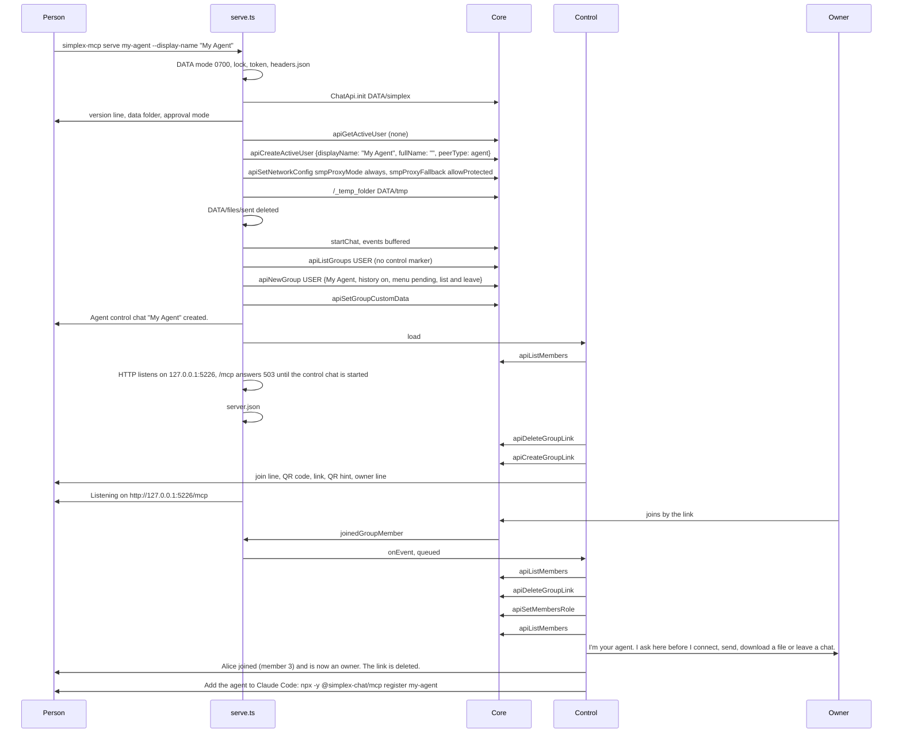

Notes:

- At first use, libsimplex and the Node.js add-on are downloaded, with one `Downloading ...` line each on stderr ([libs.ts:114-135](../../simplex-chat-nodejs/src/libs.ts#L114-L135)).
- With `--data`, `--data <folder>` is appended to the register hint, shell-quoted ([serve.ts:188-190](../src/serve.ts#L188-L190)).
- With `--qr-code small`, the line `If the QR code does not scan, ...` is printed after the link ([control.ts:412](../src/control.ts#L412)).
- Events that arrive before the HTTP listener starts are buffered and handled in order ([serve.ts:237-251](../src/serve.ts#L237-L251)).
- The server runs `ownerJoined` for every `joinedGroupMember` event of a human without `--owners`, and the link is deleted in that handler ([control.ts:189-190](../src/control.ts#L189-L190), [:371-378](../src/control.ts#L371-L378)).

Source: [cli.ts:219-230](../src/cli.ts#L219-L230), [serve.ts:67-129](../src/serve.ts#L67-L129), [:208-226](../src/serve.ts#L208-L226), [files.ts:12-48](../src/files.ts#L12-L48), [http.ts:14-46](../src/http.ts#L14-L46), [control.ts:102-117](../src/control.ts#L102-L117), [:341-345](../src/control.ts#L341-L345), [:406-425](../src/control.ts#L406-L425), [:499-520](../src/control.ts#L499-L520).

---

## 2. `register`

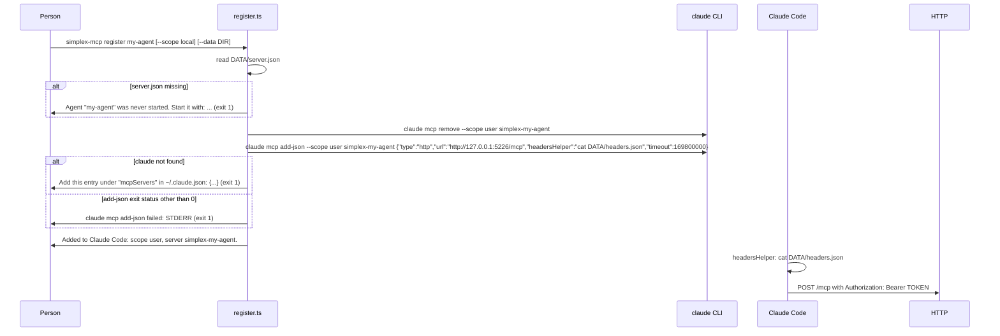

Notes:

- `simplex-mcp` ignores the exit status of `claude mcp remove` and stops at that step only when the `claude` binary is missing ([register.ts:38-39](../src/register.ts#L38-L39)).
- On Windows, a missing `claude` is run again through `cmd.exe`, with each argument quoted for it ([register.ts:86-101](../src/register.ts#L86-L101)).
- `timeout` is `(expireHours + 24) × 3600000 + 600000` ms from `server.json` ([register.ts:51](../src/register.ts#L51)).
- With `--scope local`, the project folder in the manual entry is the git repository root, the main repository of a worktree, or the current folder outside a repository ([register.ts:56](../src/register.ts#L56), [:60-84](../src/register.ts#L60-L84)).

Source: [cli.ts:118-133](../src/cli.ts#L118-L133), [:228](../src/cli.ts#L228), [register.ts:33-58](../src/register.ts#L33-L58), [files.ts:50-53](../src/files.ts#L50-L53).

---

## 3. `connect` with approval

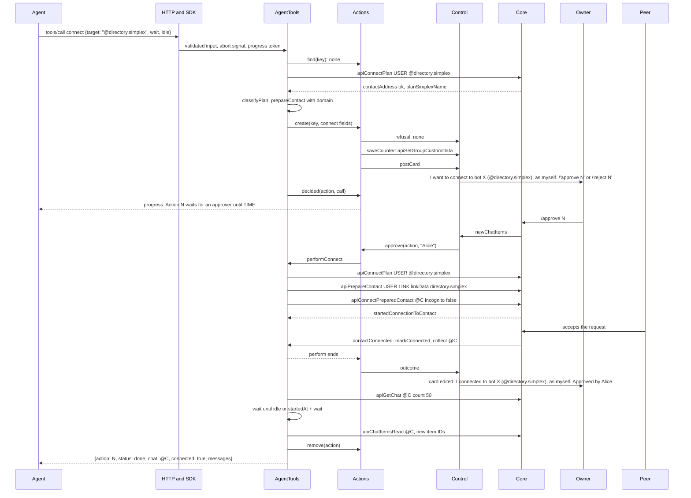

Notes:

- The plan is read again in the perform step ([tools.ts:725](../src/tools.ts#L725)).
- Join methods per plan ([tools.ts:754-782](../src/tools.ts#L754-L782), [:1317-1380](../src/tools.ts#L1317-L1380)):

| Plan | Methods |
|---|---|
| known prepared contact or group | `apiConnectPreparedContact(C, incognito, message)`<br>`apiConnectPreparedGroup(G, incognito, message)` |
| channel link (`direct` false, with link data) | `apiPrepareGroup(USER, LINK, false, linkData, domain)`<br>`apiConnectPreparedGroup(G, incognito)` |
| contact address with link data, and a SimpleX name or a message | `apiPrepareContact(USER, LINK, linkData, domain)`<br>`apiConnectPreparedContact(C, incognito, message)`, or `apiConnectPreparedGroup` for a business |
| `contactViaAddress` | `apiConnectContactViaAddress(USER, incognito, CONTACT_ID)` |
| other links | `apiConnectPreparedLink(USER, incognito, LINK)` |

- After a failed prepared connect, the server deletes the prepared chat without notifying ([tools.ts:784-791](../src/tools.ts#L784-L791)).
- The connection is matched by `contactConnected` or `userJoinedGroup`: by contact or group ID, or by the pending connection ID ([tools.ts:625-633](../src/tools.ts#L625-L633), [:793-798](../src/tools.ts#L793-L798)).
- In the perform step the server waits for the other side until `startedAt + wait`, at most until `created + 23 h 50 min`, and then reports `connected: false` ([tools.ts:147](../src/tools.ts#L147), [:724](../src/tools.ts#L724), [:748-751](../src/tools.ts#L748-L751)).
- Without `message`, the idle time is counted from the connection; with `message`, from the first reply ([tools.ts:804](../src/tools.ts#L804), [messages.ts:321-329](../src/messages.ts#L321-L329)).
- For a target the agent is connected to, the result is `status: known` with its chat fields, and no action is created ([tools.ts:657](../src/tools.ts#L657)).
- Exact progress texts: `Action N waits for an approver until TIME.`, then `Action N waits for the connection until TIME.`, then `K messages in CHAT; waiting until TIME.` ([actions.ts:343-354](../src/actions.ts#L343-L354), [tools.ts:693](../src/tools.ts#L693)).

Source: [tools.ts:652-707](../src/tools.ts#L652-L707), [:721-807](../src/tools.ts#L721-L807), [actions.ts:155-186](../src/actions.ts#L155-L186), [:206-223](../src/actions.ts#L206-L223), [control.ts:141-152](../src/control.ts#L141-L152).

---

## 4. `send` with responses

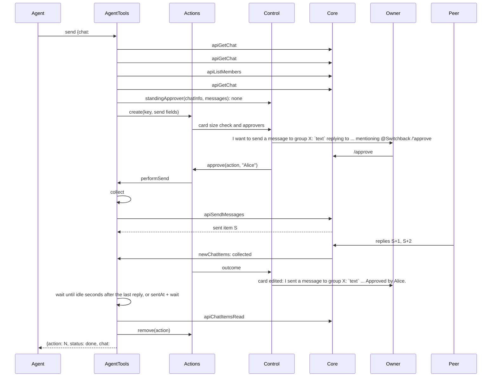

Notes:

- Checks before the action: `text`, `file` or `voice`, `voice` without `file`, the chat connected, role `observer` or `relay` refused, `reply_to` item a message, mentioned members present and the chat a group, and the message length with its quote ([tools.ts:814-829](../src/tools.ts#L814-L829)).
- The server starts collecting before the send and, after it, drops items with IDs up to the sent item ([tools.ts:863](../src/tools.ts#L863), [:876-878](../src/tools.ts#L876-L878)).
- Mentioned names missing from the text are prefixed as `@name` ([tools.ts:1481-1484](../src/tools.ts#L1481-L1484)).
- While a collected message is live, or held for its transcription, the server waits for its final update or its release; such items are left out of `responses` and counted in `more` ([messages.ts:321-329](../src/messages.ts#L321-L329), [tools.ts:848](../src/tools.ts#L848), [:854](../src/tools.ts#L854), [:1167-1169](../src/tools.ts#L1167-L1169)).
- With `voice`, `voice.m4a` is made first, with the audio API and `ffmpeg`, and sent as a voice message ([tools.ts:861-862](../src/tools.ts#L861-L862), [API 1.10](api.md#110-voice-messages)).
- At most 100 replies are kept per action; later ones are counted as overflow ([messages.ts:11](../src/messages.ts#L11), [:110-111](../src/messages.ts#L110-L111)).

Source: [tools.ts:809-884](../src/tools.ts#L809-L884), [messages.ts:100-115](../src/messages.ts#L100-L115), [:321-329](../src/messages.ts#L321-L329), [control.ts:583-590](../src/control.ts#L583-L590).

---

## 5. `receive` with `wait`

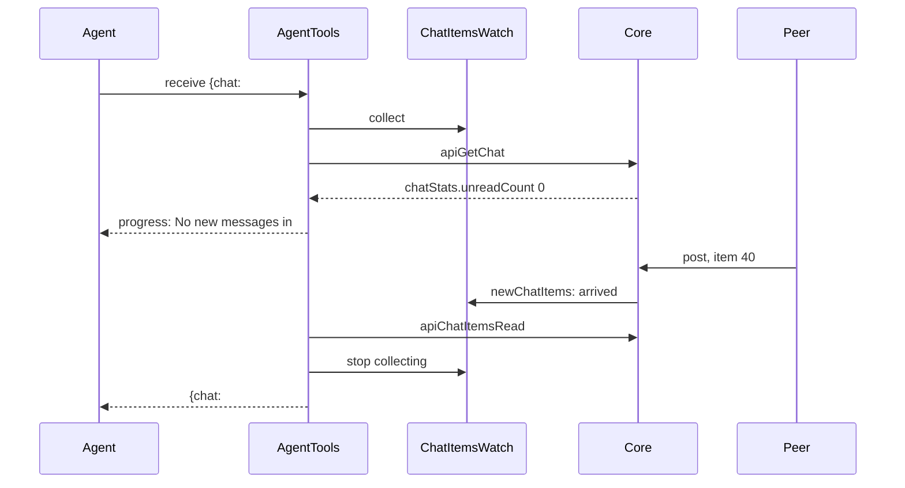

Notes:

- With unread items the server reads `around` the first unread item, `count` 0, then pages of `after` the last item, `count` 100, until it holds `limit + 1` unread messages that are neither live nor held for their transcription, or a page is short ([messages.ts:286-297](../src/messages.ts#L286-L297), [tools.ts:1180](../src/tools.ts#L1180)).
- A message held for its transcription is returned after its release ([tools.ts:1185](../src/tools.ts#L1185), [flow 17](#17-a-voice-message-at-arrival)).
- Unread items other than messages in the read pages are marked read with the returned messages ([tools.ts:1182](../src/tools.ts#L1182), [:1199](../src/tools.ts#L1199)).
- `more`: the arrived messages not returned, the overflow and the unread items not read ([tools.ts:1201](../src/tools.ts#L1201)).
- Items received while the pages are read are returned once ([tools.ts:1181-1184](../src/tools.ts#L1181-L1184)).
- Exact progress text: `No new messages in CHAT; waiting until TIME.` ([tools.ts:1188](../src/tools.ts#L1188)).

Source: [tools.ts:1171-1205](../src/tools.ts#L1171-L1205), [messages.ts:286-329](../src/messages.ts#L286-L329).

---

## 6. `send` under a standing approval, and `/revoke`

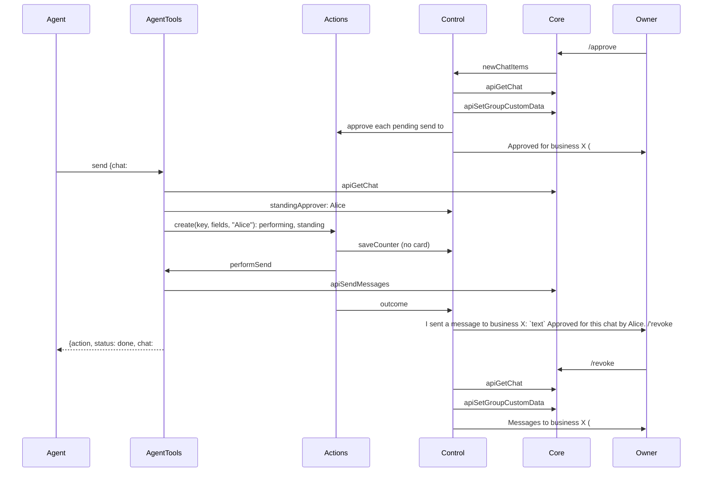

Notes:

- The approval is used in mode `requests` while member `approvedById` is an approver ([control.ts:130-133](../src/control.ts#L130-L133)).
- For sends that were pending at `/approve CHAT all`, the card ends with the plain `Approved by Alice.` ([control.ts:554](../src/control.ts#L554), [:563](../src/control.ts#L563)).
- `connect` and `leave` actions are created without the standing approver, so they stay pending ([tools.ts:663](../src/tools.ts#L663), [:992](../src/tools.ts#L992)).
- `/receive CHAT N all` and `/receive CHAT off` work the same way for downloads, with the key `simplexMcpFiles`, except that download N alone is performed, and the other pending downloads of the chat stay pending ([control.ts:22-25](../src/control.ts#L22-L25), [:251-253](../src/control.ts#L251-L253), [tools.ts:1025](../src/tools.ts#L1025)).

Source: [control.ts:243-263](../src/control.ts#L243-L263), [:337-339](../src/control.ts#L337-L339), [tools.ts:833-835](../src/tools.ts#L833-L835), [actions.ts:155-186](../src/actions.ts#L155-L186), [:265-283](../src/actions.ts#L265-L283).

---

## 7. `leave`

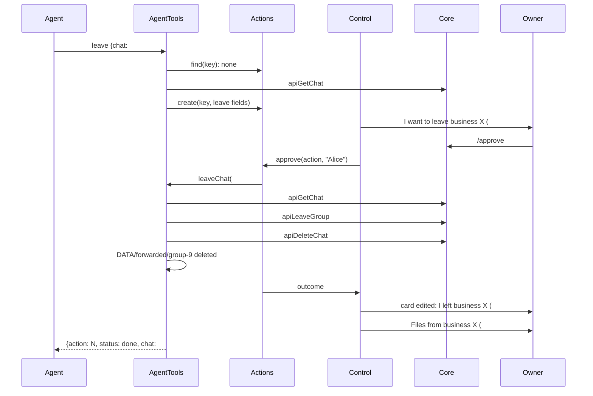

Notes:

- For a contact, the card text is `I want to delete KIND NAME (@N).`, and the perform step calls `apiDeleteChat` for the contact, full, with notify ([control.ts:591-594](../src/control.ts#L591-L594), [tools.ts:1001](../src/tools.ts#L1001)).
- The delete notifies, so the core notifies the contact or the members ([tools.ts:1001](../src/tools.ts#L1001), [:1004](../src/tools.ts#L1004)).
- The server looks for an attached action before it reads the chat, so a repeated call after the deletion is attached to the done action ([tools.ts:987-990](../src/tools.ts#L987-L990)).

Source: [tools.ts:985-1008](../src/tools.ts#L985-L1008), [control.ts:145-152](../src/control.ts#L145-L152), [:299-302](../src/control.ts#L299-L302).

---

## 8. Mode `host`

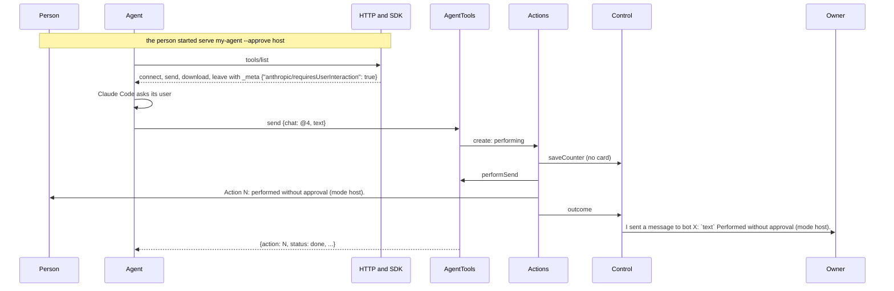

Notes:

- New actions are still refused unless the control chat has an approver ([control.ts:124-127](../src/control.ts#L124-L127)).
- In mode `host`, `standingApprover` returns `undefined`, so standing approvals are ignored by `send`, `download`, `list` and `/list`, and `/approve CHAT all` stores nothing; downloads get no card, so `/receive CHAT N all` has no card to act on ([control.ts:132](../src/control.ts#L132), [:213](../src/control.ts#L213)).
- A download in mode `host` is received without the approval of unknown servers, and it gets no card and no outcome post ([tools.ts:560](../src/tools.ts#L560), [:1083](../src/tools.ts#L1083), [control.ts:495-497](../src/control.ts#L495-L497)).
- The kept-files message also follows a done `leave` in mode `host` ([control.ts:150-151](../src/control.ts#L150-L151)).

Source: [tools.ts:503-513](../src/tools.ts#L503-L513), [actions.ts:166](../src/actions.ts#L166), [:281](../src/actions.ts#L281), [control.ts:145-152](../src/control.ts#L145-L152), [:554](../src/control.ts#L554).

---

## 9. Expiry

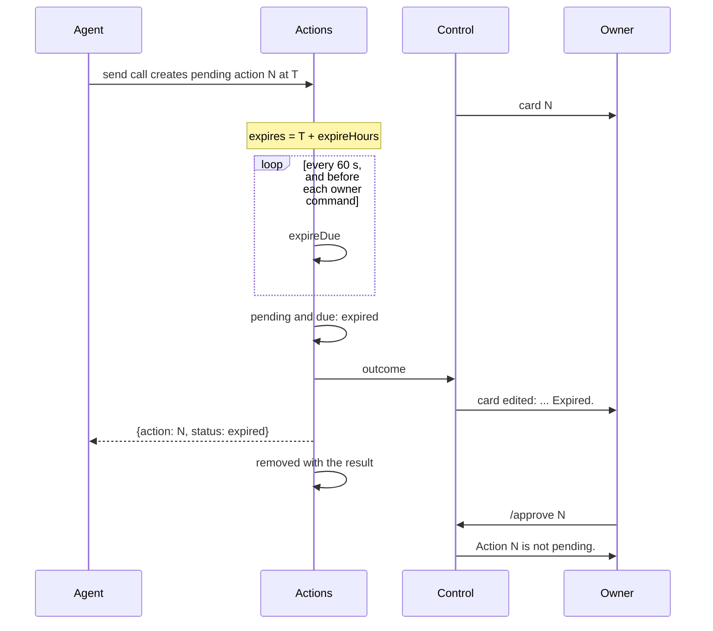

Notes:

- A decided action with an open count of 0 is removed at the first tick after its expiry time ([actions.ts:200-201](../src/actions.ts#L200-L201)).
- Expiry times are listed in the `/pending` reply ([control.ts:619-621](../src/control.ts#L619-L621)).
- The server ends the connect wait at `created + 23 h 50 min`, within the 24 hours in which a message can be edited ([tools.ts:147](../src/tools.ts#L147), [:724](../src/tools.ts#L724)).

Source: [actions.ts:129](../src/actions.ts#L129), [:163](../src/actions.ts#L163), [:193-204](../src/actions.ts#L193-L204), [control.ts:201](../src/control.ts#L201), [:227](../src/control.ts#L227).

---

## 10. A lost call and its re-attachment

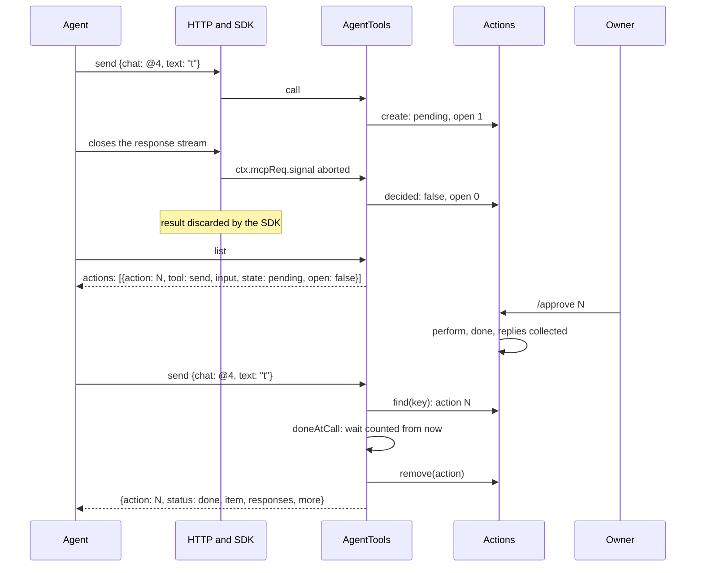

Notes:

- The key is the tool name with the action fields: `target`, `incognito`, `message` for `connect`; `chat`, `text`, `file`, `as`, `reply_to`, `mention`, `voice` for `send`; `chat`, `item` for `download`; `chat` for `leave` ([tools.ts:653](../src/tools.ts#L653), [:811](../src/tools.ts#L811), [:987](../src/tools.ts#L987), [:1012](../src/tools.ts#L1012), [:1615-1617](../src/tools.ts#L1615-L1617)).
- The `wait`, `idle` and `limit` of the attaching call are used ([tools.ts:842](../src/tools.ts#L842)).
- For a call aborted before `create`, the server returns before it creates an action ([tools.ts:662](../src/tools.ts#L662), [:834](../src/tools.ts#L834), [:991](../src/tools.ts#L991), [:1026](../src/tools.ts#L1026)).
- Abort path in the SDK: on `res` close the web request is aborted ([node index.cjs:299-303](../node_modules/@modelcontextprotocol/node/dist/index.cjs#L299-L303)); the per-request transport is closed ([server index.cjs:86-90](../node_modules/@modelcontextprotocol/server/dist/index.cjs#L86-L90)); the handler signal is aborted ([src-BhnGYybN.cjs:6425](../node_modules/@modelcontextprotocol/server/dist/src-BhnGYybN.cjs#L6425)).

Source: [tools.ts:671-683](../src/tools.ts#L671-L683), [:839-857](../src/tools.ts#L839-L857), [:1213](../src/tools.ts#L1213), [actions.ts:206-217](../src/actions.ts#L206-L217), [messages.ts:305-319](../src/messages.ts#L305-L319).

---

## 11. Shutdown with pending actions

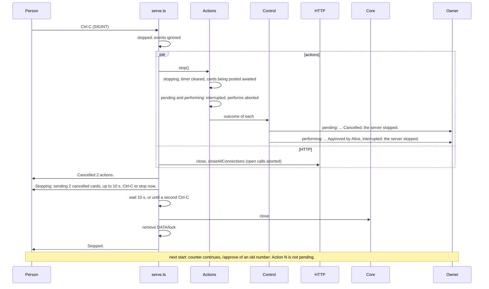

Notes:

- The interrupted card line is `DECIDER; interrupted: the server stopped.` ([control.ts:561](../src/control.ts#L561)).
- An action of mode `host` or of a standing approval whose counter is being written at the stop is set to `pending` and cancelled without a perform ([actions.ts:265-270](../src/actions.ts#L265-L270)).
- After a crash, the cards of that run are left with their commands; `/approve` of their numbers gets the reply `Action N is not pending.` ([control.ts:227](../src/control.ts#L227)).
- The stop signal of the performs is aborted after the actions are marked interrupted: a `connect` waiting for its connection ends, and an interrupted perform logs no line ([actions.ts:245-246](../src/actions.ts#L245-L246), [:280](../src/actions.ts#L280), [tools.ts:748-749](../src/tools.ts#L748-L749)).
- The wait applies only when cards were edited or posted at the stop, a `download` without a card excluded, and `--stop-wait` is above 0 ([serve.ts:180](../src/serve.ts#L180), [:192-206](../src/serve.ts#L192-L206)).

Source: [serve.ts:49-65](../src/serve.ts#L49-L65), [:174-184](../src/serve.ts#L174-L184), [:192-206](../src/serve.ts#L192-L206), [actions.ts:240-250](../src/actions.ts#L240-L250), [http.ts:48-52](../src/http.ts#L48-L52), [control.ts:552-571](../src/control.ts#L552-L571).

---

## 12. `--owners` setup

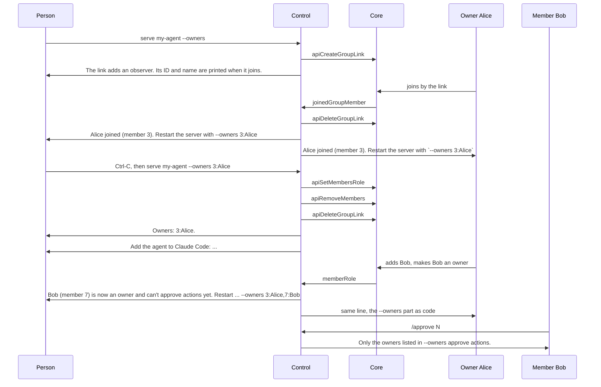

Notes:

- Until the restart with a list, new actions are refused: `The agent has no approving owner. ...` ([control.ts:125-127](../src/control.ts#L125-L127)).
- An entry must match a human by member ID and display name, folded to one line as the restart line prints it, or the server exits with code 2 ([control.ts:354-358](../src/control.ts#L354-L358), [:759-761](../src/control.ts#L759-L761)).
- With `--reset-owners`, the server deletes the control chat for all members and creates a new one with the same counter; the CLI refuses the option with an `--owners` list ([control.ts:522-527](../src/control.ts#L522-L527), [serve.ts:225](../src/serve.ts#L225), [cli.ts:112-114](../src/cli.ts#L112-L114)).
- When a listed owner leaves and none remains: `... is no longer an owner. No owners remain: restart the server with --reset-owners --owners` ([control.ts:393-398](../src/control.ts#L393-L398)).

Source: [control.ts:347-369](../src/control.ts#L347-L369), [:380-399](../src/control.ts#L380-L399), [:406-416](../src/control.ts#L406-L416), [:759-785](../src/control.ts#L759-L785).

---

## 13. `download` with approval

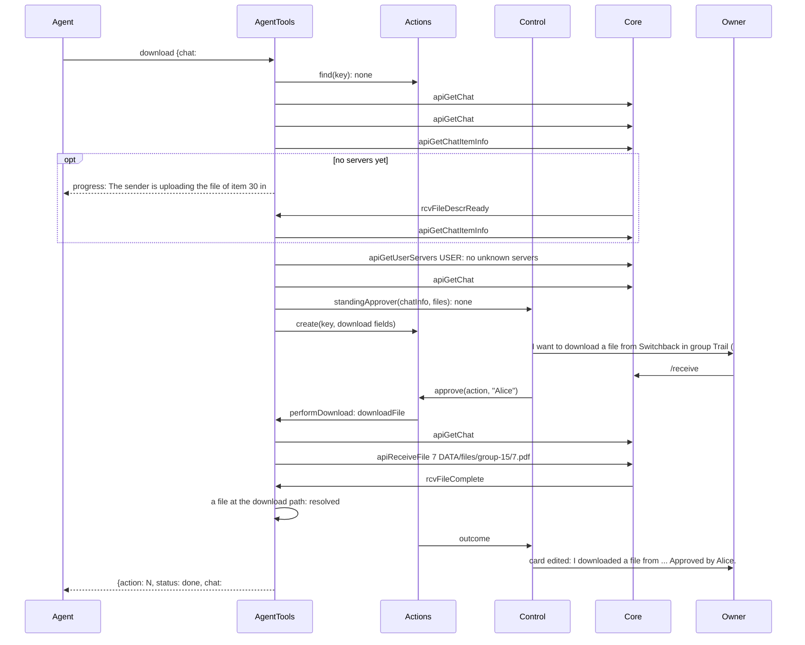

Notes:

- A check every 60 s reads the item: a deleted message or chat fails the download; 30 minutes without a rise of `rcvProgress` fail and cancel it ([tools.ts:1088-1115](../src/tools.ts#L1088-L1115)).
- A download still running `wait` seconds after the perform starts returns `status: performing`; the same call again attaches to the action ([tools.ts:1058-1061](../src/tools.ts#L1058-L1061)).
- `/approve #15 N` on a download card gets the reply `Action N is a download: ...` with the card's command line ([control.ts:234](../src/control.ts#L234)).
- A file on unknown servers gets a card that names their hosts and leaves out `/'receive CHAT N all'` ([control.ts:595-600](../src/control.ts#L595-L600), [:612-615](../src/control.ts#L612-L615), [:665-669](../src/control.ts#L665-L669)). Only such a card approves the relays; the core checks the complete description of every other download, which fails at the acceptance, or at the next check when the description completes later ([tools.ts:560](../src/tools.ts#L560), [:1096](../src/tools.ts#L1096)).
- The card of an image or video shows the sender's preview ([control.ts:441-461](../src/control.ts#L441-L461)).
- A file the core receives without a request, a short voice message, also in a member chat of a group, is moved into the chat's folder at `rcvFileComplete`; one whose transfer started before a restart, only when it has its full size. Its message then shows it as `offered`, and `download` returns its path after the approval ([tools.ts:566-606](../src/tools.ts#L566-L606), [:1135-1144](../src/tools.ts#L1135-L1144), [messages.ts:195-209](../src/messages.ts#L195-L209)).
- With `--audio`, a voice file of at most 300 s and 1500000 bytes is then transcribed in the perform, and `transcript` or `transcript_error` is added to the result ([tools.ts:1068-1075](../src/tools.ts#L1068-L1075), [:1061](../src/tools.ts#L1061)).

Source: [tools.ts:1010-1156](../src/tools.ts#L1010-L1156), [control.ts:573-617](../src/control.ts#L573-L617), [serve.ts:142-158](../src/serve.ts#L142-L158).

---

## 14. `/forward`

```mermaid
sequenceDiagram
  participant A as Agent
  participant T as AgentTools
  participant K as Control
  participant C as Core
  participant O as Owner
  O->>C: /forward #15 N (on a pending download card)
  C->>K: newChatItems
  K->>T: forwardFile(action N)
  T->>C: apiReceiveFile 7 DATA/forwarded/group-15/7.pdf
  C->>T: rcvFileComplete: resolved with the forwarded path
  T->>T: copy for the post: DATA/files/sent/send-XXXXXX/report.pdf
  K->>C: apiSendMessages #G [{fileSource: the copy, msgContent: file, quotedItemId: card N when the message fits}]
  C->>T: sndFileCompleteXFTP: the copy's folder deleted
  Note over K,O: the card stays pending; the agent's message shows the file as offered
  O->>C: /receive #15 N
  K->>T: performDownload: downloadFile
  T->>T: the forwarded file moved to DATA/files/group-15/7.pdf
  T-->>A: {action: N, status: done, chat: #15, item: 30, path}
```

Notes:

- `/forward` gets no reply; a download or post that fails is posted as ``Action N: the file was not received: `ERROR`.``, and a failed post deletes the copy ([control.ts:265-281](../src/control.ts#L265-L281)).
- The copy is named by the name the sender gave ([tools.ts:936-940](../src/tools.ts#L936-L940)).
- The post keeps the sender's preview of an image or video; it replies to the card when the message, with the card as its quote, is within 15602 bytes by the length rule of `send` ([control.ts:265-281](../src/control.ts#L265-L281), [tools.ts:1494-1510](../src/tools.ts#L1494-L1510)).
- The download is shared with the agent's: one download per file ID; the move to the download path waits for the copy of the post ([tools.ts:537-564](../src/tools.ts#L537-L564)).
- The forwarded path is outside `DATA/files/`, so `send` refuses the file there; it is deleted when the agent leaves the chat, and by `/delete CHAT files` ([tools.ts:909-914](../src/tools.ts#L909-L914), [:959-977](../src/tools.ts#L959-L977), [:1000-1008](../src/tools.ts#L1000-L1008)).

Source: [control.ts:221-239](../src/control.ts#L221-L239), [:265-281](../src/control.ts#L265-L281), [tools.ts:537-554](../src/tools.ts#L537-L554), [:886-896](../src/tools.ts#L886-L896), [:936-940](../src/tools.ts#L936-L940).

---

## 15. `send` with a file

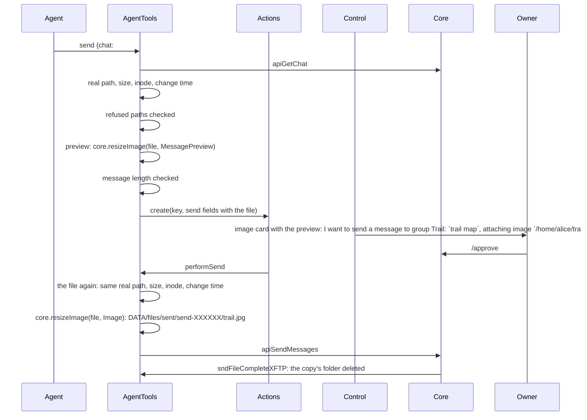

Notes:

- A refused file ends the call with an error, and the refusal is posted to the control chat and logged ([tools.ts:900-903](../src/tools.ts#L900-L903), [control.ts:154-158](../src/control.ts#L154-L158)).
- A video's preview is the first frame from `ffmpeg` and its duration comes from `ffprobe`; a GIF or WebP gets the fixed preview ([tools.ts:1573-1607](../src/tools.ts#L1573-L1607)).
- A changed file fails the perform: ``file: PATH changed after the request.`` ([tools.ts:916-921](../src/tools.ts#L916-L921)).
- `sndFileError` deletes the copy too, and the failure is posted to the control chat and logged ([serve.ts:161-163](../src/serve.ts#L161-L163), [control.ts:160-169](../src/control.ts#L160-L169)).

Source: [tools.ts:809-837](../src/tools.ts#L809-L837), [:859-934](../src/tools.ts#L859-L934), [control.ts:441-461](../src/control.ts#L441-L461), [:583-590](../src/control.ts#L583-L590).

---

## 16. `/leave` and `/delete CHAT files`

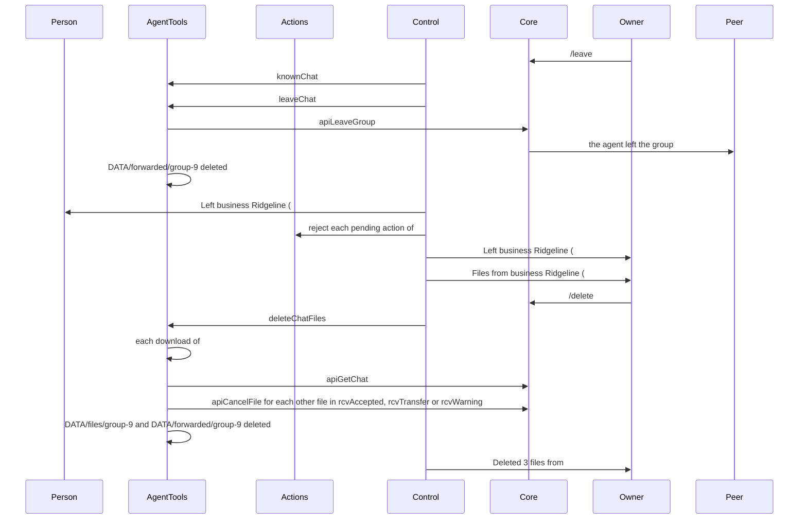

Notes:

- `/leave` acts at once in both modes, and works for a contact as `Deleted bot X (@4), requested by Alice.` ([control.ts:283-297](../src/control.ts#L283-L297)).
- The line `Left ...` goes to the log and to the owners; the members of #9 see only that the agent left.
- The files message is posted after the reply, and only when the folder has files ([control.ts:294-295](../src/control.ts#L294-L295), [:309-311](../src/control.ts#L309-L311)).
- `/delete CHAT files` works for a current or a left chat; the failed downloads return `Your owner deleted the files of this chat.`, and the reply counts the forwarded files too ([tools.ts:959-977](../src/tools.ts#L959-L977)).
- The paged reads find the downloads the core continues after a restart, which have no download in memory; for a left chat they find none ([messages.ts:272-280](../src/messages.ts#L272-L280), [tools.ts:966-972](../src/tools.ts#L966-L972)).

Source: [control.ts:283-307](../src/control.ts#L283-L307), [tools.ts:954-977](../src/tools.ts#L954-L977), [:1000-1008](../src/tools.ts#L1000-L1008).

---

## 17. A voice message at arrival

The server runs with `--audio http://127.0.0.1:8080,stt,tts`, and an owner approved all files of #15.

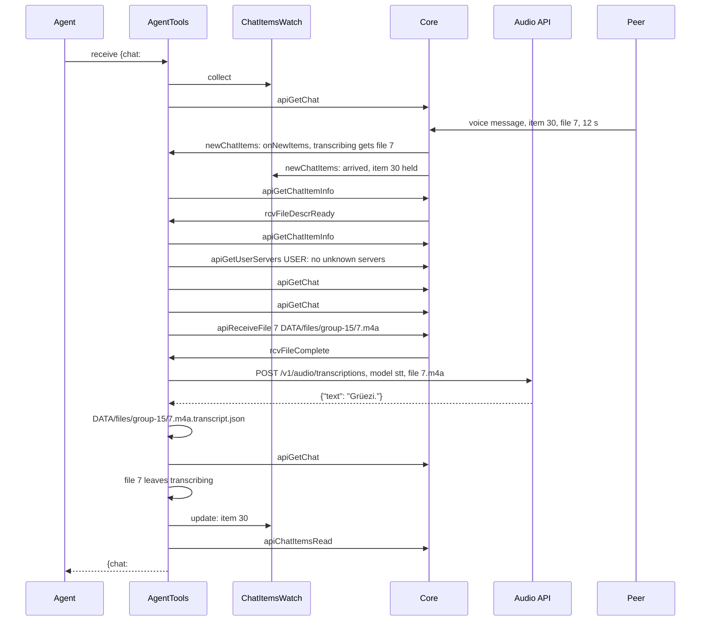

Notes:

- Without a files approval, in mode `host`, in a member chat, above 300 s or 1500000 bytes, with 20 voice files in transcription, or with the control chat lost, the message is delivered at once with its file `offered` ([tools.ts:577-579](../src/tools.ts#L577-L579)).
- No servers 60 s after the arrival, unknown servers, a removed files approval or a failed download: the message is released without a transcript. Each of them but the removed approval is logged as `voice message of file N: ERROR` ([tools.ts:583-590](../src/tools.ts#L583-L590)).
- A failure of the audio API is written as `transcript_error` and logged as `transcription of file N: ERROR`; the requests of the process are sent one at a time ([audio.ts:22-26](../src/audio.ts#L22-L26), [:33-42](../src/audio.ts#L33-L42)).
- During the run, its download is shared with a `download` of the item, and the run is awaited there, so one transcription request is sent ([tools.ts:557-558](../src/tools.ts#L557-L558), [:1073-1074](../src/tools.ts#L1073-L1074)).
- The item is held in the responses of `send` in the same way ([tools.ts:846-848](../src/tools.ts#L846-L848)).

Source: [tools.ts:566-594](../src/tools.ts#L566-L594), [:1167-1169](../src/tools.ts#L1167-L1169), [audio.ts:22-74](../src/audio.ts#L22-L74), [messages.ts:203](../src/messages.ts#L203), [serve.ts:139-140](../src/serve.ts#L139-L140).
