# SimpleX MCP server: flows

> Sequence diagrams of the main flows, each with notes and source locations.
>
> Related specs: [README](README.md) | [Architecture](architecture.md) | [API](api.md)

Participants:

| Letter | Participant |
|---|---|
| P | the person at the terminal |
| A | the agent in Claude Code |
| H | the HTTP listener with the MCP SDK |
| T | `AgentTools` |
| X | `Actions` |
| K | `Control` |
| C | the SimpleX core behind `ChatApi` |
| O | the owner in the SimpleX app |
| D | a peer |
| L | `Statuses`, the status messages |
| I | the inference endpoint of `--inference` |
| Y | `Activity`, the Claude Code activity |

`#G` is the agent control chat, `USER` the agent's user ID, `DATA` the data folder. Calls to the core are shown as the `ChatApi` methods the server calls, with their arguments in short. Card and progress texts with a semicolon are shown with a comma in the diagrams; the exact texts are in [API](api.md).

---

## Table of contents

1. [First start and the owner joins](#1-first-start-and-the-owner-joins)
2. [`register`](#2-register)
3. [`connect` with approval](#3-connect-with-approval)
4. [`send` with responses](#4-send-with-responses)
5. [`receive` with `wait`](#5-receive-with-wait)
6. [`send` under a standing approval, and `/revoke`](#6-send-under-a-standing-approval-and-revoke)
7. [`leave`](#7-leave)
8. [Mode `host`](#8-mode-host)
9. [Expiry](#9-expiry)
10. [A lost call and its re-attachment](#10-a-lost-call-and-its-re-attachment)
11. [Shutdown with pending actions](#11-shutdown-with-pending-actions)
12. [`--owners` setup](#12---owners-setup)
13. [`download` with approval](#13-download-with-approval)
14. [`/forward`](#14-forward)
15. [`send` with a file](#15-send-with-a-file)
16. [`/leave` and `/delete CHAT files`](#16-leave-and-delete-chat-files)
17. [Status message while the agent works](#17-status-message-while-the-agent-works)
18. [Claude Code activity in the status message](#18-claude-code-activity-in-the-status-message)

---

## 1. First start and the owner joins

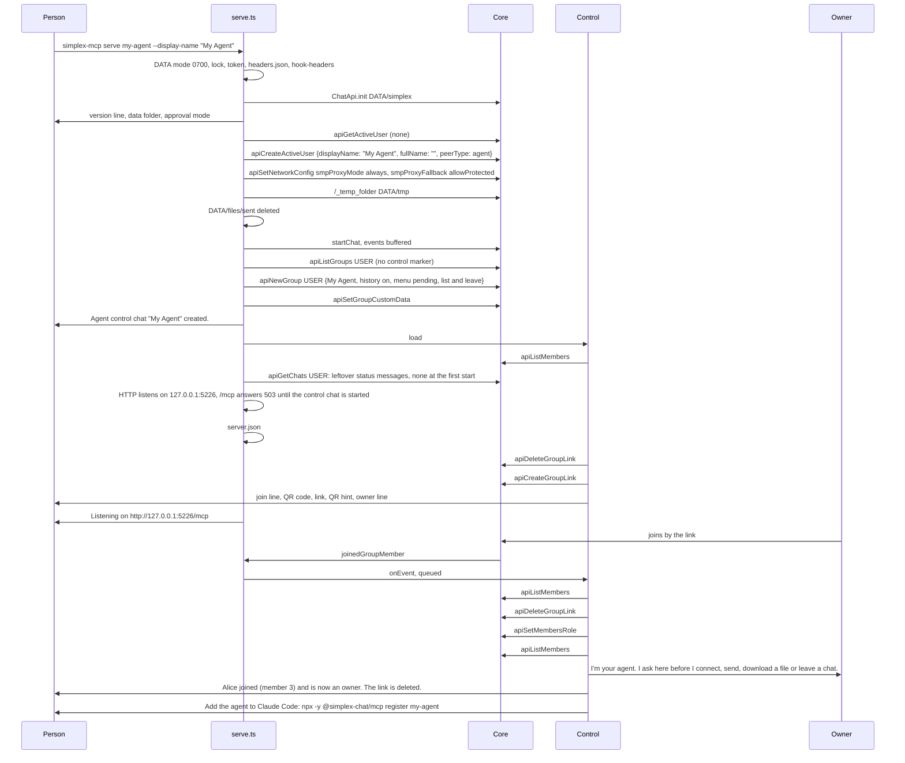

Notes:

- At first use, libsimplex and the Node.js add-on are downloaded, with one `Downloading ...` line each on stderr ([libs.ts:114-135](../../simplex-chat-nodejs/src/libs.ts#L114-L135)).
- With `--data`, `--data <folder>` is appended to the register hint, shell-quoted ([serve.ts:193-195](../src/serve.ts#L193-L195)).
- With `--qr-code small`, the line `If the QR code does not scan, ...` is printed after the link ([control.ts:412](../src/control.ts#L412)).
- Events that arrive before the HTTP listener starts are buffered and handled in order ([serve.ts:250-264](../src/serve.ts#L250-L264)).
- The server runs `ownerJoined` for every `joinedGroupMember` event of a human without `--owners`, and the link is deleted in that handler ([control.ts:189-190](../src/control.ts#L189-L190), [:371-378](../src/control.ts#L371-L378)).

Source: [cli.ts:214-225](../src/cli.ts#L214-L225), [serve.ts:68-133](../src/serve.ts#L68-L133), [:221-239](../src/serve.ts#L221-L239), [files.ts:12-53](../src/files.ts#L12-L53), [http.ts:18-55](../src/http.ts#L18-L55), [control.ts:102-117](../src/control.ts#L102-L117), [:341-345](../src/control.ts#L341-L345), [:406-425](../src/control.ts#L406-L425), [:499-520](../src/control.ts#L499-L520), [tools.ts:1162-1167](../src/tools.ts#L1162-L1167), [:1217-1225](../src/tools.ts#L1217-L1225).

---

## 2. `register`

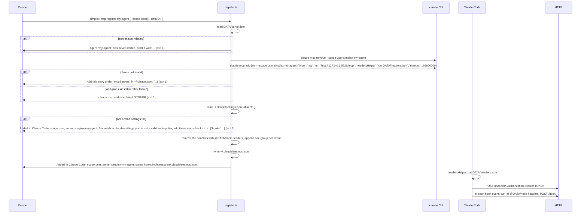

Notes:

- `simplex-mcp` ignores the exit status of `claude mcp remove` and stops at that step only when the `claude` binary is missing ([register.ts:41-42](../src/register.ts#L41-L42)).
- On Windows, a missing `claude` is run again through `cmd.exe`, with each argument quoted for it ([register.ts:133-148](../src/register.ts#L133-L148)).
- `timeout` is `(expireHours + 24) × 3600000 + 600000` ms from `server.json` ([register.ts:59](../src/register.ts#L59)).
- With `--scope local`, the project folder in the manual entry and in the path of the settings file is the git repository root, the main repository of a worktree, or the current folder outside a repository ([register.ts:70-71](../src/register.ts#L70-L71), [:107-131](../src/register.ts#L107-L131)).
- The settings file is `CONFIG/settings.json`, with CONFIG `CLAUDE_CONFIG_DIR`, or `~/.claude` when it is unset or empty; with `--scope local`, `PROJECT/.claude/settings.local.json` ([register.ts:35](../src/register.ts#L35), [:68-72](../src/register.ts#L68-L72)).
- The hooks are written after `claude mcp add-json` succeeds; at a repeated `register`, the handlers of the same data folder are replaced, so a changed port is applied ([register.ts:46-50](../src/register.ts#L46-L50), [:87-101](../src/register.ts#L87-L101)).
- The hooks and the merge rules are listed in [API 3.2](api.md#32-register), and the use of their events in [18](#18-claude-code-activity-in-the-status-message).

Source: [cli.ts:120-135](../src/cli.ts#L120-L135), [:223](../src/cli.ts#L223), [register.ts:35-105](../src/register.ts#L35-L105), [files.ts:42-44](../src/files.ts#L42-L44), [:55-58](../src/files.ts#L55-L58).

---

## 3. `connect` with approval

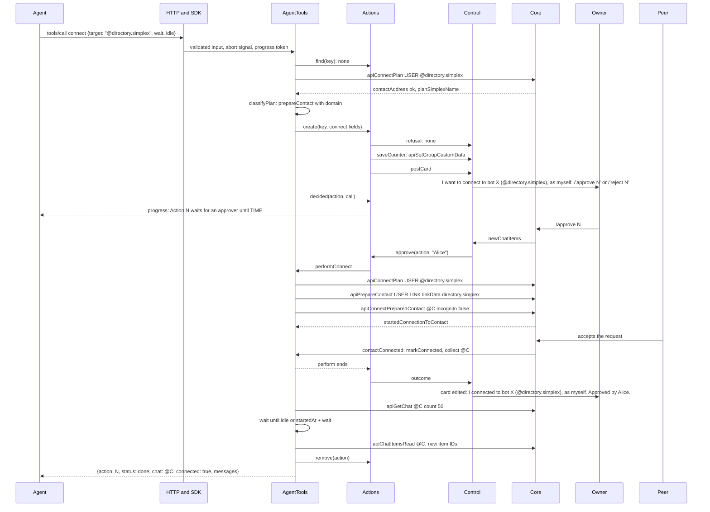

Notes:

- The plan is read again in the perform step ([tools.ts:709](../src/tools.ts#L709)).
- Join methods per plan ([tools.ts:738-766](../src/tools.ts#L738-L766), [:1317-1380](../src/tools.ts#L1317-L1380)):

| Plan | Methods |
|---|---|
| known prepared contact or group | `apiConnectPreparedContact(C, incognito, message)`<br>`apiConnectPreparedGroup(G, incognito, message)` |
| channel link (`direct` false, with link data) | `apiPrepareGroup(USER, LINK, false, linkData, domain)`<br>`apiConnectPreparedGroup(G, incognito)` |
| contact address with link data, and a SimpleX name or a message | `apiPrepareContact(USER, LINK, linkData, domain)`<br>`apiConnectPreparedContact(C, incognito, message)`, or `apiConnectPreparedGroup` for a business |
| `contactViaAddress` | `apiConnectContactViaAddress(USER, incognito, CONTACT_ID)` |
| other links | `apiConnectPreparedLink(USER, incognito, LINK)` |

- After a failed prepared connect, the server deletes the prepared chat without notifying ([tools.ts:768-775](../src/tools.ts#L768-L775)).
- The connection is matched by `contactConnected` or `userJoinedGroup`: by contact or group ID, or by the pending connection ID ([tools.ts:609-617](../src/tools.ts#L609-L617), [:777-782](../src/tools.ts#L777-L782)).
- In the perform step the server waits for the other side until `startedAt + wait`, at most until `created + 23 h 50 min`, and then reports `connected: false` ([tools.ts:150](../src/tools.ts#L150), [:708](../src/tools.ts#L708), [:732-735](../src/tools.ts#L732-L735)).
- Without `message`, the idle time is counted from the connection; with `message`, from the first reply ([tools.ts:788](../src/tools.ts#L788), [messages.ts:323-331](../src/messages.ts#L323-L331)).
- For a target the agent is connected to, the result is `status: known` with its chat fields, and no action is created ([tools.ts:641](../src/tools.ts#L641)).
- Exact progress texts: `Action N waits for an approver until TIME.`, then `Action N waits for the connection until TIME.`, then `K messages in CHAT; waiting until TIME.` ([actions.ts:343-354](../src/actions.ts#L343-L354), [tools.ts:677](../src/tools.ts#L677)).

Source: [tools.ts:636-691](../src/tools.ts#L636-L691), [:705-791](../src/tools.ts#L705-L791), [actions.ts:155-186](../src/actions.ts#L155-L186), [:206-223](../src/actions.ts#L206-L223), [control.ts:141-152](../src/control.ts#L141-L152).

---

## 4. `send` with responses

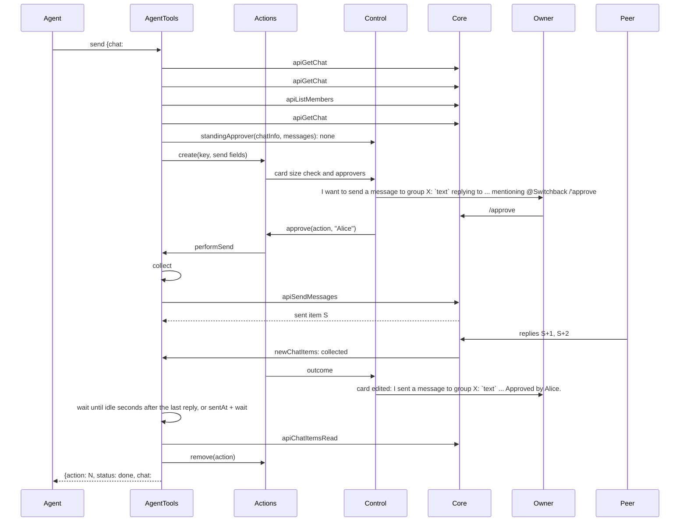

Notes:

- Checks before the action: `text` or `file`, the chat connected, role `observer` or `relay` refused, `reply_to` item a message, mentioned members present and the chat a group, and the message length with its quote ([tools.ts:798-811](../src/tools.ts#L798-L811)).
- The server starts collecting before the send and, after it, drops items with IDs up to the sent item ([tools.ts:866](../src/tools.ts#L866), [:880-882](../src/tools.ts#L880-L882)).
- Mentioned names missing from the text are prefixed as `@name` ([tools.ts:1490-1493](../src/tools.ts#L1490-L1493)).
- While a collected message is live, the server waits for its final update; live items are left out of `responses` and counted in `more` ([messages.ts:323-331](../src/messages.ts#L323-L331), [tools.ts:852](../src/tools.ts#L852), [:858](../src/tools.ts#L858)).
- At most 100 replies are kept per action; later ones are counted as overflow ([messages.ts:10](../src/messages.ts#L10), [:109-110](../src/messages.ts#L109-L110)).
- With `live: true`, the call is never attached to an action, and after the role check its text is shown in the status message of the chat ([tools.ts:796](../src/tools.ts#L796), [:805](../src/tools.ts#L805), [17](#17-status-message-while-the-agent-works)).

Source: [tools.ts:793-888](../src/tools.ts#L793-L888), [messages.ts:99-114](../src/messages.ts#L99-L114), [:323-331](../src/messages.ts#L323-L331), [control.ts:583-589](../src/control.ts#L583-L589).

---

## 5. `receive` with `wait`

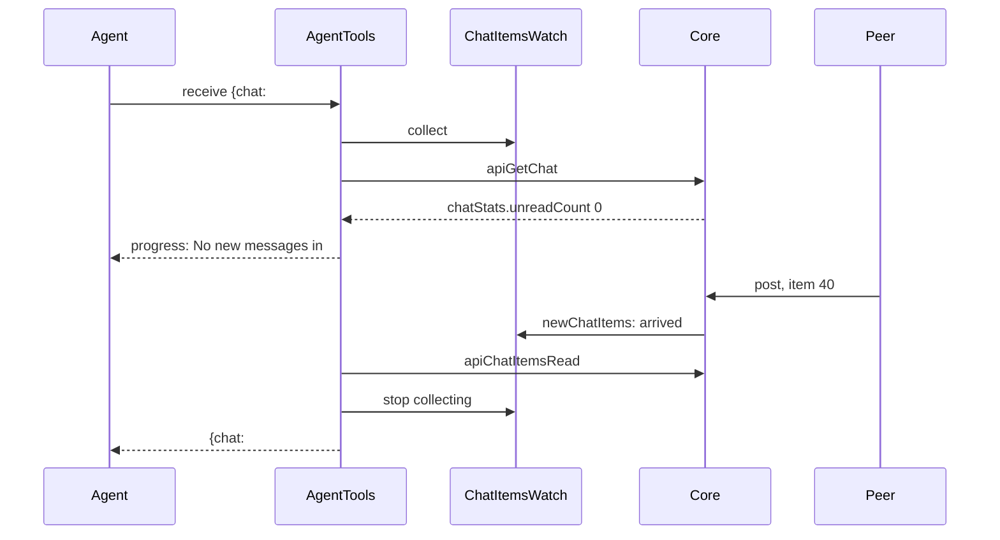

Notes:

- With unread items the server reads `around` the first unread item, `count` 0, then pages of `after` the last item, `count` 100, until it holds `limit + 1` unread, non-live messages or a page is short ([messages.ts:285-299](../src/messages.ts#L285-L299)).
- Unread items other than messages in the read pages are marked read with the returned messages ([tools.ts:1180](../src/tools.ts#L1180), [:1198](../src/tools.ts#L1198)).
- `more`: the arrived messages not returned, the overflow and the unread items not read ([tools.ts:1201](../src/tools.ts#L1201)).
- Items received while the pages are read are returned once ([tools.ts:1179-1182](../src/tools.ts#L1179-L1182)).
- Exact progress text: `No new messages in CHAT; waiting until TIME.` ([tools.ts:1187](../src/tools.ts#L1187)).
- Before the wait, the status message of the chat is deleted; with `typing: true`, a status message is started when messages are returned ([tools.ts:1184-1185](../src/tools.ts#L1184-L1185), [:1200](../src/tools.ts#L1200), [17](#17-status-message-while-the-agent-works)).

Source: [tools.ts:1169-1205](../src/tools.ts#L1169-L1205), [messages.ts:285-331](../src/messages.ts#L285-L331).

---

## 6. `send` under a standing approval, and `/revoke`

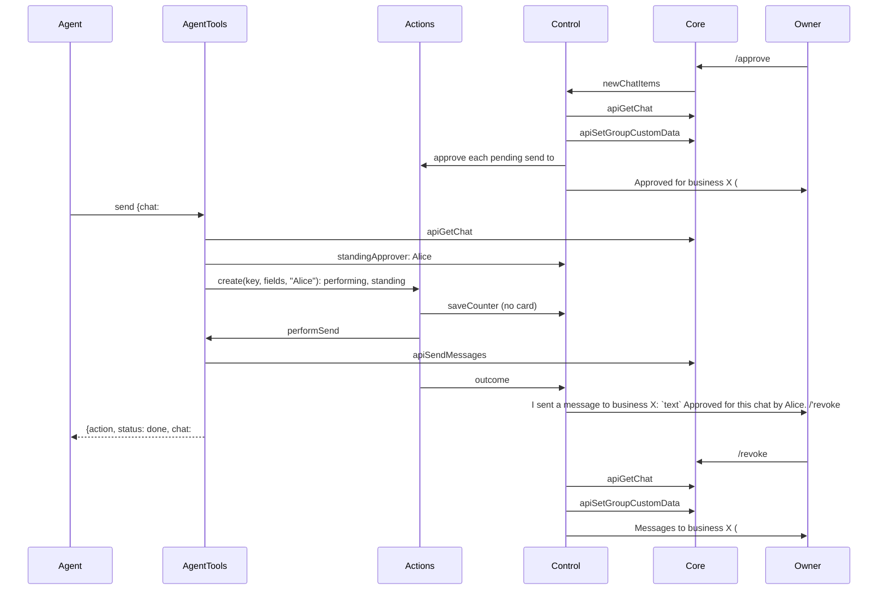

Notes:

- The approval is used in mode `requests` while member `approvedById` is an approver ([control.ts:130-133](../src/control.ts#L130-L133)).
- For sends that were pending at `/approve CHAT all`, the card ends with the plain `Approved by Alice.` ([control.ts:554](../src/control.ts#L554), [:563](../src/control.ts#L563)).
- `connect` and `leave` actions are created without the standing approver, so they stay pending ([tools.ts:647](../src/tools.ts#L647), [:984](../src/tools.ts#L984)).
- `/receive CHAT N all` and `/receive CHAT off` work the same way for downloads, with the key `simplexMcpFiles`, except that download N alone is performed, and the other pending downloads of the chat stay pending ([control.ts:22-25](../src/control.ts#L22-L25), [:251-253](../src/control.ts#L251-L253), [tools.ts:1023](../src/tools.ts#L1023)).
- After `/revoke #9`, the status message of #9 is deleted at its next tick, and a `send` with `live: true` to #9 is refused ([status.ts:119-126](../src/status.ts#L119-L126), [tools.ts:835](../src/tools.ts#L835), [17](#17-status-message-while-the-agent-works)).

Source: [control.ts:243-263](../src/control.ts#L243-L263), [:337-339](../src/control.ts#L337-L339), [tools.ts:815-817](../src/tools.ts#L815-L817), [actions.ts:155-186](../src/actions.ts#L155-L186), [:265-283](../src/actions.ts#L265-L283).

---

## 7. `leave`

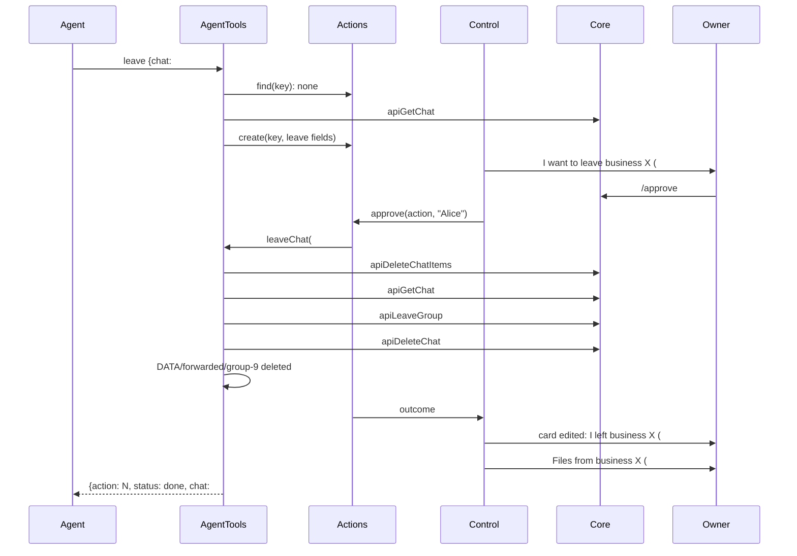

Notes:

- For a contact, the card text is `I want to delete KIND NAME (@N).`, and the perform step calls `apiDeleteChat` for the contact, full, with notify ([control.ts:590-593](../src/control.ts#L590-L593), [tools.ts:996](../src/tools.ts#L996)).
- The delete notifies, so the core notifies the contact or the members ([tools.ts:996](../src/tools.ts#L996), [:1000](../src/tools.ts#L1000)).
- The server looks for an attached action before it reads the chat, so a repeated call after the deletion is attached to the done action ([tools.ts:979-982](../src/tools.ts#L979-L982)).
- From before the status deletion until the chat is deleted, #9 is marked as being left: a `send` with `live: true` to #9 is refused with `No chat #9. list shows the agent's chats.` until the membership is marked left in `apiLeaveGroup`, and after that with `The agent is not connected to #9 and can't post; list shows connected: false.`; a status started meanwhile ends at its first tick without a post ([tools.ts:992-1004](../src/tools.ts#L992-L1004), [:803-804](../src/tools.ts#L803-L804), [:831](../src/tools.ts#L831), [:1448](../src/tools.ts#L1448)).

Source: [tools.ts:977-1006](../src/tools.ts#L977-L1006), [control.ts:145-152](../src/control.ts#L145-L152), [:299-302](../src/control.ts#L299-L302).

---

## 8. Mode `host`

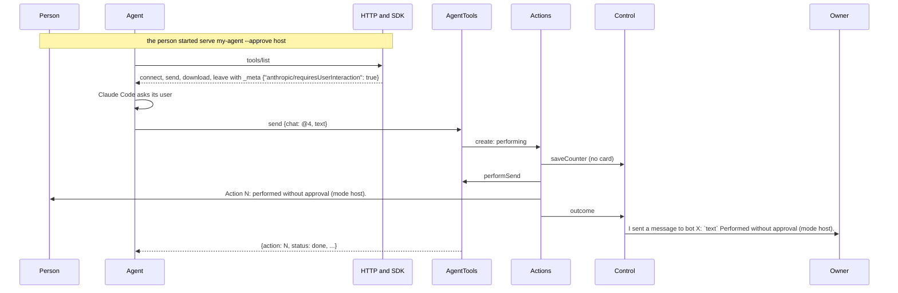

Notes:

- New actions are still refused unless the control chat has an approver ([control.ts:124-127](../src/control.ts#L124-L127)).
- In mode `host`, `standingApprover` returns `undefined`, so standing approvals are ignored by `send`, `download`, `list` and `/list`, and `/approve CHAT all` stores nothing; downloads get no card, so `/receive CHAT N all` has no card to act on ([control.ts:132](../src/control.ts#L132), [:213](../src/control.ts#L213)).
- A download in mode `host` is received without the approval of unknown servers, and it gets no card and no outcome post ([tools.ts:564](../src/tools.ts#L564), [:1078](../src/tools.ts#L1078), [control.ts:495-497](../src/control.ts#L495-L497)).
- The kept-files message also follows a done `leave` in mode `host` ([control.ts:150-151](../src/control.ts#L150-L151)).

Source: [tools.ts:504-514](../src/tools.ts#L504-L514), [actions.ts:166](../src/actions.ts#L166), [:281](../src/actions.ts#L281), [control.ts:145-152](../src/control.ts#L145-L152), [:554](../src/control.ts#L554).

---

## 9. Expiry

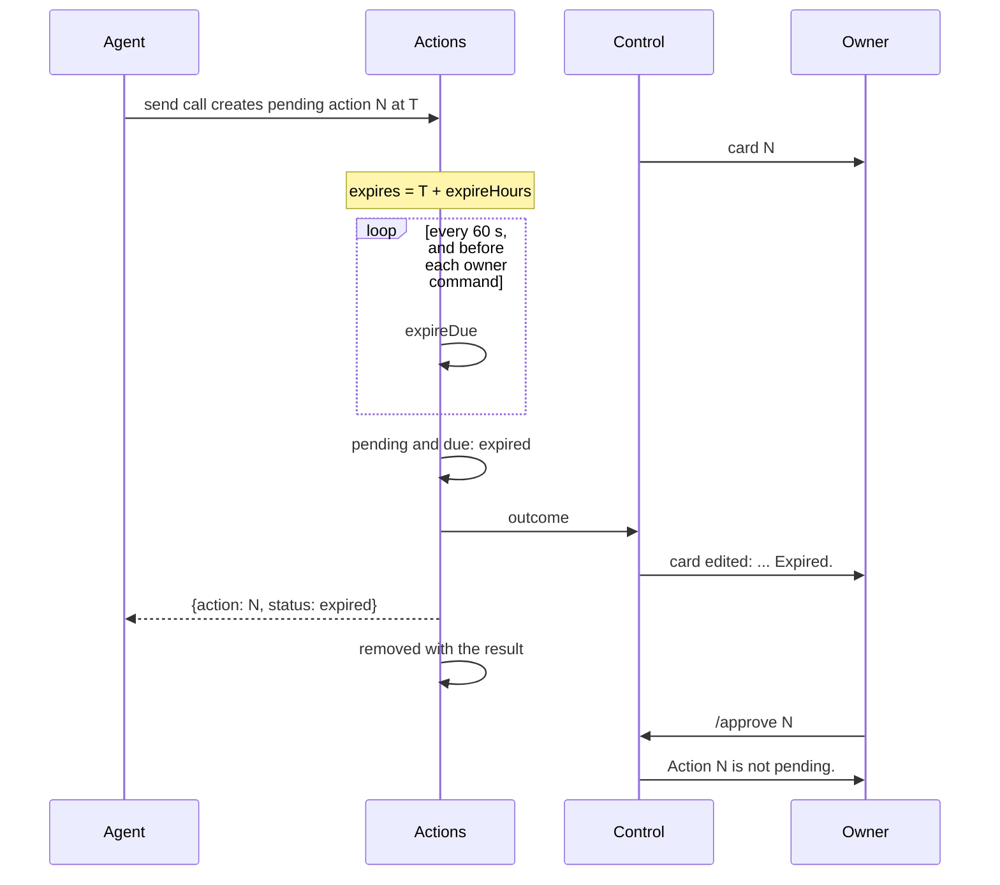

Notes:

- A decided action with an open count of 0 is removed at the first tick after its expiry time ([actions.ts:200-201](../src/actions.ts#L200-L201)).
- Expiry times are listed in the `/pending` reply ([control.ts:618-620](../src/control.ts#L618-L620)).
- The server ends the connect wait at `created + 23 h 50 min`, within the 24 hours in which a message can be edited ([tools.ts:150](../src/tools.ts#L150), [:708](../src/tools.ts#L708)).

Source: [actions.ts:129](../src/actions.ts#L129), [:163](../src/actions.ts#L163), [:193-204](../src/actions.ts#L193-L204), [control.ts:201](../src/control.ts#L201), [:227](../src/control.ts#L227).

---

## 10. A lost call and its re-attachment

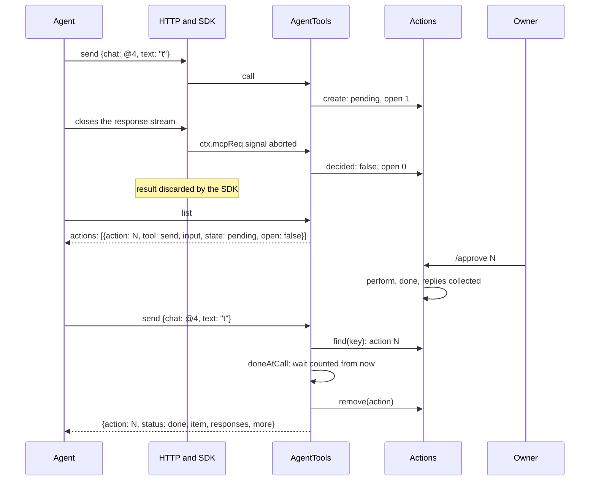

Notes:

- The key is the tool name with the action fields: `target`, `incognito`, `message` for `connect`; `chat`, `text`, `file`, `as`, `reply_to`, `mention` for `send`; `chat`, `item` for `download`; `chat` for `leave` ([tools.ts:637](../src/tools.ts#L637), [:795](../src/tools.ts#L795), [:979](../src/tools.ts#L979), [:1010](../src/tools.ts#L1010), [:1620-1622](../src/tools.ts#L1620-L1622)).
- The `wait`, `idle` and `limit` of the attaching call are used ([tools.ts:846](../src/tools.ts#L846)).
- For a call aborted before `create`, the server returns before it creates an action ([tools.ts:646](../src/tools.ts#L646), [:816](../src/tools.ts#L816), [:983](../src/tools.ts#L983), [:1024](../src/tools.ts#L1024)).
- Abort path in the SDK: on `res` close the web request is aborted ([node index.cjs:299-303](../node_modules/@modelcontextprotocol/node/dist/index.cjs#L299-L303)); the per-request transport is closed ([server index.cjs:86-90](../node_modules/@modelcontextprotocol/server/dist/index.cjs#L86-L90)); the handler signal is aborted ([src-BhnGYybN.cjs:6425](../node_modules/@modelcontextprotocol/server/dist/src-BhnGYybN.cjs#L6425)).

Source: [tools.ts:655-667](../src/tools.ts#L655-L667), [:843-861](../src/tools.ts#L843-L861), [:1213](../src/tools.ts#L1213), [actions.ts:206-217](../src/actions.ts#L206-L217), [messages.ts:307-321](../src/messages.ts#L307-L321).

---

## 11. Shutdown with pending actions

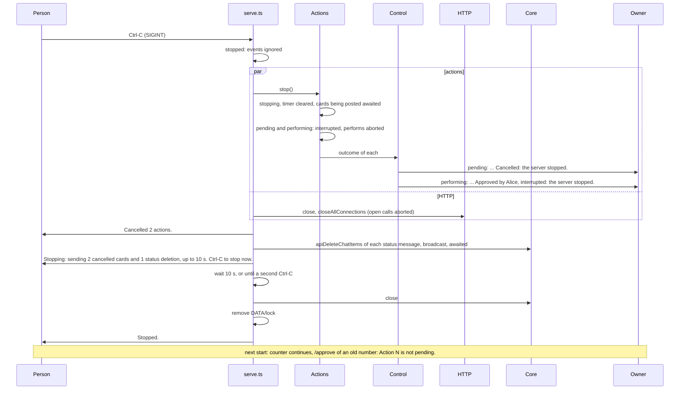

Notes:

- The interrupted card line is `DECIDER; interrupted: the server stopped.` ([control.ts:561](../src/control.ts#L561)).
- An action of mode `host` or of a standing approval whose counter is being written at the stop is set to `pending` and cancelled without a perform ([actions.ts:265-270](../src/actions.ts#L265-L270)).
- After a crash, the cards of that run are left with their commands; `/approve` of their numbers gets the reply `Action N is not pending.` ([control.ts:227](../src/control.ts#L227)).
- The stop signal of the performs is aborted after the actions are marked interrupted: a `connect` waiting for its connection ends, and an interrupted perform logs no line ([actions.ts:245-246](../src/actions.ts#L245-L246), [:280](../src/actions.ts#L280), [tools.ts:732-733](../src/tools.ts#L732-L733)).
- The status messages are ended after the HTTP server is closed and `Actions.stop` returns; later starts are ignored, and notes are refused ([serve.ts:181-184](../src/serve.ts#L181-L184), [status.ts:79-85](../src/status.ts#L79-L85)).
- The wait applies only when cards were edited or posted at the stop, a `download` without a card excluded, or status messages had a render, and `--stop-wait` is above 0. Cards are counted only while the control chat is not lost ([serve.ts:184-185](../src/serve.ts#L184-L185), [:197-213](../src/serve.ts#L197-L213)).

Source: [serve.ts:50-66](../src/serve.ts#L50-L66), [:178-189](../src/serve.ts#L178-L189), [:197-213](../src/serve.ts#L197-L213), [status.ts:79-85](../src/status.ts#L79-L85), [actions.ts:240-250](../src/actions.ts#L240-L250), [http.ts:57-61](../src/http.ts#L57-L61), [control.ts:552-571](../src/control.ts#L552-L571).

---

## 12. `--owners` setup

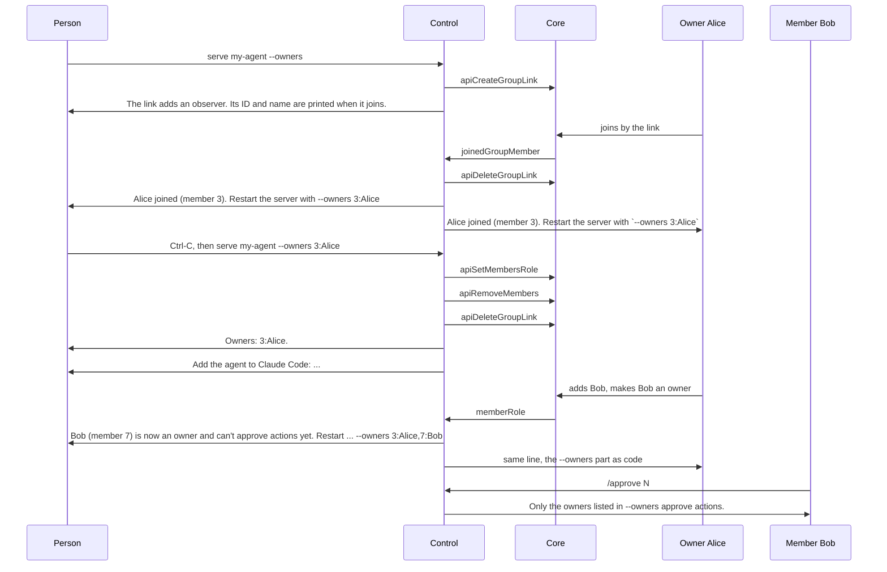

Notes:

- Until the restart with a list, new actions are refused: `The agent has no approving owner. ...` ([control.ts:125-127](../src/control.ts#L125-L127)).
- An entry must match a human by member ID and display name, folded to one line as the restart line prints it, or the server exits with code 2 ([control.ts:354-358](../src/control.ts#L354-L358), [:758-760](../src/control.ts#L758-L760)).
- With `--reset-owners`, the server deletes the control chat for all members and creates a new one with the same counter; the CLI refuses the option with an `--owners` list ([control.ts:522-527](../src/control.ts#L522-L527), [serve.ts:238](../src/serve.ts#L238), [cli.ts:111-113](../src/cli.ts#L111-L113)).
- When a listed owner leaves and none remains: `... is no longer an owner. No owners remain: restart the server with --reset-owners --owners` ([control.ts:393-398](../src/control.ts#L393-L398)).

Source: [control.ts:347-369](../src/control.ts#L347-L369), [:380-399](../src/control.ts#L380-L399), [:406-416](../src/control.ts#L406-L416), [:758-784](../src/control.ts#L758-L784).

---

## 13. `download` with approval

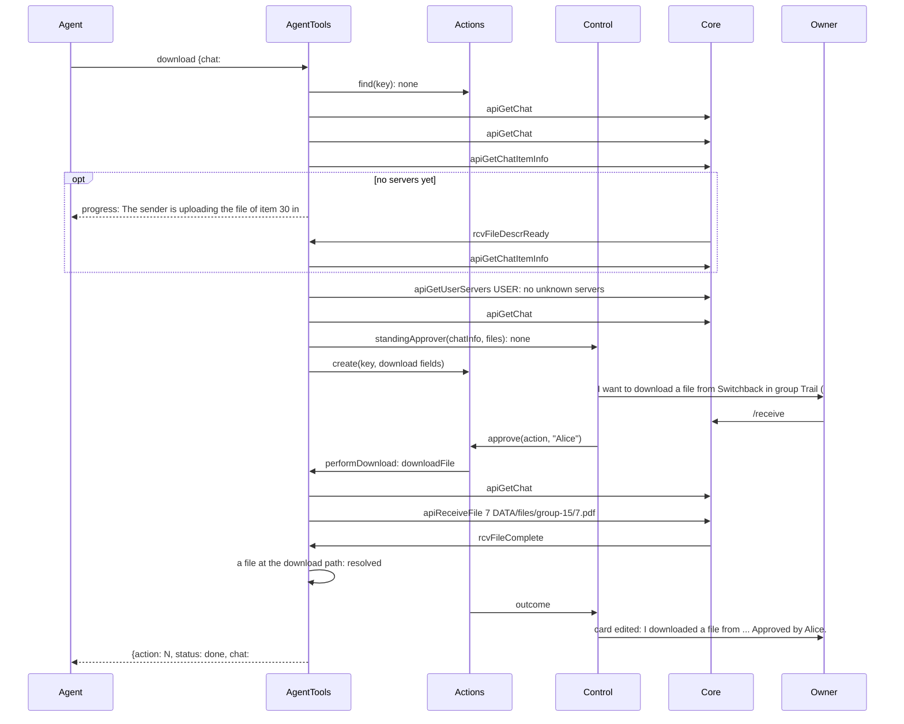

Notes:

- A check every 60 s reads the item: a deleted message or chat fails the download; 30 minutes without a rise of `rcvProgress` fail and cancel it ([tools.ts:1083-1110](../src/tools.ts#L1083-L1110)).
- A download still running `wait` seconds after the perform starts returns `status: performing`; the same call again attaches to the action ([tools.ts:1056-1059](../src/tools.ts#L1056-L1059)).
- `/approve #15 N` on a download card gets the reply `Action N is a download: ...` with the card's command line ([control.ts:234](../src/control.ts#L234)).
- A file on unknown servers gets a card that names their hosts and leaves out `/'receive CHAT N all'` ([control.ts:594-599](../src/control.ts#L594-L599), [:611-614](../src/control.ts#L611-L614), [:664-668](../src/control.ts#L664-L668)). Only such a card approves the relays; the core checks the complete description of every other download, which fails at the acceptance, or at the next check when the description completes later ([tools.ts:564](../src/tools.ts#L564), [:1091](../src/tools.ts#L1091)).
- The card of an image or video shows the sender's preview ([control.ts:441-461](../src/control.ts#L441-L461)).
- A file the core receives without a request, a short voice message, also in a member chat of a group, is moved into the chat's folder at `rcvFileComplete`; one whose transfer started before a restart, only when it has its full size. Its message then shows it as `offered`, and `download` returns its path after the approval ([tools.ts:570-590](../src/tools.ts#L570-L590), [:1130-1139](../src/tools.ts#L1130-L1139), [messages.ts:194-208](../src/messages.ts#L194-L208)).

Source: [tools.ts:1008-1151](../src/tools.ts#L1008-L1151), [control.ts:573-616](../src/control.ts#L573-L616), [serve.ts:146-162](../src/serve.ts#L146-L162).

---

## 14. `/forward`

```mermaid
sequenceDiagram
  participant A as Agent
  participant T as AgentTools
  participant K as Control
  participant C as Core
  participant O as Owner
  O->>C: /forward #15 N (on a pending download card)
  C->>K: newChatItems
  K->>T: forwardFile(action N)
  T->>C: apiReceiveFile 7 DATA/forwarded/group-15/7.pdf
  C->>T: rcvFileComplete: resolved with the forwarded path
  T->>T: copy for the post: DATA/files/sent/send-XXXXXX/report.pdf
  K->>C: apiSendMessages #G [{fileSource: the copy, msgContent: file, quotedItemId: card N when the message fits}]
  C->>T: sndFileCompleteXFTP: the copy's folder deleted
  Note over K,O: the card stays pending; the agent's message shows the file as offered
  O->>C: /receive #15 N
  K->>T: performDownload: downloadFile
  T->>T: the forwarded file moved to DATA/files/group-15/7.pdf
  T-->>A: {action: N, status: done, chat: #15, item: 30, path}
```

Notes:

- `/forward` gets no reply; a download or post that fails is posted as ``Action N: the file was not received: `ERROR`.``, and a failed post deletes the copy ([control.ts:265-281](../src/control.ts#L265-L281)).
- The copy is named by the name the sender gave ([tools.ts:940-944](../src/tools.ts#L940-L944)).
- The post keeps the sender's preview of an image or video; it replies to the card when the message, with the card as its quote, is within 15602 bytes by the length rule of `send` ([control.ts:265-281](../src/control.ts#L265-L281), [tools.ts:1499-1515](../src/tools.ts#L1499-L1515)).
- The download is shared with the agent's: one download per file ID; the move to the download path waits for the copy of the post ([tools.ts:541-568](../src/tools.ts#L541-L568)).
- The forwarded path is outside `DATA/files/`, so `send` refuses the file there; it is deleted when the agent leaves the chat, and by `/delete CHAT files` ([tools.ts:913-918](../src/tools.ts#L913-L918), [:951-969](../src/tools.ts#L951-L969), [:992-1006](../src/tools.ts#L992-L1006)).

Source: [control.ts:221-239](../src/control.ts#L221-L239), [:265-281](../src/control.ts#L265-L281), [tools.ts:541-558](../src/tools.ts#L541-L558), [:890-900](../src/tools.ts#L890-L900), [:940-944](../src/tools.ts#L940-L944).

---

## 15. `send` with a file

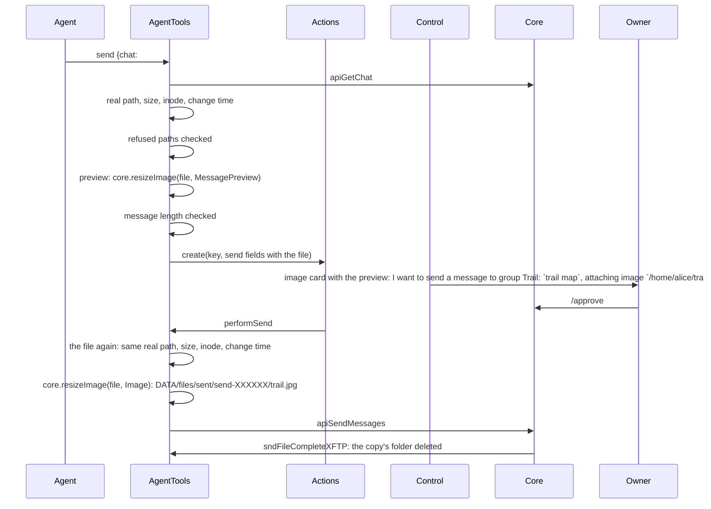

Notes:

- A refused file ends the call with an error, and the refusal is posted to the control chat and logged ([tools.ts:904-907](../src/tools.ts#L904-L907), [control.ts:154-158](../src/control.ts#L154-L158)).
- A video's preview is the first frame from `ffmpeg` and its duration comes from `ffprobe`; a GIF or WebP gets the fixed preview ([tools.ts:1578-1612](../src/tools.ts#L1578-L1612)).
- A changed file fails the perform: ``file: PATH changed after the request.`` ([tools.ts:920-925](../src/tools.ts#L920-L925)).
- `sndFileError` deletes the copy too, and the failure is posted to the control chat and logged ([serve.ts:165-167](../src/serve.ts#L165-L167), [control.ts:160-169](../src/control.ts#L160-L169)).

Source: [tools.ts:793-819](../src/tools.ts#L793-L819), [:863-938](../src/tools.ts#L863-L938), [control.ts:441-461](../src/control.ts#L441-L461), [:583-589](../src/control.ts#L583-L589).

---

## 16. `/leave` and `/delete CHAT files`

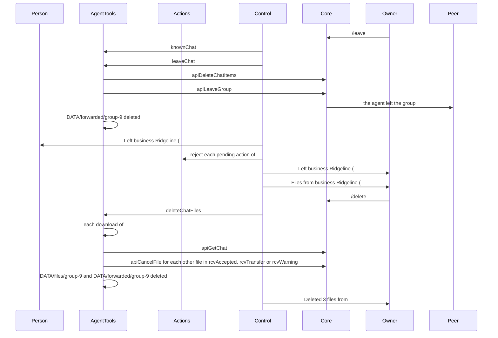

Notes:

- `/leave` acts at once in both modes, and works for a contact as `Deleted bot X (@4), requested by Alice.` ([control.ts:283-297](../src/control.ts#L283-L297)).
- With `/leave`, the status message of the chat is deleted first, as with `leave` ([7](#7-leave), [tools.ts:992-995](../src/tools.ts#L992-L995)).
- The line `Left ...` goes to the log and to the owners; the members of #9 see only that the agent left.
- The files message is posted after the reply, and only when the folder has files ([control.ts:294-295](../src/control.ts#L294-L295), [:309-311](../src/control.ts#L309-L311)).
- `/delete CHAT files` works for a current or a left chat; the failed downloads return `Your owner deleted the files of this chat.`, and the reply counts the forwarded files too ([tools.ts:951-969](../src/tools.ts#L951-L969)).
- The paged reads find the downloads the core continues after a restart, which have no download in memory; for a left chat they find none ([messages.ts:271-279](../src/messages.ts#L271-L279), [tools.ts:958-964](../src/tools.ts#L958-L964)).

Source: [control.ts:283-307](../src/control.ts#L283-L307), [tools.ts:946-969](../src/tools.ts#L946-L969), [:992-1006](../src/tools.ts#L992-L1006).

---

## 17. Status message while the agent works

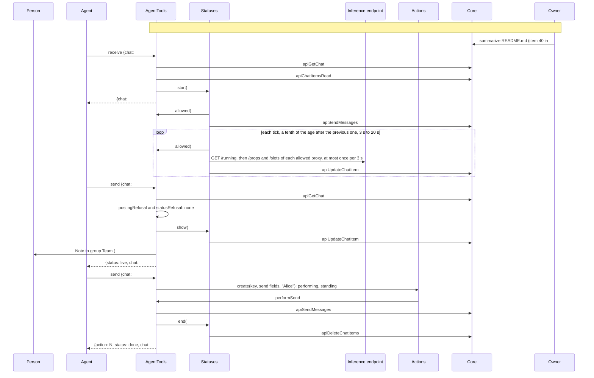

Notes:

- Eligibility is read before the first post and at each tick: the agent can post in #9, #9 is a chat with a person, a group or a business chat and is not being left, the mode is `requests`, the control chat is not lost, and #9 has a standing approval of messages ([tools.ts:830-841](../src/tools.ts#L830-L841), [:1451-1458](../src/tools.ts#L1451-L1458), [status.ts:119-126](../src/status.ts#L119-L126)). When #9 is not eligible at the first tick, the status ends without a post.
- The status is started for any message returned with `typing: true`, whatever its sender; a start in a chat with a status is ignored ([tools.ts:1200](../src/tools.ts#L1200), [status.ts:51-55](../src/status.ts#L51-L55)).
- The label is read for renders 2 to 49, after the inference poll; the labels and their order are in [API 1.10](api.md#110-status-message) ([status.ts:127-131](../src/status.ts#L127-L131), [:147-152](../src/status.ts#L147-L152), [:174-211](../src/status.ts#L174-L211)).
- With the status hooks of `register`, the labels also name the Claude Code tool, permission prompt, subagent or compaction in progress ([18](#18-claude-code-activity-in-the-status-message)).
- At the 50th render, the line is `◌ working since YYYY-MM-DD HH:MM UTC`; later ticks are run every 5 min without a render, and notes are rendered up to the 59th render ([status.ts:132-133](../src/status.ts#L132-L133), [:143](../src/status.ts#L143), [:170](../src/status.ts#L170)).
- A note is checked as a `send` up to the role check, then by `statusRefusal`; it is rendered at once without an action, and the result is returned without a wait ([tools.ts:798-805](../src/tools.ts#L798-L805), [:821-828](../src/tools.ts#L821-L828), [status.ts:57-67](../src/status.ts#L57-L67)).
- The answer is a new message; the status message is deleted after `apiSendMessages` returns, and it is kept after a failed answer ([tools.ts:869-879](../src/tools.ts#L869-L879)). The outcome of the answer is posted to the control chat as in [6](#6-send-under-a-standing-approval-and-revoke).
- Other deletions: a `receive` of #9 that waits, `leave` and `/leave`, a tick of a chat that is not eligible, 23 hours, 30 minutes without calls from 50 renders, a failed send or update of the status, the stop ([API 1.10](api.md#110-status-message)).
- A render queued while the first send of a status runs is sent after it. When that send fails, a new live item is posted for the queued render, and that item is removed by the deletion queued after it ([api.ts:1187-1189](../../simplex-chat-nodejs/src/api.ts#L1187-L1189), [:1199-1208](../../simplex-chat-nodejs/src/api.ts#L1199-L1208), [status.ts:114-117](../src/status.ts#L114-L117)).
- Polls are shared by all status messages for 3 s; one 1 s deadline is set for all requests of a poll; a failed poll is logged as `inference endpoint: ERROR` unless the previous one failed ([inference.ts:34-48](../src/inference.ts#L34-L48), [status.ts:154-165](../src/status.ts#L154-L165)).

Source: [tools.ts:793-841](../src/tools.ts#L793-L841), [:863-888](../src/tools.ts#L863-L888), [:1169-1205](../src/tools.ts#L1169-L1205), [status.ts:31-211](../src/status.ts#L31-L211), [inference.ts:31-107](../src/inference.ts#L31-L107).

---

## 18. Claude Code activity in the status message

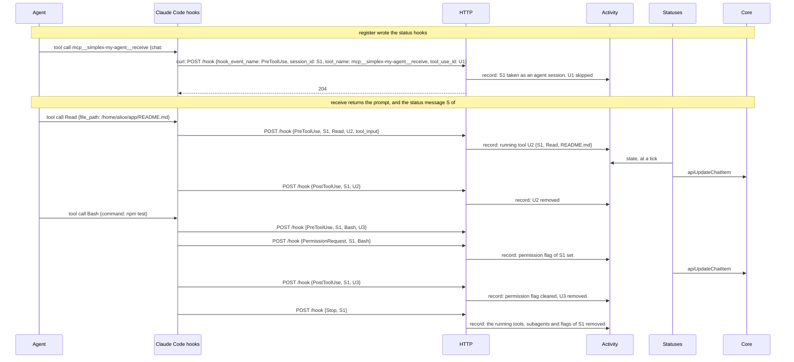

Notes:

- Claude Code runs the hooks for every session that reads the settings file, without a wait for curl; curl ends within 2 s, and its answer is discarded ([register.ts:63-66](../src/register.ts#L63-L66), [Claude Code hooks: background](https://code.claude.com/docs/en/hooks#run-hooks-in-the-background)).
- A session is taken as an agent session from its first event whose `tool_name` is a tool of this server; events of other sessions are discarded ([activity.ts:39-42](../src/activity.ts#L39-L42)).
- The calls of this server are skipped by `Activity` and shown as `using TOOL` from the running calls of `Statuses` other than `receive` ([activity.ts:46](../src/activity.ts#L46), [status.ts:150](../src/status.ts#L150), [:196](../src/status.ts#L196)).
- `agent_id` is set in the tool events of a subagent; at `PostToolBatch`, only the running tools of the same agent are removed ([activity.ts:56-58](../src/activity.ts#L56-L58)).
- Labels are read at ticks, 3 s to 20 s apart, so a tool call started and ended between two ticks is not shown ([status.ts:127-131](../src/status.ts#L127-L131), [:141-145](../src/status.ts#L141-L145)).
- The posts of one session may be received out of order; for an end event received before its `PreToolUse`, the ID is kept as ended, and the late `PreToolUse` is skipped ([activity.ts:46](../src/activity.ts#L46), [:53-55](../src/activity.ts#L53-L55)).
- While the server is down, curl fails with a refused connection; Claude Code hides the completion notices of async hooks by default ([Claude Code hooks: background](https://code.claude.com/docs/en/hooks#run-hooks-in-the-background)).

Source: [register.ts:10](../src/register.ts#L10), [:63-66](../src/register.ts#L63-L66), [http.ts:26-30](../src/http.ts#L26-L30), [:63-72](../src/http.ts#L63-L72), [serve.ts:113-114](../src/serve.ts#L113-L114), [:124](../src/serve.ts#L124), [activity.ts:24-115](../src/activity.ts#L24-L115), [status.ts:147-152](../src/status.ts#L147-L152), [:193-211](../src/status.ts#L193-L211).
