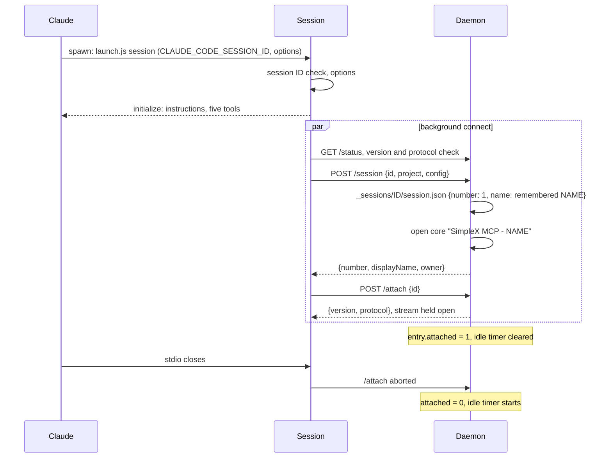
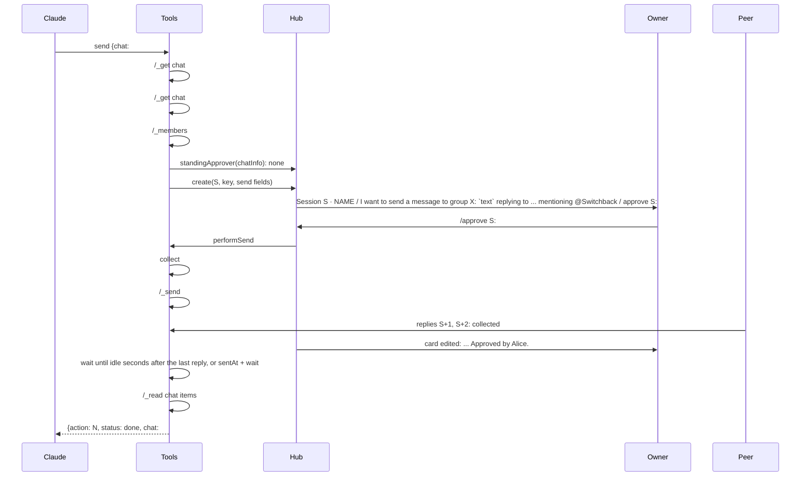
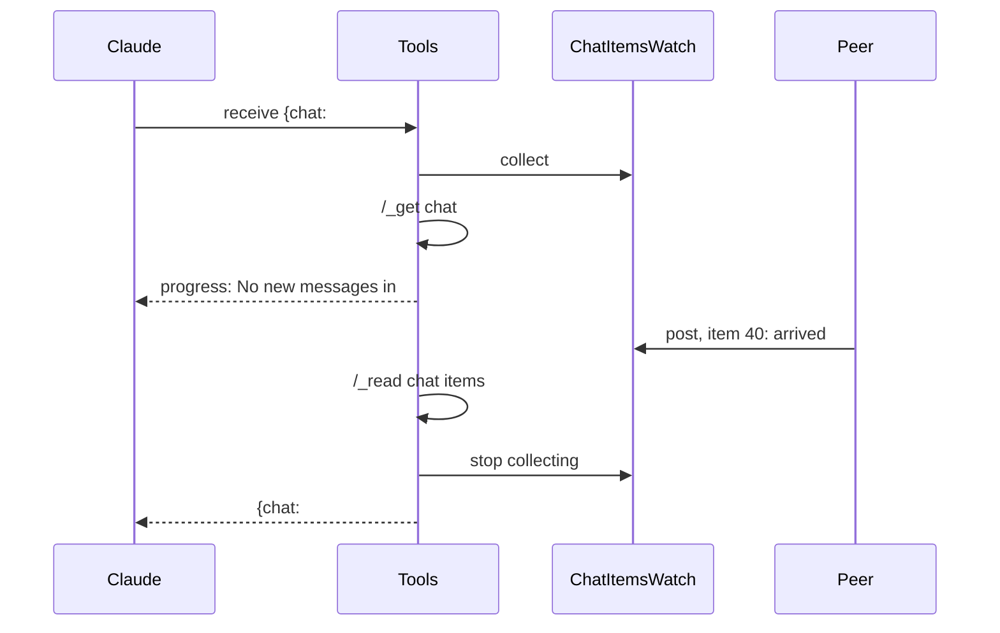
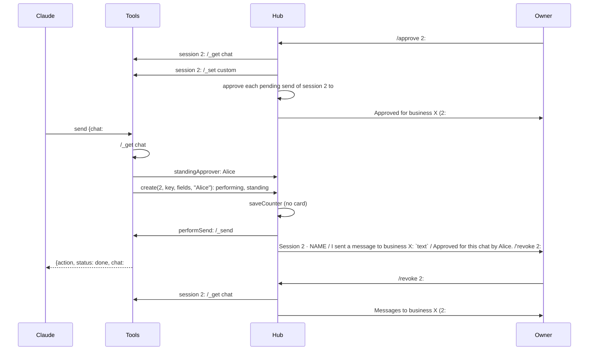
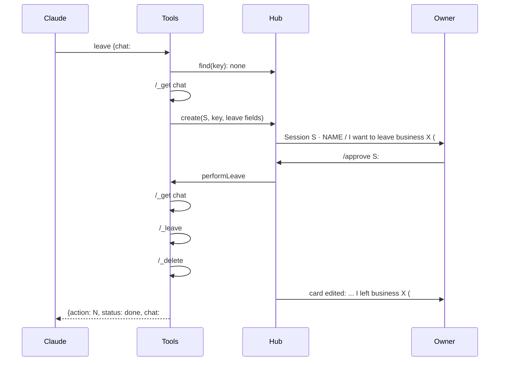
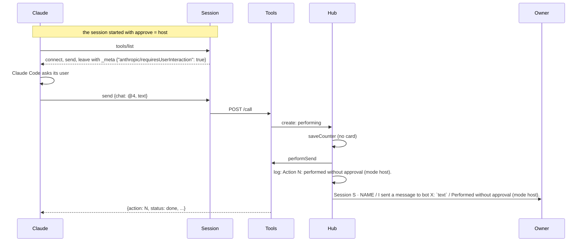
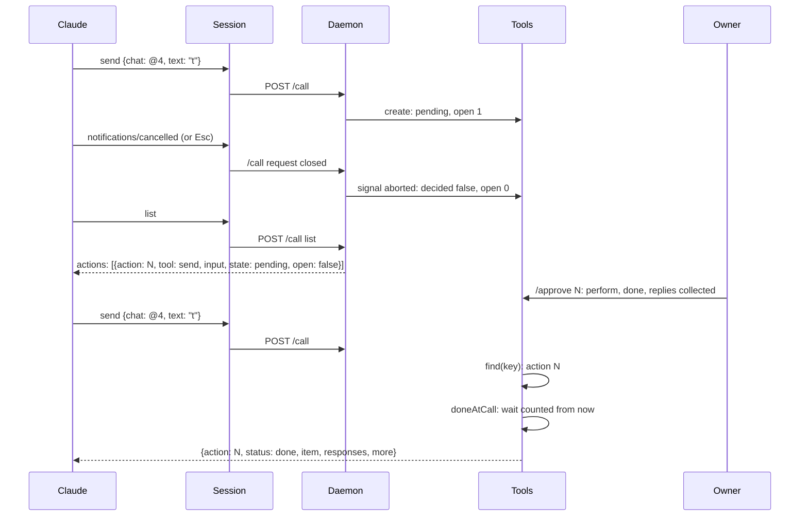
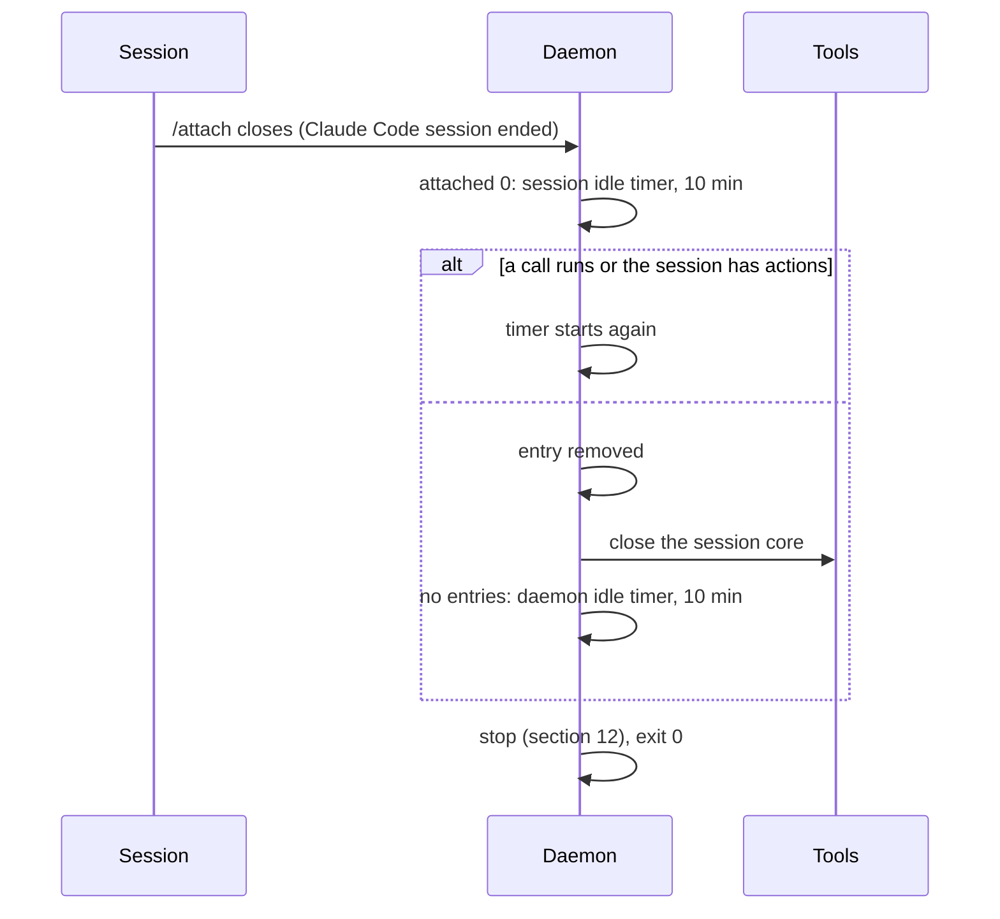
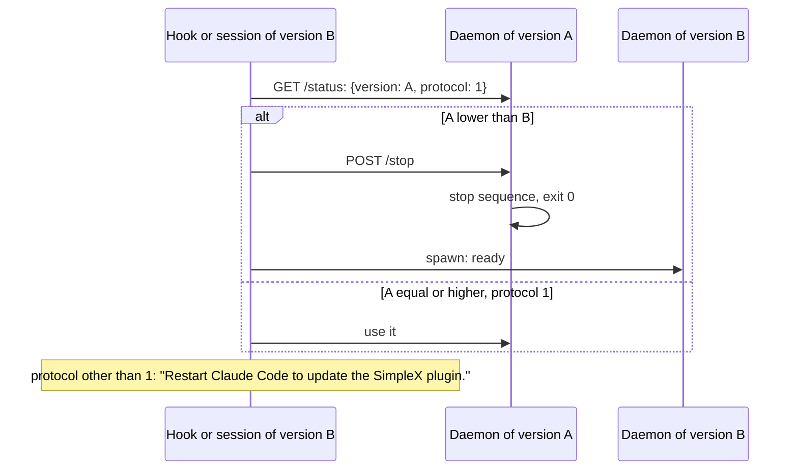
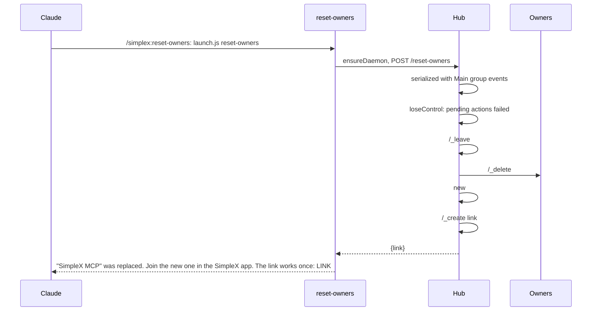

# SimpleX MCP server: flows

> Sequence diagrams of the main flows, each with notes and source locations.
>
> Related specs: [README](README.md) | [Architecture](architecture.md) | [API](api.md)

Participants:

| Name | Participant |
|---|---|
| Claude | Claude Code: the model, its MCP client and its hooks |
| Hook | `simplex-mcp hook session-start` |
| Session | `simplex-mcp session`, the stdio MCP server of one Claude Code session |
| Daemon | `simplex-mcp daemon`: listener, routes and session registry |
| Hub | `Hub` with `Control` and `Actions`, and the hub core |
| Tools | `AgentTools` of one session, with its session core |
| Owner | the owner in the SimpleX app |
| Peer | a contact, bot, group or channel |

`#G` is the Main group, `S` a session number, `ID` a Claude Code session ID, `LINK` a link as `connFullLink [connShortLink]`. Chat commands are shown as the daemon sends them. Card and progress texts with a semicolon are shown with a comma in the diagrams; the exact texts are in the notes and in [API](api.md).

---

## Table of contents

1. [First session start and the owner joins](#1-first-session-start-and-the-owner-joins)
2. [Session process start and attach](#2-session-process-start-and-attach)
3. [`connect` with approval](#3-connect-with-approval)
4. [`send` with responses](#4-send-with-responses)
5. [`receive` with `wait`](#5-receive-with-wait)
6. [`send` under a standing approval, and `/revoke`](#6-send-under-a-standing-approval-and-revoke)
7. [`leave`](#7-leave)
8. [Mode `host`](#8-mode-host)
9. [Expiry](#9-expiry)
10. [A lost call and its re-attachment](#10-a-lost-call-and-its-re-attachment)
11. [Idle close and idle stop](#11-idle-close-and-idle-stop)
12. [Daemon stop with pending actions](#12-daemon-stop-with-pending-actions)
13. [Daemon crash and a new daemon](#13-daemon-crash-and-a-new-daemon)
14. [A newer version](#14-a-newer-version)
15. [`reset-owners`](#15-reset-owners)

---

## 1. First session start and the owner joins

```mermaid
sequenceDiagram
  participant C as Claude
  participant K as Hook
  participant D as Daemon
  participant H as Hub
  participant O as Owner
  C->>K: SessionStart {session_id, session_title}
  K->>K: Node.js 22 check, options
  K->>K: ROOT mode 0700, token
  K->>D: GET /status (ENOENT: no daemon)
  K->>D: spawn dist/cli.js daemon, detached, fd 3 pipe, log to daemon.log
  D->>D: lock, session numbers, listen on daemon.sock
  D->>H: Hub.open(options)
  H->>H: /_create user {"displayName":"SimpleX MCP","peerType":"agent"}
  H->>H: /network socks=off smp-proxy=always smp-proxy-fallback=protected
  H->>H: startChat, events buffered
  H->>H: /_delete @C full notify=off (preset contact of a new user)
  H->>H: /_groups USER (no marker)
  H->>H: /_group USER {SimpleX MCP, history on, menu pending and list}
  H->>H: /_set custom #G {"simplexMcp":{"control":true,"nextAction":1}}
  H->>H: load: /_members #G
  H->>H: start: /_delete link #G, /_create link #G member
  D->>D: idle stop timer
  D->>K: fd 3: ready
  K->>D: GET /status
  K->>D: POST /title {id, name, config}
  D->>H: configure(config)
  D->>D: no entry, no session.json: remember NAME for ID
  D-->>K: {mainGroup, owner: {owners: [], link}, version, protocol}
  K-->>C: systemMessage: QR code and link; additionalContext: link
  O->>H: joins by the link
  H->>H: joinedGroupMember: /_delete link #G, /_member role #G M owner
  H->>O: I'm your agents' Main group. Your Claude Code sessions ask here before they connect or send.
  H->>H: log: NAME joined (member M) and is now an owner. The link is deleted.
```

Notes:

- At first use, libsimplex and the Node.js add-on are downloaded, with one `Downloading ...` line each in `daemon.log`; the first `npx` run also fills the npx cache. The hook's timeout is 600 s, and the spawner waits for the ready line at most 5 minutes ([hooks.json](../hooks/hooks.json), [client.ts:108](../src/client.ts#L108)).
- The hook and the session process start together, and both can spawn a daemon. The one that loses the lock reports `running`; its spawner's `GET /status` then waits until the winner's hub is open ([daemon.ts:82-101](../src/daemon.ts#L82-L101), [:134-139](../src/daemon.ts#L134-L139)).
- The hook records the title and creates no profile, folder or number; the session process creates the profile ([2](#2-session-process-start-and-attach)). When the session process reaches the daemon first, `/title` renames its profile instead ([daemon.ts:201-223](../src/daemon.ts#L201-L223)).
- The profile name is `SimpleX MCP - ` and the session title, else the project folder name, else `Claude Code`, through `validName` ([agent.ts:31-39](../src/agent.ts#L31-L39)).
- The QR code in the hook message is `plain`: block characters without colors ([qr.ts:27-31](../src/qr.ts#L27-L31)).
- With an owner present, the hook output is `{}`.
- The daemon runs `ownerJoined` for a `joinedGroupMember` event of a human while no owner exists ([control.ts:161](../src/control.ts#L161), [:267-273](../src/control.ts#L267-L273)).

Source: [hook.ts:28-46](../src/hook.ts#L28-L46), [client.ts:32-89](../src/client.ts#L32-L89), [daemon.ts:82-101](../src/daemon.ts#L82-L101), [:363-385](../src/daemon.ts#L363-L385), [hub.ts:26-48](../src/hub.ts#L26-L48), [core.ts:24-40](../src/core.ts#L24-L40), [control.ts:93-106](../src/control.ts#L93-L106), [:280-285](../src/control.ts#L280-L285), [:338-349](../src/control.ts#L338-L349), [daemon.ts:201-237](../src/daemon.ts#L201-L237).

---

## 2. Session process start and attach



Notes:

- Tools are registered before the daemon is reached, so the MCP startup does not wait for the daemon; a tool call before the connection is ready awaits the same connect promise ([session.ts:47-52](../src/session.ts#L47-L52), [:62-68](../src/session.ts#L62-L68)).
- A session started with an invalid option does not connect; every tool call returns the option error ([session.ts:38-48](../src/session.ts#L38-L48)).
- `/session` carries no name. A new session takes the title the hook recorded for its ID, else the project folder name; a stored session keeps its name ([session.ts:46](../src/session.ts#L46), [daemon.ts:316-327](../src/daemon.ts#L316-L327)).
- After `/clear`, and after `--continue` or `--resume` without an ID, the hook gets a new session ID while the session process keeps its own; the daemon remembers the new ID's title in memory only, at most 100 IDs, so no profile is created for it.
- `claude --resume` starts a session process with the same session ID: the daemon reopens `_sessions/ID/` with the same number and chats.

Source: [session.ts:34-53](../src/session.ts#L34-L53), [:123-140](../src/session.ts#L123-L140), [daemon.ts:192-199](../src/daemon.ts#L192-L199), [:239-250](../src/daemon.ts#L239-L250), [:316-327](../src/daemon.ts#L316-L327).

---

## 3. `connect` with approval

```mermaid
sequenceDiagram
  participant C as Claude
  participant S as Session
  participant D as Daemon
  participant T as Tools
  participant H as Hub
  participant O as Owner
  participant P as Peer
  C->>S: tools/call connect {target: "@directory.simplex", wait, idle}
  S->>D: POST /call {id, tool: connect, input}
  D->>T: call(connect, input, {signal, progress})
  T->>H: find(key): none
  T->>T: /_connect plan USER @directory.simplex
  T->>T: classifyPlan: prepareContact with domain
  T->>H: create(S, key, connect fields)
  H->>H: refusal: none; /_set custom #G (counter)
  H->>O: Session S · NAME / I want to connect to bot X (@directory.simplex), as myself. / approve N or reject N
  T->>H: decided(action, call)
  H-->>S: {progress: "Action N waits for an approver until TIME."}
  S-->>C: notifications/progress
  O->>H: /approve N
  H->>D: perform(action)
  D->>T: perform(action) in session S
  T->>T: /_connect plan, /_prepare contact USER LINK domain=directory.simplex {link data}
  T->>T: /_connect contact @C incognito=off
  P->>T: accepts: contactConnected, collect @C
  H->>O: card edited: ... I connected to bot X (@directory.simplex), as myself. Approved by Alice.
  T->>T: /_get chat @C count=50, wait until idle, /_read chat items
  T-->>D: {action: N, status: done, chat: @C, connected: true, messages}
  D-->>S: {result}
  S-->>C: result
```

Notes:

- The plan is read again in the perform step ([tools.ts:487](../src/tools.ts#L487)).
- Join commands per plan ([tools.ts:516-544](../src/tools.ts#L516-L544)):

| Plan | Commands |
|---|---|
| known prepared contact or group | `/_connect contact @C incognito=X [json M]`<br>`/_connect group #G incognito=X [json M]` |
| channel link (`direct` false, with link data) | `/_prepare group USER LINK direct=off [domain=D] JSON`<br>`/_connect group #G incognito=X` |
| contact address with link data, and a SimpleX name or a message | `/_prepare contact USER LINK [domain=D] JSON`<br>`/_connect contact @C incognito=X [json M]`, or `/_connect group #G ...` for a business |
| `contactViaAddress` | `/_connect contact USER incognito=X CONTACT_ID` |
| other links | `/_connect USER incognito=X LINK` |

- After a failed prepared connect, the daemon deletes the prepared chat with `notify=off` ([tools.ts:546-553](../src/tools.ts#L546-L553)).
- The connection is matched by `contactConnected` or `userJoinedGroup` of the session's core: by contact or group ID, or by the pending connection ID ([tools.ts:390-398](../src/tools.ts#L390-L398), [:559-564](../src/tools.ts#L559-L564)).
- In the perform step the daemon waits for the other side until `startedAt + wait`, at most until `created + 23 h 50 min`, and then reports `connected: false` ([tools.ts:486](../src/tools.ts#L486), [:510-513](../src/tools.ts#L510-L513)).
- Without `message`, the idle time is counted from the connection; with `message`, from the first reply ([tools.ts:570](../src/tools.ts#L570), [messages.ts:227](../src/messages.ts#L227)).
- For a target the session is connected to, the result is `status: known` with its chat fields, and no action is created ([tools.ts:420](../src/tools.ts#L420)).
- Exact progress texts: `Action N waits for an approver until TIME.`, then `Action N waits for the connection until TIME.`, then `K messages in CHAT; waiting until TIME.` ([actions.ts:342-353](../src/actions.ts#L342-L353), [tools.ts:455](../src/tools.ts#L455)).

Source: [session.ts:94-113](../src/session.ts#L94-L113), [daemon.ts:252-269](../src/daemon.ts#L252-L269), [tools.ts:415-467](../src/tools.ts#L415-L467), [:483-573](../src/tools.ts#L483-L573), [:811-874](../src/tools.ts#L811-L874), [actions.ts:123-207](../src/actions.ts#L123-L207), [control.ts:138-197](../src/control.ts#L138-L197).

---

## 4. `send` with responses



Notes:

- Checks before the action: chat reference, connected chat, role `observer` or `relay` refused, `reply_to` item present, mentioned members present and the chat a group ([tools.ts:575-584](../src/tools.ts#L575-L584)).
- The daemon starts collecting before the send and, after it, drops items with IDs up to the sent item ([tools.ts:615](../src/tools.ts#L615), [:625-627](../src/tools.ts#L625-L627)).
- Mentioned names missing from the text are prefixed as `@name` ([tools.ts:617-618](../src/tools.ts#L617-L618)).
- While a collected message is live, the daemon waits for its final update; live items are left out of `responses` and counted in `more` ([messages.ts:225-227](../src/messages.ts#L225-L227), [tools.ts:602](../src/tools.ts#L602), [:608](../src/tools.ts#L608)).
- At most 100 replies are kept per action; later ones are counted as overflow ([messages.ts:81-82](../src/messages.ts#L81-L82)).

Source: [tools.ts:575-632](../src/tools.ts#L575-L632), [messages.ts:71-86](../src/messages.ts#L71-L86), [:224-232](../src/messages.ts#L224-L232), [control.ts:412-417](../src/control.ts#L412-L417).

---

## 5. `receive` with `wait`



Notes:

- With unread items the daemon reads `around=<minUnreadItemId> count=0`, then pages of `after=<last> count=100` until it holds `limit + 1` unread, non-live messages or a page is short ([messages.ts:186-196](../src/messages.ts#L186-L196)).
- Unread items other than messages in the read pages are marked read with the returned messages ([tools.ts:667](../src/tools.ts#L667), [:684](../src/tools.ts#L684)).
- `more`: the arrived messages not returned, the overflow and the unread items not read ([tools.ts:686](../src/tools.ts#L686)).
- Items received while the pages are read are returned once ([tools.ts:666-669](../src/tools.ts#L666-L669)).
- Exact progress text: `No new messages in CHAT; waiting until TIME.` ([tools.ts:673](../src/tools.ts#L673)).

Source: [tools.ts:656-690](../src/tools.ts#L656-L690), [messages.ts:186-232](../src/messages.ts#L186-L232).

---

## 6. `send` under a standing approval, and `/revoke`



Notes:

- The approval is stored in the session's database and used in mode `requests` while Main group member `approvedById` is an owner ([control.ts:117-120](../src/control.ts#L117-L120)).
- `/approve S:CHAT all` and `/revoke S:CHAT` need session S to be open; otherwise the reply is `No open session S. /list shows the open sessions.` ([control.ts:223-224](../src/control.ts#L223-L224), [:239-240](../src/control.ts#L239-L240)).
- For sends that were pending at `/approve S:CHAT all`, the card ends with the plain `Approved by Alice.` ([control.ts:232-234](../src/control.ts#L232-L234), [:383](../src/control.ts#L383)).
- `connect` and `leave` actions are created without the standing approver, so they stay pending ([tools.ts:426](../src/tools.ts#L426), [:641](../src/tools.ts#L641)).

Source: [control.ts:222-246](../src/control.ts#L222-L246), [tools.ts:589](../src/tools.ts#L589), [actions.ts:123-158](../src/actions.ts#L123-L158), [:270-288](../src/actions.ts#L270-L288).

---

## 7. `leave`



Notes:

- For a contact, the card text is `I want to delete KIND NAME (@N).`, and the perform step sends `/_delete @N full` ([actions.ts:329-331](../src/actions.ts#L329-L331), [tools.ts:650](../src/tools.ts#L650)).
- The delete mode is `full` without `notify=off`, so the core notifies the contact or the members.
- The daemon looks for an attached action before it reads the chat, so a repeated call after the deletion is attached to the done action ([tools.ts:636-638](../src/tools.ts#L636-L638)).

Source: [tools.ts:634-654](../src/tools.ts#L634-L654), [control.ts:418-421](../src/control.ts#L418-L421).

---

## 8. Mode `host`



Notes:

- `_meta` follows the option of the session's own start, and the daemon applies the mode of the session's own `/session`; other sessions keep their modes, so cards of one Main group can come from both modes ([session.ts:48](../src/session.ts#L48), [daemon.ts:194](../src/daemon.ts#L194)).
- Each action keeps the mode it was created under, so its outcome card and log line do not change when its session's mode changes later ([actions.ts:34](../src/actions.ts#L34), [control.ts:383](../src/control.ts#L383)).
- New actions are still refused unless the Main group has an owner ([control.ts:113-114](../src/control.ts#L113-L114)).
- For a session in mode `host`, `undefined` is returned by `standingApprover`, so standing approvals are ignored by `send`, `list` and `/list` ([control.ts:119](../src/control.ts#L119)).
- `_meta` is set on `connect`, `send` and `leave` only ([tools.ts:361](../src/tools.ts#L361)).

Source: [tools.ts:355-365](../src/tools.ts#L355-L365), [actions.ts:136](../src/actions.ts#L136), [:286](../src/actions.ts#L286), [control.ts:383](../src/control.ts#L383).

---

## 9. Expiry

```mermaid
sequenceDiagram
  participant C as Claude
  participant H as Hub
  participant O as Owner
  C->>H: send call creates pending action N at T
  H->>O: card N
  Note over H: expires = T + expireHours at T
  Note over H: timer for expires; expireDue at each hub event, daemon request and owner command
  H->>H: pending and due: expired
  H->>O: card edited: ... Expired.
  H-->>C: {action: N, status: expired}
  H->>H: removed with the result
  O->>H: /approve N
  H->>O: Action N is not pending.
```

Notes:

- A pending action that expires with no open call is removed at once, so a repeated call creates a new action.
- A decided action with an open count of 0 is removed at its expiry time; one decided later, or whose last open call ends later, is removed then ([actions.ts:253-255](../src/actions.ts#L253-L255), [:181](../src/actions.ts#L181), [:293](../src/actions.ts#L293)).
- Expiry times are listed in the `/pending` reply ([control.ts:437-439](../src/control.ts#L437-L439)).
- A changed `expire_hours` applies to actions created after the next `/session` or `/title` ([hub.ts:64](../src/hub.ts#L64), [actions.ts:133](../src/actions.ts#L133)).
- The connect wait ends at `created + 23 h 50 min`, within the 24 hours in which a message can be edited ([tools.ts:113](../src/tools.ts#L113), [:486](../src/tools.ts#L486)).

Source: [actions.ts:151](../src/actions.ts#L151), [:184-188](../src/actions.ts#L184-L188), [:237-255](../src/actions.ts#L237-L255), [hub.ts:93](../src/hub.ts#L93), [daemon.ts:141-146](../src/daemon.ts#L141-L146), [control.ts:169](../src/control.ts#L169), [:397-398](../src/control.ts#L397-L398).

---

## 10. A lost call and its re-attachment



Notes:

- The key is the session number, the tool name and the action fields: `target`, `incognito`, `message` for `connect`; `chat`, `text`, `reply_to`, `mention` for `send`; `chat` for `leave` ([tools.ts:416](../src/tools.ts#L416), [:585](../src/tools.ts#L585), [:636](../src/tools.ts#L636), [:988-990](../src/tools.ts#L988-L990)).
- The `wait`, `idle` and `limit` of the attaching call are used ([tools.ts:596](../src/tools.ts#L596)).
- For a call aborted before `create`, no action is created ([tools.ts:425](../src/tools.ts#L425), [:588](../src/tools.ts#L588), [:640](../src/tools.ts#L640)).
- Abort path: the SDK aborts the handler's signal; the session process passes it to its `/call` request; the daemon aborts the call's controller when the request closes before the reply ends, and writes no result ([session.ts:99-103](../src/session.ts#L99-L103), [daemon.ts:256-264](../src/daemon.ts#L256-L264)).

Source: [tools.ts:434-445](../src/tools.ts#L434-L445), [:593-611](../src/tools.ts#L593-L611), [:698](../src/tools.ts#L698), [actions.ts:190-201](../src/actions.ts#L190-L201), [messages.ts:208-222](../src/messages.ts#L208-L222).

---

## 11. Idle close and idle stop



Notes:

- A new `/session`, `/attach` or `/call` for any ID clears the daemon idle timer; a new request for a closing ID waits for the close and reopens the profile ([daemon.ts:282-327](../src/daemon.ts#L282-L327)). `/title` leaves both idle timers alone.
- The daemon idle timer also runs from the daemon start until the first entry ([daemon.ts:95](../src/daemon.ts#L95)).

Source: [daemon.ts:239-250](../src/daemon.ts#L239-L250), [:329-355](../src/daemon.ts#L329-L355).

---

## 12. Daemon stop with pending actions

```mermaid
sequenceDiagram
  participant X as SIGTERM, /stop or idle timer
  participant D as Daemon
  participant H as Hub
  participant T as Tools
  participant S as Session
  participant O as Owner
  X->>D: stop()
  D->>D: timers cleared, new entries refused (503)
  D->>D: listener closed; /attach and /call streams destroyed
  D-->>S: streams end: calls return "The SimpleX daemon stopped; repeat the call."
  D->>H: Hub.stop
  H->>H: events ignored; Actions.stop: pending and performing interrupted
  H->>O: pending: ... Cancelled: the SimpleX daemon stopped.
  H->>O: performing: ... Approved by Alice, interrupted: the SimpleX daemon stopped.
  H->>H: /sql chat, /sql agent: pending deliveries to #G members, every 100 ms, at most 10 s
  H->>H: close the hub core
  D->>D: log: Cancelled 2 actions.
  D->>T: close each session core
  D->>D: remove ROOT/lock, log: Stopped.
  D->>D: exit 0 (after the /stop reply)
  Note over D,O: next start: counter continues, /approve of an old number: Action N is not pending.
```

Notes:

- The interrupted card line is `DECIDER; interrupted: the SimpleX daemon stopped.` ([control.ts:390](../src/control.ts#L390)).
- A host-mode action whose counter is being written at the stop is set to `pending` and cancelled without a perform ([actions.ts:273](../src/actions.ts#L273)).
- The perform signal is aborted after the actions are marked interrupted: a `connect` waiting for its connection ends, and an interrupted perform logs no line ([actions.ts:231](../src/actions.ts#L231), [:285](../src/actions.ts#L285), [tools.ts:510-512](../src/tools.ts#L510-L512)).
- The delivery wait is the daemon's one deliberate poll, run only during the stop and capped at 10 s, because the core emits no status event when an edit of an already delivered card is delivered ([core.ts:64](../src/core.ts#L64)).
- An error of a `/sql` query of the delivery wait is logged as `delivery wait: ERROR` and ends the wait ([core.ts:70-78](../src/core.ts#L70-L78)).

Source: [daemon.ts:103-172](../src/daemon.ts#L103-L172), [:377-384](../src/daemon.ts#L377-L384), [hub.ts:76-83](../src/hub.ts#L76-L83), [actions.ts:224-235](../src/actions.ts#L224-L235), [core.ts:59-68](../src/core.ts#L59-L68).

---

## 13. Daemon crash and a new daemon

```mermaid
sequenceDiagram
  participant C as Claude
  participant S as Session
  participant D1 as Daemon (crashed)
  participant D2 as New daemon
  C->>S: receive {chat, wait}
  S->>D1: POST /call
  D1--xS: connection reset
  S->>S: drop the connection
  S-->>C: The SimpleX daemon stopped; repeat the call.
  C->>S: receive {chat, wait}
  S->>D2: GET /status: ECONNREFUSED or ENOENT
  S->>D2: spawn; lock: PID not running, file replaced
  S->>D2: /session, /attach, /call
  D2-->>C: result
```

Notes:

- The crashed daemon's actions are lost; their cards keep their commands, and `/approve` of their numbers replies `Action N is not pending.` ([control.ts:187](../src/control.ts#L187)).
- A stale socket file is removed before the new daemon listens ([socket.ts:40](../src/socket.ts#L40)); a stale lock is replaced when its PID is not running ([files.ts:81-88](../src/files.ts#L81-L88)).
- Status 409 for a session the new daemon has not seen yet is retried once after a new connection ([session.ts:87-88](../src/session.ts#L87-L88)).

Source: [session.ts:81-121](../src/session.ts#L81-L121), [:143-146](../src/session.ts#L143-L146), [client.ts:32-44](../src/client.ts#L32-L44).

---

## 14. A newer version



Notes:

- Versions are compared by their first three numeric parts ([client.ts:117-122](../src/client.ts#L117-L122)).
- Session processes of version A lose their streams when A stops; their next call connects to B, whose protocol must match.

Source: [client.ts:32-62](../src/client.ts#L32-L62), [daemon.ts:127-130](../src/daemon.ts#L127-L130).

---

## 15. `reset-owners`



Notes:

- Run in a terminal, the output has an `ansi` QR code before the link; through the skill it has none, because stdout is not a terminal ([owner.ts:13-30](../src/owner.ts#L13-L30)).
- Member IDs change in the new group, so standing approvals given in the old one stop applying ([control.ts:117-120](../src/control.ts#L117-L120)).
- Until someone joins, new actions are refused with the new link ([control.ts:113-114](../src/control.ts#L113-L114)).

Source: [owner.ts:21-26](../src/owner.ts#L21-L26), [hub.ts:72-74](../src/hub.ts#L72-L74), [control.ts:204-211](../src/control.ts#L204-L211), [:351-356](../src/control.ts#L351-L356).
