# SimpleX MCP server: flows

> Sequence diagrams of the main flows, each with notes and source locations.
>
> Related specs: [README](README.md) | [Architecture](architecture.md) | [API](api.md)

Participants:

| Letter | Participant |
|---|---|
| P | the person at the terminal |
| A | the agent in Claude Code |
| H | the HTTP listener with the MCP SDK |
| T | `AgentTools` |
| X | `Actions` |
| K | `Control` |
| C | the SimpleX core behind `ChatApi` |
| O | the owner in the SimpleX app |
| D | a peer |

`#G` is the agent control chat, `USER` the agent's user ID, `DATA` the data folder. Calls to the core are shown as the `ChatApi` methods the server calls, with their arguments in short. Card and progress texts with a semicolon are shown with a comma in the diagrams; the exact texts are in [API](api.md).

---

## Table of contents

1. [First start and the owner joins](#1-first-start-and-the-owner-joins)
2. [`register`](#2-register)
3. [`connect` with approval](#3-connect-with-approval)
4. [`send` with responses](#4-send-with-responses)
5. [`receive` with `wait`](#5-receive-with-wait)
6. [`send` under a standing approval, and `/revoke`](#6-send-under-a-standing-approval-and-revoke)
7. [`leave`](#7-leave)
8. [Mode `host`](#8-mode-host)
9. [Expiry](#9-expiry)
10. [A lost call and its re-attachment](#10-a-lost-call-and-its-re-attachment)
11. [Shutdown with pending actions](#11-shutdown-with-pending-actions)
12. [`--owners` setup](#12---owners-setup)
13. [`download` with approval](#13-download-with-approval)
14. [`/forward`](#14-forward)
15. [`send` with a file](#15-send-with-a-file)
16. [`/leave` and `/delete CHAT files`](#16-leave-and-delete-chat-files)
17. [Scheduled prompts](#17-scheduled-prompts)

---

## 1. First start and the owner joins

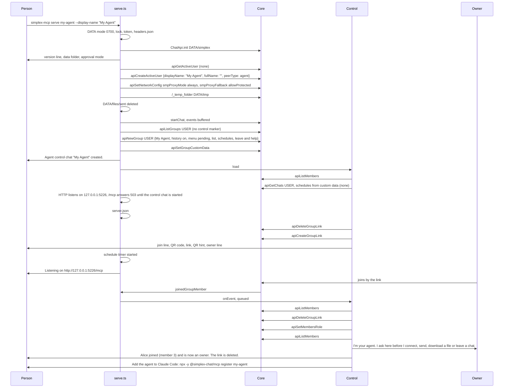

Notes:

- At first use, libsimplex and the Node.js add-on are downloaded, with one `Downloading ...` line each on stderr ([libs.ts:114-135](../../simplex-chat-nodejs/src/libs.ts#L114-L135)).
- With `--data`, `--data <folder>` is appended to the register hint, shell-quoted ([serve.ts:189-191](../src/serve.ts#L189-L191)).
- With `--qr-code small`, the line `If the QR code does not scan, ...` is printed after the link ([control.ts:532](../src/control.ts#L532)).
- Events that arrive before the HTTP listener starts are buffered and handled in order ([serve.ts:238-252](../src/serve.ts#L238-L252)).
- The server runs `ownerJoined` for every `joinedGroupMember` event of a human without `--owners`, and the link is deleted in that handler ([control.ts:267-268](../src/control.ts#L267-L268), [:491-498](../src/control.ts#L491-L498)).

Source: [cli.ts:198-209](../src/cli.ts#L198-L209), [serve.ts:66-129](../src/serve.ts#L66-L129), [:209-227](../src/serve.ts#L209-L227), [files.ts:12-48](../src/files.ts#L12-L48), [http.ts:14-46](../src/http.ts#L14-L46), [control.ts:175-191](../src/control.ts#L175-L191), [:461-465](../src/control.ts#L461-L465), [:526-545](../src/control.ts#L526-L545), [:619-640](../src/control.ts#L619-L640).

---

## 2. `register`

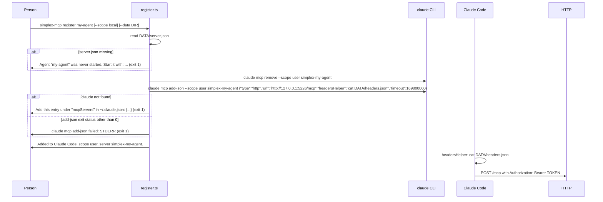

Notes:

- `simplex-mcp` ignores the exit status of `claude mcp remove` and stops at that step only when the `claude` binary is missing ([register.ts:38-39](../src/register.ts#L38-L39)).
- On Windows, a missing `claude` is run again through `cmd.exe`, with each argument quoted for it ([register.ts:86-101](../src/register.ts#L86-L101)).
- `timeout` is `(expireHours + 24) × 3600000 + 600000` ms from `server.json` ([register.ts:51](../src/register.ts#L51)).
- With `--scope local`, the project folder in the manual entry is the git repository root, the main repository of a worktree, or the current folder outside a repository ([register.ts:56](../src/register.ts#L56), [:60-84](../src/register.ts#L60-L84)).

Source: [cli.ts:110-125](../src/cli.ts#L110-L125), [:207](../src/cli.ts#L207), [register.ts:33-58](../src/register.ts#L33-L58), [files.ts:50-53](../src/files.ts#L50-L53).

---

## 3. `connect` with approval

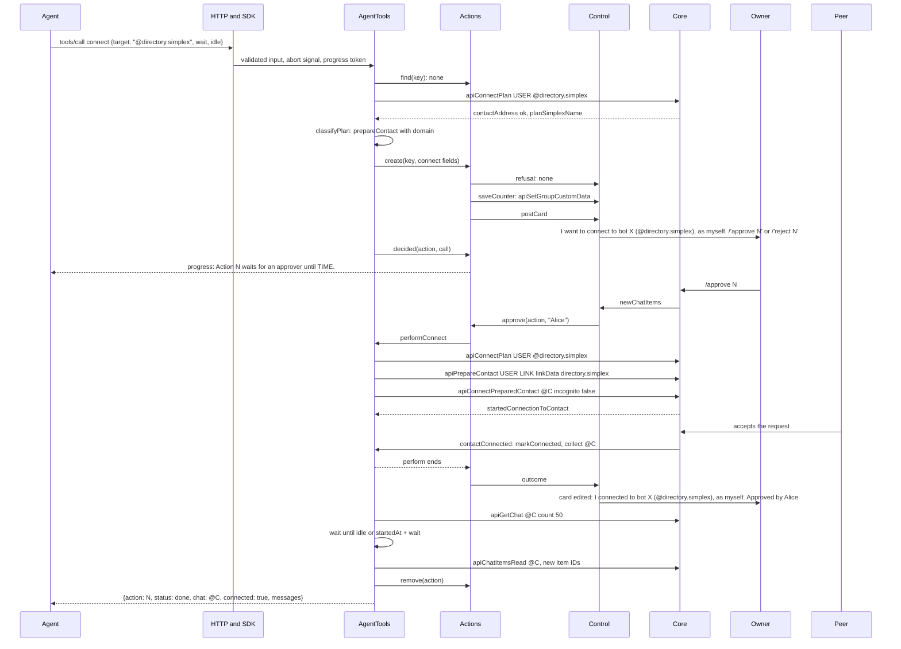

Notes:

- The plan is read again in the perform step ([tools.ts:698](../src/tools.ts#L698)).
- Join methods per plan ([tools.ts:727-755](../src/tools.ts#L727-L755), [:1273-1336](../src/tools.ts#L1273-L1336)):

| Plan | Methods |
|---|---|
| known prepared contact or group | `apiConnectPreparedContact(C, incognito, message)`<br>`apiConnectPreparedGroup(G, incognito, message)` |
| channel link (`direct` false, with link data) | `apiPrepareGroup(USER, LINK, false, linkData, domain)`<br>`apiConnectPreparedGroup(G, incognito)` |
| contact address with link data, and a SimpleX name or a message | `apiPrepareContact(USER, LINK, linkData, domain)`<br>`apiConnectPreparedContact(C, incognito, message)`, or `apiConnectPreparedGroup` for a business |
| `contactViaAddress` | `apiConnectContactViaAddress(USER, incognito, CONTACT_ID)` |
| other links | `apiConnectPreparedLink(USER, incognito, LINK)` |

- After a failed prepared connect, the server deletes the prepared chat without notifying ([tools.ts:757-764](../src/tools.ts#L757-L764)).
- The connection is matched by `contactConnected` or `userJoinedGroup`: by contact or group ID, or by the pending connection ID ([tools.ts:598-606](../src/tools.ts#L598-L606), [:766-771](../src/tools.ts#L766-L771)).
- In the perform step the server waits for the other side until `startedAt + wait`, at most until `created + 23 h 50 min`, and then reports `connected: false` ([tools.ts:145](../src/tools.ts#L145), [:697](../src/tools.ts#L697), [:721-724](../src/tools.ts#L721-L724)).
- Without `message`, the idle time is counted from the connection; with `message`, from the first reply ([tools.ts:777](../src/tools.ts#L777), [messages.ts:323-331](../src/messages.ts#L323-L331)).
- For a target the agent is connected to, the result is `status: known` with its chat fields, and no action is created ([tools.ts:630](../src/tools.ts#L630)).
- Exact progress texts: `Action N waits for an approver until TIME.`, then `Action N waits for the connection until TIME.`, then `K messages in CHAT; waiting until TIME.` ([actions.ts:343-354](../src/actions.ts#L343-L354), [tools.ts:666](../src/tools.ts#L666)).

Source: [tools.ts:625-680](../src/tools.ts#L625-L680), [:694-780](../src/tools.ts#L694-L780), [actions.ts:155-186](../src/actions.ts#L155-L186), [:206-223](../src/actions.ts#L206-L223), [control.ts:219-230](../src/control.ts#L219-L230).

---

## 4. `send` with responses

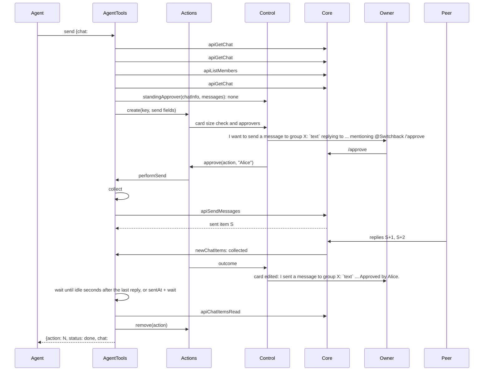

Notes:

- Checks before the action: `text` or `file`, the chat connected, role `observer` or `relay` refused, `reply_to` item a message, mentioned members present and the chat a group, and the message length with its quote ([tools.ts:787-800](../src/tools.ts#L787-L800)).
- The server starts collecting before the send and, after it, drops items with IDs up to the sent item ([tools.ts:833](../src/tools.ts#L833), [:846-848](../src/tools.ts#L846-L848)).
- Mentioned names missing from the text are prefixed as `@name` ([tools.ts:1437-1440](../src/tools.ts#L1437-L1440)).
- While a collected message is live, the server waits for its final update; live items are left out of `responses` and counted in `more` ([messages.ts:323-331](../src/messages.ts#L323-L331), [tools.ts:819](../src/tools.ts#L819), [:825](../src/tools.ts#L825)).
- At most 100 replies are kept per action; later ones are counted as overflow ([messages.ts:10](../src/messages.ts#L10), [:109-110](../src/messages.ts#L109-L110)).

Source: [tools.ts:782-854](../src/tools.ts#L782-L854), [messages.ts:99-114](../src/messages.ts#L99-L114), [:323-331](../src/messages.ts#L323-L331), [control.ts:703-709](../src/control.ts#L703-L709).

---

## 5. `receive` with `wait`

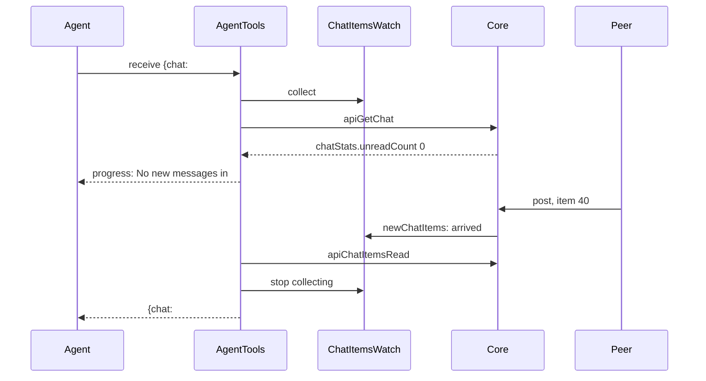

Notes:

- With unread items the server reads `around` the first unread item, `count` 0, then pages of `after` the last item, `count` 100, until it holds `limit + 1` unread, non-live messages or a page is short ([messages.ts:285-299](../src/messages.ts#L285-L299)).
- Unread items other than messages in the read pages are marked read with the returned messages ([tools.ts:1135](../src/tools.ts#L1135), [:1153](../src/tools.ts#L1153)).
- `more`: the arrived messages not returned, the overflow and the unread items not read ([tools.ts:1156](../src/tools.ts#L1156)).
- Items received while the pages are read are returned once ([tools.ts:1134-1137](../src/tools.ts#L1134-L1137)).
- Exact progress text: `No new messages in CHAT; waiting until TIME.` ([tools.ts:1142](../src/tools.ts#L1142)).
- The wait is also ended when a scheduled prompt of the chat is made due; the prompt is returned in `scheduled` ([17](#17-scheduled-prompts)).

Source: [tools.ts:1123-1161](../src/tools.ts#L1123-L1161), [messages.ts:285-331](../src/messages.ts#L285-L331).

---

## 6. `send` under a standing approval, and `/revoke`

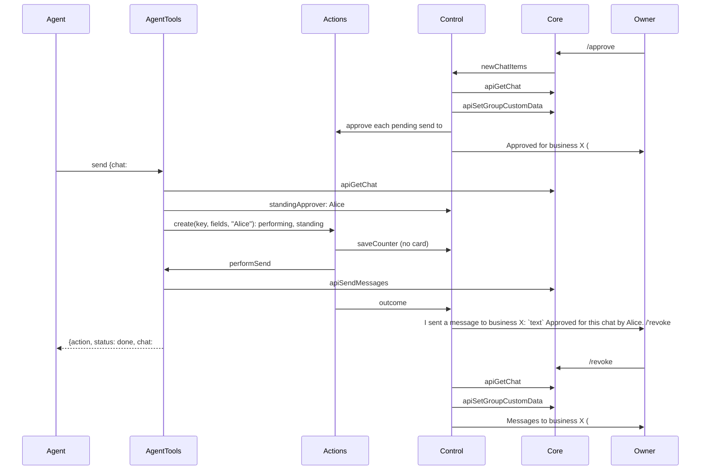

Notes:

- The approval is used in mode `requests` while member `approvedById` is an approver ([control.ts:204-211](../src/control.ts#L204-L211)).
- For sends that were pending at `/approve CHAT all`, the card ends with the plain `Approved by Alice.` ([control.ts:674](../src/control.ts#L674), [:683](../src/control.ts#L683)).
- `connect` and `leave` actions are created without the standing approver, so they stay pending ([tools.ts:636](../src/tools.ts#L636), [:950](../src/tools.ts#L950)).
- `/receive CHAT N all` and `/receive CHAT off` work the same way for downloads, with the key `simplexMcpFiles`, except that download N alone is performed, and the other pending downloads of the chat stay pending ([control.ts:26-29](../src/control.ts#L26-L29), [:336-338](../src/control.ts#L336-L338), [tools.ts:984](../src/tools.ts#L984)).

Source: [control.ts:328-348](../src/control.ts#L328-L348), [:457-459](../src/control.ts#L457-L459), [tools.ts:804-806](../src/tools.ts#L804-L806), [actions.ts:155-186](../src/actions.ts#L155-L186), [:265-283](../src/actions.ts#L265-L283).

---

## 7. `leave`

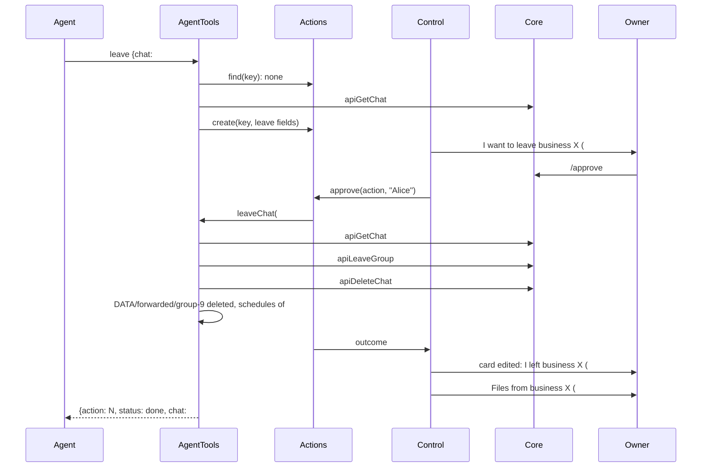

Notes:

- For a contact, the card text is `I want to delete KIND NAME (@N).`, and the perform step calls `apiDeleteChat` for the contact, full, with notify ([control.ts:710-713](../src/control.ts#L710-L713), [tools.ts:959](../src/tools.ts#L959)).
- The delete notifies, so the core notifies the contact or the members ([tools.ts:959](../src/tools.ts#L959), [:962](../src/tools.ts#L962)).
- The server looks for an attached action before it reads the chat, so a repeated call after the deletion is attached to the done action ([tools.ts:945-948](../src/tools.ts#L945-L948)).

Source: [tools.ts:943-967](../src/tools.ts#L943-L967), [control.ts:223-230](../src/control.ts#L223-L230), [:412-415](../src/control.ts#L412-L415).

---

## 8. Mode `host`

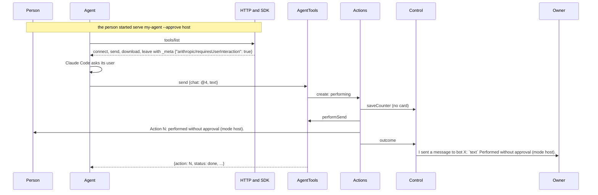

Notes:

- New actions are still refused unless the control chat has an approver ([control.ts:198-201](../src/control.ts#L198-L201)).
- In mode `host`, `standingApprover` returns `undefined`, so standing approvals are ignored by `send`, `download`, `list` and `/list`, and `/approve CHAT all` stores nothing; downloads get no card, so `/receive CHAT N all` has no card to act on ([control.ts:206](../src/control.ts#L206), [:298](../src/control.ts#L298)).
- A download in mode `host` is received without the approval of unknown servers, and it gets no card and no outcome post ([tools.ts:553](../src/tools.ts#L553), [:1039](../src/tools.ts#L1039), [control.ts:615-617](../src/control.ts#L615-L617)).
- The kept-files message also follows a done `leave` in mode `host` ([control.ts:228-229](../src/control.ts#L228-L229)).

Source: [tools.ts:496-506](../src/tools.ts#L496-L506), [actions.ts:166](../src/actions.ts#L166), [:281](../src/actions.ts#L281), [control.ts:223-230](../src/control.ts#L223-L230), [:674](../src/control.ts#L674).

---

## 9. Expiry

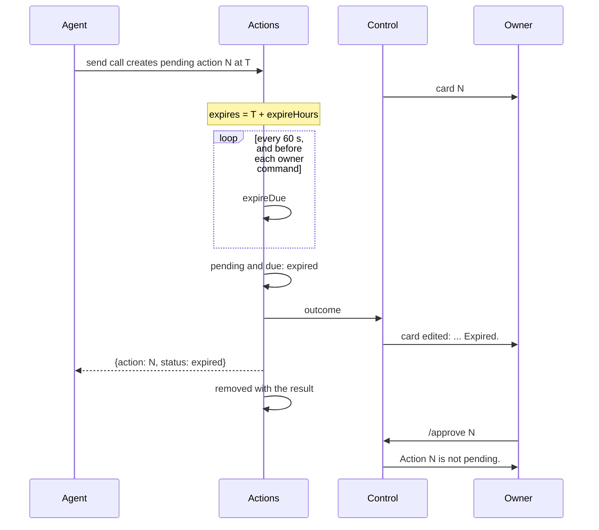

Notes:

- A decided action with an open count of 0 is removed at the first tick after its expiry time ([actions.ts:200-201](../src/actions.ts#L200-L201)).
- Expiry times are listed in the `/pending` reply ([control.ts:738-740](../src/control.ts#L738-L740)).
- The server ends the connect wait at `created + 23 h 50 min`, within the 24 hours in which a message can be edited ([tools.ts:145](../src/tools.ts#L145), [:697](../src/tools.ts#L697)).

Source: [actions.ts:129](../src/actions.ts#L129), [:163](../src/actions.ts#L163), [:193-204](../src/actions.ts#L193-L204), [control.ts:279](../src/control.ts#L279), [:312](../src/control.ts#L312).

---

## 10. A lost call and its re-attachment

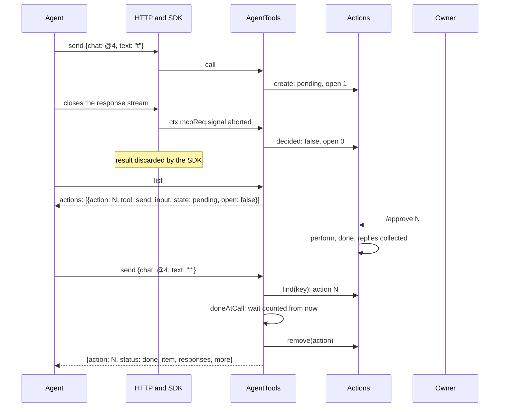

Notes:

- The key is the tool name with the action fields: `target`, `incognito`, `message` for `connect`; `chat`, `text`, `file`, `as`, `reply_to`, `mention` for `send`; `chat`, `item` for `download`; `chat` for `leave` ([tools.ts:626](../src/tools.ts#L626), [:784](../src/tools.ts#L784), [:945](../src/tools.ts#L945), [:971](../src/tools.ts#L971), [:1567-1569](../src/tools.ts#L1567-L1569)).
- The `wait`, `idle` and `limit` of the attaching call are used ([tools.ts:813](../src/tools.ts#L813)).
- For a call aborted before `create`, the server returns before it creates an action ([tools.ts:635](../src/tools.ts#L635), [:805](../src/tools.ts#L805), [:949](../src/tools.ts#L949), [:985](../src/tools.ts#L985)).
- Abort path in the SDK: on `res` close the web request is aborted ([node index.cjs:299-303](../node_modules/@modelcontextprotocol/node/dist/index.cjs#L299-L303)); the per-request transport is closed ([server index.cjs:86-90](../node_modules/@modelcontextprotocol/server/dist/index.cjs#L86-L90)); the handler signal is aborted ([src-BhnGYybN.cjs:6425](../node_modules/@modelcontextprotocol/server/dist/src-BhnGYybN.cjs#L6425)).

Source: [tools.ts:644-656](../src/tools.ts#L644-L656), [:810-828](../src/tools.ts#L810-L828), [:1169](../src/tools.ts#L1169), [actions.ts:206-217](../src/actions.ts#L206-L217), [messages.ts:307-321](../src/messages.ts#L307-L321).

---

## 11. Shutdown with pending actions

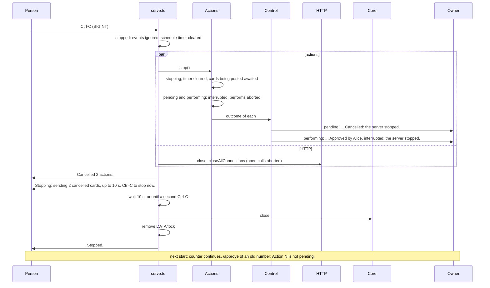

Notes:

- The interrupted card line is `DECIDER; interrupted: the server stopped.` ([control.ts:681](../src/control.ts#L681)).
- An action of mode `host` or of a standing approval whose counter is being written at the stop is set to `pending` and cancelled without a perform ([actions.ts:265-270](../src/actions.ts#L265-L270)).
- After a crash, the cards of that run are left with their commands; `/approve` of their numbers gets the reply `Action N is not pending.` ([control.ts:312](../src/control.ts#L312)).
- The stop signal of the performs is aborted after the actions are marked interrupted: a `connect` waiting for its connection ends, and an interrupted perform logs no line ([actions.ts:245-246](../src/actions.ts#L245-L246), [:280](../src/actions.ts#L280), [tools.ts:721-722](../src/tools.ts#L721-L722)).
- The wait applies only when cards were edited or posted at the stop, a `download` without a card excluded, and `--stop-wait` is above 0 ([serve.ts:181](../src/serve.ts#L181), [:193-207](../src/serve.ts#L193-L207)).

Source: [serve.ts:48-64](../src/serve.ts#L48-L64), [:174-185](../src/serve.ts#L174-L185), [:193-207](../src/serve.ts#L193-L207), [actions.ts:240-250](../src/actions.ts#L240-L250), [http.ts:48-52](../src/http.ts#L48-L52), [control.ts:672-691](../src/control.ts#L672-L691).

---

## 12. `--owners` setup

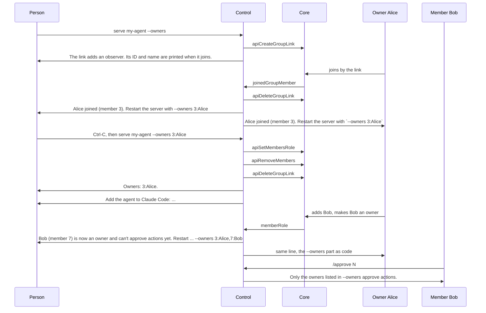

Notes:

- Until the restart with a list, new actions are refused: `The agent has no approving owner. ...` ([control.ts:199-201](../src/control.ts#L199-L201)).
- An entry must match a human by member ID and display name, folded to one line as the restart line prints it, or the server exits with code 2 ([control.ts:474-478](../src/control.ts#L474-L478), [:893-895](../src/control.ts#L893-L895)).
- With `--reset-owners`, the server deletes the control chat for all members and creates a new one with the same counter; the CLI refuses the option with an `--owners` list ([control.ts:642-647](../src/control.ts#L642-L647), [serve.ts:226](../src/serve.ts#L226), [cli.ts:104-106](../src/cli.ts#L104-L106)).
- When a listed owner leaves and none remains: `... is no longer an owner. No owners remain: restart the server with --reset-owners --owners` ([control.ts:513-518](../src/control.ts#L513-L518)).

Source: [control.ts:467-489](../src/control.ts#L467-L489), [:500-519](../src/control.ts#L500-L519), [:526-536](../src/control.ts#L526-L536), [:893-919](../src/control.ts#L893-L919).

---

## 13. `download` with approval

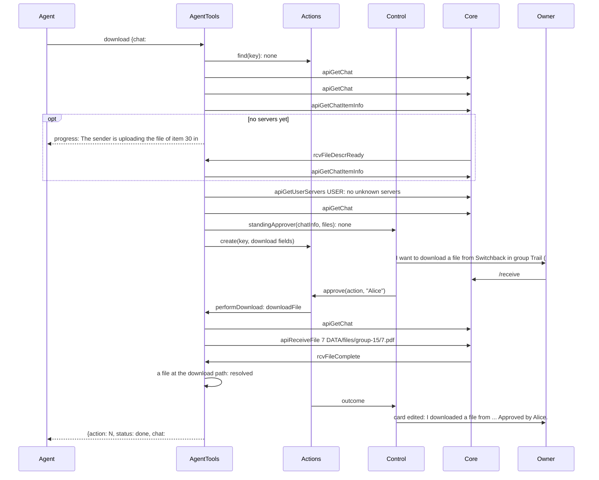

Notes:

- A check every 60 s reads the item: a deleted message or chat fails the download; 30 minutes without a rise of `rcvProgress` fail and cancel it ([tools.ts:1044-1071](../src/tools.ts#L1044-L1071)).
- A download still running `wait` seconds after the perform starts returns `status: performing`; the same call again attaches to the action ([tools.ts:1017-1020](../src/tools.ts#L1017-L1020)).
- `/approve #15 N` on a download card gets the reply `Action N is a download: ...` with the card's command line ([control.ts:319](../src/control.ts#L319)).
- A file on unknown servers gets a card that names their hosts and leaves out `/'receive CHAT N all'` ([control.ts:714-719](../src/control.ts#L714-L719), [:731-734](../src/control.ts#L731-L734), [:784-788](../src/control.ts#L784-L788)). Only such a card approves the relays; the core checks the complete description of every other download, which fails at the acceptance, or at the next check when the description completes later ([tools.ts:553](../src/tools.ts#L553), [:1052](../src/tools.ts#L1052)).
- The card of an image or video shows the sender's preview ([control.ts:561-581](../src/control.ts#L561-L581)).
- A file the core receives without a request, a short voice message, also in a member chat of a group, is moved into the chat's folder at `rcvFileComplete`; one whose transfer started before a restart, only when it has its full size. Its message then shows it as `offered`, and `download` returns its path after the approval ([tools.ts:559-579](../src/tools.ts#L559-L579), [:1091-1100](../src/tools.ts#L1091-L1100), [messages.ts:194-208](../src/messages.ts#L194-L208)).

Source: [tools.ts:969-1112](../src/tools.ts#L969-L1112), [control.ts:693-736](../src/control.ts#L693-L736), [serve.ts:142-158](../src/serve.ts#L142-L158).

---

## 14. `/forward`

```mermaid
sequenceDiagram
  participant A as Agent
  participant T as AgentTools
  participant K as Control
  participant C as Core
  participant O as Owner
  O->>C: /forward #15 N (on a pending download card)
  C->>K: newChatItems
  K->>T: forwardFile(action N)
  T->>C: apiReceiveFile 7 DATA/forwarded/group-15/7.pdf
  C->>T: rcvFileComplete: resolved with the forwarded path
  T->>T: copy for the post: DATA/files/sent/send-XXXXXX/report.pdf
  K->>C: apiSendMessages #G [{fileSource: the copy, msgContent: file, quotedItemId: card N when the message fits}]
  C->>T: sndFileCompleteXFTP: the copy's folder deleted
  Note over K,O: the card stays pending; the agent's message shows the file as offered
  O->>C: /receive #15 N
  K->>T: performDownload: downloadFile
  T->>T: the forwarded file moved to DATA/files/group-15/7.pdf
  T-->>A: {action: N, status: done, chat: #15, item: 30, path}
```

Notes:

- `/forward` gets no reply; a download or post that fails is posted as ``Action N: the file was not received: `ERROR`.``, and a failed post deletes the copy ([control.ts:378-394](../src/control.ts#L378-L394)).
- The copy is named by the name the sender gave ([tools.ts:906-910](../src/tools.ts#L906-L910)).
- The post keeps the sender's preview of an image or video; it replies to the card when the message, with the card as its quote, is within 15602 bytes by the length rule of `send` ([control.ts:378-394](../src/control.ts#L378-L394), [tools.ts:1446-1462](../src/tools.ts#L1446-L1462)).
- The download is shared with the agent's: one download per file ID; the move to the download path waits for the copy of the post ([tools.ts:530-557](../src/tools.ts#L530-L557)).
- The forwarded path is outside `DATA/files/`, so `send` refuses the file there; it is deleted when the agent leaves the chat, and by `/delete CHAT files` ([tools.ts:879-884](../src/tools.ts#L879-L884), [:917-935](../src/tools.ts#L917-L935), [:958-967](../src/tools.ts#L958-L967)).

Source: [control.ts:306-324](../src/control.ts#L306-L324), [:378-394](../src/control.ts#L378-L394), [tools.ts:530-547](../src/tools.ts#L530-L547), [:856-866](../src/tools.ts#L856-L866), [:906-910](../src/tools.ts#L906-L910).

---

## 15. `send` with a file

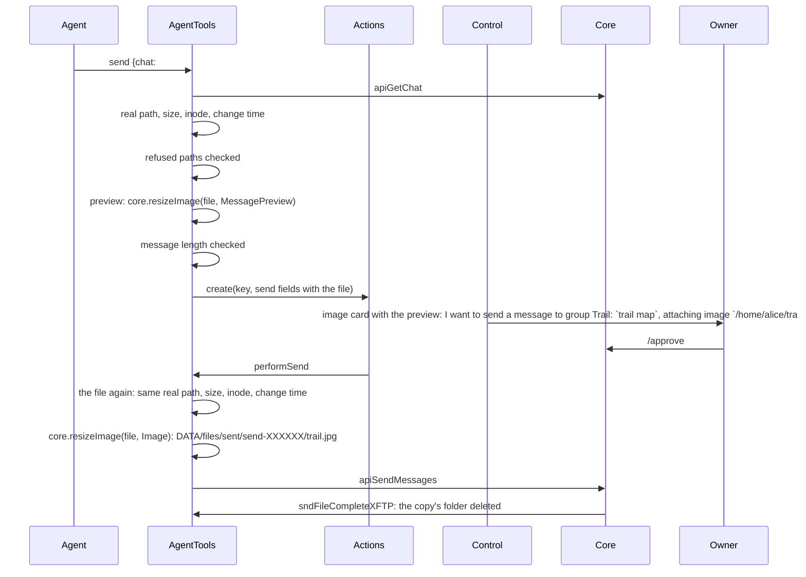

Notes:

- A refused file ends the call with an error, and the refusal is posted to the control chat and logged ([tools.ts:870-873](../src/tools.ts#L870-L873), [control.ts:232-236](../src/control.ts#L232-L236)).
- A video's preview is the first frame from `ffmpeg` and its duration comes from `ffprobe`; a GIF or WebP gets the fixed preview ([tools.ts:1525-1559](../src/tools.ts#L1525-L1559)).
- A changed file fails the perform: ``file: PATH changed after the request.`` ([tools.ts:886-891](../src/tools.ts#L886-L891)).
- `sndFileError` deletes the copy too, and the failure is posted to the control chat and logged ([serve.ts:161-163](../src/serve.ts#L161-L163), [control.ts:238-247](../src/control.ts#L238-L247)).

Source: [tools.ts:782-808](../src/tools.ts#L782-L808), [:830-904](../src/tools.ts#L830-L904), [control.ts:561-581](../src/control.ts#L561-L581), [:703-709](../src/control.ts#L703-L709).

---

## 16. `/leave` and `/delete CHAT files`

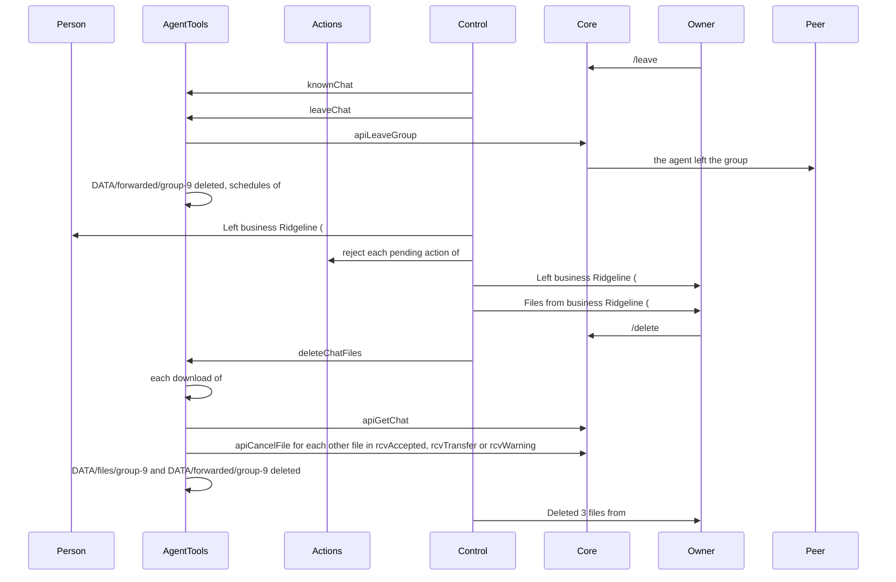

Notes:

- `/leave` acts at once in both modes, and works for a contact as `Deleted bot X (@4), requested by Alice.` ([control.ts:396-410](../src/control.ts#L396-L410)).
- The line `Left ...` goes to the log and to the owners; the members of #9 see only that the agent left.
- The files message is posted after the reply, and only when the folder has files ([control.ts:407-408](../src/control.ts#L407-L408), [:422-424](../src/control.ts#L422-L424)).
- `/delete CHAT files` works for a current or a left chat; the failed downloads return `Your owner deleted the files of this chat.`, and the reply counts the forwarded files too ([tools.ts:917-935](../src/tools.ts#L917-L935)).
- The paged reads find the downloads the core continues after a restart, which have no download in memory; for a left chat they find none ([messages.ts:271-279](../src/messages.ts#L271-L279), [tools.ts:924-930](../src/tools.ts#L924-L930)).

Source: [control.ts:396-420](../src/control.ts#L396-L420), [tools.ts:912-935](../src/tools.ts#L912-L935), [:958-967](../src/tools.ts#L958-L967).

---

## 17. Scheduled prompts

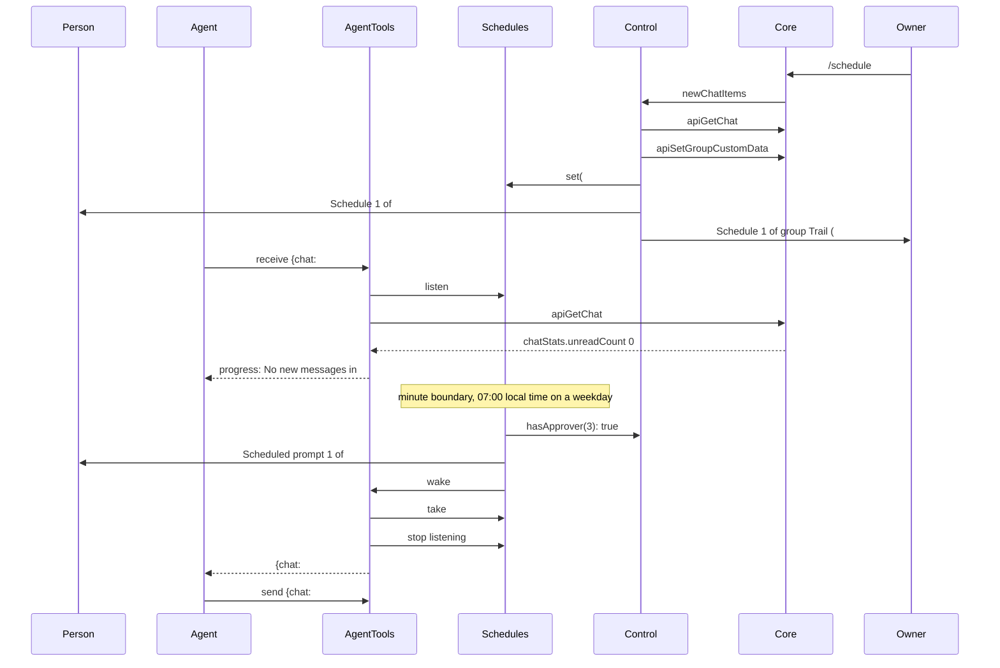

Notes:

- The command is accepted from approvers only, in both modes; CRON and PROMPT are checked before the custom data is written, and a chat has at most 10 schedules ([control.ts:350-364](../src/control.ts#L350-L364)).
- At its due time, an entry is skipped while member `byId` is not an approver or the control chat is lost ([schedule.ts:61](../src/schedule.ts#L61), [control.ts:209-211](../src/control.ts#L209-L211)).
- One due prompt is kept per entry, with the minute it first became due; after `take`, the entry becomes due again at its next match ([schedule.ts:38-43](../src/schedule.ts#L38-L43), [:61-62](../src/schedule.ts#L61-L62)).
- A call with a due prompt of its chat is answered without a wait; the prompts are taken after the returned messages are marked read, so after an aborted call they stay due ([tools.ts:1139-1156](../src/tools.ts#L1139-L1156)).
- By `/unschedule #15 1`, the entry and its due prompt are removed, and the later entries are renumbered; by `leave` and `/leave`, the schedules of the chat are dropped ([control.ts:366-376](../src/control.ts#L366-L376), [schedule.ts:19-22](../src/schedule.ts#L19-L22), [tools.ts:966](../src/tools.ts#L966)).
- `/schedules` is answered from the custom data of all chats ([control.ts:441-446](../src/control.ts#L441-L446)).
- Prompts due while the server is stopped are not delivered later ([serve.ts:128](../src/serve.ts#L128), [:176](../src/serve.ts#L176)).

Source: [schedule.ts:12-96](../src/schedule.ts#L12-L96), [control.ts:350-376](../src/control.ts#L350-L376), [:830-839](../src/control.ts#L830-L839), [tools.ts:1123-1161](../src/tools.ts#L1123-L1161), [serve.ts:109-111](../src/serve.ts#L109-L111), [:128](../src/serve.ts#L128), [:176](../src/serve.ts#L176).
