# SimpleX MCP server: flows

> Sequence diagrams of the main flows of `@simplex-chat/mcp` 0.3.0, each with notes and source locations: `serve` in flows 1-16, the Claude Code plugin in flows 17-26.
>
> Related specs: [README](README.md) | [Architecture](architecture.md) | [API](api.md)

Participants:

| Letter | Participant |
|---|---|
| P | the person at the terminal |
| A | the agent in Claude Code |
| H | the HTTP listener with the MCP SDK |
| T | `AgentTools` |
| X | `Actions` |
| K | `Control` |
| C | the SimpleX core behind `ChatApi` |
| O | the owner in the SimpleX app |
| D | a peer |

In flows 1-16, `#G` is the agent control chat, `USER` the agent's user ID, `DATA` the data folder. Calls to the core are shown as the `ChatApi` methods the server calls, with their arguments in short. Card and progress texts with a semicolon are shown with a comma in the diagrams; the exact texts are in [API](api.md).

---

## Table of contents

1. [First start and the owner joins](#1-first-start-and-the-owner-joins)
2. [`register`](#2-register)
3. [`connect` with approval](#3-connect-with-approval)
4. [`send` with responses](#4-send-with-responses)
5. [`receive` with `wait`](#5-receive-with-wait)
6. [`send` under a standing approval, and `/revoke`](#6-send-under-a-standing-approval-and-revoke)
7. [`leave`](#7-leave)
8. [Mode `host`](#8-mode-host)
9. [Expiry](#9-expiry)
10. [A lost call and its re-attachment](#10-a-lost-call-and-its-re-attachment)
11. [Shutdown with pending actions](#11-shutdown-with-pending-actions)
12. [`--owners` setup](#12---owners-setup)
13. [`download` with approval](#13-download-with-approval)
14. [`/forward`](#14-forward)
15. [`send` with a file](#15-send-with-a-file)
16. [`/leave` and `/delete CHAT files`](#16-leave-and-delete-chat-files)

Claude Code plugin ([participants](#claude-code-plugin-flows)):

17. [First session start and the owner joins](#17-first-session-start-and-the-owner-joins)
18. [Session process start and attach](#18-session-process-start-and-attach)
19. [A tool call with approval in the session group](#19-a-tool-call-with-approval-in-the-session-group)
20. [A prompt from the session group](#20-a-prompt-from-the-session-group)
21. [A terminal prompt and the answer](#21-a-terminal-prompt-and-the-answer)
22. [A tool use approved in the session group](#22-a-tool-use-approved-in-the-session-group)
23. [Mode `host` for a session](#23-mode-host-for-a-session)
24. [`/give`](#24-give)
25. [`reset-owners`](#25-reset-owners)
26. [Idle close, idle stop and a newer version](#26-idle-close-idle-stop-and-a-newer-version)

---

## 1. First start and the owner joins

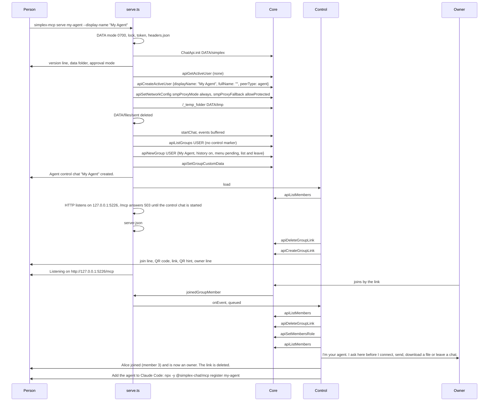

Notes:

- At first use, libsimplex and the Node.js add-on are downloaded, with one `Downloading ...` line each on stderr ([libs.ts:114-135](../../simplex-chat-nodejs/src/libs.ts#L114-L135)).
- With `--data`, `--data <folder>` is appended to the register hint, shell-quoted ([serve.ts:157-159](../src/serve.ts#L157-L159)).
- With `--qr-code small`, the line `If the QR code does not scan, ...` is printed after the link ([control.ts:448](../src/control.ts#L448)).
- Events that arrive before the HTTP listener starts are buffered and handled in order ([core.ts:62-76](../src/core.ts#L62-L76)).
- The server runs `ownerJoined` for every `joinedGroupMember` event of a human without `--owners`, and the link is deleted in that handler ([control.ts:209-210](../src/control.ts#L209-L210), [:407-414](../src/control.ts#L407-L414)).

Source: [cli.ts:218-251](../src/cli.ts#L218-L251), [serve.ts:64-122](../src/serve.ts#L64-L122), [core.ts:38-82](../src/core.ts#L38-L82), [files.ts:85-138](../src/files.ts#L85-L138), [http.ts:14-46](../src/http.ts#L14-L46), [control.ts:102-127](../src/control.ts#L102-L127), [:377-381](../src/control.ts#L377-L381), [:442-461](../src/control.ts#L442-L461), [:536-561](../src/control.ts#L536-L561).

---

## 2. `register`

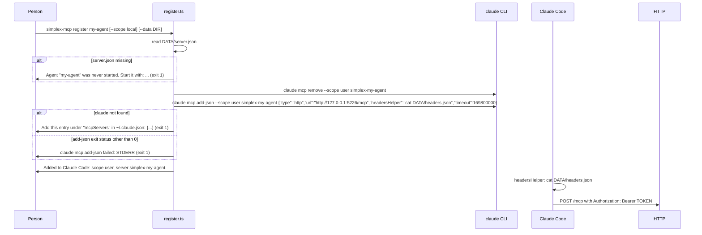

Notes:

- `simplex-mcp` ignores the exit status of `claude mcp remove` and stops at that step only when the `claude` binary is missing ([register.ts:38-39](../src/register.ts#L38-L39)).
- On Windows, a missing `claude` is run again through `cmd.exe`, with each argument quoted for it ([register.ts:86-101](../src/register.ts#L86-L101)).
- `timeout` is `(expireHours + 24) × 3600000 + 600000` ms from `server.json` ([register.ts:51](../src/register.ts#L51)).
- With `--scope local`, the project folder in the manual entry is the git repository root, the main repository of a worktree, or the current folder outside a repository ([register.ts:56](../src/register.ts#L56), [:60-84](../src/register.ts#L60-L84)).

Source: [cli.ts:130-145](../src/cli.ts#L130-L145), [:227](../src/cli.ts#L227), [register.ts:33-58](../src/register.ts#L33-L58), [files.ts:140-143](../src/files.ts#L140-L143).

---

## 3. `connect` with approval

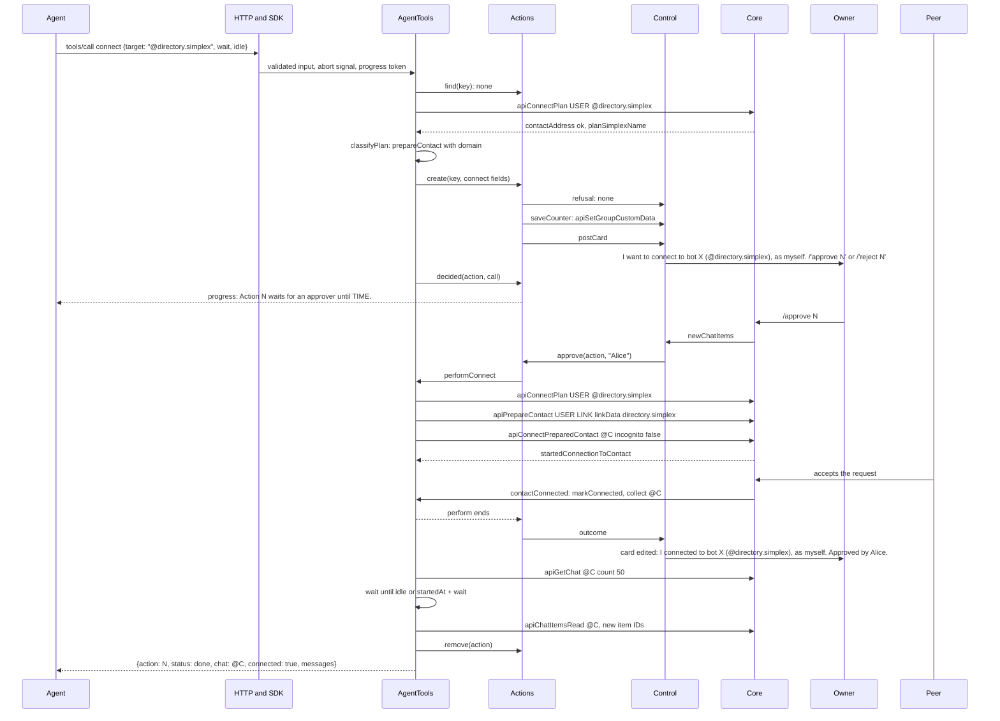

Notes:

- The plan is read again in the perform step ([tools.ts:796](../src/tools.ts#L796)).
- Join methods per plan ([tools.ts:826-854](../src/tools.ts#L826-L854), [:1368-1431](../src/tools.ts#L1368-L1431)):

| Plan | Methods |
|---|---|
| known prepared contact or group | `apiConnectPreparedContact(C, incognito, message)`<br>`apiConnectPreparedGroup(G, incognito, message)` |
| channel link (`direct` false, with link data) | `apiPrepareGroup(USER, LINK, false, linkData, domain)`<br>`apiConnectPreparedGroup(G, incognito)` |
| contact address with link data, and a SimpleX name or a message | `apiPrepareContact(USER, LINK, linkData, domain)`<br>`apiConnectPreparedContact(C, incognito, message)`, or `apiConnectPreparedGroup` for a business |
| `contactViaAddress` | `apiConnectContactViaAddress(USER, incognito, CONTACT_ID)` |
| other links | `apiConnectPreparedLink(USER, incognito, LINK)` |

- After a failed prepared connect, the server deletes the prepared chat without notifying ([tools.ts:856-863](../src/tools.ts#L856-L863)).
- The connection is matched by `contactConnected` or `userJoinedGroup`: by contact or group ID, or by the pending connection ID ([tools.ts:647-655](../src/tools.ts#L647-L655), [:865-870](../src/tools.ts#L865-L870)).
- In the perform step the server waits for the other side until `startedAt + wait`, at most until `created + 23 h 50 min`, and then reports `connected: false` ([tools.ts:152](../src/tools.ts#L152), [:795](../src/tools.ts#L795), [:820-823](../src/tools.ts#L820-L823)).
- Without `message`, the idle time is counted from the connection; with `message`, from the first reply ([tools.ts:877](../src/tools.ts#L877), [messages.ts:327-335](../src/messages.ts#L327-L335)).
- For a target the agent is connected to, the result is `status: known` with its chat fields, and no action is created ([tools.ts:720](../src/tools.ts#L720)).
- Exact progress texts: `Action N waits for an approver until TIME.`, then `Action N waits for the connection until TIME.`, then `K messages in CHAT; waiting until TIME.` ([actions.ts:408-419](../src/actions.ts#L408-L419), [tools.ts:764](../src/tools.ts#L764)).

Source: [tools.ts:715-778](../src/tools.ts#L715-L778), [:792-880](../src/tools.ts#L792-L880), [actions.ts:176-211](../src/actions.ts#L176-L211), [:244-262](../src/actions.ts#L244-L262), [control.ts:160-171](../src/control.ts#L160-L171).

---

## 4. `send` with responses

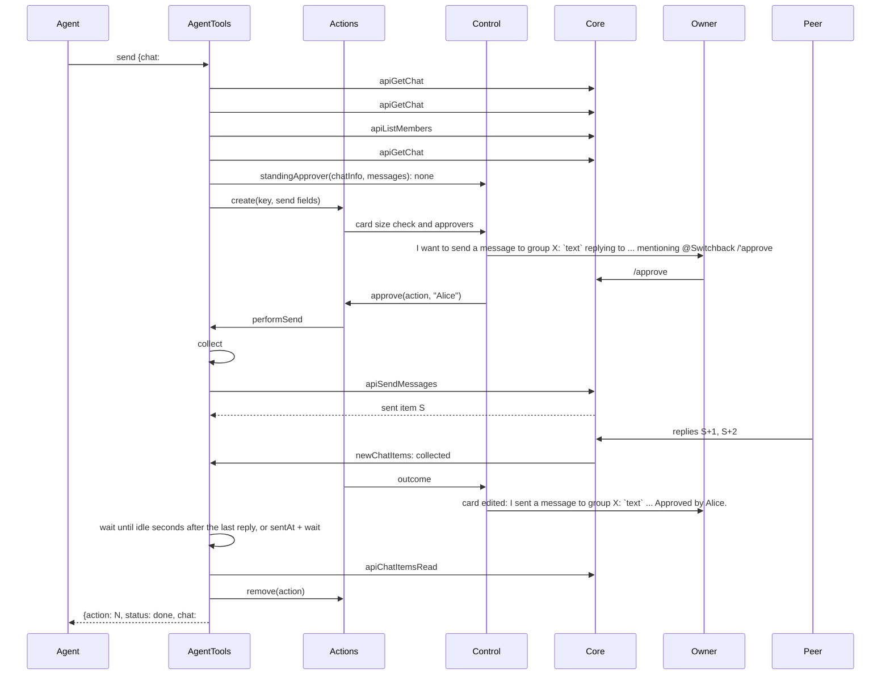

Notes:

- Checks before the action: `text` or `file`, the chat connected, role `observer` or `relay` refused, `reply_to` item a message, mentioned members present and the chat a group, and the message length with its quote ([tools.ts:887-900](../src/tools.ts#L887-L900)).
- The server starts collecting before the send and, after it, drops items with IDs up to the sent item ([tools.ts:932](../src/tools.ts#L932), [:945-947](../src/tools.ts#L945-L947)).
- Mentioned names missing from the text are prefixed as `@name` ([tools.ts:1544-1547](../src/tools.ts#L1544-L1547)).
- While a collected message is live, the server waits for its final update; live items are left out of `responses` and counted in `more` ([messages.ts:327-335](../src/messages.ts#L327-L335), [tools.ts:918](../src/tools.ts#L918), [:924](../src/tools.ts#L924)).
- At most 100 replies are kept per action; later ones are counted as overflow ([messages.ts:10](../src/messages.ts#L10), [:109-110](../src/messages.ts#L109-L110)).

Source: [tools.ts:882-953](../src/tools.ts#L882-L953), [messages.ts:99-114](../src/messages.ts#L99-L114), [:327-335](../src/messages.ts#L327-L335), [control.ts:636-642](../src/control.ts#L636-L642).

---

## 5. `receive` with `wait`

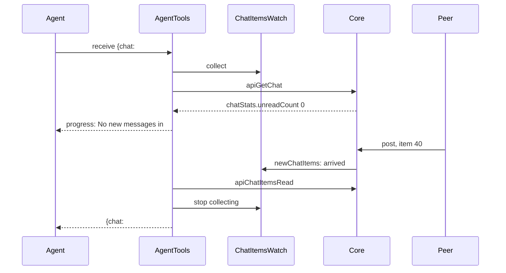

Notes:

- With unread items the server reads `around` the first unread item, `count` 0, then pages of `after` the last item, `count` 100, until it holds `limit + 1` unread, non-live messages or a page is short ([messages.ts:289-303](../src/messages.ts#L289-L303)).
- Unread items other than messages in the read pages are marked read with the returned messages ([tools.ts:1231](../src/tools.ts#L1231), [:1248](../src/tools.ts#L1248)).
- `more`: the arrived messages not returned, the overflow and the unread items not read ([tools.ts:1250](../src/tools.ts#L1250)).
- Items received while the pages are read are returned once ([tools.ts:1230-1233](../src/tools.ts#L1230-L1233)).
- Exact progress text: `No new messages in CHAT; waiting until TIME.` ([tools.ts:1237](../src/tools.ts#L1237)).

Source: [tools.ts:1219-1254](../src/tools.ts#L1219-L1254), [messages.ts:289-335](../src/messages.ts#L289-L335).

---

## 6. `send` under a standing approval, and `/revoke`

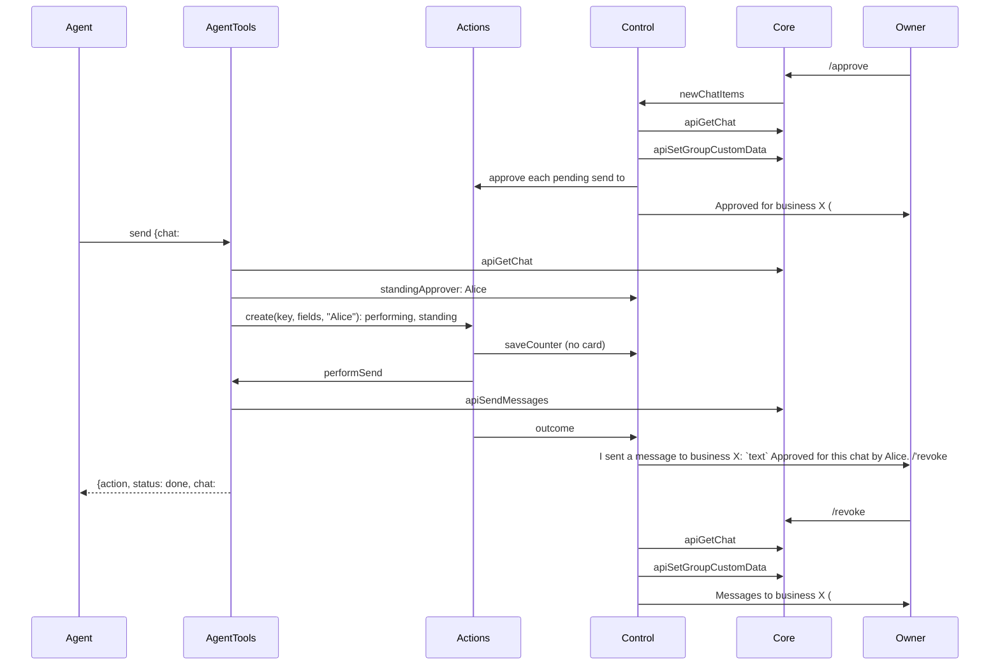

Notes:

- The approval is used in mode `requests` while member `approvedById` is an approver ([control.ts:141-144](../src/control.ts#L141-L144)).
- For sends that were pending at `/approve CHAT all`, the card ends with the plain `Approved by Alice.` ([control.ts:602](../src/control.ts#L602), [:611](../src/control.ts#L611)).
- `connect` and `leave` actions are created without the standing approver, so they stay pending ([tools.ts:726](../src/tools.ts#L726), [:1049](../src/tools.ts#L1049)).
- `/receive CHAT N all` and `/receive CHAT off` work the same way for downloads, with the key `simplexMcpFiles`, except that download N alone is performed, and the other pending downloads of the chat stay pending ([control.ts:22-25](../src/control.ts#L22-L25), [:273-275](../src/control.ts#L273-L275), [tools.ts:1081](../src/tools.ts#L1081)).

Source: [control.ts:265-285](../src/control.ts#L265-L285), [:373-375](../src/control.ts#L373-L375), [tools.ts:904-906](../src/tools.ts#L904-L906), [actions.ts:176-211](../src/actions.ts#L176-L211), [:325-343](../src/actions.ts#L325-L343).

---

## 7. `leave`

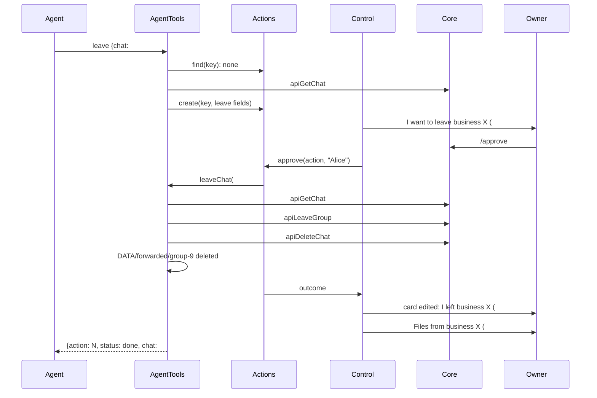

Notes:

- For a contact, the card text is `I want to delete KIND NAME (@N).`, and the perform step calls `apiDeleteChat` for the contact, full, with notify ([control.ts:643-646](../src/control.ts#L643-L646), [tools.ts:1057](../src/tools.ts#L1057)).
- The delete notifies, so the core notifies the contact or the members ([tools.ts:1057](../src/tools.ts#L1057), [:1060](../src/tools.ts#L1060)).
- The server looks for an attached action before it reads the chat, so a repeated call after the deletion is attached to the done action ([tools.ts:1044-1046](../src/tools.ts#L1044-L1046)).

Source: [tools.ts:1042-1064](../src/tools.ts#L1042-L1064), [control.ts:164-171](../src/control.ts#L164-L171), [:321-324](../src/control.ts#L321-L324).

---

## 8. Mode `host`

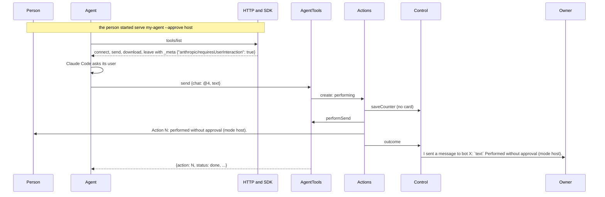

Notes:

- New actions are still refused unless the control chat has an approver ([control.ts:134-138](../src/control.ts#L134-L138)).
- In mode `host`, `standingApprover` returns `undefined`, so standing approvals are ignored by `send`, `download`, `list` and `/list`, and `/approve CHAT all` stores nothing; downloads get no card, so `/receive CHAT N all` has no card to act on ([control.ts:143](../src/control.ts#L143), [:233](../src/control.ts#L233)).
- A download in mode `host` is received without the approval of unknown servers, and it gets no card and no outcome post ([tools.ts:602](../src/tools.ts#L602), [:1135](../src/tools.ts#L1135), [control.ts:532-534](../src/control.ts#L532-L534)).
- The kept-files message also follows a done `leave` in mode `host` ([control.ts:169-170](../src/control.ts#L169-L170)).

Source: [tools.ts:532-534](../src/tools.ts#L532-L534), [actions.ts:189](../src/actions.ts#L189), [:341](../src/actions.ts#L341), [control.ts:164-171](../src/control.ts#L164-L171), [:602](../src/control.ts#L602).

---

## 9. Expiry

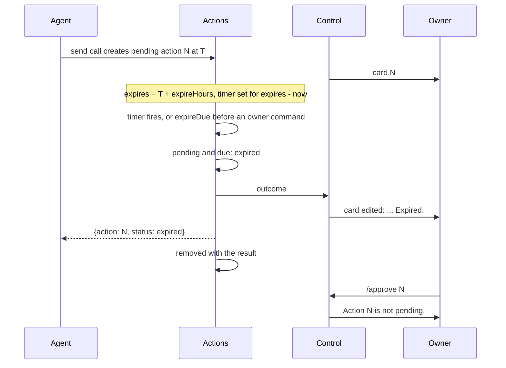

Notes:

- A decided action with an open count of 0 is removed once its expiry time has passed: at its timer, at a later decision or at the close of its last call ([actions.ts:308-310](../src/actions.ts#L308-L310)).
- A timer that fires before the expiry time, on the monotonic clock, is set again ([actions.ts:301](../src/actions.ts#L301)).
- Expiry times are listed in the `/pending` reply ([control.ts:673-675](../src/control.ts#L673-L675)).
- The server ends the connect wait at `created + 23 h 50 min`, within the 24 hours in which a message can be edited ([tools.ts:152](../src/tools.ts#L152), [:795](../src/tools.ts#L795)).

Source: [actions.ts:186](../src/actions.ts#L186), [:238-242](../src/actions.ts#L238-L242), [:292-310](../src/actions.ts#L292-L310), [control.ts:221](../src/control.ts#L221), [:249](../src/control.ts#L249).

---

## 10. A lost call and its re-attachment

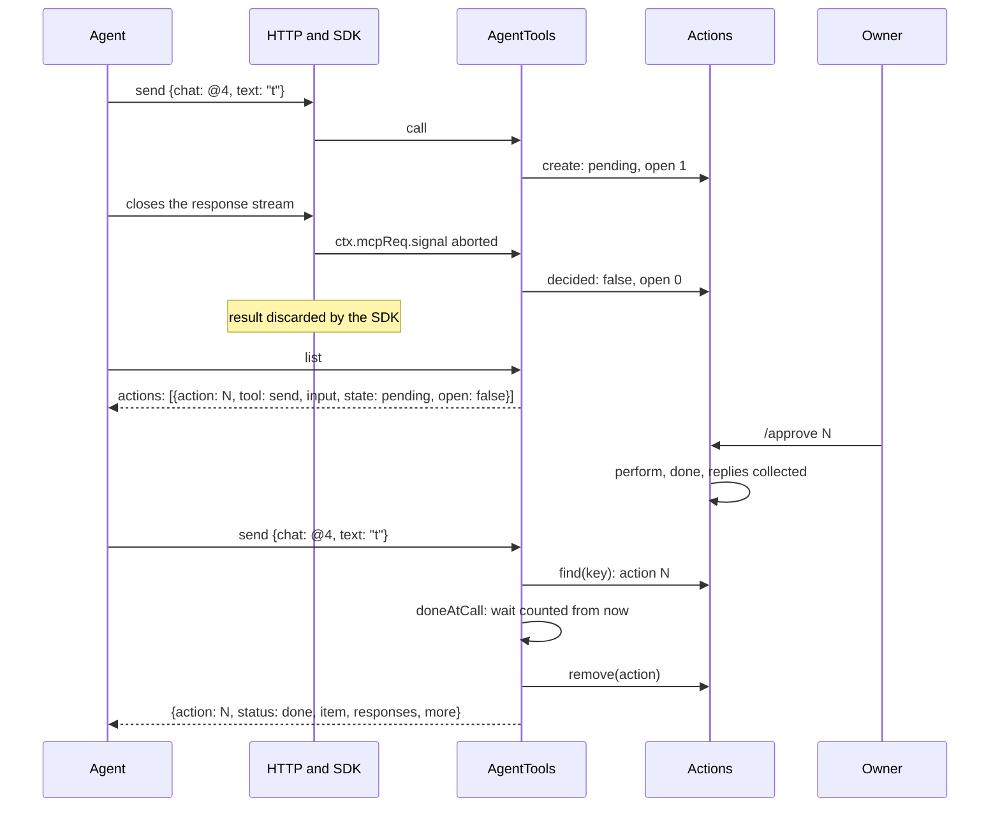

Notes:

- The key is the session number, `undefined` for `serve`, the tool name and the action fields: `target`, `incognito`, `message` for `connect`; `chat`, `text`, `file`, `as`, `reply_to`, `mention` for `send`; `chat`, `item` for `download`; `chat` for `leave` ([tools.ts:716](../src/tools.ts#L716), [:884](../src/tools.ts#L884), [:1044](../src/tools.ts#L1044), [:1068](../src/tools.ts#L1068), [:1674-1676](../src/tools.ts#L1674-L1676)).
- The `wait`, `idle` and `limit` of the attaching call are used ([tools.ts:912](../src/tools.ts#L912)).
- For a call aborted before `create`, the server returns before it creates an action ([tools.ts:725](../src/tools.ts#L725), [:905](../src/tools.ts#L905), [:1048](../src/tools.ts#L1048), [:1082](../src/tools.ts#L1082)).
- Abort path in the SDK: on `res` close the web request is aborted ([node index.cjs:299-303](../node_modules/@modelcontextprotocol/node/dist/index.cjs#L299-L303)); the per-request transport is closed ([server index.cjs:86-90](../node_modules/@modelcontextprotocol/server/dist/index.cjs#L86-L90)); the handler signal is aborted ([src-BhnGYybN.cjs:6425](../node_modules/@modelcontextprotocol/server/dist/src-BhnGYybN.cjs#L6425)).

Source: [tools.ts:742-754](../src/tools.ts#L742-L754), [:909-927](../src/tools.ts#L909-L927), [:1262](../src/tools.ts#L1262), [actions.ts:244-256](../src/actions.ts#L244-L256), [messages.ts:311-325](../src/messages.ts#L311-L325).

---

## 11. Shutdown with pending actions

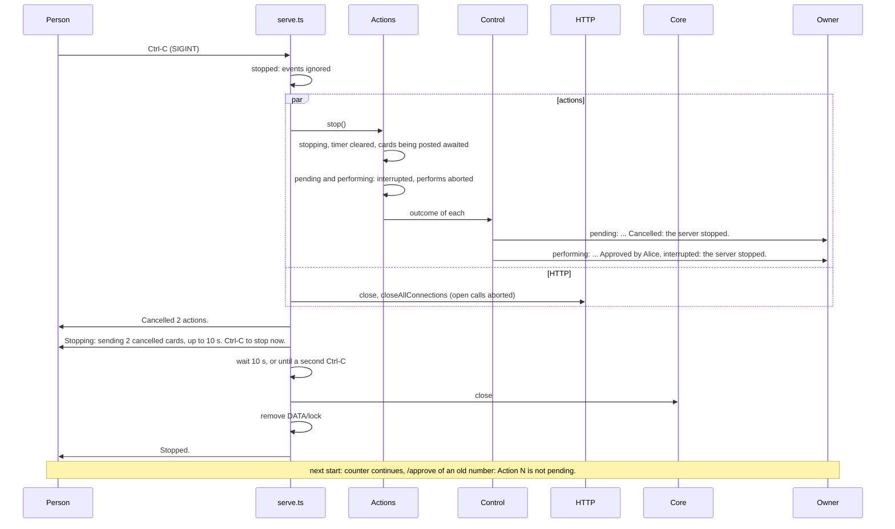

Notes:

- The interrupted card line is `DECIDER; interrupted: the server stopped.` ([control.ts:609](../src/control.ts#L609)).
- An action of mode `host` or of a standing approval whose counter is being written at the stop is set to `pending` and cancelled without a perform ([actions.ts:325-330](../src/actions.ts#L325-L330)).
- After a crash, the cards of that run are left with their commands; `/approve` of their numbers gets the reply `Action N is not pending.` ([control.ts:249](../src/control.ts#L249)).
- The stop signal of the performs is aborted after the actions are marked interrupted: a `connect` waiting for its connection ends, and an interrupted perform logs no line ([actions.ts:285-286](../src/actions.ts#L285-L286), [:340](../src/actions.ts#L340), [tools.ts:820-821](../src/tools.ts#L820-L821)).
- The wait applies only when cards were edited or posted at the stop, a `download` without a card excluded, and `--stop-wait` is above 0 ([serve.ts:149](../src/serve.ts#L149), [:161-175](../src/serve.ts#L161-L175)).

Source: [serve.ts:46-62](../src/serve.ts#L46-L62), [:143-153](../src/serve.ts#L143-L153), [:161-175](../src/serve.ts#L161-L175), [actions.ts:279-310](../src/actions.ts#L279-L310), [http.ts:48-52](../src/http.ts#L48-L52), [control.ts:600-619](../src/control.ts#L600-L619).

---

## 12. `--owners` setup

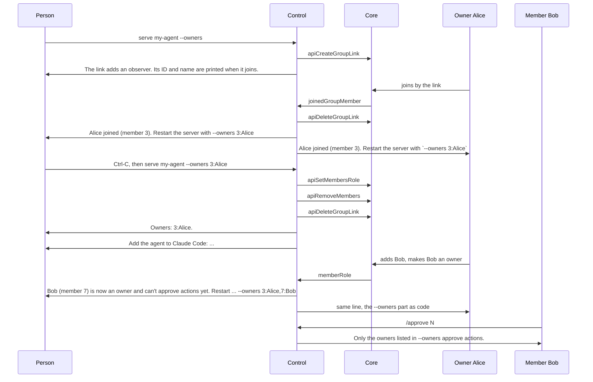

Notes:

- Until the restart with a list, new actions are refused: `The agent has no approving owner. ...` ([control.ts:136-138](../src/control.ts#L136-L138)).
- An entry must match a human by member ID and display name, folded to one line as the restart line prints it, or the server exits with code 2 ([control.ts:390-394](../src/control.ts#L390-L394), [:794-796](../src/control.ts#L794-L796)).
- With `--reset-owners`, the server deletes the control chat for all members and creates a new one with the same counter; the CLI refuses the option with an `--owners` list ([control.ts:563-575](../src/control.ts#L563-L575), [serve.ts:181](../src/serve.ts#L181), [cli.ts:124-126](../src/cli.ts#L124-L126)).
- When a listed owner leaves and none remains: `... is no longer an owner. No owners remain: restart the server with --reset-owners --owners` ([control.ts:429-434](../src/control.ts#L429-L434)).

Source: [control.ts:383-405](../src/control.ts#L383-L405), [:416-435](../src/control.ts#L416-L435), [:442-452](../src/control.ts#L442-L452), [:794-820](../src/control.ts#L794-L820).

---

## 13. `download` with approval

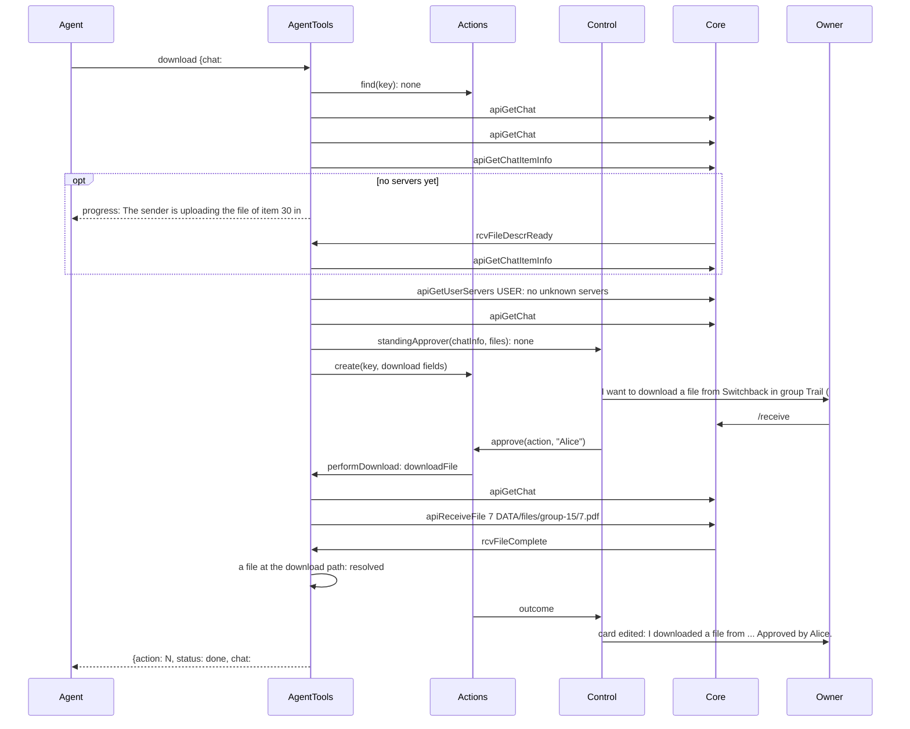

Notes:

- A check every 60 s reads the item: a deleted message or chat fails the download; 30 minutes without a rise of `rcvProgress` fail and cancel it ([tools.ts:1140-1167](../src/tools.ts#L1140-L1167)).
- A download still running `wait` seconds after the perform starts returns `status: performing`; the same call again attaches to the action ([tools.ts:1113-1116](../src/tools.ts#L1113-L1116)).
- `/approve #15 N` on a download card gets the reply `Action N is a download: ...` with the card's command line ([control.ts:256](../src/control.ts#L256)).
- A file on unknown servers gets a card that names their hosts and leaves out `/'receive CHAT N all'` ([control.ts:647-652](../src/control.ts#L647-L652), [:666-669](../src/control.ts#L666-L669), [:719-723](../src/control.ts#L719-L723)). Only such a card approves the relays; the core checks the complete description of every other download, which fails at the acceptance, or at the next check when the description completes later ([tools.ts:602](../src/tools.ts#L602), [:1148](../src/tools.ts#L1148)).
- The card of an image or video shows the sender's preview ([control.ts:477-497](../src/control.ts#L477-L497)).
- A file the core receives without a request, a short voice message, also in a member chat of a group, is moved into the chat's folder at `rcvFileComplete`; one whose transfer started before a restart, only when it has its full size. Its message then shows it as `offered`, and `download` returns its path after the approval ([tools.ts:608-628](../src/tools.ts#L608-L628), [:1187-1196](../src/tools.ts#L1187-L1196), [messages.ts:194-208](../src/messages.ts#L194-L208)).

Source: [tools.ts:1066-1208](../src/tools.ts#L1066-L1208), [control.ts:621-671](../src/control.ts#L621-L671), [tools.ts:657-684](../src/tools.ts#L657-L684).

---

## 14. `/forward`

```mermaid
sequenceDiagram
  participant A as Agent
  participant T as AgentTools
  participant K as Control
  participant C as Core
  participant O as Owner
  O->>C: /forward #15 N (on a pending download card)
  C->>K: newChatItems
  K->>T: forwardFile(action N)
  T->>C: apiReceiveFile 7 DATA/forwarded/group-15/7.pdf
  C->>T: rcvFileComplete: resolved with the forwarded path
  T->>T: copy for the post: DATA/files/sent/send-XXXXXX/report.pdf
  K->>C: apiSendMessages #G [{fileSource: the copy, msgContent: file, quotedItemId: card N when the message fits}]
  C->>T: sndFileCompleteXFTP: the copy's folder deleted
  Note over K,O: the card stays pending; the agent's message shows the file as offered
  O->>C: /receive #15 N
  K->>T: performDownload: downloadFile
  T->>T: the forwarded file moved to DATA/files/group-15/7.pdf
  T-->>A: {action: N, status: done, chat: #15, item: 30, path}
```

Notes:

- `/forward` gets no reply; a download or post that fails is posted as ``Action N: the file was not received: `ERROR`.``, and a failed post deletes the copy ([control.ts:287-303](../src/control.ts#L287-L303)).
- The copy is named by the name the sender gave ([tools.ts:1005-1009](../src/tools.ts#L1005-L1009)).
- The post keeps the sender's preview of an image or video; it replies to the card when the message, with the card as its quote, is within 15602 bytes by the length rule of `send` ([control.ts:287-303](../src/control.ts#L287-L303), [tools.ts:1553-1569](../src/tools.ts#L1553-L1569)).
- The download is shared with the agent's: one download per file ID; the move to the download path waits for the copy of the post ([tools.ts:579-606](../src/tools.ts#L579-L606)).
- The forwarded path is outside `DATA/files/`, so `send` refuses the file there; it is deleted when the agent leaves the chat, and by `/delete CHAT files` ([tools.ts:978-983](../src/tools.ts#L978-L983), [:1016-1034](../src/tools.ts#L1016-L1034), [:1056-1064](../src/tools.ts#L1056-L1064)).

Source: [control.ts:243-261](../src/control.ts#L243-L261), [:287-303](../src/control.ts#L287-L303), [tools.ts:579-596](../src/tools.ts#L579-L596), [:955-965](../src/tools.ts#L955-L965), [:1005-1009](../src/tools.ts#L1005-L1009).

---

## 15. `send` with a file

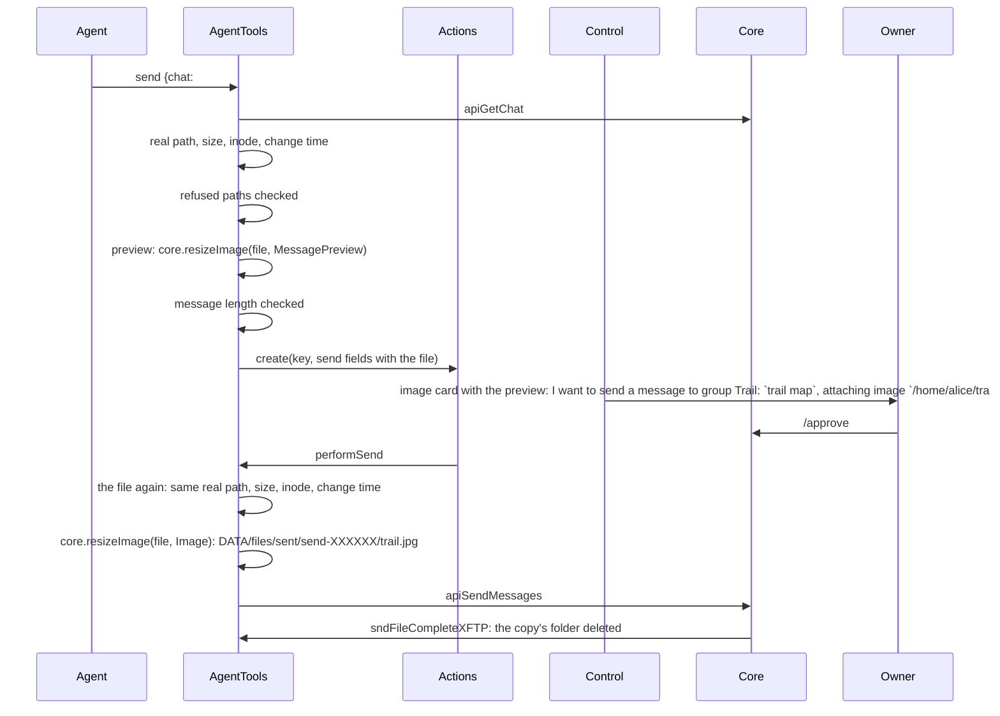

Notes:

- A refused file ends the call with an error, and the refusal is posted to the control chat and logged ([tools.ts:969-972](../src/tools.ts#L969-L972), [control.ts:173-177](../src/control.ts#L173-L177)).
- A video's preview is the first frame from `ffmpeg` and its duration comes from `ffprobe`; a GIF or WebP gets the fixed preview ([tools.ts:1632-1666](../src/tools.ts#L1632-L1666)).
- A changed file fails the perform: ``file: PATH changed after the request.`` ([tools.ts:985-990](../src/tools.ts#L985-L990)).
- `sndFileError` deletes the copy too, and the failure is posted to the control chat and logged ([tools.ts:680-682](../src/tools.ts#L680-L682), [serve.ts:133](../src/serve.ts#L133), [control.ts:179-188](../src/control.ts#L179-L188)).

Source: [tools.ts:882-907](../src/tools.ts#L882-L907), [:929-1003](../src/tools.ts#L929-L1003), [control.ts:477-497](../src/control.ts#L477-L497), [:636-642](../src/control.ts#L636-L642).

---

## 16. `/leave` and `/delete CHAT files`

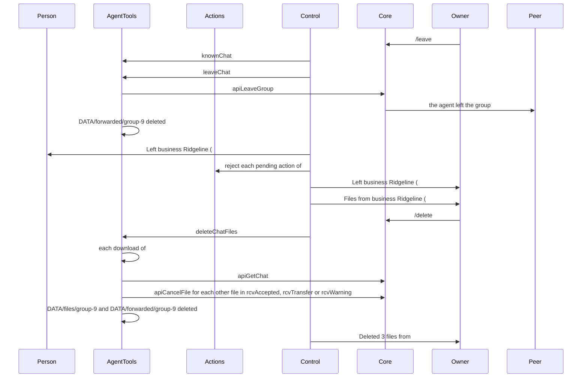

Notes:

- `/leave` acts at once in both modes, and works for a contact as `Deleted bot X (@4), requested by Alice.` ([control.ts:305-319](../src/control.ts#L305-L319)).
- The line `Left ...` goes to the log and to the owners; the members of #9 see only that the agent left.
- The files message is posted after the reply, and only when the folder has files ([control.ts:316-317](../src/control.ts#L316-L317), [:345-347](../src/control.ts#L345-L347)).
- `/delete CHAT files` works for a current or a left chat; the failed downloads return `Your owner deleted the files of this chat.`, and the reply counts the forwarded files too ([tools.ts:1016-1034](../src/tools.ts#L1016-L1034)).
- The paged reads find the downloads the core continues after a restart, which have no download in memory; for a left chat they find none ([messages.ts:275-283](../src/messages.ts#L275-L283), [tools.ts:1023-1029](../src/tools.ts#L1023-L1029)).

Source: [control.ts:305-329](../src/control.ts#L305-L329), [tools.ts:1011-1034](../src/tools.ts#L1011-L1034), [:1056-1064](../src/tools.ts#L1056-L1064).

---

## Claude Code plugin flows

Participants of the plugin flows:

| Letter | Participant |
|---|---|
| CC | Claude Code |
| HK | a hook run by `launch.js` |
| S | the session process, `simplex-mcp session` |
| D | the daemon: socket routes and entries |
| M | `MainGroup` |
| N | the `Session` of session N, with its `Control` and `Actions` |
| T | the session's `AgentTools` |
| C | the core `_hub`, profile `Claude` |
| U | `User` with the core `_user` |
| O | an owner in the SimpleX app |

`#M` is the Main group, `#G` the group of session N, ROOT the data root.

---

## 17. First session start and the owner joins

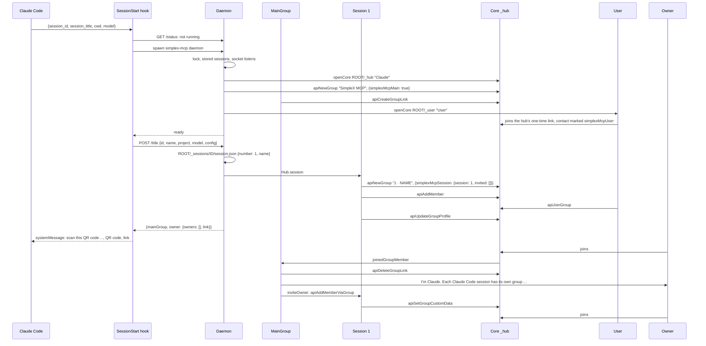

Notes:

- The link reaches the person only: the hook's `systemMessage` carries it, and no hook context or tool result does ([hook.ts:46-48](../src/hook.ts#L46-L48)).
- The core deletes the preset contact of a new profile, both in `_hub` and in `_user` ([core.ts:29](../src/core.ts#L29), [:45-53](../src/core.ts#L45-L53)).
- `User` connects at the first start only: later starts find the hub's contact marked `simplexMcpUser` ([user.ts:21](../src/user.ts#L21), [:58-60](../src/user.ts#L58-L60)).
- Owners are invited to the groups of open sessions when they join; the groups of closed sessions are joined by `/join N` ([hub.ts:325-329](../src/hub.ts#L325-L329), [:312-323](../src/hub.ts#L312-L323)).

Source: [hook.ts:37-52](../src/hook.ts#L37-L52), [client.ts:32-89](../src/client.ts#L32-L89), [daemon.ts:78-97](../src/daemon.ts#L78-L97), [:186-193](../src/daemon.ts#L186-L193), [hub.ts:244-260](../src/hub.ts#L244-L260), [:283-301](../src/hub.ts#L283-L301), [:358-370](../src/hub.ts#L358-L370), [main-group.ts:135-156](../src/main-group.ts#L135-L156), [user.ts:16-55](../src/user.ts#L16-L55).

---

## 18. Session process start and attach

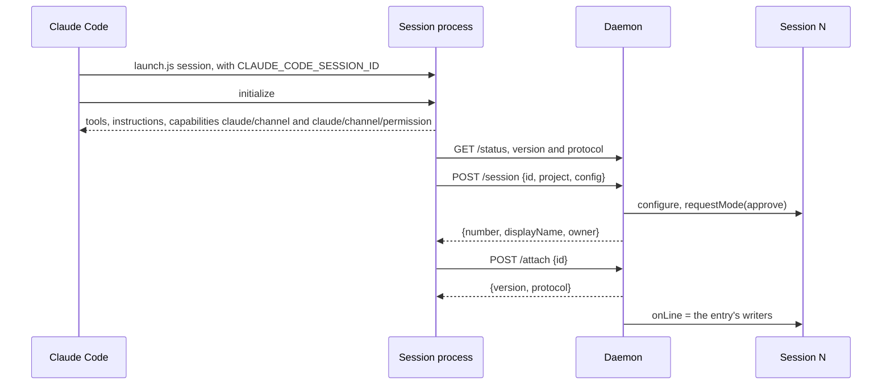

Notes:

- An invalid option is kept as the result of every call, and the session process does not connect ([session.ts:41-48](../src/session.ts#L41-L48), [:62](../src/session.ts#L62)).
- `/session` for a session without a folder creates it; `/attach`, `/call`, `/permission` and `/turn` answer 409 for it, and `call` registers again once ([daemon.ts:287-296](../src/daemon.ts#L287-L296), [session.ts:96-107](../src/session.ts#L96-L107)).
- The end of the `/attach` stream drops the connection; the next call connects again ([session.ts:151-156](../src/session.ts#L151-L156)).

Source: [session.ts:37-63](../src/session.ts#L37-L63), [:138-158](../src/session.ts#L138-L158), [daemon.ts:177-220](../src/daemon.ts#L177-L220).

---

## 19. A tool call with approval in the session group

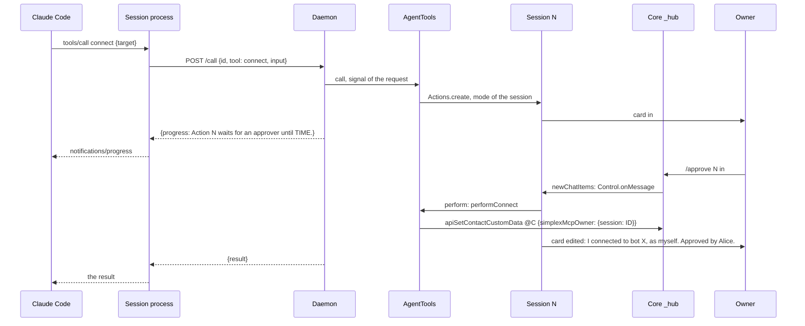

Notes:

- The approver check of the session group counts only invited members whose member in the Main group is an owner ([hub.ts:209-212](../src/hub.ts#L209-L212)).
- Without an approver in `#G`, the action is refused with the text of [API 4.4](api.md#44-tool-results-in-the-plugin).
- The connected chat gets the session's ID as its owner ([tools.ts:573-577](../src/tools.ts#L573-L577), [:815](../src/tools.ts#L815)).

Source: [daemon.ts:222-239](../src/daemon.ts#L222-L239), [hub.ts:63-87](../src/hub.ts#L63-L87), [tools.ts:715-736](../src/tools.ts#L715-L736).

---

## 20. A prompt from the session group

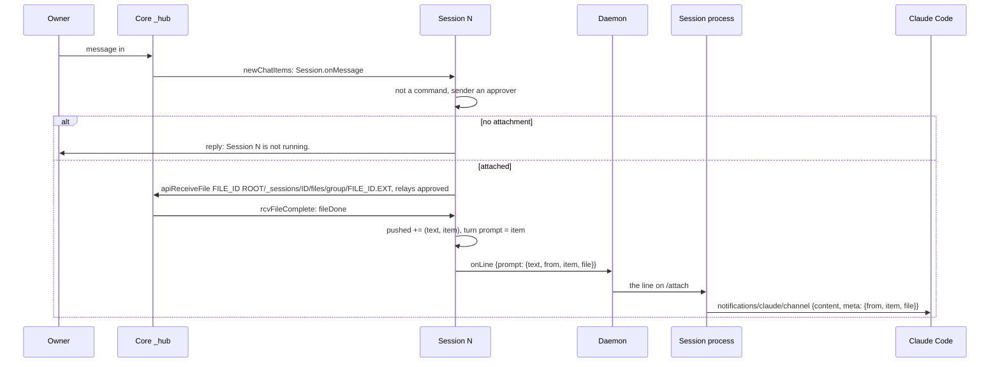

Notes:

- Messages of members who are not approvers, and one-line `/` commands, are not prompts ([hub.ts:122](../src/hub.ts#L122)).
- A failed file receipt drops the prompt and logs `prompt of session N` ([hub.ts:124](../src/hub.ts#L124), [:190-191](../src/hub.ts#L190-L191)).
- A session started without the channel flag gets the notification and drops it.

Source: [hub.ts:118-125](../src/hub.ts#L118-L125), [:178-193](../src/hub.ts#L178-L193), [daemon.ts:211](../src/daemon.ts#L211), [session.ts:50-53](../src/session.ts#L50-L53), [:170-174](../src/session.ts#L170-L174).

---

## 21. A terminal prompt and the answer

```mermaid
sequenceDiagram
  participant P as Person
  participant CC as Claude Code
  participant HK as Turn hook
  participant D as Daemon
  participant N as Session N
  participant U as User
  participant C as Core _hub
  participant O as Owner
  P->>CC: prompt typed in the terminal
  CC->>HK: UserPromptSubmit {session_id, prompt}, in the background
  HK->>D: POST /turn {id, prompt}
  D->>N: turn
  N->>N: not pushed in the last 60 s: turn prompt = none
  N->>U: post(N, parts)
  U->>O: the prompt in #G, from User
  CC->>CC: turn ends
  CC->>HK: Stop {session_id, last_assistant_message, effort}
  HK->>D: POST /turn {id, answer, effort}
  D->>N: turn
  N->>C: apiUpdateGroupProfile #G shortDescr MODEL · effort LEVEL, when it changed
  N->>N: end pending permissions
  N->>C: apiSendMessages #G parts, the first quoting the turn prompt from the group
  C->>O: the answer, from Claude
```

Notes:

- A prompt pushed from the group in the last 60 s is skipped, raw or wrapped in `<channel source="plugin:simplex:simplex" ... item="I" ...>` with the pushed item ([hub.ts:24](../src/hub.ts#L24), [:203-207](../src/hub.ts#L203-L207)).
- PostModelSwitch sends `{id, model}`; only the short description changes ([hook.ts:57](../src/hook.ts#L57), [hub.ts:139-143](../src/hub.ts#L139-L143)).
- A turn hook without a daemon prints `{}`; other errors are logged on its stderr ([hook.ts:54-62](../src/hook.ts#L54-L62)).

Source: [hooks.json:5-7](../hooks/hooks.json#L5-L7), [hub.ts:138-151](../src/hub.ts#L138-L151), [:195-201](../src/hub.ts#L195-L201), [:403-418](../src/hub.ts#L403-L418), [user.ts:29-32](../src/user.ts#L29-L32).

---

## 22. A tool use approved in the session group

```mermaid
sequenceDiagram
  participant CC as Claude Code
  participant S as Session process
  participant D as Daemon
  participant N as Session N
  participant O as Owner
  CC->>S: notifications/claude/channel/permission_request {request_id, tool_name, description, input_preview}
  CC->>CC: the terminal dialog stays open
  S->>D: POST /permission {id, requestId, toolName, description, inputPreview}
  D->>N: permission
  N->>O: card in #G: I want to use `Bash`: `DESCRIPTION`, preview, /'approve N' or /'reject N'
  O->>N: /approve N
  N->>N: performing
  N->>D: onLine {permission: {requestId, behavior: allow}}
  D->>S: the line on /attach
  S->>CC: notifications/claude/channel/permission {request_id, behavior: allow}
  N->>N: done, removed
  N->>O: card edited: ... Approved by Alice.
```

Notes:

- `/reject N` pushes `deny`; the card ends with `Rejected by NAME.` ([hub.ts:130-131](../src/hub.ts#L130-L131)).
- The first answer applies, in the terminal or in the group. A card still pending at the end of the turn, or when the last attachment ends, ends with `Expired.` ([hub.ts:149](../src/hub.ts#L149), [:153-157](../src/hub.ts#L153-L157), [daemon.ts:217](../src/daemon.ts#L217)).
- The card is posted in mode `requests` also for a session in mode `host` ([hub.ts:128](../src/hub.ts#L128)).

Source: [session.ts:55-58](../src/session.ts#L55-L58), [:91-94](../src/session.ts#L91-L94), [daemon.ts:121-125](../src/daemon.ts#L121-L125), [hub.ts:127-135](../src/hub.ts#L127-L135), [control.ts:624-627](../src/control.ts#L624-L627).

---

## 23. Mode `host` for a session

```mermaid
sequenceDiagram
  participant S as Session process
  participant D as Daemon
  participant N as Session N
  participant O as Owner
  S->>D: POST /session {config: {approve: host}}
  D->>N: requestMode(host)
  N->>O: card in #G: I want to run in mode host ... /'approve N' or /'reject N'
  O->>N: /approve N
  N->>N: perform: setMode(host), session.json mode host
  N->>O: card edited: I run in mode host ... Approved by Alice.
  S->>D: POST /session {config: {approve: requests}}
  D->>N: requestMode(requests): at once, session.json mode requests
```

Notes:

- One `mode` card is pending at a time ([hub.ts:110](../src/hub.ts#L110)).
- The session process marks the action tools for Claude Code's confirmation from the option at its own start, before the owner decides ([session.ts:54](../src/session.ts#L54)).

Source: [hub.ts:107-116](../src/hub.ts#L107-L116), [:214-218](../src/hub.ts#L214-L218), [tools.ts:555-556](../src/tools.ts#L555-L556).

---

## 24. `/give`

```mermaid
sequenceDiagram
  participant O as Owner
  participant K as Control of session 1
  participant T as AgentTools of session 1
  participant C as Core _hub
  O->>K: /give @4 2 in the group of session 1
  K->>T: agentChat @4: a chat of session 1
  K->>K: session 2 has an ID
  K->>T: giveChat @4 ID2
  T->>C: apiSetContactCustomData @4 {simplexMcpOwner: {session: ID2}}
  K->>K: pending actions of @4 with a card rejected by Alice
  K->>O: Gave bot X (@4) to session 2.
```

Source: [control.ts:331-343](../src/control.ts#L331-L343), [tools.ts:560-563](../src/tools.ts#L560-L563), [hub.ts:303-305](../src/hub.ts#L303-L305).

---

## 25. `reset-owners`

```mermaid
sequenceDiagram
  participant P as Person
  participant CC as Claude Code
  participant D as Daemon
  participant M as MainGroup
  participant N as Sessions
  participant O as Owner
  P->>CC: /simplex:reset-owners
  CC->>D: launch.js reset-owners: POST /reset-owners
  alt owners exist
    D->>M: askReset
    M->>O: A terminal asks to replace the owners ... /'approve reset' or /'reject reset'
    D-->>CC: An owner approves the reset in "SimpleX MCP". Then run npx -y @simplex-chat/mcp link ...
    O->>M: /approve reset
    M->>O: card edited: ... Approved by Alice.
    M->>M: the group deleted for all members, a new Main group with a link
    M->>N: removeOwners: apiRemoveMembers of the invited members of each session group
    P->>D: npx -y @simplex-chat/mcp link in a terminal
    D-->>P: Join "SimpleX MCP" in the SimpleX app. The link works once:, QR code, link
  else no owners, from Claude Code
    CC-->>P: Run npx -y @simplex-chat/mcp reset-owners in a terminal.
  end
```

Notes:

- Without owners, `reset-owners` in a terminal replaces the group at once and prints the new link with a QR code ([owner.ts:26-33](../src/owner.ts#L26-L33), [hub.ts:277-281](../src/hub.ts#L277-L281)).
- One reset card is pending at a time; `/reject reset` leaves the group ([main-group.ts:96-100](../src/main-group.ts#L96-L100), [:123-133](../src/main-group.ts#L123-L133)).

Source: [main-group.ts:102-114](../src/main-group.ts#L102-L114), [hub.ts:172-176](../src/hub.ts#L172-L176), [:331-333](../src/hub.ts#L331-L333).

---

## 26. Idle close, idle stop and a newer version

```mermaid
sequenceDiagram
  participant S as Session process
  participant D as Daemon
  participant N as Session N
  participant S2 as Session process of a newer plugin
  S->>D: the /attach stream ends with Claude Code
  D->>N: onLine = undefined, endPermissions
  D->>D: idle timer, 10 min
  D->>N: no call, no action in memory: entry closed, open false
  D->>D: no entry: stop timer, 10 min
  D->>D: stop: actions cancelled, cards edited, cores closed, lock released
  S2->>D: GET /status: version lower than its own
  S2->>D: POST /stop
  S2->>D: spawn a daemon of its version
```

Notes:

- A call or an attachment cancels the stop timer by creating an entry ([daemon.ts:252-262](../src/daemon.ts#L252-L262)).
- A daemon of a higher version is kept; another protocol version makes clients fail with `Restart Claude Code to update the SimpleX plugin.` ([client.ts:32-44](../src/client.ts#L32-L44)).

Source: [daemon.ts:154-175](../src/daemon.ts#L154-L175), [:212-219](../src/daemon.ts#L212-L219), [:298-316](../src/daemon.ts#L298-L316), [hub.ts:339-349](../src/hub.ts#L339-L349).
