# SimpleX MCP server: flows

> Sequence diagrams of the main flows of `@simplex-chat/mcp` 0.3.0, each with notes and source locations: `serve` in flows 1-16, the Claude Code plugin in flows 17-26.
>
> Related specs: [README](README.md) | [Architecture](architecture.md) | [API](api.md)

Participants:

| Letter | Participant |
|---|---|
| P | the person at the terminal |
| A | the agent in Claude Code |
| H | the HTTP listener with the MCP SDK |
| T | `AgentTools` |
| X | `Actions` |
| K | `Control` |
| C | the SimpleX core behind `ChatApi` |
| O | the owner in the SimpleX app |
| D | a peer |

In flows 1-16, `#G` is the agent control chat, `USER` the agent's user ID, `DATA` the data folder. Calls to the core are shown as the `ChatApi` methods the server calls, with their arguments in short. Card and progress texts with a semicolon are shown with a comma in the diagrams; the exact texts are in [API](api.md).

---

## Table of contents

1. [First start and the owner joins](#1-first-start-and-the-owner-joins)
2. [`register`](#2-register)
3. [`connect` with approval](#3-connect-with-approval)
4. [`send` with responses](#4-send-with-responses)
5. [`receive` with `wait`](#5-receive-with-wait)
6. [`send` under a standing approval, and `/revoke`](#6-send-under-a-standing-approval-and-revoke)
7. [`leave`](#7-leave)
8. [Mode `host`](#8-mode-host)
9. [Expiry](#9-expiry)
10. [A lost call and its re-attachment](#10-a-lost-call-and-its-re-attachment)
11. [Shutdown with pending actions](#11-shutdown-with-pending-actions)
12. [`--owners` setup](#12---owners-setup)
13. [`download` with approval](#13-download-with-approval)
14. [`/forward`](#14-forward)
15. [`send` with a file](#15-send-with-a-file)
16. [`/leave` and `/delete CHAT files`](#16-leave-and-delete-chat-files)

Claude Code plugin ([participants](#claude-code-plugin-flows)):

17. [First session start and the owner joins](#17-first-session-start-and-the-owner-joins)
18. [Session process start and attach](#18-session-process-start-and-attach)
19. [A tool call with approval in the session group](#19-a-tool-call-with-approval-in-the-session-group)
20. [A prompt from the session group](#20-a-prompt-from-the-session-group)
21. [A terminal prompt and the answer](#21-a-terminal-prompt-and-the-answer)
22. [A tool use approved in the session group](#22-a-tool-use-approved-in-the-session-group)
23. [Mode `host` for a session](#23-mode-host-for-a-session)
24. [`/give`](#24-give)
25. [`reset-owners`](#25-reset-owners)
26. [Idle close, idle stop and a newer version](#26-idle-close-idle-stop-and-a-newer-version)
27. [`/clear`, `--continue` and `/resume` in one session](#27-clear---continue-and-resume-in-one-session)

---

## 1. First start and the owner joins

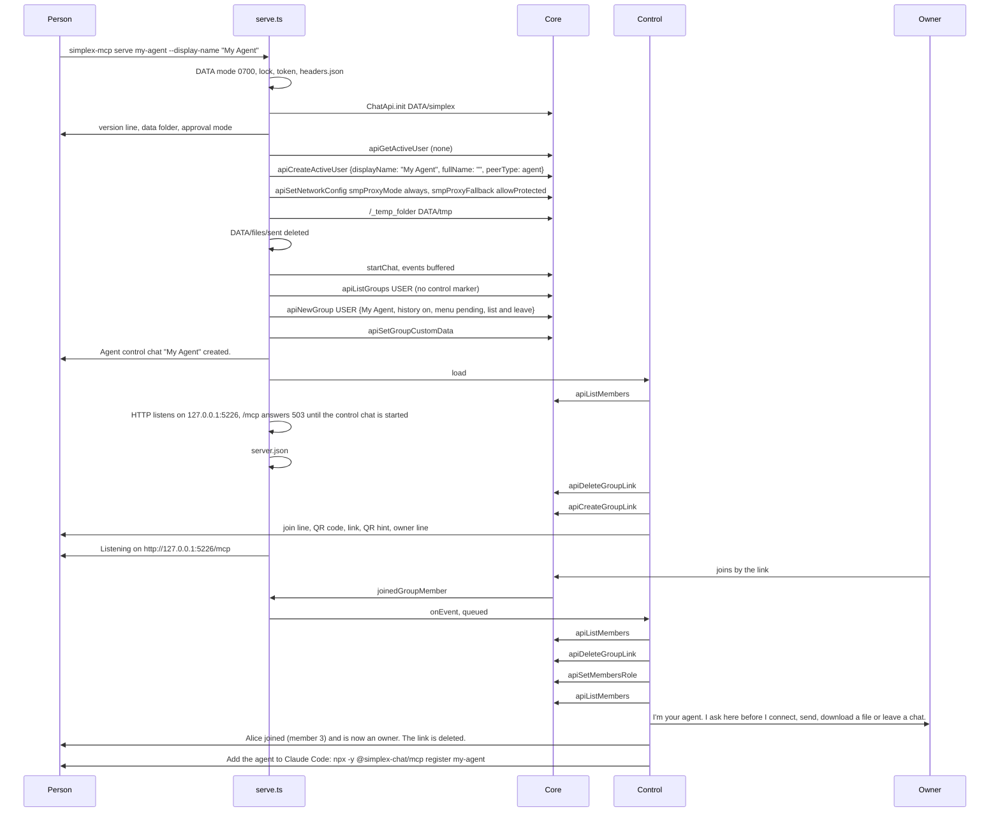

Notes:

- At first use, libsimplex and the Node.js add-on are downloaded, with one `Downloading ...` line each on stderr ([libs.ts:114-135](../../simplex-chat-nodejs/src/libs.ts#L114-L135)).
- With `--data`, `--data <folder>` is appended to the register hint, shell-quoted ([serve.ts:157-159](../src/serve.ts#L157-L159)).
- With `--qr-code small`, the line `If the QR code does not scan, ...` is printed after the link ([control.ts:457](../src/control.ts#L457)).
- Events that arrive before the HTTP listener starts are buffered and handled in order ([core.ts:62-76](../src/core.ts#L62-L76)).
- The server runs `ownerJoined` for every `joinedGroupMember` event of a human without `--owners`, and the link is deleted in that handler ([control.ts:218-219](../src/control.ts#L218-L219), [:416-423](../src/control.ts#L416-L423)).

Source: [cli.ts:218-251](../src/cli.ts#L218-L251), [serve.ts:64-122](../src/serve.ts#L64-L122), [core.ts:38-82](../src/core.ts#L38-L82), [files.ts:100-143](../src/files.ts#L100-L143), [http.ts:14-46](../src/http.ts#L14-L46), [control.ts:105-130](../src/control.ts#L105-L130), [:386-390](../src/control.ts#L386-L390), [:451-470](../src/control.ts#L451-L470), [:545-570](../src/control.ts#L545-L570).

---

## 2. `register`

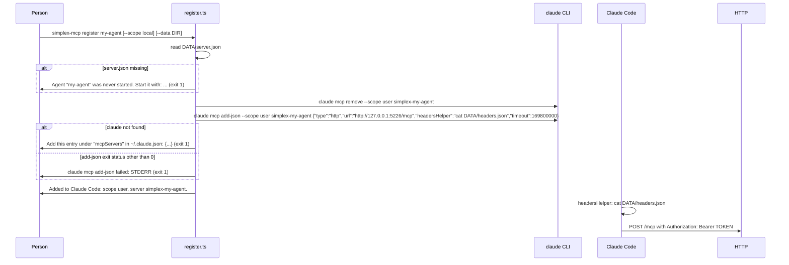

Notes:

- `simplex-mcp` ignores the exit status of `claude mcp remove` and stops at that step only when the `claude` binary is missing ([register.ts:38-39](../src/register.ts#L38-L39)).
- On Windows, a missing `claude` is run again through `cmd.exe`, with each argument quoted for it ([register.ts:86-101](../src/register.ts#L86-L101)).
- `timeout` is `(expireHours + 24) × 3600000 + 600000` ms from `server.json` ([register.ts:51](../src/register.ts#L51)).
- With `--scope local`, the project folder in the manual entry is the git repository root, the main repository of a worktree, or the current folder outside a repository ([register.ts:56](../src/register.ts#L56), [:60-84](../src/register.ts#L60-L84)).

Source: [cli.ts:130-145](../src/cli.ts#L130-L145), [:227](../src/cli.ts#L227), [register.ts:33-58](../src/register.ts#L33-L58), [files.ts:145-148](../src/files.ts#L145-L148).

---

## 3. `connect` with approval

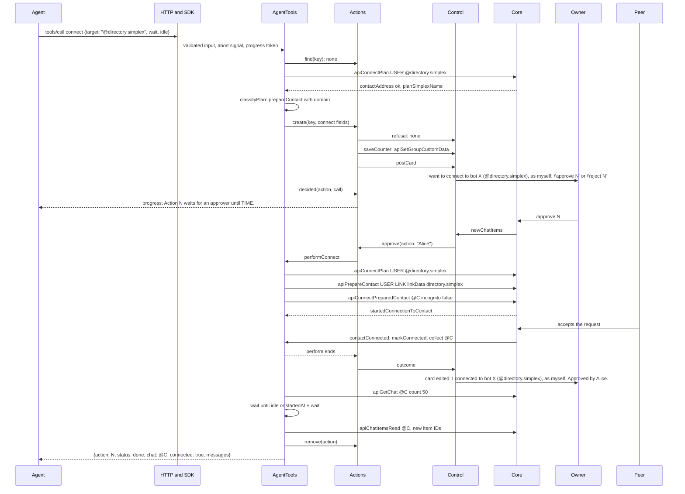

Notes:

- The plan is read again in the perform step ([tools.ts:799](../src/tools.ts#L799)).
- Join methods per plan ([tools.ts:830-858](../src/tools.ts#L830-L858), [:1372-1435](../src/tools.ts#L1372-L1435)):

| Plan | Methods |
|---|---|
| known prepared contact or group | `apiConnectPreparedContact(C, incognito, message)`<br>`apiConnectPreparedGroup(G, incognito, message)` |
| channel link (`direct` false, with link data) | `apiPrepareGroup(USER, LINK, false, linkData, domain)`<br>`apiConnectPreparedGroup(G, incognito)` |
| contact address with link data, and a SimpleX name or a message | `apiPrepareContact(USER, LINK, linkData, domain)`<br>`apiConnectPreparedContact(C, incognito, message)`, or `apiConnectPreparedGroup` for a business |
| `contactViaAddress` | `apiConnectContactViaAddress(USER, incognito, CONTACT_ID)` |
| other links | `apiConnectPreparedLink(USER, incognito, LINK)` |

- After a failed prepared connect, the server deletes the prepared chat without notifying ([tools.ts:860-867](../src/tools.ts#L860-L867)).
- The connection is matched by `contactConnected` or `userJoinedGroup`: by contact or group ID, or by the pending connection ID ([tools.ts:648-656](../src/tools.ts#L648-L656), [:869-874](../src/tools.ts#L869-L874)). In the plugin, a pending connection is also recorded in the session group's data, and its chat becomes the session's when it connects after the call returned, within a day of the record ([tools.ts:810](../src/tools.ts#L810), [hub.ts:161-166](../src/hub.ts#L161-L166), [:476-477](../src/hub.ts#L476-L477)).
- In the perform step the server waits for the other side until `startedAt + wait`, at most until `created + 23 h 50 min`, and then reports `connected: false` ([tools.ts:153](../src/tools.ts#L153), [:798](../src/tools.ts#L798), [:824-827](../src/tools.ts#L824-L827)).
- Without `message`, the idle time is counted from the connection; with `message`, from the first reply ([tools.ts:881](../src/tools.ts#L881), [messages.ts:327-335](../src/messages.ts#L327-L335)).
- For a target the agent is connected to, the result is `status: known` with its chat fields, and no action is created; in the plugin, the chat becomes the session's when it has no owner ([tools.ts:721](../src/tools.ts#L721), [:734-739](../src/tools.ts#L734-L739)).
- Exact progress texts: `Action N waits for an approver until TIME.`, then `Action N waits for the connection until TIME.`, then `K messages in CHAT; waiting until TIME.` ([actions.ts:411-422](../src/actions.ts#L411-L422), [tools.ts:767](../src/tools.ts#L767)).

Source: [tools.ts:716-781](../src/tools.ts#L716-L781), [:795-884](../src/tools.ts#L795-L884), [actions.ts:178-213](../src/actions.ts#L178-L213), [:247-265](../src/actions.ts#L247-L265), [control.ts:168-179](../src/control.ts#L168-L179).

---

## 4. `send` with responses

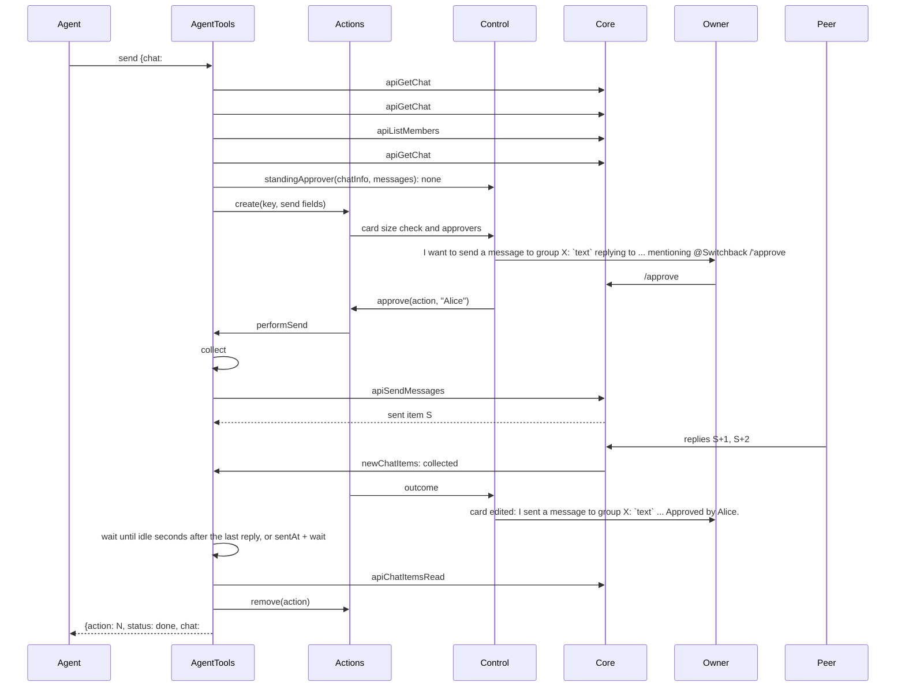

Notes:

- Checks before the action: `text` or `file`, the chat connected, role `observer` or `relay` refused, `reply_to` item a message, mentioned members present and the chat a group, and the message length with its quote ([tools.ts:891-904](../src/tools.ts#L891-L904)).
- The server starts collecting before the send and, after it, drops items with IDs up to the sent item ([tools.ts:936](../src/tools.ts#L936), [:949-951](../src/tools.ts#L949-L951)).
- Mentioned names missing from the text are prefixed as `@name` ([tools.ts:1548-1551](../src/tools.ts#L1548-L1551)).
- While a collected message is live, the server waits for its final update; live items are left out of `responses` and counted in `more` ([messages.ts:327-335](../src/messages.ts#L327-L335), [tools.ts:922](../src/tools.ts#L922), [:928](../src/tools.ts#L928)).
- At most 100 replies are kept per action; later ones are counted as overflow ([messages.ts:10](../src/messages.ts#L10), [:109-110](../src/messages.ts#L109-L110)).

Source: [tools.ts:886-957](../src/tools.ts#L886-L957), [messages.ts:99-114](../src/messages.ts#L99-L114), [:327-335](../src/messages.ts#L327-L335), [control.ts:650-656](../src/control.ts#L650-L656).

---

## 5. `receive` with `wait`

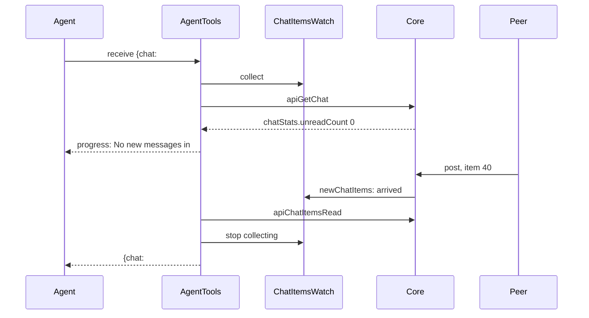

Notes:

- With unread items the server reads `around` the first unread item, `count` 0, then pages of `after` the last item, `count` 100, until it holds `limit + 1` unread, non-live messages or a page is short ([messages.ts:289-303](../src/messages.ts#L289-L303)).
- Unread items other than messages in the read pages are marked read with the returned messages ([tools.ts:1235](../src/tools.ts#L1235), [:1252](../src/tools.ts#L1252)).
- `more`: the arrived messages not returned, the overflow and the unread items not read ([tools.ts:1254](../src/tools.ts#L1254)).
- Items received while the pages are read are returned once ([tools.ts:1234-1237](../src/tools.ts#L1234-L1237)).
- Exact progress text: `No new messages in CHAT; waiting until TIME.` ([tools.ts:1241](../src/tools.ts#L1241)).

Source: [tools.ts:1223-1258](../src/tools.ts#L1223-L1258), [messages.ts:289-335](../src/messages.ts#L289-L335).

---

## 6. `send` under a standing approval, and `/revoke`

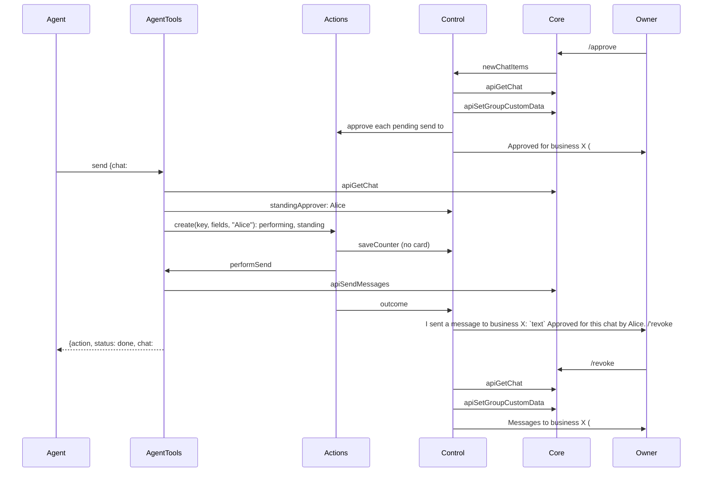

Notes:

- The approval is used in mode `requests` while member `approvedById` is an approver ([control.ts:149-152](../src/control.ts#L149-L152)).
- For sends that were pending at `/approve CHAT all`, the card ends with the plain `Approved by Alice.` ([control.ts:616](../src/control.ts#L616), [:625](../src/control.ts#L625)).
- `connect` and `leave` actions are created without the standing approver, so they stay pending ([tools.ts:727](../src/tools.ts#L727), [:1053](../src/tools.ts#L1053)).
- `/receive CHAT N all` and `/receive CHAT off` work the same way for downloads, with the key `simplexMcpFiles`, except that download N alone is performed, and the other pending downloads of the chat stay pending ([control.ts:25-28](../src/control.ts#L25-L28), [:282-284](../src/control.ts#L282-L284), [tools.ts:1085](../src/tools.ts#L1085)).

Source: [control.ts:274-294](../src/control.ts#L274-L294), [:382-384](../src/control.ts#L382-L384), [tools.ts:908-910](../src/tools.ts#L908-L910), [actions.ts:178-213](../src/actions.ts#L178-L213), [:328-346](../src/actions.ts#L328-L346).

---

## 7. `leave`

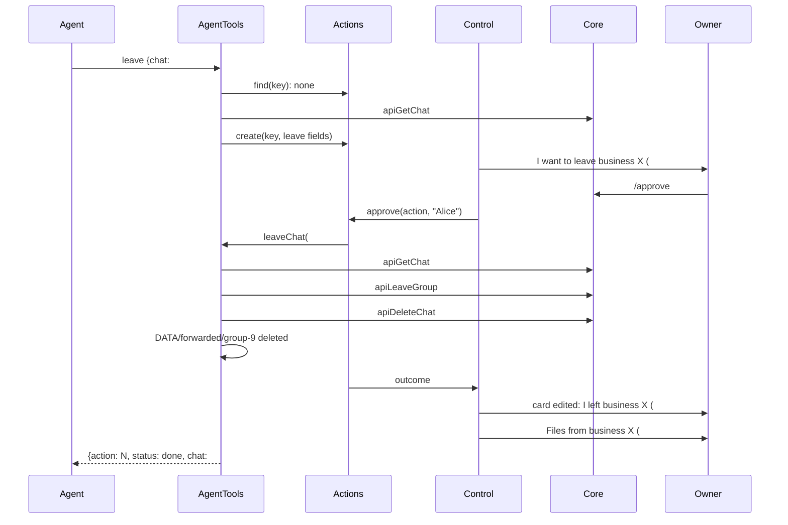

Notes:

- For a contact, the card text is `I want to delete KIND NAME (@N).`, and the perform step calls `apiDeleteChat` for the contact, full, with notify ([control.ts:657-660](../src/control.ts#L657-L660), [tools.ts:1061](../src/tools.ts#L1061)).
- The delete notifies, so the core notifies the contact or the members ([tools.ts:1061](../src/tools.ts#L1061), [:1064](../src/tools.ts#L1064)).
- The server looks for an attached action before it reads the chat, so a repeated call after the deletion is attached to the done action ([tools.ts:1048-1050](../src/tools.ts#L1048-L1050)).

Source: [tools.ts:1046-1068](../src/tools.ts#L1046-L1068), [control.ts:172-179](../src/control.ts#L172-L179), [:330-333](../src/control.ts#L330-L333).

---

## 8. Mode `host`

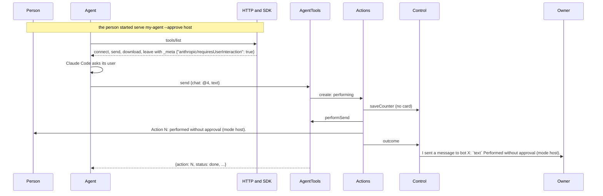

Notes:

- New actions are still refused unless the control chat has an approver ([control.ts:138-142](../src/control.ts#L138-L142)).
- In mode `host`, `standingApprover` returns `undefined`, so standing approvals are ignored by `send`, `download`, `list` and `/list`, and `/approve CHAT all` stores nothing; downloads get no card, so `/receive CHAT N all` has no card to act on ([control.ts:151](../src/control.ts#L151), [:242](../src/control.ts#L242)).
- A download in mode `host` is received without the approval of unknown servers, and it gets no card and no outcome post ([tools.ts:603](../src/tools.ts#L603), [:1139](../src/tools.ts#L1139), [control.ts:541-543](../src/control.ts#L541-L543)).
- The kept-files message also follows a done `leave` in mode `host` ([control.ts:177-178](../src/control.ts#L177-L178)).

Source: [tools.ts:533-535](../src/tools.ts#L533-L535), [actions.ts:191](../src/actions.ts#L191), [:344](../src/actions.ts#L344), [control.ts:172-179](../src/control.ts#L172-L179), [:616](../src/control.ts#L616).

---

## 9. Expiry

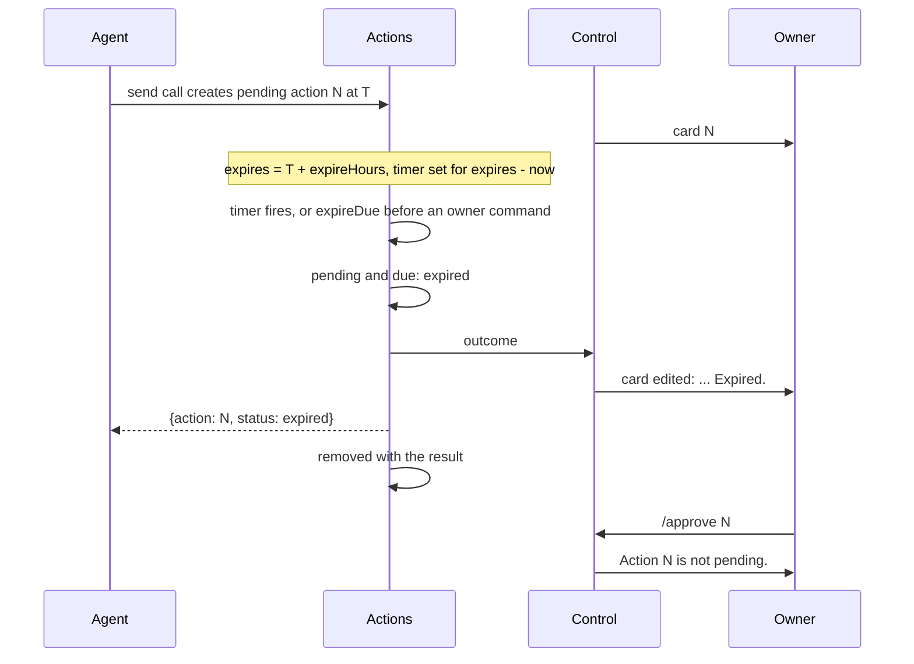

Notes:

- A decided action with an open count of 0 is removed once its expiry time has passed: at its timer, at a later decision or at the close of its last call ([actions.ts:311-313](../src/actions.ts#L311-L313)).
- A timer that fires before the expiry time, on the monotonic clock, is set again ([actions.ts:304](../src/actions.ts#L304)).
- Expiry times are listed in the `/pending` reply ([control.ts:687-689](../src/control.ts#L687-L689)).
- The server ends the connect wait at `created + 23 h 50 min`, within the 24 hours in which a message can be edited ([tools.ts:153](../src/tools.ts#L153), [:798](../src/tools.ts#L798)).

Source: [actions.ts:188](../src/actions.ts#L188), [:241-245](../src/actions.ts#L241-L245), [:295-313](../src/actions.ts#L295-L313), [control.ts:230](../src/control.ts#L230), [:258](../src/control.ts#L258).

---

## 10. A lost call and its re-attachment

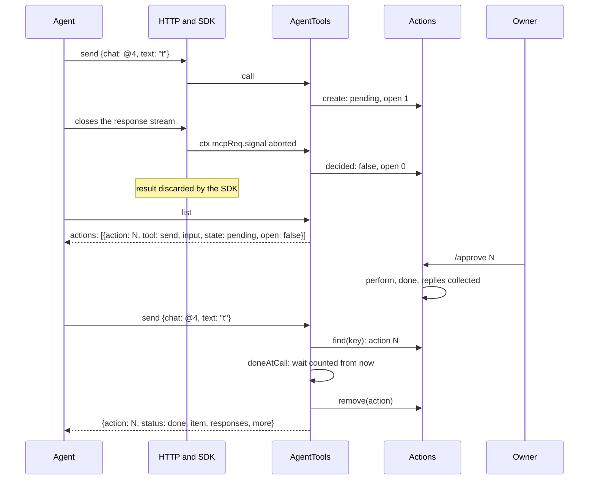

Notes:

- The key is the session number, `undefined` for `serve`, the tool name and the action fields: `target`, `incognito`, `message` for `connect`; `chat`, `text`, `file`, `as`, `reply_to`, `mention` for `send`; `chat`, `item` for `download`; `chat` for `leave` ([tools.ts:717](../src/tools.ts#L717), [:888](../src/tools.ts#L888), [:1048](../src/tools.ts#L1048), [:1072](../src/tools.ts#L1072), [:1678-1680](../src/tools.ts#L1678-L1680)).
- The `wait`, `idle` and `limit` of the attaching call are used ([tools.ts:916](../src/tools.ts#L916)).
- For a call aborted before `create`, the server returns before it creates an action ([tools.ts:726](../src/tools.ts#L726), [:909](../src/tools.ts#L909), [:1052](../src/tools.ts#L1052), [:1086](../src/tools.ts#L1086)).
- Abort path in the SDK: on `res` close the web request is aborted ([node index.cjs:299-303](../node_modules/@modelcontextprotocol/node/dist/index.cjs#L299-L303)); the per-request transport is closed ([server index.cjs:86-90](../node_modules/@modelcontextprotocol/server/dist/index.cjs#L86-L90)); the handler signal is aborted ([src-BhnGYybN.cjs:6425](../node_modules/@modelcontextprotocol/server/dist/src-BhnGYybN.cjs#L6425)).

Source: [tools.ts:745-757](../src/tools.ts#L745-L757), [:913-931](../src/tools.ts#L913-L931), [:1266](../src/tools.ts#L1266), [actions.ts:247-259](../src/actions.ts#L247-L259), [messages.ts:311-325](../src/messages.ts#L311-L325).

---

## 11. Shutdown with pending actions

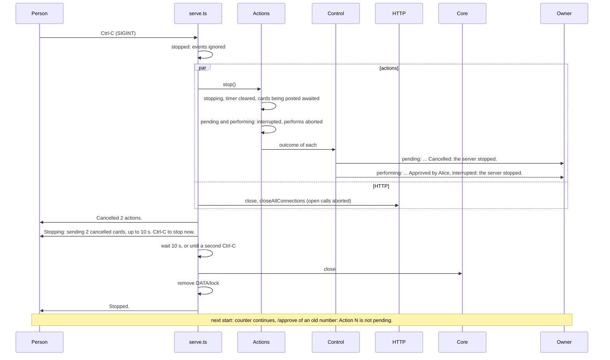

Notes:

- The interrupted card line is `DECIDER; interrupted: the server stopped.` ([control.ts:623](../src/control.ts#L623)).
- An action of mode `host` or of a standing approval whose counter is being written at the stop is set to `pending` and cancelled without a perform ([actions.ts:328-333](../src/actions.ts#L328-L333)).
- After a crash, the cards of that run are left with their commands; `/approve` of their numbers gets the reply `Action N is not pending.` ([control.ts:258](../src/control.ts#L258)).
- The stop signal of the performs is aborted after the actions are marked interrupted: a `connect` waiting for its connection ends, and an interrupted perform logs no line ([actions.ts:288-289](../src/actions.ts#L288-L289), [:343](../src/actions.ts#L343), [tools.ts:824-825](../src/tools.ts#L824-L825)).
- The wait applies only when cards were edited or posted at the stop, a `download` without a card excluded, and `--stop-wait` is above 0 ([serve.ts:149](../src/serve.ts#L149), [:161-175](../src/serve.ts#L161-L175)).

Source: [serve.ts:46-62](../src/serve.ts#L46-L62), [:143-153](../src/serve.ts#L143-L153), [:161-175](../src/serve.ts#L161-L175), [actions.ts:282-313](../src/actions.ts#L282-L313), [http.ts:48-52](../src/http.ts#L48-L52), [control.ts:614-633](../src/control.ts#L614-L633).

---

## 12. `--owners` setup

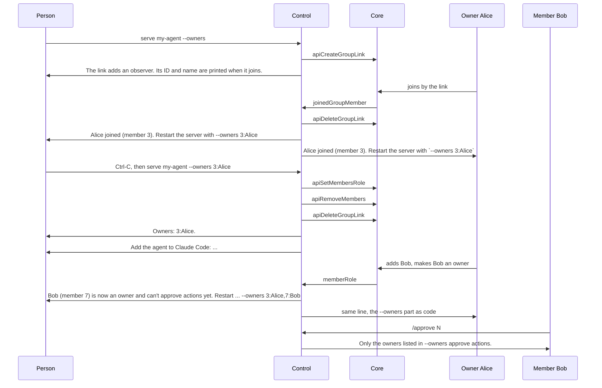

Notes:

- Until the restart with a list, new actions are refused: `The agent has no approving owner. ...` ([control.ts:140-142](../src/control.ts#L140-L142)).
- An entry must match a human by member ID and display name, folded to one line as the restart line prints it, or the server exits with code 2 ([control.ts:399-403](../src/control.ts#L399-L403), [:808-810](../src/control.ts#L808-L810)).
- With `--reset-owners`, the server deletes the control chat for all members and creates a new one with the same counter; the CLI refuses the option with an `--owners` list ([control.ts:572-584](../src/control.ts#L572-L584), [serve.ts:181](../src/serve.ts#L181), [cli.ts:124-126](../src/cli.ts#L124-L126)).
- When a listed owner leaves and none remains: `... is no longer an owner. No owners remain: restart the server with --reset-owners --owners` ([control.ts:438-443](../src/control.ts#L438-L443)).

Source: [control.ts:392-414](../src/control.ts#L392-L414), [:425-444](../src/control.ts#L425-L444), [:451-461](../src/control.ts#L451-L461), [:808-834](../src/control.ts#L808-L834).

---

## 13. `download` with approval

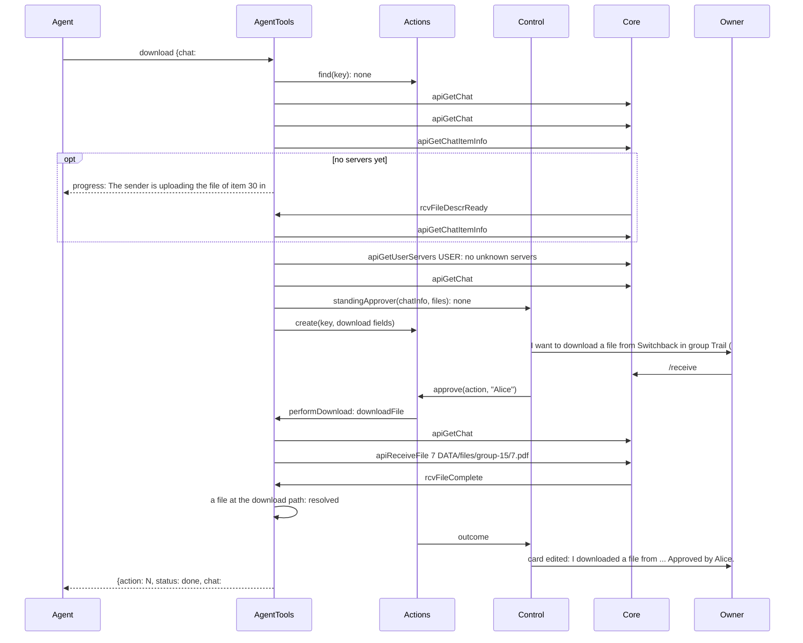

Notes:

- A check every 60 s reads the item: a deleted message or chat fails the download; 30 minutes without a rise of `rcvProgress` fail and cancel it ([tools.ts:1144-1171](../src/tools.ts#L1144-L1171)).
- A download still running `wait` seconds after the perform starts returns `status: performing`; the same call again attaches to the action ([tools.ts:1117-1120](../src/tools.ts#L1117-L1120)).
- `/approve #15 N` on a download card gets the reply `Action N is a download: ...` with the card's command line ([control.ts:265](../src/control.ts#L265)).
- A file on unknown servers gets a card that names their hosts and leaves out `/'receive CHAT N all'` ([control.ts:661-666](../src/control.ts#L661-L666), [:680-683](../src/control.ts#L680-L683), [:733-737](../src/control.ts#L733-L737)). Only such a card approves the relays; the core checks the complete description of every other download, which fails at the acceptance, or at the next check when the description completes later ([tools.ts:603](../src/tools.ts#L603), [:1152](../src/tools.ts#L1152)).
- The card of an image or video shows the sender's preview ([control.ts:486-506](../src/control.ts#L486-L506)).
- A file the core receives without a request, a short voice message, also in a member chat of a group, is moved into the chat's folder at `rcvFileComplete`; one whose transfer started before a restart, only when it has its full size. Its message then shows it as `offered`, and `download` returns its path after the approval ([tools.ts:609-629](../src/tools.ts#L609-L629), [:1191-1200](../src/tools.ts#L1191-L1200), [messages.ts:194-208](../src/messages.ts#L194-L208)).

Source: [tools.ts:1070-1212](../src/tools.ts#L1070-L1212), [control.ts:635-685](../src/control.ts#L635-L685), [tools.ts:658-685](../src/tools.ts#L658-L685).

---

## 14. `/forward`

```mermaid
sequenceDiagram
  participant A as Agent
  participant T as AgentTools
  participant K as Control
  participant C as Core
  participant O as Owner
  O->>C: /forward #15 N (on a pending download card)
  C->>K: newChatItems
  K->>T: forwardFile(action N)
  T->>C: apiReceiveFile 7 DATA/forwarded/group-15/7.pdf
  C->>T: rcvFileComplete: resolved with the forwarded path
  T->>T: copy for the post: DATA/files/sent/send-XXXXXX/report.pdf
  K->>C: apiSendMessages #G [{fileSource: the copy, msgContent: file, quotedItemId: card N when the message fits}]
  C->>T: sndFileCompleteXFTP: the copy's folder deleted
  Note over K,O: the card stays pending; the agent's message shows the file as offered
  O->>C: /receive #15 N
  K->>T: performDownload: downloadFile
  T->>T: the forwarded file moved to DATA/files/group-15/7.pdf
  T-->>A: {action: N, status: done, chat: #15, item: 30, path}
```

Notes:

- `/forward` gets no reply; a download or post that fails is posted as ``Action N: the file was not received: `ERROR`.``, and a failed post deletes the copy ([control.ts:296-312](../src/control.ts#L296-L312)).
- The copy is named by the name the sender gave ([tools.ts:1009-1013](../src/tools.ts#L1009-L1013)).
- The post keeps the sender's preview of an image or video; it replies to the card when the message, with the card as its quote, is within 15602 bytes by the length rule of `send` ([control.ts:296-312](../src/control.ts#L296-L312), [tools.ts:1557-1573](../src/tools.ts#L1557-L1573)).
- The download is shared with the agent's: one download per file ID; the move to the download path waits for the copy of the post ([tools.ts:580-607](../src/tools.ts#L580-L607)).
- The forwarded path is outside `DATA/files/`, so `send` refuses the file there; it is deleted when the agent leaves the chat, and by `/delete CHAT files` ([tools.ts:982-987](../src/tools.ts#L982-L987), [:1020-1038](../src/tools.ts#L1020-L1038), [:1060-1068](../src/tools.ts#L1060-L1068)).

Source: [control.ts:252-270](../src/control.ts#L252-L270), [:296-312](../src/control.ts#L296-L312), [tools.ts:580-597](../src/tools.ts#L580-L597), [:959-969](../src/tools.ts#L959-L969), [:1009-1013](../src/tools.ts#L1009-L1013).

---

## 15. `send` with a file

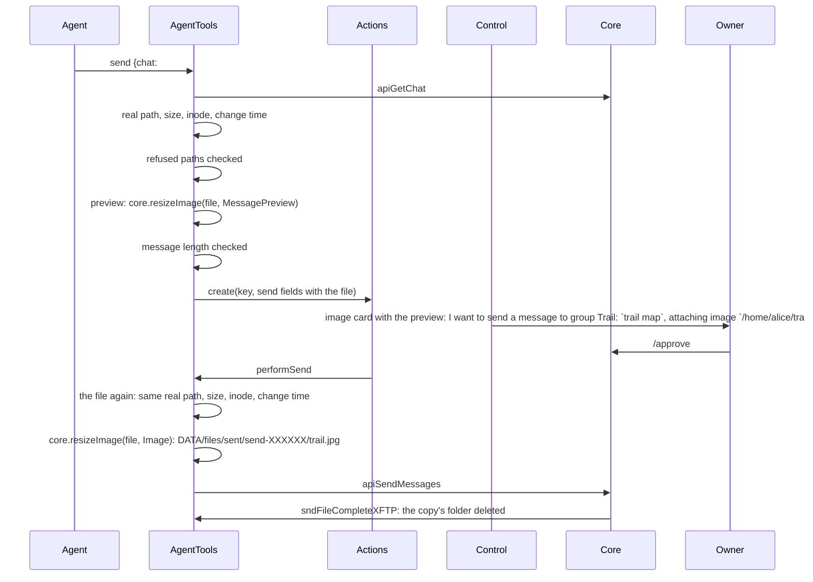

Notes:

- A refused file ends the call with an error, and the refusal is posted to the control chat and logged ([tools.ts:973-976](../src/tools.ts#L973-L976), [control.ts:181-185](../src/control.ts#L181-L185)).
- A video's preview is the first frame from `ffmpeg` and its duration comes from `ffprobe`; a GIF or WebP gets the fixed preview ([tools.ts:1636-1670](../src/tools.ts#L1636-L1670)).
- A changed file fails the perform: ``file: PATH changed after the request.`` ([tools.ts:989-994](../src/tools.ts#L989-L994)).
- `sndFileError` deletes the copy too, and the failure is posted to the control chat and logged ([tools.ts:681-683](../src/tools.ts#L681-L683), [serve.ts:133](../src/serve.ts#L133), [control.ts:187-196](../src/control.ts#L187-L196)).

Source: [tools.ts:886-911](../src/tools.ts#L886-L911), [:933-1007](../src/tools.ts#L933-L1007), [control.ts:486-506](../src/control.ts#L486-L506), [:650-656](../src/control.ts#L650-L656).

---

## 16. `/leave` and `/delete CHAT files`

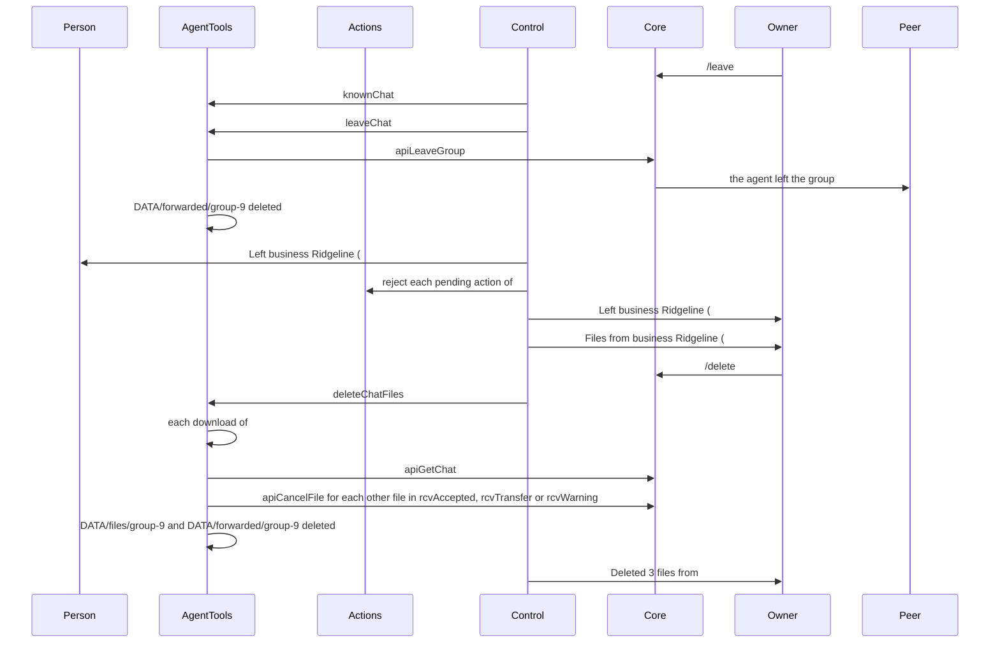

Notes:

- `/leave` acts at once in both modes, and works for a contact as `Deleted bot X (@4), requested by Alice.` ([control.ts:314-328](../src/control.ts#L314-L328)).
- The line `Left ...` goes to the log and to the owners; the members of #9 see only that the agent left.
- The files message is posted after the reply, and only when the folder has files ([control.ts:325-326](../src/control.ts#L325-L326), [:354-356](../src/control.ts#L354-L356)).
- `/delete CHAT files` works for a current or a left chat; the failed downloads return `Your owner deleted the files of this chat.`, and the reply counts the forwarded files too ([tools.ts:1020-1038](../src/tools.ts#L1020-L1038)).
- The paged reads find the downloads the core continues after a restart, which have no download in memory; for a left chat they find none ([messages.ts:275-283](../src/messages.ts#L275-L283), [tools.ts:1027-1033](../src/tools.ts#L1027-L1033)).

Source: [control.ts:314-338](../src/control.ts#L314-L338), [tools.ts:1015-1038](../src/tools.ts#L1015-L1038), [:1060-1068](../src/tools.ts#L1060-L1068).

---

## Claude Code plugin flows

Participants of the plugin flows:

| Letter | Participant |
|---|---|
| CC | Claude Code |
| HK | a hook, `node dist/cli.js hook ...` in the plugin's folder |
| S | the session process, `simplex-mcp session` |
| D | the daemon: socket routes and entries |
| M | `MainGroup` |
| N | the `Session` of session N, with its `Control` and `Actions` |
| T | the session's `AgentTools` |
| C | the core `_hub`, profile `Claude` |
| U | `User` with the core `_user` |
| O | an owner in the SimpleX app |

`#M` is the Main group, `#G` the group of session N, ROOT the data root.

---

## 17. First session start and the owner joins

```mermaid
sequenceDiagram
  participant CC as Claude Code
  participant HK as SessionStart hook
  participant D as Daemon
  participant M as MainGroup
  participant N as Session 1
  participant C as Core _hub
  participant U as User
  participant O as Owner
  CC->>HK: {session_id, session_title, cwd, model}
  HK->>D: GET /status: not running
  HK->>D: spawn simplex-mcp daemon
  D->>D: lock, stored sessions, socket listens
  D->>C: openCore ROOT/_hub "Claude"
  D->>C: apiNewGroup "SimpleX MCP", {simplexMcpMain: true}
  M->>C: apiGetGroupLinkStr #M: none, apiCreateGroupLink #M member
  D->>U: openCore ROOT/_user "User"
  U->>C: joins the hub's one-time link; the contact of its connection marked simplexMcpUser
  D-->>HK: ready
  HK->>D: POST /title {id, pid, name, project, model, config}
  D->>D: ROOT/_sessions/ID/session.json {number: 1, name}
  D->>N: Hub.session
  N->>C: apiNewGroup "1 · NAME", {simplexMcpSession: {session: 1, invited: []}}
  N->>C: apiAddMember #G User
  U->>C: apiJoinGroup #G, marked {simplexMcpSession: 1}
  N->>C: apiUpdateGroupProfile #G shortDescr MODEL
  D-->>HK: {mainGroup, owner: {owners: [], link}}
  HK-->>CC: systemMessage: scan this QR code ..., QR code, link
  O->>C: joins #M by the link
  C->>M: joinedGroupMember
  M->>C: apiDeleteGroupLink #M, apiSetMembersRole #M owner
  M->>O: I'm Claude. Each Claude Code session has its own group ...
  M->>N: inviteOwner: apiAddMemberViaGroup #G via #M, role owner
  N->>C: apiSetGroupCustomData #G invited [{groupMemberId, mainMemberId}]
  O->>C: joins #G from the invitation in #M
```

Notes:

- The link reaches the person only: the hook's `systemMessage` carries it, and no hook context or tool result does ([hook.ts:50-52](../src/hook.ts#L50-L52)).
- The core deletes the preset contact of a new profile, both in `_hub` and in `_user` ([core.ts:29](../src/core.ts#L29), [:45-53](../src/core.ts#L45-L53)).
- `User` connects at the first start only: later starts find the hub's contact marked `simplexMcpUser`. The contact is the one whose connection is that of the invitation the hub created; when `User` does not connect in 60 s, the daemon runs without it, and terminal prompts are not posted ([user.ts:21](../src/user.ts#L21), [:38-48](../src/user.ts#L38-L48), [:60-62](../src/user.ts#L60-L62), [hub.ts:342](../src/hub.ts#L342)).
- A later daemon start without owners keeps the Main group's link ([main-group.ts:70-78](../src/main-group.ts#L70-L78)).
- Owners are invited to the groups of open sessions when they join; the groups of closed sessions are joined by `/join N` ([hub.ts:416-420](../src/hub.ts#L416-L420), [:403-414](../src/hub.ts#L403-L414)).

Source: [hook.ts:41-56](../src/hook.ts#L41-L56), [client.ts:35-92](../src/client.ts#L35-L92), [daemon.ts:92-119](../src/daemon.ts#L92-L119), [:216-246](../src/daemon.ts#L216-L246), [hub.ts:334-351](../src/hub.ts#L334-L351), [:374-392](../src/hub.ts#L374-L392), [:449-461](../src/hub.ts#L449-L461), [main-group.ts:140-161](../src/main-group.ts#L140-L161), [user.ts:16-57](../src/user.ts#L16-L57).

---

## 18. Session process start and attach

```mermaid
sequenceDiagram
  participant CC as Claude Code
  participant S as Session process
  participant D as Daemon
  participant N as Session N
  CC->>S: node dist/cli.js session, with CLAUDE_CODE_SESSION_ID
  CC->>S: initialize
  S-->>CC: tools, instructions, capabilities claude/channel and claude/channel/permission
  S->>D: GET /status, version and protocol
  S->>D: POST /session {id, pid: parent process, project, config}
  D->>D: resolve id: alias; id with session.json; session of pid, or a wait of up to 10 s for the title of pid
  D->>N: configure, requestMode(approve)
  D-->>S: {number, displayName, owner}
  S->>D: POST /attach {id}
  D-->>S: {version, protocol}
  D->>N: onLine = the entry's writers
  D-->>S: the /attach stream ends: the daemon stopped
  S->>S: after 1 s, then twice as late after each failure, up to 30 s
  S->>D: GET /status, spawn when none runs, POST /session, POST /attach
```

Notes:

- An invalid option is kept as the result of every call, and the session process does not connect ([session.ts:43-50](../src/session.ts#L43-L50), [:64](../src/session.ts#L64)).
- `/session` for a session without a folder creates it; `/attach`, `/call`, `/permission` and `/turn` answer 409 for it, and `call` registers again once ([daemon.ts:377-387](../src/daemon.ts#L377-L387), [session.ts:115-126](../src/session.ts#L115-L126)).
- The end of the `/attach` stream, or a failed connection, also a failed spawn, drops the connection and connects again, so the channel works again without a call; one timer serves each attempt, so the delay doubles once per failed attempt; another protocol version, the `ProtocolError`, ends the retries ([session.ts:84-108](../src/session.ts#L84-L108), [:171-177](../src/session.ts#L171-L177), [client.ts:45](../src/client.ts#L45)).

Source: [session.ts:39-65](../src/session.ts#L39-L65), [:157-179](../src/session.ts#L157-L179), [daemon.ts:201-308](../src/daemon.ts#L201-L308).

---

## 19. A tool call with approval in the session group

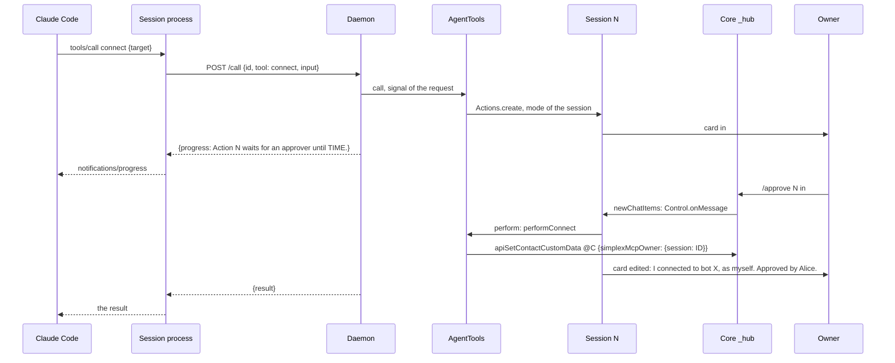

Notes:

- The approver check of the session group counts only invited members whose member in the Main group is an owner ([hub.ts:282-285](../src/hub.ts#L282-L285)).
- Without an approver in `#G`, the action is refused with the text of [API 4.4](api.md#44-tool-results-in-the-plugin).
- The connected chat gets the session's ID as its owner ([tools.ts:574-578](../src/tools.ts#L574-L578), [:819](../src/tools.ts#L819)).

Source: [daemon.ts:310-329](../src/daemon.ts#L310-L329), [hub.ts:73-103](../src/hub.ts#L73-L103), [tools.ts:716-739](../src/tools.ts#L716-L739).

---

## 20. A prompt from the session group

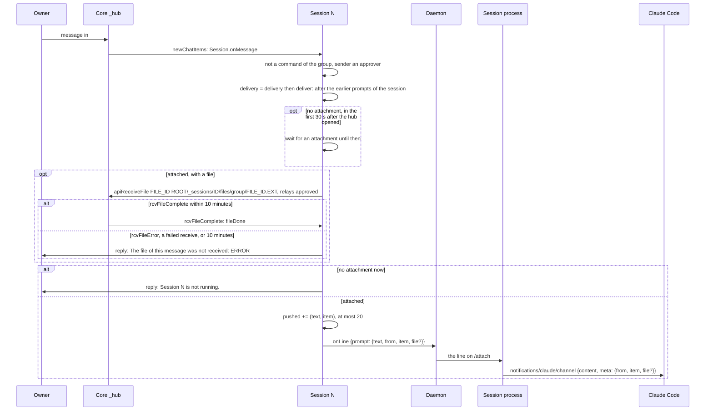

Notes:

- Messages of members who are not approvers, and one-line `/` commands with a keyword of the group's commands, are not prompts; an approver's other one-line `/` text, such as `/model sonnet`, is a prompt ([hub.ts:157](../src/hub.ts#L157), [control.ts:19](../src/control.ts#L19), [:204](../src/control.ts#L204), [:609-612](../src/control.ts#L609-L612)).
- Prompts reach the session in arrival order: a prompt waits for the file of an earlier prompt ([hub.ts:158](../src/hub.ts#L158)).
- After a daemon start, a prompt that arrives before its session attaches again waits up to 30 s from the hub's open, so a prompt sent while the daemon was stopped reaches the session ([hub.ts:225-227](../src/hub.ts#L225-L227), [:344](../src/hub.ts#L344)).
- A session started without the channel flag gets the notification and drops it.

Source: [hub.ts:153-159](../src/hub.ts#L153-L159), [:225-249](../src/hub.ts#L225-L249), [daemon.ts:298](../src/daemon.ts#L298), [session.ts:52-55](../src/session.ts#L52-L55), [:191-195](../src/session.ts#L191-L195).

---

## 21. A terminal prompt and the answer

```mermaid
sequenceDiagram
  participant P as Person
  participant CC as Claude Code
  participant HK as Turn hook
  participant D as Daemon
  participant N as Session N
  participant U as User
  participant C as Core _hub
  participant O as Owner
  P->>CC: prompt typed in the terminal
  CC->>HK: UserPromptSubmit {session_id, prompt}, in the background
  HK->>D: ensureDaemon, POST /turn {id, pid, at, prompt}
  D->>N: turn
  N->>N: end pending permissions created before at
  N->>N: no pushed prompt matched: turns += (at, null)
  N->>U: post(N, parts), unless a "/" command
  U->>O: the prompt in #G, from User
  CC->>CC: turn ends
  CC->>HK: Stop {session_id, last_assistant_message, effort}
  HK->>D: ensureDaemon, POST /turn {id, pid, at, answer, effort}
  D->>N: turn
  N->>N: end pending permissions created before at
  N->>N: quote = the newest turn record before at; it and the older ones leave turns
  N->>N: a changed effort: description, session.json
  N->>C: apiSendMessages #G parts, the first quoting the quote when it came from the group
  opt the core refuses the quote
    N->>C: apiSendMessages #G parts without the quote
  end
  C->>O: the answer, from Claude
  N->>C: apiUpdateGroupProfile #G shortDescr MODEL · effort LEVEL, when it changed
```

Notes:

- `at` is `performance.timeOrigin` of the hook process. An answer quotes the newest prompt record whose hook started before its own, also when the request of the next prompt arrives first, or while the answer's request waits for the short description ([hook.ts:58](../src/hook.ts#L58), [hub.ts:179-185](../src/hub.ts#L179-L185), [:251-260](../src/hub.ts#L251-L260)).
- A prompt from the group is not posted again: the pushed prompts in `<channel source="plugin:simplex:simplex" ... item="I" ...>` tags of the prompt with their item, or equal to the raw prompt and pushed in the last 60 s, leave the pushed prompts, and the oldest of them is the item of the turn record. Without a turn record before the answer, the answer quotes the oldest pushed prompt not quoted yet and marks it; it stays pushed, so that a prompt request handled after the Stop request still matches it and `User` does not post it ([hub.ts:24-28](../src/hub.ts#L24-L28), [:183-185](../src/hub.ts#L183-L185), [:253-257](../src/hub.ts#L253-L257), [:276-280](../src/hub.ts#L276-L280)).
- An empty answer takes its turn record too, without a post ([hub.ts:181](../src/hub.ts#L181), [:193](../src/hub.ts#L193)).
- A prompt request whose hook started before an answer already handled records no turn, so that a later answer does not quote its prompt ([hub.ts:182](../src/hub.ts#L182), [:184](../src/hub.ts#L184)).
- A blank prompt, as Claude Code sends for a prompt with images only, a prompt made only of this plugin's channel tags, as after a daemon restart lost the pushed prompts, and a prompt that is a one-line `/` command, such as `/simplex:link`, are not posted ([hub.ts:192](../src/hub.ts#L192)).
- An answer whose quote the core refuses with `invalidQuote` or `chatItemNotFound`, as for a deleted prompt, is posted without the quote; so are the replies `Session N is not running.` and `The file of this message was not received: ERROR` ([hub.ts:268-274](../src/hub.ts#L268-L274), [:516-519](../src/hub.ts#L516-L519)).
- The hook cuts a prompt or an answer over 250,000 characters there, ending with `…`, so that the request fits the socket's 1 MiB ([hook.ts:15](../src/hook.ts#L15), [:78-80](../src/hook.ts#L78-L80)).
- A card of a tool use that started after the hook is kept: the hook's start time `at` is earlier than its creation ([hook.ts:58](../src/hook.ts#L58), [hub.ts:200-204](../src/hub.ts#L200-L204)).
- PostModelSwitch sends `{id, model}`; only the short description changes ([hook.ts:61](../src/hook.ts#L61), [hub.ts:186-197](../src/hub.ts#L186-L197)).
- A Stop request with a changed effort posts the answer before it updates the short description, so that a prompt request handled meanwhile posts after the answer; the description is updated also when a post fails ([hub.ts:191-197](../src/hub.ts#L191-L197)).
- A turn hook starts the daemon when none runs, repeats a turn refused with 409 up to 15 times 1 s apart, past the 10 s a held title waits, prints `{}`, and logs errors on its stderr ([hook.ts:58-76](../src/hook.ts#L58-L76)).

Source: [hooks.json:5-7](../hooks/hooks.json#L5-L7), [hub.ts:179-198](../src/hub.ts#L179-L198), [:251-274](../src/hub.ts#L251-L274), [:499-519](../src/hub.ts#L499-L519), [user.ts:29-32](../src/user.ts#L29-L32).

---

## 22. A tool use approved in the session group

```mermaid
sequenceDiagram
  participant CC as Claude Code
  participant S as Session process
  participant D as Daemon
  participant N as Session N
  participant O as Owner
  CC->>S: notifications/claude/channel/permission_request {request_id, tool_name, description, input_preview}
  CC->>CC: the terminal dialog stays open
  S->>D: POST /permission {id, requestId, toolName, description, inputPreview}
  D->>N: permission
  N->>O: card in #G: I want to use `Bash`: `DESCRIPTION`, preview, /'approve N' or /'reject N'
  O->>N: /approve N
  N->>N: performing
  N->>D: onLine {permission: {requestId, behavior: allow}}
  D->>S: the line on /attach
  S->>CC: notifications/claude/channel/permission {request_id, behavior: allow}
  N->>N: done, removed
  N->>O: card edited: ... Approved by Alice.
```

Notes:

- `/reject N` pushes `deny`; the card ends with `Rejected by NAME.` ([hub.ts:171-172](../src/hub.ts#L171-L172)).
- The first answer applies, in the terminal or in the group. A card still pending at a prompt or an answer whose hook started after the card, or when the last attachment ends, ends with `Ended.` ([hub.ts:180](../src/hub.ts#L180), [:200-204](../src/hub.ts#L200-L204), [daemon.ts:305](../src/daemon.ts#L305), [control.ts:630-631](../src/control.ts#L630-L631)).
- The input preview is cut to fit the card ([control.ts:136](../src/control.ts#L136), [:713-727](../src/control.ts#L713-L727)).
- The card is posted in mode `requests` also for a session in mode `host` ([hub.ts:169](../src/hub.ts#L169)).

Source: [session.ts:57-60](../src/session.ts#L57-L60), [:110-113](../src/session.ts#L110-L113), [daemon.ts:143-147](../src/daemon.ts#L143-L147), [hub.ts:168-176](../src/hub.ts#L168-L176), [control.ts:638-641](../src/control.ts#L638-L641).

---

## 23. Mode `host` for a session

```mermaid
sequenceDiagram
  participant S as Session process
  participant D as Daemon
  participant N as Session N
  participant O as Owner
  S->>D: POST /session {config: {approve: host}}
  D->>N: requestMode(host): requested = host
  alt the group has no approver
    O->>N: joins #G: membership event, Control.onEvent, askMode
  end
  N->>O: card in #G: I want to run in mode host ... /'approve N' or /'reject N'
  O->>N: /approve N
  N->>N: perform: setMode(host), session.json mode host
  N->>O: card edited: I run in mode host ... Approved by Alice.
  S->>D: POST /session {config: {approve: requests}}
  D->>N: requestMode(requests): a pending mode card ends with Ended.; at once, session.json mode requests
```

Notes:

- One `mode` card is pending at a time; a rejected or expired card forgets the request until the next `/session` ([hub.ts:140-151](../src/hub.ts#L140-L151)).
- A rejected card sets `hostDeclined` in `session.json`: later `/session` requests of `host` post no card, also after a daemon restart, until a `/session` with `requests` clears it ([hub.ts:74-78](../src/hub.ts#L74-L78), [:136](../src/hub.ts#L136), [:141](../src/hub.ts#L141), [:145](../src/hub.ts#L145), [:292-295](../src/hub.ts#L292-L295)).
- A pending `mode` card does not keep the session open ([hub.ts:119-121](../src/hub.ts#L119-L121)).
- The session process marks the action tools for Claude Code's confirmation from the option at its own start, before the owner decides ([session.ts:56](../src/session.ts#L56)).

Source: [hub.ts:132-151](../src/hub.ts#L132-L151), [:287-301](../src/hub.ts#L287-L301), [:490](../src/hub.ts#L490), [tools.ts:556-557](../src/tools.ts#L556-L557).

---

## 24. `/give`

```mermaid
sequenceDiagram
  participant O as Owner
  participant K as Control of session 1
  participant T as AgentTools of session 1
  participant C as Core _hub
  O->>K: /give @4 2 in the group of session 1
  K->>T: agentChat @4: a chat of session 1
  K->>K: session 2 has an ID
  K->>T: giveChat @4 ID2
  T->>C: apiSetContactCustomData @4 {simplexMcpOwner: {session: ID2}}
  K->>K: pending actions of @4 with a card rejected by Alice
  K->>O: Gave bot X (@4) to session 2.
```

Source: [control.ts:340-352](../src/control.ts#L340-L352), [tools.ts:561-564](../src/tools.ts#L561-L564), [hub.ts:394-396](../src/hub.ts#L394-L396).

---

## 25. `reset-owners`

```mermaid
sequenceDiagram
  participant P as Person
  participant CC as Claude Code
  participant D as Daemon
  participant M as MainGroup
  participant N as Sessions
  participant O as Owner
  P->>CC: /simplex:reset-owners
  CC->>D: node dist/cli.js reset-owners: POST /reset-owners
  alt owners exist
    D->>M: askReset
    M->>O: A terminal asks to replace the owners ... /'approve reset' or /'reject reset'
    D-->>CC: An owner approves the reset in "SimpleX MCP". Then run npx -y @simplex-chat/mcp@VERSION link ...
    O->>M: /approve reset
    M->>O: card edited: ... Approved by Alice.
    M->>M: the group deleted for all members, a new Main group with a link
    M->>N: removeOwners: apiRemoveMembers of the invited members of each session group
    P->>D: npx -y @simplex-chat/mcp@VERSION link in a terminal
    D-->>P: Join "SimpleX MCP" in the SimpleX app. The link works once:, QR code, link
  else no owners, from Claude Code
    CC-->>P: Run npx -y @simplex-chat/mcp@VERSION reset-owners in a terminal.
  end
```

Notes:

- VERSION is the plugin's version, so that the command runs the daemon's version ([owner.ts:7-8](../src/owner.ts#L7-L8)).

- Without owners, `reset-owners` in a terminal replaces the group at once and prints the new link with a QR code ([owner.ts:26-33](../src/owner.ts#L26-L33), [hub.ts:368-372](../src/hub.ts#L368-L372)).
- One reset card is pending at a time; `/reject reset` leaves the group ([main-group.ts:101-105](../src/main-group.ts#L101-L105), [:128-138](../src/main-group.ts#L128-L138)).

Source: [main-group.ts:107-119](../src/main-group.ts#L107-L119), [hub.ts:219-223](../src/hub.ts#L219-L223), [:422-424](../src/hub.ts#L422-L424).

---

## 26. Idle close, idle stop and a newer version

```mermaid
sequenceDiagram
  participant S as Session process
  participant D as Daemon
  participant N as Session N
  participant S2 as Session process of a newer plugin
  S->>D: the /attach stream ends with Claude Code
  D->>N: onLine = undefined, endPermissions
  D->>D: idle timer, 10 min
  D->>N: no call, no action in memory: entry closed, open false
  D->>D: no entry: stop timer, 10 min
  D->>D: stop: actions cancelled, cards edited, cores closed, lock released
  S2->>D: GET /status: version lower than its own
  S2->>D: POST /stop
  S2->>D: spawn a daemon of its version
```

Notes:

- A call or an attachment cancels the stop timer by creating an entry ([daemon.ts:342-352](../src/daemon.ts#L342-L352)).
- A daemon of a higher version is kept; another protocol version makes clients fail with `Restart Claude Code to update the SimpleX plugin.` ([client.ts:35-47](../src/client.ts#L35-L47)).

Source: [daemon.ts:176-199](../src/daemon.ts#L176-L199), [:299-307](../src/daemon.ts#L299-L307), [:389-407](../src/daemon.ts#L389-L407), [hub.ts:430-440](../src/hub.ts#L430-L440).

---

## 27. `/clear`, `--continue` and `/resume` in one session

Claude Code keeps the session server's `CLAUDE_CODE_SESSION_ID` from its spawn, gives the hooks a new `session_id` after `/clear` and `/resume`, and with `--continue` may spawn the server with a startup ID other than the resumed one. The hooks send `CLAUDE_PID`, and the session server its parent process, the same Claude Code process.

```mermaid
sequenceDiagram
  participant CC as Claude Code, process P
  participant S as Session process
  participant HK as Hooks
  participant D as Daemon
  participant N as Session of A
  Note over CC,N: /clear in session A, the server attached as A
  CC->>HK: SessionStart {session_id: B, source: clear}, CLAUDE_PID P
  HK->>D: POST /title {id: B, pid: P}
  D->>D: B unknown; entry A has pid P and is attached: alias B to A, in A's session.json
  D->>N: rename, model
  HK->>D: POST /turn {id: B, pid: P, answer}
  D->>N: turn, posted in A's group
  Note over CC,N: claude --continue: the server spawned with startup ID X, the resumed session R
  CC->>S: CLAUDE_CODE_SESSION_ID X
  S->>D: POST /session {id: X, pid: P}
  D->>D: X unknown, no folder: wait up to 10 s for a /title of P
  CC->>HK: SessionStart {session_id: R, source: resume}, CLAUDE_PID P
  HK->>D: POST /title {id: R, pid: P}
  D->>D: the session of R opened, the title of P recorded
  D->>D: the wait of X ends: alias X to R
  D-->>S: {number of R}
  S->>D: POST /attach {id: X}: the entry of R
  Note over CC,N: /resume R2 in session A, R2 with its own session.json
  CC->>HK: SessionStart {session_id: R2, source: resume}, CLAUDE_PID P
  HK->>D: POST /title {id: R2, pid: P}
  D->>D: R2 has session.json; entry A has pid P and is attached: A, without an alias
  HK->>D: POST /turn {id: R2, pid: P, answer}
  D->>N: turn, posted in A's group
  Note over CC,N: later, claude --resume R2 in process Q
  S->>D: POST /session {id: R2, pid: Q}
  D-->>S: {number of R2}: its own group and chats
  Note over CC,N: the title of a new ID F before the server of P registers, as with --fork-session or /clear during a re-attach
  HK->>D: POST /title {id: F, pid: P}
  D->>D: F unknown, no session of P: title of P = F; the title is held
  D-->>HK: the reply
  S->>D: POST /session {id: A, pid: P}
  D->>D: A has session.json: A; the held title resumes: entry A has pid P: alias F to A
  D->>N: rename, model
```

Notes:

- A session server's process is followed while it is attached and for 10 s after it detached, and a title's process for 10 s; a new Claude Code process with a reused PID later starts its own session ([daemon.ts:267-272](../src/daemon.ts#L267-L272)).
- Only an ID without `session.json` gets an alias. A hook of an ID with `session.json` goes to the session attached from its process, in memory, else to its own session; a session server with such an ID registers it ([daemon.ts:252-261](../src/daemon.ts#L252-L261)).
- A title of a new ID from a process without a known session is answered at once and applied after the session server of that process registers, or after 10 s without one; then it opens a session of its own. So `/clear` during the re-attach of a session server after a daemon start, and `--fork-session` in either order, join the new ID to the session the server registers ([daemon.ts:201-246](../src/daemon.ts#L201-L246), [:451-461](../src/daemon.ts#L451-L461)).
- A session created for an ID records the aliases that already point to it in its first `session.json` ([daemon.ts:382-383](../src/daemon.ts#L382-L383)).
- Turn hooks of an ID whose title is held get 409 and repeat up to 15 times 1 s apart, past the 10 s ([hook.ts:13](../src/hook.ts#L13)).
- A second title of a process whose title is held is held too, so that two `/clear` within the wait join both new IDs to the session the server registers. A daemon stop saves the held titles in `ROOT/titles.json`; the next start takes them as new titles ([daemon.ts:106](../src/daemon.ts#L106), [:179](../src/daemon.ts#L179), [:219-229](../src/daemon.ts#L219-L229)).
- Aliases are read from `session.json` at the daemon's start, so later hooks and calls with B or X reach the same session ([daemon.ts:86-90](../src/daemon.ts#L86-L90), [:274-279](../src/daemon.ts#L274-L279)).
- Without `CLAUDE_PID`, before Claude Code 2.1.214, a new session server waits the 10 s and then registers its own ID.

Source: [hook.ts:49](../src/hook.ts#L49), [:61](../src/hook.ts#L61), [:82-85](../src/hook.ts#L82-L85), [session.ts:52](../src/session.ts#L52), [daemon.ts:201-279](../src/daemon.ts#L201-L279).
