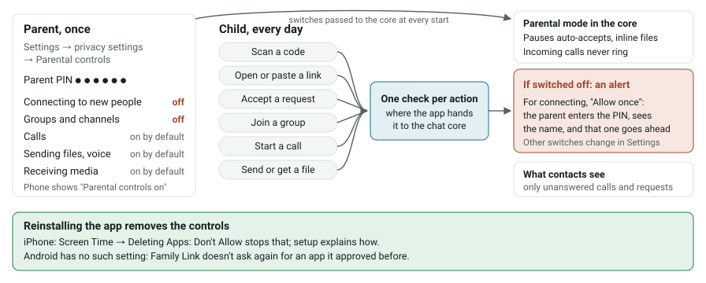
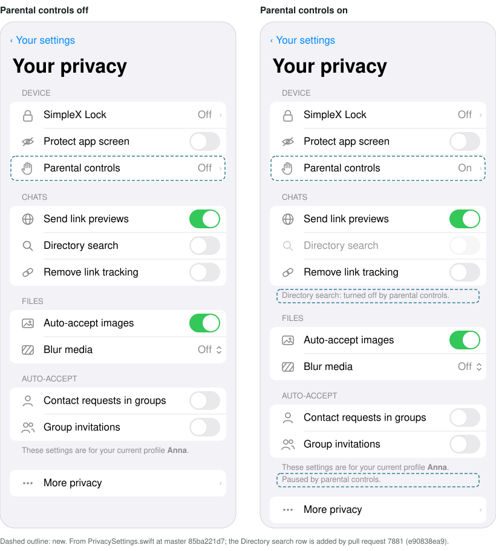
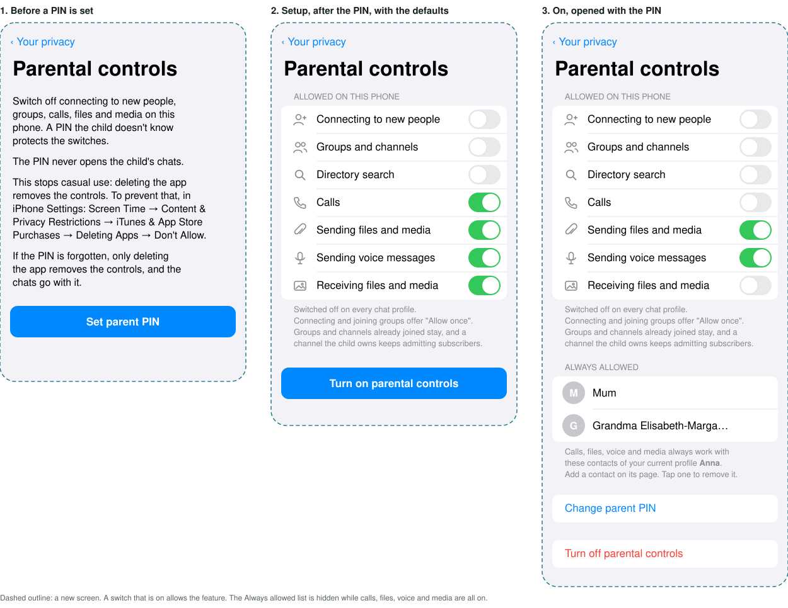
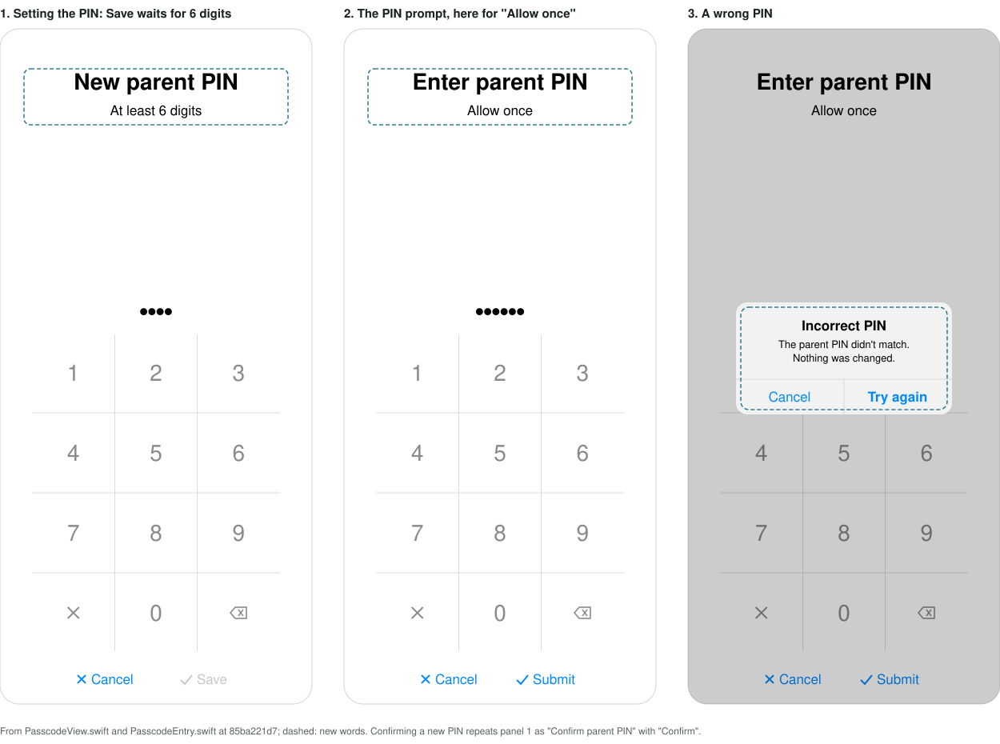
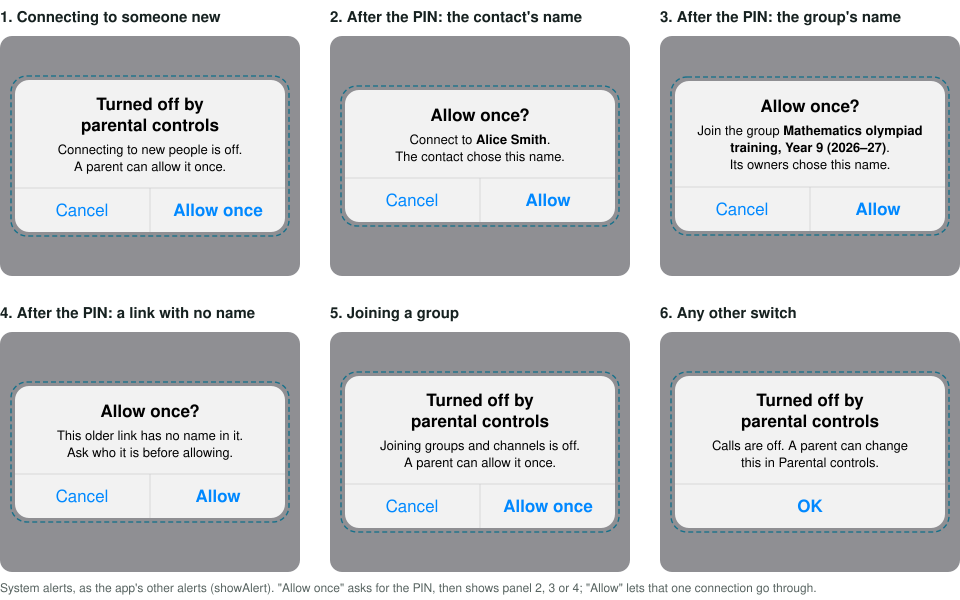
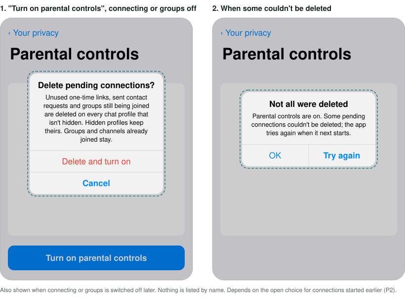
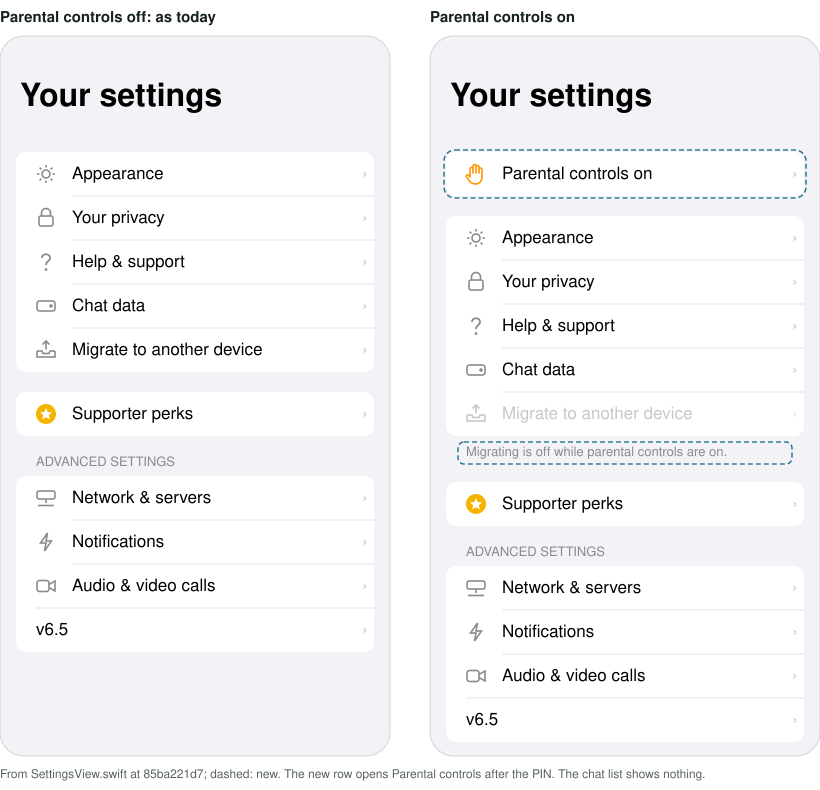
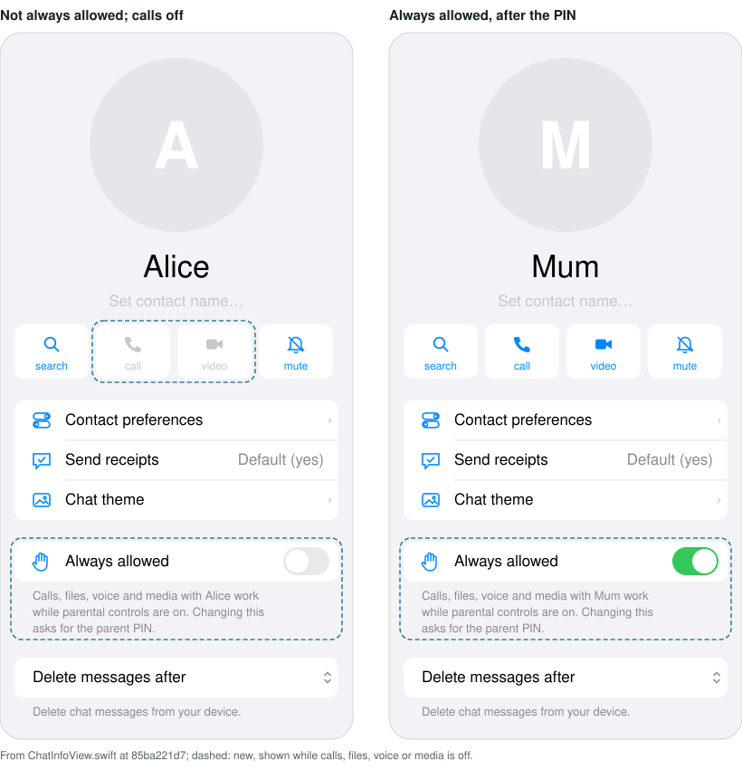
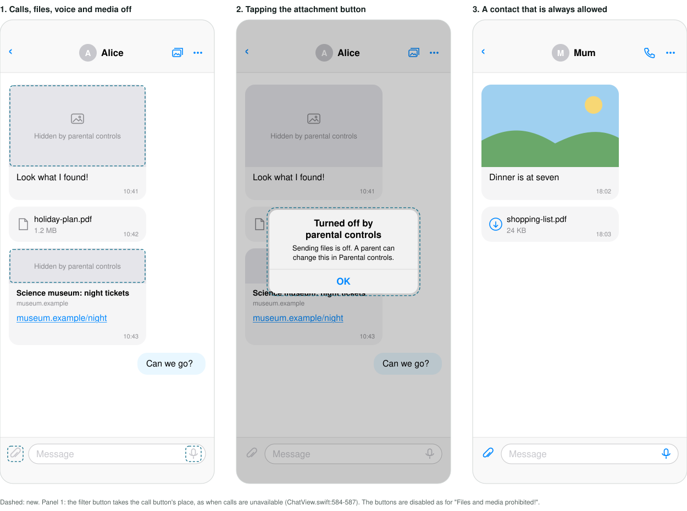

# Parental controls: design

Platforms: iOS first, then the same screens in Kotlin for Android. Not on desktop *(provisional, P10)*. No protocol, message or database format changes; one new local API command and one new error in the chat core (section 7.1).

Answers marked *(provisional, Pn)* wait for a decision (section 13); Pn names the choice on the decision page. Code references are to master at 85ba221d7, except directory search (section 7.8), which is cited at e90838ea9, the head commit of pull request #7881. Kotlin paths that start with `views/`, `model/` or `platform/` are under `apps/multiplatform/common/src/commonMain/kotlin/chat/simplex/common/`.

## 1. What it does

A parent setting up a phone for a child opens the privacy settings ("Your privacy" on both platforms) → Parental controls, sets a parent PIN and chooses what to switch off. By default that is connecting to new people, creating or joining groups and channels, and searching SimpleX Directory; calls, sending files, voice messages, and receiving images, videos and files can be switched off too, while contacts the parent marks as always allowed, such as the parents, keep them. Then the parent hands the phone over.

The child keeps chatting with everyone already in their chats. Settings shows "Parental controls on". When the child tries to connect to someone new, by scanning a code, opening or pasting a link, or accepting a request, or to join a group or channel, the app says this is turned off by parental controls and offers "Allow once": the parent enters the PIN, sees the name of the contact or group, and that one connection goes through. Everything else that is off stays off until the parent changes it on the PIN-protected screen.

Nothing in this feature reads, keeps, shows or reports the child's messages, contacts or groups, to the parent or to anyone, apart from the contacts the parent marks as always allowed, which the parental screen lists by name.

This answers issue #4482's second request (a parental PIN and approval before adding contacts). Its first request, forwarding the child's messages to a parent, is monitoring and is not built.

## 2. Principles

1. **Switch off, never watch.** A control removes a capability. No control keeps history, lists contacts or groups to the parent beyond the always-allowed contacts the parent chose, or sends anything off the device.
2. **The PIN never opens a path to the chats.** It opens only the parental screen, allow-once and a contact's "Always allowed" (section 7.9). Anything that would hand over the chats (database export and migration, the chat console, "Use from desktop") is off while controls are on, even for the parent; to use it, the parent turns the controls off, which removes the indicator from Settings *(provisional, P5)*.
3. **Visible on the phone, invisible to contacts.** Settings shows that controls are on, and an action the controls refuse says "Turned off by parental controls". No control sends a message or changes the profile, apart from leaving a group still being joined when groups are switched off (section 7.3).
4. **Check every action where it goes to the core.** Each action the child starts is checked in the app's function that sends it to the chat core, so every button that reaches it is covered, including buttons added later. What the core does on its own (auto-accepting, ringing for a call, receiving inline files) is stopped by a parental mode in the core. Buttons are also hidden or disabled, for a clean screen; that is presentation, not enforcement.
5. **Fail closed.** A missing or unreadable PIN never opens the gate; an action the check can't classify counts as restricted.

## 3. Limits

The child holds the phone, so a determined, technically able child gets around the controls. The setup screen says in one sentence that the controls stop casual use and state the parent's intent; they are not a lock.

- **Reinstalling the app or clearing its data removes the controls.** On iPhone, Screen Time can stop the app being deleted (Settings → Screen Time → Content & Privacy Restrictions → iTunes & App Store Purchases → Deleting Apps, https://support.apple.com/en-gb/126807); the setup screen says how. On Android, Family Link approves new downloads but not an app it approved before (https://support.google.com/googleplay/answer/7103028: previously approved apps "will not require additional approval to download"), so reinstalling stays open there.
- **A factory reset, "Erase All Content and Settings", watching the parent type the PIN, or another device.**
- **A forgotten PIN.** Only deleting the app then removes the controls, and the chats go with it, since export is off while the controls are on (section 8). The setup screen says so; there is no recovery path, since any would also serve the child (section 13).
- **One-off connections the child started on a hidden profile** before the controls (an unused one-time link, a request sent, a group being joined) can still complete: the app can't open a hidden profile without its password (section 7.3). So can, until #7922, connections kept after a failed link join, which the chat list leaves out (section 12). Addresses and links of groups the child hosts, on hidden profiles too, are covered by the parental mode.
- **A channel the child owns keeps admitting subscribers through its relays**, since their joins never reach the child's core (`src/Simplex/Chat/Library/Subscriber.hs:1637-1638,1695-1717`), and a subscriber can write to the channel's admins (`src/Simplex/Chat/Library/Commands.hs:4964-4968`; that this reaches the child in the app is not traced). The parental screen says so when groups is switched off.
- **Groups and channels the child is already in stay, and can gain new members** through other members' links.

## 4. Who could misuse it

- **The child getting around it.** Covered: every connecting path the child can start (section 7.2); what the core would do on its own, on every profile, hidden ones included, and in an imported database (section 7.1); connections started before the controls, on profiles the app can open, apart from those kept after a failed link join until #7922 (section 7.3); the chat console, database import and migration, including the "Migrate" offered by onboarding after the database is deleted, and "Use from desktop" (all off, section 8). Not covered: section 3.
- **The parent sliding into watching.** The PIN opens only the parental screen, allow-once and "Always allowed" (principle 2), so it gives no access to the chats beyond holding the unlocked app, which shows them anyway. App lock, self-destruct and profiles, including hidden ones, stay the child's *(provisional, P5)*, so the child decides who can open the app. Allow-once shows the parent only the name of the one contact or group being approved, which the child is asking for. Always-allowed contacts are added one at a time on that contact's page (section 7.9), so the parent sees only the contacts the child shows them. The clean-up of section 7.3 lists nothing by name.
- **One adult imposing it on another.** Someone who keeps the PIN can stop an adult reaching anyone new. The chat list shows nothing, so the adult learns of the controls from the "Parental controls on" row at the top of Settings, from the alert "Turned off by parental controls" on every action the checks refuse, from the disabled attachment and voice buttons, which say the same when tapped, from the placeholders that replace pictures, and from the "Audio/video calls: received, prohibited" item that each turned-away call leaves in the chat (`apps/ios/SimpleXChat/ChatTypes.swift:4778`). Hidden buttons give no sign, so an adult who doesn't open Settings and doesn't try a refused action may not notice the controls for some time. The always-allowed list also lets that person switch off calls, files, voice and media with everyone but themselves; the adult then sees "Turned off by parental controls" on the call and attachment buttons of every other contact. Safeguards: deleting the app or its data always removes the controls, because the app does not make them survive a reinstall; nothing is controlled remotely; the PIN opens nothing of the chats.
- **Strangers contacting the child.** They must not learn the phone is restricted, since that would mark a child. Section 9 lists what a contact can see; none of it is specific to these controls.

## 5. Stored state

- **Switches:** the set of capabilities switched off, from `enum ParentalCapability { connect, groups, directorySearch, calls, sendFiles, voice, receiveMedia }`; an empty set means controls are off. iOS: a group default in `apps/ios/SimpleXChat/AppGroup.swift` (alongside `GROUP_DEFAULT_ALLOW_SHARE_EXTENSION`, line 27), so the notification and share extensions read it. Kotlin: an app preference in `AppPreferences` (`model/SimpleXAPI.kt`).
- **Parent PIN:** stored like the app passcode. iOS: a new keychain item `kcParentPassword` in `apps/ios/SimpleXChat/KeyChain.swift` (same access policy, `kSecAttrAccessibleAfterFirstUnlockThisDeviceOnly`, line 12). Kotlin: a new `KeyStoreItem` in `views/helpers/DatabaseUtils.kt` (lines 17-19 hold the existing three).
- **Always-allowed contacts:** the connection IDs (`agentConnId` of the contact's `activeConn`; iOS `apps/ios/SimpleXChat/ChatTypes.swift:2675`, core `src/Simplex/Chat/Types.hs:1945`) of the contacts the parent marked, stored beside the switches in the same group default and app preference (section 7.9). A connection ID is random, so an entry left from a deleted database never matches a contact of a new one, and an entry that matches no contact allows nothing (principle 5). Turning the controls off clears it.
- **Clean-up snapshot** (section 7.3): the chats a clean-up still has to delete, by profile, beside the switches. Each switch that goes off adds its own; a snapshot is removed when its clean-up ends, when its switch goes back on, when the controls are turned off, and when the database is deleted, inside the function every deletion path calls (iOS `deleteAppDatabaseAndFiles`, `apps/ios/SimpleXChat/FileUtils.swift:109`; Kotlin `deleteChatDatabaseFilesAndState`, `views/database/DatabaseView.kt:556`), since it names chats by their IDs, which a new database reuses.
- **Wrong PINs** (section 6): the count of wrong PINs in a row and the remaining wait, beside the switches; cleared by the right PIN and when the controls are turned off.
- **Kept out of the settings archive.** Importing a database or migrating to a device also imports the app settings packed with it (iOS `apps/ios/Shared/Model/SimpleXAPI.swift:2309-2317`, `apps/ios/Shared/Views/UserSettings/AppSettings.swift:14`; Kotlin `AppSettings`, `model/SimpleXAPI.kt:8711`). The switches, the always-allowed contacts, the clean-up snapshots, the wrong-PIN state and the PIN are not part of `AppSettings`.
- **Outside the chat database.** Deleting the database and the self-destruct passcode leave them in place (iOS `apps/ios/Shared/Views/LocalAuth/LocalAuthView.swift:65-79`; Kotlin `views/localauth/LocalAuthView.kt:57-75` and `views/database/DatabaseView.kt:556-578` remove only database files and their own preferences). Deleting the app or its data removes them.
- **Reinstall on iOS:** iOS can keep keychain items after the app is deleted, while the app-group container that holds the switches goes with the app. So on launch, if `kcParentPassword` exists and no switches are stored, the app removes it; a reinstalled app never asks for a PIN nobody remembers. The existing clean-up (`apps/ios/Shared/AppDelegate.swift:111-122`) stays as it is: its test, "no app-lock flag and no database", also passes after an in-app "Delete database", so adding the PIN to it would delete the PIN while the switches stay, leaving the controls stuck on. (That the app-group container goes on uninstall is iOS behaviour to confirm once on a device.)
- **The parental mode** (section 7.1) is held in memory and sent by the app at every chat start; nothing is stored in the chat database.

## 6. The parent gate and the parental screen

**Setting the PIN** reuses `SetAppPasscodeView` with `passcodeKeychain: kcParentPassword` (iOS `apps/ios/Shared/Views/LocalAuth/SetAppPasscodeView.swift:13-18`; Kotlin `views/localauth/SetAppPasscodeView.kt:14-15`). The PIN must not be compared with the app passcode or the self-destruct passcode, in either direction: rejecting a matching PIN would tell the parent the child's passcode by trial, and the reverse. The view's `prohibitedPasscodeKeychain` defaults to the self-destruct item (line 15 on both platforms), so it becomes optional and the parental use passes none. Two more parameters get today's values as defaults: the confirming step's title, "Confirm Passcode" today (iOS `SetAppPasscodeView.swift:30`, Kotlin `SetAppPasscodeView.kt:40`), which the parental use sets to "Confirm parent PIN"; and the shortest code accepted, 4 digits today (iOS `PasscodeView.swift:80`, Kotlin `views/localauth/PasscodeView.kt:81,123`), which is 6 for the parent PIN, so guessing it means trying up to a million codes rather than ten thousand.

**Asking for the PIN** reuses the PIN pad: a new `authenticateParent(reason:completed:)` sets `ChatModel.laRequest` with the parent PIN as `password` and `selfDestruct: false` (iOS `LocalAuthRequest`, `apps/ios/Shared/Views/Helpers/LocalAuthenticationUtils.swift:29-35`, checked in `LocalAuthView.swift:31`; Kotlin `views/localauth/LocalAuthView.kt:26-43`). It never uses system authentication, which the child can pass. It does not reuse `authenticate` or `authorize`: those follow the app-lock mode and treat "unavailable" as success (`LocalAuthenticationUtils.swift:19-26,39-58`). No PIN stored means the gate stays shut. On iOS the parent prompt doesn't use `laRequest`, which is drawn only by the root view and the Settings sheet (`apps/ios/Shared/ContentView.swift:94`, `apps/ios/Shared/Views/ChatList/ChatListView.swift:115-118`), under any other sheet, such as a contact's page or New chat, and which the app lock also uses. `authenticateParent` presents `LocalAuthView`, with its own request, full screen from the top view controller, as `showAppSheet` finds it (`apps/ios/Shared/Views/Helpers/AppSheet.swift:32-46`), and dismisses it in the request's completion; it can't be swiped away, and leaving it in any other way counts as "Cancel". Kotlin already shows the prompt above everything (`views/helpers/LocalAuthentication.kt:49`). After five wrong PINs in a row, the prompt waits a minute before the next try, doubling up to an hour. The remaining wait is stored with the switches and counted down with the device's monotonic clock (`ProcessInfo.processInfo.systemUptime`, `SystemClock.elapsedRealtime()`) while the app runs, so neither changing the clock nor restarting the app shortens it.

**The parental screen** is a new row in the privacy settings, "Your privacy" on both platforms (iOS `apps/ios/Shared/Views/UserSettings/PrivacySettings.swift:57-76`, the "Device" section; Android `PrivacyDeviceSection`, `apps/multiplatform/common/src/androidMain/kotlin/chat/simplex/common/views/usersettings/PrivacySettings.android.kt:18-31`, titled at `views/usersettings/PrivacySettings.kt:61`). Opening it asks for the PIN once controls are on. In order (section 14.2 has its states and words):
1. What this does and doesn't do (section 3), and, on iOS, how to stop app deletion in Screen Time.
2. Set or change the parent PIN.
3. The switches, with the defaults of section 1, and the always-allowed contacts (section 7.9). During setup, "Turn on parental controls" saves the switches, and only while the PIN is stored. Leaving the screen without turning the controls on removes the new PIN, and a PIN left by an interrupted setup is removed at the next start by the reinstall rule of section 5, so the switches are never stored without a PIN.
4. When connecting or groups is switched off: one confirmation for the clean-up of section 7.3, and a note that groups and channels the child is already in stay.
5. "Turn off parental controls": PIN, then the switches, the always-allowed contacts, the clean-up snapshots, the wrong-PIN state and the PIN are removed, and the parental mode ends, so addresses and group links work as before. Pending connections removed by the clean-up are not restored; the child starts new ones as needed.

**The indicator:** while any switch is off, a row "Parental controls on" at the top of the Settings screen, before its first section, opening the parental screen (iOS `apps/ios/Shared/Views/UserSettings/SettingsView.swift:322-323`; Kotlin `views/usersettings/SettingsView.kt:99-101`). The chat list shows nothing.

## 7. The controls

Each control lists where its check runs, on both platforms, and the screens where its buttons are hidden or disabled. A check that fails throws a new error, "Turned off by parental controls", which the existing error alerts show; for connecting and joining groups, the alert offers "Allow once" (sections 7.2, 7.4).

### 7.1 The parental mode: what the core does on its own

Some connections, calls and files happen in the chat core with no app call: auto-accepting on an address, a business address, member contacts and group invitations; ringing for an incoming call; receiving small inline files. The app can't reach them on profiles other than the active one: address settings and the profile act only on the active user (`withUserId` → `checkSameUser`, `src/Simplex/Chat/Library/Internal.hs:3451-3457`), and the auto-accept setters need a hidden profile's password (`src/Simplex/Chat/Library/Commands.hs:541-551`). And the calls preference doesn't reach incognito contacts (`src/Simplex/Chat/Types.hs:695-698`) or contacts with their own calls setting (`src/Simplex/Chat/Types/Preferences.hs:1078-1080`).

So the core gets a parental mode: a new local API command that sets which of `connect`, `groups`, `calls`, `receiveMedia` are off and the connection IDs of the always-allowed contacts (section 7.9), held in memory like `APISetEncryptLocalFiles` (`Commands.hs:659`, `chatWriteVar encryptLocalFiles`). Each auto-accept setting is read through one effective value, "the setting is on and its switch is not off", computed once and used at every read listed below. While the parental mode is on:

| Off | The core | Where |
|---|---|---|
| `connect` | does not auto-accept requests to an ordinary address; they wait as with auto-accept off, and the child can accept one with allow-once ("Accept" stays visible for that, section 7.2) | `src/Simplex/Chat/Library/Subscriber.hs:1529-1541` |
| `connect` | ignores requests to a business address before storing them: nothing stored, nothing sent, the requester stays pending; in the notification extension the push then shows nothing rather than the generic "new contact request". (A business address has no waiting state: the store creates the business chat inside `createOrUpdateContactRequest`, `Subscriber.hs:1503`, `src/Simplex/Chat/Store/ContactRequest.hs:196-199`, and the subscriber then accepts it, `Subscriber.hs:1542-1543`.) No allow-once, since there is no request to show | `Subscriber.hs:1503` |
| `connect` | does not auto-accept a group member's direct-contact request; the stored invitation records no started connection | `autoAcceptMemberContacts` at `Subscriber.hs:3946,3949,3968` |
| `groups` | does not auto-accept group invitations; they stay as pending invitations | `autoAcceptGroupInvitations` at `Subscriber.hs:2723,3907` |
| `groups` | ignores join requests to the links of groups the child hosts, on every profile, sending nothing (not the existing rejection, which sends `XGrpLinkReject`). Channels are joined through their relays and are not covered (section 3) | `Subscriber.hs:1633-1648` (`acceptGroupJoinRequestAsync`, 1646) |
| `groups` | treats a group invitation that arrives on a group-link connection the child made earlier as a pending invitation instead of joining | `Subscriber.hs:2721-2722` → the pending branch at 2728-2730 |
| `calls` | turns every incoming call, except from an always-allowed contact, into the existing local "feature rejected" item, whatever the preferences; it never rings | `Subscriber.hs:3051-3057,3078-3081` |
| `receiveMedia` | does not receive inline files on arrival, except in a direct chat with an always-allowed contact; a file sent inline that arrives while receiving is off can't be received later (`src/Simplex/Chat/Library/Internal.hs:826`) | `receiveInlineMode`, `Subscriber.hs:2545-2551`, called at 2040 (direct and group messages), 2511 (direct) and 2527 (group) |
| `receiveMedia` | does not receive, at start or activation, files the notification extension marked to receive earlier, except files of always-allowed contacts (`files.contact_id`, `src/Simplex/Chat/Store/SQLite/Migrations/chat_schema.sql:287`); the marks stay, so marks under two days old are received at the next start after the controls are off (`src/Simplex/Chat/Store/Files.hs:809-823`); older ones wait for a manual download | `startFilesToReceive`, `src/Simplex/Chat/Library/Commands.hs:265,347-361,617` |
| `receiveMedia` | refuses the commands that receive a file, or mark it to receive, except for files of always-allowed contacts, with a new `ChatErrorType` constructor for parental controls (Haskell, Swift `apps/ios/SimpleXChat/APITypes.swift:744`, Kotlin `model/SimpleXAPI.kt:7904`), which `receiveFiles` on both platforms shows as the alert of section 14.4 (iOS `apps/ios/Shared/Model/SimpleXAPI.swift:1628-1632`, Kotlin `model/SimpleXAPI.kt:2283-2293`; no alert when receiving automatically). These commands are how the main app, the notification extension (`apiReceiveFile`, `apiSetFileToReceive`, `apps/ios/SimpleX NSE/NotificationService.swift:1174,1182`) and Android's background service receive, so one check covers them all | `ReceiveFile`, `SetFileToReceive`: `src/Simplex/Chat/Controller.hs:658-659`, `Commands.hs:3554,3560` |

**How each process gets it.** The main app, the notification extension and the share extension each run their own core, and both extensions reuse theirs across pushes and shares, so each sends the command at these sites, and doesn't start or continue if sending fails (principle 5):
- iOS main app: in `initializeChat`, next to file encryption (`apps/ios/Shared/Model/SimpleXAPI.swift:2305`; every controller creation goes through it; `/_start` at 2376), and whenever the switches change.
- Notification extension: in `doStartChat` before `/_start` (`apps/ios/SimpleX NSE/NotificationService.swift:888-894`), and on every push after `startChat()` returns (line 425) and before it fetches the push's connections, because later pushes return early or only reactivate the core (849, 855-860, 917-925). It reads the switches and the always-allowed contacts from group defaults each time; if the resend fails, it skips the push and shows the generic notification.
- Share extension: in `initChat` on both branches, before `apiStartChat` and before `apiActivateChat` (`apps/ios/SimpleX SE/ShareModel.swift:179-201`; its file-encryption call at 198 runs after start, so it is not the pattern to copy).
- Android: in `initChatController`, next to file encryption (`platform/Core.kt:138`, before the chat starts at 166 or 180); the app and its background service share one process and one core.

It covers every profile, hidden ones included, the notification extension's core, and a database imported later. Nothing is sent to anyone and nothing is stored for the parental mode; the waiting records are the ones the setting-off paths already store. The address, group-link and preference settings are untouched, so turning the controls off brings them back as they were. Cost: one command, one variable, the checks above at about ten read sites, the per-push resend in the notification extension, and core tests for each.

### 7.2 Connecting to new people (`connect`)

Off: no new contact can be added from this phone, in either direction.

Checks (iOS `apps/ios/Shared/Model/SimpleXAPI.swift`; Kotlin `model/SimpleXAPI.kt`):

| Action | iOS | Kotlin |
|---|---|---|
| Plan a link: not refused, since a plan connects nothing (a full link reads only the local store, `src/Simplex/Chat/Library/Commands.hs:4504,4521-4523,4553-4555`; a short link or a name reads its link data or name record, as opening any link does today). The plan's kind picks the switch, and while that switch is off the alert replaces the preview in `planAndConnect`, which every link path passes (below): with "Allow once" when the plan has a name, and the no-name alert when it has none | `apiConnectPlan` 1043 | `apiConnectPlan` 1681 |
| Connect via a link | `apiConnect` 1058 | `apiConnect` 1691 |
| Connect a prepared contact (short links) | `apiConnectPreparedContact` 1231 | `apiConnectPreparedContact` 1864 |
| Connect a prepared business chat (it is a group, `src/Simplex/Chat/Library/Commands.hs:2200-2214`): counted as `connect`, not `groups` | `apiConnectPreparedGroup` 1238 | `apiConnectPreparedGroup` 1874 |
| Connect via a contact's address card | `apiConnectContactViaAddress` 1245 | `apiConnectContactViaAddress` 1884 |
| Create a one-time invitation | `apiAddContact` 1020 | `apiAddContact` 1651 |
| Create an address | `apiCreateUserAddress` 1463 | `apiCreateUserAddress` 2069 |
| Accept a contact request | `apiAcceptContactRequest` 1516 | `apiAcceptContactRequest` 2132 |
| Contact a group member directly | `apiCreateMemberContact` 2129, `apiSendMemberContactInvitation` 2135 | `apiCreateMemberContact` 2636, `apiSendMemberContactInvitation` 2645 |
| Accept a member's direct-contact invitation | `apiAcceptMemberContact` 2141 | `apiAcceptMemberContact` 2654 |

A link is checked against `connect` or `groups` by what its plan says it is; a link the app couldn't plan counts as both. Auto-accept settings can still be changed; while connecting is off the core ignores them (section 7.1).

Buttons hidden:
- iOS (`apps/ios/Shared/Views/`): the new-chat sheet's "Create 1-time link", "Scan / Paste link", paste field and "Connect to @name" rows (`NewChat/NewChatMenuButton.swift:96-129,355-406`); the chat-list search's paste and name rows (`ChatList/ChatListView.swift:751-918`); the connect cards after onboarding and the banner (`NewChat/OnboardingCards.swift:150-302`, `Onboarding/ConnectBannerCard.swift:33-58`); creating an address (`UserSettings/UserAddressView.swift:295-336`); the "Accept" action on contact-request notifications (`Model/NtfManager.swift:64-70`), where no PIN prompt can run; contact cards (`ChatList/ChatListNavLink.swift:97-119`, `Contacts/ContactListNavLink.swift:217-261`).
- Kotlin: the new-chat sheet's "1-time link", "Scan / paste link", paste field and name rows (`views/newchat/NewChatSheet.kt:57-62,188-197,322,413,539-554`); the chat-list banner, search paste and name rows (`views/chatlist/ChatListView.kt:384-419,868-874,1236-1262`); the connect cards (`views/newchat/OnboardingCards.kt:376-417`); creating an address (`views/usersettings/UserAddressView.kt:74-121,310`); the "Accept" action on contact-request notifications (`apps/multiplatform/android/src/main/java/chat/simplex/app/model/NtfManager.android.kt:130-141`); contact cards (`views/chatlist/ChatListNavLinkView.kt:824-899`, `views/contacts/ContactListNavView.kt:62-70`).
- Links in messages, in the app's own help and news rows, and opened from outside the app stay tappable, and so does "Accept" on contact requests in the chat list, the contacts list and the chat (iOS `ChatList/ChatListNavLink.swift:134-153,495-527`, `Contacts/ContactListNavLink.swift:78-106,281-314`, `Chat/ComposeMessage/ContextContactRequestActionsView.swift:21-35`; Kotlin `views/chatlist/ChatListNavLinkView.kt:132-135,279-283,527-557,698-728`, `views/chat/ComposeContextContactRequestActionsView.kt:69-96,136-165`, `views/contacts/ContactListNavView.kt:78-130`), and so do direct contact with a group member and the "Accept" and "Reject" of a member's direct-contact invitation (iOS `Chat/Group/GroupMemberInfoView.swift:364-377,420-430`, `Chat/ComposeMessage/ContextMemberContactActionsView.swift:30-40`; Kotlin `views/chat/group/GroupMemberInfoView.kt:518-522`, `views/chat/ComposeContextGroupDirectInvitationActionsView.kt:100,151-171`): they reach the check and get the "Allow once" alert ("Reject" connects nothing and isn't checked). Every link path on both platforms passes `planAndConnect` (iOS `apps/ios/Shared/Views/NewChat/NewChatView.swift:1319`; Kotlin `views/newchat/ConnectPlan.kt:24`) before any connecting call.

**Allow once.** The alert offers "Allow once". The parent enters the PIN and sees what is about to happen: the name from the link's plan, the name on the request, the member's name, or, for a prepared chat opened without a pass (after the app restarted, say), the name of its profile. A link without a name offers no allow-once: an older full contact, one-time or group link is planned without link data (`src/Simplex/Chat/Library/Commands.hs:4504,4747-4748`), so the parent would approve someone unnamed; the alert asks for a new link instead. Since every link is planned before the alert, the app knows whether the plan has a name before it offers "Allow once", for full and short links alike. The app then continues with a one-time pass held in memory and never stored, bound to that link, request or member:
- a short link connects in two steps, the plan and later the connect from the prepared chat's composer (iOS `apps/ios/Shared/Views/Chat/ComposeMessage/ComposeView.swift:1195,1212`; Kotlin `views/chat/ComposeView.kt:657,698`), so the pass approved at the plan is carried to the prepared contact or business chat and used by its connect;
- contacting a group member is two calls (create, then send the invitation); one pass covers both;
- creating a one-time link or an address offers no allow-once, since there is no one to show the parent: the child scans the other person's link instead, or the parent switches connecting on and off.

Joining a group or channel has the same exception (section 7.4); any other switch is changed on the parental screen.

### 7.3 Connections started before the controls

Connections the child started before the controls complete in the core when the other side answers: an unused one-time link, a request sent to an address and accepted later, a prepared chat, a direct-contact invitation sent to a group member, a group being joined (`Subscriber.hs:484-518,619-636`). Blocking these in the core would also block allowed-once connections, which complete the same way. The child's own address and the links of groups the child hosts need nothing here: the parental mode ignores what arrives on them (section 7.1), and they work again when the controls are off. Channels are the exception (section 3).

So when connecting or groups is switched off, after one confirmation, the app deletes *(provisional, P2)*:
1. with connecting off: unused one-time links, requests the child sent that are still pending, direct-contact invitations the child sent to group members, and prepared chats not yet connected;
2. with groups off: groups the child is still joining, and connections the child started through group links that the host hasn't accepted yet: today's hosts send the group's invitation inside the confirmation (`XGrpLinkInv`, `src/Simplex/Chat/Library/Internal.hs:1076-1086`), and the child's core joins on receiving it (`Subscriber.hs:3213-3218`). A group being joined is left first and then deleted, as the app's own "Leave" and "Delete" do, since the core deletes a group whose membership is current only for its owner (`APIDeleteChat`, `Commands.hs:1396-1399`). Leaving sends the group's usual leave message (`APILeaveGroup`, 3246), the one exception to principle 3, and the host sees a member leave (section 9).

It does this on every profile it can open, switching the active profile and back for the visible ones (chat commands act on the active user, section 7.1). The switches are stored and sent to the core first. Then the app takes a snapshot of what it is to delete, the chats of each visible profile that match the list above, stores it with the switches (section 5), and deletes what the snapshot names. An interrupted or failed clean-up runs again at the next start, or on "Try again", and deletes a chat of the snapshot only while its switch is still off and the chat still matches the list above: a link still unused, a request still pending, a prepared chat still not connected, a group still being joined. "Allow once" removes the chat it approves from the snapshot, and a switch going back on removes its snapshot, so nothing allowed after the switch went off is deleted. A group joined with allow-once from an invitation that arrived earlier is the case that rules out deleting by creation time: joining doesn't change the group's creation time (`APIJoinGroup`, `src/Simplex/Chat/Library/Commands.hs:2889-2907`). A hidden profile can't be opened without its password, so its one-off pending connections stay (section 3). Nothing is listed by name, so the parent learns nothing about the child's profiles or groups.

### 7.4 Groups and channels (`groups`)

Off: the child can't create or join groups or channels, create group links, or admit members waiting for review; joining offers "Allow once". Existing groups keep working, including adding the child's existing contacts to them, and they can gain members through other members' links.

| Action | iOS | Kotlin |
|---|---|---|
| Create a group | `apiNewGroup` 1949 | `apiNewGroup` 2415 |
| Create a channel | `apiNewPublicGroup` 1961 | `apiNewPublicGroup` 2428 |
| Accept a group invitation | `apiJoinGroup` 2007 | `apiJoinGroup` 2465 |
| Join via a group link (short links; a business chat counts as `connect`, section 7.2) | `apiConnectPreparedGroup` 1238 | `apiConnectPreparedGroup` 1874 |
| Join via a link (older links) | `apiConnect` 1058, by the plan | `apiConnect` 1691, by the plan |
| Create a group link | `apiCreateGroupLink` 2090 | `apiCreateGroupLink` 2585 |
| Admit a member waiting for review | `apiAcceptMember` 2017 | `apiAcceptMember` 2491 |

While groups are off, the parental mode keeps group invitations pending and ignores join requests to the links of groups the child hosts (section 7.1); a channel the child owns keeps admitting subscribers through its relays (section 3).

**Allow once.** As for connecting (section 7.2), the alert offers "Allow once", and after the PIN the parent sees the group's or channel's name before approving: from the invitation, for "Join" on a group invitation (`apiJoinGroup`); from the link's plan, for a group link, whose pass is carried to the prepared group and used by its "Join group" or "Join channel" (`apiConnectPreparedGroup`). An older full group link (`apiConnect`, by the plan) contains no name, so it offers no allow-once (section 7.2): the child's core would join as soon as the host accepts (section 7.3), with no step where the parent sees the group's name. Creating groups, channels and group links, and admitting members, have no allow-once.

Buttons hidden:
- iOS (`apps/ios/Shared/Views/`): "Create group" and "Create public channel" (`NewChat/NewChatMenuButton.swift:130-145`); creating a group link (`Chat/Group/GroupLinkView.swift:122-125,164-195`).
- Kotlin: "Create group" and "Create channel" (`views/newchat/NewChatSheet.kt:63-68,198-205`); creating a group link (`views/chat/group/GroupLinkView.kt:45-56,119-123,213`).
- "Join" on group invitations and "Join group" / "Join channel" in a prepared group stay visible, so they reach the check and its "Allow once": iOS `ChatList/ChatListNavLink.swift:217-236,320-330`, `Chat/ChatItem/CIGroupInvitationView.swift:95-101`, `Chat/ComposeMessage/ComposeView.swift:486-496`; Kotlin `views/chatlist/ChatListNavLinkView.kt:86,196-201,314-316,488-511,902-919`, `views/chat/item/CIGroupInvitationView.kt:90-93`, `views/chat/ComposeView.kt:1780-1787`.

### 7.5 Calls (`calls`)

Off: no calls in or out, except with always-allowed contacts (section 7.9).

Incoming calls are turned away by the parental mode (section 7.1): no ringing in the app, on the iPhone call screen, through the notification extension or on Android's call screen, for every contact, incognito ones included, except always-allowed ones. Rejecting sends nothing (`APIRejectCall`, `Commands.hs:1541-1552`; the local item at `Subscriber.hs:3078-3081`), so the caller sees a call nobody answers. No preference changes.

Outgoing and answering, checked in the app, pass for always-allowed contacts:

| Action | iOS | Kotlin |
|---|---|---|
| Start a call: checked before CallKit and the call view start, since a refusal at the API leaves the call screen hanging (`apps/ios/Shared/Views/Call/ActiveCallView.swift:121-131`) | `CallController.startCall`, `apps/ios/Shared/Views/Call/CallController.swift:351`, and `apiSendCallInvitation` 1834 | `startChatCall`, `views/chat/ChatView.kt:911`, and `apiSendCallInvitation` 2172 |
| Answer a call (an invitation received before calls were switched off) | `apiSendCallOffer` 1842 | `apiSendCallOffer` 2182 |

For contacts that are not always allowed, the chat toolbar's call button is hidden, and the call buttons of contact and member info keep the disabled look they have when calls are prohibited, saying "Turned off by parental controls" when tapped:
- iOS (`apps/ios/Shared/Views/`): the chat toolbar's call menu (`Chat/ChatView.swift:562-583`; the filter button takes its place, as when calls are unavailable, 584-587); contact info's call buttons (`Chat/ChatInfoView.swift:160-161`) and member info's (`Chat/Group/GroupMemberInfoView.swift:370-371`), both `CallButton` (`Chat/ChatInfoView.swift:783-896`). Calls started by Siri or from the phone's recents (`apps/ios/Shared/ContentView.swift:325-355`) reach `CallController.startCall` and are refused there.
- Kotlin: the chat toolbar's call button and menu (`views/chat/ChatView.kt:1296-1300,1552-1561`); contact info's call buttons (`views/chat/ChatInfoView.kt:576-577`) and member info's (`views/chat/group/GroupMemberInfoView.kt:512-513`), both `CallButton` (`views/chat/ChatInfoView.kt:965`).

### 7.6 Sending files and voice messages (`sendFiles`, `voice`)

Off: in chats other than with always-allowed contacts (section 7.9), the composer's attachment (photos, camera, files) or voice button is disabled and says "Turned off by parental controls" when tapped; forwarding a message with a file is refused; the share extension does not send files. Files saved to the child's own notes (`apiCreateChatItems`, iOS 602, Kotlin 1290; the share extension, `apps/ios/SimpleX SE/ShareAPI.swift:62-66`) go to no one and stay allowed.

| Action | iOS | Kotlin |
|---|---|---|
| Send messages; refused when any carries a file (`sendFiles`) or is voice (`voice`), unless the chat is with an always-allowed contact | `apiSendMessages` 559 | `apiSendMessages` 1253 |
| Forward messages; refused when any carries a file, unless the chat they go to is with an always-allowed contact or the child's own notes | `apiForwardChatItems` 526 | `apiForwardChatItems` 1312 |

Share extension (iOS): it starts its own core and sends through its own `apiSendMessages` (`apps/ios/SimpleX SE/ShareAPI.swift:57-85`, called at `apps/ios/SimpleX SE/ShareModel.swift:149`), so the check runs there too: with `sendFiles` off it refuses images, videos and files, except to always-allowed contacts, and still shares text and links. It reads the switches and the always-allowed contacts from group defaults, as it reads "Allow sharing" today (`ShareModel.swift:77-80`).

Buttons disabled, as when a contact's preferences prohibit files or voice, with the parental alert in place of "Files and media prohibited!" and "Voice messages prohibited!":
- iOS (`apps/ios/Shared/Views/Chat/`): the attachment button and its menu (`ComposeMessage/ComposeView.swift:1127-1147`, items 608-689; the disabled pattern at 1137-1144), the voice button (`ComposeMessage/SendMessageView.swift:120-128`; the disabled pattern, `voiceMessageNotAllowedButton`, at 295-330). Pasting images into the text field is refused (`ComposeMessage/NativeTextEditor.swift:186-256`). Forwarding stays available for text and is refused for files at `apiForwardChatItems`.
- Kotlin: the attachment button (`views/chat/ComposeView.kt:1311-1345`), the voice button (`views/chat/SendMsgView.kt:137-155`). Today the attachment button is disabled when a group prohibits files, so its alert never shows (`ComposeView.kt:1316-1333`); for the parental controls it stays enabled, greyed, and shows the alert when tapped, as the voice button already does (`DisallowedVoiceButton`, `SendMsgView.kt:142-149`). Images inserted from the Android keyboard are refused (`apps/multiplatform/common/src/androidMain/kotlin/chat/simplex/common/platform/PlatformTextField.android.kt:108-120`). Sharing into the app from other Android apps (`apps/multiplatform/android/src/main/java/chat/simplex/app/MainActivity.kt:157-209`) ends in `apiSendMessages` and is refused there for files.

### 7.7 Receiving images, videos and files (`receiveMedia`)

Off: except in direct chats with always-allowed contacts (section 7.9), nothing is downloaded or opened, and image, video and link previews are replaced by a plain placeholder, because image and video messages contain their own preview (`MCImage`, `MCVideo`, `src/Simplex/Chat/Protocol.hs:747-748`), and link messages contain a picture the sender chose (`MCLink`, `LinkPreview`, `Protocol.hs:746`). Notifications contain no message images on either platform, so they need nothing. Profile and group pictures stay, including those of members who join the child's groups through other members' links and pictures that contacts change later: the switch is about what people send in messages. The core stops receiving inline files and refuses the commands that receive a file (section 7.1), so the app's own receiving needs no check of its own; its functions show the refusal as an alert.

| Action | iOS | Kotlin |
|---|---|---|
| Receive a file (manual and automatic): refused by the core unless the file is from an always-allowed contact | `receiveFile` 1598, `receiveFiles` 1607 | `receiveFile` 2385, `receiveFiles` 2269 |
| Auto-receive (main app and notification extension): unchanged, since the core refuses what isn't allowed; automatic receiving shows no alert for the refusal | `ChatItem.autoReceiveFile()`, `apps/ios/SimpleXChat/ChatTypes.swift:4003-4013`, used by the notification extension at `apps/ios/SimpleX NSE/NotificationService.swift:1031` | the new-message handler calls `receiveFile`, `model/SimpleXAPI.kt:3070-3079`; Android has no separate extension |

Previews replaced and download buttons hidden:
- iOS (`apps/ios/Shared/Views/`): image, video, voice and file items (`Chat/ChatItem/CIImageView.swift:50-60`, `Chat/ChatItem/CIVideoView.swift:70,101`, `Chat/ChatItem/CIVoiceView.swift:302-316`, `Chat/ChatItem/CIFileView.swift:88-100`), link previews (`Chat/ChatItem/CILinkView.swift:22-23`), quoted media (`Chat/ChatItem/FramedItemView.swift:263-276`), the compose bar's media preview of an item being forwarded or edited (`Chat/ComposeMessage/ComposeView.swift:285-287`), the "Download" actions (`Chat/ChatView.swift:2328-2329,1597-1608`), and media previews in the chat list (`ChatList/ChatPreviewView.swift:427-453`).
- Kotlin: image, video, file and voice items (`views/chat/item/CIImageView.kt:225-236`, `views/chat/item/CIVideoView.kt:102,132`, `views/chat/item/CIFileView.kt:76-86`, `views/chat/item/CIVoiceView.kt:424-428`), link previews and quoted media (`views/chat/item/FramedItemView.kt`), the compose bar's context item (`views/chat/ContextItemView.kt`), the "Download" menu item (`views/chat/item/ChatItemView.kt:458-467`), media previews in the chat list (`views/chatlist/ChatPreviewView.kt:335-353`). Android's background service receives through the same `receiveFile` and is covered by its check.

Received files the child already has stay as they are.

### 7.8 Directory search (`directorySearch`)

Off: the app doesn't search SimpleX Directory. A search sends the typed text to the directory and lists public groups and channels; joining one of them is checked as in section 7.4. The switch is separate from connecting and groups, so a parent can allow searching while joining still needs "Allow once". Directory search is in pull request #7881 (https://github.com/simplex-chat/simplex-chat/pull/7881), not yet on master; the references below are to its head commit e90838ea9.

| Action | iOS | Kotlin |
|---|---|---|
| Search the directory: the "Search in Directory" row, the keyboard's Search key, "Load more" and retry all reach it | `apiSearchDirectory`, `apps/ios/Shared/Model/SimpleXAPI.swift:1044` | `apiSearchDirectory`, `model/SimpleXAPI.kt:1685` |

Hidden:
- iOS: the "Search in Directory" row in the chat list's search (`apps/ios/Shared/Views/ChatList/ChatListView.swift:860,863,914-915`, defined at 1015-1017) and in New chat (`apps/ios/Shared/Views/NewChat/NewChatMenuButton.swift:108-110`); the keyboard's Search key runs only the local filter (`ChatListView.swift:877-878`, `NewChatMenuButton.swift:448-449`).
- Kotlin: the same row (`views/chatlist/ChatListView.kt:1308`, `views/newchat/NewChatSheet.kt:364,462`) and Search key (`views/chatlist/ChatListView.kt:889`, `views/newchat/NewChatSheet.kt:355,453`).

Every trigger also passes `confirmDirectorySearch` (iOS `apps/ios/Shared/Views/ChatList/DirectorySearchView.swift:321-327`, Kotlin `views/chatlist/DirectorySearchView.kt:326-331`), which shows "Turned off by parental controls" while the switch is off: a refusal inside `apiSearchDirectory` alone would come back as "Search failed, tap to retry" (`DirectorySearchView.swift:138-140`). Switching directory search off clears results already shown. The "Directory search" privacy setting that the pull request adds (iOS `apps/ios/Shared/Views/UserSettings/PrivacySettings.swift:87-89`, Kotlin `views/usersettings/PrivacySettings.kt:72-76`) is shown disabled, with "Directory search: turned off by parental controls." under its section. The core needs nothing: a search is a request the app sends (`APISendServiceRequest`), never one the core starts. A child already in contact with the SimpleX Directory bot can still search by messaging it, as before; joining what it lists is checked as in section 7.4.

### 7.9 Contacts always allowed

The parent can mark contacts, such as the parents themselves, as always allowed: calls, sending files, voice messages and receiving media then work in the direct chat with that contact whatever those four switches say. Connecting, groups and directory search have no such list: they concern people the child isn't in contact with yet. Groups are not covered: files that an always-allowed contact sends in a group follow the switches.

**Adding a contact.** On the contact's page, a row "Always allowed" in a section of its own after the one with "Contact preferences" (iOS `apps/ios/Shared/Views/Chat/ChatInfoView.swift:185-206`; Kotlin `views/chat/ChatInfoView.kt:594-616`), shown while any of the four switches is off, for a contact that is ready and active, with a connection; turning it on or off asks for the PIN (section 14.7). The child opens that page and hands the phone over, so the parent sees only that contact. The parental screen lists the always-allowed contacts of the current profile by name, each removable there; it lists no other contacts. Two other ways were weighed: choosing from a list of all contacts on the parental screen, which shows the parent every contact; and offering it with "Allow once", which would apply to a contact that exists only after the other side accepts.

**Where it is checked:**
- The core: the calls and receiving-media rows of section 7.1 skip always-allowed contacts, receiving their files included; the app sends the list with the switches, at the same sites. The core matches the connection an event arrives on (`activeConn = Just conn`, `src/Simplex/Chat/Store/Connections.hs:140`) and the app the contact's stored connection; they are the same, since a contact's connection is set once, when the contact is created (`createDirectContact`, `src/Simplex/Chat/Store/Direct.hs:452-458`), and contacts are never merged with each other (`Subscriber.hs:3006-3040`).
- The app, at the checks of sections 7.5–7.7: starting and answering a call, sending and forwarding files and voice messages to the contact, and its previews. The share extension sends files to an always-allowed contact.

Removing the contact's entry, deleting the contact, or turning the controls off ends it.

## 8. Settings while controls are on

**Need the PIN:** only the parental controls screen, allow-once and a contact's "Always allowed".

**Off entirely, even for the parent** *(provisional, P5)*, shown disabled where the setting is listed, because each would hand the chats to whoever uses it or skip every check:

| Setting | Why | iOS | Kotlin |
|---|---|---|---|
| Database export, import and migration to or from another device | Export and migration copy the whole database out; with the default random passphrase the app sets a new passphrase without asking for the old one (`apps/ios/Shared/Views/Database/DatabaseView.swift:209-220`, `DatabaseEncryptionView.swift:86,139`; Kotlin `views/database/DatabaseEncryptionView.kt:52`). Import and migration bring in contacts made elsewhere. | `apps/ios/Shared/Views/Database/DatabaseView.swift:210-227`; migration from the device, `apps/ios/Shared/Views/UserSettings/SettingsView.swift:352-364` → `apps/ios/Shared/Views/Migration/MigrateFromDevice.swift`; migration to the device in onboarding, `apps/ios/Shared/Views/Onboarding/CreateProfile.swift:282-295` and `apps/ios/Shared/Views/Onboarding/SimpleXInfo.swift:91-104` | `views/database/DatabaseView.kt:247-272`; `views/usersettings/SettingsView.kt:106` → `views/migration/MigrateFromDevice.kt`; onboarding `views/onboarding/SimpleXInfo.kt:98,169`, `views/WelcomeView.kt:201-225` |
| Developer tools, with the chat console | The console sends any command but `/sql`, past every check in the app, and reads the active profile's chats | Settings → version row (`apps/ios/Shared/Views/UserSettings/SettingsView.swift:414-421`) → `VersionView.swift:30-36` → `DeveloperView.swift:35-39` → `apps/ios/Shared/Views/TerminalView.swift:147-160` | `views/usersettings/VersionInfoView.kt:52` (the advanced settings section, per platform) → `views/usersettings/DeveloperView.kt:21,32` → `views/TerminalView.kt:59` |
| "Use from desktop" | A linked computer runs the phone's chats past every check (`src/Simplex/Chat/Remote.hs:508-556`); a desktop paired earlier reconnects by itself | `apps/ios/Shared/Views/ChatList/UserPicker.swift:73`; `connectRemoteCtrl` 1740, `findKnownRemoteCtrl` 1747, `confirmRemoteCtrl` 1751 refused; `stopRemoteCtrl` 1769 when the first switch goes off | Android only: `views/chatlist/UserPicker.kt:378-389`; `connectRemoteCtrl` 2727, `findKnownRemoteCtrl` 2739, `confirmRemoteCtrl` 2741 refused; `stopRemoteCtrl` 2767 |

Deleting the database stays available: the switches survive it (section 5), and onboarding's "Migrate" is off while controls are on.

Left to the child: app lock and its passcode, self-destruct, chat profiles including hidden ones, auto-accept settings (ignored by the core while the matching switch is off, section 7.1), preferences, network and servers, call settings, appearance, notifications. None of them gets around a switch; locking app lock or hidden profiles would let the person holding the PIN open the child's chats.

## 9. What contacts see

- A contact request sent to the child stays pending, as with anyone who doesn't accept.
- A file the child can't receive stays not received, as with anyone who doesn't open it.
- A call to the child from a contact that is not always allowed is never answered: the caller sees "calling…" and then a missed call, as with anyone who doesn't pick up.
- The host of a group the child was still joining when groups were switched off sees the child leave, as with anyone who leaves a group (section 7.3).
- Nothing else: no other control sends a message, and none changes the profile or any preference.

## 10. Onboarding

No onboarding step. A question about children asked of every new user puts parental controls in front of adults who have none, which one commenter in the issue objects to; a parent sets the controls up in Settings before handing the phone over. The website's FAQ points to the setting.

Onboarding today (since #6888, 2026-04-27) is: introduction, first profile, "Your network" (routers and notifications), conditions (iOS `apps/ios/Shared/Views/Onboarding/OnboardingView.swift:18-57`; Kotlin `views/onboarding/OnboardingView.kt:3-13`). Making connections moved out of onboarding into cards at the top of the chat list (#6753; iOS `apps/ios/Shared/Views/NewChat/OnboardingCards.swift:135-308`, Kotlin `views/newchat/OnboardingCards.kt:332`). With connecting off, those cards are hidden (section 7.2); with any switch off, onboarding's "Migrate" is off (section 8).

## 11. Not built

- Forwarding or showing the child's messages, contacts or groups to anyone.
- Preventing the child from deleting messages or chats, or forcing disappearing messages off: they exist only to keep history for reading.
- An "incognito off" switch: it doesn't stop anyone reaching the child; it only makes the child show their real name and photo to everyone they connect with.
- Making the controls survive deleting the app. On iOS the keychain can outlive the app, but the app removes its keychain passcodes after a reinstall on purpose (`apps/ios/Shared/AppDelegate.swift:111-122`, #3841), and Apple's engineers call keychain survival undocumented (https://developer.apple.com/forums/thread/36442). On Android, Block Store keeps up to 16 small entries across a reinstall when the user's backup is on, in builds with Google Play services (https://developer.android.com/identity/block-store), so not in the F-Droid build. Either would take away the simple way out for an adult on whom the controls were imposed; on iOS, Screen Time does it with the parent's own passcode.
- Desktop *(provisional, P10)*: the desktop app stores passcodes unencrypted (`apps/multiplatform/common/src/desktopMain/kotlin/chat/simplex/common/platform/Cryptor.desktop.kt:3-17`) in `settings.properties` (`platform/Resources.desktop.kt:40,64`), so every switch could be edited and the PIN read. The parental screen is hidden on desktop.
- Approval from the parent's own phone. iOS 26's PermissionKit can send a child's request to the parent through Messages, but it shows the new contact's name to Apple's Messages, and Apple asks apps to use it only when they know the user is a child (WWDC25 session 293, https://developer.apple.com/videos/play/wwdc2025/293/).
- Time limits and app blocking: Screen Time and Family Link do these.
- Checking every command in the core, so the console and every client are covered without locking them: the next step after the parental mode of section 7.1, if the app checks prove too easy to get around.

## 12. Build order

Each step ships on its own, iOS first, then Kotlin for Android.

1. The parental mode (7.1) with its tests; stored state, the parent PIN, the parent gate, the parental screen, the indicator, and the settings that are off (8).
2. Connecting: the checks and allow-once of 7.2, the clean-up of 7.3, and directory search (7.8).
3. Groups and channels (7.4), with allow-once.
4. Calls (7.5), sending files and voice (7.6), receiving media (7.7), and the always-allowed contacts (7.9).

Open pull requests that touch the code cited here, as of 2026-10-28:
- #7881, directory search: covered by section 7.8.
- #7899 removes `processGroupFileInvitation'`, one caller of `receiveInlineMode` (`Subscriber.hs:2527`); the rule of section 7.1 stays.
- #7909 rewrites the Kotlin chat views that sections 7.5–7.7 and 14.8 cite (ChatView, ComposeView, SendMsgView, CIImageView, CIFileView, CIVideoView); the checks stay the same and their line references move.
- #7922 lists the connections kept after failed link joins as pending connections; on master they are left out of the chat list. A join that reached the other side can still complete, so the clean-up of section 7.3 deletes them once they are listed; before #7922 they are missed, like a hidden profile's.
- #7338 reconnects desktop sessions after the connection drops, and #7234 keeps the iOS desktop session alive in the background: while the controls are on, those reconnects are refused too and the session is stopped, as for the commands of section 8.
- #7891 binds the contact-merge probes to their connections; contacts are still not merged with each other, so the matching of section 7.9 stays.
- #7813 shows "Already connected?" when connecting through a used one-time link; it changes the plan's handling, and the plan check of section 7.2 stays first.

## 13. Open choices

The answers on the decision page are applied above. Choices made in applying them, to confirm:
- Always-allowed contacts are marked one at a time on each contact's page with the PIN (section 7.9); the alternatives, a picker over all contacts and offering it with "Allow once", show the parent every contact or apply to a contact that doesn't exist yet.
- Where the app already disables a control and explains it (prohibited files, voice and calls), the switches do the same rather than hide it (sections 7.5, 7.6).
- A link without a name offers no allow-once (sections 7.2, 7.4), so the parent never approves someone unnamed; the child asks for a new link.
- The parent PIN has at least 6 digits, and wrong PINs make the prompt wait (section 6).
- A forgotten PIN has no recovery path (section 3): any would also serve the child. Recommended: none, said on the setup screen.
- Profile and group pictures stay when receiving media is off (section 7.7), including new members' and changed ones.
- The clean-up leaves a group still being joined before deleting it, which sends the group's usual leave message (section 7.3). The alternatives: keep such groups and let their joins complete (a stated limit), or a core path that deletes them without leaving.

Three choices stay provisional:

1. **Connections started before the controls (P2), for the project owner.** The design deletes them on every profile the app can open, without listing them (section 7.3). The other options are listing them for the parent to keep or delete, which shows the parent the child's profiles and group names, or leaving them with a sentence on the setup screen.
2. **Desktop (P10), for the project owner.** The design leaves the desktop app out, since its settings file keeps passcodes in plain text (section 11). The user leans the same way.
3. **The parent unlocking the app (P5, asked on the decision page as a question of its own).** The user suggests that the parent should be able to unlock the app, which conflicts with principle 2: the PIN never opens a path to the chats. The options:
   - A. As designed: the PIN opens only the parental screen, allow-once and "Always allowed"; when the child has locked the app, the parent asks the child to unlock it. **Recommended:** it adds nothing to what a PIN holder can do, so an adult on whom the controls are imposed keeps a phone whose chats the PIN can't open (section 4).
   - B. The lock screen offers "Parental controls", which opens only the parental screen with the PIN: the parent changes the controls without the child's passcode and still sees no chats. It costs a way past the lock screen, so whoever holds the PIN can change the controls without the phone's owner unlocking it, and the lock screen then shows anyone holding the phone that controls are on.
   - C. The PIN also unlocks the app: whoever holds the PIN reads the chats whenever they hold the phone. It drops principle 2 and the safeguard of section 4.

## 14. Screens

Drawn for iOS from the views they extend, at 85ba221d7, quoting their strings; what is new has a dashed outline. Android mirrors each screen in Compose with the same structure and words (CLAUDE.md, "Apps"); each part says where it differs. A switch that is on allows its feature; every refusal says "Turned off by parental controls"; the contacts of section 7.9 are called "Always allowed" on every screen.

### 14.1 Your privacy: the "Parental controls" row

- **Where:** the "Device" section, after "Protect app screen" (iOS `PrivacySettings.swift:57-76`). A navigation row like "SimpleX Lock" (`simplexLockRow`, 479-485): icon `hand.raised`, "Parental controls", value "Off" or "On". `checkmark.shield` is not used, since contact pages show it for verified contacts (`ChatInfoView.swift:382`).
- **States:** off and on, as drawn with the default switches. The "Auto-accept" footer adds, under "These settings are for your current profile **name**.", one line for each row the core ignores (section 7.1): "Contact requests in groups: paused by parental controls." while connecting is off, and "Group invitations: paused by parental controls." while groups is off. The address's own "Auto-accept" (iOS `UserAddressView.swift:758-760`, Kotlin `UserAddressView.kt:564`) gets "Paused by parental controls." under it while connecting is off. While directory search is off, its setting from pull request #7881 is disabled, with "Directory search: turned off by parental controls." under the section (section 7.8).
- **Android:** the row is in `PrivacyDeviceSection` (`PrivacySettings.android.kt:18-31`) as a `SettingsActionItemWithContent` with the value text, as `ChatLockItem`; desktop doesn't show it (P10).

### 14.2 Parental controls

Title "Parental controls", pushed from Your privacy.

- **Before a PIN is set:** what the controls do and don't, in short paragraphs (section 3): that the PIN never opens the child's chats, the Screen Time path on iOS only, and that a forgotten PIN leaves only deleting the app, with its chats; then one main action, "Set parent PIN". No switches are shown until a PIN exists.
- **Setup, after the PIN (section 14.3):** "Allowed on this phone", seven switches with the defaults of section 1: "Connecting to new people", "Groups and channels", "Directory search" off; "Calls", "Sending files and media", "Sending voice messages", "Receiving files and media" on. Footer: "Switched off on every chat profile." and "Connecting and joining groups offer "Allow once".", and, while groups is off, "Groups and channels already joined stay, and a channel the child owns keeps admitting subscribers." (section 3). The main action, "Turn on parental controls", sits under the list; with connecting or groups off, it asks the confirmation of section 14.5 first. While every switch is on, it is disabled, with "Switch off at least one feature." under it. Leaving the screen without turning the controls on removes the new PIN.
- **On, opened with the PIN:** the same switches with their current values, then "Always allowed": the current profile's always-allowed contacts with avatar and name on one line, long names cut with "…", and the footer "Calls, files, voice and media always work with these contacts of your current profile **name**. Add a contact on its page. Tap one to remove it." Tapping a contact asks "Remove *name* from Always allowed?" with "Remove" and "Cancel". With no such contact, the section shows its footer only. While calls, sending files, voice and receiving media are all on, the section is hidden, since the list would change nothing. Then "Change parent PIN" (section 14.3) and "Turn off parental controls", which asks "Turn off parental controls?", "Everything switched off works again, and the PIN and the always-allowed contacts are removed.", with "Turn off" (destructive) and "Cancel". Switching the last switch back on asks the same, since no switch off means the controls are off (section 5).
- **When a switch changes,** the app sends the parental mode to the core first and stores the switch only when the core accepts it. On an error the switch returns to its place, and an alert "Error saving parental controls" shows the error, to try again.
- **Android:** `ColumnWithScrollBar` with `AppBarTitle`, `SectionView` and `SettingsPreferenceItem` rows, as `PrivacySettingsView` (`PrivacySettings.kt:60-116`); the main actions are the same filled buttons.

### 14.3 The parent PIN

- **Setting it:** `SetAppPasscodeView` with the title "New parent PIN", the reason "At least 6 digits", then "Confirm parent PIN" with "Confirm" (section 6). "Save" stays disabled below 6 digits. A keychain error shows the existing "KeyChain error" alert (`SetAppPasscodeView.swift:56-58`), and the screen stays before a PIN.
- **Asking for it:** `LocalAuthView` with the title "Enter parent PIN" and a reason that names the action: "Open parental controls", "Allow once", "Always allow *name*", "Change parent PIN", "Turn off parental controls". "Submit" and "Cancel" as today.
- **A wrong PIN:** "Incorrect PIN", "The parent PIN didn't match. Nothing was changed.", with "Try again", which shows the prompt again, and "Cancel". Cancelling the prompt leaves everything as it was. After five wrong PINs in a row (section 6), the alert says "Try again in 1 minute." and "Try again" stays disabled until then; the wait doubles with each further wrong PIN, up to an hour. The way out of a forgotten PIN is said on the setup screen, not here, so the alert doesn't point the child at it.
- **Android:** `SetAppPasscodeView.kt` and `LocalAuthView.kt`, which already mirror iOS; the landscape layout differs as it does today.

### 14.4 "Turned off by parental controls" and "Allow once"

System alerts, as the app's others (`showAlert`). Title "Turned off by parental controls"; the message names the switch: "Connecting to new people is off.", "Joining groups and channels is off.", "Creating groups and channels is off.", "Directory search is off.", "Calls are off.", "Sending files and media is off.", "Sending voice messages is off.", "Receiving files and media is off.".

- **Connecting and joining** add "A parent can allow it once." and the buttons "Allow once" and "Cancel". "Allow once" asks for the PIN (section 14.3), then shows the approval "Allow once?" with the name: "Connect to *name*.", "Accept the request from *name*.", "Send *name* a direct contact invitation.", "Join the group *name*." or "Join the channel *name*.", and "The contact chose this name." or "Its owners chose this name.", since a name proves nothing. "Allow" lets that one connection go through (sections 7.2, 7.4); "Cancel" drops the pass.
- **A link with no name** (an older full link) gets the same alert without "Allow once": "Connecting to new people is off. This older link has no name in it, so it can't be allowed once: ask for a new link.", with "OK"; for a group link, "Joining groups and channels is off." first.
- **Every other switch** adds "A parent can change this in Parental controls." with "OK".
- Names are shown in full, wrapped; they come from other people and are shown as plain text.
- **Android:** `AlertManager.shared.showAlertDialog` and `showAlertMsg` (`views/helpers/AlertManager.kt:126,212`), with the same words.

### 14.5 Turning on: connections started earlier

Depends on P2 (section 13), drawn for its recommended option.

- "Turn on parental controls" with connecting or groups off, or switching either off later, asks "Delete pending connections?": "Unused one-time links, sent contact requests and groups still being joined are deleted on every chat profile that isn't hidden. Hidden profiles keep theirs. Groups and channels already joined stay." The first sentence names only what the switches being turned off delete: one-time links and sent requests for connecting, groups being joined for groups; as drawn, the defaults turn off both. The buttons are "Delete and turn on" (destructive) and "Cancel"; later, "Delete and switch off". Nothing is listed by name.
- The switches are stored and sent to the core first, then the connections are deleted (section 7.3), with the app's progress indicator over the screen. Only what the snapshot taken when the switch went off names is deleted, so an interrupted clean-up runs again at the next start, or on "Try again", without touching what was allowed once since.
- If some can't be deleted: "Not all were deleted", "Parental controls are on. Some pending connections couldn't be deleted; the app tries again when it next starts.", with "Try again" and "OK".
- **Android:** the same alerts with `AlertManager`.

### 14.6 Settings: "Parental controls on"

- While any switch is off, a section before the others with one row: the `hand.raised` icon in orange, the colour Settings uses for an unencrypted database (`SettingsView.swift:533`), "Parental controls on", opening Parental controls after the PIN (section 6). The chat list shows nothing.
- "Migrate to another device" is disabled, with "Migrating is off while parental controls are on." under its section (section 8). The other settings that are off are disabled where they are listed, each with the same kind of line: "Developer tools" in App version, export and import in Chat data, "Use from desktop" in the profile menu.
- **Android:** a `SectionView` with a `SettingsActionItem` before the first section of `SettingsLayout` (`SettingsView.kt:99-101`); "Migrate to another device" is disabled through its `disabled` parameter (106).

### 14.7 A contact's page: "Always allowed"

- A section after the one with "Contact preferences", shown while calls, sending files, voice or receiving media is off, for a contact that is ready and active: a toggle "Always allowed" with the `hand.raised` icon, and the footer "Calls, files, voice and media with *name* work while parental controls are on. Changing this asks for the parent PIN." Toggling asks for the PIN with the reason "Always allow *name*"; a wrong PIN or "Cancel" returns the toggle.
- The call buttons keep the disabled look they have when calls are prohibited and say "Turned off by parental controls" when tapped (section 7.5); for an always-allowed contact they work.
- **Android:** a `SectionView` with a `SettingsActionItemWithContent` and a `DefaultSwitch`, as the auto-accept rows (`PrivacySettings.kt:349-356`), after the section at `ChatInfoView.kt:594-616`.

### 14.8 A chat with the controls on

- **Receiving media off:** a plain grey area with the photo icon and "Hidden by parental controls" in place of each image or video preview, keeping the message's text; the same in place of a link preview's picture, keeping its title and site; a file keeps its name and size without the download button. Tapping any of them shows the alert of section 14.4. Quotes, the compose bar's context and the chat list show the photo icon without the picture (section 7.7).
- **Sending files and voice off:** the attachment button and the voice button keep their places, greyed, as for "Files and media prohibited!" (`ComposeView.swift:1137-1144`) and "Voice messages prohibited!" (`SendMessageView.swift:295-330`); tapping them shows the alert. The text field is unchanged.
- **Calls off:** the filter button takes the call button's place, as when calls are unavailable (`ChatView.swift:584-587`).
- **An always-allowed contact:** the chat is as today.
- **Android:** the toolbar leaves the call button out, as when calls are prohibited (`ChatView.kt:1295-1301`); the attachment and voice buttons are greyed and stay tappable, so the alert shows (section 7.6).

### 14.9 Directory search while it is off

Not drawn. The "Search in Directory" row isn't shown in the chat list's search or in New chat, and the keyboard's Search key filters the local chats only (section 7.8). With directory search on and groups off, results show as usual, and "Open" on one reaches the group check and its "Allow once".
