# SimpleX Directory search in app search

The directory is searched from the app's search fields, in the chat list and in New chat. Transport is the service RPC: one request and one response over the directory's contact address.

Results are stored nowhere, and are kept only while the search text and the active profile are unchanged.

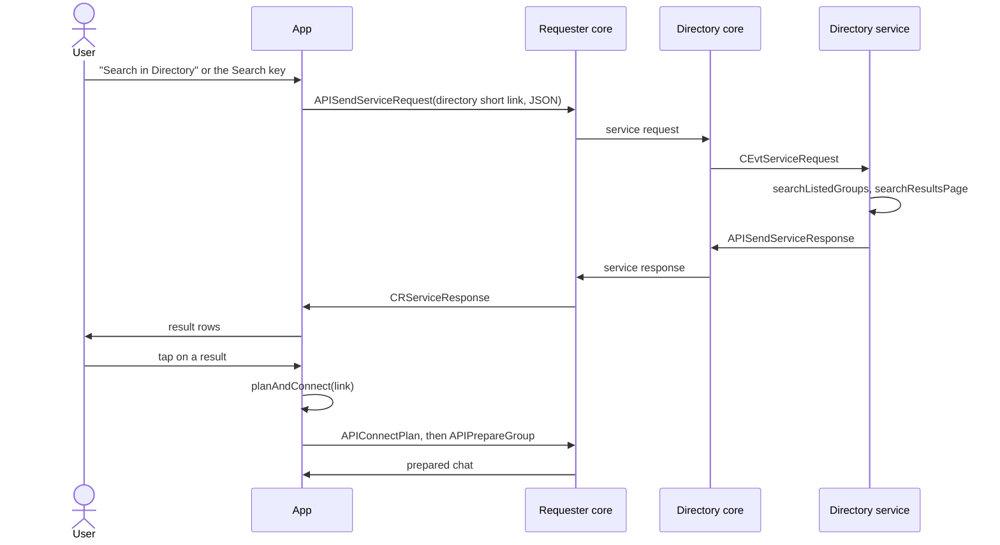

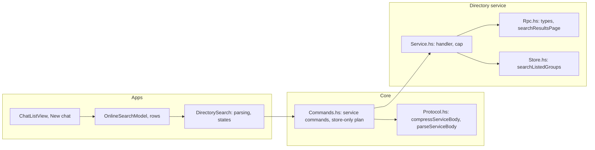

## 1. Directory: search over RPC

`Directory/Rpc.hs`, JSON-derived, declared by hand in Kotlin and Swift.

```haskell
data DirectoryRequest = DRSearch
  { searchText :: Text,
    searchCursor :: Maybe SearchCursor
  }

data DirectorySearchEntry = DirectorySearchEntry
  { entryType :: DirectoryEntryType,
    displayName :: Text,
    simplexName :: Maybe Text,
    groupLink :: PublicLink,
    shortDescr :: Maybe Text,
    image :: Maybe ImageData,
    activeAt :: Maybe UTCTime,
    createdAt :: Maybe UTCTime
  }

data DirectoryResponse
  = DRSearchResults
      { entries :: [DirectorySearchEntry],
        searchCursor :: Maybe SearchCursor,
        moreCount :: Int
      }
  | DRError {errorMessage :: Text}
```

Wire format:

```
request:  {"type": "search", "searchText": …, "searchCursor": …}
response: {"type": "searchResults", "entries": […], "searchCursor": …, "moreCount": N}
error:    {"type": "error", "errorMessage": …}
```

`searchText` has at most 100 characters. An absent `searchCursor` in a request means the first page; in a response, the last page.

The search is the bot's text search (`STSearch`): a case-insensitive substring match over the profiles of registered groups and channels. `%` and `_` in the text match literally. Matched fields:

- display name
- full name
- short description
- description
- SimpleX name, when the domain is verified

Sort: member count. Rows read per request: `searchResults` (10). The size is omitted from the response.

The app stores `SearchCursor` as `JsonObject` / `JSONValue` and sends it back unchanged in the next request. A cursor of another search mode is answered with the error response.

An entry differs from the web listing's `DirectoryEntry`:

- `welcomeMessage` is left out.
- `shortDescr` is plain text, cut to 160 characters (`maxShortDescrLength`).
- `image` replaces `imageFile`: the group's profile picture, at most 12,500 characters of data URI (`maxProfileImageSize`), a JPEG or PNG kept by `safeImageData`; otherwise the entry is sent without it.
- `groupLink` contains only the short link when one exists.
- `entryType`, `simplexName`, `activeAt` and `createdAt` are computed by the web listing's functions.

**Size bound.** A service response is sent as a confirmation, padded to `e2eEncConnInfoLength`: 11,106 bytes with PQ on. `maxServiceBodyLength` = 10,737 bytes applies in both directions (11,106 less 2, 256 of reply queue framing and 111 of signature).

**Compression**, in the core:

- `compressServiceBody` compresses a body over the bound, with the `'X'` marker of connection info. It returns an error for a body still over the bound, or over `maxDecompressedMsgLength` (64 KB) uncompressed.
- `parseServiceBody` decompresses with the size bounded by `maxDecompressedMsgLength`, and returns an error for JSON nested deeper than 32 levels.
- A body under the bound is sent uncompressed.

Call sites:

- `APISendServiceRequest`: request encode and response decode
- `APISendServiceResponse`: response encode
- `SREQ` path: request decode

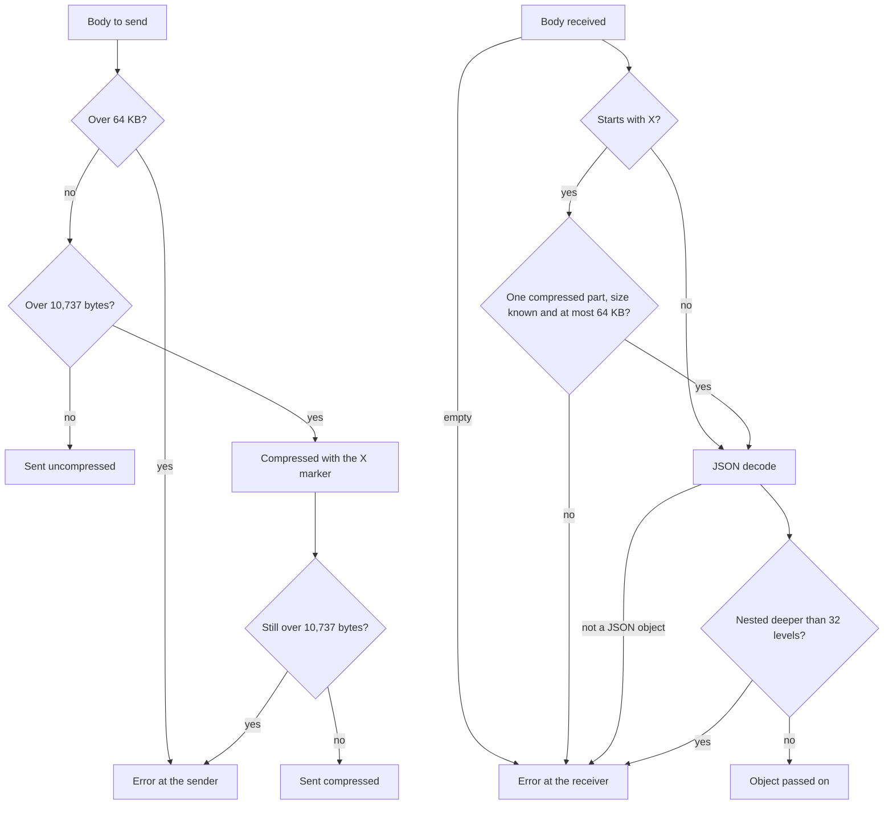

An image near the limit is about 9,400 bytes, so a response contains one such entry. The app shows the entries of the response and loads further pages on request (§6).

**Filling the page.** `searchResultsPage` drops entries from the end until the compressed response fits. The cursor is taken from the last row included. A single entry over the bound is sent without its image; if still over, it is skipped and the cursor is moved past it. `moreCount` is the number of matches after the cursor, floored at 0, and 0 without a cursor. Rows without a public link are counted by the cursor and not sent.

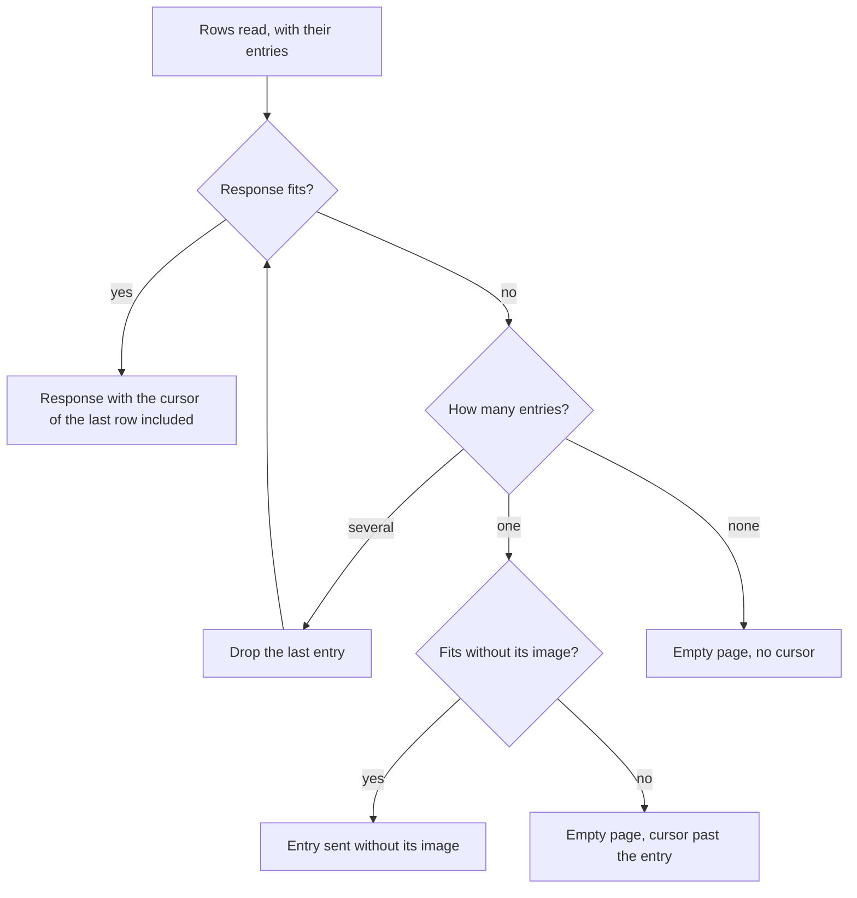

**Handler.** `DEServiceRequest` in `DirectoryEvent`, from `CEvtServiceRequest`. `directoryServiceEvent` decodes the request, searches, and replies with `APISendServiceResponse`. The core drops and logs a payload that is not a valid JSON object. The handler answers a wrong shape or unknown method with the error response. With `--run-cli`, the terminal shows a service request with empty data.

`forkWithinCap` forks each request with at most `maxServiceRequestsInFlight` (8) running, and decrements the count when the request ends, by any path. The cap is global, and the app sends unsigned requests. A request over the cap is rejected with the reason "service is busy" (`APIRejectServiceRequest`, enqueued).

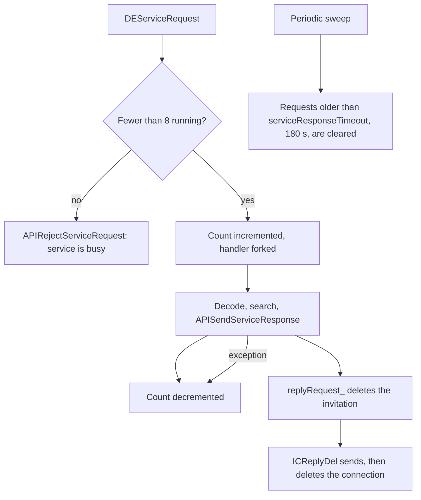

**Paging by the sort key.** Each search mode pages by the key it sorts on, with `r.group_id` as the tie-break, for `/next` and the RPC:

```sql
-- STAll, STSearch
AND (g.summary_current_members_count < ? OR (g.summary_current_members_count = ? AND r.group_id > ?))
ORDER BY g.summary_current_members_count DESC, r.group_id ASC

-- STRecent
AND (r.created_at < ? OR (r.created_at = ? AND r.group_id > ?))
ORDER BY r.created_at DESC, r.group_id ASC
```

`SearchCursor` holds the sort value and the group id: `SCMembers {lastMembers, lastGroupId}` or `SCRecent {lastCreatedAt, lastGroupId}`. `/next` replays the saved `searchType` with it. The count queries take the same condition, so the count is the remainder.

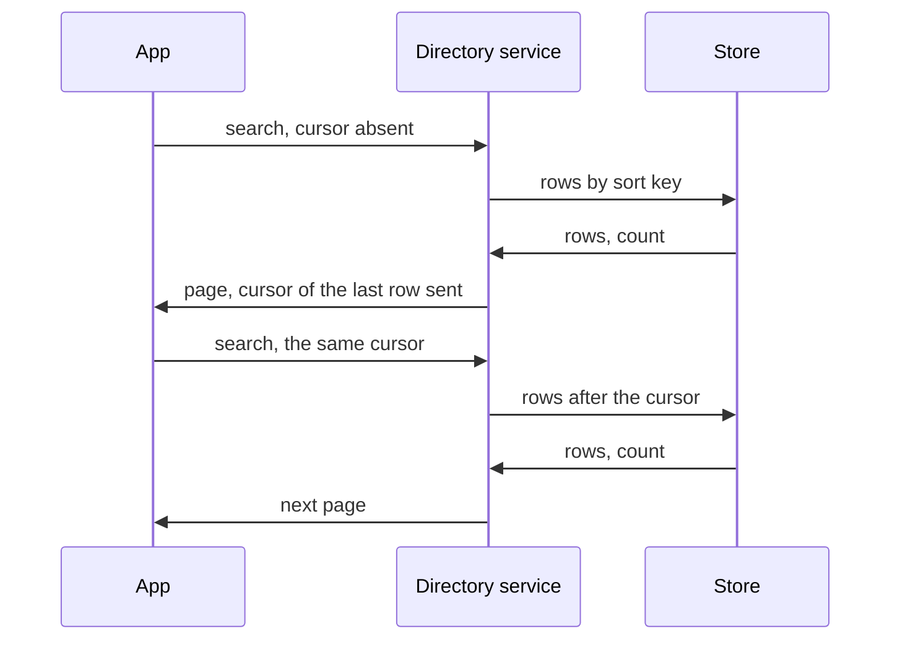

For `/next` the directory holds the cursor in `searchRequests`.

`testSearchGroupsPaging` covers `/all`, `/new` and text search with member counts that are not monotone in id: its last registered group has the most members.

## 2. Core: bot support and the directory's address

`CoreChatOpts` has `serviceRequests :: Bool`, the `--service-requests` switch, read in `runSimplexChat` and false by default. The directory binary always sets it. A service request received while the option is off is logged and dropped.

`APIRejectServiceRequest` rejects a request, with a reason sent to the requester at once; without a reason the requester waits until its timeout.

**The address is upgraded in place, and the published link is unchanged.** A request to an address without ratchet keys fails with `ASENotDRAddress`, as for an address created without `pq_ratchet`. `setConnShortLink` creates keys when they are absent, so `/_rotate_address_keys <user id>` (`APIRotateAddressRatchetKeys`) upgrades the existing address with the same `shortLinkKey` and `linkId`. The agent keeps the last 3 generations of keys (`keepAddressKeys`), so a rotation leaves in-flight requests valid. `testServiceRequestUpgradedAddress` covers it.

**Only the short link of an upgraded address contains the keys.** Rotation stores the keys in the short link's data, and the full link stays as created, without them. `serviceRequest_` reads the keys from the resolved URI, so the full link of the directory's address gives `ASENotDRAddress`.

The directory's short link is published in `docs/DIRECTORY.md`:

```
https://smp4.simplex.im/a#lXUjJW5vHYQzoLYgmi8GbxkGP41_kjefFvBrdwg-0Ok
```

Before the release that uses search, the live address's keys are rotated with the new CLI on the directory's database, and then the new directory service is started.

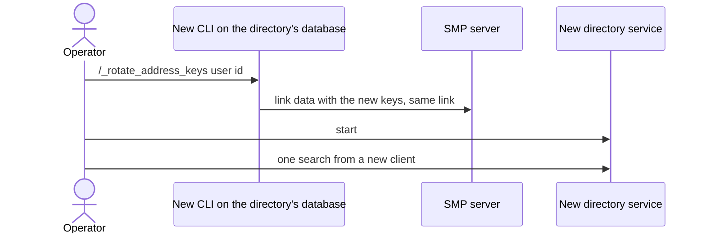

**A store-only plan of a group's short link.** `connectPlan` with `resolve=never` (`PRMNever`) reads only the store. For a group's short link it finds a prepared group, and one joined with `/c` and that link, whose connection stores the full link under the short link. The apps use it to recognise the user's chats among results (§5).

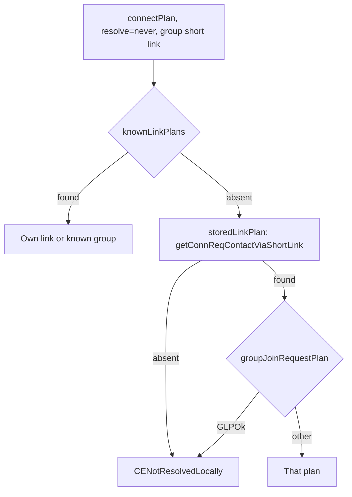

## 3. Apps: API binding

Kotlin: `CC.APISendServiceRequest(userId, target, timeoutSec, request: JsonObject)`, with `cmdString` matching the parser (`/_service_request <userId> <target>[ timeout=<s>][ sign_key=<k>] <json>`), a `CR.CRServiceResponse` case and `apiSearchDirectory(rh, text, cursor)`. iOS: the same as a `ChatCommand` case taking `JSONValue`, and a response case in `ChatResponse1`. The app sends requests unsigned.

`APISendServiceRequest` takes the target. The directory's short link (§2) is a constant, `DIRECTORY_SERVICE_LINK`, declared once per platform and referenced only by `apiSearchDirectory`.

The app sends at most 100 characters of search text, counted as Unicode scalars on iOS and code points on Kotlin.

The call waits for the reply or the timeout, with `requestTimeout` of 10 s counted from sending; the lookup of the directory's address before it has its own network timeout. On Kotlin it runs with `withApi` and plain `sendCmd`, and a timeout gives the retry row. Progress is shown through `ConnectProgressManager` after 1 s: in the search field on iOS and in Kotlin's New chat, in the toolbar on Kotlin's chat list. Its `onCancel` ends the wait; rows already shown stay.

**Progress owner.** `planAndConnect` calls `cancelConnectProgress()` and then starts its own progress.

- `startConnectProgress(text, owner, onCancel)` records the owner, and does nothing for a search while a connection is the owner.
- `stopConnectProgress(owner)` does nothing unless the current owner matches.
- `cancelConnectProgress()` cancels whichever owner is recorded.

Owners: `directorySearch` and `connect`. Other call sites use `connect`.

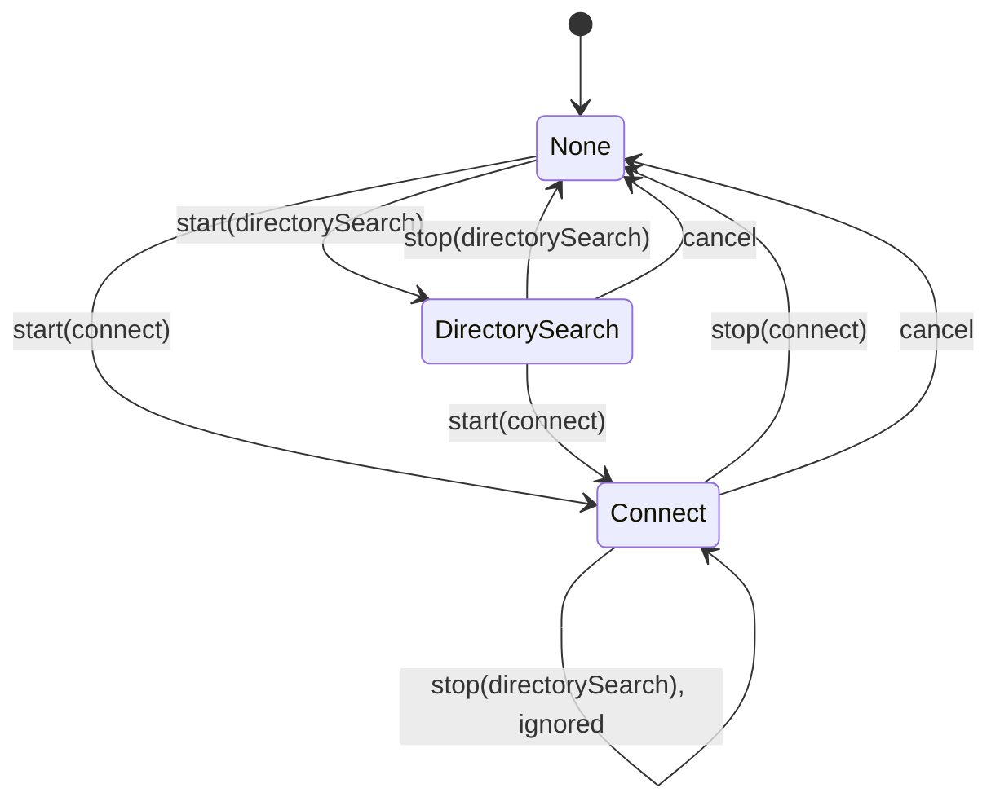

`OnlineSearchModel` compares a generation counter, incremented on every text change, profile switch and cancel; a reply of an older generation is dropped. The request contains no profile and is the same in incognito.

**Response parsing.** `parseDirectorySearchResponse` accepts only a `searchResults` response, and decodes entries one at a time.

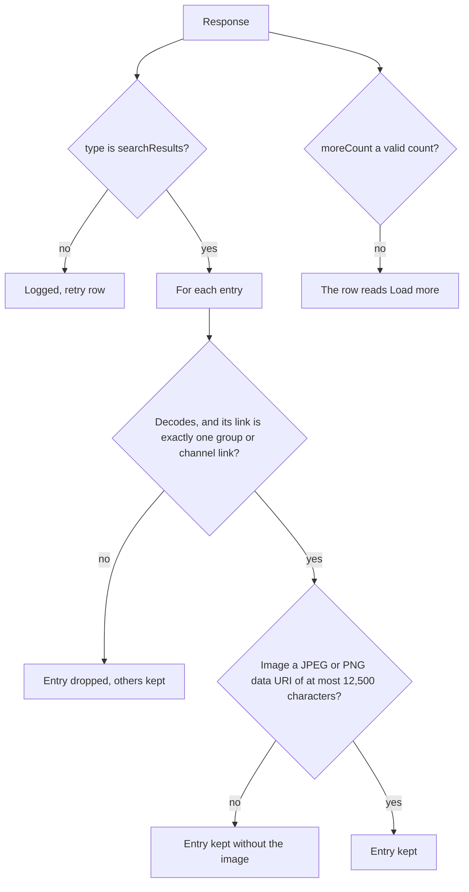

Text from the directory is drawn as plain text, with line limits. The image check is `isSafeImageData`.

## 4. Search UI

**Design.** The screens follow the "Online search screens" canvas, its Proposed page. Departures:

- The load row reads "Load more · N left", in place of "Load 10 more · N left".
- The result menu has only Open, as the app has one directory.
- The alert ends at "without your profile", without the sentence on search history.
- The screens for several directories are left out (§10).

**Rows.** `SearchInDirectoryRow` is placed with `ConnectByNameRow`, in all four places: the chat list with either toolbar, and New chat on each platform.

| Search text | Toolbar at the bottom (slot above the field) | Toolbar at the top |
|---|---|---|
| Empty | Tags | Tags above; nothing below |
| Plain text | "Search in Directory"; nothing while results show or load | Tags above; "Search in Directory" below, nothing while results show or load |
| Name candidate | "Connect to …", and "Search in Directory" until results show | Tags above; "Connect to …" below, and "Search in Directory" until results show |
| Pasted SimpleX link | Tags | Tags above; nothing below |

"Connect to …" stays next to the results. On Android with the toolbar at the top, "Connect to …" replaces the tags. On desktop the tags always show, with the rows between them and the field.

**Keyboard.** `SearchTextField` has an optional `onSearch`, passed only from the chat list's field and New chat's, and excluded from Archived contacts, which shares New chat's bar: on Android through `KeyboardActions`, on desktop on the Enter key's release while the field is enabled. iOS uses `.submitLabel(.search)` and `.onSubmit`. A field with `onSearch` has autocorrect and capitalization off; other search fields keep autocorrect.

**Actions.** The key and the row run the same directory search. A SimpleX name is looked up only by "Connect to …". The search is skipped for empty or whitespace-only text and for a pasted SimpleX link. `isDirectorySearchable` is that condition; the views add `!onlineSearch.showResults` for the row.

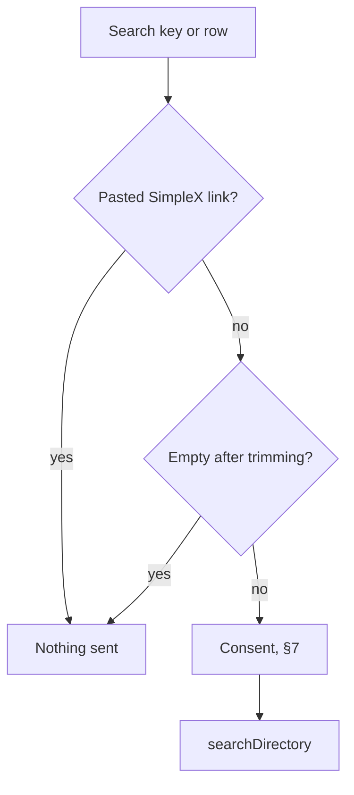

**The search bar is always present.** With no conversations yet, the search bar is above the onboarding pages, and below them with the toolbar at the bottom. While a search runs or has run, the results replace the pages. On desktop the pages are in the centre pane, and the chat list pane contains the search bar and the results. On Android with the toolbar at the bottom, the onboarding cards keep their size when the field opens the keyboard, and the pages above the field scroll.

## 5. Results

One list without headers, after the local chats:

1. the user's chats among the results that the list omits, as their regular chat rows
2. the other results
3. the load or retry row

With the toolbar at the bottom the list is mirrored, so the user's own chats are nearest the field and the load row is farthest from it. On New chat the matching contacts and the results form one group: on iOS the `moreRows` of `ContactsList`, which Archived contacts uses without them; on Kotlin the rows after `filteredContactChats`.

**Result rows** are drawn from the response:

- `image`
- `#` and `displayName`
- `simplexName`, as plain text and unverified; connecting uses the link
- `shortDescr`, in up to two lines
- the member or subscriber count from `entryType.summary`, a channel when `groupType` is channel
- trailing "Open"

**Nothing is shown twice.** Each new entry's link is planned store-only (§2, `apiConnectPlan` with `.never`, logging failures without an alert) and mapped by `directoryResultState`:

| State | Plan | Drawn as |
|---|---|---|
| Your chat | names a chat: a known or prepared group, the user's own group, or a pending join with its chat | hidden when the list shows that chat, otherwise its chat row once, which opens it |
| Joining | a pending join without a chat | a result with "Already joining", without Open |
| Open | anything else, including an absent plan | a result with Open |

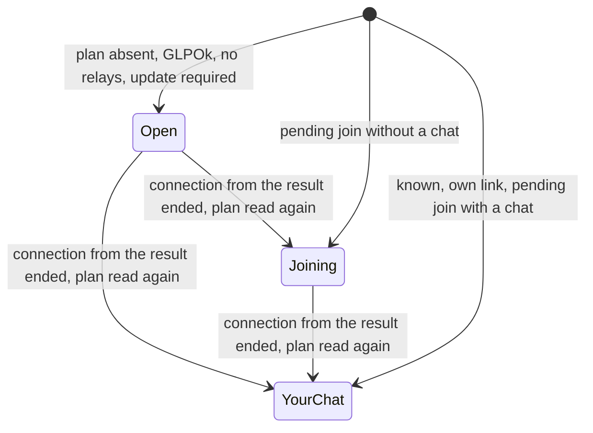

Only chat ids from the store are compared; fields written by the directory are excluded. An entry repeated across pages is dropped by its link, which is also the row key. A page whose results are all chats already listed adds neither row nor note. On the chat list, plan results are read again when a connection started from a result ends.

**Opening.** A tap calls `planAndConnect(link)` with `prepareGroup = open`, which makes the online plan, with the spinner of §3, and opens the prepared chat with its Join button. `planAndConnect` shows the alert for a plan with a signature result or another name; Open's plan of a link without a signature has neither, so Open goes straight to the prepared chat. A prepared channel's banner shows its subscriber count from the link data when it is above 0. A Joining result uses the default, `confirm`, which keeps the pending join's alert. Prepared chats the user opened but didn't join stay in the chat list, as for a pasted link. A long press (iOS 16 and later, Android) or a right click on desktop shows a menu with Open.

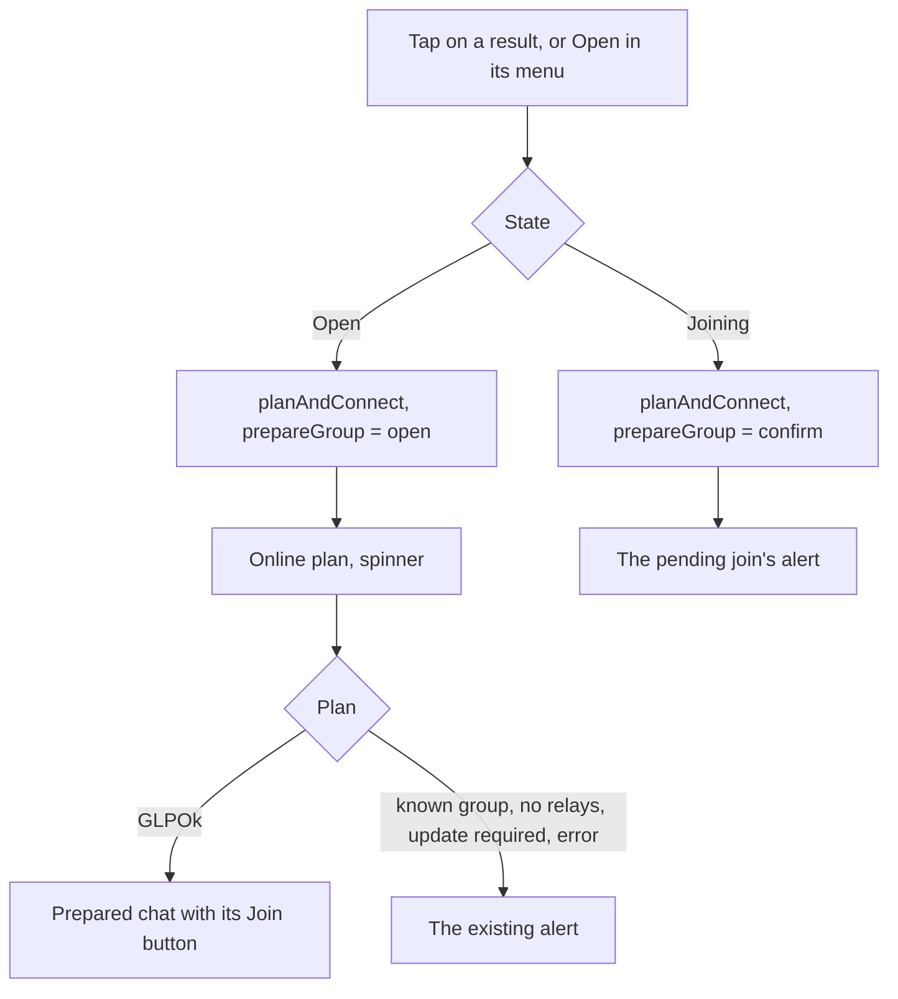

**While chat is stopped** "Search in Directory" and the load and retry rows are hidden, the Search key sends nothing, and result rows are disabled, as chat rows are.

**Cards.** While a search runs or has run, the chat list hides its banner and cards, even after a search that found nothing; filtering by typing keeps them.

**Empty states:**

- online search not run, with text: "Search in Directory" is shown, and "No chats found" and New chat's "No filtered contacts" are hidden
- running, or anything found: both messages hidden
- finished, nothing found: "No chats found" on the chat list (in onboarding, as a row); in New chat "No filtered contacts", or "No contacts" with no contacts

"You have no chats" on Android and desktop hides while a search runs or has run.

**Platform differences:**

- The chat list's spinner is in the toolbar on Kotlin, as for connections.
- The result menu is a context menu with a preview on iOS, and a dropdown on Kotlin.
- New chat's result icons are 30 pt on iOS and 42 dp on Kotlin, as each app's contact rows.
- A `moreCount` of `5.0` is accepted on iOS and rejected on Kotlin.
- Kotlin's New chat field stays enabled while a link shows, so its `onSearch` tests the link.
- A long name hides the SimpleX name on Kotlin, and iOS truncates both.
- Rotation on Android drops the results.
- When onboarding ends, Kotlin clears the search and iOS keeps it.
- While chat is starting, iOS treats it as stopped and Kotlin as running, as each platform's chat rows do.

## 6. Pagination

```
OnlineSearchModel
  directory: results shown
  moreCount: Int or null
  cursor: JSON or null
  loading: Bool
  failed: Bool
  searched: Bool
  searchedText: String
  generation: Int

showResults = loading or searched
footer = retry when failed, else loadMore when cursor is set, else none
```

```
reset():
  generation += 1
  directory, moreCount, cursor, searchedText cleared
  loading, failed, searched = false

cancelRequest():
  generation += 1
  loading = false

search(text):
  text = trim(text)
  when text is not empty: after consent, searchDirectory(text)

searchDirectory(text):
  return when text is empty, or loading and text == searchedText
  reset()
  searchedText = text
  request()

loadMore():
  after consent: requestNextPage()

requestNextPage():
  return when cursor is null, or loading
  request()

retry():
  after consent: requestNextPage() when cursor is set, else searchDirectory(searchedText)

request():
  gen = generation
  loading = true
  failed = false
  r = apiSearchDirectory(searchedText, cursor)
  page = new entries of r, each with its store-only plan
  return when gen != generation
  loading = false
  searched = true
  when r is null: failed = true, return
  cursor = r.cursor
  moreCount = r.moreCount
  directory += page
```

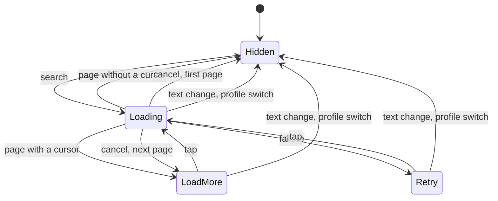

The app shows the entries of each response, often one when the entry has a full-size image (§1).

The last row reads "Load more · N left", or "Load more" when the response has no count. A tap requests the next page with the stored cursor; the page is appended, de-duplicated by link. The row is greyed while the page loads and is removed when the response has no cursor. After a failure it reads "Search failed, tap to retry", which repeats the next page or the first page; the results shown stay. Pages are loaded only on a tap on the row.

A change of the search text or a profile switch calls `reset()`, at the view that holds the text.

## 7. Consent

Search text is sent only after the user agrees. The "Directory search" switch in Settings › Privacy is off by default. While it is off, every online search, load and retry shows the alert "Enable Directory search?": "Search text is sent to SimpleX Directory, each search separately and without your profile." `OnlineSearchModel` calls `confirmDirectorySearch` before every request. With the switch on, the alert is not shown.

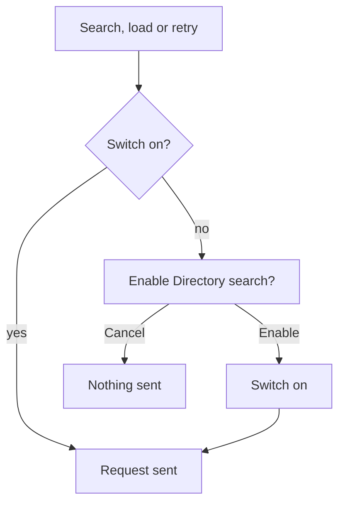

A request contains the search text, the cursor and the reply queue.

## 8. Strings

Kotlin: `common/src/commonMain/moko-resources/base/strings.xml`. iOS: inline `NSLocalizedString` at the use site. Texts:

- the row label
- the load and retry rows
- "Already joining"
- the members count
- the alert's title and body
- the alert's Enable action
- the switch
- the spinner
- New chat's "No contacts"

## 9. Failure modes

| Case | Result |
|---|---|
| Address without ratchet keys, or a full link used | `ASENotDRAddress`: logged, retry row |
| Directory over its cap | rejected at once, retry row (§1) |
| Directory silent, or service requests off | timeout after 10 s, retry row |
| Response too large to send | prevented by filling the page against the compressed size (§1) |
| Network down | fails at the address lookup's network timeout, or within 10 s of sending; retry row |
| Error response, or a response that can't be parsed | logged, retry row |
| One entry that can't be decoded, or with another kind of link | that entry dropped, the rest of the page kept |
| A store lookup of a result fails | logged; a result with Open, whose online plan shows the error |
| Response late, or after a text change, profile switch or cancel | dropped by the generation counter |
| Nothing found | the empty state of §5 |
| A chat the user already has | its chat row, or hidden (§5) |

## 10. What the design protects, and its limits

The directory learns the search text, when it was sent, and the SMP server of the request's reply queue, and nothing else about the requester: a request is unsigned, contains no profile, and uses a new connection that is deleted after the reply or the timeout. Requests are end-to-end encrypted from the requester to the directory's address. Each later page of a search repeats the text and sends the cursor of the page before, so the directory can link them. A text search's cursor contains the member count and the group id; the group id shows only the order in which the directory joined groups.

A reply queue's SMP server sees the queue on the user's transport session for that server, as for any new connection.

The apps treat the directory, and whoever controls it, as untrusted: they accept only group and channel links, draw its text as plain text and only JPEG and PNG images up to the profile image size, and make no network request and show no alert for an entry until the user opens it. Listing owners can't affect the requester beyond their own listing's bounded fields.

Requests are unsigned, so the only limit is global: a stable key would link every search of a user. Anyone can send requests without connecting, so the work of one request is bounded by the text limit and the page size, and the work of accepted requests by the cap. The directory's terminal omits search text.

The consent alert states only that each search is sent separately and without the profile.

Limits of what is built:

- The reply queue is on one of the user's SMP servers, and the directory sees that server. A user with few or self-hosted servers can have their searches linked and be recognised by it.
- A group the user was added to by invitation, or joined through a link its owner has since replaced, isn't recognised: it shows as a result with Open beside the user's own chat, and Open prepares a second copy. Recognising it needs the group's current link in the member's group record, a protocol change. Channels are always joined through a prepared chat, so they are recognised.
- "N left" counts listings without a public link, which are never sent, so the count can exceed the results still to come.
- One directory, fixed in the apps.
- A rejection over the cap is prepared on the directory's event thread, outside the cap.

Out of scope:

- streaming the response
- per-row image fetch
- directory browse
- self-hosted directory configuration
