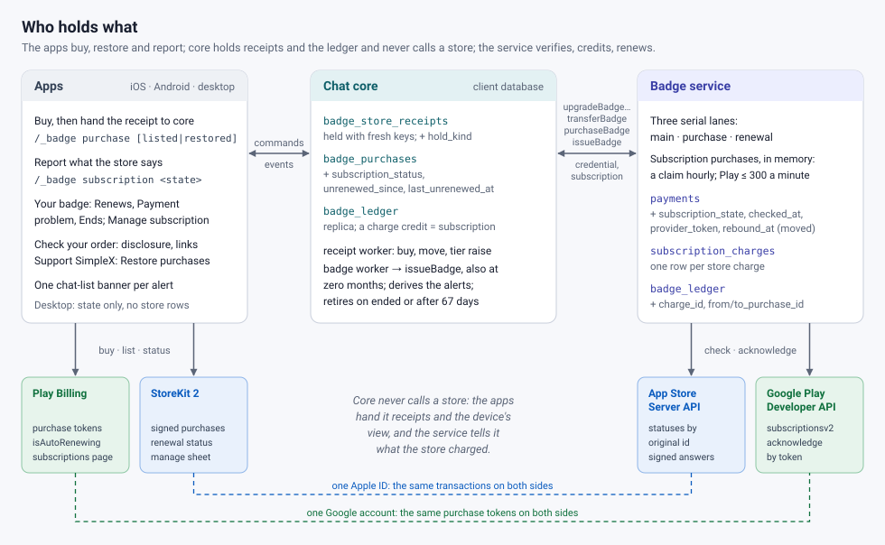
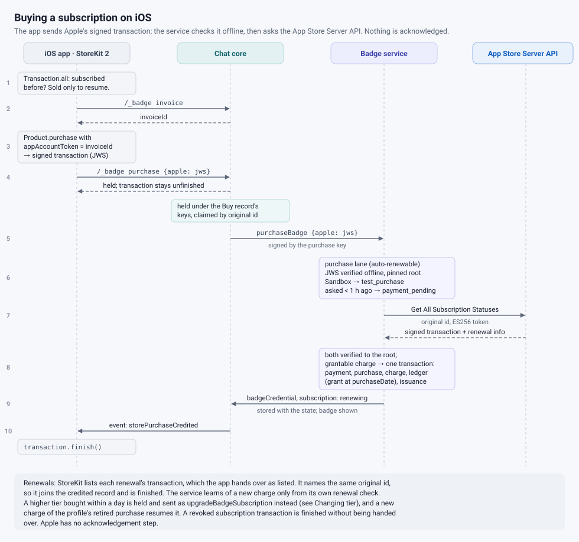
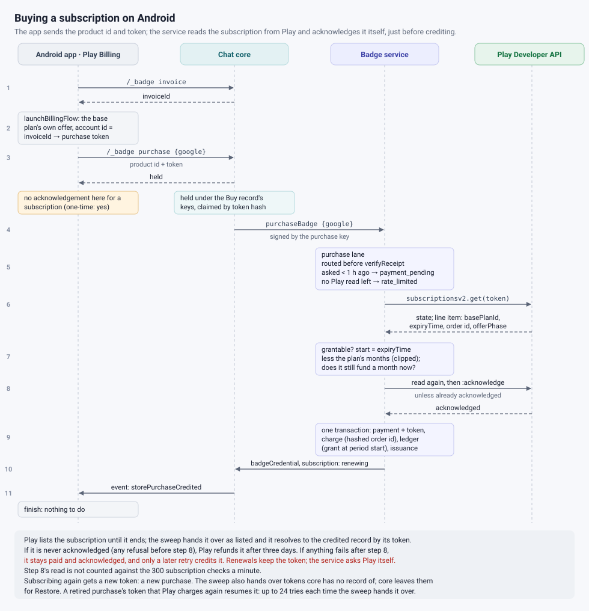
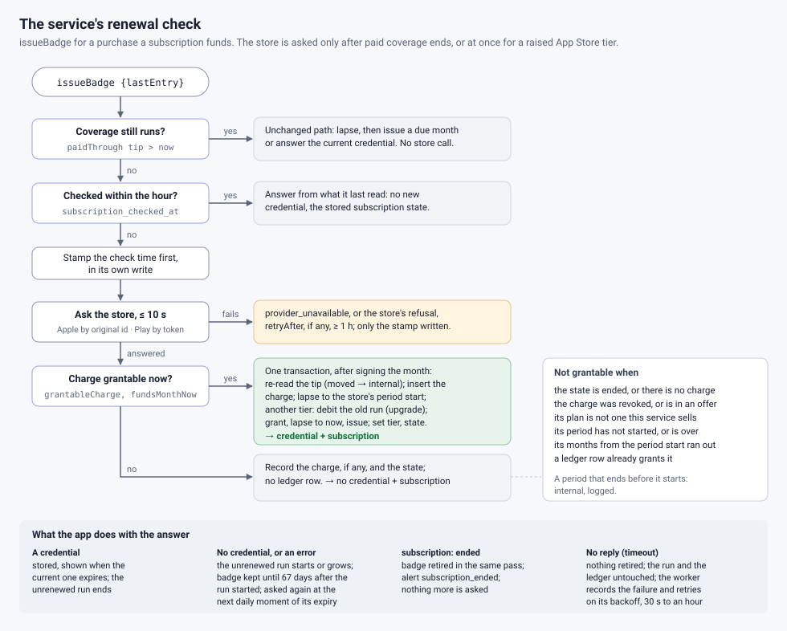
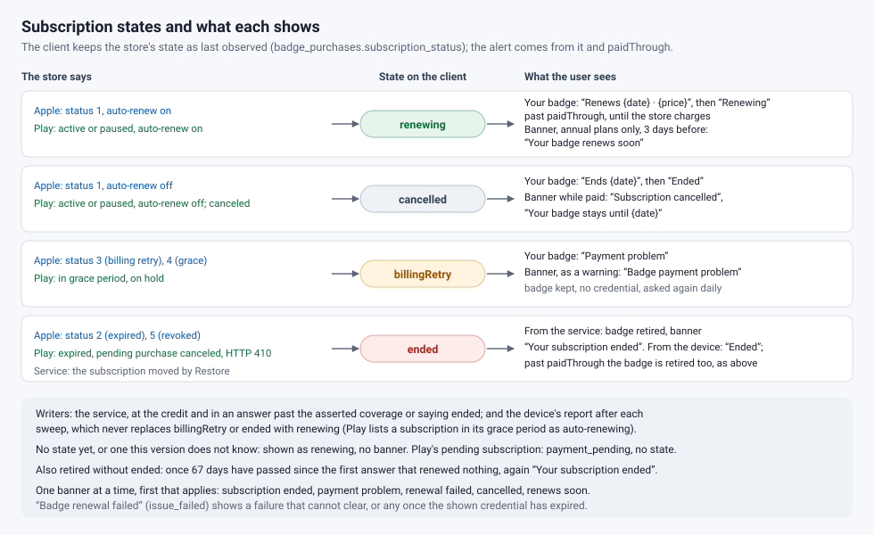
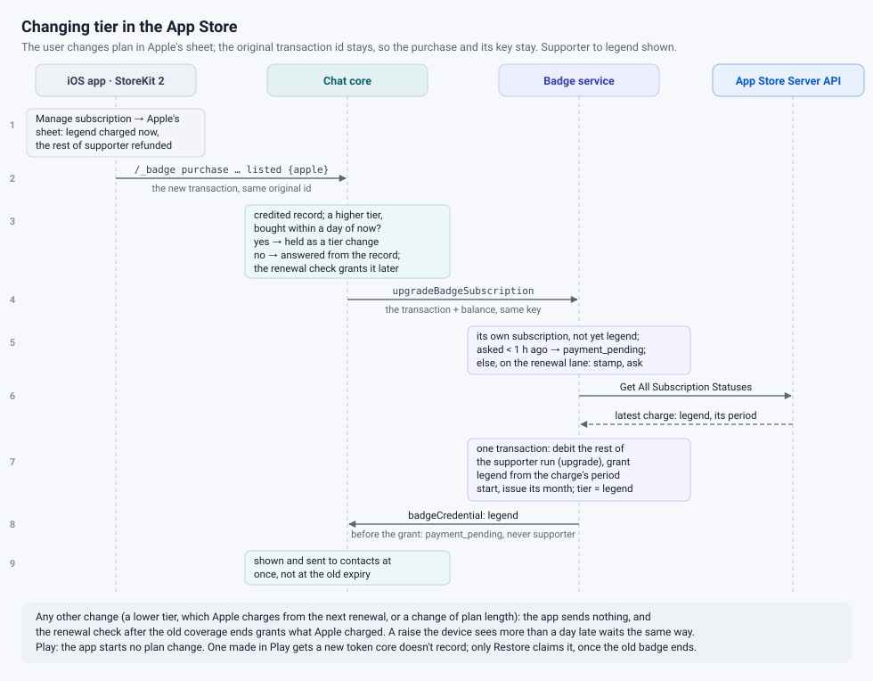
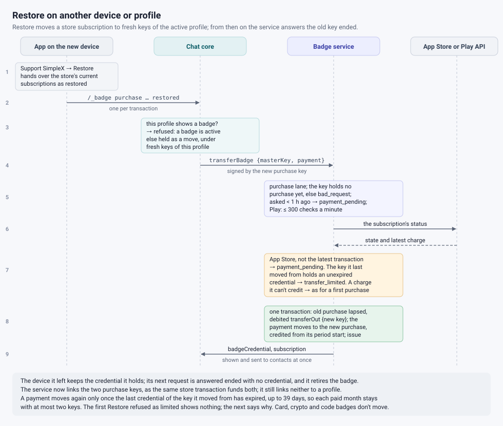
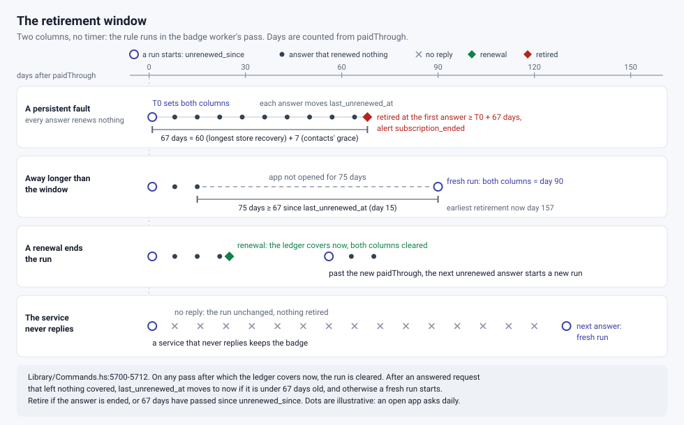
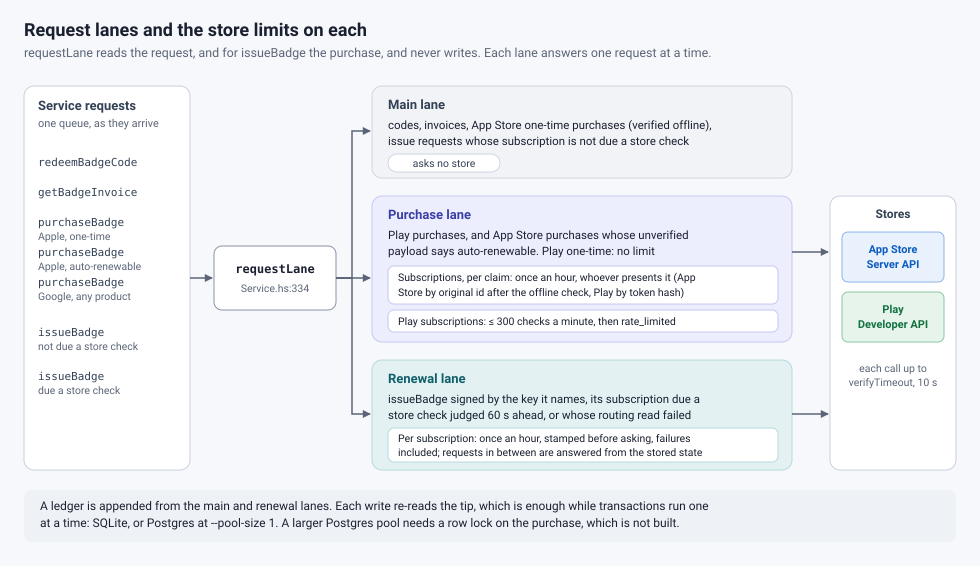

# Badge subscriptions (PR #7716)

Supporter badges (supporter and legend tiers) were prepaid: a code bought on the web, or a one-month store purchase not yet offered. This PR sells them as App Store and Google Play subscriptions, monthly or annual, across the badge service, core and apps. On iOS this release keeps buying and Restore hidden: the app opens the badge page on the site and redeems the code bought there.

## Buying

The app passes the store's receipt, through core, to the badge service, which checks it with the store and credits the badge.

- **iOS:** the service checks Apple's signature, then asks Apple about the subscription by its original transaction id, which renewals and tier changes keep. An Apple ID that subscribed before can subscribe again only to the badge its profile's last purchase retired, on the same device; core then resumes that purchase.
- **Android:** the service reads the subscription from Play by its purchase token and acknowledges it. Play refunds purchases left unacknowledged for three days.

## Renewals

The app requests each month's badge credential at the weekly moment all apps share, then daily, and before issuing a month the service asks the store, at most hourly per subscription. Once the paid months run out, a new charge funds the next month, from its billing-period start and as the tier the store charged; while they run, as in an annual plan, a refund or revocation the store reports ends the badge, its months not yet issued debited as a refund. The app also reports the device's view of the store, such as auto-renewal off, for the badge screen and banners.

## Changing tier

The app never starts a change. On iOS the user changes plan in Apple's subscription sheet; all four subscriptions share one group, so the original transaction id, the purchase and its key stay.

- **Raising the tier:** Apple charges the new tier at once and refunds the rest of the old period. When the device sees that transaction before it expires, core sends it to the service, retrying up to 24 times each time the device hands it over; the service asks Apple, ends the old tier's remaining months and grants the new tier from the charge. The new badge shows at once.
- **Lowering the tier, or any other change:** the app sends nothing, and the renewal check grants what Apple charged; Apple charges a lower tier from the next renewal.
- **Play:** each badge is its own product, the app starts no plan change, and Play's pages offered none in testing; another badge is a new purchase, which the app allows once the current badge has ended.

## Restore: moving to another device or profile

Restore purchases (Support SimpleX screen; hidden on iOS in this release) hands the store's current subscriptions to core, which asks the service to move one to fresh keys of the active profile, unless that profile already shows a badge: while it is held, core refuses the others, and the app carries on past those refusals, reporting a failure only when nothing was restored. The service asks the store, ends the old purchase, which it answers "ended" from then on, and credits the new key with the current charge; the new badge shows at once. The device it left keeps the badge it holds until that credential is due for renewal, then retires it.

A store receipt is no secret: whoever holds it can move the badge to their own keys. So a subscription moves again only once the badge already issued to the key it left has expired, up to 39 days, which keeps each paid month with at most two keys; an App Store receipt moves it only while it is the subscription's latest transaction, a Play token for the subscription's life. The service now links the two purchase keys, as the same store transaction funds both, but still not either to a profile. Badges bought by card, crypto or code don't move.

## How a subscription ends

While the store retries a failed payment, the badge stays (on iOS, until the device reports it expired), though contacts see it as expired a week after its last credential expires, and the profile can't buy or redeem another. It is removed as soon as the service answers that the subscription ended; once the paid months have run out, when Apple's store on the device reports it expired; or after 67 days of answers that renewed nothing: 60 days, the longest either store retries, plus 7 days of contacts' grace. If the service never replies and the device reports nothing, the badge stays. A retired subscription the store charges again comes back when the device next hands that charge over, unless the profile has had another badge since: then a hand-over moves it to fresh keys, as Restore does, once no badge shows, and until then the device keeps the transaction unfinished.

## Protecting the service and the stores

Purchases and Restores that ask a store, requests with a month due and tier changes, and everything else run on separate queues, so fake purchases can delay only other purchases and Restores. Each subscription is checked at most hourly per purpose (purchase, Restore, renewal), and the purchase path makes at most 300 Play subscription checks a minute; a Play purchase turned away for three days is refunded.

## Protocol and database changes

- **Badge RPC** (still version 1): an optional subscription state in credential answers; charges use the existing `charge` ledger entry; `upgradeBadgeSubscription` for a raised App Store tier and `transferBadge` for Restore, with a `transfer_limited` error.
- **Chat API:** a command reporting the store's state, `listed` and `restored` receipt flags, a refusal while a store receipt may still be credited, and the subscription and its alerts in the badge state.
- **Databases:** four columns in core's, for the store's state, the answers that renewed nothing, and what a held receipt is held for; on the service, a charges table, the charge and the purchases a move links on ledger rows, and state, check time, Play token and move time on payments.

## Known limits

- Automated tests use fake stores built from the stores' documentation. On 22 October the lifecycle was walked by hand on an iPhone and an Android phone, against Apple's sandbox and Play's test purchases, with the real verifiers; the review fixes made that night are tested only automatically. Real money, real billing dates and the stores' own retries and refunds are still unexercised.
- A purchase completing while another badge shows waits for it to end, and may meanwhile be refunded or lose paid periods.
- A Restore refused because the subscription moved recently may say nothing the first time.
- Play purchases are acknowledged before being signed and recorded; if either fails, Play won't refund, and only a later successful retry credits them.

## Before sale

Not built: iOS resubscription on another device or profile or to another badge, Restore for badges bought by card or crypto, seeing a Play refund that leaves the subscription active, and spreading the weekly moment.

Store setup: the product ids and every store setting are the store setup checklist in the badge service's [README](../../apps/simplex-badge-service/README.md#store-setup). Besides them: server API credentials, enough quota, translations, store review (Sandbox purchases are refused as test purchases, an open question), and products hidden until these apps ship.
