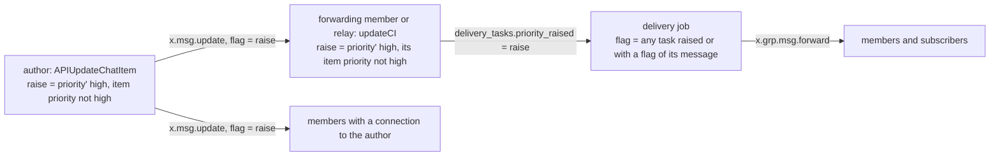

# Message priority

Date: 2026-10-13. Replaces `2026-10-13-silent-messages.md`.

A group member marks a message with a priority, when it is sent or by an update; a high priority message is an attention item of the chat, as a mention or a reply, and is shown with a bell.

References are to `/code/simplex-chat-4`, commit `be2e1c1cc`. Haskell paths without a directory are in `src/Simplex/Chat/`. Layout names are those of the code: `classic` and `terminal` (`flat` in `2026-10-13-flat-chat-layout-ui.md`).

## 1. Rules
```
priority          integer of a message: -1 low, 0 normal, 1 high; absent: 0
                  a received value of -1 or below is silent, of 0 normal, of 1 or above high
                  silent is accepted in every chat from every sender (2026-11-12-mcp-silent-messages.md, Q1)
scope             groups, business chats and channels
senders           the API, the CLI and the libraries; the apps send normal priority
item priority     set from x.msg.new when the item is created, limited to -1 .. 1
                  set by every x.msg.update of the sender of the item, by the same rules; absent: normal (decided by the user on 2026-11-22)
                  unchanged by an update of an item that the recipient deleted
normal priority   a priority message of a sender who is not allowed (section 3), and a priority message to a contact,
                  are sent and received with normal priority, without an error
read item         an item already read when its priority is raised stays read; a notification is shown
attention item    received item with userMention: mention or reply (as now), or high priority (new)
```
- Notifications are created for every message except a silent one. Notification text and sound are unchanged. The SMP notification flag is set as now for new messages, and for an update only when it changes the item to high priority: the author compares its item before and after the update, and a forwarding member or relay compares its own item when it applies the update and stores the result with the delivery task. An edit that repeats high priority is sent and forwarded without the flag.
- Mode `MFMentions`: the apps notify for attention items, as now; a high priority item is one of them. A raise is notified once, for an unread and for a read item; a change to a lower priority is not notified.
- An item that is a mention and high priority is shown as high priority.

Counters of a chat (`ChatStats`):
```
unreadCount           unread items                  unchanged
unreadMentions        unread attention items        high priority included; groups only, as now
unreadHighPriority    unread high priority items    new; 0 in direct chats and note folders
```
Chat list badge of a group:
```
sign          bell when unreadHighPriority > 0; otherwise "@" when unreadMentions > 0
sign colour   primary for MFAll and MFMentions; secondary for MFNone
number        unreadCount; secondary for MFMentions and MFNone, as now
one unread    an attention item: the sign alone in a circle, as "@" now
```

| Unread items | MFAll | MFMentions | MFNone (muted) |
|---|---|---|---|
| 2 normal, 1 high | primary bell, primary "3" | primary bell, secondary "3" | secondary bell, secondary "3" |
| 1 high | primary bell | primary bell | secondary bell |

Other places:
```
list label (user tag)    bell in place of "●" when a chat of the list has unreadHighPriority > 0 and MFAll or MFMentions
muted chat (MFNone)      notifications, list labels, the "unread" filter and profile totals: as now for a mention
chat view                bell in the meta of the item, sent and received, in both layouts; its unread counters are unchanged
item info                row "High priority"
member support chats     a high priority item is counted in support_chat_items_mentions and shown with "@"; an update sets the priority there as in the main scope
preference               set and shown by the CLI; excluded from feature items and from the preference screens of the apps
```

## 2. Protocol and types
```
Protocol.hs
  MsgPriority                  new: MPSilent | MPNormal | MPHigh   -- JSON and database: -1, 0, 1; parsed from any integer by its sign
                                 JSON: absent and null are MPNormal, MPNormal is omitted
  MsgContainer (:691)          priority :: MsgPriority    -- new, after live; JSON "priority": 1
  mcSimple (:718)              priority = MPNormal
  XMsgUpdate (:463)            priority :: MsgPriority    -- new last field; parsed by opt "priority" (:1421-1429); encoded by .=? (:1514)
                               positional uses: Library/Commands.hs:811, 845, 1474; Library/Subscriber.hs:589, 769, 1088, 1339, 4048
  allowedPriority              new: Bool -> MsgPriority -> MsgPriority; high is normal when not allowed
  cmPriority                   new, next to cmToQuotedMsg (:635): AChatMsgEvent -> MsgPriority, eventPriority of the event
                                 XMsgNew, XMsgUpdate: the field; otherwise MPNormal
  eventHasNotification         new, next to hasNotification (:1338): ChatMsgEvent e -> Bool
                                 x.msg.new: False for silent, otherwise True; other events, x.msg.update included: hasNotification of the event tag
Types.hs
  IntDef                       new newtype of Int, next to BoolDef (:2337); FromJSON omittedField = Just (IntDef 0)
Messages.hs
  CIMeta (:509)                priority :: MsgPriority    -- new, after userMention
  mkCIMeta (:535)              new parameter priority :: MsgPriority, after userMention
  dummyMeta (:551)             priority = MPNormal
  ChatStats (:458)             unreadHighPriority :: IntDef    -- new, after unreadMentions
  emptyChatStats (:467)        unreadHighPriority = IntDef 0
Controller.hs
  ComposedMessage (:1335)      priority :: MsgPriority    -- new; FromJSON (:1934): v .:? "priority", MPNormal when absent
  UpdatedMessage (:1343)       priority :: MsgPriority    -- new last field; JSON derived (:1947)
                               positional uses: Library/Commands.hs:798, 2697, 2701, 6562; apps/simplex-badge-service/src/BadgeService/Group.hs:344
  CEvtChatItemUpdated (:980)   chatItemUpdate :: AChatItemUpdate   -- #8219: chatItem and prevChatItem, the item before the update
                               a raise: chatItem is high priority, prevChatItem is not
```
- In a signed message `priority` is covered by the signature. The chat protocol version is unchanged.

## 3. Preference
Who sends messages with a priority other than 0 in a group is set by a group preference. Direct chats are outside this preference: priority is ignored there (sections 4, 5).
```
feature     GFMsgPriority, SGFMsgPriority
JSON name   msgPriority
name text   "Message priority"
type        MsgPriorityGroupPreference
              enable :: GroupFeatureEnabled
              role :: Maybe GroupMemberRole
            as VoiceGroupPreference (Types/Preferences.hs:735): HasField "enable" (:800) and "role" (:927), GroupFeatureI (:851), GroupFeatureRoleI (:943)
            FromJSON omittedField = on for admin, as SignMessagesGroupPreference (:1275)
default     enable = on, role = admin: admins and owners, in groups, channels and business chats
            business chat: the business is the owner (Store/Groups.hs:2245), the customer a member (:2262)
```
- A member may send when `enable = on` and the member role is at or above `role` (`groupFeatureMemberAllowed'`, `Types/Preferences.hs:273`). A channel post is checked with the owner role.
- `Types/Preferences.hs`, a case or a field next to that of voice at `:205 :221 :250 :300 :321 :337 :353 :378 :396 :451 :498 :569 :588 :608 :1099 :1121`; True at `:300` and `:321`; `Nothing` in `emptyGroupPrefs` (`:588`) and `defaultBusinessGroupPrefs` (`:608`).
- The feature is excluded from `allGroupFeatures` (`:280`), as `SGFSessions`: the feature items of a chat and the items for preference changes are unchanged.
- CLI, parser next to that of voice (`Library/Commands.hs:6453`); the command is accepted from owners (`runUpdateGroupProfile`, `:4166`):
```
/set priority #<group> on|off [<role>]    SetGroupFeatureRole (AGFR SGFMsgPriority)
/set priority #team on member             members and above; without a role: every member
```
- CLI views, `AGF SGFMsgPriority` appended to the feature list of `viewGroupUpdated` (`View.hs:2121`) and `viewGroupProfile` (`:2149`): `Message priority: on for admins`.

## 4. Core: sending
New message, the rules below are for high priority (1 or above); silent (-1 or below) is sent in every chat and scope without a preference (2026-11-12-mcp-silent-messages.md):
```
contact    high priority of a composed message is ignored: the message is sent without the field; the item has priority 0
group      sent value = 1, when the value is 1 or above and groupFeatureUserAllowed SGFMsgPriority gInfo (Types.hs:689); every scope
           otherwise the message is sent with normal priority, without an error, as ttl without the timed messages feature (sndCITimed_, Library/Internal.hs:185)
```
- `Library/Commands.hs:4861` `sendContactContentMessages`: high `priority` of each composed message is replaced with Nothing.
- `Library/Commands.hs:4931` `sendGroupContentMessages_`: `priority` of each composed message is replaced with the sent value.
- `Library/Internal.hs:212` `prepareGroupMsg`: new parameter `priority :: MsgPriority`, set in the container (`:229`); passed at:
  - `Library/Commands.hs:4994`: `priority` of the composed message
  - `Library/Internal.hs:1551` (`sendHistory`): `allowedPriority False` of the stored item; high priority is not sent in history
- `Library/Internal.hs:2983` `NewSndChatItemData`: `priority :: MsgPriority`:
  - `prepareSndItemsData` (`Library/Commands.hs:5061`): `priority` of the composed message
  - the other 4 constructions (`Library/Internal.hs:2979`, `Library/Commands.hs:3069, 3121, 3220`): MPNormal
- `Library/Internal.hs:3010` `saveSndChatItems.createItem`: `priority` is passed to `createNewSndChatItem` and `mkChatItem_`.
- `Library/Internal.hs:3081` `mkChatItem_`: new parameter `priority`; MPNormal at `:3079` (`mkChatItem`) and `:3414` (`createLocalChatItems`).
- The other values of `ComposedMessage` are built with `priority = MPNormal`: `Library/Commands.hs:792, 1140, 2611, 2639, 2684, 3485, 5247`; `Bot.hs:90, 97`; `apps/simplex-badge-service/src/BadgeService/Group.hs:286`. A forwarded item and a report have normal priority.

Update, `APIUpdateChatItem` (`Library/Commands.hs:798`); `priority` of the updated message is the new priority of the item, normal when absent (decided by the user on 2026-11-22):
```
note folder    priority of the updated message is ignored
contact (:799)
  priority'    allowedPriority False priority: silent or normal
group (:824)
  priority'    allowedPriority (groupFeatureUserAllowed SGFMsgPriority gInfo) priority, as for a new message in every scope
both
  condition    changed || the item is live || priority' /= the item priority
  event        priority = priority'
  SMP flag     group: on when priority' is high and the item priority is not, passed to sendGroupMessageFlags
                 sendGroupMessageFlags (Library/Internal.hs): sendGroupMessage with the flag; sendGroupMessage passes eventHasNotification of its event
                 sendGroupSignedMessages_ (Library/Internal.hs:2748): new parameter MsgFlags, computed by its callers from their events
               contact: eventHasNotification of x.msg.update, off; Library/Internal.hs:2248 (direct), :2552 (deliverMessage)
  item         edited = changed && itemLive /= Just True
               CIMeta.priority = priority' before updateGroupChatItem and updateDirectChatItem'
```

## 5. Core: receiving
New item, `Library/Internal.hs:3030` `saveRcvChatItem'`, with unchanged callers:
```
priority = allowedPriority (content is CIRcvMsgContent && rcvPriorityAllowed cd) (cmPriority chatMsgEvent)
           silent from every sender in every chat; high only when allowed, otherwise normal
userMention = (mention or reply, :3062, as now) || priority == MPHigh
priority is passed to createNewRcvChatItem and mkChatItem_

rcvPriorityAllowed cd =          -- new, Library/Internal.hs, for high priority only
  CDGroupRcv g _ m   -> groupFeatureMemberAllowed SGFMsgPriority m g && not (memberBlocked m)
  CDChannelRcv g _   -> groupFeatureMemberAllowed' SGFMsgPriority GROwner (fullGroupPreferences g)
  CDDirectRcv, CDLocalRcv -> False
```
- A high priority message of a sender who is not allowed, and every direct high priority message, is received as a normal message.
- Items of group and forwarded messages (`Library/Subscriber.hs:2209, 4008`), of history, and the item created by `x.msg.update` for a missing item (`:2327`) are created by this function. The item created by `x.msg.update` has the priority of the update, by the rules above: `cmPriority` takes the priority of `x.msg.new` and of `x.msg.update` (decided by the user on 2026-11-21).
- Support chat counters (`memberChatStats`, `Library/Internal.hs:3064`; `Store/Messages.hs:2195-2212`) are computed from `userMention`, unchanged.

Update, `Library/Subscriber.hs:2297` `groupMessageUpdate` and the direct `messageUpdate` (`:589`): new parameter, `priority` of `XMsgUpdate` (`:1088`, `:4048`).
```
updateCI (:2368), new parameters: priority of the update; cd of the item (the values at :2351, :2354)
  priority'    the item priority when the item is deleted; otherwise allowedPriority (rcvPriorityAllowed cd) priority, as for a new item
               direct messageUpdate: allowedPriority False priority
  condition    changed || the item is live || priority' /= the item priority; otherwise chatItemNotChanged, no delivery task
  edited       changed && itemLive /= Just True
  item         CIMeta.priority = priority' before updateGroupChatItem (:2379) and updateDirectChatItem'
  userMention  updateGroupCIUserMention (#8219), after updateGroupCIMentions: mention or reply || high priority, as for a new item
  event        :2382: chatItemUpdated with prevChatItem, the item before the update (#8219)
  delivery     for an applied update only (:2384); DeliveryTaskContext.priorityRaised = priority' is high and the item priority is not
               an item created for a missing message (:2373): priorityRaised = the created item is high
```
- The status of an item is unchanged by its priority: an unread item is counted by the stats queries; a read item stays read. The apps notify a change to high priority once and a change to a lower priority not at all; their counters change by the previous and the new item.

Groups, channels, relays:
```
forwarding    an applied update is forwarded: signed as its bytes; unsigned encoded again with priority (Protocol.hs:1591)
              SMP flag of a forwarded x.msg.update: priorityRaised of its delivery task, stored when the forwarding member or relay applies it
                (delivery_tasks.priority_raised), not the priority in the message; a delivery job has the flag when one of its tasks has it
                (taskHasNotification: priorityRaised || msgHasNotification)
              each receiver applies rcvPriorityAllowed with the role of the author
history       unsigned item: encoded with the priority of the stored item when it is silent; high priority is dropped by the member that sends history
              signed item: its stored bytes, the last signed message of the item (updateChatItemSignedMsg, Store/Messages.hs:2780), with the priority of that message
abuse         every member with MFAll or MFMentions is notified by one message of an allowed member
limits        the role of the preference; a high priority message of a blocked member is received with normal priority; MFNone
              a silent message stays silent, from every sender
```

SMP notification flag of `x.msg.update`:


## 6. Storage
Migration `M20261113_item_priority`, SQLite and Postgres, registered in `Store/SQLite/Migrations.hs`, `Store/Postgres/Migrations.hs` and `simplex-chat.cabal`. It adds two columns and two partial indexes.
```
chat_items
  item_priority INTEGER NOT NULL DEFAULT 0      -- SMALLINT in Postgres
delivery_tasks
  priority_raised INTEGER NOT NULL DEFAULT 0    -- SMALLINT in Postgres; 1: the forwarded x.msg.update changed the item to high priority
idx_chat_items_contacts_silent    (user_id, item_status, contact_id, item_priority) WHERE item_priority < 0 AND contact_id IS NOT NULL
idx_chat_items_groups_priority    (user_id, item_status, group_id, group_scope_tag, group_scope_group_member_id, item_priority) WHERE item_priority <> 0 AND group_id IS NOT NULL
```
- `Store/Delivery.hs`: `createMsgDeliveryTask` writes `priority_raised` from `DeliveryTaskContext`; `getMsgDeliveryTask_` reads it into `MessageDeliveryTask.priorityRaised`. A task created before the migration has 0.
- Down migration: the indexes and the columns are dropped. The schema dumps and `chat_query_plans.txt` need regeneration by the schema and query plan tests; they are never edited by hand.

`Store/Messages.hs`:
```
createNewChatItem_ :591          new parameter priority, written to item_priority; 0 at Library/Internal.hs:3412
createNewSndChatItem :549        new parameter priority; 0 in SendMessageBroadcast (Library/Commands.hs:2679)
createNewRcvChatItem :565        new parameter priority
createNewChatItemNoMsg :584      0
updateGroupChatItem_ :2794       the UPDATE (:2803) also writes item_priority and user_mention from CIMeta
ChatItemModeRow :2283            item_priority added
item queries :2711 :3105 :3218   i.item_priority selected
item rows :1096 :2308 :2369      priority passed to mkCIMeta
toChatStats :787                 unreadSilent = IntDef 0, unreadHighPriority = IntDef 0, for direct chats and note folders
GroupStatsRow :791               unreadSilent and unreadHighPriority added after unreadMentions
findGroupChatPreviews_ :899      join PriorityStats: unread items of the main scope with item_priority <> 0,
                                   SUM(CASE WHEN item_priority < 0 ...) AS UnreadSilent, SUM(CASE WHEN item_priority > 0 ...) AS UnreadHighPriority
getGroupUnreadCount_ :1739       a second query with the same sums over item_priority <> 0; returns count, mentions, silent, high priority
```
- The group counts read `idx_chat_items_groups_priority`, and the silent count of contacts reads `idx_chat_items_contacts_silent` (2026-11-12-mcp-silent-messages.md, Q7). A received high priority item always has `user_mention = 1`: both columns are written together at creation and at a raise, and an edit keeps it (`updateGroupCIUserMention`, #8219).

## 7. API and CLI
`/_send` (`Library/Commands.hs:6174`) and `/_update item` (`:6183`) syntax is unchanged. `priority` is a property of each composed message and of the updated message:
```
/_send #1 json [{"msgContent": {"type": "text", "text": "done"}, "priority": 1}]
/_update item #1 5 json {"msgContent": {"type": "text", "text": "done"}, "mentions": {}, "priority": 1}
```
- Streamed message: sent with `live=on`, updated with `live=on`, completed by `/_update item` without `live` and with `"priority": 1`. A message that is not live is raised by the same command, with or without a change of the text. An update without `priority` makes the item normal.
- For a contact and a note folder `priority` is ignored by both commands. Responses and events: `CIMeta.priority` in chat items; `ChatStats.unreadHighPriority` where the other counters are returned; a raise is the event `chatItemUpdated` whose `chatItemUpdate` has a high priority `chatItem` and a `prevChatItem` that is not.

## 8. Apps: model
`K`: `apps/multiplatform/common/src/commonMain/kotlin/chat/simplex/common/`. `I`: `apps/ios/`.
```
CIMeta                 priority: Int? = null; highPriority: priority >= 1
                       K model/ChatModel.kt:3907; I SimpleXChat/ChatTypes.swift:4272
ChatStats              unreadHighPriority: Int = 0
                       K model/ChatModel.kt:1502; I SimpleXChat/ChatTypes.swift:2423, also a parameter of init
group preference       msgPriority in FullGroupPreferences, decoded also when absent: K RoleGroupPreference with the default on for admins, I RoleGroupPreference?;
                       optional in GroupPreferences; copied by toGroupPreferences
                       K model/SimpleXAPI.kt:6369, :6418, :6383; I SimpleXChat/ChatTypes.swift:1658, :1716, :1773
                       returned unchanged when the other preferences are saved (K views/chat/group/GroupPreferences.kt:48; I Shared/Views/Chat/Group/GroupChatInfoView.swift:1142)
                         by the unchanged preference screens; GroupFeature is unchanged
new unread item        event newChatItems: unreadHighPriority + 1 for a high priority item
                       K addChatItem, model/ChatModel.kt:612; I addChatItem, Shared/Model/ChatModel.swift:733
items read             /_read chat items: unreadHighPriority reduced by the count of read high priority items; /_read chat: 0
                       K markChatItemsRead :884, markItemsReadInCurrentChat :904 (third result)
                       I markChatItemsRead ChatModel.swift:1041, apiMarkChatItemsRead SimpleXAPI.swift:1925 (new parameter highPriorityRead)
                         unreadItemIds ChatView.swift:1838 (third result), calls :1812, :1817
item read or removed   events chatItemsStatusesUpdated, chatItemUpdated, chatItemsDeleted, and removal of the items of a member
                       K decreaseCounterInPrimaryContext :940: new parameter item; unreadMentions and unreadHighPriority
                         are reduced by the flags of the item; calls :675 (pItem), :725 (cItem), :777 (item)
                       I removeChatItem ChatModel.swift:850, removeMemberItems :885: third delta
                         UnreadCollector :1062, changeUnreadCounter(_:by:unreadMentions:) :1162: third delta
priority raised        event chatItemUpdated: chatItem high priority, prevChatItem (#8219) not
                       active profile: unreadCount, unreadMentions, unreadSilent and unreadHighPriority change by previous vs new
                         K applyChatItemUpdate (model/ChatModel.kt); I applyChatItemUpdate (Shared/Model/ChatModel.swift)
                       user total: previous vs new of the items counted for the user, silent items left out in MFAll
                       other profile: previous vs new of the items counted with ntfsEnabled, silent items left out in MFAll
                       notification: notifyMessageReceived for a raise, for an unread and for a read item
                         K chatItemUpdateNotify (model/SimpleXAPI.kt); I chatItemUpdate (Shared/Model/SimpleXAPI.swift), ChatItem.isRaised(from:)
                       NSE: case chatItemUpdated in NSEChatEvent (SimpleX NSE/NSEAPITypes.swift)
                         receivedMsgNtf (SimpleX NSE/NotificationService.swift:1003): a raise as .newChatItems; otherwise .noNtf, as duplicateGroupMessage
```
`ntfsEnabled` (K `model/ChatModel.kt:1809`; I `ChatTypes.swift:2290`) is computed from `userMention`, unchanged. Unchanged notification paths of new items:
```
K    platform/NtfManager.kt:39; model/SimpleXAPI.kt:3026, 3041, 3072, in the one receiver loop (startReceiver, :784)
I    Shared/Model/NtfManager.swift:253; Shared/Model/SimpleXAPI.swift:2636, 2646, 2682, 3135
     SimpleX NSE/NotificationService.swift:1024
```
List labels:
```
UnreadTag = Read | Unread | HighPriority    -- type of Chat.unreadTag; K model/ChatModel.kt:1475, I ChatModel.swift:1444
unreadTag(chat):
  MFAll         HighPriority if unreadHighPriority > 0; Unread if unreadChat || unreadCount > unreadSilent
                  only silent unread items: Read, as unread items of a muted chat; "lists should only show unread and priority marks" (decided by the user on 2026-11-23)
  MFMentions    HighPriority if unreadHighPriority > 0; Unread if unreadChat || unreadMentions > 0
  MFNone, nil   Unread if unreadChat
  otherwise     Read
unreadTags[tag]      chats of the tag with unreadTag Unread or HighPriority
priorityTags[tag]    chats of the tag with unreadTag HighPriority
update(chat, was):                                                     -- was: unreadTag before the change
  now = chat.unreadTag
  when now /= was, for tag in tags of the chat:
    each map of tagCounts(was)[tag] -= 1
    each map of tagCounts(now)[tag] += 1                               -- tagCounts: the maps of the rows above
functions with this rule     K model/ChatModel.kt: updateChatTags :319, moveChatTagUnread :380, updateChatTagReadInPrimaryContext :1052,
                               markChatTagRead :1068, markChatTagReadInPrimaryContext_ :1076
                             I ChatModel.swift: updateChatTags :197, markChatTagRead :251, updateChatTagRead :257, decTagsReadCount :269
Boolean uses of unreadTag    compared with None: K views/chatlist/ChatListView.kt:1575, ChatListNavLinkView.kt:984
                             I Shared/Views/ChatList/ChatListView.swift:676, TagListView.swift:201, :211
other call sites             unchanged: the value before the change is passed as now
```

## 9. Apps: views
```
chat list badge    K views/chatlist/ChatPreviewView.kt:465-493: ic_notifications in place of ic_alternate_email when unreadHighPriority > 0
                   I Shared/Views/ChatList/ChatPreviewView.swift:233, 241: Text(Image(systemName: "bell.fill")) in place of MENTION_START
list label         K views/chatlist/ChatListView.kt:1348: inline icon ic_notifications, primary, when priorityTags[tag] > 0; " ●" otherwise
                   I Shared/Views/ChatList/ChatListView.swift:1060: Text(Image(systemName: "bell.fill")) in the same place
item meta          K views/chat/item/CIMetaView.kt: CIMetaText (:83), first element StatusIconText(ic_notifications, primary) when highPriority
                     reserveSpaceForMeta (:155): iconSpace for it
                   I Shared/Views/Chat/ChatItem/CIMetaView.swift: ciMetaText (:127), first element statusIconText("bell.fill", colorMode.resolve(primaryColor)),
                     as the "xmark.seal" icon (:167)
item info          K views/chat/ChatItemInfoView.kt: Details (:254), InfoRow with ic_notifications after "Disappears at"; itemInfoShareText (:568)
                   I Shared/Views/Chat/ChatItemInfoView.swift: details (:135), itemInfoShareText (:520)
string             info_row_high_priority: "High priority" (K moko-resources/base/strings.xml; I the same text)
```

## 10. Terminal
`View.hs:709` `viewChatItem`, mark `!!` for a high priority item of a group; `!` for a mention or a reply, as now:
```
received    #team alice!!> done      ttyFromGroupAttention (:3100), fromGroupAttention_ (:3113): the mark in place of the Bool
sent        #team !! done            ttyTo "!! " after ttyToGroup (:739)
updated     the same marks in viewItemUpdate (:864), at :892 and :901, also with "[edited]"
```
- `Terminal/Output.hs:188`: `sendNtf` for a raise, a high priority item with a previous item that is not, as for a new item (`:181-185`). `markRead` (`:161`) and `setActiveChat` depend on `isUserMention`, unchanged.

## 11. Libraries and docs
- `bots/src/API/TypeInfo.hs`: `"IntDef" -> ST TInt []` (`:174`); `MsgPriorityGroupPreference` in `roleGroupPrefTypes` (`:248`).
- Generated files are written by `tests/APIDocs.hs` (`testGenerate`, `:153`): `bots/api/TYPES.md`, `bots/api/EVENTS.md`, and the types and events files of `packages/simplex-chat-client/types/typescript/src` and `packages/simplex-chat-python/src/simplex_chat/types`.
- New optional parameter `priority`, set in the composed or the updated message; `apiSendMessages` (`api.ts:443`) and `api_send_messages` (`api.py:196`) are unchanged:
  - `packages/simplex-chat-nodejs/src/api.ts`: `apiSendTextMessage` (`:466`), `apiSendTextReply` (`:474`), `apiUpdateChatItem` (`:482`), `LiveMessage.end` (the priority of the final message)
  - `packages/simplex-chat-python/src/simplex_chat/api.py`: `api_send_text_message` (`:225`), `api_send_text_reply` (`:236`), `api_update_chat_item` (`:241`)
  - `packages/simplex-chat-python/src/simplex_chat/client.py`: `Message.reply` (`:74`)
- `bots/README.md`, new section "Message priority" before "How to create a bot" (`:87`): the field of a new message, the raise by an update, the group preference and its role, direct chats.
- `docs/protocol/simplex-chat.md`: `priority` in `x.msg.new` (`:168`) and `x.msg.update` (`:185`), the receiver rules, the preference. `docs/protocol/simplex-chat.schema.json`: optional `priority` of type `integer`, as `ttl`, in `msgContainer` (`:117`) and `x.msg.update` (`:478`).
- `apps/ios/spec` and `apps/multiplatform/spec`: the descriptions of the changed functions.

## 12. Compatibility
```
receiver, sender before this release    "priority" is ignored by the parsers of x.msg.new and x.msg.update; a sender sends normal priority
forwarding host or relay before         signed message: forwarded as received bytes, "priority" kept
                                        unsigned message: encoded again from the parsed message (Protocol.hs:1591), "priority" dropped
owner before this release               the preference is absent: the default; the received preference JSON is kept (prefsToRow, Types/Preferences.hs:181) and parsed after an upgrade
                                        preferences saved by an app before this release are sent without msgPriority: the default applies again
remote desktop                          host JSON is decoded by the controller core (Remote/Protocol.hs:71, :185)
                                        newer desktop, older mobile: priority absent, unreadHighPriority 0, msgPriority by omittedField
                                        older desktop, newer mobile: a high priority item is shown as a mention
                                        chatItemUpdated, also a raise, between a peer with #8219 and a peer without it: a protocol error in the chat console,
                                          until the version bump after #8219 refuses such peers
bots                                    priority of ComposedMessage and UpdatedMessage is optional and ignored by a core before this release (Controller.hs:1934, :1947); the response fields of section 7 are added
downgrade                               item_priority is dropped; user_mention = 1 is kept: the items are shown as mentions
```

## 13. Tests
`tests/ProtocolTests.hs`:
- `x.msg.new` with `"priority":1` and with `"priority":-1`, and `x.msg.update` with `"priority":1`, are encoded and decoded
- the fixture `testGroupPreferences` gets `msgPriority = Nothing`; group preferences without `msgPriority` are decoded to the default

`tests/ChatTests/Groups.hs`, `tests/ChatTests/ChatRelays.hs`, `tests/ChatTests/Profiles.hs`; `ChatStats` is read with `getChatPreviews` through `withCCTransaction` (`tests/ChatTests/Utils.hs:671`):
- `/_send #1 json` with `"priority": 1` by the owner: sender `#team !! done`, members `#team alice!!> done`; `unreadMentions = 1`, `unreadHighPriority = 1`; by a member: sent and received as normal
- `/set priority #team on member`, `/set priority #team off`: `Message priority: on for members` and `Message priority: off` in the CLI views of the owner and of members; feature items unchanged; the rule applied by senders and receivers
- `/unmute mentions #team`: a normal message is printed with `<muted>`, a high priority message without it; with a mention of the user: `!!`, counters 1 and 1
- after `/_read chat items` for the high priority item: `unreadHighPriority = 0`; `"priority": -1`: a normal item with `priority = -1`; member blocked by the recipient: normal priority
- message forwarded by the host to a member without a direct connection: high priority; history of an unsigned item: normal priority
- channel through a relay: an owner post with priority is high priority for a subscriber; business chat: high priority for a message of the business, normal for a message of the customer
- raise: normal message, then `/_update item` with `"priority": 1` and the same text: sender `#team !! done`, members `#team alice!!> done`; one `chatItemUpdated` with a high priority item and a previous item that is not; raise of a read item: the item stays read, `unreadHighPriority = 0`, the item has priority 1
- streamed message: `live=on`, live updates, completion with `"priority": 1`: high priority; a later edit with `"priority": 1`: high priority
- raise by a member below the role: the update is sent without the field; update of an item deleted by the recipient: the created item has the priority of the update, -1 for an edit of a silent item that repeats -1, 1 for a raise
- member support chat: an edit of a high priority item that repeats 1 keeps it high; a raise is applied
- an edit that repeats 1 of an item marked deleted by the recipient: the item stays high
- an edit of a high priority item without `priority`: normal at the sender and the receivers, counters without it; a later update with `"priority": 1` notifies once
- a forwarded update of a member below the role with `"priority": 1`: not applied and not forwarded when the content is unchanged; forwarded with the SMP notification flag off when the content changed
- a raise of a member's item, forwarded by the host: sent and forwarded with the SMP notification flag on; a later edit that repeats 1: sent and forwarded with the flag off
- `tests/ProtocolTests.hs`: `eventHasNotification` of `x.msg.update` is off for every priority
- `packages/simplex-chat-nodejs/tests/api.unit.test.ts`: `LiveMessage.end` with a priority updates the live message, or sends the final text, with it
- direct chat: an edit of a silent item without `priority`: normal at both
- message to a contact with `"priority": 1`, and its update with `"priority": 1`: sent without the field; the items have priority 0

Manual checks, Android, desktop, iOS:
1. Badge table of section 1 in a group; list label; the bell is removed when the item is read or deleted; muted chat.
2. Group set to "Mute" (`MFMentions`): notification, in-app banner and sound for a high priority message and for a raise only; app open, in background and closed; iOS push for a raise sent by the author to a member with a connection, and for a forwarded raise with the patch of `2026-10-13-forwarded-notification-flag.md`. Raise of a streamed message: one notification with the final text; the bell appears on the item, the badge and the list label.
3. Item meta in the classic and terminal layouts, sent and received, image without text; item info. Group preferences saved from an app after `/set priority`: the value is kept. Desktop linked to a mobile of the previous release, and the reverse: chats and items are shown.

## Interfaces
```
wire              "priority" in x.msg.new
                  "priority" in x.msg.update
core types        MsgContainer.priority
                  XMsgUpdate.priority
                  ComposedMessage.priority
                  UpdatedMessage.priority
                  CIMeta.priority
                  NewSndChatItemData.priority
                  ChatStats.unreadSilent
                  ChatStats.unreadHighPriority
                  AChatItemUpdate.prevChatItem (#8219)
                  IntDef
                  MsgPriority
                  DeliveryTaskContext.priorityRaised
                  MessageDeliveryTask.priorityRaised
core functions    allowedPriority
                  sendGroupMessageFlags
                  sendGroupSignedMessages_, new parameter MsgFlags
                  taskHasNotification
                  cmPriority
                  eventHasNotification
                  rcvPriorityAllowed
                  prepareGroupMsg, new parameter priority
feature           GFMsgPriority with MsgPriorityGroupPreference
                  JSON name msgPriority
CLI               /set priority #<group>
terminal          mark "!!"
storage           chat_items.item_priority
                  delivery_tasks.priority_raised
                  migration M20261113_item_priority
apps              CIMeta.highPriority
                  UnreadTag
                  priorityTags
```

## Depends on
`2026-10-13-forwarded-notification-flag.md`, a separate patch: the notification flag of messages forwarded by relays and hosts (delivery jobs, `Library/Subscriber.hs:4416, 4483`) is set by that patch; for `x.msg.update` this plan sets it when the forwarding member or relay changes its item to high priority (`priorityRaised` of the delivery task, section 5). The author's own send (section 4) is part of this plan.

This plan is implemented independently of the other plans. Their references to `silent` of the rejected plan are replaced:
```
2026-10-13-message-parts.md        MsgContainer: priority, parts, partsId; priority is a field of the head only
                                   XMsgUpdate: priority, then parts, as new last fields; the positional uses are the same sites
                                   item_priority is set or raised by the head; unchanged by x.msg.part
                                   CIMeta, mkCIMeta: priority, partsMissing; ChatItemModeRow: item_priority, item_parts; NewSndChatItemData: priority, itemParts, partMsgIds
                                   prepareGroupMsg: one new parameter, priority; in sendHistory with the priority and live of the item
                                   SMP flag of a call: any eventHasNotification of its events; a call of parts only: False
                                   its migration is named with a later date than M20261113_item_priority
2026-10-13-block-markdown.md       terminal suffixes: msgVerifiedStr, then " (incomplete)"
2026-10-13-message-read-more.md    release grouping: this plan in place of silent messages
layout and rendering plans         the bell is part of CIMetaView in both layouts and in the added meta line
```

## Open questions
1. Closed: one partial index of group items with a priority counts both tiers (2026-11-12-mcp-silent-messages.md, Q7 A).
2. Later: a compose control for high priority in the apps; the bell on the unread counters of the chat view, on preset filters (contacts, groups, businesses) and in member support chat lists. Recommended: later.
