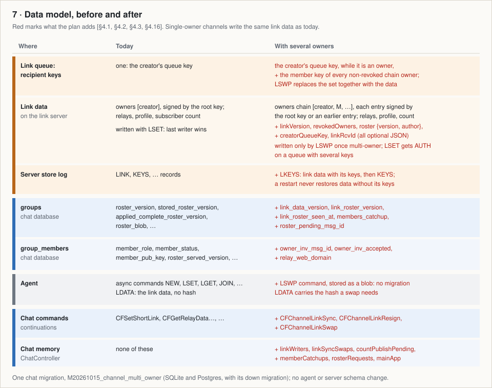
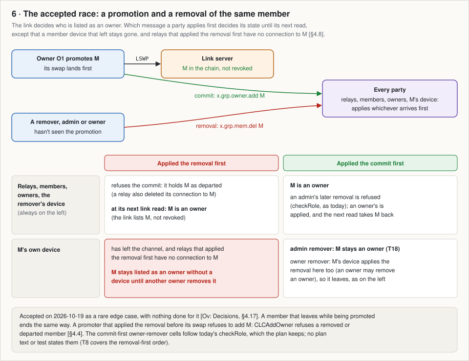

# Channel multi-owner (S3-min): summary

A short technical summary of the channel multi-owner plan for programmers who won't read all of it. Sources: the overview, [2026-10-15-channel-multi-owner-s3min.md](../2026-10-15-channel-multi-owner-s3min.md), and the implementation plan, [2026-10-15-channel-multi-owner-s3min-implementation.md](../2026-10-15-channel-multi-owner-s3min-implementation.md). [§4.4] cites the implementation plan, [Ov: Decisions] the overview. Nothing is implemented yet.

## Approach and why

Today a channel has one owner, its creator. The link data (profile, owner chain, relays, subscriber count) lives in one SMP queue on the link server, and the creator overwrites it with `LSET`: last writer wins. The creator alone numbers the roster, the signed list of member, moderator and admin roles that relays and members apply in version order [§3].

The plan gives a channel several equal owners, each able to do what the creator does today: a member becomes an owner after it accepts, owners can remove each other, and the channel survives any owner leaving, the creator included. Owners are trusted as the single owner is today; the design defends against malicious relays and a link server that withholds or serves stale data [Ov: intro, §1, §2].

The link server already orders every write to its queue, so the plan makes it order everything the owners share [Ov: How it works, §4]:

- **Compare-and-swap.** An owner reads the link data, applies its one change and writes it back with `LSWP` and the hash of what it read. If the data changed meanwhile, the server answers `CONFLICT`, and the owner reads and re-applies. The same step can replace the queue's recipient keys, so keys and data change together [§4.1, §4.4].
- **Role changes are numbered on the link.** The link names the roster version and its author, and an owner claims the next version only while it holds the complete roster of the current one. Each version has one author who had all earlier ones, as relays and members already assume, so they keep today's roster protocol [§4.10].
- **Relays treat owner actions as today**, without checking them against the link: they can't forge owner signatures, and owners are trusted [Ov: Decisions, §4.13].
- **Background work is a "link sync"**: agent async commands queued on the owner's connection to a relay (its "mailbox"), each step re-deriving what is left from the latest read and the database, so it survives restarts. User commands write synchronously [§4.4].

*Diagram 1. Who holds what, and who talks to whom.*

*Diagram 2. Two owners write at once; the stale swap gets `CONFLICT`, reads again and re-applies.*

*Diagram 3. An owner claims roster version v + 1 only while it holds the complete roster at v.*

## Protocol changes

| Layer | Change | Plan |
|---|---|---|
| SMP v24 | `LSWP hash [keys] userData`, a recipient command, not proxied: stores the new user data, and the whole key set if given, only if the SHA-256 of the stored encrypted user data equals `hash`. No fixed data is sent, so 52 Ed25519 keys fit (about 50 owners, computed); an `LSET`-shaped command would fit 6. | §4.1 |
| SMP v24 | Error `CONFLICT`, from `LSWP` only. `LSET` gets `AUTH` on a queue with several keys, so stale or downgraded single-owner writes can't overwrite multi-owner data. Store-log record `LKEYS` (data with its keys). | §4.1 |
| Link data | `GroupShortLinkData` gains optional `linkVersion` (write counter), `revokedOwners` (never shrinks), `creatorQueueKey` (kept in the key set while the creator is an owner), `linkRcvId` (the queue address other owners write to) and `roster {version, author}`. Writes keep unknown fields. New chain entries are signed by the root key (creator) or the signer's member key. | §4.3, §4.4 |
| Chat v23 | `x.grp.owner.inv {memberId}` and `x.grp.owner.acpt {invId}` through the invitee's support chat; the commit `x.grp.owner.add {memberId, memberKey, profile}` to everyone; unsigned `x.grp.members.req {cursor}` and `x.grp.members.page` between a new owner and one relay; optional `linkVersion` in `x.grp.info`. | §4.5 |

Plan §9 leaves two of these open, both recommended as planned: sending only the user data (q.4) and refusing `LSET` on multi-key queues, a server behaviour change (q.5).

**Compatibility** [§4.3, §5]. Promotion needs every relay on chat v23 and the link server on SMP v24. Older members ignore the commit and reject a new owner's messages until they upgrade; older joiners take revoked chain entries as owners, whose keys authorise nothing on the queue. A channel switches to multi-owner writes at its first accepted invitation; after the creator's first swap its queued single-owner writes get `AUTH`. Other channels keep today's code paths.

## Types and functions by module

| Repo | Module | Added or changed | Plan |
|---|---|---|---|
| simplexmq | `Protocol`, `Transport` | `LinkDataHash`, `CONFLICT`, `LSWP`; SMP 23 → 24 (proxied stays 23) | §4.1 |
| simplexmq | `Server`, `QueueStore/*`, `StoreLog`, `Client` | `LSWP` handler; `swapQueueLinkData` (STM, Postgres, journal); multi-key `LSET` refusal; `CreateLinkKeys`; `swapSMPQueueLink` | §4.1 |
| simplexmq | agent | `LinkOwnerCreds`; read with hash, `setShortLinkSwap` (sync, async), `deleteLinkQueueWithCreds`, creator queue credentials, v24 and private-routing checks; hash in `LDATA`; a session per link | §4.2 |
| chat | `Protocol` | link data fields, `LinkRoster`, `CreatorQueueKey`; five events; chat 22 → 23 | §4.3, §4.5 |
| chat | `Controller` | `APIInviteGroupOwner`, `APIAcceptGroupOwnerInvitation`, `CROwnerInvitationSent`; `CEChannelLink` (11 cases); six config limits; a test hook; in-memory state; `Maybe GroupLink` in `CEvtGroupLinkDataUpdated` and `CRGroupRelaysAdded` | §4.13, §4.16 |
| chat | `Types`, `Messages/CIContent/Events` | `CFChannelLinkSync`, `CFChannelLinkResign`, `CFChannelLinkSwap`; `RGEOwnerInvitation` | §4.4, §4.6 |
| chat | `Library/*` | `writeChannelLink` (user writes), `enqueueLinkSync` (background), `ChannelLinkChange` (profile, add or revoke owner, relays, count, roster); `applyChannelLinkData` (every read); `claimRosterVersion`; `activateGroupRelays` | §4.4, §4.10, §4.13 |

## Database

| Table | New columns | Meaning |
|---|---|---|
| `groups` | `link_data_version`, `link_roster_version`, `link_roster_seen_at`, `members_catchup`, `roster_pending_msg_id` | highest `linkVersion` seen; last roster commitment and when it appeared; catch-up pending; own roster not yet sent |
| `group_members` | `owner_inv_msg_id`, `owner_inv_accepted`, `relay_web_domain` | pending invitation and its acceptance; a relay's web domain without a relay row |

One chat migration, `M20261015_channel_multi_owner` (SQLite and Postgres, with its down migration), columns only; no agent or server schema change [§4.16, §5].

*Diagram 7. What the plan adds, by store.*

## API, commands and apps

- **New** [§4.6]: `/owner invite #<group> <member>` (`APIInviteGroupOwner`), refused unless the member's security code is verified (the only check that catches a relay substituting its key), every relay is on chat v23, the link server on SMP v24, and the chain under 50 entries. `/_owner accept #<groupId> <chatItemId> [direct=on]` (`APIAcceptGroupOwnerInvitation`) runs on the member's device, which from then on connects to the link server directly, revealing its IP address to that operator; the invitation says so, private-routing settings need an explicit confirmation, and settings that forbid direct connections refuse it.
- **Changed in multi-owner mode**: role changes, and removals of members, moderators and admins, claim a roster version [§4.10]; removing an owner and leaving (not the last owner) are link writes, and destroying deletes the link queue first [§4.8, §4.9, §4.14]; a profile edit is refused when the link's profile differs from the one the device held when the edit started [§4.12]; owners read the link on channel open [§4.4]. Group-link commands are refused for every channel [§4.14].
- **Apps**, iOS and Kotlin mirrored, ~380 lines each [§6, §6.1]: Owner in the role picker via verification, the invitation item, "Remove owner", Leave while another owner exists, link screen, composer and relay settings for non-creator owners, and editors that refuse a stale save.

*Diagram 4. Promotion end to end. Transferring ownership is this, then the creator leaves (diagram 5).*

*Diagram 5. A removal and a leave land on the link first; the swap drops the owner's key, then the announcement follows.*

## How owners, relays and members stay consistent

- **Owners** announce profile, role, owner and relay changes and leaves only after their link write lands; posts, moderation, blocks, subscriber removals and invitations are sent as today [§5]. Every read goes through `applyChannelLinkData`: an older `linkVersion` is ignored, and reads only add owners or mark revoked ones departed, so a stale read can't undo a promotion but can show a removed owner as current until the next read [§4.4, §5].
- **Roster**: an owner that sees another owner's role event above its version fetches the roster from the relays, and a claim before it arrives gets `CLERosterSyncing` ("catching up, try again"). Departed owners' roster messages still pass the gate. An undelivered roster is re-signed at the next version; a departed author's version that no relay serves is abandoned after a day (claim `r + 2`) [§4.10].
- **Relays** apply owner events as today, plus the commit, read the link at invitation and every 15 minutes, and accept from a departed owner only its leave and roster messages up to the link's roster version [§4.13, §5]. **Relays and members** ignore an `x.grp.info` older than their `linkVersion` (relays still forward it) [§4.12].
- **Background work** runs in the main app only, at most five swaps per channel per trigger; chat start re-enqueues it [§4.4, §4.15]. A new owner pages the member list from one relay, without pictures; the first current owner in the chain publishes the count at most once a minute [§4.4, §4.7, §4.11].

## Accepted trade-offs and residual risks

Trade-offs [Ov: Trade-offs users notice, Ov: Decisions]:

- Owner actions need the link server (posting doesn't); a role change takes 1–3 s and can be refused for a few seconds after another owner's. The link server learns when owners act and how many there are; a new owner's profile reaches every subscriber.
- **A promotion wins over a concurrent removal or leave of the member** (decided 2026-10-19): parties that applied the removal first take the member as an owner at their next read; if the member's device applied the removal first, it has left, and the member stays listed as an owner until an owner removes it [§4.8]. With an owner as remover the device applies the removal in either order (today's `checkRole`, which the plan keeps; T8 tests the removal-first order).
- Blocking stays unordered, as in groups; no invitation cancel, field-level profile merge, equal-version tie-break or root-key retirement [§2].

*Diagram 6. The link decides who is listed as an owner; arrival order decides each party's state until its next read, except that a member device that left stays gone and relays that applied the removal keep no connection to the member.*

Residual risks [Ov: Residual risks, §5]:

- A link server ignoring the compare-and-swap can lose writes or split roles, but can't forge.
- A removed owner on modified software acts as an owner through a relay until the relay learns of the removal (the announcement, or its next 15-minute check), and can send inflated role versions that block later role changes at that relay and its members; with a colluding link server it can serve forged link data.
- Any current owner can destroy the channel or lock the others out.
- A role change no relay serves (its author lost or removed first, or its only relay failed) stops every other owner's role changes while a lost author is still an owner; once it is removed, the version is abandoned within a day; devices that applied part of it revert, and earlier versions the abandoning owner missed are dropped.
- A remover that crashes after its swap sends no announcement; others learn at their next read.
- A creator restored from an old backup acts as single owner until it leaves or destroys, and its role changes can collide. A downgraded server loses recent link data and stops multi-owner writes; a creator on an older app can't change the link.

## Slices

~2,260 production Haskell lines (simplexmq ~490, chat ~1,770) plus tests, and ~380 per app platform; each slice compiles and passes its tests on its own [§6].

| # | Slice | Lines |
|---|---|---|
| S1 | simplexmq store: hash, `CONFLICT`, swap per store, `LSET` refusal, `LKEYS` | ~190 |
| S2 | simplexmq protocol: v24, `LSWP`, handler, client | ~100 |
| S3 | simplexmq agent | ~200 |
| S4 | chat on the new simplexmq, structural | ~90 |
| S5 | chat wire and data, inert | ~300 |
| S6 | link writes and reads, multi-owner mode | ~200 |
| S7 | link syncs | ~170 |
| S8 | callers: profile, relays, count | ~190 |
| S9 | promotion | ~220 |
| S10 | member catch-up | ~120 |
| S11 | roster through the link | ~250 |
| S12 | removal, leave, destroy | ~170 |
| S13 | guards | ~60 |
| S14–S17 | iOS, then Kotlin mirroring it | ~380 per platform |

**Risks** [§8, Ov: Not verified, size]: the riskiest assumption is that the unchanged roster protocol converges with link-claimed versions (S11, S12 test it); the second, that every background callback re-derived from the latest read is idempotent (T17). S1 and S2 first prove the swap's atomicity and the computed 50-owner size; the 100,000-member catch-up is an estimate. App code and Postgres tests run only on the host.
