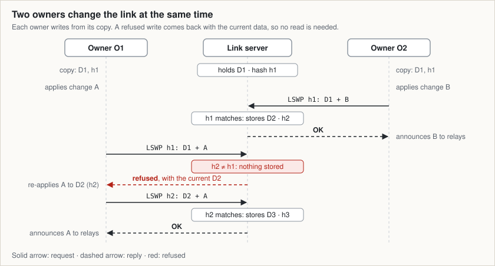
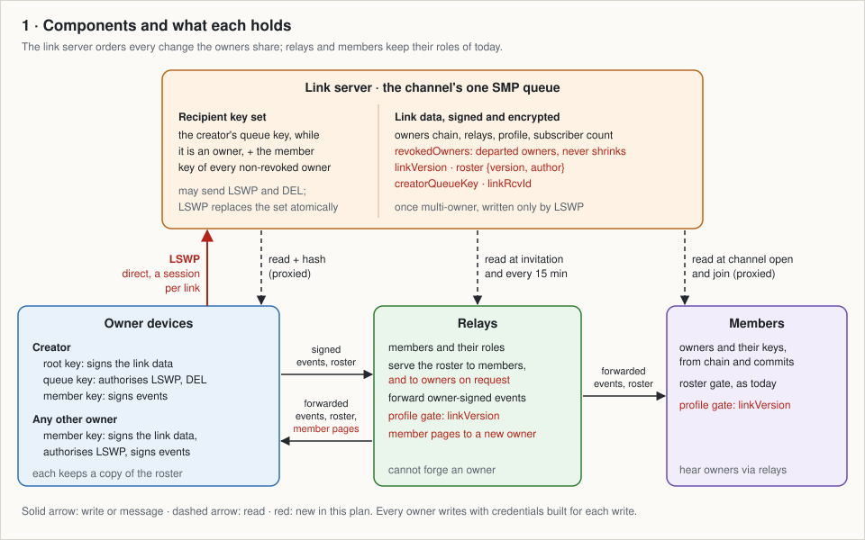
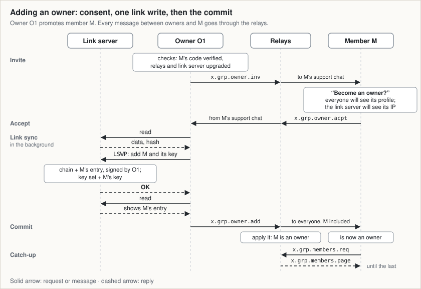
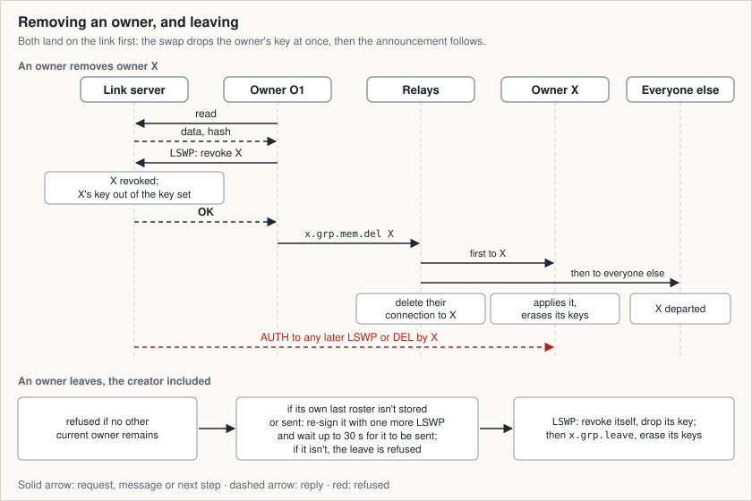
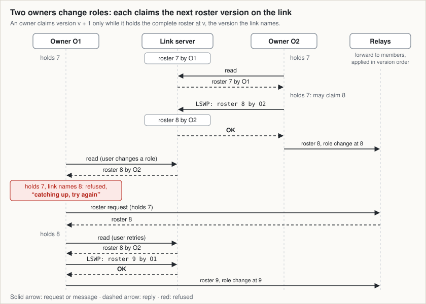

# Channels with several owners: summary

The plan lets a channel have up to six equal owners (five while its creator is one): the server that holds the channel's link takes their changes one at a time, so concurrent changes are never lost or undone. The [server part](https://github.com/simplex-chat/simplexmq/pull/2005) and the [first chat part](https://github.com/spaced4ndy/simplex-chat/pull/4) are built; the rest waits for your review of the design.

The published page, with the pictures one at a time: https://claude.ai/artifact/25Z9m6xPzLMkiGNJ6TeKgy

`LSWP` (link swap) is the new write command. Each owner keeps a copy of the link data and its hash (h1, h2) and writes from it; the server stores the write only if that hash still matches what it holds. Otherwise it stores nothing and sends back the current data, and the owner re-applies its change to that and writes again, five swaps at most in all. Neither change is lost, and the refused owner needs no read.

Sources: [Overview, How it works][ov28]: the one new server command; [Plan §4.1][pl44-46]: the hash, `LSWP` and the reply with the current data; [Plan §4.3][pl99]: the stored copy; [Plan §4.4][pl105-115]: write from the copy, at most five swaps, then the announcement.

Only owners write the channel's link, and the server accepts a write only with one of the keys it holds: at most six, one of them the key the creator made the link with, while the creator is an owner. So a channel has up to six owners, five while the creator is one. Relays and members only read the link; relays carry everything else between owners and members, as today. Blue marks what the plan adds.

Sources: [Overview, How it works][ov26-32]: the link server orders what owners share; [Plan §4.1][pl45]: room for 6 keys; the key set swapped with the data; [Plan §4.3][pl83-89]: the new link-data fields; [Plan §4.3, stored copy][pl99]: when a write reads first, and the device's other reads; [Plan §4.4, step 3][pl111]: which keys may write; [Plan §4.4][pl144]: who reads the link, and when; [Plan §4.7][pl197-199]: member pages for a new owner; [Plan §4.12][pl256]: older profile updates skipped; [Plan §5][pl321-326]: relays can't forge owners; the 15-minute relay check; writes direct, reads private.

A member becomes an owner only after its security code is verified and it accepts, and only while the channel has room for another owner. One link write then adds it; the write's reply already shows it, so the announcement follows with no read. In order: the invitation, the acceptance, the link write, the announcement to everyone, the new owner's download of the member list from a relay. Handing a channel over is this promotion, then the creator leaves.

Sources: [Overview, What owners can do][ov14]: make a member an owner, up to 6 owners; [Plan §4.6][pl172-193]: invite (with the owner limit), accept, the link write, the commit; [Plan §4.7][pl197-199]: the new owner's member list; [Plan §6.1][pl382]: the "Become an owner?" question; [Plan §7, T3][pl408]: the creator promotes M and leaves.

A removal or a leave lands on the link first: from then on the server refuses the departed owner's key (`AUTH`), and the announcement follows. The last owner can't leave. An owner whose last role change may not have reached any relay re-sends it before leaving, so it isn't lost.

Sources: [Overview, What owners can do][ov16-17]: remove an owner, leave; [Plan §4.8][pl203-207]: removing an owner; [Plan §4.9][pl209-217]: leaving, with the re-sign and the 30-second wait; [Plan §1, AC4][pl16]: the removed owner's writes and `DEL` get `AUTH`.

The roster is the signed list of member, moderator and admin roles; 7, 8 and 9 are its versions. An owner claims the next version only while it holds every earlier one, so members and relays apply role changes in order, as today. An owner whose copy is behind learns the newer version from its refused write, fetches that roster from a relay, and its user sees "catching up, try again" for a few seconds.

Sources: [Overview, How it works][ov29]: role changes numbered on the link server; [Overview, What owners can do][ov15] and [plan §4.10][pl230]: the roster's roles, owners outside it; [Overview, Trade-offs users notice][ov53]: "catching up, try again"; [Plan §4.10][pl221-226]: claims from the complete roster, and the roster request; [Plan §4.17][pl306]: two role changes at once.

- **For users.** Today a channel has one owner, its creator. With the plan any owner can post, edit the channel, change roles, manage relays and destroy the channel; a member becomes an owner only after its security code is verified and it accepts an invitation; owners can remove each other, and the channel keeps working after the creator leaves. Up to six owners, five while the creator is one. [overview][ov3-22]
- **How.** Each owner keeps a copy of the channel's link data, makes its one change and writes it back; the server takes the write only if nobody wrote since, and otherwise sends back the current data for the owner to re-apply its change. The roster, the signed list of member, moderator and admin roles, is numbered on the same server, so relays and members keep today's role protocol. [overview][ov24-32]
- **What users notice.** Owner actions need that server, posting doesn't; a role change takes 1–3 seconds and can be refused for a few seconds after another owner's ("catching up, try again"); a new owner's device connects to the server directly, showing it the device's IP address, and the invitation says so. [overview][ov51-60], [timing][ov38]
- **Trust.** Owners trust each other as the single owner is trusted today: any owner can destroy the channel or lock the others out. The design guards against dishonest relays and a server that withholds the link or serves an old copy. [overview][ov3], [risks][ov62-68]
- **Cost and order.** About 112 hours of work, building, testing and reviewing included. The server part and the first chat part (new messages and data, needing nothing from the new server) start side by side; then the chat core moves onto the new server, with the iOS, Android and desktop apps after the core parts they need, built and tested on GitHub's runners. The riskiest part, role changes by several owners reaching every member in order, is mostly tested before any app work in the planned order. [plan][pl328-351], [risk][pl468]

## Decided

- An owner's write keeps the shape of today's write and adds the hash and the owner keys, for now. That leaves room for six keys: up to five owners while the creator is one, six after it leaves. [overview][ov42], [plan][pl45]
- The server refuses today's write on a link several owners write, so a stale write, or one from an older app, can't erase the other owners' changes. Single-owner channels are unaffected. [overview][ov43], [plan][pl47]
- A write refused because the data changed is answered with the current data, so no read follows it. [overview][ov44], [plan][pl113]
- Each owner writes from its stored copy of the link data; it reads before a write only without a usable copy or to confirm a refusal the copy shows, and also at channel open and app start. It costs one database column; owners read the link less, and the server learns nothing new, since a refused write's data comes back over the connection the write already uses. [overview][ov45], [copy][pl99], [privacy][pl326]
- The server part starts from the server code version this branch pins and adapts the design to it. [overview][ov46], [plan][pl54]

## For programmers

What the pictures don't show; the plan's sections have the rest. Each link opens the cited lines of the [overview](../2026-10-15-channel-multi-owner-s3min.md) or the [implementation plan](../2026-10-15-channel-multi-owner-s3min-implementation.md) at the commit this page describes.

- **Wire.** SMP v24, the server protocol's next version: `LSWP linkId hash [keys] (fixedData, userData)` answers `OK`, or `LCUR` (current) with the stored user data when the hash differs; `LSET` gets `AUTH` on a queue with several keys; not proxied. Chat protocol v23: `x.grp.owner.inv`, `x.grp.owner.acpt`, `x.grp.owner.add` (invite, consent, commit), `x.grp.members.req` and `x.grp.members.page` (member list), `linkVersion` in `x.grp.info`. [[§4.1][pl41-54], [§4.5][pl155-168]]
- **Agent.** Owners store and write from `OwnerLinkData` (encrypted fixed data, signed user data, hash); a swap returns `LSRSwapped` or `LSRChanged` with the link's data after it, directly or as the `LSWAP` event of an async command. [[§4.2][pl56-77]]
- **Chat.** A user's command writes with `writeChannelLink`; background work (finishing a promotion, relays, the count, roster re-sends) runs as link syncs of agent async commands. Both continue with `continueChannelLink`, which re-derives what is left from the latest data and the database, at most five swaps per trigger. Link data older than the stored `linkVersion` is ignored, and a read only adds owners or marks revoked ones departed. [[§4.4][pl101-151]]
- **Roster.** Claims come from the complete roster; roster messages from an owner who has since left are still applied in version order; a version by an owner who has left that no relay serves is skipped after a day. [[§4.10][pl219-246]]
- **Data and API.** One migration, nine columns, no new table; `/owner invite #<group> <member>` and `/_owner accept #<groupId> <chatItemId> [direct=on]`; refusals as `CEChannelLink` errors. [[§4.16][pl283-297]]
- **Risks.** The riskiest assumption is that today's roster protocol converges when versions are claimed through the link (tests in S9, S10 and S13); next, that background callbacks re-derived from the latest data are idempotent (T17, in S8). S1 first proves the swap's atomicity and that six keys fit. Trade-offs and residual risks: [overview][ov51-73]. [[§8][pl466-472]]

| Slices | What | Starts |
|---|---|---|
| S1–S2 | simplexmq: the swap, SMP v24, the agent | first |
| S3 | chat: new messages and data, nothing that needs the new server | beside S1–S2 |
| S4–S5 | chat on the new server: writes from the copy, link syncs, profile, relays, count | after S2 and S3 |
| S6 | CI: a test backend with channels on a v24 link server | after S4's first part |
| S7–S10 | promotion, member list, guards; roster through the link | after S5 |
| S11–S12 | apps: invitation and promotion, iOS then Kotlin | after S6 and S8 |
| S13–S14 | leave, removal, destroy | after S10 |
| S15–S16 | apps: owner management, iOS then Kotlin | after S11–S14 |

Sixteen slices; each compiles and passes its tests alone. [[§6][pl328-372]]

[ov3]: https://github.com/spaced4ndy/simplex-chat/blob/03a4636f61c5b5dbdb63609f35dcc7b2e73b7170/plans/2026-10-15-channel-multi-owner-s3min.md?plain=1#L3
[ov3-22]: https://github.com/spaced4ndy/simplex-chat/blob/03a4636f61c5b5dbdb63609f35dcc7b2e73b7170/plans/2026-10-15-channel-multi-owner-s3min.md?plain=1#L3-L22
[ov14]: https://github.com/spaced4ndy/simplex-chat/blob/03a4636f61c5b5dbdb63609f35dcc7b2e73b7170/plans/2026-10-15-channel-multi-owner-s3min.md?plain=1#L14
[ov15]: https://github.com/spaced4ndy/simplex-chat/blob/03a4636f61c5b5dbdb63609f35dcc7b2e73b7170/plans/2026-10-15-channel-multi-owner-s3min.md?plain=1#L15
[ov16-17]: https://github.com/spaced4ndy/simplex-chat/blob/03a4636f61c5b5dbdb63609f35dcc7b2e73b7170/plans/2026-10-15-channel-multi-owner-s3min.md?plain=1#L16-L17
[ov24-32]: https://github.com/spaced4ndy/simplex-chat/blob/03a4636f61c5b5dbdb63609f35dcc7b2e73b7170/plans/2026-10-15-channel-multi-owner-s3min.md?plain=1#L24-L32
[ov26-32]: https://github.com/spaced4ndy/simplex-chat/blob/03a4636f61c5b5dbdb63609f35dcc7b2e73b7170/plans/2026-10-15-channel-multi-owner-s3min.md?plain=1#L26-L32
[ov28]: https://github.com/spaced4ndy/simplex-chat/blob/03a4636f61c5b5dbdb63609f35dcc7b2e73b7170/plans/2026-10-15-channel-multi-owner-s3min.md?plain=1#L28
[ov29]: https://github.com/spaced4ndy/simplex-chat/blob/03a4636f61c5b5dbdb63609f35dcc7b2e73b7170/plans/2026-10-15-channel-multi-owner-s3min.md?plain=1#L29
[ov38]: https://github.com/spaced4ndy/simplex-chat/blob/03a4636f61c5b5dbdb63609f35dcc7b2e73b7170/plans/2026-10-15-channel-multi-owner-s3min.md?plain=1#L38
[ov42]: https://github.com/spaced4ndy/simplex-chat/blob/03a4636f61c5b5dbdb63609f35dcc7b2e73b7170/plans/2026-10-15-channel-multi-owner-s3min.md?plain=1#L42
[ov43]: https://github.com/spaced4ndy/simplex-chat/blob/03a4636f61c5b5dbdb63609f35dcc7b2e73b7170/plans/2026-10-15-channel-multi-owner-s3min.md?plain=1#L43
[ov44]: https://github.com/spaced4ndy/simplex-chat/blob/03a4636f61c5b5dbdb63609f35dcc7b2e73b7170/plans/2026-10-15-channel-multi-owner-s3min.md?plain=1#L44
[ov45]: https://github.com/spaced4ndy/simplex-chat/blob/03a4636f61c5b5dbdb63609f35dcc7b2e73b7170/plans/2026-10-15-channel-multi-owner-s3min.md?plain=1#L45
[ov46]: https://github.com/spaced4ndy/simplex-chat/blob/03a4636f61c5b5dbdb63609f35dcc7b2e73b7170/plans/2026-10-15-channel-multi-owner-s3min.md?plain=1#L46
[ov51-60]: https://github.com/spaced4ndy/simplex-chat/blob/03a4636f61c5b5dbdb63609f35dcc7b2e73b7170/plans/2026-10-15-channel-multi-owner-s3min.md?plain=1#L51-L60
[ov51-73]: https://github.com/spaced4ndy/simplex-chat/blob/03a4636f61c5b5dbdb63609f35dcc7b2e73b7170/plans/2026-10-15-channel-multi-owner-s3min.md?plain=1#L51-L73
[ov53]: https://github.com/spaced4ndy/simplex-chat/blob/03a4636f61c5b5dbdb63609f35dcc7b2e73b7170/plans/2026-10-15-channel-multi-owner-s3min.md?plain=1#L53
[ov62-68]: https://github.com/spaced4ndy/simplex-chat/blob/03a4636f61c5b5dbdb63609f35dcc7b2e73b7170/plans/2026-10-15-channel-multi-owner-s3min.md?plain=1#L62-L68
[pl16]: https://github.com/spaced4ndy/simplex-chat/blob/03a4636f61c5b5dbdb63609f35dcc7b2e73b7170/plans/2026-10-15-channel-multi-owner-s3min-implementation.md?plain=1#L16
[pl41-54]: https://github.com/spaced4ndy/simplex-chat/blob/03a4636f61c5b5dbdb63609f35dcc7b2e73b7170/plans/2026-10-15-channel-multi-owner-s3min-implementation.md?plain=1#L41-L54
[pl44-46]: https://github.com/spaced4ndy/simplex-chat/blob/03a4636f61c5b5dbdb63609f35dcc7b2e73b7170/plans/2026-10-15-channel-multi-owner-s3min-implementation.md?plain=1#L44-L46
[pl45]: https://github.com/spaced4ndy/simplex-chat/blob/03a4636f61c5b5dbdb63609f35dcc7b2e73b7170/plans/2026-10-15-channel-multi-owner-s3min-implementation.md?plain=1#L45
[pl47]: https://github.com/spaced4ndy/simplex-chat/blob/03a4636f61c5b5dbdb63609f35dcc7b2e73b7170/plans/2026-10-15-channel-multi-owner-s3min-implementation.md?plain=1#L47
[pl54]: https://github.com/spaced4ndy/simplex-chat/blob/03a4636f61c5b5dbdb63609f35dcc7b2e73b7170/plans/2026-10-15-channel-multi-owner-s3min-implementation.md?plain=1#L54
[pl56-77]: https://github.com/spaced4ndy/simplex-chat/blob/03a4636f61c5b5dbdb63609f35dcc7b2e73b7170/plans/2026-10-15-channel-multi-owner-s3min-implementation.md?plain=1#L56-L77
[pl83-89]: https://github.com/spaced4ndy/simplex-chat/blob/03a4636f61c5b5dbdb63609f35dcc7b2e73b7170/plans/2026-10-15-channel-multi-owner-s3min-implementation.md?plain=1#L83-L89
[pl99]: https://github.com/spaced4ndy/simplex-chat/blob/03a4636f61c5b5dbdb63609f35dcc7b2e73b7170/plans/2026-10-15-channel-multi-owner-s3min-implementation.md?plain=1#L99
[pl101-151]: https://github.com/spaced4ndy/simplex-chat/blob/03a4636f61c5b5dbdb63609f35dcc7b2e73b7170/plans/2026-10-15-channel-multi-owner-s3min-implementation.md?plain=1#L101-L151
[pl105-115]: https://github.com/spaced4ndy/simplex-chat/blob/03a4636f61c5b5dbdb63609f35dcc7b2e73b7170/plans/2026-10-15-channel-multi-owner-s3min-implementation.md?plain=1#L105-L115
[pl111]: https://github.com/spaced4ndy/simplex-chat/blob/03a4636f61c5b5dbdb63609f35dcc7b2e73b7170/plans/2026-10-15-channel-multi-owner-s3min-implementation.md?plain=1#L111
[pl113]: https://github.com/spaced4ndy/simplex-chat/blob/03a4636f61c5b5dbdb63609f35dcc7b2e73b7170/plans/2026-10-15-channel-multi-owner-s3min-implementation.md?plain=1#L113
[pl144]: https://github.com/spaced4ndy/simplex-chat/blob/03a4636f61c5b5dbdb63609f35dcc7b2e73b7170/plans/2026-10-15-channel-multi-owner-s3min-implementation.md?plain=1#L144
[pl155-168]: https://github.com/spaced4ndy/simplex-chat/blob/03a4636f61c5b5dbdb63609f35dcc7b2e73b7170/plans/2026-10-15-channel-multi-owner-s3min-implementation.md?plain=1#L155-L168
[pl172-193]: https://github.com/spaced4ndy/simplex-chat/blob/03a4636f61c5b5dbdb63609f35dcc7b2e73b7170/plans/2026-10-15-channel-multi-owner-s3min-implementation.md?plain=1#L172-L193
[pl197-199]: https://github.com/spaced4ndy/simplex-chat/blob/03a4636f61c5b5dbdb63609f35dcc7b2e73b7170/plans/2026-10-15-channel-multi-owner-s3min-implementation.md?plain=1#L197-L199
[pl203-207]: https://github.com/spaced4ndy/simplex-chat/blob/03a4636f61c5b5dbdb63609f35dcc7b2e73b7170/plans/2026-10-15-channel-multi-owner-s3min-implementation.md?plain=1#L203-L207
[pl209-217]: https://github.com/spaced4ndy/simplex-chat/blob/03a4636f61c5b5dbdb63609f35dcc7b2e73b7170/plans/2026-10-15-channel-multi-owner-s3min-implementation.md?plain=1#L209-L217
[pl219-246]: https://github.com/spaced4ndy/simplex-chat/blob/03a4636f61c5b5dbdb63609f35dcc7b2e73b7170/plans/2026-10-15-channel-multi-owner-s3min-implementation.md?plain=1#L219-L246
[pl221-226]: https://github.com/spaced4ndy/simplex-chat/blob/03a4636f61c5b5dbdb63609f35dcc7b2e73b7170/plans/2026-10-15-channel-multi-owner-s3min-implementation.md?plain=1#L221-L226
[pl230]: https://github.com/spaced4ndy/simplex-chat/blob/03a4636f61c5b5dbdb63609f35dcc7b2e73b7170/plans/2026-10-15-channel-multi-owner-s3min-implementation.md?plain=1#L230
[pl256]: https://github.com/spaced4ndy/simplex-chat/blob/03a4636f61c5b5dbdb63609f35dcc7b2e73b7170/plans/2026-10-15-channel-multi-owner-s3min-implementation.md?plain=1#L256
[pl283-297]: https://github.com/spaced4ndy/simplex-chat/blob/03a4636f61c5b5dbdb63609f35dcc7b2e73b7170/plans/2026-10-15-channel-multi-owner-s3min-implementation.md?plain=1#L283-L298
[pl306]: https://github.com/spaced4ndy/simplex-chat/blob/03a4636f61c5b5dbdb63609f35dcc7b2e73b7170/plans/2026-10-15-channel-multi-owner-s3min-implementation.md?plain=1#L307
[pl321-326]: https://github.com/spaced4ndy/simplex-chat/blob/03a4636f61c5b5dbdb63609f35dcc7b2e73b7170/plans/2026-10-15-channel-multi-owner-s3min-implementation.md?plain=1#L322-L327
[pl326]: https://github.com/spaced4ndy/simplex-chat/blob/03a4636f61c5b5dbdb63609f35dcc7b2e73b7170/plans/2026-10-15-channel-multi-owner-s3min-implementation.md?plain=1#L327
[pl328-351]: https://github.com/spaced4ndy/simplex-chat/blob/03a4636f61c5b5dbdb63609f35dcc7b2e73b7170/plans/2026-10-15-channel-multi-owner-s3min-implementation.md?plain=1#L329-L352
[pl328-372]: https://github.com/spaced4ndy/simplex-chat/blob/03a4636f61c5b5dbdb63609f35dcc7b2e73b7170/plans/2026-10-15-channel-multi-owner-s3min-implementation.md?plain=1#L329-L373
[pl382]: https://github.com/spaced4ndy/simplex-chat/blob/03a4636f61c5b5dbdb63609f35dcc7b2e73b7170/plans/2026-10-15-channel-multi-owner-s3min-implementation.md?plain=1#L383
[pl408]: https://github.com/spaced4ndy/simplex-chat/blob/03a4636f61c5b5dbdb63609f35dcc7b2e73b7170/plans/2026-10-15-channel-multi-owner-s3min-implementation.md?plain=1#L409
[pl466-472]: https://github.com/spaced4ndy/simplex-chat/blob/03a4636f61c5b5dbdb63609f35dcc7b2e73b7170/plans/2026-10-15-channel-multi-owner-s3min-implementation.md?plain=1#L467-L473
[pl468]: https://github.com/spaced4ndy/simplex-chat/blob/03a4636f61c5b5dbdb63609f35dcc7b2e73b7170/plans/2026-10-15-channel-multi-owner-s3min-implementation.md?plain=1#L469
