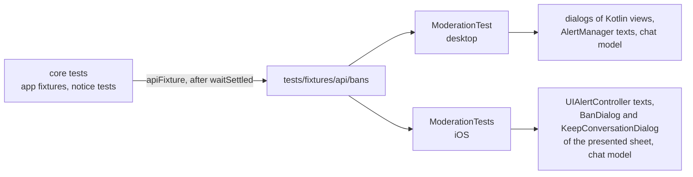

# Bans and chat actions: UI (parts 2-5)

iOS and Kotlin multiplatform (Android, desktop).
Design: plans/2026-10-16-moderation-ux.html.
Core: plans/2026-10-16-bans-core.md (part 1).
App line numbers refer to commit 643a9afad, a historical snapshot (`git show 643a9afad:<path>`); the app code now includes later master changes. The branch's own changes: `git diff origin/master...HEAD`.
Haskell line numbers refer to a503e09ef.

Terms: UI text says "block" for both kinds, as master did; "ban" was used in the UI until 10 Nov. References to core use the code terms:
- block: the block while the member is in the group, until unblocked ("Block for all", "Unblock for all"; x.grp.mem.restrict, `blockedByAdmin`); timed blocks were removed on 25 Nov
- notice: the block at removal or deletion ("Block and remove", "Delete and block", "Not allowed"; `LinkNotice`)

Paths:
- iOS: apps/ios/Shared, apps/ios/SimpleXChat
- Kotlin: `common/` = apps/multiplatform/common/src/commonMain/kotlin/chat/simplex/common
- Kotlin strings: apps/multiplatform/common/src/commonMain/moko-resources/base/strings.xml
- iOS localization keys are the English source texts; a changed text is a new key (apps/ios/LOCALIZATION.md)
- Kotlin keys keep their names when only the text changes

## Parts of PR 8073

- PR 2: recipient UI: inventory item 12; decoding of CAPLinkNotice, GLPLinkNotice, CELinkNotice
- PR 3: bans in groups and channels: inventory items 1-11, 13
- PR 4: contacts, business chats and deletion: inventory items 15-20
- PR 5: chat list actions: inventory items 22-26
- inventory items 14, 21: core, part 1
- PR 8073 includes the core part and these four app parts; "PR 2" to "PR 5" below name these parts

Docs in every part (Change Protocol, apps/ios/CODE.md and apps/multiplatform/CODE.md):
- spec/ and product/ documents of both app trees, per the Document Map rows of the changed files

## PR 2: recipient UI

Status: implemented; CI builds the iOS app and runs its unit tests (job "macos-latest (iOS)"), and builds the desktop and Android apps and runs their unit tests (step "Build and test Kotlin apps" of build.yml); "How it works" opens https://simplex.chat/docs/guide/secret-groups.html#blocking-members, the "Blocking members" section of docs/guide/secret-groups.md.

### Covers

- "Not allowed: rejoining or reconnecting"
- decoding of the plan results and the error below

### Core API

- APIConnectPlan returns CPContactAddress (CAPLinkNotice {expiresAt, contactSLinkData_}) and CPGroupLink (GLPLinkNotice {expiresAt}): Controller.hs:1173, 1184; Commands.hs:4658, 4683
- CELinkNotice {expiresAt} (Controller.hs:1520) is returned by APIConnectPreparedContact, APIConnectPreparedGroup, APIConnect with a contact link, APIConnectContactViaAddress: Commands.hs:2279, 2308, 2371, 2405, 3913
- JSON tag "linkNotice"; `expiresAt` is absent for a notice without end time

### Alert

- title: "Not allowed"
- group link: "Blocked by the admins of this group."
- channel link: "Blocked by the owners of this channel."
- contact address: "Blocked by this contact."
- business address: "Blocked by this business." (core gap 5)
- with `expiresAt`: "until <time>" before the full stop, as "Blocked by this contact until <time>."
- buttons: OK; "Connect to @<name>" or "Join channel #<name>" when the name has the other kind of chat (open question 26); How it works
- Kotlin, plan results: the device label when remote hosts are set up (`hostDevice`)
- How it works opens the "Blocking members" section of the user guide (open question 14)
- shape of the server notice alert: iOS `showClientNotice` (SimpleXAPI.swift:3182-3203), Kotlin `showClientNoticeAlert` (SimpleXAPI.kt:8916-8945)

### Target of the alert

- GLPLinkNotice: the link type of a parsed link (group link: group; channel link: channel; other links: contact); otherwise channel when `planSimplexName.nameType` is `publicGroup`, group otherwise
- CAPLinkNotice: business when `contactSLinkData_.business`; contact otherwise
- CELinkNotice after APIConnectPreparedGroup: business when `groupInfo.businessChat` is set; channel when `groupInfo.isChannel`; group otherwise
- CELinkNotice after APIConnectPreparedContact or APIConnectContactViaAddress: contact
- CELinkNotice after APIConnect: from the link type of the connection link (open question 16): group link: group; channel link: channel; other links: contact

### iOS

- Shared/Model/AppAPITypes.swift `ContactAddressPlan` (1474-1481): `case linkNotice(expiresAt: Date?, contactSLinkData_: ContactShortLinkData?)`; `GroupLinkPlan` (1489-1497): `case linkNotice(expiresAt: Date?)`
- SimpleXChat/APITypes.swift `ChatErrorType` (743): `case linkNotice(expiresAt: Date?)`
- Shared/Views/NewChat/NewChatView.swift `planAndConnect` (1321-1668): `.linkNotice` cases in the contactAddress switch (1437-1522) and the groupLink switch (1523-1652); each shows the alert and calls `cleanup`
- NewChatView.swift: new alert function next to `showInvitationLinkConnectingAlert` (913) and `showGroupLinkConnectingAlert` (923)
- Shared/Model/SimpleXAPI.swift `apiConnectResponseAlert` (1082-1166): `.error(.linkNotice)` case; target parameter
- SimpleXAPI.swift `apiConnect` (1058-1080): the target `LinkNoticeTarget(connLink)`, from the link type of the connection link
- SimpleXAPI.swift `apiConnectPreparedContact` (1231-1236): the contact target
- SimpleXAPI.swift `apiConnectPreparedGroup` (1238-1243): target parameter; caller: Shared/Views/Chat/ComposeMessage/ComposeView.swift:1211
- SimpleXAPI.swift `apiConnectContactViaAddress` (1245-1257): the alert for `.linkNotice` in place of `connectionErrorAlert`
- SimpleXChat/ChatTypes.swift: user guide URL constant next to `contentModerationPostLink` (22); `bansGuideLink`: https://simplex.chat/docs/guide/secret-groups.html#blocking-members

### Kotlin

- common/model/SimpleXAPI.kt `ContactAddressPlan` (7458-7465): `@SerialName("linkNotice") class LinkNotice(val expiresAt: Instant? = null, val contactSLinkData_: ContactShortLinkData? = null)`; `GroupLinkPlan` (7468-7476): `@SerialName("linkNotice") class LinkNotice(val expiresAt: Instant? = null)`
- SimpleXAPI.kt `ChatErrorType` (7753): `LinkNotice(expiresAt)` class and its `string` case
- SimpleXAPI.kt `apiConnectResponseAlert` (1659-1745): LinkNotice case; target parameter
- SimpleXAPI.kt `apiConnect` (1643): the target `LinkNoticeTarget.fromConnLink(connLink)`, from the link type of the connection link
- SimpleXAPI.kt `apiConnectPreparedContact` (1816-1824): the contact target
- SimpleXAPI.kt `apiConnectPreparedGroup` (1826-1834): target parameter; caller: common/views/chat/ComposeView.kt:697
- SimpleXAPI.kt `apiConnectContactViaAddress` (1836-1845): the alert for LinkNotice before `networkErrorAlert`
- common/views/newchat/ConnectPlan.kt `planAndConnectTask` (57-406): LinkNotice branches in ContactAddress (154-247) and GroupLink (248-391)
- ConnectPlan.kt: new alert function
- user guide URL constant next to `contentModerationPostLink` (common/views/chat/item/CIFileView.kt:273); `bansGuideLink`: https://simplex.chat/docs/guide/secret-groups.html#blocking-members

### Strings

iOS, new:
- "Not allowed"
- "Blocked by the admins of this group."
- "Blocked by the admins of this group until %@."
- "Blocked by the owners of this channel."
- "Blocked by the owners of this channel until %@."
- "Blocked by this contact."
- "Blocked by this contact until %@."
- "Blocked by this business."
- "Blocked by this business until %@."

iOS, reused:
- "How it works" (comment "alert button")
- "Ok" of `okCleanupAlertAction`
- "Connect to %@", "Join channel %@" (comment "new chat action")

Kotlin, new keys:
- link_notice_alert_title
- link_notice_banned_group
- link_notice_banned_channel
- link_notice_banned_contact
- link_notice_banned_business
- link_notice_banned_group_until
- link_notice_banned_channel_until
- link_notice_banned_contact_until
- link_notice_banned_business_until

Kotlin, reused:
- how_it_works
- ok
- connect_plan_connect_to_name, connect_plan_join_name

## PR 3: bans in groups and channels

Status: implemented; built and tested in CI, as PR 2. The typed confirmation word is "yes" (open question 7); the removal dialog defaults to 1 day (open question 17); "Hide messages" stays below moderator (open question 1).

### Covers

- "Hide messages"
- "Ban member: moderator"
- "Ban member: admin or owner", with "Remove forever?"
- "Lift ban: member"
- "Remove member" (new for banned)
- "Bulk ban and removal" (Android and desktop)
- "hidden" placeholders for messages hidden by the user
- ban of members pending approval

### Core API

- Hide messages, Show messages: APISetMemberSettings, as today
- Block for all: APIBlockMembersForAll {blocked = True}
- Unblock for all: APIBlockMembersForAll {blocked = False}
- Block and remove: the removal dialog of a blocked member, then APIRemoveMembers {withMessages, notice = LinkNotice {ttl}} (core gap 2); 1 day = 86400; 1 week = 604800; forever: ttl absent
- Remove member, blocked and `canBanAndRemove`: APIRemoveMembers {withMessages, notice = LinkNotice {ttl}}
- Remove member, otherwise: APIRemoveMembers without notice, as today
- Remove forever: notice `{}`
- responses CRMembersBlockedForAllUser, CRUserDeletedMembers: decoded as today
- events CEvtMemberBlockedForAll, CEvtGroupMemberUpdated, CEvtDeletedMember: processed as today (iOS SimpleXAPI.swift:2600, 2761, 2844; Kotlin SimpleXAPI.kt:2974, 3182, 3230)

### Shared types

- iOS AppAPITypes.swift: `struct LinkNotice: Encodable {var ttl: Int64?}` and a " notice=<json>" command suffix
- Kotlin SimpleXAPI.kt: `@Serializable data class LinkNotice(val ttl: Long? = null)` next to `ChatDeleteMode` (7285)
- LinkNotice without ttl encodes as `{}` (Swift synthesized encoding; Kotlin `jsonShort` with `explicitNulls = false`)
- `BanDuration` enum in both apps: day, week, forever; `ttl`; text
- `LINK_NOTICE_VERSION = 23`: iOS SimpleXChat/ChatTypes.swift next to the version constants (13-20); Kotlin SimpleXAPI.kt next to `GROUP_KNOCKING_VERSION` (68-72)
- `LINK_NOTICE_VERSION` equals core linkNoticeVersion
- member support: `member.versionRange.maxVersion >= LINK_NOTICE_VERSION` (iOS ChatTypes.swift:3414-3420; Kotlin common/model/ChatModel.kt:2970); the same range as core `memberChatVRange'` (Types.hs:1260-1266)
- typed confirmation: a text field with the placeholder "Type yes"; the confirm button is enabled when the trimmed field text equals the untranslated word "yes" in any case (open question 7)

### API layer

- iOS AppAPITypes.swift `apiRemoveMembers` (85, 302): `notice: LinkNotice?`
- iOS SimpleXAPI.swift `apiRemoveMembers` (2025): the same parameter
- Kotlin SimpleXAPI.kt `CC.ApiRemoveMembers` (3952, 4168): `notice`
- Kotlin SimpleXAPI.kt `apiRemoveMembers` (2452): the same parameter
- `apiBlockMembersForAll` unchanged in both apps
- `canBlockForAll` without the `!memberPending` condition, and false for members that left or were removed (status rejected, removed, left or group deleted, as core `memberRemoved`, Types.hs:1502-1507): iOS ChatTypes.swift:3394-3399; Kotlin ChatModel.kt:2957-2962; member info of such members stays reachable from their chat items, and removal or leaving ends the block (moderation-ux.html:555, 572, 575)

### Dialogs

Hide messages:
- titles "Hide messages?", "Show messages?"; buttons "Hide", "Show"; texts as today, with the display name
- menu items "Hide messages" (crossed eye), "Show messages" (eye)

Block member (moderator):
- "Block member for all?" ("Block subscriber for all?" in channels)
- buttons: Block, Cancel; no duration (decided 25 Nov)
- text: "**<name>** won't be notified, and the messages will be hidden for all."

Block member (admin or owner, member removable with a block, `canBanAndRemove`):
- the moderator dialog with "Block and remove", which opens the "Remove member?" dialog of a blocked member below, where the duration is chosen
- text: "**<name>** won't be notified, and if removed, can't rejoin while blocked."

Remove forever:
- title "Remove forever?"
- text: "<name> can't rejoin via the group link again, except from another app." ("channel link" in channels)
- field with the placeholder "Type yes"; Remove (enabled when the field matches); Cancel

Unblock for all:
- "Unblock member for all?" ("Unblock subscriber for all?" in channels)
- "Messages from <name> will be shown for all members." ("… for all subscribers." in channels)
- Cancel, Unblock for all

Remove member:
- not blocked, or blocked and not `canBanAndRemove`: today's dialog; blocked and below LINK_NOTICE_VERSION: with "1 member with previous version: cannot block" (decided 25 Nov)
- blocked and `canBanAndRemove`: "Remove member?" ("Remove subscriber?" in channels) with "Block for" (default: 1 day, open question 17), Remove, Remove and delete messages, Cancel; text "**<name>** won't be notified, and can't rejoin while blocked."
- Forever opens "Remove forever?"

Bulk (Android and desktop; with one selected member, the block dialog and the removal dialog of a blocked member are the dialogs above):
- block button: "Block members for all?" ("Block subscribers for all?" in channels); admin or owner, every selected member `canBanAndRemove`: Block and "Block and remove", which opens the bulk "Remove members?" with "Block for"; otherwise Block only
- block button, admin or owner: "N members with previous version: block only" when N selected members are below LINK_NOTICE_VERSION
- block texts: "Members won't be notified, and their messages will be hidden for all."; with the removal buttons, "Members won't be notified, and if removed, can't rejoin while blocked." ("Subscribers" in channels)
- remove button, no selected member blocked: today's "Remove members?"
- remove button, a selected member blocked and every selected member `canBanAndRemove`: "Remove members?" with "Block for" (default: 1 day), Remove, Remove and delete messages, Cancel; text "Members won't be notified, and can't rejoin while blocked." ("Subscribers" in channels); the block applies to every selected member; the remove button shows a clock in this case (decided 25 Nov)
- remove button, a selected member blocked and a selected member not `canBanAndRemove`: today's "Remove members?"; "N members with previous version: cannot block" when N selected members are below LINK_NOTICE_VERSION
- "Remove forever?" for several: "Members can't rejoin via the group link again, except from another app." ("Subscribers", "channel link" in channels)
- unblock button: "Unblock members for all?" with "Messages from these members will be shown for all members." ("Messages from these subscribers will be shown for all subscribers." in channels)

### iOS

- Shared/Views/Chat/Group/GroupMemberInfoView.swift `blockMemberAlert`, `unblockMemberAlert` (839-859): Hide and Show texts
- GroupMemberInfoView.swift `blockMemberButton`, `unblockMemberButton` (680-695): labels; icons "eye.slash", "eye"
- GroupMemberInfoView.swift `blockForAllAlert` (882-891): replaced by the block sheet `BanDialog` (`showBanMemberSheet`, `banMemberDialog`), presented with `showClosableAppSheet` (Shared/Views/Helpers/AppSheet.swift): buttons and footer text; `BanDialog` shows the "Block for" picker only when `withDuration` (the removal sheet)
- GroupMemberInfoView.swift `unblockForAllAlert` (893-902): new texts "Messages from <name> will be shown for all members." ("… for all subscribers." in channels)
- GroupMemberInfoView.swift `blockForAllButton`, `unblockForAllButton` (663-678): labels unchanged; `blockForAllButton` opens the block sheet
- GroupMemberInfoView.swift `adminDestructiveSection` (627-648): block shown for pending members through `canBlockForAll`
- GroupMemberInfoView.swift `blockMemberForAll` (904-917): onSuccess parameter; "Error blocking member for all" on failure
- GroupMemberInfoView.swift `GroupMemberInfoViewAlert` (56-84): `blockForAllAlert` case removed
- Shared/Views/Chat/Group/GroupChatInfoView.swift `MemberRowView.blockSwipe` (601-617): Hide and Show labels
- GroupChatInfoView.swift `MemberRowView.blockForAllSwipe` (619-635): "Block for all" opens the block sheet; "Unblock for all" unchanged
- GroupChatInfoView.swift `MemberRowView.memberInfo`: "blocked" for `blockedByAdmin`, "hidden" for members hidden by the user (open question 3)
- GroupChatInfoView.swift `GroupChatInfoViewAlert` (43-69): `blockForAllAlert` case removed
- GroupChatInfoView.swift `showRemoveMemberAlert` (995-1044): blocked member with `canBanAndRemove`: the removal sheet (`showRemoveBannedMemberSheet`); otherwise today's alerts
- GroupChatInfoView.swift `removeMember` (1046-1070): notice parameter
- "Remove forever?": UIAlertController with a text field, placeholder "Type yes"; Remove enabled when the text matches (`removeForeverAlert`, `typedWordConfirms`)
- Shared/Views/Chat/ComposeMessage/ContextPendingMemberActionsView.swift `showAcceptMemberAlert`: accept of a member blocked for all (open question 25)
- Shared/Views/Chat/ChatItem/MarkedDeletedItemView.swift `mergedMarkedDeletedText`, `markedDeletedText` (32-83): "blocked" -> "hidden"
- Shared/Views/Chat/ChatItem/FramedItemView.swift (49-50): "blocked" -> "hidden"
- Shared/Views/ChatList/ChatPreviewView.swift `markedDeletedText` (320-331): "blocked" -> "hidden"

### Kotlin

- common/views/chat/group/GroupMemberInfoView.kt `blockMemberAlert`, `unblockMemberAlert` (1022-1043): titles hide_messages_question, show_messages_question (new); buttons hide_verb (existing), show_verb (new); texts block_member_desc, unblock_member_desc with the display name
- GroupMemberInfoView.kt `BlockMemberButton`, `UnblockMemberButton` (802-820): labels hide_messages_button, show_messages_button; icons ic_visibility_off, ic_visibility
- GroupMemberInfoView.kt `blockForAllAlert` for one member (1064-1075) and for a selection (1077-1087): replaced by `banMembersDialog` (one member or a selection), shown by `showBanDialog` with `AlertManager.shared.showAlertDialogButtonsColumn` and button rows; `showBanDialog` shows `ExposedDropDownSettingRow` "Block for" only when `withDuration` (the removal dialog)
- GroupMemberInfoView.kt `unblockForAllAlert` (1089-1110): texts lift_ban_desc, lift_ban_subscriber_desc; for a selection, unblock_members_desc, unblock_subscribers_desc
- GroupMemberInfoView.kt `BlockForAllButton`, `UnblockForAllButton` (822-840): unchanged
- GroupMemberInfoView.kt `ModeratorDestructiveSection` (430-453): block shown for pending members through `canBlockForAll`
- GroupMemberInfoView.kt `removeMemberDialog` (253-334): blocked member with `canBanAndRemove`: removal dialog with "Block for"; otherwise today's dialogs
- GroupMemberInfoView.kt `removeMember` (348-365): unchanged; removals with a notice: `removeBannedMembers`, then GroupChatInfoView.kt `removeMembers`, which calls `onSuccess` only on success
- common/views/chat/group/GroupChatInfoView.kt `removeMemberAlert` (278-360): the rule of `removeMemberDialog`
- GroupChatInfoView.kt `removeMembersAlert` (362-391): bulk removal rule
- GroupChatInfoView.kt `removeMembers` (1404-1429): notice parameter
- GroupChatInfoView.kt `DropDownMenuForMember` (1183-1230): Block for all opens `banMembersDialog`; Unblock for all; Hide messages, Show messages (hide_messages_button, show_messages_button) with ic_visibility_off, ic_visibility
- GroupChatInfoView.kt `MemberRow`: member_info_member_blocked for `blockedByAdmin`, member_info_member_hidden for members hidden by the user
- GroupChatInfoView.kt `SelectedItemsButtonsToolbar` (866-905) and common/views/chat/group/GroupMembersToolbar.kt `SelectedItemsMembersToolbar`, `recheckItems` (22-129): the block button opens `banMembersDialog`, the unblock button the bulk Unblock for all; the remove button shows a clock (ic_schedule_filled) while a selected member is blocked and every selected member is `canBanAndRemove`; Block and Unblock are disabled when a pending member is among several selected
- "Remove forever?": `showTypedConfirmationDialog` with `TextEditor` (common/views/helpers/TextEditor.kt), placeholder "Type yes"; Remove enabled when the text matches
- common/views/chat/ComposeContextPendingMemberActionsView.kt `acceptMemberDialog`: as iOS (open question 25)
- common/views/chat/item/MarkedDeletedItemView.kt (74-76, 104-110) and FramedItemView.kt (277): new keys hidden_item_description, hidden_items_description

### Strings

iOS, new:
- "Hide messages?"
- "Show messages?"
- "Show"
- "Hide messages"
- "Show messages"
- "hidden"
- "%lld messages hidden"
- "Block for"
- "Forever" (comment "ban duration")
- "Block and remove"
- "**%@** won't be notified, and the messages will be hidden for all."
- "**%@** won't be notified, and if removed, can't rejoin while blocked."
- "**%@** won't be notified, and can't rejoin while blocked."
- "Remove forever?"
- "%@ can't rejoin via the group link again, except from another app."
- "%@ can't rejoin via the channel link again, except from another app."
- "Type %@", the field placeholder, with the untranslated word "yes" as the parameter
- "Messages from %@ will be shown for all members."
- "Messages from %@ will be shown for all subscribers."
- "Error blocking member for all"
- "Member will be unblocked for all and will join the group, accept member?"

iOS, reused:
- "Hide" (the chat item action)
- "Block" (comment "ban dialog action" added; the button of master's "Block member?")
- "All new messages from %@ will be hidden!", "Messages from %@ will be shown!"
- "Block member for all?", "Block subscriber for all?" (comment "ban dialog title" added)
- "Block for all", "Unblock for all", "Unblock member for all?", "Unblock subscriber for all?"
- "blocked" (member list)
- "1 day", "1 week" (comment "time interval")
- "Remove member?", "Remove subscriber?", "Remove", "Remove and delete messages", "Cancel"

Kotlin, keys for the changed meanings (so that translations are not reused for another meaning):
- hide_messages_question: "Hide messages?"
- hide_messages_button: "Hide messages"
- show_messages_question: "Show messages?"
- show_messages_button: "Show messages"
- show_verb: "Show"; Hide uses the existing hide_verb
- hidden_item_description: "hidden"
- hidden_items_description: "%d messages hidden"
- member_info_member_hidden: "hidden"
- the Block action and the "blocked" label reuse block_member_confirmation ("Block") and member_info_member_blocked ("blocked"), whose texts stay

Kotlin, changed values:
- unblock_members_desc: "Messages from these members will be shown for all members."

Kotlin, new keys:
- block_subscribers_for_all_question
- unblock_subscribers_desc
- ban_for
- ban_duration_forever
- ban_and_remove
- ban_member_desc
- ban_member_desc_ban_and_remove
- ban_members_desc
- ban_members_desc_ban_and_remove
- ban_subscribers_desc
- ban_subscribers_desc_ban_and_remove
- member_previous_version_ban_only
- members_previous_version_ban_only
- member_previous_version_cannot_ban
- members_previous_version_cannot_ban
- remove_banned_member_desc
- remove_banned_members_desc
- remove_banned_subscribers_desc
- remove_forever_question
- remove_forever_desc
- remove_forever_subscriber_desc
- remove_forever_members_desc
- remove_forever_subscribers_desc
- type_to_confirm: "Type %s", the field placeholder; the word "yes" is a constant in code, untranslated
- lift_ban_desc
- lift_ban_subscriber_desc
- accept_blocked_pending_member_alert_question

Kotlin, reused:
- block_for_all_question, block_subscriber_for_all_question, block_members_for_all_question, block_for_all
- unblock_for_all_question, unblock_subscriber_for_all_question, unblock_members_for_all_question, unblock_for_all
- member_blocked_by_admin, block_member_desc, unblock_member_desc
- chat_item_ttl_day, chat_item_ttl_week
- button_remove_member_question, button_remove_subscriber_question, button_remove_members_question
- remove_member_confirmation, remove_member_delete_messages_confirmation, cancel_verb

Kotlin, unused after PR 3:
- block_members_desc
- block_member_question, block_member_button
- unblock_member_question, unblock_member_button, unblock_member_confirmation
- blocked_item_description, blocked_items_description

## PR 4: contacts, business chats and deletion

### Covers

- "Delete contact"
- "Privacy setting: contact deletion"
- "Archive contact": the action and the "Contact archived!" alert (chat list entries: PR 5)
- "Delete and ban contact"
- "Delete group" (groups and channels)
- "Delete business chat"
- "Delete and ban customer"
- chat info entries: "Delete and ban" for a contact and for the owner of a business chat

### Core API

- Delete contact: APIDeleteChat {CDMFull notify | CDMEntity notify}; Keep conversation on: CDMEntity
- Delete and block contact: APIDeleteChat {CDMFull | CDMEntity, notify = False, notice = LinkNotice {ttl}} (core gap 9)
- Archive: APIDeleteChat {CDMArchive}; response CRContactDeleted with `chatDeleted = True`
- Delete group, channel or business chat: APIDeleteChat {CDMFull | CDMEntity}; response CRGroupDeletedUser; CDMEntity returns the group with membership status GSMemGroupDeleted
- Delete and block customer: APIDeleteChat {CDMFull | CDMEntity, notify = False, notice = LinkNotice {ttl}} (core gap 8)
- `Connection.viaUserContactLink` (Types.hs:1933, JSON derived at Types.hs:2344): decoded in both apps

### Flows

Delete contact, `sndReady && active` (archived or not):
- dialog 1, setting Notify: confirmation; Delete, Cancel
- dialog 1, setting Ask: confirmation; Delete and notify, Delete silently, Cancel
- dialog 2: Keep conversation, Delete, Cancel
- dialog 2 text: "**<name>** will be notified." or "**<name>** won't be notified."; "…, and can reconnect via your address." when `userAddress` is set (iOS ChatModel.swift:433; Kotlin ChatModel.kt:185)
- Keep conversation on: CDMEntity; off: CDMFull
- archived contact with Keep conversation on: stays in Archived contacts

Delete contact, otherwise:
- "Confirm contact deletion?" with Confirm, as today

Archive:
- without confirmation
- CDMArchive; the contact gets `chatDeleted = true`; chat items stay in the model
- alert "Contact archived!" with Don't show again (iOS `showDeleteConversationNoticeDefault`; Kotlin `appPrefs.showDeleteConversationNotice`)

Delete and block contact:
- dialog 1: confirmation; "Block for" (default 1 day); Delete and block, Cancel
- dialog 2 for 1 day or 1 week: Keep conversation; Delete and block, Cancel; the text names the duration
- dialog 2 for Forever: Keep conversation; field; Delete and block (enabled when the field matches), Cancel

Delete group or channel, `isOwner` and `membership.memberActive`, `businessChat` absent:
- dialog 1: today's alert
- dialog 2: toggle "Keep conversation" ("Keep messages" in channels), Delete, Cancel; no text
- Keep conversation on: CDMEntity; the chat stays in the list with the returned group
- Keep conversation off: CDMFull; the chat is removed
- owner with membership that is not active: today's alert only; the core accepts CDMEntity only from an active owner (Commands.hs, `doSendDel`)

Delete business chat, `isCustomerChatOwner` (`isOwner`, `membership.memberActive`, `businessChat.chatType == .customer`):
- dialog 1: today's alert
- dialog 2: Keep conversation, Delete, Cancel; "**<customer>** will be notified, and can reconnect via your address." when the user's address has `businessAddress` set, otherwise "**<customer>** will be notified."

Delete and block customer:
- the Delete and block contact flow with the customer texts

Privacy setting "Contact deletion":
- values: Notify, Ask
- stored default: Ask
- new users: Notify, set at first profile creation

### iOS

- SimpleXChat/ChatTypes.swift `Connection` (2604-2657): `viaUserContactLink: Int64?`; CodingKeys entry (2622-2624)
- Shared/Model/AppAPITypes.swift `apiDeleteChat` (145, 374): `notice: LinkNotice?`
- AppAPITypes.swift `ChatDeleteMode` (1513-1532): `case archive`, command string "archive"; `case messages` removed, as its only caller, "Only delete conversation", is removed
- Shared/Model/SimpleXAPI.swift `apiDeleteChat` (1259-1268): notice parameter; returns the GroupInfo of `groupDeletedUser`
- SimpleXAPI.swift `apiDeleteContact` (1270-1284): notice parameter
- SimpleXAPI.swift `deleteChat` (1286-1298): CDMEntity updates the group in ChatModel
- SimpleXAPI.swift `deleteContactChat` (1300-1330): notice parameter; `.archive` keeps the chat items and updates the contact
- Shared/Views/Chat/ChatInfoView.swift `deleteContactDialog` (1112-1127): `sndReady && active` opens dialog 1; otherwise `deleteNotReadyContact` (1329-1349), unchanged
- ChatInfoView.swift `deleteContactOrConversationDialog` (1156-1190), `deleteContactWithoutConversation` (1304-1327): replaced by dialog 1 (alert for Notify, action sheet for Ask)
- ChatInfoView.swift `DeleteActiveContactDialog` (1262-1302): replaced by `deleteContactKeepDialog`, which returns the shared `KeepConversationDialog` (dialog 2; one Delete button; footer by notification choice); `KeepConversationDialog` also serves group deletion and Delete and block
- ChatInfoView.swift `deleteContactMaybeErrorAlert` (1192-1226): notice parameter; "Contact archived!" is shown by the new `archiveContact`
- ChatInfoView.swift `deleteConversationNotice` (1228-1237): title "Contact archived!"
- ChatInfoView.swift: new Delete and block sheets; new archive action function
- ChatInfoView.swift body section (268-271): "Delete and block" button next to "Delete contact"
- Shared/Views/Chat/Group/GroupChatInfoView.swift `deleteGroupButton` (874-882), `deleteGroupAlert` (904-925): the Delete group and Delete business chat flows; dialog 2 with `showClosableAppSheet`
- GroupChatInfoView.swift `deleteGroupAlertMessage` (1072-1086): unchanged; the customer line is in `deleteGroupKeepDialog`
- GroupChatInfoView.swift bottom section (241-255): "Delete and block" for the business chat owner
- Shared/Views/ChatList/ChatListNavLink.swift `deleteGroupAlert` (565-575): removed; the Delete swipe (`deleteGroupChatButton`) shows `GroupChatInfoView.deleteGroupAlert`, the flows of group info; More holds no Delete (PR 5)
- Shared/Views/UserSettings/SettingsView.swift: new key next to `DEFAULT_PRIVACY_SHOW_FILE_ENCRYPTION` (39); `appDefaults` (98-153) value Ask; `EnumDefault`
- Shared/Views/Onboarding/CreateProfile.swift `CreateFirstProfile.createProfile` (365-383): sets Notify next to line 376
- Shared/Views/UserSettings/PrivacySettings.swift body (54-175): picker "Contact deletion" with the footer text
- Shared/Views/Contacts/ContactListNavLink.swift (63, 123, 153, 225): Delete swipes call `deleteContactDialog` without `showSheetContent`; `deletedChatNavLink` adds the Block swipe (`deleteAndBanContactDialog`, tint orange) when `canDeleteAndBan` (open question 12)
- AppAPITypes.swift `AppSettings`, AppSettings.swift: `privacyContactDeletion`, migrated with the app settings
- Shared/Views/NewChat/NewChatMenuButton.swift `DeletedChats` (458-498): lists every contact with `chatDeleted`, unchanged

### Kotlin

- common/model/ChatModel.kt `Connection` (2035-2051): `viaUserContactLink: Long? = null`
- common/model/SimpleXAPI.kt `CC.ApiDeleteChat` (4012, 4231): `notice`
- SimpleXAPI.kt `ChatDeleteMode` (7285-7295): `Archive`, command string "archive"; `Messages` removed, as its only caller, "Only delete conversation", is removed
- SimpleXAPI.kt `apiDeleteGroup`, new, next to `apiDeleteContact`: mode and notice; returns the GroupInfo of `GroupDeletedUser`; `apiDeleteChat` keeps its Boolean result for its other callers
- SimpleXAPI.kt `apiDeleteContact` (1880-1893): notice parameter
- GroupChatInfoView.kt `deleteGroupChat`, new: CDMEntity updates the group, other modes remove the chat; also used by the invitation alert's Delete, in place of ChatListNavLinkView.kt `deleteGroup`
- SimpleXAPI.kt AppPreferences: enum preference with default Ask next to `privacyShowEncryption` (133)
- common/views/chat/ChatInfoView.kt `deleteContactDialog` (231-246): branching as iOS
- ChatInfoView.kt `deleteContactOrConversationDialog` (248-281), `deleteContactWithoutConversation` (364-419): replaced by dialog 1
- ChatInfoView.kt `deleteActiveContactDialog` (306-362): dialog 2
- ChatInfoView.kt `deleteContact` (471-495): notice parameter; `ChatDeleteMode.Archive` updates the contact
- ChatInfoView.kt `showDeleteConversationNotice` (283-293): shown after Archive
- ChatInfoView.kt `ChatInfoLayout` section (681-684): "Delete and block" button; new composable next to `DeleteContactButton` (1262-1271)
- ChatInfoView.kt: new Delete and block dialogs; new archive action function
- common/views/chat/group/GroupChatInfoView.kt `deleteGroupDialog` (212-251): the Delete group and Delete business chat flows
- GroupChatInfoView.kt bottom section (817-839): "Delete and block" for the business chat owner
- common/views/contacts/ContactListNavView.kt `ContactDeleteActions`, new: Delete and block in the menu of Archived contacts when `canDeleteAndBan` (open question 12)
- SimpleXAPI.kt `AppSettings`: `privacyContactDeletion`, migrated with the app settings
- common/views/WelcomeView.kt `createProfileOnboarding` (389-412): sets Notify next to line 396
- common/views/usersettings/PrivacySettings.kt `PrivacySettingsView` (55-117): `ExposedDropDownSettingRow` "Contact deletion"

### Strings

iOS, new:
- "Delete and notify"
- "Delete silently"
- "Contact with **%@** will be deleted - this cannot be undone!"
- "Chat with **%@** will be deleted for all members - this cannot be undone!"
- "**%@** will be notified."
- "**%@** won't be notified."
- "**%@** will be notified, and can reconnect via your address."
- "**%@** won't be notified, and can reconnect via your address."
- "Keep messages"
- "Contact archived!"
- "You can view the conversation with %@ in Archived contacts."
- "You can still view conversation with %@ in Archived contacts."
- "Delete and block?"
- "Delete and block"
- "Delete and block forever?"
- "**%@** won't be notified, and can't connect to you for %@."
- "**%@** won't be notified, and can't connect via your address again, except from another app."
- "Can't block"
- "**%@** left this chat or uses an older app version."
- "Error archiving contact"
- "Error loading members"
- "Contact deletion"
- "Notify"
- "Ask"
- "Ask: choose each time whether the contact is notified."

iOS, reused:
- "Delete contact?", "Keep conversation", "Delete", "Cancel"
- "Delete group?", "Delete channel?", "Delete chat?"
- "You can send messages to %@ from Archived contacts.", "Don't show again"
- "Contact deleted!", "You can still view conversation with %@ in the list of chats."
- "Error deleting chat!"
- PR 3: "Block for", "1 day", "1 week", "Forever", "Type %@"
- business chat texts: the contact strings with the customer's name, with "Chat with **%@** …" as the deletion text (open question 13)

iOS, unused after PR 4:
- "Only delete conversation", "Delete without notification", "Delete and notify contact", "Conversation deleted!", "Contact will be deleted - this cannot be undone!"

Kotlin, changed values:
- delete_and_notify_contact: "Delete and notify"
- delete_without_notification: "Delete silently"

Kotlin, new keys:
- delete_contact_with_cannot_undo_warning
- delete_chat_with_for_all_members_cannot_undo_warning
- contact_will_be_notified
- contact_wont_be_notified
- contact_will_be_notified_can_connect_again
- contact_wont_be_notified_can_connect_again
- keep_messages
- contact_archived
- you_can_view_conversation_in_archived_contacts
- you_can_still_view_conversation_in_archived_contacts
- delete_and_ban_question
- delete_and_ban
- contact_cant_connect_for_duration
- delete_and_ban_forever_question
- delete_and_ban_forever_desc
- cant_ban
- cant_ban_customer_desc
- error_archiving_contact
- error_loading_members
- privacy_contact_deletion
- privacy_contact_deletion_notify
- privacy_contact_deletion_ask
- privacy_contact_deletion_footer

Kotlin, reused:
- delete_contact_question, keep_conversation, delete_verb, cancel_verb, ok
- delete_group_question, delete_channel_question, delete_chat_question, delete_chat_for_all_members_cannot_undo_warning
- you_can_still_send_messages_to_contact, dont_show_again, contact_deleted, you_can_still_view_conversation_with_contact
- error_deleting_contact, error_deleting_group
- PR 3: ban_for, chat_item_ttl_day, chat_item_ttl_week, ban_duration_forever, type_to_confirm

Kotlin, unused after PR 4:
- only_delete_conversation
- conversation_deleted: its translations say "Conversation deleted!", so the Archive notice takes the new key contact_archived

## PR 5: chat list actions

### Covers

- "Chat list actions: contact"
- "Chat list actions: group"
- "Chat list actions: business chat"
- "List sheet with Favorites"

### Core API

- Favorites: APISetChatSettings {favorite} through `toggleChatFavorite` (iOS Shared/Views/Chat/ChatView.swift:3231-3235; Kotlin common/views/chatlist/ChatListNavLinkView.kt:954-957), as today
- Archive, Delete and block, Delete: the PR 4 flows

### iOS swipe (Shared/Views/ChatList/ChatListNavLink.swift)

Leading, contacts and groups: Unread, List, Mute
- `contactNavLink` leading (128-132) and `groupNavLink` default leading (262-266): `markReadButton`, `tagChatButton`, `toggleNtfsButton`
- `tagChatButton` (402-409): tint `.green`
- `toggleFavoriteButton` (353-369): removed

Trailing, in code order (the first action is at the screen edge; a full swipe performs it):
- contact: Delete, Block, More (Clear, Archive)
- business chat owner: Delete, Block, More (Clear, Leave, Archive reports)
- group owner: Delete, Leave, then Clear or More (Clear, Archive reports)
- channel owner: Delete, then Clear or More (Clear, Archive reports)
- member: Leave, then Clear or More (Clear, Archive reports)
- member who left: Delete in the place of Leave
- More is shown when it holds two or more actions; a single action is shown in its place
- conditions as today: Clear when the chat has items (185, 270); Archive reports for moderators with reports (269); Leave when membership is current or pending and the user is not a channel owner (272); Delete when `canDelete` (271)
- Block: label "Block", icon "hand.raised.fill", tint `.orange`; opens "Delete and block?" (PR 4); contact: shown when `canDeleteAndBan`; business chat owner: shown for `isCustomerChatOwner`, and `deleteAndBanCustomerIfAvailable` loads the members on tap: "Error loading members" when the load fails, "Can't block" when the customer is not removable with a block
- Archive: action sheet button; the PR 4 archive action

Code:
- `contactNavLink` trailing default branch (183-201): rewritten
- `groupNavLink` default trailing (267-297): rewritten
- `moreOptionsButton` (434-465): an action sheet titled with the chat name (SwiftUI ActionSheet requires a title); buttons per layout
- unchanged: contact card branch (97-119), `nextAcceptContactRequest` branch (135-182), `memInvited` and `memAccepted` branches (219-253), note folders (302-318)

### Android and desktop menu (common/views/chatlist/ChatListNavLinkView.kt)

- `ContactMenuItems` (274-298): `ToggleFavoritesChatAction` removed (291); after `ClearChatAction`: Archive when `!contact.chatDeleted`; Delete; Delete and block (availability rules)
- `GroupMenuItems` (300-349): `ToggleFavoritesChatAction` removed (332); business chat owner (`isCustomerChatOwner`): Delete and block after Delete; `deleteAndBanCustomer` loads the members on tap, as the iOS swipe
- `ToggleFavoritesChatAction` (408-418): removed
- new menu actions: Archive, Delete and block

### List sheet with Favorites

- iOS ChatListNavLink.swift `setTagChatSheet` (411-432): always `TagListView`; the fraction includes the Favorites row
- iOS Shared/Views/ChatList/TagListView.swift `TagListView` (20-185): with `chat` set, a first section with the Favorites row; star "star.fill" or "star"; tap: `toggleChatFavorite`, then `dismiss()`
- Kotlin ChatListNavLinkView.kt `TagListAction` (386-406): always `TagListView`
- Kotlin common/views/chatlist/TagListView.kt `TagListView` (46-170): with `chat` set, a first item with the Favorites row (ic_star_filled or ic_star) and a divider; click: `toggleChatFavorite`, then `close()`
- `TagListView` without `chat` (iOS ChatListView.swift:1078; Kotlin TagListView.kt:347): unchanged

### Docs

- apps/ios/spec/client/chat-list.md section 7 "Swipe Actions" (232-250)
- apps/multiplatform/spec/client/chat-list.md menu rows (211-212)

### Strings

iOS, reused:
- "List", "More", "Clear", "Leave", "Delete", "Archive", "Favorites", "Archive reports"
- "Block" (comment "swipe action"), a key on master, also used by the block dialog's "Block" action and the Archived contacts swipe; one translation serves all three

iOS, unused after PR 5:
- "Favorite", "Unfav." (swipe action)
- "Clear or delete group?", "Clear group?"

Kotlin, reused:
- archive_verb, chat_list_favorites, delete_and_ban (PR 4)

Kotlin, unused in menus after PR 5:
- unfavorite_chat
- favorite_chat (still used in common/views/chatlist/ChatPreviewView.kt:510)

## Version and availability rules

- `LINK_NOTICE_VERSION` = core linkNoticeVersion
- member support: `member.versionRange.maxVersion >= LINK_NOTICE_VERSION`
- contact support: `contact.activeConn.peerChatVRange.maxVersion >= LINK_NOTICE_VERSION`
- an action with a false condition is hidden

Blocks:
- Block for all and Unblock for all: every member version
- Block for all and Unblock for all: shown when `canBlockForAll` (user moderator or above and active; member below moderator; relays excluded; member status not rejected, removed, left or group deleted); pending members included
- Block and remove: shown when `canBanAndRemove`: `canBeRemoved`, `memberCurrentOrPending`, member below moderator, and the member supports LINK_NOTICE_VERSION (iOS ChatTypes.swift; Kotlin ChatModel.kt)
- Remove member, blocked (`blockedByAdmin`) and `canBanAndRemove`: dialog with "Block for"
- Remove member, blocked and not `canBanAndRemove`: today's dialog, with "1 member with previous version: cannot block" when the member is below LINK_NOTICE_VERSION
- Remove member, not blocked: today's dialog
- invited members (`memInvited`): removal as today
- bulk "Block members for all?": removal buttons for admin or owner when every selected member is `canBanAndRemove`; for admin or owner, "N members with previous version: block only" when N selected members are below LINK_NOTICE_VERSION; Block and Unblock disabled when a pending member is among several selected
- bulk "Remove members?": "Block for" when a selected member is blocked and every selected member is `canBanAndRemove`; otherwise today's dialog, with "N members with previous version: cannot block" when a selected member is blocked and N selected members are below LINK_NOTICE_VERSION (core gap 3)

Contacts and business chats:
- Delete and block, contact: `sndReady && active` (core `contactReady && contactActive`, Types.hs:310-314); `activeConn.viaUserContactLink` set; contact support
- Delete and block, business chat: `isCustomerChatOwner` (`isOwner`, `membership.memberActive`, `businessChat.chatType == .customer`); customer member (`memberId == businessChat.customerId`) with `canBanAndRemove`; in group info, the loaded members are checked; in the chat list, the members are loaded and checked on tap
- Delete, Archive, Keep conversation, Notify and Ask: every version

## Core gaps

Resolved in the core plan:
1. Block end time per member: removed with timed blocks on 25 Nov. The removal dialog defaults to 1 day (open question 17).
2. "Block and remove": APIRemoveMembers {notice} alone; no block message.
3. Bulk removal with mixed versions: without a notice, no version error; with a notice, an error when a selected member is below linkNoticeVersion, so "Block for" is offered only when all selected members support it.
4. Rejection of a blocked pending member: APIRemoveMembers without a notice has no block validation; rejection is unchanged.
5. "Blocked by this business.": `CAPLinkNotice {expiresAt, contactSLinkData_}`; `contactSLinkData_.business` for short links.
7. Expiry of the user's own blocks: removed with timed blocks on 25 Nov.
8. CDMEntity with a notice: accepted from an active owner for a business chat whose customer passes the notice check of APIRemoveMembers (current or pending, not a relay, below moderator, version 23 or later).
9. Contact deletion with a notice: `notify` is ignored.
10. Version check: `supportsVersion` (Types.hs:1265-1266).

Resolved in the apps:
6. Business chats in the chat list: the apps load the members on tap (`apiListMembers`) and check the customer with `canDeleteAndBanCustomer`; a failed load shows "Error loading members" (open question 27).

## Open questions

1. Moderators and above: "Hide messages" in member info and in the member menu; today it is shown below moderator only (iOS GroupMemberInfoView.swift:255-259; Kotlin GroupMemberInfoView.kt:695-699, GroupChatInfoView.kt:1185-1229); the page lists it for "Any member". Decided: below moderator only, as today; moderators moderate.
2. Regular members: their apps keep `blockedByAdmin` set for a banned member; member info label "Blocked by admin" (iOS GroupMemberInfoView.swift:652-654; Kotlin GroupMemberInfoView.kt:459-465), member list label "blocked" (iOS GroupChatInfoView.swift:589-591; Kotlin GroupChatInfoView.kt:1102-1103) and blurred avatar (`MemberProfileImage`): kept, renamed or hidden. Decided: renamed to "banned"; the blurred avatar is kept. Since 10 Nov, "block" as on master: member info "Blocked by admin", member list "blocked"; the blurred avatar is kept.
3. Member list label for members hidden by the user and for banned members (moderators). Decided: "banned" for banned members, "hidden" for members hidden by the user. Since 10 Nov: "blocked" for members blocked for all, "hidden" for members hidden by the user.
4. Moderator texts: "blocked by admin" placeholders and the events "blocked %@", "unblocked %@", "you blocked %@", "you unblocked %@" (iOS SimpleXChat/ChatTypes.swift:6082-6087, 6138-6143; Kotlin rcv_group_event_member_blocked, snd_group_event_member_blocked): kept or changed to ban wording. Decided: ban wording. Since 10 Nov: kept as on master.
5. Ban end time in member info. Decided: shown to moderators and above, "Banned until <time>" for a timed ban, "Banned" for a forever ban. Since 10 Nov: "Blocked until <time>" for a timed block, "Blocked by admin" for a block without an end time. Since 25 Nov, with timed blocks removed: no end time is shown.
6. Texts the page omits: bulk "Ban members?" for moderators; bulk "Lift ban"; "Ban member?" for admins with Forever selected; channel and business chat variants of the ban and removal texts. Built:
   - bulk "Block members for all?", moderator: "Members won't be notified, and their messages will be hidden for all."
   - bulk "Unblock members for all?": "Messages from these members will be shown for all members."
   - channels: "subscriber" and "subscribers" for "member" and "members", "channel link" for "group link" ("Block subscriber for all?", "Block subscribers for all?"); the bulk titles "Unblock members for all?" and "Remove members?" stay
   - business chat variants: PR 4 (open question 13)
7. The typed word: decided "yes", in English for every language; the localized prompt takes it as a parameter, so the word is not translated.
8. Labels and icons: iOS member list swipe labels; icons for Ban and Archive in the swipe and the menu. Decided for Ban and Lift ban: the raised hand icons of today (iOS hand.raised, hand.raised.slash; Kotlin the current block icons); Archive open (PR 4, PR 5).
   Built: Archive with iOS "archivebox", Kotlin ic_inventory_2; Delete and block with Kotlin ic_back_hand.
9. Contact without chat items: More holds Archive only; colour of the Archive tile. Built: Archive shown in place of a one-action More, with the tint of the existing archive action.
10. "Contact archived!" text for a deleted contact. Built: "You can view the conversation with <name> in Archived contacts."; for a contact that is not deleted, "You can send messages to <name> from Archived contacts.".
11. Archive entry point when PR 4 is released before PR 5; Archive in chat info. Built: the chat list only (PR 4 and PR 5 are released together in #8073); Archive is absent from chat info.
12. "Delete and block" in Archived contacts (iOS ContactListNavLink.swift `deletedChatNavLink`, 139-166, has Delete only). Built: offered under the availability rules of the chat list.
13. Business texts: "Customer" as a word or the customer's name. Built: the customer's name, in the contact strings.
14. "How it works": the "Blocking members" section of docs/guide/secret-groups.md (decided).
15. Section of the Privacy screen for "Contact deletion"; inclusion in the migrated app settings (src/Simplex/Chat/AppSettings.hs). Built: next to the other chat privacy settings, with the footer "Ask: choose each time whether the contact is notified."; `privacyContactDeletion` in AppSettings.hs, so it migrates with the app settings.
16. "Not allowed" first line after APIConnect without a connection plan: from the link type, as for the plan results (decided).
17. Default notice duration in the removal dialog: decided 1 day always, as for a new ban. The notice ends `ttl` after the earlier of the removal message's server time and its receipt, rounded up to a whole hour; it is independent of the block.
18. Cancel in the new dialogs: the design drawings omit it. Built: Cancel in every new dialog and sheet.
19. Titles of the new dialogs. Built: "Delete and block?" and "Delete and block forever?"; the second dialogs of Delete contact, Delete group and Delete chat have no title on iOS and repeat the first dialog's title on Android and desktop.
20. Forever text of Delete and block. Built: "**<name>** won't be notified, and can't connect via your address again, except from another app.", with the field placeholder "Type yes" (open question 24).
21. "Archive reports" for the business chat owner: the PR 5 layout drops it. Built: kept in More when the chat has reports.
22. Ban of a customer who left or uses an older app. Built: "Can't block" / "**<name>** left this chat or uses an older app version." / OK; the same alert shows for a customer with moderator role or above.
23. Notice after deleting an archived contact with Keep conversation. Built: "You can still view conversation with <name> in Archived contacts."; today's text says "in the list of chats".
24. Dialog texts, decided on 12 Nov; they replace the texts of the sections above:
   - at most 2 lines; "won't be notified" stays; the display name appears once, in bold (plain in iOS system alerts)
   - Block member for all?, moderator: "**<name>** won't be notified, and the messages will be hidden for all."
   - Block member for all?, admin or owner: "**<name>** won't be notified, and if removed, can't rejoin while blocked."
   - several: "Members won't be notified, and their messages will be hidden for all." or "…, and if removed, can't rejoin while blocked."; "Subscribers" in channels
   - Remove member? for a blocked member: "**<name>** won't be notified, and can't rejoin while blocked."; several: "Members won't be notified, …"
   - Remove forever?: "**<name>** can't rejoin via the group link again, except from another app."; "channel link" in channels; several: "Members can't rejoin …"
   - Delete contact? and Delete and block?, dialog 1: "Contact with **<name>** will be deleted - this cannot be undone!"; business: "Chat with **<name>** will be deleted for all members - this cannot be undone!"
   - Delete contact?, dialog 2: "**<name>** will be notified." or "won't be notified."; with the user's address: "…, and can reconnect via your address."; Delete chat? of a business chat owner: "will be notified"
   - Delete and block?, dialog 2: "**<name>** won't be notified, and can't connect to you for <duration>."
   - Delete and block forever?: "**<name>** won't be notified, and can't connect via your address again, except from another app."
   - the typed field: placeholder "Type yes"; the line "Type yes to confirm." is removed
   - Not allowed: "Blocked by the admins of this group." with "until <time>" before the full stop for a timed block; "No IDs shared" is removed
25. Accept of a blocked pending member. Decided 20 Nov, in the review: one dialog; for a member blocked for all, the accept dialog reads "Member will be unblocked for all and will join the group, accept member?", and each accept button unblocks the member for all, then accepts with its role; a failed unblock shows its error and accepts nothing; Cancel changes nothing.
26. Not allowed for a link found by a SimpleX name. Decided 20 Nov: the button "Connect to @<name>" or "Join channel #<name>" when the name has the other kind of chat, and the device label (Kotlin), as the other plan alerts.
27. A failed member load before Delete and block of a customer. Decided 20 Nov: "Error loading members".

## App tests on recorded responses

The harness of plans/2026-11-16-name-alert-fixtures.md, shared by the name and moderation tests: Kotlin `RecordedApiTest` in NameAlertsTest.kt, iOS `RecordedAPITestCase` in NameAlertsTests.swift.

Fixtures:

| Fixture | Recorded by | State commands | Action commands |
|---|---|---|---|
| contact-notices | blocked contact | `/_get chat @2`, `@4` | plans of a timed and a forever notice, `/_connect 1`, `/_delete @c full notify=off` |
| connect-contact-notice | blocked contact | | `/_connect contact @5` of a prepared contact, `/_connect contact 1 incognito=off 6` of a contact card |
| plan-group-notice, connect-group-notice | removed member | `/_get chat #2` | plan, `/_connect group #2` of a prepared group |
| plan-channel-notice, connect-channel-notice | removed subscriber | `/_get chat #1` | plan, `/_connect group #1` |
| names/plan-channel-notice | removed subscriber, channel deleted | | plans of `team.simplex` (channel and contact) and `@team.simplex` |
| plan-business-notice, connect-business-notice | removed customer | `/_get chat #2` | plan, `/_connect group #2` of a prepared business chat |
| block-members | group owner | `/_members #1` | `/_block` of one member and of two; unblock, bulk; `/_remove` with notices and without |
| hide-messages | group member | `/_members #1` | `/_member settings` |
| previous-version | owner | `/_members #1` | bulk block, refused notice, bulk removal |
| previous-version-moderator | moderator | `/_members #1` | |
| pending-member | group owner | `/_members #1` | block, unblock, accept |
| channel | channel owner | `/_members #1` | block, unblock, remove forever, delete keeping the conversation |
| group-deletion, group-deletion-member | owner, member | `/_members #1`, `#2` | `/_delete #g full|entity notify=on` |
| business | business owner | `/_show_address 1`, `/_members #1`, `#2`, `#3` | delete and block, delete keeping the conversation |
| contact-deletion | address owner | `/_show_address 1`, `/_get chat @2` to `@5` | favorite (Kotlin form), archive, delete of an archived contact, delete and block 1 day and forever, delete notifying |

Recording:
- `waitSettled` before the commands: no contact connection with `contact_conn_initiated` left after CON, and every relay group with a connected relay has its roster; master's names fixtures were recorded before these settled.
- `expiresAt` recorded as 2099-01-01 12:00 UTC; `groupLinkId` and `relayLink` replaced by their keys.
- `dropOutputs`: the other clients' output read until 2 seconds pass without a line.

Tests, both apps unless noted:
- Not allowed: plans of a contact address, group link, channel link, channel name and business address, with and without an end time; connect errors of a link, a prepared contact, a contact card, group, channel and business chat; OK; Connect to the other chat of the name.
- Block for all: dialog texts and actions of member, subscriber and member of a previous version; Block and remove opens the removal dialog with "Block for"; bulk block and unblock (Kotlin); the "block only" warning for owners and its absence for moderators (Kotlin).
- Unblock for all, member and subscriber.
- Member info: Unblock for all (Kotlin).
- The clock of the toolbar's remove button: shown when a selected member is blocked and all support notices (Kotlin).
- Remove: a blocked member with Remove forever? and its typed word; a member not blocked; bulk removal of blocked members, with Block for when all support notices and with the warning when one does not (Kotlin).
- Hide and Show messages.
- Pending member: block; Accept as before for a member not blocked; Accept of a blocked member unblocks, then accepts; a failed unblock accepts nothing (iOS); bulk Block and Unblock disabled when a pending member is among several selected (Kotlin).
- The typed word of Remove forever? and Delete and block forever? (iOS: the check that both use).
- Favorites row of the list sheet and the Contact deletion picker (Kotlin).
- Contact deletion: Notify and Ask, with and without the user's address; Keep conversation; the "Contact deleted!" notice for a contact in the chat list and in Archived contacts; Confirm contact deletion? for a contact that deleted the user.
- Archive and "Contact archived!"; the archive error.
- Failures: the iOS error of Block for all; a failed member load before Delete and block of a customer shows "Error loading members".
- Delete and block: 1 day with Keep conversation, 1 week, forever; contact via address only.
- Group, channel and business chat deletion: owner with Keep conversation, member without it, business owner with the customer's notice line; Delete and block of a customer; Can't block for a customer who left.
- iOS chat list actions of contacts and business chats.
- Report reason `content`.

Fixed:
- iOS: Block and Unblock for all show "Error blocking member for all" on failure.
- iOS: Delete and block of a customer sends `notify=off`, as Kotlin.
- Kotlin: bulk Block and Unblock are disabled when a pending member is among several selected.
- Kotlin: "N members with previous version: block only" is shown to admins and owners, whose dialog offers removal.
- Both: a failed member load shows "Error loading members", not "Can't block".
- Both: an archive failure is titled "Error archiving contact".
- Both: Accept of a blocked pending member unblocks, then accepts (open question 25).
- Both: Not allowed for a SimpleX name offers the other chat of the name (open question 26).

Gaps:
- iOS: swipes, SwiftUI buttons of the info views, the duration picker, the Keep conversation toggle and the typed-word field; tests call the functions behind them and the closures of the presented dialog.
- iOS: the Favorites row of the list sheet and the Contact deletion picker (SwiftUI only).
- Kotlin: the bulk toolbar icons; tests call the dialogs and the toolbar's enabled check.
- Kotlin: the chat list menu entries (covered by the snapshot references).
- Both: How it works (opens a browser).
- Kotlin: the device label of Not allowed shows only with remote hosts, which the tests do not set up.
- Kotlin: a failed unblock before Accept; `apiBlockMembersForAll` throws in a background coroutine after its alert, which the test framework reports as a failure.
- Receiving side (memberBlockedForAll, groupMemberUpdated, deletedMember): the app handlers are unchanged.
